# Dependencies

| Name | Summary |
|--- | --- |
| **<font size='3'>[anybadge](https://github.com/jongracecox/anybadge)</font>**<br> | *Simple, flexible badge generator for project badges.*<br>[](https://github.com/jongracecox/anybadge) |
| **<font size='3'>[anyenv](https://phil65.github.io/anyenv/)</font>**<br> | *Compatibility layer for some basic operations to allow painless operation in PyOdide and Python pre-releases*<br>[](https://app.codecov.io/gh/phil65/anyenv) [](https://phil65.github.io/anyenv/) [](https://github.com/phil65/anyenv/issues) [](https://github.com/phil65/anyenv) |
| **<font size='3'>[anyio](https://anyio.readthedocs.io/en/latest/)</font>**<br> | *High-level concurrency and networking framework on top of asyncio or Trio*<br>[](https://anyio.readthedocs.io/en/latest/) [](https://anyio.readthedocs.io/en/stable/versionhistory.html) [](https://github.com/agronholm/anyio) [](https://github.com/agronholm/anyio/issues) |
| **<font size='3'>[clinspector](https://phil65.github.io/clinspector/)</font>**<br> | *Introspect Python CLI apps (Typer, Click, Cleo, Cappa, Cyclopts, argparse) into structured data.*<br>[](https://app.codecov.io/gh/phil65/clinspector) [](https://phil65.github.io/clinspector/) [](https://phil65.github.io/clinspector/) [](https://github.com/phil65/clinspector/issues) [](https://github.com/phil65/clinspector) |
| **<font size='3'>[coloraide](https://github.com/facelessuser/coloraide)</font>**<br> | *A color library for Python.*<br>[](https://github.com/facelessuser/coloraide) |
| **<font size='3'>[epregistry](https://github.com/phil65/epregistry)</font>**<br> | *Cached, generically typed registries for Python entry points, plus package/distribution name mapping*<br>[](https://app.codecov.io/gh/phil65/epregistry) [](https://phil65.github.io/epregistry/) [](https://github.com/phil65/epregistry) [](https://github.com/phil65/epregistry/issues) [](https://github.com/phil65/epregistry) |
| **<font size='3'>[fieldz](https://github.com/pyapp-kit/fieldz)</font>**<br> | *Utilities for providing compatibility with many dataclass-like libraries*<br>[](https://github.com/pyapp-kit/fieldz) [](https://github.com/pyapp-kit/fieldz) |
| **<font size='3'>[fsspec](https://github.com/fsspec/filesystem_spec)</font>**<br> | *File-system specification*<br>[](https://filesystem-spec.readthedocs.io/en/latest/changelog.html) [](https://filesystem-spec.readthedocs.io/en/latest/) [](https://github.com/fsspec/filesystem_spec) |
| **<font size='3'>[git-changelog](https://pawamoy.github.io/git-changelog)</font>**<br> | *Automatic Changelog generator using Jinja2 templates.*<br>[](https://pawamoy.github.io/git-changelog) [](https://pawamoy.github.io/git-changelog) [](https://pawamoy.github.io/git-changelog/changelog) [](https://github.com/pawamoy/git-changelog) [](https://github.com/pawamoy/git-changelog/issues) [](https://github.com/pawamoy/git-changelog/discussions) [](https://gitter.im/git-changelog/community) [](https://github.com/sponsors/pawamoy) |
| **<font size='3'>[githarbor](https://github.com/phil65/githarbor)</font>**<br> | *Unified Python client for GitHub, GitLab, Gitea, Azure DevOps and local Git repositories*<br>[](https://app.codecov.io/gh/phil65/githarbor) [](https://phil65.github.io/githarbor/) [](https://github.com/phil65/githarbor) [](https://github.com/phil65/githarbor/issues) [](https://github.com/phil65/githarbor) |
| **<font size='3'>[GitPython](https://gitpython.readthedocs.io/en/stable/)</font>**<br> | *GitPython is a Python library used to interact with Git repositories*<br>[](https://github.com/gitpython-developers/GitPython) [](https://gitpython.readthedocs.io/en/stable/) [](https://github.com/gitpython-developers/GitPython/blob/main/doc/source/changes.rst) |
| **<font size='3'>[griffelib](https://mkdocstrings.github.io/griffe)</font>**<br> | *Signatures for entire Python programs. Extract the structure, the frame, the skeleton of your project, to generate API documentation or find breaking changes in your API.*<br>[](https://mkdocstrings.github.io/griffe) [](https://mkdocstrings.github.io/griffe) [](https://mkdocstrings.github.io/griffe/changelog) [](https://github.com/mkdocstrings/griffe) [](https://github.com/mkdocstrings/griffe/issues) [](https://github.com/mkdocstrings/griffe/discussions) [](https://gitter.im/mkdocstrings/griffe) [](https://github.com/sponsors/pawamoy) |
| **<font size='3'>[Jinja2](https://jinja.palletsprojects.com/)</font>**<br> | *A very fast and expressive template engine.*<br>[](https://jinja.palletsprojects.com/changes/) [](https://discord.gg/pallets) [](https://jinja.palletsprojects.com/) [](https://palletsprojects.com/donate) [](https://github.com/pallets/jinja/) |
| **<font size='3'>[jinjarope](https://phil65.github.io/jinjarope/)</font>**<br> | *Jinja2 toolkit: enhanced Environment, extra filters / tests, fsspec-based loaders and TOML JinjaFiles.*<br>[](https://app.codecov.io/gh/phil65/jinjarope) [](https://phil65.github.io/jinjarope/) [](https://github.com/phil65/jinjarope/issues) [](https://github.com/phil65/jinjarope) |
| **<font size='3'>[logfire-sdk](https://pydantic.dev/logfire)</font>**<br> | *The best Python observability tool! 🪵🔥*<br>[](https://pydantic.dev/logfire) [](https://github.com/pydantic/logfire) [](https://pydantic.dev/docs/logfire/) [](https://github.com/pydantic/logfire/blob/main/CHANGELOG.md) |
| **<font size='3'>[Markdown](https://Python-Markdown.github.io/)</font>**<br> | *Python implementation of John Gruber's Markdown.*<br>[](https://Python-Markdown.github.io/) [](https://Python-Markdown.github.io/) [](https://github.com/Python-Markdown/markdown) [](https://github.com/Python-Markdown/markdown/issues) [](https://python-markdown.github.io/changelog/) |
| **<font size='3'>[MarkupSafe](https://markupsafe.palletsprojects.com/)</font>**<br> | *Safely add untrusted strings to HTML/XML markup.*<br>[](https://palletsprojects.com/donate) [](https://markupsafe.palletsprojects.com/) [](https://markupsafe.palletsprojects.com/page/changes/) [](https://github.com/pallets/markupsafe/) [](https://discord.gg/pallets) |
| **<font size='3'>[natsort](https://github.com/SethMMorton/natsort)</font>**<br> | *Simple yet flexible natural sorting in Python.*<br>[](https://github.com/SethMMorton/natsort) |
| **<font size='3'>[packaging](https://packaging.pypa.io/)</font>**<br> | *Core utilities for Python packages*<br>[](https://packaging.pypa.io/) [](https://github.com/pypa/packaging) |
| **<font size='3'>[pipdeptree](https://github.com/tox-dev/pipdeptree)</font>**<br> | *Command line utility to show dependency tree of packages.*<br>[](https://pipdeptree.readthedocs.io/en/latest/changelog.html) [](https://pipdeptree.readthedocs.io) [](https://github.com/tox-dev/pipdeptree) [](https://github.com/tox-dev/pipdeptree) [](https://github.com/tox-dev/pipdeptree/issues) |
| **<font size='3'>[platformdirs](https://github.com/tox-dev/platformdirs)</font>**<br> | *A small Python package for determining appropriate platform-specific dirs, e.g. a `user data dir`.*<br>[](https://platformdirs.readthedocs.io/en/latest/changelog.html) [](https://platformdirs.readthedocs.io) [](https://github.com/tox-dev/platformdirs) [](https://github.com/tox-dev/platformdirs) [](https://github.com/tox-dev/platformdirs/issues) |
| **<font size='3'>[pydantic](https://github.com/pydantic/pydantic)</font>**<br> | *Data validation using Python type hints*<br>[](https://github.com/pydantic/pydantic) [](https://pydantic.dev/docs/validation/latest/get-started/) [](https://github.com/sponsors/samuelcolvin) [](https://github.com/pydantic/pydantic) [](https://pydantic.dev/docs/validation/latest/get-started/changelog/) |
| **<font size='3'>[pymdown-extensions](https://github.com/facelessuser/pymdown-extensions)</font>**<br> | *Extension pack for Python Markdown.*<br>[](https://github.com/facelessuser/pymdown-extensions) |
| **<font size='3'>[pytest-asyncio](https://github.com/pytest-dev/pytest-asyncio)</font>**<br> | *Pytest support for asyncio*<br>[](https://github.com/pytest-dev/pytest-asyncio/issues) [](https://pytest-asyncio.readthedocs.io/en/stable/reference/changelog.html) [](https://pytest-asyncio.readthedocs.io) [](https://github.com/pytest-dev/pytest-asyncio) [](https://github.com/pytest-dev/pytest-asyncio) |
| **<font size='3'>[python-dotenv](https://github.com/theskumar/python-dotenv)</font>**<br> | *Read key-value pairs from a .env file and set them as environment variables*<br>[](https://github.com/theskumar/python-dotenv) |
| **<font size='3'>[PyYAML](https://pyyaml.org/)</font>**<br> | *YAML parser and emitter for Python*<br>[](https://github.com/yaml/pyyaml/issues) [](https://github.com/yaml/pyyaml/actions) [](https://pyyaml.org/wiki/PyYAMLDocumentation) [](http://lists.sourceforge.net/lists/listinfo/yaml-core) [](https://github.com/yaml/pyyaml) [](https://pyyaml.org/) |
| **<font size='3'>[requests](https://requests.readthedocs.io)</font>**<br> | *Python HTTP for Humans.*<br>[](https://requests.readthedocs.io) [](https://github.com/psf/requests) |
| **<font size='3'>[rich](https://github.com/Textualize/rich)</font>**<br> | *Render rich text, tables, progress bars, syntax highlighting, markdown and more to the terminal*<br>[](https://rich.readthedocs.io/en/latest/) [](https://github.com/Textualize/rich) |
| **<font size='3'>[tomli_w](https://github.com/hukkin/tomli-w)</font>**<br> | *A lil' TOML writer*<br>[](https://github.com/hukkin/tomli-w/blob/master/CHANGELOG.md) [](https://github.com/hukkin/tomli-w) |
| **<font size='3'>[typer](https://github.com/fastapi/typer)</font>**<br> | *Typer, build great CLIs. Easy to code. Based on Python type hints.*<br>[](https://github.com/fastapi/typer) [](https://typer.tiangolo.com) [](https://github.com/fastapi/typer) [](https://github.com/fastapi/typer/issues) [](https://typer.tiangolo.com/release-notes/) |
| **<font size='3'>[universal_pathlib](https://github.com/fsspec/universal_pathlib)</font>**<br> | *pathlib api extended to use fsspec backends*<br>[](https://github.com/fsspec/universal_pathlib) [](https://github.com/fsspec/universal_pathlib/blob/main/CHANGELOG.md) |
| **<font size='3'>[upathtools](https://phil65.github.io/upathtools/)</font>**<br> | *Async helpers, typed base classes and many filesystem implementations for fsspec and universal-pathlib*<br>[](https://app.codecov.io/gh/phil65/upathtools) [](https://phil65.github.io/upathtools/) [](https://phil65.github.io/upathtools/) [](https://github.com/phil65/upathtools/issues) [](https://github.com/phil65/upathtools) [](https://agentskills.io/specification) [](https://appwrite.io/docs/references/cloud/server-python/storage) [](https://docs.github.com/en/rest) [](https://docs.gitlab.com/api/repository_files/) [](https://linear.app/developers/graphql) [](https://modelcontextprotocol.io/specification/latest) [](https://developers.notion.com/reference/intro) [](https://filesystem-spec.readthedocs.io/en/latest/api.html) |
| **<font size='3'>[yamling](https://phil65.github.io/yamling/)</font>**<br> | *Enhanced YAML loading and dumping.*<br>[](https://app.codecov.io/gh/phil65/yamling) [](https://github.com/phil65/yamling/discussions) [](https://phil65.github.io/yamling/) [](https://github.com/phil65/yamling/issues) [](https://github.com/phil65/yamling) |
| **<font size='3'>[zensical](https://zensical.org/)</font>**<br> | *A modern static site generator built by the creators of Material for MkDocs*<br>[](https://zensical.org/docs/changelog/) [](https://zensical.org/docs/) [](https://zensical.org/) [](https://github.com/zensical/zensical/issues) [](https://github.com/zensical/zensical/) [](https://github.com/zensical/zensical) |
| **<font size='3'>[markdown-it-py](https://github.com/executablebooks/markdown-it-py)</font>**<br>`extra == "html"` | *Python port of markdown-it. Markdown parsing, done right!*<br>[](https://markdown-it-py.readthedocs.io) [](https://github.com/executablebooks/markdown-it-py) |
| **<font size='3'>[mdit-py-plugins](https://github.com/executablebooks/mdit-py-plugins)</font>**<br>`extra == "html"` | *Collection of plugins for markdown-it-py*<br>[](https://mdit-py-plugins.readthedocs.io) [](https://github.com/executablebooks/mdit-py-plugins) |
| **<font size='3'>[mkconvert](https://phil65.github.io/mkconvert/)</font>**<br>`extra == "html"` | *One API for Python and Rust Markdown parsers with common options, plus HTML-to-Markdown conversion*<br>[](https://app.codecov.io/gh/phil65/mkconvert) [](https://phil65.github.io/mkconvert/) [](https://phil65.github.io/mkconvert/) [](https://github.com/phil65/mkconvert/issues) [](https://github.com/phil65/mkconvert) |
| **<font size='3'>[agentpool](https://phil65.github.io/agentpool/)</font>**<br>`extra == "llm"` | *Pydantic-AI based Multi-Agent Framework with YAML-based Agents, Teams, Workflows & Extended ACP / AGUI integration*<br>[](https://app.codecov.io/gh/phil65/agentpool) [](https://github.com/phil65/agentpool/discussions) [](https://phil65.github.io/agentpool/) [](https://github.com/phil65/agentpool/issues) [](https://github.com/phil65/agentpool) [](https://a2a-protocol.org/v1.0.0/specification/) [](https://agentclientprotocol.com/protocol/overview) [](https://docs.ag-ui.com/introduction) [](https://modelcontextprotocol.io/specification/2026-07-28) [](https://modelcontextprotocol.io/extensions/events/overview) [](https://modelcontextprotocol.io/extensions/tasks/overview) [](https://opencode.ai/docs/server/) [](https://github.com/badlogic/pi-mono/blob/main/packages/coding-agent/docs/rpc.md) |
| **<font size='3'>[mkdocs](https://www.mkdocs.org/)</font>**<br>`extra == "mkdocs"` | *Project documentation with Markdown.*<br>[](https://www.mkdocs.org/) [](https://github.com/mkdocs/mkdocs) [](https://github.com/mkdocs/mkdocs/issues) [](https://www.mkdocs.org/about/release-notes/) |
| **<font size='3'>[mkdocs-material](https://squidfunk.github.io/mkdocs-material/)</font>**<br>`extra == "mkdocs"` | *Documentation that simply works*<br>[](https://squidfunk.github.io/mkdocs-material/) [](https://github.com/squidfunk/mkdocs-material) [](https://squidfunk.github.io/mkdocs-material/changelog/) [](https://github.com/squidfunk/mkdocs-material/issues) [](https://zensical.org/upcoming-changes/#material-for-mkdocs) [](https://zensical.org/docs/compatibility/mkdocs/migration/) |
| `**<font size='3'>furo</font>**`<br>`extra == "sphinx"` | *A clean customisable Sphinx documentation theme.*<br>[](https://github.com/pradyunsg/furo) |
| **<font size='3'>[myst-parser](https://github.com/executablebooks/MyST-Parser)</font>**<br>`extra == "sphinx"` | *An extended [CommonMark](https://spec.commonmark.org/) compliant parser,*<br>[](https://myst-parser.readthedocs.io) [](https://github.com/executablebooks/MyST-Parser) |
| **<font size='3'>[Sphinx](https://www.sphinx-doc.org/)</font>**<br>`extra == "sphinx"` | *Python documentation generator*<br>[](https://www.sphinx-doc.org/en/master/changes.html) [](https://github.com/sphinx-doc/sphinx) [](https://www.sphinx-doc.org/) [](https://pypi.org/project/Sphinx/) [](https://www.sphinx-doc.org/) [](https://github.com/sphinx-doc/sphinx/issues) |
| **<font size='3'>[sphinx_design](https://github.com/executablebooks/sphinx-design)</font>**<br>`extra == "sphinx"` | *A sphinx extension for designing beautiful, view size responsive web components.*<br>[](https://sphinx-design.readthedocs.io) [](https://github.com/executablebooks/sphinx-design) |



<details>
<summary>Page info</summary>

<details>
<summary>Code for this page</summary>

```mermaid
graph LR
    classDef missing stroke-dasharray: 5
    aiofile["aiofile<br/>3.12.3"]
    aioitertools["aioitertools<br/>0.13.0"]
    annotated-doc["annotated-doc<br/>0.0.7"]
    annotated-types["annotated-types<br/>0.8.0"]
    anybadge["anybadge<br/>1.18.0"]
    anyenv["anyenv<br/>3.1.0"]
    anyio["anyio<br/>4.16.0"]
    appdirs["appdirs<br/>1.4.4"]
    build["build<br/>1.6.1"]
    caio["caio<br/>0.12.10"]
    certifi["certifi<br/>2026.11.20"]
    charset-normalizer["charset-normalizer<br/>3.5.3"]
    click_0["click<br/>8.5.1"]
    clinspector["clinspector<br/>2.2.0"]
    coloraide["coloraide<br/>8.17"]
    epregistry["epregistry<br/>2.0.6"]
    executing["executing<br/>2.3.0"]
    fieldz["fieldz<br/>0.2.0"]
    fsspec["fsspec<br/>2026.9.0"]
    git-changelog["git-changelog<br/>2.12.0"]
    gitdb["gitdb<br/>4.0.12"]
    githarbor["githarbor<br/>1.0.4"]
    gitpython["GitPython<br/>3.2.1"]
    googleapis-common-protos["googleapis-common-protos<br/>1.76.0"]
    griffelib["griffelib<br/>2.4.1"]
    idna["idna<br/>3.20"]
    iniconfig["iniconfig<br/>2.3.1"]
    installer["installer<br/>1.1.0"]
    jinja2["Jinja2<br/>3.1.6"]
    jinjarope["jinjarope<br/>1.3.0"]
    logfire-cli["logfire-cli<br/>0.1.21"]
    logfire-sdk["logfire-sdk<br/>6.0.1"]
    logfire["logfire<br/>6.0.1"]
    markdown-it-py["markdown-it-py<br/>4.3.0"]
    markdown["Markdown<br/>3.11.4"]
    markupsafe["MarkupSafe<br/>3.0.4"]
    mdurl["mdurl<br/>0.1.2"]
    mknodes["mknodes<br/>5.0.0"]
    nab-index["nab-index<br/>0.0.31"]
    nab-markersets["nab-markersets<br/>0.0.31"]
    nab-project["nab-project<br/>0.0.31"]
    nab-provider["nab-provider<br/>0.0.31"]
    nab-resolver["nab-resolver<br/>0.0.31"]
    nab["nab<br/>0.0.31"]
    natsort["natsort<br/>8.4.0"]
    opentelemetry-api["opentelemetry-api<br/>1.45.2"]
    opentelemetry-exporter-http-transport["opentelemetry-exporter-http-transport<br/>0.66b2"]
    opentelemetry-exporter-otlp-common["opentelemetry-exporter-otlp-common<br/>0.66b2"]
    opentelemetry-exporter-otlp-proto-common["opentelemetry-exporter-otlp-proto-common<br/>1.45.2"]
    opentelemetry-exporter-otlp-proto-http["opentelemetry-exporter-otlp-proto-http<br/>1.45.2"]
    opentelemetry-instrumentation["opentelemetry-instrumentation<br/>0.66b2"]
    opentelemetry-proto["opentelemetry-proto<br/>1.45.2"]
    opentelemetry-sdk["opentelemetry-sdk<br/>1.45.2"]
    opentelemetry-semantic-conventions["opentelemetry-semantic-conventions<br/>0.66b2"]
    packaging["packaging<br/>26.4"]
    pathlib-abc["pathlib_abc<br/>0.5.2"]
    pathspec["pathspec<br/>1.1.1"]
    pipdeptree["pipdeptree<br/>4.2.16"]
    platformdirs["platformdirs<br/>4.14.8"]
    pluggy["pluggy<br/>1.7.0"]
    protobuf["protobuf<br/>7.36.2"]
    pydantic-core["pydantic_core<br/>2.50.5"]
    pydantic["pydantic<br/>2.14.4"]
    pygments["Pygments<br/>2.21.0"]
    pymdown-extensions["pymdown-extensions<br/>13.1.2"]
    pyproject-hooks["pyproject_hooks<br/>1.3.3"]
    pytest-asyncio["pytest-asyncio<br/>1.5.0"]
    pytest["pytest<br/>9.2.0"]
    python-dotenv["python-dotenv<br/>1.2.4"]
    pyyaml-include["pyyaml-include<br/>2.2"]
    pyyaml["PyYAML<br/>6.0.4"]
    requests["requests<br/>2.34.2"]
    rich["rich<br/>15.0.0"]
    ripgrep-rs["ripgrep-rs<br/>0.5.0"]
    semver["semver<br/>3.2.0"]
    shellingham["shellingham<br/>1.5.4"]
    smmap["smmap<br/>5.0.3"]
    tomli-w["tomli_w<br/>1.2.0"]
    tomli["tomli<br/>2.5.0"]
    truststore["truststore<br/>0.10.5"]
    typer["typer<br/>0.29.3"]
    typing-extensions["typing_extensions<br/>4.16.0"]
    typing-inspection["typing-inspection<br/>0.4.5"]
    universal-pathlib["universal_pathlib<br/>0.3.11"]
    upathtools["upathtools<br/>1.26.0"]
    urllib3["urllib3<br/>2.8.0"]
    wrapt["wrapt<br/>2.5.2"]
    yamling["yamling<br/>2.1.9"]
    zensical-ui["zensical-ui<br/>0.0.43"]
    zensical["zensical<br/>0.1.3"]
    aiofile -- "~=0.12.0" --> caio
    anybadge -- "any" --> packaging
    anyenv -- ">=0.12.0" --> aioitertools
    anyenv -- ">=0.3.4" --> universal-pathlib
    anyenv -- ">=1.4.4" --> appdirs
    anyenv -- ">=4.8.0" --> anyio
    anyio -- ">=2.8" --> idna
    anyio -- ">=4.16.0" --> typing-extensions
    build -- ">=24.0" --> packaging
    build -- "any" --> pyproject-hooks
    fieldz -- ">=4.10.0" --> typing-extensions
    git-changelog -- ">=26.0" --> packaging
    git-changelog -- ">=3.0" --> jinja2
    git-changelog -- ">=3.0" --> semver
    git-changelog -- ">=4.4" --> platformdirs
    gitdb -- ">=3.0.1,<6" --> smmap
    githarbor -- ">=0.6.5" --> upathtools
    githarbor -- ">=2024.2.0" --> fsspec
    githarbor -- "any" --> universal-pathlib
    gitpython -- ">=4.0.1,<5" --> gitdb
    googleapis-common-protos -- ">=6.33.5,<8.0.0" --> protobuf
    jinja2 -- ">=2.0" --> markupsafe
    jinjarope -- ">=0.4.17" --> anyenv
    jinjarope -- "any" --> epregistry
    jinjarope -- "any" --> fsspec
    jinjarope -- "any" --> jinja2
    jinjarope -- "any" --> markupsafe
    jinjarope -- "any" --> universal-pathlib
    jinjarope -- "any" --> upathtools
    logfire -- "==6.0.1" --> logfire-sdk
    logfire -- ">=0.1.20" --> logfire-cli
    logfire-sdk -- ">=0.41b0,<0.67b0" --> opentelemetry-instrumentation
    logfire-sdk -- ">=0.60b0,<0.67b0" --> opentelemetry-semantic-conventions
    logfire-sdk -- ">=1.39.0,<1.46.0" --> opentelemetry-api
    logfire-sdk -- ">=1.39.0,<1.46.0" --> opentelemetry-exporter-otlp-proto-http
    logfire-sdk -- ">=1.39.0,<1.46.0" --> opentelemetry-sdk
    logfire-sdk -- ">=13.4.2" --> rich
    logfire-sdk -- ">=2.0.1" --> executing
    logfire-sdk -- ">=2.31.0" --> requests
    logfire-sdk -- ">=2026.10.19" --> certifi
    logfire-sdk -- ">=4.13.0" --> typing-extensions
    logfire-sdk -- ">=4.23.4" --> protobuf
    markdown-it-py -- "~=0.1" --> mdurl
    mknodes -- ">=0.0.11" --> zensical
    mknodes -- ">=0.12.0" --> typer
    mknodes -- ">=1.0.4" --> clinspector
    mknodes -- ">=1.3.0" --> jinjarope
    mknodes -- ">=1.3.0" --> pytest-asyncio
    mknodes -- ">=10.0" --> pymdown-extensions
    mknodes -- ">=13.0" --> rich
    mknodes -- ">=2.1" --> markupsafe
    mknodes -- ">=2.1.0" --> anyenv
    mknodes -- ">=2.28" --> requests
    mknodes -- ">=2.6.1" --> git-changelog
    mknodes -- ">=23.0" --> packaging
    mknodes -- ">=3.0" --> logfire
    mknodes -- ">=3.0.0" --> pipdeptree
    mknodes -- ">=3.5" --> markdown
    mknodes -- ">=4.0" --> anyio
    mknodes -- "any" --> anybadge
    mknodes -- "any" --> coloraide
    mknodes -- "any" --> epregistry
    mknodes -- "any" --> fieldz
    mknodes -- "any" --> fsspec
    mknodes -- "any" --> githarbor
    mknodes -- "any" --> gitpython
    mknodes -- "any" --> griffelib
    mknodes -- "any" --> jinja2
    mknodes -- "any" --> natsort
    mknodes -- "any" --> platformdirs
    mknodes -- "any" --> pydantic
    mknodes -- "any" --> python-dotenv
    mknodes -- "any" --> pyyaml
    mknodes -- "any" --> tomli-w
    mknodes -- "any" --> universal-pathlib
    mknodes -- "any" --> upathtools
    mknodes -- "any" --> yamling
    nab -- "==0.0.31" --> nab-index
    nab -- "==0.0.31" --> nab-markersets
    nab -- "==0.0.31" --> nab-project
    nab -- "==0.0.31" --> nab-provider
    nab -- "==0.0.31" --> nab-resolver
    nab -- ">=2.2" --> tomli
    nab -- ">=26.4" --> packaging
    nab -- ">=4.6" --> typing-extensions
    nab-index -- "==0.0.31" --> nab-provider
    nab-index -- "==0.0.31" --> nab-resolver
    nab-index -- ">=0.10" --> truststore
    nab-index -- ">=2.0" --> urllib3
    nab-index -- ">=26.4" --> packaging
    nab-index -- ">=4.6" --> typing-extensions
    nab-markersets -- "==0.0.31" --> nab-resolver
    nab-markersets -- ">=26.4" --> packaging
    nab-project -- "==0.0.31" --> nab-index
    nab-project -- "==0.0.31" --> nab-markersets
    nab-project -- "==0.0.31" --> nab-provider
    nab-project -- "==0.0.31" --> nab-resolver
    nab-project -- ">=1.0" --> installer
    nab-project -- ">=1.2" --> build
    nab-project -- ">=1.2" --> pyproject-hooks
    nab-project -- ">=2.2" --> tomli
    nab-project -- ">=26.4" --> packaging
    nab-project -- ">=4.6" --> typing-extensions
    nab-provider -- "==0.0.31" --> nab-markersets
    nab-provider -- "==0.0.31" --> nab-resolver
    nab-provider -- ">=26.4" --> packaging
    nab-provider -- ">=4.6" --> typing-extensions
    opentelemetry-api -- ">=4.5.0" --> typing-extensions
    opentelemetry-exporter-http-transport -- "~=1.15" --> opentelemetry-api
    opentelemetry-exporter-otlp-common -- "~=1.45.2" --> opentelemetry-sdk
    opentelemetry-exporter-otlp-proto-common -- "==1.45.2" --> opentelemetry-proto
    opentelemetry-exporter-otlp-proto-http -- "==0.66b2" --> opentelemetry-exporter-http-transport
    opentelemetry-exporter-otlp-proto-http -- "==0.66b2" --> opentelemetry-exporter-otlp-common
    opentelemetry-exporter-otlp-proto-http -- "==1.45.2" --> opentelemetry-exporter-otlp-proto-common
    opentelemetry-exporter-otlp-proto-http -- "==1.45.2" --> opentelemetry-proto
    opentelemetry-exporter-otlp-proto-http -- ">=4.5.0" --> typing-extensions
    opentelemetry-exporter-otlp-proto-http -- "~=1.15" --> opentelemetry-api
    opentelemetry-exporter-otlp-proto-http -- "~=1.45.2" --> opentelemetry-sdk
    opentelemetry-exporter-otlp-proto-http -- "~=1.52" --> googleapis-common-protos
    opentelemetry-exporter-otlp-proto-http -- "~=2.7" --> requests
    opentelemetry-instrumentation -- "==0.66b2" --> opentelemetry-semantic-conventions
    opentelemetry-instrumentation -- ">=1.0.0,<3.0.0" --> wrapt
    opentelemetry-instrumentation -- ">=18.0" --> packaging
    opentelemetry-instrumentation -- "~=1.4" --> opentelemetry-api
    opentelemetry-proto -- ">=5.0,<8.0" --> protobuf
    opentelemetry-sdk -- "==0.66b2" --> opentelemetry-semantic-conventions
    opentelemetry-sdk -- "==1.45.2" --> opentelemetry-api
    opentelemetry-sdk -- ">=4.5.0" --> typing-extensions
    opentelemetry-semantic-conventions -- "==1.45.2" --> opentelemetry-api
    opentelemetry-semantic-conventions -- ">=4.5.0" --> typing-extensions
    pipdeptree -- ">=0.0.19" --> nab
    pipdeptree -- ">=0.0.19" --> nab-index
    pipdeptree -- ">=0.0.19" --> nab-project
    pydantic -- "==2.50.5" --> pydantic-core
    pydantic -- ">=0.4.4" --> typing-inspection
    pydantic -- ">=0.6.0" --> annotated-types
    pydantic -- ">=4.16.0" --> typing-extensions
    pydantic-core -- ">=4.16.0" --> typing-extensions
    pymdown-extensions -- ">=3.10.3" --> markdown
    pymdown-extensions -- "any" --> pyyaml
    pytest -- ">=1.6,<2" --> pluggy
    pytest -- ">=2" --> iniconfig
    pytest -- ">=2.15" --> pygments
    pytest -- ">=24" --> packaging
    pytest-asyncio -- ">=8.4" --> pytest
    pyyaml-include -- ">=2021.4.0" --> fsspec
    pyyaml-include -- "~=6.0" --> pyyaml
    requests -- ">=1.26,<3" --> urllib3
    requests -- ">=2,<4" --> charset-normalizer
    requests -- ">=2.5,<4" --> idna
    requests -- ">=2023.5.7" --> certifi
    rich -- ">=2.13.0,<3.0.0" --> pygments
    rich -- ">=2.2.0" --> markdown-it-py
    typer -- ">=0.0.2" --> annotated-doc
    typer -- ">=1.3.0" --> shellingham
    typer -- ">=13.8.0" --> rich
    typer -- ">=2.5.3" --> pydantic
    typing-inspection -- ">=4.15.0" --> typing-extensions
    universal-pathlib -- ">=0.5.1,<0.6.0" --> pathlib-abc
    universal-pathlib -- ">=2024.5.0" --> fsspec
    upathtools -- ">=0.3.0" --> universal-pathlib
    upathtools -- ">=0.3.14" --> ripgrep-rs
    upathtools -- ">=2.10" --> pydantic
    upathtools -- ">=2025.2.0" --> fsspec
    upathtools -- ">=3.9.0" --> aiofile
    yamling -- ">=0.4.7" --> anyenv
    yamling -- ">=0.6.4" --> upathtools
    yamling -- ">=5.1" --> pyyaml
    yamling -- "any" --> fsspec
    yamling -- "any" --> pydantic
    yamling -- "any" --> pyyaml-include
    yamling -- "any" --> universal-pathlib
    zensical -- "==0.0.43" --> zensical-ui
    zensical -- ">=1.0.4" --> pathspec
    zensical -- ">=11.0" --> pymdown-extensions
    zensical -- ">=2.20" --> pygments
    zensical -- ">=2.4.0" --> tomli
    zensical -- ">=3.1" --> jinja2
    zensical -- ">=3.7" --> markdown
    zensical -- ">=6.0.2" --> pyyaml
    zensical -- ">=8.1.8" --> click_0

```

**mknodes.manual.dev_section._**

```python
@nav.route.page("Dependencies", hide="toc", icon="database")
def _(page: mk.MkPage) -> None:
    page += mk.MkDependencyTable(layout="badge")
    page += mk.MkPipDepTree(direction="LR")

```

</details>

<details>
<summary>Resources</summary>

```python
Resources(css=[],
          markdown_extensions={'tables': {}},
          plugins=[],
          js=[],
          assets=[],
          packages=[])
```

</details>

<details>
<summary>Metadata</summary>

```yaml
created:
  source_filename: /home/runner/work/mknodes/mknodes/src/mknodes/manual/dev_section.py
  source_function: _
  source_line_no: 7
hide:
- toc
icon: material/database
title: Dependencies

```

</details>

</details>
