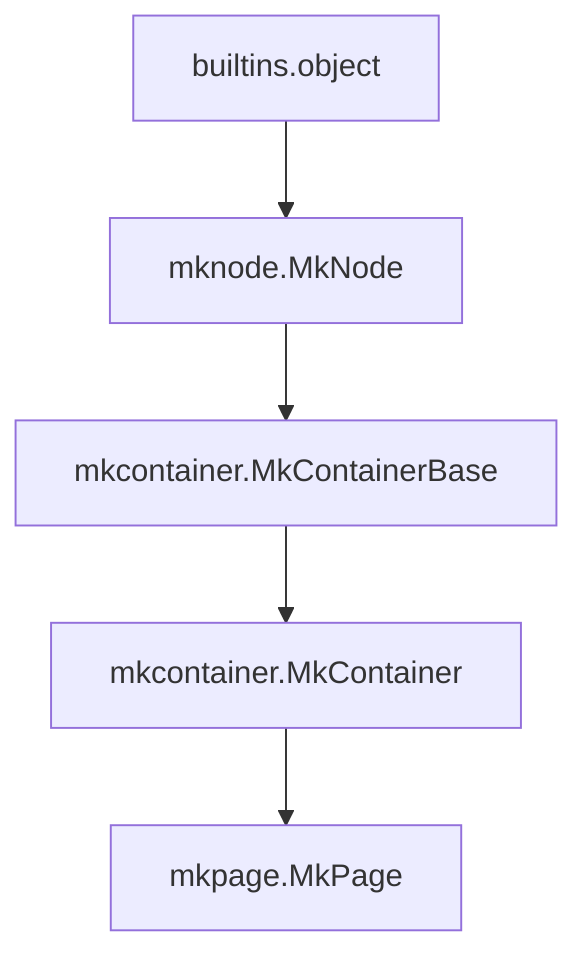
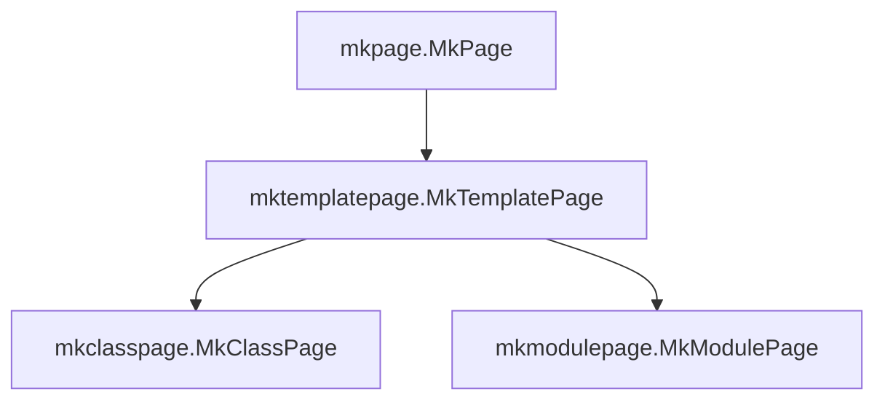
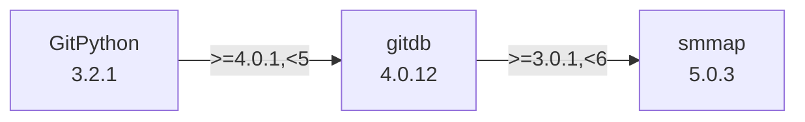

# A quick node tour

```python
def a_quick_tour(page: mk.MkPage) -> None:
```

This will be a quick, short random introduction of some of the nodes
included in **MkNodes**.
The selection of nodes is totally random, this should just provide a quick overview
how to interact with the nodes.

Let the tour begin!

Our first [MkNode](../Core%20API/mknode.md#mknodes.MkNode) is very clever. You just show him a node and he
will tell you all you need to know about him.
It's [MkDocStrings](#mknodes.MkDocStrings)!
Lets check what he knows about [MkPage](../Core%20API/navs_and_pages.md#mknodes.MkPage):

```python
    node = mk.MkDocStrings(mk.MkPage)
```

[MkDocStrings](#mknodes.MkDocStrings) sometimes really writes long stories,
so we will put everything into
a collapsed [MkAdmonition](../The%20nodes/Container%20nodes/mkadmonition.md#mknodes.MkAdmonition) box,
so we dont need that much space:

```python
    admonition = mk.MkAdmonition(node, collapsible=True)
    str(admonition)
```

Here is the result:
<details>
<summary>Info</summary>

<a id="mknodes.MkPage"></a>

```python
class MkPage(mkcontainer.MkContainer)
```

A node container representing a Markdown page.

A page contains a list of other Markdown nodes, has a virtual Markdown file
associated, and can have metadata (added as header)

</details>

[MkDocStrings](#mknodes.MkDocStrings) can even show information about himself.
Very talented!

```python
    node = mk.MkDocStrings(mk.MkDocStrings)
    admonition = mk.MkAdmonition(node, collapsible=True)
    str(admonition)
```

<details>
<summary>Info</summary>

<a id="mknodes.MkDocStrings"></a>

```python
class MkDocStrings(mknode.MkNode)
```

Docstring section (powered by mkdocstrings).

</details>

Okay, that's enough DocStrings for today. You can find more of
[MkDocStrings](#mknodes.MkDocStrings) work
on the [node pages](<../The nodes/index.md>) (he tells you something about every
[MkNode](../Core%20API/mknode.md#mknodes.MkNode) there) and in the [Core API](<../Core API/index.md>).

Another [MkNode](../Core%20API/mknode.md#mknodes.MkNode) who is displaying his skills on the node pages is
[MkClassDiagram](../The%20nodes/Documentation%20nodes/mkclassdiagram.md#mknodes.MkClassDiagram).

He's a very talented painter. Perhaps he can draw us something about
[MkPage](../Core%20API/navs_and_pages.md#mknodes.MkPage)!

```python
    diagram = mk.MkClassDiagram(mk.MkPage)
    str(diagram)
```


[MkClassDiagram](../The%20nodes/Documentation%20nodes/mkclassdiagram.md#mknodes.MkClassDiagram) can draw different kind of graphs.
The first picture [MkClassDiagram](../The%20nodes/Documentation%20nodes/mkclassdiagram.md#mknodes.MkClassDiagram) has painted was about
base classes. Lets check out the subclasses:

```python
    diagram = mk.MkClassDiagram(mk.MkPage, mode="subclasses")
    str(diagram)
```


There are multiple talented drawers among the **MkNodes**.
[MkPipDepTree](../The%20nodes/About-the-project%20nodes/mkpipdeptree.md#mknodes.MkPipDepTree) is known for his dependency drawings,
we can ask him to draw a graph for one of our dependencies.

To not overboard him, lets pick a package without too many dependencies:

```python
    node_1 = mk.MkPipDepTree("gitpython", direction="LR")
    str(node_1)
```


We now come to the last [MkNode](../Core%20API/mknode.md#mknodes.MkNode) of our quick tour.

Let's introduce [MkMetadataBadges](../The%20nodes/About-the-project%20nodes/mkmetadatabadges.md#mknodes.MkMetadataBadges)!

[MkMetadataBadges](../The%20nodes/About-the-project%20nodes/mkmetadatabadges.md#mknodes.MkMetadataBadges) just loves Badges. He creates them
himself and doesnt rely on webservies.

```python
    node_2 = mk.MkMetadataBadges("classifiers", package="mkdocstrings")
    str(node_2)
```


Looks neat, right?
This is also a good chance to explain how nodes can get their information
from the context. Let me explain:

If we instanciate **MkNodes** and dont add them to the tree,
then the nodes are clueless. They dont know who they belong to.

To make them part of the tree, we either add them for example to a page

(like this: `page += node`)

or we pass them a parent on instantiation.

In this example, once we add [MkMetadataBadges](../The%20nodes/About-the-project%20nodes/mkmetadatabadges.md#mknodes.MkMetadataBadges)
to the tree, that node knows
that he should create badges for our very own package, **mknodes**,
unless we explicitely tell him to do otherwise. It will become his new "default".

You dont believe me? Let me show you:

```python
    node_3 = mk.MkMetadataBadges("websites", parent=page)
```

Now that node is connected. If we ask him to draw now, he will create website
badges for **mknodes**!

```python
    str(node_3)
```

[](https://app.codecov.io/gh/phil65/mknodes)
[](https://github.com/phil65/mknodes/discussions)
[](https://phil65.github.io/mknodes/)
[](https://github.com/phil65/mknodes/issues)
[](https://github.com/phil65/mknodes)
This mechanism is the same for many **MkNodes**. For example, our earlier guest
[MkPipDepTree](../The%20nodes/About-the-project%20nodes/mkpipdeptree.md#mknodes.MkPipDepTree) behaves the same. Once connected,
he will want to paint **mknodes** dependency graphs without us telling him to do so!

Interesting, right?

That's it for a first quick look at the nodes.
There are about 70 different ones available in this package.
Some are exciting, some are boring. It's no difference to humans.

Oh, and if you wonder how this tour was done: I got help from
[MkCommentedCode](../The%20nodes/Documentation%20nodes/mkcommentedcode.md#mknodes.MkCommentedCode)!

```python
    page += mk.MkCommentedCode(a_quick_tour, style="text", render_comments=True)
```

[MkCommentedCode](../The%20nodes/Documentation%20nodes/mkcommentedcode.md#mknodes.MkCommentedCode) parses a function and separates comments
from code. These chunks are displayed on a rotating basis then.

Before we end the tour, let's take a look at the raw material.
We can use the [MkCode](../The%20nodes/Container%20nodes/mkcode.md#mknodes.MkCode) node for that.

```python
    page += mk.MkCode.for_object(a_quick_tour)
```

As you can see, we added the [MkCode](../The%20nodes/Container%20nodes/mkcode.md#mknodes.MkCode) node to the page.
It will be displayed right after the [MkCommentedCode](../The%20nodes/Documentation%20nodes/mkcommentedcode.md#mknodes.MkCommentedCode)
block. You will see it right below.

Oh, and `render_comments=True` renders the **jinja2** expressions in the
comments above. The page itself is not rendered with Jinja, so the expressions
in the raw code below stay as they are.

That's it. The rest of the nodes you need to check out yourself. Have fun!

**mknodes.manual.a_quick_tour.a_quick_tour**

```python
def a_quick_tour(page: mk.MkPage) -> None:
    # This will be a quick, short random introduction of some of the nodes
    # included in **MkNodes**.
    # The selection of nodes is totally random, this should just provide a quick overview
    # how to interact with the nodes.
    #
    # Let the tour begin!
    #
    # Our first [MkNode][mknodes.MkNode] is very clever. You just show him a node and he
    # will tell you all you need to know about him.
    # It's [MkDocStrings][mknodes.MkDocStrings]!
    # Lets check what he knows about [MkPage][mknodes.MkPage]:
    node = mk.MkDocStrings(mk.MkPage)
    # [MkDocStrings][mknodes.MkDocStrings] sometimes really writes long stories,
    # so we will put everything into
    # a collapsed [MkAdmonition][mknodes.MkAdmonition] box,
    # so we dont need that much space:
    admonition = mk.MkAdmonition(node, collapsible=True)
    str(admonition)
    # Here is the result:
    # {{ "mknodes.MkPage" | MkDocStrings | MkAdmonition(collapsible=True) }}

    # [MkDocStrings][mknodes.MkDocStrings] can even show information about himself.
    # Very talented!
    node = mk.MkDocStrings(mk.MkDocStrings)
    admonition = mk.MkAdmonition(node, collapsible=True)
    str(admonition)
    # {{ "mknodes.MkDocStrings" | MkDocStrings | MkAdmonition(collapsible=True)}}

    # Okay, that's enough DocStrings for today. You can find more of
    # [MkDocStrings][mknodes.MkDocStrings] work
    # on the [node pages](<../The nodes/index.md>) (he tells you something about every
    # [MkNode][mknodes.MkNode] there) and in the [Core API](<../Core API/index.md>).
    #
    # Another [MkNode][mknodes.MkNode] who is displaying his skills on the node pages is
    # [MkClassDiagram][mknodes.MkClassDiagram].
    #
    # He's a very talented painter. Perhaps he can draw us something about
    # [MkPage][mknodes.MkPage]!
    #
    diagram = mk.MkClassDiagram(mk.MkPage)
    str(diagram)
    # {{ "mknodes.MkPage" | MkClassDiagram }}

    # [MkClassDiagram][mknodes.MkClassDiagram] can draw different kind of graphs.
    # The first picture [MkClassDiagram][mknodes.MkClassDiagram] has painted was about
    # base classes. Lets check out the subclasses:
    diagram = mk.MkClassDiagram(mk.MkPage, mode="subclasses")
    str(diagram)
    # {{ "mknodes.MkPage" | MkClassDiagram(mode="subclasses") }}

    # There are multiple talented drawers among the **MkNodes**.
    # [MkPipDepTree][mknodes.MkPipDepTree] is known for his dependency drawings,
    # we can ask him to draw a graph for one of our dependencies.
    #
    # To not overboard him, lets pick a package without too many dependencies:

    node_1 = mk.MkPipDepTree("gitpython", direction="LR")
    str(node_1)
    # {{ "gitpython" | MkPipDepTree(direction="LR") }}

    # We now come to the last [MkNode][mknodes.MkNode] of our quick tour.
    #
    # Let's introduce [MkMetadataBadges][mknodes.MkMetadataBadges]!
    #
    # [MkMetadataBadges][mknodes.MkMetadataBadges] just loves Badges. He creates them
    # himself and doesnt rely on webservies.
    node_2 = mk.MkMetadataBadges("classifiers", package="mkdocstrings")
    str(node_2)
    # {{ "classifiers" | MkMetadataBadges(package="mkdocstrings") }}

    # Looks neat, right?
    # This is also a good chance to explain how nodes can get their information
    # from the context. Let me explain:
    #
    # If we instanciate **MkNodes** and dont add them to the tree,
    # then the nodes are clueless. They dont know who they belong to.
    #
    # To make them part of the tree, we either add them for example to a page
    #
    # (like this: `page += node`)
    #
    # or we pass them a parent on instantiation.
    #
    # In this example, once we add [MkMetadataBadges][mknodes.MkMetadataBadges]
    # to the tree, that node knows
    # that he should create badges for our very own package, **mknodes**,
    # unless we explicitely tell him to do otherwise. It will become his new "default".
    #
    # You dont believe me? Let me show you:
    node_3 = mk.MkMetadataBadges("websites", parent=page)

    # Now that node is connected. If we ask him to draw now, he will create website
    # badges for **mknodes**!

    str(node_3)
    # {{ "websites" | MkMetadataBadges }}

    # This mechanism is the same for many **MkNodes**. For example, our earlier guest
    # [MkPipDepTree][mknodes.MkPipDepTree] behaves the same. Once connected,
    # he will want to paint **mknodes** dependency graphs without us telling him to do so!
    #
    # Interesting, right?
    #
    # That's it for a first quick look at the nodes.
    # There are about 70 different ones available in this package.
    # Some are exciting, some are boring. It's no difference to humans.
    #
    # Oh, and if you wonder how this tour was done: I got help from
    # [MkCommentedCode][mknodes.MkCommentedCode]!
    #
    page += mk.MkCommentedCode(a_quick_tour, style="text", render_comments=True)

    # [MkCommentedCode][mknodes.MkCommentedCode] parses a function and separates comments
    # from code. These chunks are displayed on a rotating basis then.
    #
    # Before we end the tour, let's take a look at the raw material.
    # We can use the [MkCode][mknodes.MkCode] node for that.
    #
    page += mk.MkCode.for_object(a_quick_tour)
    # As you can see, we added the [MkCode][mknodes.MkCode] node to the page.
    # It will be displayed right after the [MkCommentedCode][mknodes.MkCommentedCode]
    # block. You will see it right below.
    #
    # Oh, and `render_comments=True` renders the **jinja2** expressions in the
    # comments above. The page itself is not rendered with Jinja, so the expressions
    # in the raw code below stay as they are.
    #
    # That's it. The rest of the nodes you need to check out yourself. Have fun!

```

<details>
<summary>Page info</summary>

<details>
<summary>Code for this page</summary>

**mknodes.manual.get_started_section._**

```python
@nav.route.page("A quick node tour", hide="toc", icon="ic:outline-tour")
def _(page: mk.MkPage) -> None:
    # Only the commented tour renders Jinja, the raw source at the end must stay as is.
    page.metadata.render_macros = False
    a_quick_tour(page)

```

</details>

<details>
<summary>Resources</summary>

```python
Resources(css=[],
          markdown_extensions={'pymdownx.highlight': {'anchor_linenums': True,
                                                      'line_spans': '__span',
                                                      'pygments_lang_class': True},
                               'pymdownx.superfences': {}},
          plugins=[],
          js=[],
          assets=[],
          packages=[])
```

</details>

<details>
<summary>Metadata</summary>

```yaml
created:
  source_filename: /home/runner/work/mknodes/mknodes/src/mknodes/manual/get_started_section.py
  source_function: _
  source_line_no: 43
hide:
- toc
icon: ic:outline-tour
render_macros: false
title: A quick node tour

```

</details>

</details>
