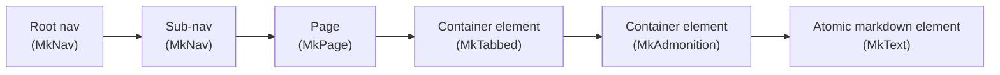

# MkNavs

## A quick overview

All elements which can become part of the "website tree" inherit from [MkNode](../Core%20API/mknode.md#mknodes.MkNode)

Simplified, there are basically 3 different MkNode types:

* **MkNavs**, used to structure the pages into a hierarchy
* **Mkpages**, used as a container for the markdown elements
* **MkNode elements**, used to display the markdown itself (and in some cases HTML)

Given a random Element from a full website tree, this is how the path from root to leaf element could look like:



In essence: A path can contain *one or more MkNavs*, exactly *one MkPage*, and *one or more (nested) MkNode Elements*.

> [!NOTE]
> Because of the Markdown elements being part of the tree, the elements can behave quite intelligently in some situations. For example, code blocks automatically set the correct amount of fence backticks. That way you cant get conflicts because of two blocks having the same fence backtick sequence. The same accounts for the new Block extensions from [pymdownx](https://facelessuser.github.io/pymdown-extensions/), which uses `/` as fence character.

## MkNavs: General information

MkNavs are nodes to represent "sections", perhaps comparable to a folder (with MkPages being files in this analogy).
MkNavs can contain other MkNavs to construct a hierarchical website tree structure, as well as MkPages and [MkLinks](../The%20nodes/Base%20nodes/mklink.md#mknodes.MkLink).
MkPages can be "regular" child of an [MkNav](../Core%20API/navs_and_pages.md#mknodes.MkNav), or an index page. Index pages are dedicated pages
which are shown when a site nav menu item containing children is clicked, or for the website root.

<details>
<summary>Theme support for index pages</summary>

Index pages need specific theme support (like [MkDocs-Material](https://squidfunk.github.io/mkdocs-material/) has) or the
[mkdocs-section-index](https://github.com/oprypin/mkdocs-section-index) plugin.

</details>

## MkNav metadata

MkNavs (as well as MkPages) own a metadata object, which can be set via the [MkPage.metadata](../MkPages/metadata.md#mknodes.Metadata) attribute.
That metadata is not really useful for the [MkNav](../Core%20API/navs_and_pages.md#mknodes.MkNav) itself. The metadata gets propagated to the child pages though, and thus this mechanism can be helpful to set metadata for a complete website branch / section in one go.
Metadata is also inherited from the parent MkNavs in case they have metadata set. In other words:
Template / Metadata inheritance happens through the whole chain of MkNavs / MkPages, from top to bottom.

<details>
<summary>Further info</summary>

See the [Metadata](../MkPages/metadata.md#mknodes.Metadata) section, the [MkDocs Documentation](https://www.mkdocs.org/user-guide/writing-your-docs/#meta-data) as well as the [MkDocs-Material](https://squidfunk.github.io/mkdocs-material/) docs for further info.

</details>

## MkNav templates

Similar to metadata, page templates can also be set for MkNavs. (small difference: attribute is called `page_template` for MkNavs instead of `template` for MkPages) Again, they are not used by the MkNavs itself, but propagate to all child pages / navs. You will find more details in later parts of the docs.

Here is a quick example to show how easy a new template can get set up.
Compare this one-liner to the "regular" process of creating an HTML file (with no markdown support) in a subfolder separated from your actual content:

``` py
nav = MkNav()
nav.page_template.announce.content = "Display **Markdown** in announcement bar!"
```

In the case of MkDocs, Template HTMLs will get created temporarily during the build process and will get deleted after deployment / serving.

<details>
<summary>Static templates</summary>

Apart from "page templates", which apply to specific (groups of) MkPages, there are also "static" templates
which are part of the `Theme` object (or of a Theme subclass).
That way you can for example populate the `404` error page easily with Markdown.

</details>

## Using MkNavs

The very first element you get in **MkNodes** is the root nav. The root nav is the node which will contain all other nodes at the end of the tree building process, in a nested, hierarchical structure.

Technically, there are no differences between the root MkNav and any other "nested" MkNav, except that the root MkNav does not have a parent.

You can construct sub-MkNavs by [instantiating](../Core%20API/navs_and_pages.md#mknodes.MkNav) them, by using [MkNav.add_nav](../Core%20API/navs_and_pages.md#mknodes.MkNav) or by using the decorator routing mechanism.

Besides getting created via decorated functions, MkNavs can also get populated via decorators.

``` py
nav = MkNav()  # this nav will get populated with a sub-nav

@nav.route.nav("Path to", "Nav", optional=kw_args):  # Arguments reflect the "path" of newly created nav.
def _(sub_nav: MkNav)  # naming these methods is rather pointless, so we'll just call them "_".
    sub_nav += ...  #  this sub_nav is created via decorator


@nav.route.page("My page"):  # Pages can get routed, too, of course.
...
```

Another way to populate MkNavs is by using the [NavParser](#mknodes.navs.navparser.NavParser) (`parse` attribute of an MkNav)
The NavParser allows to read *SUMMARY.md* files (known from [mkdocs-literate-nav](https://oprypin.github.io/mkdocs-literate-nav/) ), "pure" markdown-file / folder structures and more.
There is also an experimental support for `index.py` routing files as a replacement for *SUMMARY.md* files.

``` py
nav = MkNav()  # this nav will get populated with the *SUMMARY.md* content
nav.parse.file("path/to/SUMMARY.md")
```

## Index pages

"Index pages" (the index.md files of the root and the subfolders) are a special case when it comes to
building the tree. Each MkNav has a dedicated slot for an index page.

``` py
nav.index_page = my_mkpage_instance
```

Alternatively, [MkNav.add_page](../Core%20API/navs_and_pages.md#mknodes.MkNav) takes the keyword argument `is_index`:
``` py
index_page = nav.add_page(is_index=True, ...)
```

## Build process

During the build process, MkNavs get converted to *SUMMARY.md* files. These will then get picked up by MkDocs afterwards in order to build the MkDocs nav tree.

> [!NOTE]
> In the future, MkNavs (as well as MkPages) will likely get converted to `MkDocs.structure` instances directly without taking the extra route of becoming a physical file on the hard drive.

## Subclasses

**MkNodes** also contains a special subclass of [MkNav](../Core%20API/navs_and_pages.md#mknodes.MkNav) called [MkDoc](#mknodes.MkDoc). This node is responsible for creating API documentation in an easy way, using templates (to get in impression, this is the [default template for documenting classes](https://raw.githubusercontent.com/phil65/mknodes/main/src/mknodes/resources/classpage.md) ). [MkDoc](#mknodes.MkDoc) objects have methods to collect submodules / classes from the module you want to document. The collected modules / classes are passed through the template render process in order to create Markdown text. That text will get added automatically to the [MkDoc](#mknodes.MkDoc) nav as an [MkPage](../Core%20API/navs_and_pages.md#mknodes.MkPage).

Every class gets exactly one page, nested below the module defining it: with `section_name="API"`, module `pkg.sub` ends up at `API/sub/` and its class `Klass` at `API/sub/Klass/`. Modules which only re-export a class (like a package `__init__` with `__all__`) list it with a link to that page. Private modules (`_impl`) get no pages of their own, their public classes are documented where they are re-exported (or in the nearest public parent module).

## API

### <a id="mknodes.MkNav"></a>`mknodes.MkNav`

```python
class MkNav(mknode.MkNode)
```

Nav section, representing a nestable menu.

A nav is named (exception is the root nav, which has section name = None),
has an associated virtual file (in general a SUMMARY.md),
an optional index page and can contain other navs as well as pages and links.

### <a id="mknodes.navs.navparser.NavParser"></a>`mknodes.navs.navparser.NavParser`

```python
class NavParser
```

Class used for constructing MkNavs.

#### <a id="mknodes.navs.navparser.NavParser.__init__"></a>`__init__`

```python
def __init__(nav: mk.MkNav) -> None
```

Constructor.

**Parameters:**

| Name | Type | Description | Default |
| --- | --- | --- | --- |
| `nav` | `mk.MkNav` | MkNav to use for routing |  |

#### <a id="mknodes.navs.navparser.NavParser.file"></a>`file`

```python
def file(path: str | os.PathLike[str], **kwargs: Any) -> mk.MkNav
```

Load an existing SUMMARY.md style file.

For each indentation level in SUMMARY.md, a new sub-nav is created.

Should support all SUMMARY.md options except wildcards.

**Parameters:**

| Name | Type | Description | Default |
| --- | --- | --- | --- |
| `path` | `str \| os.PathLike[str]` | Path to the file |  |
| `kwargs` | `Any` | Keyword arguments passed to the pages to create.<br>    Can be used to hide the TOC for all pages for example. | {} |

#### <a id="mknodes.navs.navparser.NavParser.folder"></a>`folder`

```python
def folder(folder: str | os.PathLike[str], *, recursive: bool = True, **kwargs: Any) -> mk.MkNav
```

Load a MkNav tree from a folder.

This method creates a navigation structure based on the contents of a specified folder.
It processes Markdown (.md) and HTML (.html) files, creating a hierarchical navigation
tree that reflects the folder structure.

Specific behaviors:
- SUMMARY.md files are ignored.
- index.md files become index pages for their respective folders.
- Hidden folders (starting with '.' or '_') are ignored.
- Page titles can be overridden using page metadata.

**Parameters:**

| Name | Type | Description | Default |
| --- | --- | --- | --- |
| `folder` | `str \| os.PathLike[str]` | The folder to load .md and .html files from. |  |
| `recursive` | `bool` | Whether to include all files recursively from subfolders. | True |
| `**kwargs` | `Any` | Additional keyword arguments passed to the created pages.<br>      Can be used to set global page properties, e.g., hiding TOC. | {} |

**Returns:**

| Type | Description |
| --- | --- |
| `mk.MkNav` | A MkNav object representing the folder's navigation structure. |

**Examples:**

```python
parser = NavParser(my_nav)
folder_nav = parser.folder("docs/", recursive=True, toc=False)
```

#### <a id="mknodes.navs.navparser.NavParser.json"></a>`json`

```python
def json(obj: list[Any] | dict[str, str | list[Any] | dict[str, Any]]) -> None
```

Parse given list or dict and attach it to given MkNav.

If no Nav is given, create a new one
Args:
    obj: Dictionary / List to parse

#### <a id="mknodes.navs.navparser.NavParser.module"></a>`module`

```python
def module(module: str | os.PathLike[str], *, recursive: bool = True, **kwargs: Any) -> mk.MkNav
```

Load a MkNav tree from a Module.

This method creates a navigation structure from a given module. It iterates through
the module's directory, creating pages for Python files and sub-navigations for
subdirectories. Each Python file is displayed as a page with its content in a code box.

**Parameters:**

| Name | Type | Description | Default |
| --- | --- | --- | --- |
| `module` | `str \| os.PathLike[str]` | The module to load code files from. Can be a string path or a PathLike object. |  |
| `recursive` | `bool` | Whether to include all files recursively. | True |
| `**kwargs` | `Any` | Additional keyword arguments passed to the pages being created.<br>These can be used to customize page properties, e.g., hiding the TOC. | {} |

**Returns:**

| Type | Description |
| --- | --- |
| `mk.MkNav` | An MkNav object representing the navigation structure of the module. |

**Example:**

```python
parser = NavParser()
nav = parser.module("mknodes", recursive=True, hide_toc=True)
```

#### <a id="mknodes.navs.navparser.NavParser.text"></a>`text`

```python
def text(text: str, path: pathlib.Path, **kwargs: Any) -> mk.MkNav
```

Create a nav based on a SUMMARY.md-style list, given as text.

This method parses a text input formatted similar to a SUMMARY.md file and
creates a navigation structure based on it. For each indentation level in
the input text, a new sub-nav is created. The method supports all SUMMARY.md
options except wildcards.

The method processes three main patterns in the input text:
1. Section and folder: Creates a subnav from a SUMMARY.md or index.py file.
2. Section and file: Creates a page or a subnav with an index page.
3. Section only: Creates a subnav from the indented lines following it.

**Parameters:**

| Name | Type | Description | Default |
| --- | --- | --- | --- |
| `text` | `str` | The input text to parse, formatted like a SUMMARY.md file. |  |
| `path` | `pathlib.Path` | The path of the file containing the input text. |  |
| `**kwargs` | `Any` | Additional keyword arguments passed to the pages to create.<br>      Can be used to set common properties for all pages. | {} |

**Returns:**

| Type | Description |
| --- | --- |
| `mk.MkNav` | The updated navigation structure after processing the input text. |

**Examples:**

```python
parser = NavParser(nav)
text = '''
* [Section 1](folder1/)
* `Page 1`
* Section 2/
    * `Subpage 1`
    * `Subpage 2`
'''
updated_nav = parser.text(text, pathlib.Path("path/to/file"))
```

### <a id="mknodes.MkDoc"></a>`mknodes.MkDoc`

```python
class MkDoc(mknav.MkNav)
```

Nav for showing a module documentation.

Every class gets exactly one page, below the module defining it (`pkg.sub.Klass` ->
`<section>/sub/Klass/`), modules re-exporting it link to that page.
With `recursive=True`, public submodules get their own (nested) MkDoc navs.

<details>
<summary>Page info</summary>

<details>
<summary>Code for this section</summary>

**mknodes.manual.navs_section._**

```python
@nav.route.page(is_index=True)
def _(page: mk.MkPage) -> None:
    variables = dict(mknode_cls=mk.MkNav)
    page += mk.MkTemplate("navs/navs_index.jinja", variables=variables)

```

</details>

<details>
<summary>Resources</summary>

```python
Resources(css=[],
          markdown_extensions={'pymdownx.superfences': {'custom_fences': [{'class': 'mermaid',
                                                                           'format': <function fence_code_format at 0x7bb797a5c1a0>,
                                                                           'name': 'mermaid'}]}},
          plugins=[Plugin('mkdocstrings')],
          js=[],
          assets=[],
          packages=[])
```

</details>

<details>
<summary>Metadata</summary>

```yaml
created:
  source_filename: /home/runner/work/mknodes/mknodes/src/mknodes/manual/navs_section.py
  source_function: _
  source_line_no: 14
title: MkNavs

```

</details>

</details>
