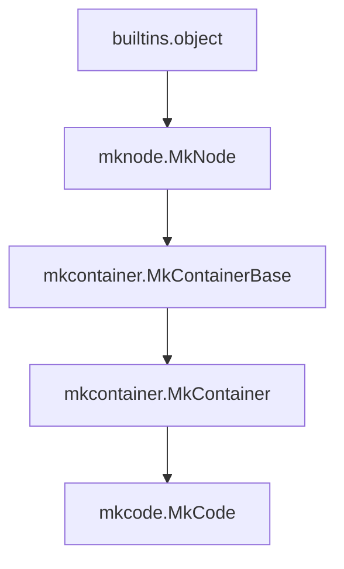

# MkClassPage

An MkClassPage is an MkPage subclass used to display information about
 a specific class. It uses a Jinja template to display the class-related information.
 By default, the Docstrings, tables for sub and parent classes as well as an inheritance
 graph are shown. The template can be adjusted manually in case a different layout
 is preferred.

<a id="mknodes.MkClassPage"></a>

```python
class MkClassPage(mktemplatepage.MkTemplatePage)
```

Page showing information about a class.

This is an example for an MkClassPage with the default layout:

<div style='border: 1px solid red;' markdown="1">

# MkCode

### Sub classes
| Name | Children | Inherits |
|--- | --- | --- |
| **<font size='4'>[MkDiagram](https://phil65.github.io/mknodes/)</font>**<br>*<font size='1'>mknodes.basenodes.mkdiagram</font>*<br>Class representing a mermaid diagram\. | <ul><li>[MkClassDiagram](https://phil65.github.io/mknodes/)</li><li>[MkPipDepTree](https://phil65.github.io/mknodes/)</li></ul> | <ul><li>[MkCode](https://phil65.github.io/mknodes/)</li></ul> |
| **<font size='4'>[MkTreeView](https://phil65.github.io/mknodes/)</font>**<br>*<font size='1'>mknodes.templatenodes.mktreeview</font>*<br>Node to display tree structures\. | <ul></ul> | <ul><li>[MkCode](https://phil65.github.io/mknodes/)</li></ul> |

### Base classes
| Name | Children | Inherits |
|--- | --- | --- |
| **<font size='4'>[MkContainer](https://phil65.github.io/mknodes/)</font>**<br>*<font size='1'>mknodes.basenodes.mkcontainer</font>*<br>A node containing other MkNodes\. | <ul><li>[MkBlock](https://phil65.github.io/mknodes/)</li><li>[MkAdmonition](https://phil65.github.io/mknodes/)</li><li>[MkBlockQuote](https://phil65.github.io/mknodes/)</li><li>[MkCode](https://phil65.github.io/mknodes/)</li><li>[MkTemplate](https://phil65.github.io/mknodes/)</li><li>[MkList](https://phil65.github.io/mknodes/)</li><li>[MkBaseTable](https://phil65.github.io/mknodes/)</li><li>[MkTab](https://phil65.github.io/mknodes/)</li><li>[MkTabContainer](https://phil65.github.io/mknodes/)</li><li>[MkCritic](https://phil65.github.io/mknodes/)</li><li>[MkAnnotation](https://phil65.github.io/mknodes/)</li><li>...</li></ul> | <ul><li>[MkContainerBase](https://phil65.github.io/mknodes/)</li></ul> |

### ⋔ Inheritance diagram


### 🛈 DocStrings

<a id="mknodes.basenodes.mkcode.MkCode"></a>

```python
class MkCode(mkcontainer.MkContainer)
```

Class representing a Code block.

## <a id="mknodes.basenodes.mkcode.MkCode.fence_boundary"></a>`fence_boundary`

```python
fence_boundary: str
```

Return fence boundary, based on nesting level. Default is ```.

## <a id="mknodes.basenodes.mkcode.MkCode.fence_title"></a>`fence_title`

```python
fence_title: str
```

Title in first line.

## <a id="mknodes.basenodes.mkcode.MkCode.__init__"></a>`__init__`

```python
def __init__(content: str | mk.MkNode | list[mk.MkNode] = '', *, language: str = 'python', title: str = '', linenums: int | None = None, highlight_lines: list[int] | None = None, fence_level: int | None = None, **kwargs: Any) -> None
```

Constructor.

**Parameters:**

| Name | Type | Description | Default |
| --- | --- | --- | --- |
| `content` | `str \| mk.MkNode \| list[mk.MkNode]` | Content to show inside code box | '' |
| `language` | `str` | language for syntax highlighting | 'python' |
| `title` | `str` | Code block title | '' |
| `linenums` | `int \| None` | If set, use as start linenumber | None |
| `highlight_lines` | `list[int] \| None` | Optionally highlight lines | None |
| `fence_level` | `int \| None` | Determines amount of ticks used for fence.<br>         If None, auto-determine based on nesting depth. | None |
| `kwargs` | `Any` | Keyword arguments passed to parent | {} |

## <a id="mknodes.basenodes.mkcode.MkCode.fence_for"></a>`fence_for`

```python
def fence_for(text: str) -> str
```

Return the fence for given code: longer than any fence inside the code.

## <a id="mknodes.basenodes.mkcode.MkCode.for_file"></a>`for_file`

```python
def for_file(path: JoinablePathLike, *, linenums: bool = True, highlight_caller: bool = True, title: str | None = None, language: str | None = None, **kwargs: Any) -> Self
```

Create a MkCode node based on a code file.

Line numbers will be shown by default. If `highlight_caller` is `True`,
it will try to detect whether the calling method is inside the code block are
creating and if yes, it will highlight that line.

**Parameters:**

| Name | Type | Description | Default |
| --- | --- | --- | --- |
| `path` | `JoinablePathLike` | Path to the code file (also supports fsspec-protocol URLs) |  |
| `linenums` | `bool` | Whether to show line numbers | True |
| `highlight_caller` | `bool` | Whether we want to try to highlight the line which called<br>              this method. | True |
| `title` | `str \| None` | title to use for the code box. If None is set, filename will be used. | None |
| `language` | `str \| None` | Syntax highlighting language. If None, try to infer from extension. | None |
| `kwargs` | `Any` | Keyword arguments passed to MkCode ctor | {} |

## <a id="mknodes.basenodes.mkcode.MkCode.for_object"></a>`for_object`

```python
def for_object(obj: datatypes.HasCodeType, *, dedent: bool = True, extract_body: bool = False, title: str | None = None, linenums: bool = True, highlight_caller: bool = True, **kwargs: Any) -> Self
```

Create a MkCode node based on a python object.

Fetches code by using the inspect module.
Line numbers will be shown by default. If highlight_caller is True,
it will try to detect whether the calling method is inside the code block are
displaying and if yes, it will highlight that line.

**Parameters:**

| Name | Type | Description | Default |
| --- | --- | --- | --- |
| `obj` | `datatypes.HasCodeType` | Python object to show code from |  |
| `dedent` | `bool` | Whether to dedent the code | True |
| `extract_body` | `bool` | if True, Function / Class signatures are stripped from the code | False |
| `title` | `str \| None` | Title to use for code block. If None, it will use the object path. | None |
| `linenums` | `bool` | Whether to show line numbers | True |
| `highlight_caller` | `bool` | Whether we want to try to highlight the line which called<br>              this method. | True |
| `kwargs` | `Any` | Keyword arguments passed to MkCode ctor | {} |

## <a id="mknodes.basenodes.mkcode.MkCode.get_content"></a>`get_content`

```python
def get_content() -> resources.NodeContent
```

Single-pass: get code block markdown and resources.

## <a id="mknodes.basenodes.mkcode.MkCode.get_text"></a>`get_text`

```python
def get_text() -> str
```

Text content.

[ Show source on GitHub](https://github.com/phil65/mknodes/blob/main/src/mknodes/basenodes/mkcode/__init__.py)

</div>

And this is an alternate tabbed layout:

<div style='border: 1px solid red;' markdown="1">

# MkCode

<details open>
<summary>DocStrings</summary>

<a id="mknodes.basenodes.mkcode.MkCode"></a>

```python
class MkCode(mkcontainer.MkContainer)
```

Class representing a Code block.

## <a id="mknodes.basenodes.mkcode.MkCode.fence_boundary"></a>`fence_boundary`

```python
fence_boundary: str
```

Return fence boundary, based on nesting level. Default is ```.

## <a id="mknodes.basenodes.mkcode.MkCode.fence_title"></a>`fence_title`

```python
fence_title: str
```

Title in first line.

## <a id="mknodes.basenodes.mkcode.MkCode.__init__"></a>`__init__`

```python
def __init__(content: str | mk.MkNode | list[mk.MkNode] = '', *, language: str = 'python', title: str = '', linenums: int | None = None, highlight_lines: list[int] | None = None, fence_level: int | None = None, **kwargs: Any) -> None
```

Constructor.

**Parameters:**

| Name | Type | Description | Default |
| --- | --- | --- | --- |
| `content` | `str \| mk.MkNode \| list[mk.MkNode]` | Content to show inside code box | '' |
| `language` | `str` | language for syntax highlighting | 'python' |
| `title` | `str` | Code block title | '' |
| `linenums` | `int \| None` | If set, use as start linenumber | None |
| `highlight_lines` | `list[int] \| None` | Optionally highlight lines | None |
| `fence_level` | `int \| None` | Determines amount of ticks used for fence.<br>         If None, auto-determine based on nesting depth. | None |
| `kwargs` | `Any` | Keyword arguments passed to parent | {} |

## <a id="mknodes.basenodes.mkcode.MkCode.fence_for"></a>`fence_for`

```python
def fence_for(text: str) -> str
```

Return the fence for given code: longer than any fence inside the code.

## <a id="mknodes.basenodes.mkcode.MkCode.for_file"></a>`for_file`

```python
def for_file(path: JoinablePathLike, *, linenums: bool = True, highlight_caller: bool = True, title: str | None = None, language: str | None = None, **kwargs: Any) -> Self
```

Create a MkCode node based on a code file.

Line numbers will be shown by default. If `highlight_caller` is `True`,
it will try to detect whether the calling method is inside the code block are
creating and if yes, it will highlight that line.

**Parameters:**

| Name | Type | Description | Default |
| --- | --- | --- | --- |
| `path` | `JoinablePathLike` | Path to the code file (also supports fsspec-protocol URLs) |  |
| `linenums` | `bool` | Whether to show line numbers | True |
| `highlight_caller` | `bool` | Whether we want to try to highlight the line which called<br>              this method. | True |
| `title` | `str \| None` | title to use for the code box. If None is set, filename will be used. | None |
| `language` | `str \| None` | Syntax highlighting language. If None, try to infer from extension. | None |
| `kwargs` | `Any` | Keyword arguments passed to MkCode ctor | {} |

## <a id="mknodes.basenodes.mkcode.MkCode.for_object"></a>`for_object`

```python
def for_object(obj: datatypes.HasCodeType, *, dedent: bool = True, extract_body: bool = False, title: str | None = None, linenums: bool = True, highlight_caller: bool = True, **kwargs: Any) -> Self
```

Create a MkCode node based on a python object.

Fetches code by using the inspect module.
Line numbers will be shown by default. If highlight_caller is True,
it will try to detect whether the calling method is inside the code block are
displaying and if yes, it will highlight that line.

**Parameters:**

| Name | Type | Description | Default |
| --- | --- | --- | --- |
| `obj` | `datatypes.HasCodeType` | Python object to show code from |  |
| `dedent` | `bool` | Whether to dedent the code | True |
| `extract_body` | `bool` | if True, Function / Class signatures are stripped from the code | False |
| `title` | `str \| None` | Title to use for code block. If None, it will use the object path. | None |
| `linenums` | `bool` | Whether to show line numbers | True |
| `highlight_caller` | `bool` | Whether we want to try to highlight the line which called<br>              this method. | True |
| `kwargs` | `Any` | Keyword arguments passed to MkCode ctor | {} |

## <a id="mknodes.basenodes.mkcode.MkCode.get_content"></a>`get_content`

```python
def get_content() -> resources.NodeContent
```

Single-pass: get code block markdown and resources.

## <a id="mknodes.basenodes.mkcode.MkCode.get_text"></a>`get_text`

```python
def get_text() -> str
```

Text content.

</details>

<details open>
<summary>Sub classes</summary>

| Name | Children | Inherits |
|--- | --- | --- |
| **<font size='4'>[MkDiagram](https://phil65.github.io/mknodes/)</font>**<br>*<font size='1'>mknodes.basenodes.mkdiagram</font>*<br>Class representing a mermaid diagram\. | <ul><li>[MkClassDiagram](https://phil65.github.io/mknodes/)</li><li>[MkPipDepTree](https://phil65.github.io/mknodes/)</li></ul> | <ul><li>[MkCode](https://phil65.github.io/mknodes/)</li></ul> |
| **<font size='4'>[MkTreeView](https://phil65.github.io/mknodes/)</font>**<br>*<font size='1'>mknodes.templatenodes.mktreeview</font>*<br>Node to display tree structures\. | <ul></ul> | <ul><li>[MkCode](https://phil65.github.io/mknodes/)</li></ul> |

</details>

<details open>
<summary>Base classes</summary>

| Name | Children | Inherits |
|--- | --- | --- |
| **<font size='4'>[MkContainer](https://phil65.github.io/mknodes/)</font>**<br>*<font size='1'>mknodes.basenodes.mkcontainer</font>*<br>A node containing other MkNodes\. | <ul><li>[MkBlock](https://phil65.github.io/mknodes/)</li><li>[MkAdmonition](https://phil65.github.io/mknodes/)</li><li>[MkBlockQuote](https://phil65.github.io/mknodes/)</li><li>[MkCode](https://phil65.github.io/mknodes/)</li><li>[MkTemplate](https://phil65.github.io/mknodes/)</li><li>[MkList](https://phil65.github.io/mknodes/)</li><li>[MkBaseTable](https://phil65.github.io/mknodes/)</li><li>[MkTab](https://phil65.github.io/mknodes/)</li><li>[MkTabContainer](https://phil65.github.io/mknodes/)</li><li>[MkCritic](https://phil65.github.io/mknodes/)</li><li>[MkAnnotation](https://phil65.github.io/mknodes/)</li><li>...</li></ul> | <ul><li>[MkContainerBase](https://phil65.github.io/mknodes/)</li></ul> |

</details>

<details>
<summary>⋔ Inheritance diagram</summary>


</details>

[ Show source on GitHub](https://github.com/phil65/mknodes/blob/main/src/mknodes/basenodes/mkcode/__init__.py)

</div>

<details>
<summary>Page info</summary>

<details>
<summary>Code for this page</summary>

**mknodes.manual.page_section._**

```python
@nav.route.page("MkClassPage")
def _(page: mk.MkPage) -> None:
    variables = dict(example_class=mk.MkCode)
    page += mk.MkTemplate("pages/mkclasspage.jinja", variables=variables)

```

</details>

<details>
<summary>Resources</summary>

```python
Resources(css=[],
          markdown_extensions={'pymdownx.superfences': {'custom_fences': [{'class': 'mermaid',
                                                                           'format': <function fence_code_format at 0x7bb797a5c1a0>,
                                                                           'name': 'mermaid'}]},
                               'tables': {}},
          plugins=[Plugin('mkdocstrings')],
          js=[],
          assets=[],
          packages=[])
```

</details>

<details>
<summary>Metadata</summary>

```yaml
created:
  source_filename: /home/runner/work/mknodes/mknodes/src/mknodes/manual/page_section.py
  source_function: _
  source_line_no: 15
title: MkClassPage

```

</details>

</details>
