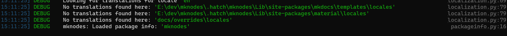

# CLI

<picture>
 
</picture>

**MkNodes** offers a CLI to generate and build websites from MkNodes build functions.
The CLI is based on `Typer` and uses a `rich` based handler for nice, colored output.

Site generator commands:

- `mknodes generate`: Runs the build function (or the default website) and writes the
  generated pages, assets and theme template overrides into the docs folder, plus a generated
  config (`mkdocs.generated.yml`, inheriting from `mkdocs.yml`) containing the nav, the required
  Markdown extensions and extra CSS / JS. With `--watch`, the site gets regenerated whenever
  project sources change.

- `mknodes build`: `generate`, followed by `zensical build -f mkdocs.generated.yml`.
  The build function can also run on a remote repository (`--repo-url`).

- `mknodes serve`: `generate --watch` running next to `zensical serve`
  (live preview on http://localhost:8000/).

Build diagnostics: problems that leave a page broken without stopping the build get logged as
warnings and summarized at the end of `mknodes build` / `generate`:

- a node that could not be created in a Jinja template
  (`{{ "x" | MkAdmonition(nonsense=1) }}`),
- a failing `/// mknodes` block or `python exec="true"` block (they run inside the engine,
  e.g. Zensical, and report back to `mknodes build`),
- broken code fences in generated pages,
- unresolved `[title][identifier]` references.

Each diagnostic names the page and where on it (line, template, first line of the block).
The error stays visible in the page for local work. With `--strict` (or `strict = true` in
`[tool.mknodes]`) the build fails if there was any diagnostic, which is what CI should use:

``` console
$ mknodes build --strict
ERROR    Strict mode: 1 build diagnostics (1 exec):
           usage.md (python exec block: from pkg import Thing): [exec] ImportError: ...
```

`--strict` is also passed to the engine (`zensical build --strict --clean`: pages from the
engine's cache would not run the Markdown extensions again). Diagnostics are also available
from Python: `BuildOutput.diagnostics` (see `mknodes.utils.diagnostics`).

External inputs (icons, license texts, `MkLlm` texts) are resolved before rendering and
pinned in a lock file, `mknodes.lock` next to `pyproject.toml` (setting `lock_file`). By
default (`live`) the build uses the locked values and adds missing ones. Commit
`mknodes.lock`; use `--refresh-inputs` to update it (fetches every input again, drops unused
entries) and `--offline` in CI: the build then makes no network or LLM calls and fails with a
list of the missing inputs if the lock file is incomplete.

Engines (`--engine`): `zensical` (default, HTML website), `mkdocs`, `mdbook`, `sphinx`,
`docsify` or `markdown` (plain Markdown files plus a `SUMMARY.md` nav, GitHub flavour), see
[Site engines](../site_engines.md). `--flavor` overrides the Markdown flavour, see
[Markdown flavours](<../../The nodes/markdown_flavours.md>).

Other commands:

- `mknodes render`: Render a single Markdown file with the MkNodes Jinja environment.
- `mknodes render-folder`: Render a folder of Markdown files (other files get copied).

<details>
<summary>Page info</summary>

<details>
<summary>Code for this section</summary>

**mknodes.manual.site.cli_section._**

```python
@nav.route.page(is_index=True, hide="toc")
def _(page: mk.MkPage):
    page += mk.MkBinaryImage.for_file("docs/assets/cli.gif")
    page += mk.MkTemplate("site/cli_index.jinja")

```

</details>

<details>
<summary>Resources</summary>

```python
Resources(css=[],
          markdown_extensions={},
          plugins=[],
          js=[],
          assets=[],
          packages=[])
```

</details>

<details>
<summary>Metadata</summary>

```yaml
created:
  source_filename: /home/runner/work/mknodes/mknodes/src/mknodes/manual/site/cli_section.py
  source_function: _
  source_line_no: 10
hide:
- toc
title: CLI

```

</details>

</details>
