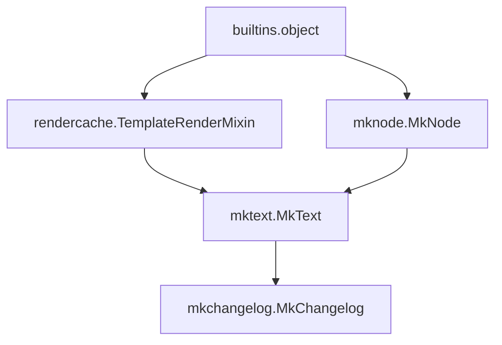

# MkChangelog

[ Show source on GitHub](https://github.com/phil65/mknodes/blob/main/src/mknodes/templatenodes/mkchangelog/__init__.py)

### Node for a git-based changelog (created by git-changelog).

> [!NOTE]
> **Description**
>
>
> !!! note
>     For building a changelog with Github Actions, the actions/checkout@v4
>     action needs to have fetch-depth set to 0 (or some other value.)

<details open>
<summary>Examples</summary>

### Example: **keepachangelog template**
> [!NOTE]
> **Jinja**
>
> ```jinja
> {{ "conventional" | MkChangelog(template="keepachangelog", shift_header_levels=2) }}
>
> ```

> [!NOTE]
> **Python**
>
> ```python
> MkChangelog()
> ```

<details open>
<summary>Rendered</summary>

### Changelog

All notable changes to this project will be documented in this file.

The format is based on [Keep a Changelog](http://keepachangelog.com/en/1.0.0/)
and this project adheres to [Semantic Versioning](http://semver.org/spec/v2.0.0.html).

<!-- insertion marker -->
#### Unreleased

<small>[Compare with latest](https://github.com/phil65/mknodes/compare/v5.0.0...HEAD)</small>

##### Features

- selectable template engine (Jinja2 default, minijinja optional) ([1ba555a](https://github.com/phil65/mknodes/commit/1ba555a709be25491ffdd2b616b774dd11b53e17) by Philipp Temminghoff). Co-Authored-By: Claude Opus 5.5 <noreply@anthropic.com>

##### Bug Fixes

- literal() keeps leading newlines outside the raw block ([3c07ff6](https://github.com/phil65/mknodes/commit/3c07ff64c2b40272ac57a70efa57e06068a4efda) by Philipp Temminghoff). Co-Authored-By: Claude Opus 5.5 <noreply@anthropic.com>
- unknown tab titles raise KeyError, not StopIteration ([5ff2efd](https://github.com/phil65/mknodes/commit/5ff2efd61e727ba819d4c4c88e9af81e531d123f) by Philipp Temminghoff). Co-Authored-By: Claude Opus 5.5 <noreply@anthropic.com>

##### Code Refactoring

- no underscore attributes, no Python-only str methods ([e129f40](https://github.com/phil65/mknodes/commit/e129f40de1be3ede3f62feace3a955bc2946cb81) by Philipp Temminghoff). Co-Authored-By: Claude Opus 5.5 <noreply@anthropic.com>

<!-- insertion marker -->
#### [v5.0.0](https://github.com/phil65/mknodes/releases/tag/v5.0.0) - 2026-11-26

<small>[Compare with v4.6.0](https://github.com/phil65/mknodes/compare/v4.6.0...v5.0.0)</small>

##### Code Refactoring

- plain names sync, async twins with _async in mknodes.inputs ([64de303](https://github.com/phil65/mknodes/commit/64de30338247e60c99e76abb452796c3161d67be) by Philipp Temminghoff). Co-Authored-By: Claude Opus 5.5 <noreply@anthropic.com>
- short names are the sync rendering API ([ed5343a](https://github.com/phil65/mknodes/commit/ed5343a482e8243a603a44310f43b51daa252702) by Philipp Temminghoff). Co-Authored-By: Claude Opus 5.5 <noreply@anthropic.com>

#### [v4.6.0](https://github.com/phil65/mknodes/releases/tag/v4.6.0) - 2026-11-26

<small>[Compare with v4.5.1](https://github.com/phil65/mknodes/compare/v4.5.1...v4.6.0)</small>

##### Features

- render passes, rendering never fetches ([050ba56](https://github.com/phil65/mknodes/commit/050ba5633cd5fe6ec2b0316619f511a22f7ee297) by Philipp Temminghoff). Co-Authored-By: Claude Opus 5.5 <noreply@anthropic.com>
- move the remaining I/O of nodes to the inputs store ([8356d29](https://github.com/phil65/mknodes/commit/8356d294ca83474978aa78f522f37c69a542a2ab) by Philipp Temminghoff). Co-Authored-By: Claude Opus 5.5 <noreply@anthropic.com>

##### Bug Fixes

- pipdeptree and pydeps one at a time ([0f31961](https://github.com/phil65/mknodes/commit/0f319618b0d50be4fb35c9a99252672c8bd48c29) by Philipp Temminghoff). Co-Authored-By: Claude Opus 5.5 <noreply@anthropic.com>
- load Pyodide 314.0.8 (Python 3.14), configurable version ([42a8f0f](https://github.com/phil65/mknodes/commit/42a8f0f83d103dca5eee89f270aea9859095406b) by Philipp Temminghoff). Co-Authored-By: Claude Opus 5.5 <noreply@anthropic.com>

##### Code Refactoring

- pure synchronous rendering ([8b46685](https://github.com/phil65/mknodes/commit/8b4668509e49c3b1f8f1511de36ed7ceca901201) by Philipp Temminghoff). Co-Authored-By: Claude Opus 5.5 <noreply@anthropic.com>
- drop from __future__ import annotations (PEP 649) ([f9bc70c](https://github.com/phil65/mknodes/commit/f9bc70c1a7d033667b15d9c4f7fd021e3f41df14) by Philipp Temminghoff). Co-Authored-By: Claude Opus 5.5 <noreply@anthropic.com>

#### [v4.5.1](https://github.com/phil65/mknodes/releases/tag/v4.5.1) - 2026-11-26

<small>[Compare with v4.5.0](https://github.com/phil65/mknodes/compare/v4.5.0...v4.5.1)</small>

##### Bug Fixes

- keep docstrings out of the page's Jinja pass ([aaa17b2](https://github.com/phil65/mknodes/commit/aaa17b2d0f8d006452db405a46c3d7c5396850d9) by Philipp Temminghoff). Co-Authored-By: Claude Opus 5.5 <noreply@anthropic.com>

#### [v4.5.0](https://github.com/phil65/mknodes/releases/tag/v4.5.0) - 2026-11-26

<small>[Compare with v4.4.1](https://github.com/phil65/mknodes/compare/v4.4.1...v4.5.0)</small>

##### Features

- separate distribution, import packages and repository ([7c300f1](https://github.com/phil65/mknodes/commit/7c300f1443d7e11585948cdc589c9d459d29ea9c) by Philipp Temminghoff). Co-Authored-By: Claude Opus 5.5 <noreply@anthropic.com>

#### [v4.4.1](https://github.com/phil65/mknodes/releases/tag/v4.4.1) - 2026-11-26

<small>[Compare with v4.4.0](https://github.com/phil65/mknodes/compare/v4.4.0...v4.4.1)</small>

##### Features

- lock icon set prefixes and included URLs, offline docs builds in CI ([b03558b](https://github.com/phil65/mknodes/commit/b03558b4baaf569f0fc519526fa07a4264c7f7c4) by Philipp Temminghoff). Co-Authored-By: Claude Opus 5.5 <noreply@anthropic.com>

#### [v4.4.0](https://github.com/phil65/mknodes/releases/tag/v4.4.0) - 2026-11-26

<small>[Compare with v4.3.1](https://github.com/phil65/mknodes/compare/v4.3.1...v4.4.0)</small>

##### Features

- inputs store with lock file for external inputs ([8b0fdcc](https://github.com/phil65/mknodes/commit/8b0fdcc67db114d99cb255d21a560e606500859f) by Philipp Temminghoff). Co-Authored-By: Claude Opus 5.5 <noreply@anthropic.com>

#### [v4.3.1](https://github.com/phil65/mknodes/releases/tag/v4.3.1) - 2026-11-25

<small>[Compare with v4.3.0](https://github.com/phil65/mknodes/compare/v4.3.0...v4.3.1)</small>

##### Bug Fixes

- render to_html() and example Html tabs with a parser that knows the flavour ([7cae7c1](https://github.com/phil65/mknodes/commit/7cae7c14818aa5d96fbf7c8f18cacf2431b917fb) by Philipp Temminghoff). Co-Authored-By: Claude Opus 5.5 <noreply@anthropic.com>

#### [v4.3.0](https://github.com/phil65/mknodes/releases/tag/v4.3.0) - 2026-11-25

<small>[Compare with v4.2.0](https://github.com/phil65/mknodes/compare/v4.2.0...v4.3.0)</small>

##### Features

- Sphinx (MyST) and Docsify engines ([9f6d6d3](https://github.com/phil65/mknodes/commit/9f6d6d34377dd70f783b4b044d5bf26800c069d5) by Philipp Temminghoff). Co-Authored-By: Claude Opus 5.5 <noreply@anthropic.com>

##### Bug Fixes

- indent multi-line MkList items ([ea19876](https://github.com/phil65/mknodes/commit/ea198763a1672989bb83371afe72ad6590628559) by Philipp Temminghoff). Co-Authored-By: Claude Opus 5.5 <noreply@anthropic.com>
- nested admonitions in the GitHub flavour ([af63f2a](https://github.com/phil65/mknodes/commit/af63f2a92c918b7cd3656ba265a52976e7f63085) by Philipp Temminghoff). Co-Authored-By: Claude Opus 5.5 <noreply@anthropic.com>
- GitHub flavour for badges, HTML tables and speech bubbles ([c50efe7](https://github.com/phil65/mknodes/commit/c50efe7d60eddc66f97cfd76fbbcd7062f2b8047) by Philipp Temminghoff). Co-Authored-By: Claude Opus 5.5 <noreply@anthropic.com>

#### [v4.2.0](https://github.com/phil65/mknodes/releases/tag/v4.2.0) - 2026-11-25

<small>[Compare with v4.1.0](https://github.com/phil65/mknodes/compare/v4.1.0...v4.2.0)</small>

##### Features

- add MkNode.to_markdown_sync ([503c1a3](https://github.com/phil65/mknodes/commit/503c1a32e94a32cf01bfb8ee6295a8748df36157) by Philipp Temminghoff). Co-Authored-By: Claude Opus 5.5 <noreply@anthropic.com>
- strict mode for build diagnostics ([6213ba1](https://github.com/phil65/mknodes/commit/6213ba1347914cf34165cf66a2bb78da24960eff) by Philipp Temminghoff). Co-Authored-By: Claude Opus 5.5 <noreply@anthropic.com>
- add MkDocs and mdBook site engines ([68834c4](https://github.com/phil65/mknodes/commit/68834c4443241744760e7a1556f23376453f5712) by Philipp Temminghoff). Co-Authored-By: Claude Opus 5.5 <noreply@anthropic.com>
- warn about broken code fences in rendered pages ([b702ce5](https://github.com/phil65/mknodes/commit/b702ce53d6ef767b332b044b9d61f89faaec7ed3) by Philipp Temminghoff). Co-Authored-By: Claude Opus 5.5 <noreply@anthropic.com>
- check autorefs references before the site engine runs ([d912eb0](https://github.com/phil65/mknodes/commit/d912eb0dc63f070c052deecdd43384a30c73eabf) by Philipp Temminghoff). Co-Authored-By: Claude Opus 5.5 <noreply@anthropic.com>

##### Bug Fixes

- no runs of blank lines in GitHub flavour ([fca8b60](https://github.com/phil65/mknodes/commit/fca8b602b84111cdbfaf315c2fc95f62c5263b6c) by Philipp Temminghoff). Co-Authored-By: Claude Opus 5.5 <noreply@anthropic.com>
- escape `|` in cells and treat a list of lists as rows ([48f1394](https://github.com/phil65/mknodes/commit/48f1394e8ac9a955144e7aff4b95ad90cf010448) by Philipp Temminghoff). Co-Authored-By: Claude Opus 5.5 <noreply@anthropic.com>
- plain URL links and the fallback context work outside a Python project ([579f25e](https://github.com/phil65/mknodes/commit/579f25e74b97e11b1896b95ce942f5ebfb490b68) by Philipp Temminghoff). Co-Authored-By: Claude Opus 5.5 <noreply@anthropic.com>
- keep the element of MkHtmlBlock in GitHub flavour ([c7f79e4](https://github.com/phil65/mknodes/commit/c7f79e415e6f97dcaaec983a52914dc37b284f8c) by Philipp Temminghoff). Co-Authored-By: Claude Opus 5.5 <noreply@anthropic.com>
- render the quick tour's own source code intact ([1799a90](https://github.com/phil65/mknodes/commit/1799a907e08ddbbc34d7383d4f5abd5c81eaef04) by Philipp Temminghoff). Co-Authored-By: Claude Opus 5.5 <noreply@anthropic.com>
- point bare links to existing pages ([dfb2606](https://github.com/phil65/mknodes/commit/dfb2606c3db5f73264e7f25f59e40f0acd4863e5) by Philipp Temminghoff). Co-Authored-By: Claude Opus 5.5 <noreply@anthropic.com>
- link `[title][dotted.path]` references ([b3ebc68](https://github.com/phil65/mknodes/commit/b3ebc688b63e5e826958744fa7cfa2d57114c0d7) by Philipp Temminghoff). Co-Authored-By: Claude Opus 5.5 <noreply@anthropic.com>
- point "created" metadata to the user code creating a page ([8f3650a](https://github.com/phil65/mknodes/commit/8f3650afffd26bb98fdcc429cc92da4457914f4b) by Philipp Temminghoff). Co-Authored-By: Claude Opus 5.5 <noreply@anthropic.com>
- show literal brackets in help texts ([3e3b6f5](https://github.com/phil65/mknodes/commit/3e3b6f5ca5c58a8e0b9f66a373dcd52e85676100) by Philipp Temminghoff). Co-Authored-By: Claude Opus 5.5 <noreply@anthropic.com>
- fetch uncached icons correctly inside a running event loop ([83bfa3b](https://github.com/phil65/mknodes/commit/83bfa3b924446aef0572a9464fa504426b94433c) by Philipp Temminghoff). Co-Authored-By: Claude Opus 5.5 <noreply@anthropic.com>
- restore examples and docstrings on the node pages ([7e92c0d](https://github.com/phil65/mknodes/commit/7e92c0dbd9ff98e45359df1ddf072ff98ec8ed11) by Philipp Temminghoff). Co-Authored-By: Claude Opus 5.5 <noreply@anthropic.com>

#### [v4.1.0](https://github.com/phil65/mknodes/releases/tag/v4.1.0) - 2026-11-25

<small>[Compare with v4.0.1](https://github.com/phil65/mknodes/compare/v4.0.1...v4.1.0)</small>

##### Features

- collect nodes per render, render template nodes once ([6cdfca8](https://github.com/phil65/mknodes/commit/6cdfca8178080da3d1b7c7c2ee8aea0399dafc3a) by Philipp Temminghoff). Co-Authored-By: Claude Opus 5.5 <noreply@anthropic.com>

##### Bug Fixes

- re-render templates after the link excludes are set ([df1b243](https://github.com/phil65/mknodes/commit/df1b243eb33951e7eeb5d9c66ede72c6fb0b3125) by Philipp Temminghoff). Co-Authored-By: Claude Opus 5.5 <noreply@anthropic.com>

##### Performance Improvements

- skip the page Jinja pass for pages without Jinja syntax ([23b400f](https://github.com/phil65/mknodes/commit/23b400fa962acab8cbd1435c57553f1e2d5f7728) by Philipp Temminghoff). Co-Authored-By: Claude Opus 5.5 <noreply@anthropic.com>
- async string filter (node | string | indent renders in the loop) ([cc8e44e](https://github.com/phil65/mknodes/commit/cc8e44ea1fe99aa476b900397b348eff46d8fb16) by Philipp Temminghoff). Co-Authored-By: Claude Opus 5.5 <noreply@anthropic.com>
- keep the env loader while its inputs are unchanged ([a3d5951](https://github.com/phil65/mknodes/commit/a3d59510579bdfe763a28b649dfbac5e72c4b587) by Philipp Temminghoff). Co-Authored-By: Claude Opus 5.5 <noreply@anthropic.com>

#### [v4.0.1](https://github.com/phil65/mknodes/releases/tag/v4.0.1) - 2026-11-25

<small>[Compare with v4.0.0](https://github.com/phil65/mknodes/compare/v4.0.0...v4.0.1)</small>

##### Bug Fixes

- MkLlm renders a placeholder when agentpool is missing or broken ([9d84461](https://github.com/phil65/mknodes/commit/9d84461ba6ede8f96b869fb1a8363006390d204d) by Philipp Temminghoff). Co-Authored-By: Claude Opus 5.5 <noreply@anthropic.com>
- robust API docs for cyclic aliases, thread-safe griffe loading, stable dependency order ([d6041c4](https://github.com/phil65/mknodes/commit/d6041c46bd90c5da48ea95d752b5cdcdd5477a1c) by Philipp Temminghoff). Co-Authored-By: Claude Opus 5.5 <noreply@anthropic.com>

##### Performance Improvements

- fewer template re-renders, cheap node environments, no asyncio patching ([50cee8e](https://github.com/phil65/mknodes/commit/50cee8eb02d30291b088e74b23794ba116d76fb5) by Philipp Temminghoff). Co-Authored-By: Claude Opus 5.5 <noreply@anthropic.com>

#### [v4.0.0](https://github.com/phil65/mknodes/releases/tag/v4.0.0) - 2026-11-25

<small>[Compare with v3.2.1](https://github.com/phil65/mknodes/compare/v3.2.1...v4.0.0)</small>

##### Features

- merge the site generator (mkdocs-mknodes) into mknodes ([3d855d4](https://github.com/phil65/mknodes/commit/3d855d486862d0d7cc037d5b7b4e761655a4c10e) by Philipp Temminghoff). Co-Authored-By: Claude Opus 5.5 <noreply@anthropic.com>
- use mknodes' DocBuilder, add flavours and a markdown engine ([c84fe34](https://github.com/phil65/mknodes/commit/c84fe34e7cc5d1c9ebe7d2dfad60c1f8ce93c1fd) by Philipp Temminghoff). Co-Authored-By: Claude Opus 5.5 <noreply@anthropic.com>
- Markdown flavours (renderers) and an engine-neutral build output ([9c42d59](https://github.com/phil65/mknodes/commit/9c42d59d3481e6b7697fb2fddbfaceeb6e33ad62) by Philipp Temminghoff). Co-Authored-By: Claude Opus 5.5 <noreply@anthropic.com>
- fetch theme icons through mknodes' on-disk icon cache ([1388dc1](https://github.com/phil65/mknodes/commit/1388dc1ee7d17e231a84702f277735a1060c7e9a) by Philipp Temminghoff). Co-Authored-By: Claude Opus 5.5 <noreply@anthropic.com>
- add engine-agnostic site generator with a Zensical writer ([c398eff](https://github.com/phil65/mknodes/commit/c398effa1f96dcab1256f1826560356187ff35e7) by Philipp Temminghoff). Co-Authored-By: Claude Opus 5.5 <noreply@anthropic.com>
- add telemetry ([996e386](https://github.com/phil65/mknodes/commit/996e3860a310d2289144efb903ac31b8f89ad8a7) by Philipp Temminghoff).
- add auto_delete_generated_templates setting ([14a1f8e](https://github.com/phil65/mknodes/commit/14a1f8ef37e14b5f4af16f74210b39e20c286902) by phil65).
- also include css for global_resources setting ([ea36e65](https://github.com/phil65/mknodes/commit/ea36e65d3419034657ee1d083f7d51997bccde68) by phil65).
- allow "non-global" resources ([3dbde90](https://github.com/phil65/mknodes/commit/3dbde908299664e15309966c04b27de23a8b7496) by phil65).
- auto-hide toc if empty for MkDocs theme ([4198896](https://github.com/phil65/mknodes/commit/4198896662cf3a0c9fd5baac0fb4b74cfd4e71bc) by phil65).
- hide-toc support via page metadata for MkDocs theme via RewriteLoader ([ab0e4c5](https://github.com/phil65/mknodes/commit/ab0e4c55881408e87f688cdbd640622834b34867) by phil65).
- add option to jinja-render all pages ([23bf883](https://github.com/phil65/mknodes/commit/23bf8833761a35931de3e80ad8082383dd4141b0) by phil65).
- auto-set MkDocs copyright setting ([6f9550f](https://github.com/phil65/mknodes/commit/6f9550fb2d4ef3ea3beb733be0e66fd6ca06e886) by phil65).
- add rewrite_theme_templates option ([a01e6d0](https://github.com/phil65/mknodes/commit/a01e6d046a3785457a095c7645796c3bd35a7ce4) by phil65).
- let theme adapt extras ([70c0d10](https://github.com/phil65/mknodes/commit/70c0d10edf494d3d97612c6e37f54d22d1941f5f) by phil65).
- allow overriding show_page_info setting via metadata ([714952f](https://github.com/phil65/mknodes/commit/714952f1db295a017df3f8ea75212872b420ef08) by phil65).

##### Bug Fixes

- write docs_dir with forward slashes ([6ffd35d](https://github.com/phil65/mknodes/commit/6ffd35df74b2a3ec0de18d7c659a3fc1bdb18b7d) by Philipp Temminghoff). Co-Authored-By: Claude Opus 5.5 <noreply@anthropic.com>
- split build_fn at the last colon, require mknodes>=3.2.1 ([6ea4f2c](https://github.com/phil65/mknodes/commit/6ea4f2c18486b73e6c7c9539f5c53ff4eb5efc9d) by Philipp Temminghoff). Co-Authored-By: Claude Opus 5.5 <noreply@anthropic.com>
- don't render the README index page with Jinja ([5124071](https://github.com/phil65/mknodes/commit/512407150c7bc8b83890f8ab114f8533398e394b) by Philipp Temminghoff). Co-Authored-By: Claude Opus 5.5 <noreply@anthropic.com>
- serialize classmethods by the class they are bound to in generated configs ([4e6e4e3](https://github.com/phil65/mknodes/commit/4e6e4e34921d7762318dfd0e8594bcd75b7e0220) by Philipp Temminghoff). Co-Authored-By: Claude Opus 5.5 <noreply@anthropic.com>
- make the actions template override render with zensical ([cfa0379](https://github.com/phil65/mknodes/commit/cfa0379f1d5d0488d5fee31e581516e0e9f73814) by Philipp Temminghoff). Co-Authored-By: Claude Opus 5.5 <noreply@anthropic.com>
- support plain 'mkdocs build' / 'mkdocs serve' ([1e39383](https://github.com/phil65/mknodes/commit/1e39383c11c3ccd40ef9440af9db4bc9bc639535) by Philipp Temminghoff). Co-Authored-By: Claude Opus 5.5 <noreply@anthropic.com>
- support bare '- mknodes' plugin entries when overriding options ([e83ac61](https://github.com/phil65/mknodes/commit/e83ac61c5bc8a141b2a65f3f34d4ae8961a6fe59) by Philipp Temminghoff). Co-Authored-By: Claude Opus 5.5 <noreply@anthropic.com>
- make create-config work with the default build function ([74385f7](https://github.com/phil65/mknodes/commit/74385f78877ac047f713ceb1f1249f46139b2dee) by Philipp Temminghoff). Co-Authored-By: Claude Opus 5.5 <noreply@anthropic.com>
- build a default website when no pages are configured ([099ce30](https://github.com/phil65/mknodes/commit/099ce3035f3bbd3feacbcfa37c54c1d97b4e1591) by Philipp Temminghoff). Co-Authored-By: Claude Opus 5.5 <noreply@anthropic.com>
- correctly build config ([3c0dc35](https://github.com/phil65/mknodes/commit/3c0dc355eb516a923e6eaa34cf9b72ef8502f8d1) by Philipp Temminghoff).
- set default build function ([2ed8203](https://github.com/phil65/mknodes/commit/2ed8203a9ac41aa0e339db296618282318a22681) by Philipp Temminghoff).
- disable httpx instrumentation ([42c69db](https://github.com/phil65/mknodes/commit/42c69dbe6749cc46c927adf8c823703d36579bc3) by Philipp Temminghoff).
- mkdocs adjustments ([e220452](https://github.com/phil65/mknodes/commit/e220452db4cddc37399bb36a171df490dc50cab7) by phil65).
- mkdocs updates ([3517501](https://github.com/phil65/mknodes/commit/351750137d03ac93e8bf1187dda7d89b043fd7d3) by phil65).
- typo in build_fn ([f1bcfb2](https://github.com/phil65/mknodes/commit/f1bcfb2053a60e66425db66f93b23fa8d5d2a29a) by phil65).
- fix changed doc link ([7ea1779](https://github.com/phil65/mknodes/commit/7ea17790db07a949905661fd4178032f3c8941a0) by phil65).
- correct relative path for page resources ([f823174](https://github.com/phil65/mknodes/commit/f82317443c4cc57a7f414c680afa8761565d6761) by phil65).
- adapt to mknodes changes ([fddcbf8](https://github.com/phil65/mknodes/commit/fddcbf86a825096db70d0664560a5400beae291d) by phil65).
- missed check to satisfy mypy ([33883fd](https://github.com/phil65/mknodes/commit/33883fd180342bd4d99986fc565fe04554f1ca92) by phil65).
- some more mknodes adaptions ([434d125](https://github.com/phil65/mknodes/commit/434d1257f87aa7d1e8ed3f95cfbd4268277fba5d) by phil65).
- Fix create-config CLI cmd ([696c220](https://github.com/phil65/mknodes/commit/696c2203280f9348f2c1a3618f244d1250e91762) by phil65).
- move mkdocs_basic.yml into resources ([01546d0](https://github.com/phil65/mknodes/commit/01546d02745aace85666811beef9763f30df033b) by phil65).
- absolute path for mkdocs_basic.yml ([02417f1](https://github.com/phil65/mknodes/commit/02417f15937aa49121e8e585a74690ab14f7297e) by phil65).
- dont fetch resources recursively for MkNavs ([ec21246](https://github.com/phil65/mknodes/commit/ec21246d18a0ea136a5df3319bfceb3b8ba476b0) by phil65).
- also collect resources from navs ([40b808c](https://github.com/phil65/mknodes/commit/40b808cb6bca322b05659ad37208ef4eb6d6f202) by phil65).

##### Code Refactoring

- remove the MkDocs plugin, Zensical is the only site engine ([27dff19](https://github.com/phil65/mknodes/commit/27dff19e44c8e93b3c265eb065a0662186d1b48d) by Philipp Temminghoff). Co-Authored-By: Claude Opus 5.5 <noreply@anthropic.com>
- use MkCode directly ([23030a0](https://github.com/phil65/mknodes/commit/23030a0a2818ae32edea244b8be441d040e62317) by phil65).
- use jinjarope directly for globals / filters ([b363ef2](https://github.com/phil65/mknodes/commit/b363ef2f7cfa9dcac252fcff94ddf81fccd81335) by phil65).
- use jinjarope lib ([70e49a0](https://github.com/phil65/mknodes/commit/70e49a0d3b92ac973f79cb820f9c8a59a1eeb993) by phil65).
- start integrating fsspec ([46903c9](https://github.com/phil65/mknodes/commit/46903c9086f90e08997be395e71a2803491ed043) by phil65).
- align var naming to mkdocs-macros ([f2867e2](https://github.com/phil65/mknodes/commit/f2867e2ca91021eb6de6e3cff3e57e71cacfcd5d) by phil65).
- cleanup build fn by moving warning / exception handling to decorators ([6570de8](https://github.com/phil65/mknodes/commit/6570de88d60bceb20171b791efdd985dc03f1d50) by phil65).
- prep for build() removal ([9b56789](https://github.com/phil65/mknodes/commit/9b5678986a1061f8ba8f0a234ab33d75ec895e14) by phil65).
- adapt to mknodes changes ([78efecf](https://github.com/phil65/mknodes/commit/78efecf85513ff691f47f7e2c64cf8476e607a37) by phil65).
- prep for removal of templates from Resources ([f09fb6f](https://github.com/phil65/mknodes/commit/f09fb6f6f945f8c3be1ec5509c86fcfbe1f24404) by phil65).
- move page rendering to BuildCollector ([1650a9c](https://github.com/phil65/mknodes/commit/1650a9cbe772598438a091c509903dcc48665679) by phil65).

#### [v3.2.1](https://github.com/phil65/mknodes/releases/tag/v3.2.1) - 2026-11-23

<small>[Compare with v3.2.0](https://github.com/phil65/mknodes/compare/v3.2.0...v3.2.1)</small>

##### Bug Fixes

- split build function paths at the last colon ([13ccc58](https://github.com/phil65/mknodes/commit/13ccc5897e8467984efe44e250ad2cb8edcc999e) by Philipp Temminghoff). Co-Authored-By: Claude Opus 5.5 <noreply@anthropic.com>

#### [v3.2.0](https://github.com/phil65/mknodes/releases/tag/v3.2.0) - 2026-11-23

<small>[Compare with v3.1.1](https://github.com/phil65/mknodes/compare/v3.1.1...v3.2.0)</small>

##### Bug Fixes

- skip members whose name is not an identifier ([e883e67](https://github.com/phil65/mknodes/commit/e883e672b7053fcf5f454927b72680b563b0f5c6) by Philipp Temminghoff). Co-Authored-By: Claude Opus 5.5 <noreply@anthropic.com>

#### [v3.1.1](https://github.com/phil65/mknodes/releases/tag/v3.1.1) - 2026-11-23

<small>[Compare with v3.1.0](https://github.com/phil65/mknodes/compare/v3.1.0...v3.1.1)</small>

##### Bug Fixes

- class pages and MRO diagrams crashed for metaclasses ([52ee0e1](https://github.com/phil65/mknodes/commit/52ee0e1b096e6ac10b559847e6f0f3cbe9b480e2) by Philipp Temminghoff). Co-Authored-By: Claude Opus 5.5 <noreply@anthropic.com>

#### [v3.1.0](https://github.com/phil65/mknodes/releases/tag/v3.1.0) - 2026-11-22

<small>[Compare with v3.0.0](https://github.com/phil65/mknodes/compare/v3.0.0...v3.1.0)</small>

##### Features

- nest class pages below their defining module ([d036717](https://github.com/phil65/mknodes/commit/d03671753b99941b9990da15323974e786af0225) by Philipp Temminghoff). Co-Authored-By: Claude Opus 5.5 <noreply@anthropic.com>
- cache icon SVGs on disk ([d7d9a03](https://github.com/phil65/mknodes/commit/d7d9a03a1e0d61224dcbfbc967dcb35ef909fe48) by Philipp Temminghoff). Co-Authored-By: Claude Opus 5.5 <noreply@anthropic.com>

#### [v3.0.0](https://github.com/phil65/mknodes/releases/tag/v3.0.0) - 2026-11-22

<small>[Compare with v2.3.1](https://github.com/phil65/mknodes/compare/v2.3.1...v3.0.0)</small>

##### Code Refactoring

- drop MkDocs runtime dependencies and MkPluginFlow ([22a2f79](https://github.com/phil65/mknodes/commit/22a2f79b728e7cfc2e556c41d36a66d02857df74) by Philipp Temminghoff). Co-Authored-By: Claude Opus 5.5 <noreply@anthropic.com>

#### [v2.3.1](https://github.com/phil65/mknodes/releases/tag/v2.3.1) - 2026-11-22

<small>[Compare with v2.3.0](https://github.com/phil65/mknodes/compare/v2.3.0...v2.3.1)</small>

##### Bug Fixes

- make the docs build with zensical ([88dcf99](https://github.com/phil65/mknodes/commit/88dcf996dab0337629228b0873de50ceb2c0142f) by Philipp Temminghoff). Co-Authored-By: Claude Opus 5.5 <noreply@anthropic.com>

#### [v2.3.0](https://github.com/phil65/mknodes/releases/tag/v2.3.0) - 2026-11-22

<small>[Compare with v2.2.17](https://github.com/phil65/mknodes/compare/v2.2.17...v2.3.0)</small>

##### Bug Fixes

- make MkDoc honor recursive=False ([0327fe9](https://github.com/phil65/mknodes/commit/0327fe978233c452551a32537b9d4125df020839) by Philipp Temminghoff). Co-Authored-By: Claude Opus 5.5 <noreply@anthropic.com>
- don't require Logfire credentials for 'mknodes build' ([7973d0a](https://github.com/phil65/mknodes/commit/7973d0a90bb292e0ae0fe0b0e5fc69ef4b975cc0) by Philipp Temminghoff). Co-Authored-By: Claude Opus 5.5 <noreply@anthropic.com>
- don't log an error when a commit has no version ([9020a4c](https://github.com/phil65/mknodes/commit/9020a4c6ae27796707847bc09f54c670871bb566) by Philipp Temminghoff). Co-Authored-By: Claude Opus 5.5 <noreply@anthropic.com>
- support bare '- mknodes' plugin entry in update_mknodes_section ([0897745](https://github.com/phil65/mknodes/commit/08977453d37723d03dee2f929a95fe7030e8d447) by Philipp Temminghoff). Co-Authored-By: Claude Opus 5.5 <noreply@anthropic.com>
- keep custom markdown of container subclasses when nested ([d052658](https://github.com/phil65/mknodes/commit/d052658b23de43399b3a0db9903f0645f98fb091) by Philipp Temminghoff). Co-Authored-By: Claude Opus 5.5 <noreply@anthropic.com>
- import git-changelog API from the top-level package ([04dfc6d](https://github.com/phil65/mknodes/commit/04dfc6d35605747852e3dbcf4092be618204ec19) by Philipp Temminghoff). Co-Authored-By: Claude Opus 5.5 <noreply@anthropic.com>

#### [v2.2.17](https://github.com/phil65/mknodes/releases/tag/v2.2.17) - 2026-11-22

<small>[Compare with v2.2.16](https://github.com/phil65/mknodes/compare/v2.2.16...v2.2.17)</small>

##### Bug Fixes

- resolve classes re-exported by collections.abc ([635ff73](https://github.com/phil65/mknodes/commit/635ff73631974853b5460d6ff7b8a12bacc0e9e2) by Philipp Temminghoff). Co-Authored-By: Claude Opus 5.5 <noreply@anthropic.com>

#### [v2.2.16](https://github.com/phil65/mknodes/releases/tag/v2.2.16) - 2026-11-22

<small>[Compare with v2.2.15](https://github.com/phil65/mknodes/compare/v2.2.15...v2.2.16)</small>

##### Bug Fixes

- only collect entry points of the documented package ([097f537](https://github.com/phil65/mknodes/commit/097f537fda1a1bb3889e6ddbff01013c5a023dfb) by Philipp Temminghoff). Co-Authored-By: Claude Opus 5.5 <noreply@anthropic.com>

#### [v2.2.15](https://github.com/phil65/mknodes/releases/tag/v2.2.15) - 2026-11-17

<small>[Compare with v2.2.14](https://github.com/phil65/mknodes/compare/v2.2.14...v2.2.15)</small>

##### Bug Fixes

- apply list_to_tuple before functools.cache ([c9abd95](https://github.com/phil65/mknodes/commit/c9abd95c137c227d2b577d14063ebeb7e8a0b36a) by Philipp Temminghoff).
- use bundled icon index in icon_for_url instead of fetching all icon sets ([081ecab](https://github.com/phil65/mknodes/commit/081ecabf84b398e90c5bed4e926880abe5562c04) by Philipp Temminghoff).

##### Code Refactoring

- use public pipdeptree.render API ([61c59bd](https://github.com/phil65/mknodes/commit/61c59bdd4ea6d39e5819645bbf1a7c298b9d613f) by Philipp Temminghoff).

#### [v2.2.14](https://github.com/phil65/mknodes/releases/tag/v2.2.14) - 2026-03-06

<small>[Compare with v2.2.13](https://github.com/phil65/mknodes/compare/v2.2.13...v2.2.14)</small>

#### [v2.2.13](https://github.com/phil65/mknodes/releases/tag/v2.2.13) - 2026-01-08

<small>[Compare with v2.2.12](https://github.com/phil65/mknodes/compare/v2.2.12...v2.2.13)</small>

#### [v2.2.12](https://github.com/phil65/mknodes/releases/tag/v2.2.12) - 2025-12-23

<small>[Compare with v2.2.11](https://github.com/phil65/mknodes/compare/v2.2.11...v2.2.12)</small>

#### [v2.2.11](https://github.com/phil65/mknodes/releases/tag/v2.2.11) - 2025-12-12

<small>[Compare with v2.2.10](https://github.com/phil65/mknodes/compare/v2.2.10...v2.2.11)</small>

#### [v2.2.10](https://github.com/phil65/mknodes/releases/tag/v2.2.10) - 2025-12-11

<small>[Compare with v2.2.9](https://github.com/phil65/mknodes/compare/v2.2.9...v2.2.10)</small>

#### [v2.2.9](https://github.com/phil65/mknodes/releases/tag/v2.2.9) - 2025-12-10

<small>[Compare with v2.2.8](https://github.com/phil65/mknodes/compare/v2.2.8...v2.2.9)</small>

#### [v2.2.8](https://github.com/phil65/mknodes/releases/tag/v2.2.8) - 2025-12-10

<small>[Compare with v2.2.7](https://github.com/phil65/mknodes/compare/v2.2.7...v2.2.8)</small>

#### [v2.2.7](https://github.com/phil65/mknodes/releases/tag/v2.2.7) - 2025-12-10

<small>[Compare with v2.2.6](https://github.com/phil65/mknodes/compare/v2.2.6...v2.2.7)</small>

#### [v2.2.6](https://github.com/phil65/mknodes/releases/tag/v2.2.6) - 2025-12-10

<small>[Compare with v2.2.5](https://github.com/phil65/mknodes/compare/v2.2.5...v2.2.6)</small>

#### [v2.2.5](https://github.com/phil65/mknodes/releases/tag/v2.2.5) - 2025-12-10

<small>[Compare with v2.2.4](https://github.com/phil65/mknodes/compare/v2.2.4...v2.2.5)</small>

#### [v2.2.4](https://github.com/phil65/mknodes/releases/tag/v2.2.4) - 2025-12-10

<small>[Compare with v2.2.3](https://github.com/phil65/mknodes/compare/v2.2.3...v2.2.4)</small>

#### [v2.2.3](https://github.com/phil65/mknodes/releases/tag/v2.2.3) - 2025-12-10

<small>[Compare with v2.2.2](https://github.com/phil65/mknodes/compare/v2.2.2...v2.2.3)</small>

#### [v2.2.2](https://github.com/phil65/mknodes/releases/tag/v2.2.2) - 2025-12-10

<small>[Compare with v2.2.1](https://github.com/phil65/mknodes/compare/v2.2.1...v2.2.2)</small>

#### [v2.2.1](https://github.com/phil65/mknodes/releases/tag/v2.2.1) - 2025-12-10

<small>[Compare with v2.2.0](https://github.com/phil65/mknodes/compare/v2.2.0...v2.2.1)</small>

#### [v2.2.0](https://github.com/phil65/mknodes/releases/tag/v2.2.0) - 2025-12-10

<small>[Compare with v2.1.0](https://github.com/phil65/mknodes/compare/v2.1.0...v2.2.0)</small>

#### [v2.1.0](https://github.com/phil65/mknodes/releases/tag/v2.1.0) - 2025-12-09

<small>[Compare with v2.0.8](https://github.com/phil65/mknodes/compare/v2.0.8...v2.1.0)</small>

#### [v2.0.8](https://github.com/phil65/mknodes/releases/tag/v2.0.8) - 2025-12-05

<small>[Compare with v2.0.7](https://github.com/phil65/mknodes/compare/v2.0.7...v2.0.8)</small>

##### Bug Fixes

- strip off frontmatter for MkTemplate ([06f3129](https://github.com/phil65/mknodes/commit/06f31294bb509881f214211193cea9fd4410d44d) by Philipp Temminghoff).

#### [v2.0.7](https://github.com/phil65/mknodes/releases/tag/v2.0.7) - 2025-12-05

<small>[Compare with v2.0.6](https://github.com/phil65/mknodes/compare/v2.0.6...v2.0.7)</small>

#### [v2.0.6](https://github.com/phil65/mknodes/releases/tag/v2.0.6) - 2025-12-04

<small>[Compare with v2.0.5](https://github.com/phil65/mknodes/compare/v2.0.5...v2.0.6)</small>

#### [v2.0.5](https://github.com/phil65/mknodes/releases/tag/v2.0.5) - 2025-12-03

<small>[Compare with v2.0.4](https://github.com/phil65/mknodes/compare/v2.0.4...v2.0.5)</small>

#### [v2.0.4](https://github.com/phil65/mknodes/releases/tag/v2.0.4) - 2025-12-02

<small>[Compare with v2.0.3](https://github.com/phil65/mknodes/compare/v2.0.3...v2.0.4)</small>

#### [v2.0.3](https://github.com/phil65/mknodes/releases/tag/v2.0.3) - 2025-12-02

<small>[Compare with v2.0.2](https://github.com/phil65/mknodes/compare/v2.0.2...v2.0.3)</small>

#### [v2.0.2](https://github.com/phil65/mknodes/releases/tag/v2.0.2) - 2025-12-01

<small>[Compare with v2.0.1](https://github.com/phil65/mknodes/compare/v2.0.1...v2.0.2)</small>

#### [v2.0.1](https://github.com/phil65/mknodes/releases/tag/v2.0.1) - 2025-12-01

<small>[Compare with v2.0.0](https://github.com/phil65/mknodes/compare/v2.0.0...v2.0.1)</small>

#### [v2.0.0](https://github.com/phil65/mknodes/releases/tag/v2.0.0) - 2025-12-01

<small>[Compare with v1.2.0](https://github.com/phil65/mknodes/compare/v1.2.0...v2.0.0)</small>

#### [v1.2.0](https://github.com/phil65/mknodes/releases/tag/v1.2.0) - 2025-11-28

<small>[Compare with v1.1.0](https://github.com/phil65/mknodes/compare/v1.1.0...v1.2.0)</small>

#### [v1.1.0](https://github.com/phil65/mknodes/releases/tag/v1.1.0) - 2025-11-28

<small>[Compare with v1.0.2](https://github.com/phil65/mknodes/compare/v1.0.2...v1.1.0)</small>

#### [v1.0.2](https://github.com/phil65/mknodes/releases/tag/v1.0.2) - 2025-11-27

<small>[Compare with v1.0.1](https://github.com/phil65/mknodes/compare/v1.0.1...v1.0.2)</small>

#### [v1.0.1](https://github.com/phil65/mknodes/releases/tag/v1.0.1) - 2025-10-28

<small>[Compare with v1.0.0](https://github.com/phil65/mknodes/compare/v1.0.0...v1.0.1)</small>

#### [v1.0.0](https://github.com/phil65/mknodes/releases/tag/v1.0.0) - 2025-10-17

<small>[Compare with v0.55.10](https://github.com/phil65/mknodes/compare/v0.55.10...v1.0.0)</small>

#### [v0.55.10](https://github.com/phil65/mknodes/releases/tag/v0.55.10) - 2025-10-01

<small>[Compare with v0.55.9](https://github.com/phil65/mknodes/compare/v0.55.9...v0.55.10)</small>

#### [v0.55.9](https://github.com/phil65/mknodes/releases/tag/v0.55.9) - 2025-09-12

<small>[Compare with v0.55.8](https://github.com/phil65/mknodes/compare/v0.55.8...v0.55.9)</small>

#### [v0.55.8](https://github.com/phil65/mknodes/releases/tag/v0.55.8) - 2025-09-12

<small>[Compare with v0.55.7](https://github.com/phil65/mknodes/compare/v0.55.7...v0.55.8)</small>

#### [v0.55.7](https://github.com/phil65/mknodes/releases/tag/v0.55.7) - 2025-05-19

<small>[Compare with v0.55.6](https://github.com/phil65/mknodes/compare/v0.55.6...v0.55.7)</small>

#### [v0.55.6](https://github.com/phil65/mknodes/releases/tag/v0.55.6) - 2025-05-19

<small>[Compare with v0.55.5](https://github.com/phil65/mknodes/compare/v0.55.5...v0.55.6)</small>

#### [v0.55.5](https://github.com/phil65/mknodes/releases/tag/v0.55.5) - 2025-03-10

<small>[Compare with v0.55.4](https://github.com/phil65/mknodes/compare/v0.55.4...v0.55.5)</small>

#### [v0.55.4](https://github.com/phil65/mknodes/releases/tag/v0.55.4) - 2025-02-24

<small>[Compare with v0.55.3](https://github.com/phil65/mknodes/compare/v0.55.3...v0.55.4)</small>

#### [v0.55.3](https://github.com/phil65/mknodes/releases/tag/v0.55.3) - 2025-02-21

<small>[Compare with v0.55.2](https://github.com/phil65/mknodes/compare/v0.55.2...v0.55.3)</small>

#### [v0.55.2](https://github.com/phil65/mknodes/releases/tag/v0.55.2) - 2025-02-21

<small>[Compare with v0.55.1](https://github.com/phil65/mknodes/compare/v0.55.1...v0.55.2)</small>

#### [v0.55.1](https://github.com/phil65/mknodes/releases/tag/v0.55.1) - 2025-02-18

<small>[Compare with v0.55.0](https://github.com/phil65/mknodes/compare/v0.55.0...v0.55.1)</small>

#### [v0.55.0](https://github.com/phil65/mknodes/releases/tag/v0.55.0) - 2025-02-18

<small>[Compare with v0.54.7](https://github.com/phil65/mknodes/compare/v0.54.7...v0.55.0)</small>

#### [v0.54.7](https://github.com/phil65/mknodes/releases/tag/v0.54.7) - 2025-02-11

<small>[Compare with v0.54.6](https://github.com/phil65/mknodes/compare/v0.54.6...v0.54.7)</small>

#### [v0.54.6](https://github.com/phil65/mknodes/releases/tag/v0.54.6) - 2025-01-19

<small>[Compare with v0.54.5](https://github.com/phil65/mknodes/compare/v0.54.5...v0.54.6)</small>

##### Bug Fixes

- hack for grifferegistry ([be9a497](https://github.com/phil65/mknodes/commit/be9a4972c032764975cf654c13e893a5e2e51e59) by Philipp Temminghoff).

#### [v0.54.5](https://github.com/phil65/mknodes/releases/tag/v0.54.5) - 2024-12-26

<small>[Compare with v0.54.4](https://github.com/phil65/mknodes/compare/v0.54.4...v0.54.5)</small>

#### [v0.54.4](https://github.com/phil65/mknodes/releases/tag/v0.54.4) - 2024-11-16

<small>[Compare with v0.54.3](https://github.com/phil65/mknodes/compare/v0.54.3...v0.54.4)</small>

##### Bug Fixes

- adust to ModuleEPRegistry ([4405760](https://github.com/phil65/mknodes/commit/4405760c9bc25d3f8e400e0bd732135927fcf34d) by Philipp Temminghoff).

#### [v0.54.3](https://github.com/phil65/mknodes/releases/tag/v0.54.3) - 2024-11-16

<small>[Compare with v0.54.2](https://github.com/phil65/mknodes/compare/v0.54.2...v0.54.3)</small>

##### Bug Fixes

- correct fallback ([2f37921](https://github.com/phil65/mknodes/commit/2f37921551b52cfc778a3fb950fbb935cfad52b4) by Philipp Temminghoff).

#### [v0.54.2](https://github.com/phil65/mknodes/releases/tag/v0.54.2) - 2024-11-16

<small>[Compare with v0.54.1](https://github.com/phil65/mknodes/compare/v0.54.1...v0.54.2)</small>

#### [v0.54.1](https://github.com/phil65/mknodes/releases/tag/v0.54.1) - 2024-11-14

<small>[Compare with v0.54.0](https://github.com/phil65/mknodes/compare/v0.54.0...v0.54.1)</small>

#### [v0.54.0](https://github.com/phil65/mknodes/releases/tag/v0.54.0) - 2024-11-14

<small>[Compare with v0.53.3](https://github.com/phil65/mknodes/compare/v0.53.3...v0.54.0)</small>

#### [v0.53.3](https://github.com/phil65/mknodes/releases/tag/v0.53.3) - 2024-11-07

<small>[Compare with v0.53.2](https://github.com/phil65/mknodes/compare/v0.53.2...v0.53.3)</small>

##### Features

- add MkLlm ([19cc194](https://github.com/phil65/mknodes/commit/19cc1945699a7db5fdb333e52ec2cf68f1739e77) by Philipp Temminghoff).

#### [v0.53.2](https://github.com/phil65/mknodes/releases/tag/v0.53.2) - 2024-11-04

<small>[Compare with v0.53.1](https://github.com/phil65/mknodes/compare/v0.53.1...v0.53.2)</small>

#### [v0.53.1](https://github.com/phil65/mknodes/releases/tag/v0.53.1) - 2024-11-01

<small>[Compare with v0.53.0](https://github.com/phil65/mknodes/compare/v0.53.0...v0.53.1)</small>

##### Bug Fixes

- upath read_text encoding fix ([22fb479](https://github.com/phil65/mknodes/commit/22fb47941fe45057a6a4ab63fe3c14d7713e2f17) by Philipp Temminghoff).

#### [v0.53.0](https://github.com/phil65/mknodes/releases/tag/v0.53.0) - 2024-10-25

<small>[Compare with v0.52.18](https://github.com/phil65/mknodes/compare/v0.52.18...v0.53.0)</small>

#### [v0.52.18](https://github.com/phil65/mknodes/releases/tag/v0.52.18) - 2024-10-25

<small>[Compare with v0.52.17](https://github.com/phil65/mknodes/compare/v0.52.17...v0.52.18)</small>

#### [v0.52.17](https://github.com/phil65/mknodes/releases/tag/v0.52.17) - 2024-10-24

<small>[Compare with v0.52.16](https://github.com/phil65/mknodes/compare/v0.52.16...v0.52.17)</small>

##### Bug Fixes

- correct types for GitContext ([ccaf145](https://github.com/phil65/mknodes/commit/ccaf145ec028db1fc722c56c5e97b4a129c4457c) by Philipp Temminghoff).
- detect active interpreter for pipdeptree ([d6986a1](https://github.com/phil65/mknodes/commit/d6986a13d860d41081c3a6a2bb0649cab49bdc94) by Philipp Temminghoff).

#### [v0.52.16](https://github.com/phil65/mknodes/releases/tag/v0.52.16) - 2024-10-23

<small>[Compare with v0.52.15](https://github.com/phil65/mknodes/compare/v0.52.15...v0.52.16)</small>

#### [v0.52.15](https://github.com/phil65/mknodes/releases/tag/v0.52.15) - 2024-10-20

<small>[Compare with v0.52.14](https://github.com/phil65/mknodes/compare/v0.52.14...v0.52.15)</small>

##### Bug Fixes

- loop over items, not keys, in get_dataclass_repr ([dc0d5c8](https://github.com/phil65/mknodes/commit/dc0d5c882a45aa60403229116ea583fcb37966a3) by Philipp Temminghoff).

#### [v0.52.14](https://github.com/phil65/mknodes/releases/tag/v0.52.14) - 2024-10-17

<small>[Compare with v0.52.13](https://github.com/phil65/mknodes/compare/v0.52.13...v0.52.14)</small>

#### [v0.52.13](https://github.com/phil65/mknodes/releases/tag/v0.52.13) - 2024-10-09

<small>[Compare with v0.52.12](https://github.com/phil65/mknodes/compare/v0.52.12...v0.52.13)</small>

#### [v0.52.12](https://github.com/phil65/mknodes/releases/tag/v0.52.12) - 2024-10-09

<small>[Compare with v0.52.11](https://github.com/phil65/mknodes/compare/v0.52.11...v0.52.12)</small>

##### Bug Fixes

- griffe changes ([a93237b](https://github.com/phil65/mknodes/commit/a93237bfead366dfa9fb01b4bc6a3afb0fccd566) by phil65).

#### [v0.52.11](https://github.com/phil65/mknodes/releases/tag/v0.52.11) - 2023-12-03

<small>[Compare with v0.52.10](https://github.com/phil65/mknodes/compare/v0.52.10...v0.52.11)</small>

##### Bug Fixes

- get_topmost_module_path for instances ([0bf23ce](https://github.com/phil65/mknodes/commit/0bf23ceba7d442f62ee180440c6c9fd4d27800aa) by phil65).

#### [v0.52.10](https://github.com/phil65/mknodes/releases/tag/v0.52.10) - 2023-11-24

<small>[Compare with v0.52.9](https://github.com/phil65/mknodes/compare/v0.52.9...v0.52.10)</small>

#### [v0.52.9](https://github.com/phil65/mknodes/releases/tag/v0.52.9) - 2023-11-23

<small>[Compare with v0.52.8](https://github.com/phil65/mknodes/compare/v0.52.8...v0.52.9)</small>

##### Features

- use EnvConfig from context ([3116000](https://github.com/phil65/mknodes/commit/311600045bb1455ee27bf5746f26d07950a7469c) by phil65).

#### [v0.52.8](https://github.com/phil65/mknodes/releases/tag/v0.52.8) - 2023-11-23

<small>[Compare with v0.52.7](https://github.com/phil65/mknodes/compare/v0.52.7...v0.52.8)</small>

#### [v0.52.7](https://github.com/phil65/mknodes/releases/tag/v0.52.7) - 2023-11-23

<small>[Compare with v0.52.6](https://github.com/phil65/mknodes/compare/v0.52.6...v0.52.7)</small>

#### [v0.52.6](https://github.com/phil65/mknodes/releases/tag/v0.52.6) - 2023-11-23

<small>[Compare with v0.52.5](https://github.com/phil65/mknodes/compare/v0.52.5...v0.52.6)</small>

##### Features

- support ImportStrs ([bd2f126](https://github.com/phil65/mknodes/commit/bd2f1269e67be5a6dc2835c49135ac4dd6bfb9a6) by phil65).

##### Bug Fixes

- fix for headers losing format ([4ee8b4b](https://github.com/phil65/mknodes/commit/4ee8b4b0a38cf667c8e8972d6702141412591f98) by phil65).
- attr-list support ([5b72a33](https://github.com/phil65/mknodes/commit/5b72a3390f399d9bb18048911a61615b6f2a97e2) by phil65).

#### [v0.52.5](https://github.com/phil65/mknodes/releases/tag/v0.52.5) - 2023-11-21

<small>[Compare with v0.52.4](https://github.com/phil65/mknodes/compare/v0.52.4...v0.52.5)</small>

##### Features

- support some more formats for parse_new_style_nav ([33c9d26](https://github.com/phil65/mknodes/commit/33c9d26edaf280ec67e2cd9f7ac47e46b7ed93ef) by phil65).

#### [v0.52.4](https://github.com/phil65/mknodes/releases/tag/v0.52.4) - 2023-11-21

<small>[Compare with v0.52.3](https://github.com/phil65/mknodes/compare/v0.52.3...v0.52.4)</small>

##### Features

- support MkNav subclasses in nav configs ([3dfe6c1](https://github.com/phil65/mknodes/commit/3dfe6c1b2ae56613f8964908c9dfe0b3759faca0) by phil65).

#### [v0.52.3](https://github.com/phil65/mknodes/releases/tag/v0.52.3) - 2023-11-20

<small>[Compare with v0.52.2](https://github.com/phil65/mknodes/compare/v0.52.2...v0.52.3)</small>

##### Features

- griffe.Class support for MkClassTable ([91318cd](https://github.com/phil65/mknodes/commit/91318cda009f39596b41378e9e5d2182cedc6bf8) by phil65).
- griffe.Class support for MkclassDiagram ([f29931d](https://github.com/phil65/mknodes/commit/f29931dca2b24bae4c67218dc751e1c38b44bebc) by phil65).

#### [v0.52.2](https://github.com/phil65/mknodes/releases/tag/v0.52.2) - 2023-11-20

<small>[Compare with v0.52.1](https://github.com/phil65/mknodes/compare/v0.52.1...v0.52.2)</small>

##### Code Refactoring

- define filters via toml file ([4035881](https://github.com/phil65/mknodes/commit/4035881a4701a2056b550475ce5c30eb5cbd0950) by phil65).

#### [v0.52.1](https://github.com/phil65/mknodes/releases/tag/v0.52.1) - 2023-11-18

<small>[Compare with v0.52.0](https://github.com/phil65/mknodes/compare/v0.52.0...v0.52.1)</small>

##### Bug Fixes

- correct github url for src folders ([2cd57c7](https://github.com/phil65/mknodes/commit/2cd57c75ddd649d4e5d44d73daeb69b1d44e9431) by phil65).

#### [v0.52.0](https://github.com/phil65/mknodes/releases/tag/v0.52.0) - 2023-11-18

<small>[Compare with v0.51.6](https://github.com/phil65/mknodes/compare/v0.51.6...v0.52.0)</small>

##### Bug Fixes

- fix pyproject tool check ([20c7273](https://github.com/phil65/mknodes/commit/20c7273344711c3ed0e77903d6e576c2db79c448) by phil65).
- add missing linebreak for dependencytable badge layout ([9e78935](https://github.com/phil65/mknodes/commit/9e78935bcdb1e533bd81fc431f761461707b804c) by phil65).
- assign correct pyproject sections to black and coverage ([17724ef](https://github.com/phil65/mknodes/commit/17724ef478f28fb0376670303195ca6bb5c17529) by phil65).

#### [v0.51.6](https://github.com/phil65/mknodes/releases/tag/v0.51.6) - 2023-11-17

<small>[Compare with v0.51.5](https://github.com/phil65/mknodes/compare/v0.51.5...v0.51.6)</small>

##### Bug Fixes

- MkCliDoc did not show content for context-based eps ([60ba671](https://github.com/phil65/mknodes/commit/60ba6717f4e4062aa66978f5148a4616b857d462) by phil65).

#### [v0.51.5](https://github.com/phil65/mknodes/releases/tag/v0.51.5) - 2023-11-17

<small>[Compare with v0.51.4](https://github.com/phil65/mknodes/compare/v0.51.4...v0.51.5)</small>

##### Features

- condition option for node menuitems ([626ebb6](https://github.com/phil65/mknodes/commit/626ebb6c1575e93328fdae881662d335ba5d7dbc) by phil65).

##### Bug Fixes

- wrong default build callable fn path ([acde489](https://github.com/phil65/mknodes/commit/acde489175e5c9effd143cebe1360bef21d49e71) by phil65).

#### [v0.51.4](https://github.com/phil65/mknodes/releases/tag/v0.51.4) - 2023-11-17

<small>[Compare with v0.51.3](https://github.com/phil65/mknodes/compare/v0.51.3...v0.51.4)</small>

##### Bug Fixes

- Pop title from kwargs before instanciating node ([4015067](https://github.com/phil65/mknodes/commit/401506799672fb5c9e8c6954176b031a7b817367) by phil65).

#### [v0.51.3](https://github.com/phil65/mknodes/releases/tag/v0.51.3) - 2023-11-17

<small>[Compare with v0.51.2](https://github.com/phil65/mknodes/compare/v0.51.2...v0.51.3)</small>

##### Bug Fixes

- render setup_cmd ([e9de54c](https://github.com/phil65/mknodes/commit/e9de54c7d03567ae812ff426608e6a3b733dc9b9) by phil65).

#### [v0.51.2](https://github.com/phil65/mknodes/releases/tag/v0.51.2) - 2023-11-16

<small>[Compare with v0.51.1](https://github.com/phil65/mknodes/compare/v0.51.1...v0.51.2)</small>

##### Code Refactoring

- make MkImageSlideshow inherit from MkTemplate ([6614f28](https://github.com/phil65/mknodes/commit/6614f28280aa8288c6ee9eef11aba89055251093) by phil65).

#### [v0.51.1](https://github.com/phil65/mknodes/releases/tag/v0.51.1) - 2023-11-16

<small>[Compare with v0.51.0](https://github.com/phil65/mknodes/compare/v0.51.0...v0.51.1)</small>

#### [v0.51.0](https://github.com/phil65/mknodes/releases/tag/v0.51.0) - 2023-11-16

<small>[Compare with v0.50.4](https://github.com/phil65/mknodes/compare/v0.50.4...v0.51.0)</small>

##### Features

- add show_docstring_description option ([4607011](https://github.com/phil65/mknodes/commit/4607011d2fac4e8888d0fde02b91e4cb08bda2be) by phil65).
- add metadata kwarg ([3709558](https://github.com/phil65/mknodes/commit/3709558a0107ddb0f3c9b7e7d86dc9b319245b01) by phil65).

##### Bug Fixes

- apply processors to MkTemplatePages ([243b10a](https://github.com/phil65/mknodes/commit/243b10af775903add78914dfcfe7b61eb3fc5c56) by phil65).

##### Code Refactoring

- make MkIFrame inherit from MkTemplate ([04c7623](https://github.com/phil65/mknodes/commit/04c7623ad937e3363b4e474290f766deb5d410dd) by phil65).
- move toc to MkNode ([4f9d1f1](https://github.com/phil65/mknodes/commit/4f9d1f1239586a755b02dbc23113a48269b84c5e) by phil65).
- cleanup MkDoc ([7d1ac62](https://github.com/phil65/mknodes/commit/7d1ac62c4e0afac77cd1b31ef71e52fc570f919b) by phil65).

#### [v0.50.4](https://github.com/phil65/mknodes/releases/tag/v0.50.4) - 2023-11-14

<small>[Compare with v0.50.3](https://github.com/phil65/mknodes/compare/v0.50.3...v0.50.4)</small>

##### Bug Fixes

- fix wrong kwarg name for repo url in MkNode.with_context ([adbf7c1](https://github.com/phil65/mknodes/commit/adbf7c15b93c7e7dd21ea14b445c19af75637e71) by phil65).

#### [v0.50.3](https://github.com/phil65/mknodes/releases/tag/v0.50.3) - 2023-11-14

<small>[Compare with v0.50.2](https://github.com/phil65/mknodes/compare/v0.50.2...v0.50.3)</small>

##### Bug Fixes

- prevent exception for MkCliDoc if no info available ([6807252](https://github.com/phil65/mknodes/commit/68072526a8cefcffb889c4d77f2294ce365fd751) by phil65).

#### [v0.50.2](https://github.com/phil65/mknodes/releases/tag/v0.50.2) - 2023-11-14

<small>[Compare with v0.50.1](https://github.com/phil65/mknodes/compare/v0.50.1...v0.50.2)</small>

##### Bug Fixes

- pass kwargs to super() in init ([9b56247](https://github.com/phil65/mknodes/commit/9b562477d5f5dc29d3fed294cab7c5a37864165c) by phil65).

#### [v0.50.1](https://github.com/phil65/mknodes/releases/tag/v0.50.1) - 2023-11-14

<small>[Compare with v0.50.0](https://github.com/phil65/mknodes/compare/v0.50.0...v0.50.1)</small>

##### Bug Fixes

- temporarily disable git version test for release ([e88b49e](https://github.com/phil65/mknodes/commit/e88b49eb9f018c33d0b3098678551409894f0518) by phil65).

#### [v0.50.0](https://github.com/phil65/mknodes/releases/tag/v0.50.0) - 2023-11-14

<small>[Compare with v0.49.6](https://github.com/phil65/mknodes/compare/v0.49.6...v0.50.0)</small>

##### Features

- add to_html filter ([f1cda4d](https://github.com/phil65/mknodes/commit/f1cda4d3e4ac4af9de209c3ea0b68bdfc92ca81c) by phil65).
- attr_list support for MkCode ([36a4b80](https://github.com/phil65/mknodes/commit/36a4b8032a53e91f151a126c42cf69c4df0bd219) by phil65).
- add apply_mod filter ([7190966](https://github.com/phil65/mknodes/commit/71909662bee042cab203ddc5f5b26642fe3c97d4) by phil65).
- add "jinja" and "python" admonition types ([d1a61b0](https://github.com/phil65/mknodes/commit/d1a61b0bfe0bb6c42702d7f0566ca6df50390740) by phil65).
- also check ClassName.toml for nodefiles ([bb7b5f7](https://github.com/phil65/mknodes/commit/bb7b5f76f6167d816d2dfecd2cb612d5b8bf0da5) by phil65).

##### Bug Fixes

- linebreak for MkSpeechBubble to ensure md conversion ([99dfb41](https://github.com/phil65/mknodes/commit/99dfb41a84261cb10899c267c17fea19e300dd53) by phil65).
- make attr_list work with MkCode ([031c3bf](https://github.com/phil65/mknodes/commit/031c3bf3303ef6d7780d2d77afa5525d5c8a5e29) by phil65).
- fix commit-version mapping ([52f914a](https://github.com/phil65/mknodes/commit/52f914a0e81196cfd16cee7fe2ee21b7a6785a3f) by phil65).
- fix for keywords ([01db39c](https://github.com/phil65/mknodes/commit/01db39c22d74782454f5e69b4b3b65952e999c74) by phil65).

##### Code Refactoring

- improve auto-repr ([1fbd654](https://github.com/phil65/mknodes/commit/1fbd65442a13ad0ee52bc4768165c36f8d6ad38c) by phil65).
- add InstallMethod objects to context ([7842dae](https://github.com/phil65/mknodes/commit/7842dae9d96ea0c7f7e7700cefa9e7e034de9886) by phil65).

#### [v0.49.6](https://github.com/phil65/mknodes/releases/tag/v0.49.6) - 2023-11-13

<small>[Compare with v0.49.5](https://github.com/phil65/mknodes/compare/v0.49.5...v0.49.6)</small>

##### Features

- support ArgumentParsers ([fc96dc0](https://github.com/phil65/mknodes/commit/fc96dc079e72603d958a39a2f2f0bd7cb1cb9446) by phil65).

##### Code Refactoring

- make MkReprRawRendr inherit from MkTemplate ([5624bb8](https://github.com/phil65/mknodes/commit/5624bb88d2923cbc2c5715821bf9476150bce9ff) by phil65).
- rename MkClickDoc to MkCliDoc ([87085df](https://github.com/phil65/mknodes/commit/87085dfc1592ba09fced1ac06b1828471dfb1da3) by phil65).
- make MkImageCompare inherit from MkTemplate ([6ea1884](https://github.com/phil65/mknodes/commit/6ea188446ae2564d83731a636329c90f528105ef) by phil65).
- make MkPluginFlow inherit from MkTemplate ([f9afc1e](https://github.com/phil65/mknodes/commit/f9afc1e1e1fd0424b1147bc318e8b2e45227c49e) by phil65).
- make MkPrettyPrint inherit from MkTemplate ([f91bc09](https://github.com/phil65/mknodes/commit/f91bc09bac5d095c928e3f5259c6bf5751c89973) by phil65).
- make MkConfigSetting inherit from MkTemplate ([6f1e276](https://github.com/phil65/mknodes/commit/6f1e276d900738f5cba25d73008fc2f2379f6791) by phil65).
- make MkDevTools inherit from MkTemplate ([0a12a01](https://github.com/phil65/mknodes/commit/0a12a01563c2fe0c07e8a17031c6e40dcfd34831) by phil65).

#### [v0.49.5](https://github.com/phil65/mknodes/releases/tag/v0.49.5) - 2023-11-12

<small>[Compare with v0.49.4](https://github.com/phil65/mknodes/compare/v0.49.4...v0.49.5)</small>

##### Features

- additional vars via keyword arguments ([cd2381a](https://github.com/phil65/mknodes/commit/cd2381ac68f1e422967185045d517726fbca6d8a) by phil65).

##### Code Refactoring

- make MkCodeOfConduct inherit from MkTemplate ([54d2238](https://github.com/phil65/mknodes/commit/54d22384010eaea4ca581eb4fc2b4640434d83cb) by phil65).
- make MkInstallGuide inherit from MkTemplate ([f78b921](https://github.com/phil65/mknodes/commit/f78b92181f4e5995a6db72c1f0a40f622147fdc6) by phil65).
- make MkClickDoc inherit from MkTemplate ([b8f2ada](https://github.com/phil65/mknodes/commit/b8f2ada704397009ffc7e012fb9939b9e8b05c8a) by phil65).

#### [v0.49.4](https://github.com/phil65/mknodes/releases/tag/v0.49.4) - 2023-11-11

<small>[Compare with v0.49.3](https://github.com/phil65/mknodes/compare/v0.49.3...v0.49.4)</small>

##### Bug Fixes

- pass parent to MkPage.from_file in str2url ([1a0c0b3](https://github.com/phil65/mknodes/commit/1a0c0b3c16d10dd28fbb4691d590d4060dc6a1da) by phil65).

##### Code Refactoring

- define tools via toml files ([6c1d3fd](https://github.com/phil65/mknodes/commit/6c1d3fdd4035ba8a430be63369d216ee68e35f04) by phil65).

#### [v0.49.3](https://github.com/phil65/mknodes/releases/tag/v0.49.3) - 2023-11-10

<small>[Compare with v0.49.2](https://github.com/phil65/mknodes/compare/v0.49.2...v0.49.3)</small>

##### Bug Fixes

- missing brackets for GriffeRegistry.get_class ([e66ab2c](https://github.com/phil65/mknodes/commit/e66ab2c22ce8b9e2eed3276b7b780ebfa69fb891) by phil65).

##### Code Refactoring

- use classhelpers for iterating classes ([c0c5e54](https://github.com/phil65/mknodes/commit/c0c5e5434909c7f6a73e8b676524ee9ff0d552a6) by phil65).

#### [v0.49.2](https://github.com/phil65/mknodes/releases/tag/v0.49.2) - 2023-11-10

<small>[Compare with v0.49.1](https://github.com/phil65/mknodes/compare/v0.49.1...v0.49.2)</small>

##### Features

- add griffe objects to MkClassTable/MkModuleTable ([e3410d3](https://github.com/phil65/mknodes/commit/e3410d38d1ec26e80675a5b76dba13c1422036ad) by phil65).

##### Code Refactoring

- more embedding of griffe ([ad6bbeb](https://github.com/phil65/mknodes/commit/ad6bbebb77d921ae4ded03d99f3e0975edaae38f) by phil65).
- use new MkTemplateTable as subclass for Metadata-tables ([4184d47](https://github.com/phil65/mknodes/commit/4184d47e5365e2e5cfcbae787767fdadf427fc67) by phil65).

#### [v0.49.1](https://github.com/phil65/mknodes/releases/tag/v0.49.1) - 2023-11-09

<small>[Compare with v0.49.0](https://github.com/phil65/mknodes/compare/v0.49.0...v0.49.1)</small>

##### Code Refactoring

- dont re-create wrapper classes / fns everytime ([31a0f97](https://github.com/phil65/mknodes/commit/31a0f9718f7fb261dfb656228510cd647a4daf1d) by phil65).

#### [v0.49.0](https://github.com/phil65/mknodes/releases/tag/v0.49.0) - 2023-11-09

<small>[Compare with v0.48.5](https://github.com/phil65/mknodes/compare/v0.48.5...v0.49.0)</small>

#### [v0.48.5](https://github.com/phil65/mknodes/releases/tag/v0.48.5) - 2023-11-08

<small>[Compare with v0.48.4](https://github.com/phil65/mknodes/compare/v0.48.4...v0.48.5)</small>

##### Code Refactoring

- add ContextConfig ([a46618b](https://github.com/phil65/mknodes/commit/a46618b4982283d0a38407d0771b7edc5e1261af) by phil65).

#### [v0.48.4](https://github.com/phil65/mknodes/releases/tag/v0.48.4) - 2023-11-08

<small>[Compare with v0.48.3](https://github.com/phil65/mknodes/compare/v0.48.3...v0.48.4)</small>

##### Bug Fixes

- protect against missing metadata ([a34bd0b](https://github.com/phil65/mknodes/commit/a34bd0b0eb2a444476afaa8de1f9507f07cab352) by phil65).

#### [v0.48.3](https://github.com/phil65/mknodes/releases/tag/v0.48.3) - 2023-11-08

<small>[Compare with v0.48.2](https://github.com/phil65/mknodes/compare/v0.48.2...v0.48.3)</small>

##### Features

- allow jinja in str2page ([204126f](https://github.com/phil65/mknodes/commit/204126f88048797b69194f2a9b8d4b9432c5e05c) by phil65).
- add version_changes to GitRepository ([11e66a4](https://github.com/phil65/mknodes/commit/11e66a46aec43615bf59bcf69df171100514c32a) by phil65).

##### Bug Fixes

- use format_js_map from jinjarope ([12963d5](https://github.com/phil65/mknodes/commit/12963d53239b231fc9b8da3cd53975388c2938e8) by phil65).

##### Code Refactoring

- make MkDevEnvSetup a template ([9a75995](https://github.com/phil65/mknodes/commit/9a759954c7c8051d3e22ceca9b8f6078ba50abdf) by phil65).

#### [v0.48.2](https://github.com/phil65/mknodes/releases/tag/v0.48.2) - 2023-11-06

<small>[Compare with v0.48.1](https://github.com/phil65/mknodes/compare/v0.48.1...v0.48.2)</small>

##### Features

- add a NestedDictLoder for NodeFile ([f2a1137](https://github.com/phil65/mknodes/commit/f2a1137e38cc979555b703504f2c642b25eddb43) by phil65).

##### Bug Fixes

- fix for get_entry_points without dist filter ([7c2a0ea](https://github.com/phil65/mknodes/commit/7c2a0eadabba51baaefcd50e52bf09f9fa7714b5) by phil65).

#### [v0.48.1](https://github.com/phil65/mknodes/releases/tag/v0.48.1) - 2023-11-04

<small>[Compare with v0.48.0](https://github.com/phil65/mknodes/compare/v0.48.0...v0.48.1)</small>

##### Features

- filter-commits support for MkChangelog ([9663c01](https://github.com/phil65/mknodes/commit/9663c0193853413945f167237b06e31dea44b4b4) by phil65).
- some more values for GitContext ([32b4aff](https://github.com/phil65/mknodes/commit/32b4aff9d3a2554f91ae2d66c594ca4841a35b78) by phil65).

##### Bug Fixes

- correctly traverse commit tree ([f0c8ca7](https://github.com/phil65/mknodes/commit/f0c8ca7f0a47d00b254b6af5ac68f75e6cf5f16b) by phil65).

#### [v0.48.0](https://github.com/phil65/mknodes/releases/tag/v0.48.0) - 2023-11-04

<small>[Compare with v0.47.8](https://github.com/phil65/mknodes/compare/v0.47.8...v0.48.0)</small>

##### Bug Fixes

- only return NodeFile if metaata name matches classname ([ed94a60](https://github.com/phil65/mknodes/commit/ed94a60c9461033958231450c5c5c6e496ba1157) by phil65).
- dont pass None as extension config ([f6f56b2](https://github.com/phil65/mknodes/commit/f6f56b2cefee62fa3cf2567d5c082a8acc6bb0c6) by phil65).
- set up env for every render ([8c282e6](https://github.com/phil65/mknodes/commit/8c282e61e8e77549378795ea9d715e69e9c67a6d) by phil65).

##### Code Refactoring

- move stuff to jinjarope lib ([d2a31b2](https://github.com/phil65/mknodes/commit/d2a31b21c550a510134df5d8d67184f798efaeb1) by phil65).

#### [v0.47.8](https://github.com/phil65/mknodes/releases/tag/v0.47.8) - 2023-11-02

<small>[Compare with v0.47.7](https://github.com/phil65/mknodes/compare/v0.47.7...v0.47.8)</small>

##### Features

- also add github_url for MkModulePage ([aca8096](https://github.com/phil65/mknodes/commit/aca8096661e5885f32718bce88090fd4a1a3ae91) by phil65).
- add github_url to MkClassPage namespace ([40156c0](https://github.com/phil65/mknodes/commit/40156c097960971bcb861c43bf2783ae1f7628f0) by phil65).

#### [v0.47.7](https://github.com/phil65/mknodes/releases/tag/v0.47.7) - 2023-11-02

<small>[Compare with v0.47.6](https://github.com/phil65/mknodes/compare/v0.47.6...v0.47.7)</small>

##### Bug Fixes

- fix nav dict nesting ([7d6903a](https://github.com/phil65/mknodes/commit/7d6903ad6f21b36c650a4637f051aec8ae843fd3) by phil65).

#### [v0.47.6](https://github.com/phil65/mknodes/releases/tag/v0.47.6) - 2023-11-01

<small>[Compare with v0.47.5](https://github.com/phil65/mknodes/compare/v0.47.5...v0.47.6)</small>

##### Bug Fixes

- collect children for MkTemplatePage ([a71cc33](https://github.com/phil65/mknodes/commit/a71cc336dde0e0a1305abf79ba6f43054b35cf00) by phil65).

#### [v0.47.5](https://github.com/phil65/mknodes/releases/tag/v0.47.5) - 2023-10-31

<small>[Compare with v0.47.4](https://github.com/phil65/mknodes/compare/v0.47.4...v0.47.5)</small>

##### Features

- toc property for MkPage ([9ee42a6](https://github.com/phil65/mknodes/commit/9ee42a620b7d1100036db575c0e4ef1e501b79d6) by phil65).

#### [v0.47.4](https://github.com/phil65/mknodes/releases/tag/v0.47.4) - 2023-10-30

<small>[Compare with v0.47.3](https://github.com/phil65/mknodes/compare/v0.47.3...v0.47.4)</small>

##### Features

- allow rendering specific block ([ad834cf](https://github.com/phil65/mknodes/commit/ad834cf533ec3797649c26d3d155bfb49febcb30) by phil65).

##### Bug Fixes

- use classhelpers.iter_subclasses in order to filter locally-defined classes ([f30544d](https://github.com/phil65/mknodes/commit/f30544df21751efb38137e61ac8ac96646e522d1) by phil65).

##### Code Refactoring

- merge MkJinjaText into MkText ([0cae638](https://github.com/phil65/mknodes/commit/0cae6382ee9781f9185f309dab8b61a265c6b625) by phil65).

#### [v0.47.3](https://github.com/phil65/mknodes/releases/tag/v0.47.3) - 2023-10-30

<small>[Compare with v0.47.2](https://github.com/phil65/mknodes/compare/v0.47.2...v0.47.3)</small>

##### Features

- allow extracting header section in FsSpecProtocolLoader ([b9b9656](https://github.com/phil65/mknodes/commit/b9b96569d2d6a51e4b5dabc8accec8bb0e361872) by phil65).

#### [v0.47.2](https://github.com/phil65/mknodes/releases/tag/v0.47.2) - 2023-10-29

<small>[Compare with v0.47.1](https://github.com/phil65/mknodes/compare/v0.47.1...v0.47.2)</small>

##### Features

- support fsspec urls in MkCode.for_file ([91dd4ce](https://github.com/phil65/mknodes/commit/91dd4ce782097867c4b31ef2aa93b8171e0923f6) by phil65).

#### [v0.47.1](https://github.com/phil65/mknodes/releases/tag/v0.47.1) - 2023-10-28

<small>[Compare with v0.47.0](https://github.com/phil65/mknodes/compare/v0.47.0...v0.47.1)</small>

##### Bug Fixes

- correctly unpack strings in __getitem__ ([ae92080](https://github.com/phil65/mknodes/commit/ae920801e89cc6402c938d27f33b93c911f165c7) by phil65).

#### [v0.47.0](https://github.com/phil65/mknodes/releases/tag/v0.47.0) - 2023-10-27

<small>[Compare with v0.46.11](https://github.com/phil65/mknodes/compare/v0.46.11...v0.47.0)</small>

##### Bug Fixes

- fix badge icon link option ([5108d97](https://github.com/phil65/mknodes/commit/5108d97d61d2256137022243abef9d9bca3be3d3) by phil65).
- also pass kwargs to url_to_fs ([4506ebd](https://github.com/phil65/mknodes/commit/4506ebdfa1265eeb92dfdd1ac2d3bace3ebc652a) by phil65).

##### Code Refactoring

- add a JinjaLoader registry ([c1dab7e](https://github.com/phil65/mknodes/commit/c1dab7ecb3dcbf101a33574b692a4f03e9f20f41) by phil65).

#### [v0.46.11](https://github.com/phil65/mknodes/releases/tag/v0.46.11) - 2023-10-26

<small>[Compare with v0.46.10](https://github.com/phil65/mknodes/compare/v0.46.10...v0.46.11)</small>

##### Features

- add render_macros option to metadata ([22cd81a](https://github.com/phil65/mknodes/commit/22cd81a274456b6f794b4e0cfa321e6d58ccbc07) by phil65).

##### Bug Fixes

- use MdConverter in to_html ([90ef667](https://github.com/phil65/mknodes/commit/90ef667b1e45464aa6cc04b022af1dd71c608051) by phil65).

#### [v0.46.10](https://github.com/phil65/mknodes/releases/tag/v0.46.10) - 2023-10-26

<small>[Compare with v0.46.9](https://github.com/phil65/mknodes/compare/v0.46.9...v0.46.10)</small>

#### [v0.46.9](https://github.com/phil65/mknodes/releases/tag/v0.46.9) - 2023-10-26

<small>[Compare with v0.46.8](https://github.com/phil65/mknodes/compare/v0.46.8...v0.46.9)</small>

##### Features

- add MkPage.next_page / previous_page ([8b58b5a](https://github.com/phil65/mknodes/commit/8b58b5a87c1a3c7d8021becf328887df73105ee8) by phil65).

##### Bug Fixes

- prevent KeyError for non-existing tool sections ([7535198](https://github.com/phil65/mknodes/commit/75351983a75ed1a6e26383e632e0a369e4db87f9) by phil65).

#### [v0.46.8](https://github.com/phil65/mknodes/releases/tag/v0.46.8) - 2023-10-25

<small>[Compare with v0.46.7](https://github.com/phil65/mknodes/compare/v0.46.7...v0.46.8)</small>

##### Features

- more options for the effects ([49cc7fc](https://github.com/phil65/mknodes/commit/49cc7fcfbe407bd7691b730be980462178ca7c73) by phil65).

##### Bug Fixes

- dont rem numbers ([1d3a0de](https://github.com/phil65/mknodes/commit/1d3a0deec15dc2528e3d6ec1773b947c37283f36) by phil65).

##### Code Refactoring

- streamline expand(ed) naming for MkDetailsBlock / MkAdmonition ([9dce6fd](https://github.com/phil65/mknodes/commit/9dce6fda473f555a58769ce02079dd84f117af27) by phil65).

#### [v0.46.7](https://github.com/phil65/mknodes/releases/tag/v0.46.7) - 2023-10-24

<small>[Compare with v0.46.6](https://github.com/phil65/mknodes/compare/v0.46.6...v0.46.7)</small>

##### Bug Fixes

- correct naming for nav router method ([7902ea4](https://github.com/phil65/mknodes/commit/7902ea41eae367d392e6efef93663969840946cd) by phil65).
- fix for find_cfg_for_folder ([81886d3](https://github.com/phil65/mknodes/commit/81886d3dadba8d9e34b2e12c601d76b3e33450de) by phil65).

#### [v0.46.6](https://github.com/phil65/mknodes/releases/tag/v0.46.6) - 2023-10-24

<small>[Compare with v0.46.5](https://github.com/phil65/mknodes/compare/v0.46.5...v0.46.6)</small>

##### Bug Fixes

- use "official" upath for release ([3a3e56a](https://github.com/phil65/mknodes/commit/3a3e56a74cde28ea8528b6da2f27fd226d82450c) by phil65).

#### [v0.46.5](https://github.com/phil65/mknodes/releases/tag/v0.46.5) - 2023-10-24

<small>[Compare with v0.46.4](https://github.com/phil65/mknodes/compare/v0.46.4...v0.46.5)</small>

##### Bug Fixes

- call relative to repository dir ([4242ffa](https://github.com/phil65/mknodes/commit/4242ffa837cba2d5a5d889d1dcd4a9b4c06b7f02) by phil65).

##### Code Refactoring

- rename find_file_in_folder_or_parent to find_cfg_for_folder and add upath support ([8d44ad0](https://github.com/phil65/mknodes/commit/8d44ad010793212b7f64e8b6d26f468535717bc4) by phil65).
- integrate upath ([d444393](https://github.com/phil65/mknodes/commit/d44439376822a360af7507db425d97d28fc862e7) by phil65).

#### [v0.46.4](https://github.com/phil65/mknodes/releases/tag/v0.46.4) - 2023-10-24

<small>[Compare with v0.46.3](https://github.com/phil65/mknodes/compare/v0.46.3...v0.46.4)</small>

##### Features

- allow combining animated and right_align ([15a57d5](https://github.com/phil65/mknodes/commit/15a57d5727d920b55c94df84a3c5b1e37df52039) by phil65).
- support loading from toml ([8dd2e27](https://github.com/phil65/mknodes/commit/8dd2e2764a1f16beb9915071ac7e0baccaa8abf1) by phil65).

##### Bug Fixes

- correctly patch pymdownx.highlight extension ([2c21f53](https://github.com/phil65/mknodes/commit/2c21f530b96232bc391e12859bded5681dd7e8a4) by phil65).

#### [v0.46.3](https://github.com/phil65/mknodes/releases/tag/v0.46.3) - 2023-10-23

<small>[Compare with v0.46.2](https://github.com/phil65/mknodes/compare/v0.46.2...v0.46.3)</small>

##### Features

- add remove_plugin method ([2a20e81](https://github.com/phil65/mknodes/commit/2a20e81fe9f75c7414a753db2a68ac0be92cd845) by phil65).
- Allow loading from dict ([a12563e](https://github.com/phil65/mknodes/commit/a12563eae3198f48888b5c1c7296d4ffcec24881) by phil65).

##### Bug Fixes

- jinja filter typo ([5a35e98](https://github.com/phil65/mknodes/commit/5a35e9846f1f398e2cf8c9a64896ccc1f997d3e5) by phil65).

#### [v0.46.2](https://github.com/phil65/mknodes/releases/tag/v0.46.2) - 2023-10-23

<small>[Compare with v0.46.1](https://github.com/phil65/mknodes/compare/v0.46.1...v0.46.2)</small>

##### Bug Fixes

- correct repr for node trees ([a1ede7b](https://github.com/phil65/mknodes/commit/a1ede7bf5cebf16b4129c27e95ef202b1edb4e9e) by phil65).

#### [v0.46.1](https://github.com/phil65/mknodes/releases/tag/v0.46.1) - 2023-10-23

<small>[Compare with v0.46.0](https://github.com/phil65/mknodes/compare/v0.46.0...v0.46.1)</small>

##### Features

- allow rendering specific blocks of a template ([4f617b6](https://github.com/phil65/mknodes/commit/4f617b69fb0db993661d0e660e5c741fc9736914) by phil65).

#### [v0.46.0](https://github.com/phil65/mknodes/releases/tag/v0.46.0) - 2023-10-22

<small>[Compare with v0.45.8](https://github.com/phil65/mknodes/compare/v0.45.8...v0.46.0)</small>

##### Code Refactoring

- add reporegistry ([3667a34](https://github.com/phil65/mknodes/commit/3667a347a38f13c64b0de836b9795f2488bfbbb4) by phil65).

#### [v0.45.8](https://github.com/phil65/mknodes/releases/tag/v0.45.8) - 2023-10-22

<small>[Compare with v0.45.7](https://github.com/phil65/mknodes/compare/v0.45.7...v0.45.8)</small>

##### Bug Fixes

- keep reference to temp dirs ([1386a11](https://github.com/phil65/mknodes/commit/1386a117773ee56b7949e841f9635950314961cf) by phil65).

#### [v0.45.7](https://github.com/phil65/mknodes/releases/tag/v0.45.7) - 2023-10-22

<small>[Compare with v0.45.6](https://github.com/phil65/mknodes/compare/v0.45.6...v0.45.7)</small>

#### [v0.45.6](https://github.com/phil65/mknodes/releases/tag/v0.45.6) - 2023-10-21

<small>[Compare with v0.45.5](https://github.com/phil65/mknodes/compare/v0.45.5...v0.45.6)</small>

##### Features

- add editable-related kwargs to MkPipDepTree ([a97932e](https://github.com/phil65/mknodes/commit/a97932e6b39ba0aa889e10bc151789ebddd54a45) by phil65).

##### Code Refactoring

- rework environment integration ([4b2a032](https://github.com/phil65/mknodes/commit/4b2a03274ad7787beb8ab8aa0490e23187954d0a) by phil65).

#### [v0.45.5](https://github.com/phil65/mknodes/releases/tag/v0.45.5) - 2023-10-21

<small>[Compare with v0.45.4](https://github.com/phil65/mknodes/compare/v0.45.4...v0.45.5)</small>

##### Features

- check pydocstyle toml section for docstring style ([d4b102d](https://github.com/phil65/mknodes/commit/d4b102da4fddafb637ae9e3e8d9de21882e621e4) by phil65).
- add CLI info to context ([80d532f](https://github.com/phil65/mknodes/commit/80d532fdef8f01b9b0f9519ce0886d24b1dc0370) by phil65).
- automatically add pipx as package repo for console_scripts packages ([59b88a7](https://github.com/phil65/mknodes/commit/59b88a769f9182c9dfe88dd2757600f8e0519b5a) by phil65).
- support fsspec protocol URLs in `from_url` ([a3154fb](https://github.com/phil65/mknodes/commit/a3154fbb220323d774657e1cb5de25aae3e12ef6) by phil65).

##### Bug Fixes

- correct handling of some paths for JinjaLoaderFileSystem ([d9d67ed](https://github.com/phil65/mknodes/commit/d9d67ed387c3db58926b8a1665fcdbfeb2d201cf) by phil65).

#### [v0.45.4](https://github.com/phil65/mknodes/releases/tag/v0.45.4) - 2023-10-21

<small>[Compare with v0.45.3](https://github.com/phil65/mknodes/compare/v0.45.3...v0.45.4)</small>

##### Bug Fixes

- use regular icon format in config to prevent build issue with social plugin ([0d3c7f7](https://github.com/phil65/mknodes/commit/0d3c7f72117b8c463b49e1dae4cda1c87005e439) by phil65).

#### [v0.45.3](https://github.com/phil65/mknodes/releases/tag/v0.45.3) - 2023-10-21

<small>[Compare with v0.45.2](https://github.com/phil65/mknodes/compare/v0.45.2...v0.45.3)</small>

##### Features

- fsspec support for `MkPage.from_file` ([26f6d49](https://github.com/phil65/mknodes/commit/26f6d4977599c3c526db4a80fc83a2837580b7b6) by phil65).
- support for fsspec paths ([1cc4beb](https://github.com/phil65/mknodes/commit/1cc4beb13cdbbf1cdb539d606a214e3ddd82becc) by phil65).
- add FsSpec jinja loaders ([b378ae5](https://github.com/phil65/mknodes/commit/b378ae54517261b4ebeed556feb7daccbf3549fc) by phil65).

##### Bug Fixes

- typo in ImageSlideshow script ([b963010](https://github.com/phil65/mknodes/commit/b963010142fd22895c95a6a972afadf1c4794f8c) by phil65).

#### [v0.45.2](https://github.com/phil65/mknodes/releases/tag/v0.45.2) - 2023-10-20

<small>[Compare with v0.45.1](https://github.com/phil65/mknodes/compare/v0.45.1...v0.45.2)</small>

##### Features

- edit_url property ([6e3954d](https://github.com/phil65/mknodes/commit/6e3954d89bf098cac91f97fb7a07e88220bc0ffc) by phil65).

##### Code Refactoring

- make status_icons a mapping ([b1220f3](https://github.com/phil65/mknodes/commit/b1220f32afe37a71868160663063ca6dbc421fdf) by phil65).

#### [v0.45.1](https://github.com/phil65/mknodes/releases/tag/v0.45.1) - 2023-10-19

<small>[Compare with v0.45.0](https://github.com/phil65/mknodes/compare/v0.45.0...v0.45.1)</small>

##### Features

- allow using iconify slugs ([180e2fc](https://github.com/phil65/mknodes/commit/180e2fce4740a2e9647b84f22182b92e023ddbee) by phil65).
- add tooltip option ([6d075be](https://github.com/phil65/mknodes/commit/6d075be706b9bc47a6dec6182a265481d3cbe708) by phil65).
- allow tuple in ctor ([4fcdb2e](https://github.com/phil65/mknodes/commit/4fcdb2eae737824d18d5caf1c481ce1833ecbe55) by phil65).

##### Bug Fixes

- some attr_list fixes ([b62c78e](https://github.com/phil65/mknodes/commit/b62c78e2f713e5147de6c20240eb53db3a3f39e2) by phil65).
- attr_list for MkAdmonition ([9f13bed](https://github.com/phil65/mknodes/commit/9f13bed6bbec166c501d136003738a78dab4b1c0) by phil65).

#### [v0.45.0](https://github.com/phil65/mknodes/releases/tag/v0.45.0) - 2023-10-19

<small>[Compare with v0.44.8](https://github.com/phil65/mknodes/compare/v0.44.8...v0.45.0)</small>

##### Features

- option to return multiple svgs in one `get_icon_svg` call ([b7af76a](https://github.com/phil65/mknodes/commit/b7af76af6842761db70eb785bbdef9ef34a1920c) by phil65).
- add MkJinjaText ([6622e0a](https://github.com/phil65/mknodes/commit/6622e0a505d4e84ec97a0695a57f034a00ef9c8b) by phil65).
- some more helpers for the environment ([7182f26](https://github.com/phil65/mknodes/commit/7182f26fbc18ef1f36040b757cf4db9832a9510f) by phil65).
- allow multiple files for INHERIT ([fae80ca](https://github.com/phil65/mknodes/commit/fae80caa694a876836bbfb6825d4495d19e9358c) by phil65).

##### Bug Fixes

- no a tag if no link given ([33e3e43](https://github.com/phil65/mknodes/commit/33e3e43bfc98afee5304c7bfe0a6e7adcc959679) by phil65).
- fix for non-project-package CLIs ([602010c](https://github.com/phil65/mknodes/commit/602010cfa752508a33f715b5fe28b9d119f1712c) by phil65).
- correctly attach css classes ([250b7ef](https://github.com/phil65/mknodes/commit/250b7ef60ee0a67059ab3085cbedeaae0b5fc03a) by phil65).

#### [v0.44.8](https://github.com/phil65/mknodes/releases/tag/v0.44.8) - 2023-10-18

<small>[Compare with v0.44.7](https://github.com/phil65/mknodes/compare/v0.44.7...v0.44.8)</small>

##### Bug Fixes

- Router condition fix ([28cc40f](https://github.com/phil65/mknodes/commit/28cc40f39710cbde6774480f2e1829ab8929fde4) by phil65).

#### [v0.44.7](https://github.com/phil65/mknodes/releases/tag/v0.44.7) - 2023-10-18

<small>[Compare with v0.44.6](https://github.com/phil65/mknodes/compare/v0.44.6...v0.44.7)</small>

#### [v0.44.6](https://github.com/phil65/mknodes/releases/tag/v0.44.6) - 2023-10-18

<small>[Compare with v0.44.5](https://github.com/phil65/mknodes/compare/v0.44.5...v0.44.6)</small>

##### Features

- add condition kwarg to Router.route_page / route_nav ([78f49c4](https://github.com/phil65/mknodes/commit/78f49c42a8a513077948696bd47fbc44899e8dd5) by phil65).

##### Bug Fixes

- drop build stats for __eq__ check ([ed09c14](https://github.com/phil65/mknodes/commit/ed09c14dea26be52ff029f74c583953a030d0025) by phil65).

#### [v0.44.5](https://github.com/phil65/mknodes/releases/tag/v0.44.5) - 2023-10-18

<small>[Compare with v0.44.4](https://github.com/phil65/mknodes/compare/v0.44.4...v0.44.5)</small>

##### Bug Fixes

- only access env prop once ([70810c2](https://github.com/phil65/mknodes/commit/70810c2e544bbe673d6262ea5823331dff9240e4) by phil65).

#### [v0.44.4](https://github.com/phil65/mknodes/releases/tag/v0.44.4) - 2023-10-18

<small>[Compare with v0.44.3](https://github.com/phil65/mknodes/compare/v0.44.3...v0.44.4)</small>

##### Features

- allow toml path in MkTimeline ctor ([d6e9628](https://github.com/phil65/mknodes/commit/d6e9628112221dfb1e6f8f725b887fc47f0ece4e) by phil65).

#### [v0.44.3](https://github.com/phil65/mknodes/releases/tag/v0.44.3) - 2023-10-18

<small>[Compare with v0.44.2](https://github.com/phil65/mknodes/compare/v0.44.2...v0.44.3)</small>

##### Features

- allow populating MkDocs-Material alternate selector ([bfc20e4](https://github.com/phil65/mknodes/commit/bfc20e4bce81c9c5f3ed634344c95e69663a52ae) by phil65).
- support str for plugin in ctor ([2aaa700](https://github.com/phil65/mknodes/commit/2aaa700c38df6ad2e79989aba179fb3fadf754ff) by phil65).
- add MkCompactAdmonition ([fbe9cf8](https://github.com/phil65/mknodes/commit/fbe9cf8458cdeb5e85fcb49dd7792de6fd0fe901) by phil65).

##### Bug Fixes

- color fix for custom admonitions ([2bd3536](https://github.com/phil65/mknodes/commit/2bd35368306382d53449cdbc66af33dba2932e4c) by phil65).
- correctly map icon sets ([8992796](https://github.com/phil65/mknodes/commit/8992796b67c4f703b4c09fe052eebb0fd4c0613d) by phil65).

#### [v0.44.2](https://github.com/phil65/mknodes/releases/tag/v0.44.2) - 2023-10-17

<small>[Compare with v0.44.1](https://github.com/phil65/mknodes/compare/v0.44.1...v0.44.2)</small>

##### Bug Fixes

- fix icon path adjustment in Metadata ctor ([b5863a7](https://github.com/phil65/mknodes/commit/b5863a7b8ce284628b0ba14a245c4fc4d661cd1e) by phil65).

#### [v0.44.1](https://github.com/phil65/mknodes/releases/tag/v0.44.1) - 2023-10-17

<small>[Compare with v0.44.0](https://github.com/phil65/mknodes/compare/v0.44.0...v0.44.1)</small>

##### Features

- add `get_icon_svg`to env filters ([051cc2d](https://github.com/phil65/mknodes/commit/051cc2dbedc91c8a335413ac7a5a100d70cf05a0) by phil65).
- add creation / revision date to metadata ([c3597b8](https://github.com/phil65/mknodes/commit/c3597b8a6c3069c667ff8fd74886e96e982d7b27) by phil65).

#### [v0.44.0](https://github.com/phil65/mknodes/releases/tag/v0.44.0) - 2023-10-17

<small>[Compare with v0.43.17](https://github.com/phil65/mknodes/compare/v0.43.17...v0.44.0)</small>

##### Features

- description for StatusIcon ([0134b71](https://github.com/phil65/mknodes/commit/0134b71c88a212b0d8be2136a6a2ce69988d7d7f) by phil65).

##### Bug Fixes

- Correct nesting for routed pages ([ce0471c](https://github.com/phil65/mknodes/commit/ce0471c0fce4ce66d6d0b102fbb20222db49dea8) by phil65).

##### Code Refactoring

- streamline MkPage.metadata ([c174603](https://github.com/phil65/mknodes/commit/c1746033bb44d0c2de0fe884bc443407cfe77a56) by phil65).

#### [v0.43.17](https://github.com/phil65/mknodes/releases/tag/v0.43.17) - 2023-10-17

<small>[Compare with v0.43.16](https://github.com/phil65/mknodes/compare/v0.43.16...v0.43.17)</small>

##### Features

- add MkIcon ([9757ef6](https://github.com/phil65/mknodes/commit/9757ef6da60874ce13f837b8298c4531e2ce9ef6) by phil65).

##### Bug Fixes

- status icon css fix ([5f1e373](https://github.com/phil65/mknodes/commit/5f1e37359a762d0524951917a3a1dfd2c23014a4) by phil65).

##### Code Refactoring

- set custom emoji index in get_resources ([1ff0268](https://github.com/phil65/mknodes/commit/1ff0268f38411007b441c4d232a80f901858f717) by phil65).

#### [v0.43.16](https://github.com/phil65/mknodes/releases/tag/v0.43.16) - 2023-10-17

<small>[Compare with v0.43.15](https://github.com/phil65/mknodes/compare/v0.43.15...v0.43.16)</small>

##### Bug Fixes

- Fix visual glitch for MkTimeline ([d793b6f](https://github.com/phil65/mknodes/commit/d793b6f588b47ddb4205c53845d02b68ea180588) by phil65).

#### [v0.43.15](https://github.com/phil65/mknodes/releases/tag/v0.43.15) - 2023-10-16

<small>[Compare with v0.43.14](https://github.com/phil65/mknodes/compare/v0.43.14...v0.43.15)</small>

##### Bug Fixes

- correct griffe module as env global for top-level modules ([c7a9ea4](https://github.com/phil65/mknodes/commit/c7a9ea4b5092756555a70fc4a3f3cba52e71e7d9) by phil65).

##### Code Refactoring

- add griffe registry ([1181120](https://github.com/phil65/mknodes/commit/11811205013a4fd43860ad5a569e1a97416f4850) by phil65).

#### [v0.43.14](https://github.com/phil65/mknodes/releases/tag/v0.43.14) - 2023-10-16

<small>[Compare with v0.43.13](https://github.com/phil65/mknodes/compare/v0.43.13...v0.43.14)</small>

##### Features

- provide index with pyconify icons for emoji extension ([d554824](https://github.com/phil65/mknodes/commit/d554824efdf6f607a9670e6148b0933960599b46) by phil65).

##### Bug Fixes

- fix resolve_inherit_tag method ([0bd8140](https://github.com/phil65/mknodes/commit/0bd81405553a10261e8d3a849e0e0771dbde812e) by phil65).

#### [v0.43.13](https://github.com/phil65/mknodes/releases/tag/v0.43.13) - 2023-10-15

<small>[Compare with v0.43.12](https://github.com/phil65/mknodes/compare/v0.43.12...v0.43.13)</small>

#### [v0.43.12](https://github.com/phil65/mknodes/releases/tag/v0.43.12) - 2023-10-15

<small>[Compare with v0.43.11](https://github.com/phil65/mknodes/compare/v0.43.11...v0.43.12)</small>

##### Bug Fixes

- include eventlistener script ([2bd2070](https://github.com/phil65/mknodes/commit/2bd207062792fb42c8160d8294131dc4f8cc1606) by phil65).

##### Code Refactoring

- rework index page integration ([1361ecb](https://github.com/phil65/mknodes/commit/1361ecbdc2ec199d99ddced63eb23a3a76b1ba8b) by phil65).
- allow "title-less" MkPages for routing ([1b9a459](https://github.com/phil65/mknodes/commit/1b9a459290bf683310b1e31713fae2dd1e3d90ea) by phil65).

#### [v0.43.11](https://github.com/phil65/mknodes/releases/tag/v0.43.11) - 2023-10-12

<small>[Compare with v0.43.10](https://github.com/phil65/mknodes/compare/v0.43.10...v0.43.11)</small>

##### Bug Fixes

- dont rely on typer/click being installed ([5d2bfe6](https://github.com/phil65/mknodes/commit/5d2bfe63d5face969217c7a70ca6379ed8226e67) by phil65).

#### [v0.43.10](https://github.com/phil65/mknodes/releases/tag/v0.43.10) - 2023-10-12

<small>[Compare with v0.43.9](https://github.com/phil65/mknodes/compare/v0.43.9...v0.43.10)</small>

##### Bug Fixes

- transfer attributes when resolving js script ([ad35973](https://github.com/phil65/mknodes/commit/ad3597376bd62338e2c43f9f00942f43becf5b81) by phil65).
- correct status icon name for MaterialTheme ([e806a82](https://github.com/phil65/mknodes/commit/e806a82f919fb522dd11204a8340229755caaa8b) by phil65).

##### Code Refactoring

- use template for MkCommitConventions ([2a3c816](https://github.com/phil65/mknodes/commit/2a3c816c9f62d4617aa6d0a8bd5e655118731265) by phil65).

#### [v0.43.9](https://github.com/phil65/mknodes/releases/tag/v0.43.9) - 2023-10-09

<small>[Compare with v0.43.8](https://github.com/phil65/mknodes/compare/v0.43.8...v0.43.9)</small>

##### Bug Fixes

- slugify MkPage path ([b17feaa](https://github.com/phil65/mknodes/commit/b17feaa5ba7b0014d48d522885ce24d62292b33b) by phil65).

#### [v0.43.8](https://github.com/phil65/mknodes/releases/tag/v0.43.8) - 2023-10-03

<small>[Compare with v0.43.7](https://github.com/phil65/mknodes/compare/v0.43.7...v0.43.8)</small>

##### Bug Fixes

- add missing "version" badge ([32c4e03](https://github.com/phil65/mknodes/commit/32c4e03d7690b2edf45f584e3455670047e68f34) by phil65).

#### [v0.43.7](https://github.com/phil65/mknodes/releases/tag/v0.43.7) - 2023-10-02

<small>[Compare with v0.43.6](https://github.com/phil65/mknodes/compare/v0.43.6...v0.43.7)</small>

#### [v0.43.6](https://github.com/phil65/mknodes/releases/tag/v0.43.6) - 2023-10-01

<small>[Compare with v0.43.5](https://github.com/phil65/mknodes/compare/v0.43.5...v0.43.6)</small>

##### Bug Fixes

- CSS colors for some color themes were hard to read ([e9d3ed0](https://github.com/phil65/mknodes/commit/e9d3ed0a81d7b520d424ccfc82fe966fe6eb2fd5) by phil65).

#### [v0.43.5](https://github.com/phil65/mknodes/releases/tag/v0.43.5) - 2023-10-01

<small>[Compare with v0.43.4](https://github.com/phil65/mknodes/compare/v0.43.4...v0.43.5)</small>

##### Features

- allow setting non-root homepage ([ac4ed28](https://github.com/phil65/mknodes/commit/ac4ed283e81fbdc660a3d2ac40777a04edc347a6) by phil65).

#### [v0.43.4](https://github.com/phil65/mknodes/releases/tag/v0.43.4) - 2023-10-01

<small>[Compare with v0.43.3](https://github.com/phil65/mknodes/compare/v0.43.3...v0.43.4)</small>

##### Features

- add method to add new FileSystemLoaders during runtime ([86004cd](https://github.com/phil65/mknodes/commit/86004cd78e33f2796dd51c9561a5d6a2b0304398) by phil65).

#### [v0.43.3](https://github.com/phil65/mknodes/releases/tag/v0.43.3) - 2023-10-01

<small>[Compare with v0.43.2](https://github.com/phil65/mknodes/compare/v0.43.2...v0.43.3)</small>

##### Bug Fixes

- make sure to populate env before calling build fn ([4bfb434](https://github.com/phil65/mknodes/commit/4bfb4346f557a9a9d4cd2e39fcd6746ac4b6a649) by phil65).
- make sure to pass hashable types to cache fn ([1858142](https://github.com/phil65/mknodes/commit/18581425fcf6b49136d368bb7049aa304c3face9) by phil65).

##### Code Refactoring

- no Material-specific CSS for all nodes ([cbbeded](https://github.com/phil65/mknodes/commit/cbbeded7d0a9addc0e82faf0ede4203a26d71a28) by phil65).

#### [v0.43.2](https://github.com/phil65/mknodes/releases/tag/v0.43.2) - 2023-09-30

<small>[Compare with v0.43.1](https://github.com/phil65/mknodes/compare/v0.43.1...v0.43.2)</small>

##### Bug Fixes

- make resources hashable ([c04d0e7](https://github.com/phil65/mknodes/commit/c04d0e7e21fe6bebb11c4662abd510ef8ee3cd74) by phil65).

#### [v0.43.1](https://github.com/phil65/mknodes/releases/tag/v0.43.1) - 2023-09-30

<small>[Compare with v0.43.0](https://github.com/phil65/mknodes/compare/v0.43.0...v0.43.1)</small>

##### Features

- render css as jinja template ([691ee23](https://github.com/phil65/mknodes/commit/691ee2399e333723f3b978d2963ef91d6433dca6) by phil65).

#### [v0.43.0](https://github.com/phil65/mknodes/releases/tag/v0.43.0) - 2023-09-30

<small>[Compare with v0.42.3](https://github.com/phil65/mknodes/compare/v0.42.3...v0.43.0)</small>

#### [v0.42.3](https://github.com/phil65/mknodes/releases/tag/v0.42.3) - 2023-09-30

<small>[Compare with v0.42.2](https://github.com/phil65/mknodes/compare/v0.42.2...v0.42.3)</small>

#### [v0.42.2](https://github.com/phil65/mknodes/releases/tag/v0.42.2) - 2023-09-30

<small>[Compare with v0.42.1](https://github.com/phil65/mknodes/compare/v0.42.1...v0.42.2)</small>

##### Code Refactoring

- rename Requirements to Resources ([d8c86ef](https://github.com/phil65/mknodes/commit/d8c86ef67e12f9439f2f0a6ba5fa707cf43e7f5d) by phil65).

#### [v0.42.1](https://github.com/phil65/mknodes/releases/tag/v0.42.1) - 2023-09-30

<small>[Compare with v0.42.0](https://github.com/phil65/mknodes/compare/v0.42.0...v0.42.1)</small>

#### [v0.42.0](https://github.com/phil65/mknodes/releases/tag/v0.42.0) - 2023-09-30

<small>[Compare with v0.41.1](https://github.com/phil65/mknodes/compare/v0.41.1...v0.42.0)</small>

##### Features

- add MkMaterialBadge ([5c98926](https://github.com/phil65/mknodes/commit/5c98926b7045dc92073c20d9f693675dc4df76fb) by phil65).
- allow setting css for specific pages ([d3a3eb8](https://github.com/phil65/mknodes/commit/d3a3eb87c4788901c0060543d766287804ea4443) by phil65).

##### Bug Fixes

- fix material color theme css ([654049c](https://github.com/phil65/mknodes/commit/654049c965c58bdff5294fa90107daccd33e5bdb) by phil65).
- fix reducing extension list for MdConverter ([31fd1ad](https://github.com/phil65/mknodes/commit/31fd1ad6a80cc322a317ea9dbfee8f936cc8b045) by phil65).

##### Code Refactoring

- BuildCollector manages the backends now ([d311b67](https://github.com/phil65/mknodes/commit/d311b67d7527a0ffefe2af20f8411751ef702628) by phil65).

#### [v0.41.1](https://github.com/phil65/mknodes/releases/tag/v0.41.1) - 2023-09-29

<small>[Compare with v0.41.0](https://github.com/phil65/mknodes/compare/v0.41.0...v0.41.1)</small>

##### Bug Fixes

- fix adapting extensions to theme ([fcd1663](https://github.com/phil65/mknodes/commit/fcd16639469efdf7af1e62a6163d3c78af58567b) by phil65).

#### [v0.41.0](https://github.com/phil65/mknodes/releases/tag/v0.41.0) - 2023-09-29

<small>[Compare with v0.40.0](https://github.com/phil65/mknodes/compare/v0.40.0...v0.41.0)</small>

##### Features

- MkJinjaTemplate now returns the rendered MkNodes as its children ([1760603](https://github.com/phil65/mknodes/commit/1760603a0e5f8f959b27f59ed93e96ca43bf6541) by phil65).
- MkHeader support for LinkProvider ([9b4630b](https://github.com/phil65/mknodes/commit/9b4630bb6ead52cbbce1c9e88a36adef1682e034) by phil65).
- allow index.py files instead of SUMMARY.md ([5bd5f78](https://github.com/phil65/mknodes/commit/5bd5f780eca191ba3caff4a534eb3b461dba451b) by phil65).
- Custom admonitions for base MkDocs theme ([e147451](https://github.com/phil65/mknodes/commit/e147451916a6ac0deea5d3fce0450d955754a360) by phil65).
- allow setting header text color for custom admonitions ([fa3a278](https://github.com/phil65/mknodes/commit/fa3a2786dfebd3e3a31791a91fdaf85e2d733240) by phil65).
- template propagation from navs to pages ([5bed3f5](https://github.com/phil65/mknodes/commit/5bed3f500473ec73c228b52e631e99b995ef8ba8) by phil65).
- add node.as_html attr ([0647ac0](https://github.com/phil65/mknodes/commit/0647ac0b92e258a70c4bac6e2c1fe906784f97d0) by Philipp Temminghoff).
- add get_url and get_link filters to Jinja env ([eccc02a](https://github.com/phil65/mknodes/commit/eccc02ae9a87233dacd92c2360a62e64e5a2ab6c) by Philipp Temminghoff).

##### Bug Fixes

- pass variables to render call for MkJinjaTemplate ([ee4be09](https://github.com/phil65/mknodes/commit/ee4be090d0f495c6b5218228eaa9c0bced3166c9) by phil65).
- missing whitespace before attr_list term ([1c82bd2](https://github.com/phil65/mknodes/commit/1c82bd25b494a0c961799b15f998a3d4d0129a41) by Philipp Temminghoff).
- Use PackageLoader instead of FileSystemLoader ([9171f38](https://github.com/phil65/mknodes/commit/9171f381886e7bfff541fe4aac4881da41879b2d) by Philipp Temminghoff).
- Page templates inherit from main instead of base ([d8dfa46](https://github.com/phil65/mknodes/commit/d8dfa46b7240f56533a8441c12d7356dbdeb1a6f) by Philipp Temminghoff).

##### Code Refactoring

- collect rendered MkNodes ([a793e5b](https://github.com/phil65/mknodes/commit/a793e5bd1905bdd2066ffb55976985832cc57557) by Philipp Temminghoff).

#### [v0.40.0](https://github.com/phil65/mknodes/releases/tag/v0.40.0) - 2023-09-22

<small>[Compare with v0.39.0](https://github.com/phil65/mknodes/compare/v0.39.0...v0.40.0)</small>

##### Features

- quick access to individual templates for each page ([432ae0e](https://github.com/phil65/mknodes/commit/432ae0efc117370cce286c85293f27671b956b58) by Philipp Temminghoff).
- add MkTimeline ([af15a71](https://github.com/phil65/mknodes/commit/af15a7185923b09c89a27227d2c31eaaf9a482e4) by Philipp Temminghoff).
- generate our own CLI docs for Click / Typer ([1131d83](https://github.com/phil65/mknodes/commit/1131d839634bd01b1d05fd05faa7634cd8605204) by Philipp Temminghoff).
- add MkImageCompare and MkImageSlideshow ([7c53207](https://github.com/phil65/mknodes/commit/7c53207e5e096914d5c6eba0705518fa7f3b5a6a) by Philipp Temminghoff).

##### Bug Fixes

- also delete per-page-templates on cleanup ([768f3a2](https://github.com/phil65/mknodes/commit/768f3a27a56cff5de02b1d3278765d01fc2dbcd2) by Philipp Temminghoff).
- show correct badges when package is set explicitely ([165c5d6](https://github.com/phil65/mknodes/commit/165c5d609172f185185736237bee31f115c57abd) by Philipp Temminghoff).
- correct page edit URI ([0a8b188](https://github.com/phil65/mknodes/commit/0a8b188e136b5b3dfd13e8945a40a0273ac95bd6) by Philipp Temminghoff).
- prefer page title over path for the menu ([5feaf4e](https://github.com/phil65/mknodes/commit/5feaf4e429c38d3881ffdebbbbceb1d335ec99e8) by Philipp Temminghoff).
- fixed Config output for some tools ([8f81719](https://github.com/phil65/mknodes/commit/8f81719c3d05936c3f539c5c3afe052892bf1a86) by Philipp Temminghoff).

##### Code Refactoring

- get rid of cssclasses dep ([644ede4](https://github.com/phil65/mknodes/commit/644ede4f113f9085986cb1537e8f43a524b2584d) by Philipp Temminghoff).

#### [v0.39.0](https://github.com/phil65/mknodes/releases/tag/v0.39.0) - 2023-09-19

<small>[Compare with v0.38.0](https://github.com/phil65/mknodes/compare/v0.38.0...v0.39.0)</small>

##### Features

- MkPage metadata now merges in MkNav metadata (like the meta plugin) ([e399b2c](https://github.com/phil65/mknodes/commit/e399b2c71bf568056163a285f06482a26e42e06b) by Philipp Temminghoff).

##### Code Refactoring

- get rid of show_source kwarg for decorators ([694f9cd](https://github.com/phil65/mknodes/commit/694f9cdf20e8563d738b16bfefdfbf3fd5c548ad) by Philipp Temminghoff).
- make env part of context ([5176c2c](https://github.com/phil65/mknodes/commit/5176c2ceb90279559f45c47cbfad80e1eafcc0c1) by Philipp Temminghoff).

#### [v0.38.0](https://github.com/phil65/mknodes/releases/tag/v0.38.0) - 2023-09-17

<small>[Compare with v0.37.0](https://github.com/phil65/mknodes/compare/v0.37.0...v0.38.0)</small>

##### Features

- allow passing a base_path for NavParser.json ([ae8fcbd](https://github.com/phil65/mknodes/commit/ae8fcbdeb498e2ac187ab6707c92e5e546e8b7d3) by Philipp Temminghoff).
- metadata: use mkdocs util in order to also support MultiMarkdown style ([afe2371](https://github.com/phil65/mknodes/commit/afe237175c40aa55cb68c34c98a1a7fe878a3d8b) by Philipp Temminghoff).
- add MkPipDepTree ([36f2708](https://github.com/phil65/mknodes/commit/36f2708c5d1be4b1f4e2539aab73216a25ae94da) by Philipp Temminghoff).
- add MkContainer.in_html_tag contextmanager ([c28e6d6](https://github.com/phil65/mknodes/commit/c28e6d66d3548fabc909d13a6d529ed3f1b1570f) by Philipp Temminghoff).

##### Bug Fixes

- correct linking to MkNavs ([de24837](https://github.com/phil65/mknodes/commit/de2483737a42983a7a725994d68e389334968aa3) by Philipp Temminghoff).

##### Code Refactoring

- completely rework TemplatePages, jinja-based now ([5b66f38](https://github.com/phil65/mknodes/commit/5b66f38a6378211a694b45220b0cc6cd1b949d3d) by Philipp Temminghoff).
- move all parse stuff to NavParser ([314e0c9](https://github.com/phil65/mknodes/commit/314e0c97578654e4b11df566ee1d1e381dbb8582) by Philipp Temminghoff).

#### [v0.37.0](https://github.com/phil65/mknodes/releases/tag/v0.37.0) - 2023-09-15

<small>[Compare with v0.36.0](https://github.com/phil65/mknodes/compare/v0.36.0...v0.37.0)</small>

##### Features

- also support strings as input ([53c0c4c](https://github.com/phil65/mknodes/commit/53c0c4c2dd86dfbd014fd47edd993d941a3630ba) by Philipp Temminghoff).
- add MkBinaryImage.for_file ([6cd412b](https://github.com/phil65/mknodes/commit/6cd412bd06effe912a95381d32ef391ee2a5cd61) by Philipp Temminghoff).
- add source button to action buttons ([17b0a22](https://github.com/phil65/mknodes/commit/17b0a22950bd202747ee2d05ce03e0258ae29437) by Philipp Temminghoff).
- add MkNode registry ([069f7c9](https://github.com/phil65/mknodes/commit/069f7c9954e4724334158b605ef42726a9c8b922) by Philipp Temminghoff).
- auto-set syntax based on file extension ([144ca63](https://github.com/phil65/mknodes/commit/144ca635762287756a6bbb8f178201be8a4849de) by Philipp Temminghoff).

##### Bug Fixes

- pass kwargs to parent ([a831984](https://github.com/phil65/mknodes/commit/a831984b9e06ea4316f7cc658ea653a9496ce265) by Philipp Temminghoff).

##### Code Refactoring

- shortcut for material/ icons refactor: improved routing decorator system ([074a5c8](https://github.com/phil65/mknodes/commit/074a5c8b506763914a2e2f01ccc0d8556451a17d) by Philipp Temminghoff).
- move stuff to backend ([d6210b8](https://github.com/phil65/mknodes/commit/d6210b88fd57e542e191998d7f01ff635f454d7f) by Philipp Temminghoff).
- allow git url in FolderInfo ctor ([d6ed22a](https://github.com/phil65/mknodes/commit/d6ed22ab141199a46b51c3a2bb8a0751c698364d) by Philipp Temminghoff).
- split up build backends ([f389d16](https://github.com/phil65/mknodes/commit/f389d16b24feb1c9eba242739c08b03f0feed65a) by Philipp Temminghoff).
- add PackageRegistry ([cf2164a](https://github.com/phil65/mknodes/commit/cf2164a7f771ad3dcdbe6238d2968a6a3152829d) by Philipp Temminghoff).

#### [v0.36.0](https://github.com/phil65/mknodes/releases/tag/v0.36.0) - 2023-09-12

<small>[Compare with v0.35.2](https://github.com/phil65/mknodes/compare/v0.35.2...v0.36.0)</small>

##### Features

- add support for ->MkNode in SUMMARY.mds ([92bf63b](https://github.com/phil65/mknodes/commit/92bf63b10c1d5c6925257be90f185e9a18c71505) by Philipp Temminghoff).
- allow defining MkNodes in mkdocs.yml ([cde2f5e](https://github.com/phil65/mknodes/commit/cde2f5eba918f14422a083b763c5452f4bf47408) by Philipp Temminghoff).
- add Github info to context ([8f77c1b](https://github.com/phil65/mknodes/commit/8f77c1b4152d4bf195e7c0c0be7b110f3fd097d4) by Philipp Temminghoff).
- DocString style for PackageContext ([a2f23c9](https://github.com/phil65/mknodes/commit/a2f23c9904947f0921f4815802d3bed4a1768f4e) by Philipp Temminghoff).

##### Bug Fixes

- dont fail when config nav is manually populated ([f77b87c](https://github.com/phil65/mknodes/commit/f77b87c96d5210293c99c7dac8a9ff8bf553647c) by Philipp Temminghoff).

##### Code Refactoring

- skip some mkdocs event hooks if no build fn is set ([4104cfb](https://github.com/phil65/mknodes/commit/4104cfb35b7ef95e1557a66ed95acc8ff9d1658a) by Philipp Temminghoff).
- separate class for MkDocsConfigFile ([d12ae2f](https://github.com/phil65/mknodes/commit/d12ae2f4a030a1ba86320b4cbb8b35af1223291e) by Philipp Temminghoff).

#### [v0.35.2](https://github.com/phil65/mknodes/releases/tag/v0.35.2) - 2023-09-11

<small>[Compare with v0.35.1](https://github.com/phil65/mknodes/compare/v0.35.1...v0.35.2)</small>

##### Bug Fixes

- protect against git exceptions ([064198a](https://github.com/phil65/mknodes/commit/064198aea1b1e954152d531098f51806136c77fd) by Philipp Temminghoff).

#### [v0.35.1](https://github.com/phil65/mknodes/releases/tag/v0.35.1) - 2023-09-11

<small>[Compare with v0.35.0](https://github.com/phil65/mknodes/compare/v0.35.0...v0.35.1)</small>

##### Bug Fixes

- use correct serializer ([60185c8](https://github.com/phil65/mknodes/commit/60185c8f6632a64c4c1edeba62086157df5342ee) by Philipp Temminghoff).

##### Code Refactoring

- move nav stuff to navs module ([5769e9b](https://github.com/phil65/mknodes/commit/5769e9b9f6569fef89d297ec28613701f835e9e2) by Philipp Temminghoff).

#### [v0.35.0](https://github.com/phil65/mknodes/releases/tag/v0.35.0) - 2023-09-11

<small>[Compare with v0.34.4](https://github.com/phil65/mknodes/compare/v0.34.4...v0.35.0)</small>

##### Features

- allow urls in for_file ([57c0603](https://github.com/phil65/mknodes/commit/57c06036e01482fcd5d4e626ae0df92e67409031) by Philipp Temminghoff).
- allow passing kwargs to build fn ([b05501d](https://github.com/phil65/mknodes/commit/b05501d208ae4e64b39500a98accbab6b3f3b7d0) by Philipp Temminghoff).
- add MkPyDeps ([84d602b](https://github.com/phil65/mknodes/commit/84d602befcf0cbb431a2d32390af625335afaa17) by Philipp Temminghoff).
- use rich-click for cli ([55ffb1f](https://github.com/phil65/mknodes/commit/55ffb1fed269c5468fd0abf97b85726f858d98f9) by Philipp Temminghoff).
- add MkCodeImage ([4597305](https://github.com/phil65/mknodes/commit/459730521fc446fcc544a9fbdeeba901b214acbb) by Philipp Temminghoff).
- add cli `create-config` command ([ee9b358](https://github.com/phil65/mknodes/commit/ee9b358ee3bfaa916c9e835d997cf8ed5d59ba33) by Philipp Temminghoff).
- show config admonition for tools ([c496c6a](https://github.com/phil65/mknodes/commit/c496c6a73c8adae6bbbc292b745702aabe9cc052) by Philipp Temminghoff).

##### Bug Fixes

- dont error out when pyproject name is missing ([28e33ea](https://github.com/phil65/mknodes/commit/28e33ea61d701483973921201489b1d2368ff089) by Philipp Temminghoff).
- fix MkClickDoc ([06cf0e6](https://github.com/phil65/mknodes/commit/06cf0e6edbaac74db39a19d45c74bfeff36e08b9) by Philipp Temminghoff).
- unique name for entry points ([1d45a23](https://github.com/phil65/mknodes/commit/1d45a23b67e53c840e7d60eebb2b0416103d2d1b) by Philipp Temminghoff).
- allow modules as entry points ([378df6b](https://github.com/phil65/mknodes/commit/378df6b17dab50440c8b59ffc733c90c1b9b41ec) by Philipp Temminghoff).
- prevent double entries in registry ([c2ec08b](https://github.com/phil65/mknodes/commit/c2ec08b77cf3fa3c3d7db79b093f0768fa6d600a) by Philipp Temminghoff).
- fix `mknodes build` cmd ([53abfc2](https://github.com/phil65/mknodes/commit/53abfc21147e0b0e1f38f13f8a4ff7e3b64d0394) by Philipp Temminghoff).

##### Code Refactoring

- add linkprovider to context ([03eadcc](https://github.com/phil65/mknodes/commit/03eadccc38a9227b4b460104674584e65859158f) by Philipp Temminghoff).
- switch to typer ([d8fdfe1](https://github.com/phil65/mknodes/commit/d8fdfe140b5ee94a0a8d18ec0d0fa334d800f292) by Philipp Temminghoff).
- get rid of infocollector ([9af2738](https://github.com/phil65/mknodes/commit/9af27381e5789615dc0c050f2945cdf378b6fe54) by Philipp Temminghoff).
- one global env for all nodes ([60362c4](https://github.com/phil65/mknodes/commit/60362c491139e398d5bc97f75cd813279398b430) by Philipp Temminghoff).
- use deepmerge instead of mergedeep ([354fcce](https://github.com/phil65/mknodes/commit/354fcce0f13b7b6e21586d2387ff24fbf8b47a95) by Philipp Temminghoff).
- allow custom licenses ([83dfd70](https://github.com/phil65/mknodes/commit/83dfd70648150407ab3806d9cf4f5f8efdef9219) by Philipp Temminghoff).
- cache badges ([0719cc1](https://github.com/phil65/mknodes/commit/0719cc1dbbfcc45bebaffe7a1613aaf18e4fb32d) by Philipp Temminghoff).

#### [v0.34.4](https://github.com/phil65/mknodes/releases/tag/v0.34.4) - 2023-09-06

<small>[Compare with v0.34.3](https://github.com/phil65/mknodes/compare/v0.34.3...v0.34.4)</small>

##### Bug Fixes

- CLI fixes ([2b08e02](https://github.com/phil65/mknodes/commit/2b08e02bb7995f4a6a5726ecb8f5263589d5f829) by Philipp Temminghoff).

#### [v0.34.3](https://github.com/phil65/mknodes/releases/tag/v0.34.3) - 2023-09-06

<small>[Compare with v0.34.2](https://github.com/phil65/mknodes/compare/v0.34.2...v0.34.3)</small>

##### Features

- list all available plugins ([64643ee](https://github.com/phil65/mknodes/commit/64643ee3e5beead69a89aa3dd8c6df21830200bc) by Philipp Temminghoff).

##### Bug Fixes

- hide MkDocStrings-related nested header for MkPluginFlow ([e552d23](https://github.com/phil65/mknodes/commit/e552d2324c711ef7c09d3b36b723ade03cff33e6) by Philipp Temminghoff).

#### [v0.34.2](https://github.com/phil65/mknodes/releases/tag/v0.34.2) - 2023-09-06

<small>[Compare with v0.34.1](https://github.com/phil65/mknodes/compare/v0.34.1...v0.34.2)</small>

##### Bug Fixes

- suppress yaml exceptions (in case python object loading fails) ([226bd05](https://github.com/phil65/mknodes/commit/226bd05faa31328b43c29a9eaa2e1dc087c519f1) by Philipp Temminghoff).

#### [v0.34.1](https://github.com/phil65/mknodes/releases/tag/v0.34.1) - 2023-09-06

<small>[Compare with v0.34.0](https://github.com/phil65/mknodes/compare/v0.34.0...v0.34.1)</small>

##### Bug Fixes

- linting fix ([063ed3a](https://github.com/phil65/mknodes/commit/063ed3a481338b527d4a153b71d26cb49b87b5aa) by Philipp Temminghoff).

#### [v0.34.0](https://github.com/phil65/mknodes/releases/tag/v0.34.0) - 2023-09-06

<small>[Compare with v0.33.0](https://github.com/phil65/mknodes/compare/v0.33.0...v0.34.0)</small>

##### Features

- add Project.for_path ([099df7b](https://github.com/phil65/mknodes/commit/099df7b006ed4d84026c07f9a87fe71697edf89b) by Philipp Temminghoff).
- auto-choose mkdocs-typer if typer is installed ([ed3e59f](https://github.com/phil65/mknodes/commit/ed3e59feddedc1c73a375ace96a28ca514061df6) by Philipp Temminghoff).
- add verbose option ([de85dcc](https://github.com/phil65/mknodes/commit/de85dccd4b39cb7eba6ae920731fe462bf20ce6e) by Philipp Temminghoff).
- add clone_depth config option ([84c56a6](https://github.com/phil65/mknodes/commit/84c56a616587041b74e3f21d5d8a8f56b6e2171e) by Philipp Temminghoff).
- add MkClickDoc ([a81133e](https://github.com/phil65/mknodes/commit/a81133e0ef2b180565ba766d7df27d7f4b9171b7) by Philipp Temminghoff).
- add get_install_candidates method ([d2bc3d1](https://github.com/phil65/mknodes/commit/d2bc3d13d92c6525295917405f7744e105c408f0) by Philipp Temminghoff).
- start with CLI module ([bac5c0c](https://github.com/phil65/mknodes/commit/bac5c0c1f5f9cfc55153c8d240b47d051a5f23ea) by Philipp Temminghoff).
- add hook info admonition ([f5ac7f5](https://github.com/phil65/mknodes/commit/f5ac7f5ebbc620fdee5f86c06513506f29d7f1ed) by Philipp Temminghoff).

##### Bug Fixes

- pass config to MaterialTheme ([6151d6c](https://github.com/phil65/mknodes/commit/6151d6ccaa91f1d8c26ca1a9c3df6fb723dac91b) by Philipp Temminghoff).

##### Code Refactoring

- hide source admonition for MkPluginFlow hook info ([a776c9a](https://github.com/phil65/mknodes/commit/a776c9a91b7960a166fa2a04a12b4c65b2ed1cb2) by Philipp Temminghoff).

#### [v0.33.0](https://github.com/phil65/mknodes/releases/tag/v0.33.0) - 2023-09-04

<small>[Compare with v0.32.0](https://github.com/phil65/mknodes/compare/v0.32.0...v0.33.0)</small>

##### Features

- allow setting custom fence level ([70e894d](https://github.com/phil65/mknodes/commit/70e894dc6a76ee680f675e5216035a4904c7f025) by Philipp Temminghoff).
- add MkWebsite ([c2af1d8](https://github.com/phil65/mknodes/commit/c2af1d80269d65ddb94543aed437d172438e7770) by Philipp Temminghoff).
- set social extra if not existing ([cc1c90f](https://github.com/phil65/mknodes/commit/cc1c90f6e1fe5c8126721a0accd96cd274e8b9dc) by Philipp Temminghoff).
- allow using remote repositories as infoprovider ([d1317a7](https://github.com/phil65/mknodes/commit/d1317a7049d69749d7d397fc5e6b8859769f4124) by Philipp Temminghoff).
- allow excluding section from search ([1b37615](https://github.com/phil65/mknodes/commit/1b37615ead68be88f90600b48844a3b728d39953) by Philipp Temminghoff).

##### Bug Fixes

- fix license file path ([9b8f13e](https://github.com/phil65/mknodes/commit/9b8f13e312f7f76260da82fc5a0f9075cdd330a5) by Philipp Temminghoff).
- use mergedeep for adding extension configs ([910c2bf](https://github.com/phil65/mknodes/commit/910c2bfa43190cacd76cda398cd7e61d0c4f42bc) by Philipp Temminghoff).
- fix incorrect downloads badge ([0516ecd](https://github.com/phil65/mknodes/commit/0516ecdad59c701c9b3b81a7a309f8f9643be12f) by Philipp Temminghoff).
- dont error out if no plugin exists ([e9b07e7](https://github.com/phil65/mknodes/commit/e9b07e7662ae0636415bfda16176a8e8fb3339f7) by Philipp Temminghoff).

##### Code Refactoring

- dont require to set module for project ([be06df3](https://github.com/phil65/mknodes/commit/be06df3754fbc20cc737aea3c08363051f718b02) by Philipp Temminghoff).

#### [v0.32.0](https://github.com/phil65/mknodes/releases/tag/v0.32.0) - 2023-09-01

<small>[Compare with v0.31.0](https://github.com/phil65/mknodes/compare/v0.31.0...v0.32.0)</small>

##### Features

- add MkTaskList ([079276d](https://github.com/phil65/mknodes/commit/079276d8724e92fccb80eac064d6d3e47f954696) by Philipp Temminghoff).
- add MkArgParseHelp ([00d45cb](https://github.com/phil65/mknodes/commit/00d45cb53e930362419d631cefc032561c39e83b) by Philipp Temminghoff).

##### Bug Fixes

- only override metadata if set in from_file ([bf212ab](https://github.com/phil65/mknodes/commit/bf212ab679a9474e89396a7d8ca48fb75e0ccaee) by Philipp Temminghoff).
- only convert to header if text contains no linebreaks ([010ec36](https://github.com/phil65/mknodes/commit/010ec3656036b6f12325bdffab5b6a904eeffa67) by Philipp Temminghoff).
- dont touch SUMMARY.mds ([f274f6a](https://github.com/phil65/mknodes/commit/f274f6aa8c72058481b2ded8c7f0e62721a8679a) by Philipp Temminghoff).

##### Code Refactoring

- switch to new-style plugin config ([1664029](https://github.com/phil65/mknodes/commit/1664029f848bcb062f3a6412c74b3df66a57cdd3) by Philipp Temminghoff).
- use decorators for dev section ([06ee093](https://github.com/phil65/mknodes/commit/06ee093416ef81a9ee53ad8954a826fb0b68dc66) by Philipp Temminghoff).
- more linking rework ([6b21b4d](https://github.com/phil65/mknodes/commit/6b21b4d3efa51301d7e25f90ba4268de6037e81d) by Philipp Temminghoff).
- rework page linking ([13c2d6f](https://github.com/phil65/mknodes/commit/13c2d6f29fca07fbd46048dcf77b762b69e3f54f) by Philipp Temminghoff).
- cleanup link replacer ([da3b633](https://github.com/phil65/mknodes/commit/da3b633103cd7d9055d4a20e6b8840d374e25bf7) by Philipp Temminghoff).

#### [v0.31.0](https://github.com/phil65/mknodes/releases/tag/v0.31.0) - 2023-08-29

<small>[Compare with first commit](https://github.com/phil65/mknodes/compare/edc922e44d3d77d774d2f1707dd3c2786b87e271...v0.31.0)</small>

##### Features

- optional icon for tree repr ([fd6cb6f](https://github.com/phil65/mknodes/commit/fd6cb6fc55e735670460e13c1bb77aa9ad2b24e5) by Philipp Temminghoff).
- add Badge layout for MkDependencyTable ([5549979](https://github.com/phil65/mknodes/commit/554997920c72e16784fdac35fd99b720265ada82) by Philipp Temminghoff).

##### Bug Fixes

- fix bug in Metadata.parse ([e6beb65](https://github.com/phil65/mknodes/commit/e6beb65bfb4d0f3529a38a52fc50d33cb5ae4226) by Philipp Temminghoff).

##### Code Refactoring

- dont rely on cwd in MkNav.from_file ([0341b71](https://github.com/phil65/mknodes/commit/0341b71491675ec9a6acd70f94e11c89711e3253) by Philipp Temminghoff).
- new style for MkCommandOutput ([70500cf](https://github.com/phil65/mknodes/commit/70500cfcc491f0bea5262e8bb9256542bd41c255) by Philipp Temminghoff).

</details>

<details>
<summary>Markdown</summary>

```markdown
### Changelog

All notable changes to this project will be documented in this file.

The format is based on [Keep a Changelog](http://keepachangelog.com/en/1.0.0/)
and this project adheres to [Semantic Versioning](http://semver.org/spec/v2.0.0.html).

<!-- insertion marker -->
#### Unreleased

<small>[Compare with latest](https://github.com/phil65/mknodes/compare/v5.0.0...HEAD)</small>

##### Features

- selectable template engine (Jinja2 default, minijinja optional) ([1ba555a](https://github.com/phil65/mknodes/commit/1ba555a709be25491ffdd2b616b774dd11b53e17) by Philipp Temminghoff). Co-Authored-By: Claude Opus 5.5 <noreply@anthropic.com>

##### Bug Fixes

- literal() keeps leading newlines outside the raw block ([3c07ff6](https://github.com/phil65/mknodes/commit/3c07ff64c2b40272ac57a70efa57e06068a4efda) by Philipp Temminghoff). Co-Authored-By: Claude Opus 5.5 <noreply@anthropic.com>
- unknown tab titles raise KeyError, not StopIteration ([5ff2efd](https://github.com/phil65/mknodes/commit/5ff2efd61e727ba819d4c4c88e9af81e531d123f) by Philipp Temminghoff). Co-Authored-By: Claude Opus 5.5 <noreply@anthropic.com>

##### Code Refactoring

- no underscore attributes, no Python-only str methods ([e129f40](https://github.com/phil65/mknodes/commit/e129f40de1be3ede3f62feace3a955bc2946cb81) by Philipp Temminghoff). Co-Authored-By: Claude Opus 5.5 <noreply@anthropic.com>

<!-- insertion marker -->
#### [v5.0.0](https://github.com/phil65/mknodes/releases/tag/v5.0.0) - 2026-11-26

<small>[Compare with v4.6.0](https://github.com/phil65/mknodes/compare/v4.6.0...v5.0.0)</small>

##### Code Refactoring

- plain names sync, async twins with _async in mknodes.inputs ([64de303](https://github.com/phil65/mknodes/commit/64de30338247e60c99e76abb452796c3161d67be) by Philipp Temminghoff). Co-Authored-By: Claude Opus 5.5 <noreply@anthropic.com>
- short names are the sync rendering API ([ed5343a](https://github.com/phil65/mknodes/commit/ed5343a482e8243a603a44310f43b51daa252702) by Philipp Temminghoff). Co-Authored-By: Claude Opus 5.5 <noreply@anthropic.com>

#### [v4.6.0](https://github.com/phil65/mknodes/releases/tag/v4.6.0) - 2026-11-26

<small>[Compare with v4.5.1](https://github.com/phil65/mknodes/compare/v4.5.1...v4.6.0)</small>

##### Features

- render passes, rendering never fetches ([050ba56](https://github.com/phil65/mknodes/commit/050ba5633cd5fe6ec2b0316619f511a22f7ee297) by Philipp Temminghoff). Co-Authored-By: Claude Opus 5.5 <noreply@anthropic.com>
- move the remaining I/O of nodes to the inputs store ([8356d29](https://github.com/phil65/mknodes/commit/8356d294ca83474978aa78f522f37c69a542a2ab) by Philipp Temminghoff). Co-Authored-By: Claude Opus 5.5 <noreply@anthropic.com>

##### Bug Fixes

- pipdeptree and pydeps one at a time ([0f31961](https://github.com/phil65/mknodes/commit/0f319618b0d50be4fb35c9a99252672c8bd48c29) by Philipp Temminghoff). Co-Authored-By: Claude Opus 5.5 <noreply@anthropic.com>
- load Pyodide 314.0.8 (Python 3.14), configurable version ([42a8f0f](https://github.com/phil65/mknodes/commit/42a8f0f83d103dca5eee89f270aea9859095406b) by Philipp Temminghoff). Co-Authored-By: Claude Opus 5.5 <noreply@anthropic.com>

##### Code Refactoring

- pure synchronous rendering ([8b46685](https://github.com/phil65/mknodes/commit/8b4668509e49c3b1f8f1511de36ed7ceca901201) by Philipp Temminghoff). Co-Authored-By: Claude Opus 5.5 <noreply@anthropic.com>
- drop from __future__ import annotations (PEP 649) ([f9bc70c](https://github.com/phil65/mknodes/commit/f9bc70c1a7d033667b15d9c4f7fd021e3f41df14) by Philipp Temminghoff). Co-Authored-By: Claude Opus 5.5 <noreply@anthropic.com>

#### [v4.5.1](https://github.com/phil65/mknodes/releases/tag/v4.5.1) - 2026-11-26

<small>[Compare with v4.5.0](https://github.com/phil65/mknodes/compare/v4.5.0...v4.5.1)</small>

##### Bug Fixes

- keep docstrings out of the page's Jinja pass ([aaa17b2](https://github.com/phil65/mknodes/commit/aaa17b2d0f8d006452db405a46c3d7c5396850d9) by Philipp Temminghoff). Co-Authored-By: Claude Opus 5.5 <noreply@anthropic.com>

#### [v4.5.0](https://github.com/phil65/mknodes/releases/tag/v4.5.0) - 2026-11-26

<small>[Compare with v4.4.1](https://github.com/phil65/mknodes/compare/v4.4.1...v4.5.0)</small>

##### Features

- separate distribution, import packages and repository ([7c300f1](https://github.com/phil65/mknodes/commit/7c300f1443d7e11585948cdc589c9d459d29ea9c) by Philipp Temminghoff). Co-Authored-By: Claude Opus 5.5 <noreply@anthropic.com>

#### [v4.4.1](https://github.com/phil65/mknodes/releases/tag/v4.4.1) - 2026-11-26

<small>[Compare with v4.4.0](https://github.com/phil65/mknodes/compare/v4.4.0...v4.4.1)</small>

##### Features

- lock icon set prefixes and included URLs, offline docs builds in CI ([b03558b](https://github.com/phil65/mknodes/commit/b03558b4baaf569f0fc519526fa07a4264c7f7c4) by Philipp Temminghoff). Co-Authored-By: Claude Opus 5.5 <noreply@anthropic.com>

#### [v4.4.0](https://github.com/phil65/mknodes/releases/tag/v4.4.0) - 2026-11-26

<small>[Compare with v4.3.1](https://github.com/phil65/mknodes/compare/v4.3.1...v4.4.0)</small>

##### Features

- inputs store with lock file for external inputs ([8b0fdcc](https://github.com/phil65/mknodes/commit/8b0fdcc67db114d99cb255d21a560e606500859f) by Philipp Temminghoff). Co-Authored-By: Claude Opus 5.5 <noreply@anthropic.com>

#### [v4.3.1](https://github.com/phil65/mknodes/releases/tag/v4.3.1) - 2026-11-25

<small>[Compare with v4.3.0](https://github.com/phil65/mknodes/compare/v4.3.0...v4.3.1)</small>

##### Bug Fixes

- render to_html() and example Html tabs with a parser that knows the flavour ([7cae7c1](https://github.com/phil65/mknodes/commit/7cae7c14818aa5d96fbf7c8f18cacf2431b917fb) by Philipp Temminghoff). Co-Authored-By: Claude Opus 5.5 <noreply@anthropic.com>

#### [v4.3.0](https://github.com/phil65/mknodes/releases/tag/v4.3.0) - 2026-11-25

<small>[Compare with v4.2.0](https://github.com/phil65/mknodes/compare/v4.2.0...v4.3.0)</small>

##### Features

- Sphinx (MyST) and Docsify engines ([9f6d6d3](https://github.com/phil65/mknodes/commit/9f6d6d34377dd70f783b4b044d5bf26800c069d5) by Philipp Temminghoff). Co-Authored-By: Claude Opus 5.5 <noreply@anthropic.com>

##### Bug Fixes

- indent multi-line MkList items ([ea19876](https://github.com/phil65/mknodes/commit/ea198763a1672989bb83371afe72ad6590628559) by Philipp Temminghoff). Co-Authored-By: Claude Opus 5.5 <noreply@anthropic.com>
- nested admonitions in the GitHub flavour ([af63f2a](https://github.com/phil65/mknodes/commit/af63f2a92c918b7cd3656ba265a52976e7f63085) by Philipp Temminghoff). Co-Authored-By: Claude Opus 5.5 <noreply@anthropic.com>
- GitHub flavour for badges, HTML tables and speech bubbles ([c50efe7](https://github.com/phil65/mknodes/commit/c50efe7d60eddc66f97cfd76fbbcd7062f2b8047) by Philipp Temminghoff). Co-Authored-By: Claude Opus 5.5 <noreply@anthropic.com>

#### [v4.2.0](https://github.com/phil65/mknodes/releases/tag/v4.2.0) - 2026-11-25

<small>[Compare with v4.1.0](https://github.com/phil65/mknodes/compare/v4.1.0...v4.2.0)</small>

##### Features

- add MkNode.to_markdown_sync ([503c1a3](https://github.com/phil65/mknodes/commit/503c1a32e94a32cf01bfb8ee6295a8748df36157) by Philipp Temminghoff). Co-Authored-By: Claude Opus 5.5 <noreply@anthropic.com>
- strict mode for build diagnostics ([6213ba1](https://github.com/phil65/mknodes/commit/6213ba1347914cf34165cf66a2bb78da24960eff) by Philipp Temminghoff). Co-Authored-By: Claude Opus 5.5 <noreply@anthropic.com>
- add MkDocs and mdBook site engines ([68834c4](https://github.com/phil65/mknodes/commit/68834c4443241744760e7a1556f23376453f5712) by Philipp Temminghoff). Co-Authored-By: Claude Opus 5.5 <noreply@anthropic.com>
- warn about broken code fences in rendered pages ([b702ce5](https://github.com/phil65/mknodes/commit/b702ce53d6ef767b332b044b9d61f89faaec7ed3) by Philipp Temminghoff). Co-Authored-By: Claude Opus 5.5 <noreply@anthropic.com>
- check autorefs references before the site engine runs ([d912eb0](https://github.com/phil65/mknodes/commit/d912eb0dc63f070c052deecdd43384a30c73eabf) by Philipp Temminghoff). Co-Authored-By: Claude Opus 5.5 <noreply@anthropic.com>

##### Bug Fixes

- no runs of blank lines in GitHub flavour ([fca8b60](https://github.com/phil65/mknodes/commit/fca8b602b84111cdbfaf315c2fc95f62c5263b6c) by Philipp Temminghoff). Co-Authored-By: Claude Opus 5.5 <noreply@anthropic.com>
- escape `|` in cells and treat a list of lists as rows ([48f1394](https://github.com/phil65/mknodes/commit/48f1394e8ac9a955144e7aff4b95ad90cf010448) by Philipp Temminghoff). Co-Authored-By: Claude Opus 5.5 <noreply@anthropic.com>
- plain URL links and the fallback context work outside a Python project ([579f25e](https://github.com/phil65/mknodes/commit/579f25e74b97e11b1896b95ce942f5ebfb490b68) by Philipp Temminghoff). Co-Authored-By: Claude Opus 5.5 <noreply@anthropic.com>
- keep the element of MkHtmlBlock in GitHub flavour ([c7f79e4](https://github.com/phil65/mknodes/commit/c7f79e415e6f97dcaaec983a52914dc37b284f8c) by Philipp Temminghoff). Co-Authored-By: Claude Opus 5.5 <noreply@anthropic.com>
- render the quick tour's own source code intact ([1799a90](https://github.com/phil65/mknodes/commit/1799a907e08ddbbc34d7383d4f5abd5c81eaef04) by Philipp Temminghoff). Co-Authored-By: Claude Opus 5.5 <noreply@anthropic.com>
- point bare links to existing pages ([dfb2606](https://github.com/phil65/mknodes/commit/dfb2606c3db5f73264e7f25f59e40f0acd4863e5) by Philipp Temminghoff). Co-Authored-By: Claude Opus 5.5 <noreply@anthropic.com>
- link `[title][dotted.path]` references ([b3ebc68](https://github.com/phil65/mknodes/commit/b3ebc688b63e5e826958744fa7cfa2d57114c0d7) by Philipp Temminghoff). Co-Authored-By: Claude Opus 5.5 <noreply@anthropic.com>
- point "created" metadata to the user code creating a page ([8f3650a](https://github.com/phil65/mknodes/commit/8f3650afffd26bb98fdcc429cc92da4457914f4b) by Philipp Temminghoff). Co-Authored-By: Claude Opus 5.5 <noreply@anthropic.com>
- show literal brackets in help texts ([3e3b6f5](https://github.com/phil65/mknodes/commit/3e3b6f5ca5c58a8e0b9f66a373dcd52e85676100) by Philipp Temminghoff). Co-Authored-By: Claude Opus 5.5 <noreply@anthropic.com>
- fetch uncached icons correctly inside a running event loop ([83bfa3b](https://github.com/phil65/mknodes/commit/83bfa3b924446aef0572a9464fa504426b94433c) by Philipp Temminghoff). Co-Authored-By: Claude Opus 5.5 <noreply@anthropic.com>
- restore examples and docstrings on the node pages ([7e92c0d](https://github.com/phil65/mknodes/commit/7e92c0dbd9ff98e45359df1ddf072ff98ec8ed11) by Philipp Temminghoff). Co-Authored-By: Claude Opus 5.5 <noreply@anthropic.com>

#### [v4.1.0](https://github.com/phil65/mknodes/releases/tag/v4.1.0) - 2026-11-25

<small>[Compare with v4.0.1](https://github.com/phil65/mknodes/compare/v4.0.1...v4.1.0)</small>

##### Features

- collect nodes per render, render template nodes once ([6cdfca8](https://github.com/phil65/mknodes/commit/6cdfca8178080da3d1b7c7c2ee8aea0399dafc3a) by Philipp Temminghoff). Co-Authored-By: Claude Opus 5.5 <noreply@anthropic.com>

##### Bug Fixes

- re-render templates after the link excludes are set ([df1b243](https://github.com/phil65/mknodes/commit/df1b243eb33951e7eeb5d9c66ede72c6fb0b3125) by Philipp Temminghoff). Co-Authored-By: Claude Opus 5.5 <noreply@anthropic.com>

##### Performance Improvements

- skip the page Jinja pass for pages without Jinja syntax ([23b400f](https://github.com/phil65/mknodes/commit/23b400fa962acab8cbd1435c57553f1e2d5f7728) by Philipp Temminghoff). Co-Authored-By: Claude Opus 5.5 <noreply@anthropic.com>
- async string filter (node | string | indent renders in the loop) ([cc8e44e](https://github.com/phil65/mknodes/commit/cc8e44ea1fe99aa476b900397b348eff46d8fb16) by Philipp Temminghoff). Co-Authored-By: Claude Opus 5.5 <noreply@anthropic.com>
- keep the env loader while its inputs are unchanged ([a3d5951](https://github.com/phil65/mknodes/commit/a3d59510579bdfe763a28b649dfbac5e72c4b587) by Philipp Temminghoff). Co-Authored-By: Claude Opus 5.5 <noreply@anthropic.com>

#### [v4.0.1](https://github.com/phil65/mknodes/releases/tag/v4.0.1) - 2026-11-25

<small>[Compare with v4.0.0](https://github.com/phil65/mknodes/compare/v4.0.0...v4.0.1)</small>

##### Bug Fixes

- MkLlm renders a placeholder when agentpool is missing or broken ([9d84461](https://github.com/phil65/mknodes/commit/9d84461ba6ede8f96b869fb1a8363006390d204d) by Philipp Temminghoff). Co-Authored-By: Claude Opus 5.5 <noreply@anthropic.com>
- robust API docs for cyclic aliases, thread-safe griffe loading, stable dependency order ([d6041c4](https://github.com/phil65/mknodes/commit/d6041c46bd90c5da48ea95d752b5cdcdd5477a1c) by Philipp Temminghoff). Co-Authored-By: Claude Opus 5.5 <noreply@anthropic.com>

##### Performance Improvements

- fewer template re-renders, cheap node environments, no asyncio patching ([50cee8e](https://github.com/phil65/mknodes/commit/50cee8eb02d30291b088e74b23794ba116d76fb5) by Philipp Temminghoff). Co-Authored-By: Claude Opus 5.5 <noreply@anthropic.com>

#### [v4.0.0](https://github.com/phil65/mknodes/releases/tag/v4.0.0) - 2026-11-25

<small>[Compare with v3.2.1](https://github.com/phil65/mknodes/compare/v3.2.1...v4.0.0)</small>

##### Features

- merge the site generator (mkdocs-mknodes) into mknodes ([3d855d4](https://github.com/phil65/mknodes/commit/3d855d486862d0d7cc037d5b7b4e761655a4c10e) by Philipp Temminghoff). Co-Authored-By: Claude Opus 5.5 <noreply@anthropic.com>
- use mknodes' DocBuilder, add flavours and a markdown engine ([c84fe34](https://github.com/phil65/mknodes/commit/c84fe34e7cc5d1c9ebe7d2dfad60c1f8ce93c1fd) by Philipp Temminghoff). Co-Authored-By: Claude Opus 5.5 <noreply@anthropic.com>
- Markdown flavours (renderers) and an engine-neutral build output ([9c42d59](https://github.com/phil65/mknodes/commit/9c42d59d3481e6b7697fb2fddbfaceeb6e33ad62) by Philipp Temminghoff). Co-Authored-By: Claude Opus 5.5 <noreply@anthropic.com>
- fetch theme icons through mknodes' on-disk icon cache ([1388dc1](https://github.com/phil65/mknodes/commit/1388dc1ee7d17e231a84702f277735a1060c7e9a) by Philipp Temminghoff). Co-Authored-By: Claude Opus 5.5 <noreply@anthropic.com>
- add engine-agnostic site generator with a Zensical writer ([c398eff](https://github.com/phil65/mknodes/commit/c398effa1f96dcab1256f1826560356187ff35e7) by Philipp Temminghoff). Co-Authored-By: Claude Opus 5.5 <noreply@anthropic.com>
- add telemetry ([996e386](https://github.com/phil65/mknodes/commit/996e3860a310d2289144efb903ac31b8f89ad8a7) by Philipp Temminghoff).
- add auto_delete_generated_templates setting ([14a1f8e](https://github.com/phil65/mknodes/commit/14a1f8ef37e14b5f4af16f74210b39e20c286902) by phil65).
- also include css for global_resources setting ([ea36e65](https://github.com/phil65/mknodes/commit/ea36e65d3419034657ee1d083f7d51997bccde68) by phil65).
- allow "non-global" resources ([3dbde90](https://github.com/phil65/mknodes/commit/3dbde908299664e15309966c04b27de23a8b7496) by phil65).
- auto-hide toc if empty for MkDocs theme ([4198896](https://github.com/phil65/mknodes/commit/4198896662cf3a0c9fd5baac0fb4b74cfd4e71bc) by phil65).
- hide-toc support via page metadata for MkDocs theme via RewriteLoader ([ab0e4c5](https://github.com/phil65/mknodes/commit/ab0e4c55881408e87f688cdbd640622834b34867) by phil65).
- add option to jinja-render all pages ([23bf883](https://github.com/phil65/mknodes/commit/23bf8833761a35931de3e80ad8082383dd4141b0) by phil65).
- auto-set MkDocs copyright setting ([6f9550f](https://github.com/phil65/mknodes/commit/6f9550fb2d4ef3ea3beb733be0e66fd6ca06e886) by phil65).
- add rewrite_theme_templates option ([a01e6d0](https://github.com/phil65/mknodes/commit/a01e6d046a3785457a095c7645796c3bd35a7ce4) by phil65).
- let theme adapt extras ([70c0d10](https://github.com/phil65/mknodes/commit/70c0d10edf494d3d97612c6e37f54d22d1941f5f) by phil65).
- allow overriding show_page_info setting via metadata ([714952f](https://github.com/phil65/mknodes/commit/714952f1db295a017df3f8ea75212872b420ef08) by phil65).

##### Bug Fixes

- write docs_dir with forward slashes ([6ffd35d](https://github.com/phil65/mknodes/commit/6ffd35df74b2a3ec0de18d7c659a3fc1bdb18b7d) by Philipp Temminghoff). Co-Authored-By: Claude Opus 5.5 <noreply@anthropic.com>
- split build_fn at the last colon, require mknodes>=3.2.1 ([6ea4f2c](https://github.com/phil65/mknodes/commit/6ea4f2c18486b73e6c7c9539f5c53ff4eb5efc9d) by Philipp Temminghoff). Co-Authored-By: Claude Opus 5.5 <noreply@anthropic.com>
- don't render the README index page with Jinja ([5124071](https://github.com/phil65/mknodes/commit/512407150c7bc8b83890f8ab114f8533398e394b) by Philipp Temminghoff). Co-Authored-By: Claude Opus 5.5 <noreply@anthropic.com>
- serialize classmethods by the class they are bound to in generated configs ([4e6e4e3](https://github.com/phil65/mknodes/commit/4e6e4e34921d7762318dfd0e8594bcd75b7e0220) by Philipp Temminghoff). Co-Authored-By: Claude Opus 5.5 <noreply@anthropic.com>
- make the actions template override render with zensical ([cfa0379](https://github.com/phil65/mknodes/commit/cfa0379f1d5d0488d5fee31e581516e0e9f73814) by Philipp Temminghoff). Co-Authored-By: Claude Opus 5.5 <noreply@anthropic.com>
- support plain 'mkdocs build' / 'mkdocs serve' ([1e39383](https://github.com/phil65/mknodes/commit/1e39383c11c3ccd40ef9440af9db4bc9bc639535) by Philipp Temminghoff). Co-Authored-By: Claude Opus 5.5 <noreply@anthropic.com>
- support bare '- mknodes' plugin entries when overriding options ([e83ac61](https://github.com/phil65/mknodes/commit/e83ac61c5bc8a141b2a65f3f34d4ae8961a6fe59) by Philipp Temminghoff). Co-Authored-By: Claude Opus 5.5 <noreply@anthropic.com>
- make create-config work with the default build function ([74385f7](https://github.com/phil65/mknodes/commit/74385f78877ac047f713ceb1f1249f46139b2dee) by Philipp Temminghoff). Co-Authored-By: Claude Opus 5.5 <noreply@anthropic.com>
- build a default website when no pages are configured ([099ce30](https://github.com/phil65/mknodes/commit/099ce3035f3bbd3feacbcfa37c54c1d97b4e1591) by Philipp Temminghoff). Co-Authored-By: Claude Opus 5.5 <noreply@anthropic.com>
- correctly build config ([3c0dc35](https://github.com/phil65/mknodes/commit/3c0dc355eb516a923e6eaa34cf9b72ef8502f8d1) by Philipp Temminghoff).
- set default build function ([2ed8203](https://github.com/phil65/mknodes/commit/2ed8203a9ac41aa0e339db296618282318a22681) by Philipp Temminghoff).
- disable httpx instrumentation ([42c69db](https://github.com/phil65/mknodes/commit/42c69dbe6749cc46c927adf8c823703d36579bc3) by Philipp Temminghoff).
- mkdocs adjustments ([e220452](https://github.com/phil65/mknodes/commit/e220452db4cddc37399bb36a171df490dc50cab7) by phil65).
- mkdocs updates ([3517501](https://github.com/phil65/mknodes/commit/351750137d03ac93e8bf1187dda7d89b043fd7d3) by phil65).
- typo in build_fn ([f1bcfb2](https://github.com/phil65/mknodes/commit/f1bcfb2053a60e66425db66f93b23fa8d5d2a29a) by phil65).
- fix changed doc link ([7ea1779](https://github.com/phil65/mknodes/commit/7ea17790db07a949905661fd4178032f3c8941a0) by phil65).
- correct relative path for page resources ([f823174](https://github.com/phil65/mknodes/commit/f82317443c4cc57a7f414c680afa8761565d6761) by phil65).
- adapt to mknodes changes ([fddcbf8](https://github.com/phil65/mknodes/commit/fddcbf86a825096db70d0664560a5400beae291d) by phil65).
- missed check to satisfy mypy ([33883fd](https://github.com/phil65/mknodes/commit/33883fd180342bd4d99986fc565fe04554f1ca92) by phil65).
- some more mknodes adaptions ([434d125](https://github.com/phil65/mknodes/commit/434d1257f87aa7d1e8ed3f95cfbd4268277fba5d) by phil65).
- Fix create-config CLI cmd ([696c220](https://github.com/phil65/mknodes/commit/696c2203280f9348f2c1a3618f244d1250e91762) by phil65).
- move mkdocs_basic.yml into resources ([01546d0](https://github.com/phil65/mknodes/commit/01546d02745aace85666811beef9763f30df033b) by phil65).
- absolute path for mkdocs_basic.yml ([02417f1](https://github.com/phil65/mknodes/commit/02417f15937aa49121e8e585a74690ab14f7297e) by phil65).
- dont fetch resources recursively for MkNavs ([ec21246](https://github.com/phil65/mknodes/commit/ec21246d18a0ea136a5df3319bfceb3b8ba476b0) by phil65).
- also collect resources from navs ([40b808c](https://github.com/phil65/mknodes/commit/40b808cb6bca322b05659ad37208ef4eb6d6f202) by phil65).

##### Code Refactoring

- remove the MkDocs plugin, Zensical is the only site engine ([27dff19](https://github.com/phil65/mknodes/commit/27dff19e44c8e93b3c265eb065a0662186d1b48d) by Philipp Temminghoff). Co-Authored-By: Claude Opus 5.5 <noreply@anthropic.com>
- use MkCode directly ([23030a0](https://github.com/phil65/mknodes/commit/23030a0a2818ae32edea244b8be441d040e62317) by phil65).
- use jinjarope directly for globals / filters ([b363ef2](https://github.com/phil65/mknodes/commit/b363ef2f7cfa9dcac252fcff94ddf81fccd81335) by phil65).
- use jinjarope lib ([70e49a0](https://github.com/phil65/mknodes/commit/70e49a0d3b92ac973f79cb820f9c8a59a1eeb993) by phil65).
- start integrating fsspec ([46903c9](https://github.com/phil65/mknodes/commit/46903c9086f90e08997be395e71a2803491ed043) by phil65).
- align var naming to mkdocs-macros ([f2867e2](https://github.com/phil65/mknodes/commit/f2867e2ca91021eb6de6e3cff3e57e71cacfcd5d) by phil65).
- cleanup build fn by moving warning / exception handling to decorators ([6570de8](https://github.com/phil65/mknodes/commit/6570de88d60bceb20171b791efdd985dc03f1d50) by phil65).
- prep for build() removal ([9b56789](https://github.com/phil65/mknodes/commit/9b5678986a1061f8ba8f0a234ab33d75ec895e14) by phil65).
- adapt to mknodes changes ([78efecf](https://github.com/phil65/mknodes/commit/78efecf85513ff691f47f7e2c64cf8476e607a37) by phil65).
- prep for removal of templates from Resources ([f09fb6f](https://github.com/phil65/mknodes/commit/f09fb6f6f945f8c3be1ec5509c86fcfbe1f24404) by phil65).
- move page rendering to BuildCollector ([1650a9c](https://github.com/phil65/mknodes/commit/1650a9cbe772598438a091c509903dcc48665679) by phil65).

#### [v3.2.1](https://github.com/phil65/mknodes/releases/tag/v3.2.1) - 2026-11-23

<small>[Compare with v3.2.0](https://github.com/phil65/mknodes/compare/v3.2.0...v3.2.1)</small>

##### Bug Fixes

- split build function paths at the last colon ([13ccc58](https://github.com/phil65/mknodes/commit/13ccc5897e8467984efe44e250ad2cb8edcc999e) by Philipp Temminghoff). Co-Authored-By: Claude Opus 5.5 <noreply@anthropic.com>

#### [v3.2.0](https://github.com/phil65/mknodes/releases/tag/v3.2.0) - 2026-11-23

<small>[Compare with v3.1.1](https://github.com/phil65/mknodes/compare/v3.1.1...v3.2.0)</small>

##### Bug Fixes

- skip members whose name is not an identifier ([e883e67](https://github.com/phil65/mknodes/commit/e883e672b7053fcf5f454927b72680b563b0f5c6) by Philipp Temminghoff). Co-Authored-By: Claude Opus 5.5 <noreply@anthropic.com>

#### [v3.1.1](https://github.com/phil65/mknodes/releases/tag/v3.1.1) - 2026-11-23

<small>[Compare with v3.1.0](https://github.com/phil65/mknodes/compare/v3.1.0...v3.1.1)</small>

##### Bug Fixes

- class pages and MRO diagrams crashed for metaclasses ([52ee0e1](https://github.com/phil65/mknodes/commit/52ee0e1b096e6ac10b559847e6f0f3cbe9b480e2) by Philipp Temminghoff). Co-Authored-By: Claude Opus 5.5 <noreply@anthropic.com>

#### [v3.1.0](https://github.com/phil65/mknodes/releases/tag/v3.1.0) - 2026-11-22

<small>[Compare with v3.0.0](https://github.com/phil65/mknodes/compare/v3.0.0...v3.1.0)</small>

##### Features

- nest class pages below their defining module ([d036717](https://github.com/phil65/mknodes/commit/d03671753b99941b9990da15323974e786af0225) by Philipp Temminghoff). Co-Authored-By: Claude Opus 5.5 <noreply@anthropic.com>
- cache icon SVGs on disk ([d7d9a03](https://github.com/phil65/mknodes/commit/d7d9a03a1e0d61224dcbfbc967dcb35ef909fe48) by Philipp Temminghoff). Co-Authored-By: Claude Opus 5.5 <noreply@anthropic.com>

#### [v3.0.0](https://github.com/phil65/mknodes/releases/tag/v3.0.0) - 2026-11-22

<small>[Compare with v2.3.1](https://github.com/phil65/mknodes/compare/v2.3.1...v3.0.0)</small>

##### Code Refactoring

- drop MkDocs runtime dependencies and MkPluginFlow ([22a2f79](https://github.com/phil65/mknodes/commit/22a2f79b728e7cfc2e556c41d36a66d02857df74) by Philipp Temminghoff). Co-Authored-By: Claude Opus 5.5 <noreply@anthropic.com>

#### [v2.3.1](https://github.com/phil65/mknodes/releases/tag/v2.3.1) - 2026-11-22

<small>[Compare with v2.3.0](https://github.com/phil65/mknodes/compare/v2.3.0...v2.3.1)</small>

##### Bug Fixes

- make the docs build with zensical ([88dcf99](https://github.com/phil65/mknodes/commit/88dcf996dab0337629228b0873de50ceb2c0142f) by Philipp Temminghoff). Co-Authored-By: Claude Opus 5.5 <noreply@anthropic.com>

#### [v2.3.0](https://github.com/phil65/mknodes/releases/tag/v2.3.0) - 2026-11-22

<small>[Compare with v2.2.17](https://github.com/phil65/mknodes/compare/v2.2.17...v2.3.0)</small>

##### Bug Fixes

- make MkDoc honor recursive=False ([0327fe9](https://github.com/phil65/mknodes/commit/0327fe978233c452551a32537b9d4125df020839) by Philipp Temminghoff). Co-Authored-By: Claude Opus 5.5 <noreply@anthropic.com>
- don't require Logfire credentials for 'mknodes build' ([7973d0a](https://github.com/phil65/mknodes/commit/7973d0a90bb292e0ae0fe0b0e5fc69ef4b975cc0) by Philipp Temminghoff). Co-Authored-By: Claude Opus 5.5 <noreply@anthropic.com>
- don't log an error when a commit has no version ([9020a4c](https://github.com/phil65/mknodes/commit/9020a4c6ae27796707847bc09f54c670871bb566) by Philipp Temminghoff). Co-Authored-By: Claude Opus 5.5 <noreply@anthropic.com>
- support bare '- mknodes' plugin entry in update_mknodes_section ([0897745](https://github.com/phil65/mknodes/commit/08977453d37723d03dee2f929a95fe7030e8d447) by Philipp Temminghoff). Co-Authored-By: Claude Opus 5.5 <noreply@anthropic.com>
- keep custom markdown of container subclasses when nested ([d052658](https://github.com/phil65/mknodes/commit/d052658b23de43399b3a0db9903f0645f98fb091) by Philipp Temminghoff). Co-Authored-By: Claude Opus 5.5 <noreply@anthropic.com>
- import git-changelog API from the top-level package ([04dfc6d](https://github.com/phil65/mknodes/commit/04dfc6d35605747852e3dbcf4092be618204ec19) by Philipp Temminghoff). Co-Authored-By: Claude Opus 5.5 <noreply@anthropic.com>

#### [v2.2.17](https://github.com/phil65/mknodes/releases/tag/v2.2.17) - 2026-11-22

<small>[Compare with v2.2.16](https://github.com/phil65/mknodes/compare/v2.2.16...v2.2.17)</small>

##### Bug Fixes

- resolve classes re-exported by collections.abc ([635ff73](https://github.com/phil65/mknodes/commit/635ff73631974853b5460d6ff7b8a12bacc0e9e2) by Philipp Temminghoff). Co-Authored-By: Claude Opus 5.5 <noreply@anthropic.com>

#### [v2.2.16](https://github.com/phil65/mknodes/releases/tag/v2.2.16) - 2026-11-22

<small>[Compare with v2.2.15](https://github.com/phil65/mknodes/compare/v2.2.15...v2.2.16)</small>

##### Bug Fixes

- only collect entry points of the documented package ([097f537](https://github.com/phil65/mknodes/commit/097f537fda1a1bb3889e6ddbff01013c5a023dfb) by Philipp Temminghoff). Co-Authored-By: Claude Opus 5.5 <noreply@anthropic.com>

#### [v2.2.15](https://github.com/phil65/mknodes/releases/tag/v2.2.15) - 2026-11-17

<small>[Compare with v2.2.14](https://github.com/phil65/mknodes/compare/v2.2.14...v2.2.15)</small>

##### Bug Fixes

- apply list_to_tuple before functools.cache ([c9abd95](https://github.com/phil65/mknodes/commit/c9abd95c137c227d2b577d14063ebeb7e8a0b36a) by Philipp Temminghoff).
- use bundled icon index in icon_for_url instead of fetching all icon sets ([081ecab](https://github.com/phil65/mknodes/commit/081ecabf84b398e90c5bed4e926880abe5562c04) by Philipp Temminghoff).

##### Code Refactoring

- use public pipdeptree.render API ([61c59bd](https://github.com/phil65/mknodes/commit/61c59bdd4ea6d39e5819645bbf1a7c298b9d613f) by Philipp Temminghoff).

#### [v2.2.14](https://github.com/phil65/mknodes/releases/tag/v2.2.14) - 2026-03-06

<small>[Compare with v2.2.13](https://github.com/phil65/mknodes/compare/v2.2.13...v2.2.14)</small>

#### [v2.2.13](https://github.com/phil65/mknodes/releases/tag/v2.2.13) - 2026-01-08

<small>[Compare with v2.2.12](https://github.com/phil65/mknodes/compare/v2.2.12...v2.2.13)</small>

#### [v2.2.12](https://github.com/phil65/mknodes/releases/tag/v2.2.12) - 2025-12-23

<small>[Compare with v2.2.11](https://github.com/phil65/mknodes/compare/v2.2.11...v2.2.12)</small>

#### [v2.2.11](https://github.com/phil65/mknodes/releases/tag/v2.2.11) - 2025-12-12

<small>[Compare with v2.2.10](https://github.com/phil65/mknodes/compare/v2.2.10...v2.2.11)</small>

#### [v2.2.10](https://github.com/phil65/mknodes/releases/tag/v2.2.10) - 2025-12-11

<small>[Compare with v2.2.9](https://github.com/phil65/mknodes/compare/v2.2.9...v2.2.10)</small>

#### [v2.2.9](https://github.com/phil65/mknodes/releases/tag/v2.2.9) - 2025-12-10

<small>[Compare with v2.2.8](https://github.com/phil65/mknodes/compare/v2.2.8...v2.2.9)</small>

#### [v2.2.8](https://github.com/phil65/mknodes/releases/tag/v2.2.8) - 2025-12-10

<small>[Compare with v2.2.7](https://github.com/phil65/mknodes/compare/v2.2.7...v2.2.8)</small>

#### [v2.2.7](https://github.com/phil65/mknodes/releases/tag/v2.2.7) - 2025-12-10

<small>[Compare with v2.2.6](https://github.com/phil65/mknodes/compare/v2.2.6...v2.2.7)</small>

#### [v2.2.6](https://github.com/phil65/mknodes/releases/tag/v2.2.6) - 2025-12-10

<small>[Compare with v2.2.5](https://github.com/phil65/mknodes/compare/v2.2.5...v2.2.6)</small>

#### [v2.2.5](https://github.com/phil65/mknodes/releases/tag/v2.2.5) - 2025-12-10

<small>[Compare with v2.2.4](https://github.com/phil65/mknodes/compare/v2.2.4...v2.2.5)</small>

#### [v2.2.4](https://github.com/phil65/mknodes/releases/tag/v2.2.4) - 2025-12-10

<small>[Compare with v2.2.3](https://github.com/phil65/mknodes/compare/v2.2.3...v2.2.4)</small>

#### [v2.2.3](https://github.com/phil65/mknodes/releases/tag/v2.2.3) - 2025-12-10

<small>[Compare with v2.2.2](https://github.com/phil65/mknodes/compare/v2.2.2...v2.2.3)</small>

#### [v2.2.2](https://github.com/phil65/mknodes/releases/tag/v2.2.2) - 2025-12-10

<small>[Compare with v2.2.1](https://github.com/phil65/mknodes/compare/v2.2.1...v2.2.2)</small>

#### [v2.2.1](https://github.com/phil65/mknodes/releases/tag/v2.2.1) - 2025-12-10

<small>[Compare with v2.2.0](https://github.com/phil65/mknodes/compare/v2.2.0...v2.2.1)</small>

#### [v2.2.0](https://github.com/phil65/mknodes/releases/tag/v2.2.0) - 2025-12-10

<small>[Compare with v2.1.0](https://github.com/phil65/mknodes/compare/v2.1.0...v2.2.0)</small>

#### [v2.1.0](https://github.com/phil65/mknodes/releases/tag/v2.1.0) - 2025-12-09

<small>[Compare with v2.0.8](https://github.com/phil65/mknodes/compare/v2.0.8...v2.1.0)</small>

#### [v2.0.8](https://github.com/phil65/mknodes/releases/tag/v2.0.8) - 2025-12-05

<small>[Compare with v2.0.7](https://github.com/phil65/mknodes/compare/v2.0.7...v2.0.8)</small>

##### Bug Fixes

- strip off frontmatter for MkTemplate ([06f3129](https://github.com/phil65/mknodes/commit/06f31294bb509881f214211193cea9fd4410d44d) by Philipp Temminghoff).

#### [v2.0.7](https://github.com/phil65/mknodes/releases/tag/v2.0.7) - 2025-12-05

<small>[Compare with v2.0.6](https://github.com/phil65/mknodes/compare/v2.0.6...v2.0.7)</small>

#### [v2.0.6](https://github.com/phil65/mknodes/releases/tag/v2.0.6) - 2025-12-04

<small>[Compare with v2.0.5](https://github.com/phil65/mknodes/compare/v2.0.5...v2.0.6)</small>

#### [v2.0.5](https://github.com/phil65/mknodes/releases/tag/v2.0.5) - 2025-12-03

<small>[Compare with v2.0.4](https://github.com/phil65/mknodes/compare/v2.0.4...v2.0.5)</small>

#### [v2.0.4](https://github.com/phil65/mknodes/releases/tag/v2.0.4) - 2025-12-02

<small>[Compare with v2.0.3](https://github.com/phil65/mknodes/compare/v2.0.3...v2.0.4)</small>

#### [v2.0.3](https://github.com/phil65/mknodes/releases/tag/v2.0.3) - 2025-12-02

<small>[Compare with v2.0.2](https://github.com/phil65/mknodes/compare/v2.0.2...v2.0.3)</small>

#### [v2.0.2](https://github.com/phil65/mknodes/releases/tag/v2.0.2) - 2025-12-01

<small>[Compare with v2.0.1](https://github.com/phil65/mknodes/compare/v2.0.1...v2.0.2)</small>

#### [v2.0.1](https://github.com/phil65/mknodes/releases/tag/v2.0.1) - 2025-12-01

<small>[Compare with v2.0.0](https://github.com/phil65/mknodes/compare/v2.0.0...v2.0.1)</small>

#### [v2.0.0](https://github.com/phil65/mknodes/releases/tag/v2.0.0) - 2025-12-01

<small>[Compare with v1.2.0](https://github.com/phil65/mknodes/compare/v1.2.0...v2.0.0)</small>

#### [v1.2.0](https://github.com/phil65/mknodes/releases/tag/v1.2.0) - 2025-11-28

<small>[Compare with v1.1.0](https://github.com/phil65/mknodes/compare/v1.1.0...v1.2.0)</small>

#### [v1.1.0](https://github.com/phil65/mknodes/releases/tag/v1.1.0) - 2025-11-28

<small>[Compare with v1.0.2](https://github.com/phil65/mknodes/compare/v1.0.2...v1.1.0)</small>

#### [v1.0.2](https://github.com/phil65/mknodes/releases/tag/v1.0.2) - 2025-11-27

<small>[Compare with v1.0.1](https://github.com/phil65/mknodes/compare/v1.0.1...v1.0.2)</small>

#### [v1.0.1](https://github.com/phil65/mknodes/releases/tag/v1.0.1) - 2025-10-28

<small>[Compare with v1.0.0](https://github.com/phil65/mknodes/compare/v1.0.0...v1.0.1)</small>

#### [v1.0.0](https://github.com/phil65/mknodes/releases/tag/v1.0.0) - 2025-10-17

<small>[Compare with v0.55.10](https://github.com/phil65/mknodes/compare/v0.55.10...v1.0.0)</small>

#### [v0.55.10](https://github.com/phil65/mknodes/releases/tag/v0.55.10) - 2025-10-01

<small>[Compare with v0.55.9](https://github.com/phil65/mknodes/compare/v0.55.9...v0.55.10)</small>

#### [v0.55.9](https://github.com/phil65/mknodes/releases/tag/v0.55.9) - 2025-09-12

<small>[Compare with v0.55.8](https://github.com/phil65/mknodes/compare/v0.55.8...v0.55.9)</small>

#### [v0.55.8](https://github.com/phil65/mknodes/releases/tag/v0.55.8) - 2025-09-12

<small>[Compare with v0.55.7](https://github.com/phil65/mknodes/compare/v0.55.7...v0.55.8)</small>

#### [v0.55.7](https://github.com/phil65/mknodes/releases/tag/v0.55.7) - 2025-05-19

<small>[Compare with v0.55.6](https://github.com/phil65/mknodes/compare/v0.55.6...v0.55.7)</small>

#### [v0.55.6](https://github.com/phil65/mknodes/releases/tag/v0.55.6) - 2025-05-19

<small>[Compare with v0.55.5](https://github.com/phil65/mknodes/compare/v0.55.5...v0.55.6)</small>

#### [v0.55.5](https://github.com/phil65/mknodes/releases/tag/v0.55.5) - 2025-03-10

<small>[Compare with v0.55.4](https://github.com/phil65/mknodes/compare/v0.55.4...v0.55.5)</small>

#### [v0.55.4](https://github.com/phil65/mknodes/releases/tag/v0.55.4) - 2025-02-24

<small>[Compare with v0.55.3](https://github.com/phil65/mknodes/compare/v0.55.3...v0.55.4)</small>

#### [v0.55.3](https://github.com/phil65/mknodes/releases/tag/v0.55.3) - 2025-02-21

<small>[Compare with v0.55.2](https://github.com/phil65/mknodes/compare/v0.55.2...v0.55.3)</small>

#### [v0.55.2](https://github.com/phil65/mknodes/releases/tag/v0.55.2) - 2025-02-21

<small>[Compare with v0.55.1](https://github.com/phil65/mknodes/compare/v0.55.1...v0.55.2)</small>

#### [v0.55.1](https://github.com/phil65/mknodes/releases/tag/v0.55.1) - 2025-02-18

<small>[Compare with v0.55.0](https://github.com/phil65/mknodes/compare/v0.55.0...v0.55.1)</small>

#### [v0.55.0](https://github.com/phil65/mknodes/releases/tag/v0.55.0) - 2025-02-18

<small>[Compare with v0.54.7](https://github.com/phil65/mknodes/compare/v0.54.7...v0.55.0)</small>

#### [v0.54.7](https://github.com/phil65/mknodes/releases/tag/v0.54.7) - 2025-02-11

<small>[Compare with v0.54.6](https://github.com/phil65/mknodes/compare/v0.54.6...v0.54.7)</small>

#### [v0.54.6](https://github.com/phil65/mknodes/releases/tag/v0.54.6) - 2025-01-19

<small>[Compare with v0.54.5](https://github.com/phil65/mknodes/compare/v0.54.5...v0.54.6)</small>

##### Bug Fixes

- hack for grifferegistry ([be9a497](https://github.com/phil65/mknodes/commit/be9a4972c032764975cf654c13e893a5e2e51e59) by Philipp Temminghoff).

#### [v0.54.5](https://github.com/phil65/mknodes/releases/tag/v0.54.5) - 2024-12-26

<small>[Compare with v0.54.4](https://github.com/phil65/mknodes/compare/v0.54.4...v0.54.5)</small>

#### [v0.54.4](https://github.com/phil65/mknodes/releases/tag/v0.54.4) - 2024-11-16

<small>[Compare with v0.54.3](https://github.com/phil65/mknodes/compare/v0.54.3...v0.54.4)</small>

##### Bug Fixes

- adust to ModuleEPRegistry ([4405760](https://github.com/phil65/mknodes/commit/4405760c9bc25d3f8e400e0bd732135927fcf34d) by Philipp Temminghoff).

#### [v0.54.3](https://github.com/phil65/mknodes/releases/tag/v0.54.3) - 2024-11-16

<small>[Compare with v0.54.2](https://github.com/phil65/mknodes/compare/v0.54.2...v0.54.3)</small>

##### Bug Fixes

- correct fallback ([2f37921](https://github.com/phil65/mknodes/commit/2f37921551b52cfc778a3fb950fbb935cfad52b4) by Philipp Temminghoff).

#### [v0.54.2](https://github.com/phil65/mknodes/releases/tag/v0.54.2) - 2024-11-16

<small>[Compare with v0.54.1](https://github.com/phil65/mknodes/compare/v0.54.1...v0.54.2)</small>

#### [v0.54.1](https://github.com/phil65/mknodes/releases/tag/v0.54.1) - 2024-11-14

<small>[Compare with v0.54.0](https://github.com/phil65/mknodes/compare/v0.54.0...v0.54.1)</small>

#### [v0.54.0](https://github.com/phil65/mknodes/releases/tag/v0.54.0) - 2024-11-14

<small>[Compare with v0.53.3](https://github.com/phil65/mknodes/compare/v0.53.3...v0.54.0)</small>

#### [v0.53.3](https://github.com/phil65/mknodes/releases/tag/v0.53.3) - 2024-11-07

<small>[Compare with v0.53.2](https://github.com/phil65/mknodes/compare/v0.53.2...v0.53.3)</small>

##### Features

- add MkLlm ([19cc194](https://github.com/phil65/mknodes/commit/19cc1945699a7db5fdb333e52ec2cf68f1739e77) by Philipp Temminghoff).

#### [v0.53.2](https://github.com/phil65/mknodes/releases/tag/v0.53.2) - 2024-11-04

<small>[Compare with v0.53.1](https://github.com/phil65/mknodes/compare/v0.53.1...v0.53.2)</small>

#### [v0.53.1](https://github.com/phil65/mknodes/releases/tag/v0.53.1) - 2024-11-01

<small>[Compare with v0.53.0](https://github.com/phil65/mknodes/compare/v0.53.0...v0.53.1)</small>

##### Bug Fixes

- upath read_text encoding fix ([22fb479](https://github.com/phil65/mknodes/commit/22fb47941fe45057a6a4ab63fe3c14d7713e2f17) by Philipp Temminghoff).

#### [v0.53.0](https://github.com/phil65/mknodes/releases/tag/v0.53.0) - 2024-10-25

<small>[Compare with v0.52.18](https://github.com/phil65/mknodes/compare/v0.52.18...v0.53.0)</small>

#### [v0.52.18](https://github.com/phil65/mknodes/releases/tag/v0.52.18) - 2024-10-25

<small>[Compare with v0.52.17](https://github.com/phil65/mknodes/compare/v0.52.17...v0.52.18)</small>

#### [v0.52.17](https://github.com/phil65/mknodes/releases/tag/v0.52.17) - 2024-10-24

<small>[Compare with v0.52.16](https://github.com/phil65/mknodes/compare/v0.52.16...v0.52.17)</small>

##### Bug Fixes

- correct types for GitContext ([ccaf145](https://github.com/phil65/mknodes/commit/ccaf145ec028db1fc722c56c5e97b4a129c4457c) by Philipp Temminghoff).
- detect active interpreter for pipdeptree ([d6986a1](https://github.com/phil65/mknodes/commit/d6986a13d860d41081c3a6a2bb0649cab49bdc94) by Philipp Temminghoff).

#### [v0.52.16](https://github.com/phil65/mknodes/releases/tag/v0.52.16) - 2024-10-23

<small>[Compare with v0.52.15](https://github.com/phil65/mknodes/compare/v0.52.15...v0.52.16)</small>

#### [v0.52.15](https://github.com/phil65/mknodes/releases/tag/v0.52.15) - 2024-10-20

<small>[Compare with v0.52.14](https://github.com/phil65/mknodes/compare/v0.52.14...v0.52.15)</small>

##### Bug Fixes

- loop over items, not keys, in get_dataclass_repr ([dc0d5c8](https://github.com/phil65/mknodes/commit/dc0d5c882a45aa60403229116ea583fcb37966a3) by Philipp Temminghoff).

#### [v0.52.14](https://github.com/phil65/mknodes/releases/tag/v0.52.14) - 2024-10-17

<small>[Compare with v0.52.13](https://github.com/phil65/mknodes/compare/v0.52.13...v0.52.14)</small>

#### [v0.52.13](https://github.com/phil65/mknodes/releases/tag/v0.52.13) - 2024-10-09

<small>[Compare with v0.52.12](https://github.com/phil65/mknodes/compare/v0.52.12...v0.52.13)</small>

#### [v0.52.12](https://github.com/phil65/mknodes/releases/tag/v0.52.12) - 2024-10-09

<small>[Compare with v0.52.11](https://github.com/phil65/mknodes/compare/v0.52.11...v0.52.12)</small>

##### Bug Fixes

- griffe changes ([a93237b](https://github.com/phil65/mknodes/commit/a93237bfead366dfa9fb01b4bc6a3afb0fccd566) by phil65).

#### [v0.52.11](https://github.com/phil65/mknodes/releases/tag/v0.52.11) - 2023-12-03

<small>[Compare with v0.52.10](https://github.com/phil65/mknodes/compare/v0.52.10...v0.52.11)</small>

##### Bug Fixes

- get_topmost_module_path for instances ([0bf23ce](https://github.com/phil65/mknodes/commit/0bf23ceba7d442f62ee180440c6c9fd4d27800aa) by phil65).

#### [v0.52.10](https://github.com/phil65/mknodes/releases/tag/v0.52.10) - 2023-11-24

<small>[Compare with v0.52.9](https://github.com/phil65/mknodes/compare/v0.52.9...v0.52.10)</small>

#### [v0.52.9](https://github.com/phil65/mknodes/releases/tag/v0.52.9) - 2023-11-23

<small>[Compare with v0.52.8](https://github.com/phil65/mknodes/compare/v0.52.8...v0.52.9)</small>

##### Features

- use EnvConfig from context ([3116000](https://github.com/phil65/mknodes/commit/311600045bb1455ee27bf5746f26d07950a7469c) by phil65).

#### [v0.52.8](https://github.com/phil65/mknodes/releases/tag/v0.52.8) - 2023-11-23

<small>[Compare with v0.52.7](https://github.com/phil65/mknodes/compare/v0.52.7...v0.52.8)</small>

#### [v0.52.7](https://github.com/phil65/mknodes/releases/tag/v0.52.7) - 2023-11-23

<small>[Compare with v0.52.6](https://github.com/phil65/mknodes/compare/v0.52.6...v0.52.7)</small>

#### [v0.52.6](https://github.com/phil65/mknodes/releases/tag/v0.52.6) - 2023-11-23

<small>[Compare with v0.52.5](https://github.com/phil65/mknodes/compare/v0.52.5...v0.52.6)</small>

##### Features

- support ImportStrs ([bd2f126](https://github.com/phil65/mknodes/commit/bd2f1269e67be5a6dc2835c49135ac4dd6bfb9a6) by phil65).

##### Bug Fixes

- fix for headers losing format ([4ee8b4b](https://github.com/phil65/mknodes/commit/4ee8b4b0a38cf667c8e8972d6702141412591f98) by phil65).
- attr-list support ([5b72a33](https://github.com/phil65/mknodes/commit/5b72a3390f399d9bb18048911a61615b6f2a97e2) by phil65).

#### [v0.52.5](https://github.com/phil65/mknodes/releases/tag/v0.52.5) - 2023-11-21

<small>[Compare with v0.52.4](https://github.com/phil65/mknodes/compare/v0.52.4...v0.52.5)</small>

##### Features

- support some more formats for parse_new_style_nav ([33c9d26](https://github.com/phil65/mknodes/commit/33c9d26edaf280ec67e2cd9f7ac47e46b7ed93ef) by phil65).

#### [v0.52.4](https://github.com/phil65/mknodes/releases/tag/v0.52.4) - 2023-11-21

<small>[Compare with v0.52.3](https://github.com/phil65/mknodes/compare/v0.52.3...v0.52.4)</small>

##### Features

- support MkNav subclasses in nav configs ([3dfe6c1](https://github.com/phil65/mknodes/commit/3dfe6c1b2ae56613f8964908c9dfe0b3759faca0) by phil65).

#### [v0.52.3](https://github.com/phil65/mknodes/releases/tag/v0.52.3) - 2023-11-20

<small>[Compare with v0.52.2](https://github.com/phil65/mknodes/compare/v0.52.2...v0.52.3)</small>

##### Features

- griffe.Class support for MkClassTable ([91318cd](https://github.com/phil65/mknodes/commit/91318cda009f39596b41378e9e5d2182cedc6bf8) by phil65).
- griffe.Class support for MkclassDiagram ([f29931d](https://github.com/phil65/mknodes/commit/f29931dca2b24bae4c67218dc751e1c38b44bebc) by phil65).

#### [v0.52.2](https://github.com/phil65/mknodes/releases/tag/v0.52.2) - 2023-11-20

<small>[Compare with v0.52.1](https://github.com/phil65/mknodes/compare/v0.52.1...v0.52.2)</small>

##### Code Refactoring

- define filters via toml file ([4035881](https://github.com/phil65/mknodes/commit/4035881a4701a2056b550475ce5c30eb5cbd0950) by phil65).

#### [v0.52.1](https://github.com/phil65/mknodes/releases/tag/v0.52.1) - 2023-11-18

<small>[Compare with v0.52.0](https://github.com/phil65/mknodes/compare/v0.52.0...v0.52.1)</small>

##### Bug Fixes

- correct github url for src folders ([2cd57c7](https://github.com/phil65/mknodes/commit/2cd57c75ddd649d4e5d44d73daeb69b1d44e9431) by phil65).

#### [v0.52.0](https://github.com/phil65/mknodes/releases/tag/v0.52.0) - 2023-11-18

<small>[Compare with v0.51.6](https://github.com/phil65/mknodes/compare/v0.51.6...v0.52.0)</small>

##### Bug Fixes

- fix pyproject tool check ([20c7273](https://github.com/phil65/mknodes/commit/20c7273344711c3ed0e77903d6e576c2db79c448) by phil65).
- add missing linebreak for dependencytable badge layout ([9e78935](https://github.com/phil65/mknodes/commit/9e78935bcdb1e533bd81fc431f761461707b804c) by phil65).
- assign correct pyproject sections to black and coverage ([17724ef](https://github.com/phil65/mknodes/commit/17724ef478f28fb0376670303195ca6bb5c17529) by phil65).

#### [v0.51.6](https://github.com/phil65/mknodes/releases/tag/v0.51.6) - 2023-11-17

<small>[Compare with v0.51.5](https://github.com/phil65/mknodes/compare/v0.51.5...v0.51.6)</small>

##### Bug Fixes

- MkCliDoc did not show content for context-based eps ([60ba671](https://github.com/phil65/mknodes/commit/60ba6717f4e4062aa66978f5148a4616b857d462) by phil65).

#### [v0.51.5](https://github.com/phil65/mknodes/releases/tag/v0.51.5) - 2023-11-17

<small>[Compare with v0.51.4](https://github.com/phil65/mknodes/compare/v0.51.4...v0.51.5)</small>

##### Features

- condition option for node menuitems ([626ebb6](https://github.com/phil65/mknodes/commit/626ebb6c1575e93328fdae881662d335ba5d7dbc) by phil65).

##### Bug Fixes

- wrong default build callable fn path ([acde489](https://github.com/phil65/mknodes/commit/acde489175e5c9effd143cebe1360bef21d49e71) by phil65).

#### [v0.51.4](https://github.com/phil65/mknodes/releases/tag/v0.51.4) - 2023-11-17

<small>[Compare with v0.51.3](https://github.com/phil65/mknodes/compare/v0.51.3...v0.51.4)</small>

##### Bug Fixes

- Pop title from kwargs before instanciating node ([4015067](https://github.com/phil65/mknodes/commit/401506799672fb5c9e8c6954176b031a7b817367) by phil65).

#### [v0.51.3](https://github.com/phil65/mknodes/releases/tag/v0.51.3) - 2023-11-17

<small>[Compare with v0.51.2](https://github.com/phil65/mknodes/compare/v0.51.2...v0.51.3)</small>

##### Bug Fixes

- render setup_cmd ([e9de54c](https://github.com/phil65/mknodes/commit/e9de54c7d03567ae812ff426608e6a3b733dc9b9) by phil65).

#### [v0.51.2](https://github.com/phil65/mknodes/releases/tag/v0.51.2) - 2023-11-16

<small>[Compare with v0.51.1](https://github.com/phil65/mknodes/compare/v0.51.1...v0.51.2)</small>

##### Code Refactoring

- make MkImageSlideshow inherit from MkTemplate ([6614f28](https://github.com/phil65/mknodes/commit/6614f28280aa8288c6ee9eef11aba89055251093) by phil65).

#### [v0.51.1](https://github.com/phil65/mknodes/releases/tag/v0.51.1) - 2023-11-16

<small>[Compare with v0.51.0](https://github.com/phil65/mknodes/compare/v0.51.0...v0.51.1)</small>

#### [v0.51.0](https://github.com/phil65/mknodes/releases/tag/v0.51.0) - 2023-11-16

<small>[Compare with v0.50.4](https://github.com/phil65/mknodes/compare/v0.50.4...v0.51.0)</small>

##### Features

- add show_docstring_description option ([4607011](https://github.com/phil65/mknodes/commit/4607011d2fac4e8888d0fde02b91e4cb08bda2be) by phil65).
- add metadata kwarg ([3709558](https://github.com/phil65/mknodes/commit/3709558a0107ddb0f3c9b7e7d86dc9b319245b01) by phil65).

##### Bug Fixes

- apply processors to MkTemplatePages ([243b10a](https://github.com/phil65/mknodes/commit/243b10af775903add78914dfcfe7b61eb3fc5c56) by phil65).

##### Code Refactoring

- make MkIFrame inherit from MkTemplate ([04c7623](https://github.com/phil65/mknodes/commit/04c7623ad937e3363b4e474290f766deb5d410dd) by phil65).
- move toc to MkNode ([4f9d1f1](https://github.com/phil65/mknodes/commit/4f9d1f1239586a755b02dbc23113a48269b84c5e) by phil65).
- cleanup MkDoc ([7d1ac62](https://github.com/phil65/mknodes/commit/7d1ac62c4e0afac77cd1b31ef71e52fc570f919b) by phil65).

#### [v0.50.4](https://github.com/phil65/mknodes/releases/tag/v0.50.4) - 2023-11-14

<small>[Compare with v0.50.3](https://github.com/phil65/mknodes/compare/v0.50.3...v0.50.4)</small>

##### Bug Fixes

- fix wrong kwarg name for repo url in MkNode.with_context ([adbf7c1](https://github.com/phil65/mknodes/commit/adbf7c15b93c7e7dd21ea14b445c19af75637e71) by phil65).

#### [v0.50.3](https://github.com/phil65/mknodes/releases/tag/v0.50.3) - 2023-11-14

<small>[Compare with v0.50.2](https://github.com/phil65/mknodes/compare/v0.50.2...v0.50.3)</small>

##### Bug Fixes

- prevent exception for MkCliDoc if no info available ([6807252](https://github.com/phil65/mknodes/commit/68072526a8cefcffb889c4d77f2294ce365fd751) by phil65).

#### [v0.50.2](https://github.com/phil65/mknodes/releases/tag/v0.50.2) - 2023-11-14

<small>[Compare with v0.50.1](https://github.com/phil65/mknodes/compare/v0.50.1...v0.50.2)</small>

##### Bug Fixes

- pass kwargs to super() in init ([9b56247](https://github.com/phil65/mknodes/commit/9b562477d5f5dc29d3fed294cab7c5a37864165c) by phil65).

#### [v0.50.1](https://github.com/phil65/mknodes/releases/tag/v0.50.1) - 2023-11-14

<small>[Compare with v0.50.0](https://github.com/phil65/mknodes/compare/v0.50.0...v0.50.1)</small>

##### Bug Fixes

- temporarily disable git version test for release ([e88b49e](https://github.com/phil65/mknodes/commit/e88b49eb9f018c33d0b3098678551409894f0518) by phil65).

#### [v0.50.0](https://github.com/phil65/mknodes/releases/tag/v0.50.0) - 2023-11-14

<small>[Compare with v0.49.6](https://github.com/phil65/mknodes/compare/v0.49.6...v0.50.0)</small>

##### Features

- add to_html filter ([f1cda4d](https://github.com/phil65/mknodes/commit/f1cda4d3e4ac4af9de209c3ea0b68bdfc92ca81c) by phil65).
- attr_list support for MkCode ([36a4b80](https://github.com/phil65/mknodes/commit/36a4b8032a53e91f151a126c42cf69c4df0bd219) by phil65).
- add apply_mod filter ([7190966](https://github.com/phil65/mknodes/commit/71909662bee042cab203ddc5f5b26642fe3c97d4) by phil65).
- add "jinja" and "python" admonition types ([d1a61b0](https://github.com/phil65/mknodes/commit/d1a61b0bfe0bb6c42702d7f0566ca6df50390740) by phil65).
- also check ClassName.toml for nodefiles ([bb7b5f7](https://github.com/phil65/mknodes/commit/bb7b5f76f6167d816d2dfecd2cb612d5b8bf0da5) by phil65).

##### Bug Fixes

- linebreak for MkSpeechBubble to ensure md conversion ([99dfb41](https://github.com/phil65/mknodes/commit/99dfb41a84261cb10899c267c17fea19e300dd53) by phil65).
- make attr_list work with MkCode ([031c3bf](https://github.com/phil65/mknodes/commit/031c3bf3303ef6d7780d2d77afa5525d5c8a5e29) by phil65).
- fix commit-version mapping ([52f914a](https://github.com/phil65/mknodes/commit/52f914a0e81196cfd16cee7fe2ee21b7a6785a3f) by phil65).
- fix for keywords ([01db39c](https://github.com/phil65/mknodes/commit/01db39c22d74782454f5e69b4b3b65952e999c74) by phil65).

##### Code Refactoring

- improve auto-repr ([1fbd654](https://github.com/phil65/mknodes/commit/1fbd65442a13ad0ee52bc4768165c36f8d6ad38c) by phil65).
- add InstallMethod objects to context ([7842dae](https://github.com/phil65/mknodes/commit/7842dae9d96ea0c7f7e7700cefa9e7e034de9886) by phil65).

#### [v0.49.6](https://github.com/phil65/mknodes/releases/tag/v0.49.6) - 2023-11-13

<small>[Compare with v0.49.5](https://github.com/phil65/mknodes/compare/v0.49.5...v0.49.6)</small>

##### Features

- support ArgumentParsers ([fc96dc0](https://github.com/phil65/mknodes/commit/fc96dc079e72603d958a39a2f2f0bd7cb1cb9446) by phil65).

##### Code Refactoring

- make MkReprRawRendr inherit from MkTemplate ([5624bb8](https://github.com/phil65/mknodes/commit/5624bb88d2923cbc2c5715821bf9476150bce9ff) by phil65).
- rename MkClickDoc to MkCliDoc ([87085df](https://github.com/phil65/mknodes/commit/87085dfc1592ba09fced1ac06b1828471dfb1da3) by phil65).
- make MkImageCompare inherit from MkTemplate ([6ea1884](https://github.com/phil65/mknodes/commit/6ea188446ae2564d83731a636329c90f528105ef) by phil65).
- make MkPluginFlow inherit from MkTemplate ([f9afc1e](https://github.com/phil65/mknodes/commit/f9afc1e1e1fd0424b1147bc318e8b2e45227c49e) by phil65).
- make MkPrettyPrint inherit from MkTemplate ([f91bc09](https://github.com/phil65/mknodes/commit/f91bc09bac5d095c928e3f5259c6bf5751c89973) by phil65).
- make MkConfigSetting inherit from MkTemplate ([6f1e276](https://github.com/phil65/mknodes/commit/6f1e276d900738f5cba25d73008fc2f2379f6791) by phil65).
- make MkDevTools inherit from MkTemplate ([0a12a01](https://github.com/phil65/mknodes/commit/0a12a01563c2fe0c07e8a17031c6e40dcfd34831) by phil65).

#### [v0.49.5](https://github.com/phil65/mknodes/releases/tag/v0.49.5) - 2023-11-12

<small>[Compare with v0.49.4](https://github.com/phil65/mknodes/compare/v0.49.4...v0.49.5)</small>

##### Features

- additional vars via keyword arguments ([cd2381a](https://github.com/phil65/mknodes/commit/cd2381ac68f1e422967185045d517726fbca6d8a) by phil65).

##### Code Refactoring

- make MkCodeOfConduct inherit from MkTemplate ([54d2238](https://github.com/phil65/mknodes/commit/54d22384010eaea4ca581eb4fc2b4640434d83cb) by phil65).
- make MkInstallGuide inherit from MkTemplate ([f78b921](https://github.com/phil65/mknodes/commit/f78b92181f4e5995a6db72c1f0a40f622147fdc6) by phil65).
- make MkClickDoc inherit from MkTemplate ([b8f2ada](https://github.com/phil65/mknodes/commit/b8f2ada704397009ffc7e012fb9939b9e8b05c8a) by phil65).

#### [v0.49.4](https://github.com/phil65/mknodes/releases/tag/v0.49.4) - 2023-11-11

<small>[Compare with v0.49.3](https://github.com/phil65/mknodes/compare/v0.49.3...v0.49.4)</small>

##### Bug Fixes

- pass parent to MkPage.from_file in str2url ([1a0c0b3](https://github.com/phil65/mknodes/commit/1a0c0b3c16d10dd28fbb4691d590d4060dc6a1da) by phil65).

##### Code Refactoring

- define tools via toml files ([6c1d3fd](https://github.com/phil65/mknodes/commit/6c1d3fdd4035ba8a430be63369d216ee68e35f04) by phil65).

#### [v0.49.3](https://github.com/phil65/mknodes/releases/tag/v0.49.3) - 2023-11-10

<small>[Compare with v0.49.2](https://github.com/phil65/mknodes/compare/v0.49.2...v0.49.3)</small>

##### Bug Fixes

- missing brackets for GriffeRegistry.get_class ([e66ab2c](https://github.com/phil65/mknodes/commit/e66ab2c22ce8b9e2eed3276b7b780ebfa69fb891) by phil65).

##### Code Refactoring

- use classhelpers for iterating classes ([c0c5e54](https://github.com/phil65/mknodes/commit/c0c5e5434909c7f6a73e8b676524ee9ff0d552a6) by phil65).

#### [v0.49.2](https://github.com/phil65/mknodes/releases/tag/v0.49.2) - 2023-11-10

<small>[Compare with v0.49.1](https://github.com/phil65/mknodes/compare/v0.49.1...v0.49.2)</small>

##### Features

- add griffe objects to MkClassTable/MkModuleTable ([e3410d3](https://github.com/phil65/mknodes/commit/e3410d38d1ec26e80675a5b76dba13c1422036ad) by phil65).

##### Code Refactoring

- more embedding of griffe ([ad6bbeb](https://github.com/phil65/mknodes/commit/ad6bbebb77d921ae4ded03d99f3e0975edaae38f) by phil65).
- use new MkTemplateTable as subclass for Metadata-tables ([4184d47](https://github.com/phil65/mknodes/commit/4184d47e5365e2e5cfcbae787767fdadf427fc67) by phil65).

#### [v0.49.1](https://github.com/phil65/mknodes/releases/tag/v0.49.1) - 2023-11-09

<small>[Compare with v0.49.0](https://github.com/phil65/mknodes/compare/v0.49.0...v0.49.1)</small>

##### Code Refactoring

- dont re-create wrapper classes / fns everytime ([31a0f97](https://github.com/phil65/mknodes/commit/31a0f9718f7fb261dfb656228510cd647a4daf1d) by phil65).

#### [v0.49.0](https://github.com/phil65/mknodes/releases/tag/v0.49.0) - 2023-11-09

<small>[Compare with v0.48.5](https://github.com/phil65/mknodes/compare/v0.48.5...v0.49.0)</small>

#### [v0.48.5](https://github.com/phil65/mknodes/releases/tag/v0.48.5) - 2023-11-08

<small>[Compare with v0.48.4](https://github.com/phil65/mknodes/compare/v0.48.4...v0.48.5)</small>

##### Code Refactoring

- add ContextConfig ([a46618b](https://github.com/phil65/mknodes/commit/a46618b4982283d0a38407d0771b7edc5e1261af) by phil65).

#### [v0.48.4](https://github.com/phil65/mknodes/releases/tag/v0.48.4) - 2023-11-08

<small>[Compare with v0.48.3](https://github.com/phil65/mknodes/compare/v0.48.3...v0.48.4)</small>

##### Bug Fixes

- protect against missing metadata ([a34bd0b](https://github.com/phil65/mknodes/commit/a34bd0b0eb2a444476afaa8de1f9507f07cab352) by phil65).

#### [v0.48.3](https://github.com/phil65/mknodes/releases/tag/v0.48.3) - 2023-11-08

<small>[Compare with v0.48.2](https://github.com/phil65/mknodes/compare/v0.48.2...v0.48.3)</small>

##### Features

- allow jinja in str2page ([204126f](https://github.com/phil65/mknodes/commit/204126f88048797b69194f2a9b8d4b9432c5e05c) by phil65).
- add version_changes to GitRepository ([11e66a4](https://github.com/phil65/mknodes/commit/11e66a46aec43615bf59bcf69df171100514c32a) by phil65).

##### Bug Fixes

- use format_js_map from jinjarope ([12963d5](https://github.com/phil65/mknodes/commit/12963d53239b231fc9b8da3cd53975388c2938e8) by phil65).

##### Code Refactoring

- make MkDevEnvSetup a template ([9a75995](https://github.com/phil65/mknodes/commit/9a759954c7c8051d3e22ceca9b8f6078ba50abdf) by phil65).

#### [v0.48.2](https://github.com/phil65/mknodes/releases/tag/v0.48.2) - 2023-11-06

<small>[Compare with v0.48.1](https://github.com/phil65/mknodes/compare/v0.48.1...v0.48.2)</small>

##### Features

- add a NestedDictLoder for NodeFile ([f2a1137](https://github.com/phil65/mknodes/commit/f2a1137e38cc979555b703504f2c642b25eddb43) by phil65).

##### Bug Fixes

- fix for get_entry_points without dist filter ([7c2a0ea](https://github.com/phil65/mknodes/commit/7c2a0eadabba51baaefcd50e52bf09f9fa7714b5) by phil65).

#### [v0.48.1](https://github.com/phil65/mknodes/releases/tag/v0.48.1) - 2023-11-04

<small>[Compare with v0.48.0](https://github.com/phil65/mknodes/compare/v0.48.0...v0.48.1)</small>

##### Features

- filter-commits support for MkChangelog ([9663c01](https://github.com/phil65/mknodes/commit/9663c0193853413945f167237b06e31dea44b4b4) by phil65).
- some more values for GitContext ([32b4aff](https://github.com/phil65/mknodes/commit/32b4aff9d3a2554f91ae2d66c594ca4841a35b78) by phil65).

##### Bug Fixes

- correctly traverse commit tree ([f0c8ca7](https://github.com/phil65/mknodes/commit/f0c8ca7f0a47d00b254b6af5ac68f75e6cf5f16b) by phil65).

#### [v0.48.0](https://github.com/phil65/mknodes/releases/tag/v0.48.0) - 2023-11-04

<small>[Compare with v0.47.8](https://github.com/phil65/mknodes/compare/v0.47.8...v0.48.0)</small>

##### Bug Fixes

- only return NodeFile if metaata name matches classname ([ed94a60](https://github.com/phil65/mknodes/commit/ed94a60c9461033958231450c5c5c6e496ba1157) by phil65).
- dont pass None as extension config ([f6f56b2](https://github.com/phil65/mknodes/commit/f6f56b2cefee62fa3cf2567d5c082a8acc6bb0c6) by phil65).
- set up env for every render ([8c282e6](https://github.com/phil65/mknodes/commit/8c282e61e8e77549378795ea9d715e69e9c67a6d) by phil65).

##### Code Refactoring

- move stuff to jinjarope lib ([d2a31b2](https://github.com/phil65/mknodes/commit/d2a31b21c550a510134df5d8d67184f798efaeb1) by phil65).

#### [v0.47.8](https://github.com/phil65/mknodes/releases/tag/v0.47.8) - 2023-11-02

<small>[Compare with v0.47.7](https://github.com/phil65/mknodes/compare/v0.47.7...v0.47.8)</small>

##### Features

- also add github_url for MkModulePage ([aca8096](https://github.com/phil65/mknodes/commit/aca8096661e5885f32718bce88090fd4a1a3ae91) by phil65).
- add github_url to MkClassPage namespace ([40156c0](https://github.com/phil65/mknodes/commit/40156c097960971bcb861c43bf2783ae1f7628f0) by phil65).

#### [v0.47.7](https://github.com/phil65/mknodes/releases/tag/v0.47.7) - 2023-11-02

<small>[Compare with v0.47.6](https://github.com/phil65/mknodes/compare/v0.47.6...v0.47.7)</small>

##### Bug Fixes

- fix nav dict nesting ([7d6903a](https://github.com/phil65/mknodes/commit/7d6903ad6f21b36c650a4637f051aec8ae843fd3) by phil65).

#### [v0.47.6](https://github.com/phil65/mknodes/releases/tag/v0.47.6) - 2023-11-01

<small>[Compare with v0.47.5](https://github.com/phil65/mknodes/compare/v0.47.5...v0.47.6)</small>

##### Bug Fixes

- collect children for MkTemplatePage ([a71cc33](https://github.com/phil65/mknodes/commit/a71cc336dde0e0a1305abf79ba6f43054b35cf00) by phil65).

#### [v0.47.5](https://github.com/phil65/mknodes/releases/tag/v0.47.5) - 2023-10-31

<small>[Compare with v0.47.4](https://github.com/phil65/mknodes/compare/v0.47.4...v0.47.5)</small>

##### Features

- toc property for MkPage ([9ee42a6](https://github.com/phil65/mknodes/commit/9ee42a620b7d1100036db575c0e4ef1e501b79d6) by phil65).

#### [v0.47.4](https://github.com/phil65/mknodes/releases/tag/v0.47.4) - 2023-10-30

<small>[Compare with v0.47.3](https://github.com/phil65/mknodes/compare/v0.47.3...v0.47.4)</small>

##### Features

- allow rendering specific block ([ad834cf](https://github.com/phil65/mknodes/commit/ad834cf533ec3797649c26d3d155bfb49febcb30) by phil65).

##### Bug Fixes

- use classhelpers.iter_subclasses in order to filter locally-defined classes ([f30544d](https://github.com/phil65/mknodes/commit/f30544df21751efb38137e61ac8ac96646e522d1) by phil65).

##### Code Refactoring

- merge MkJinjaText into MkText ([0cae638](https://github.com/phil65/mknodes/commit/0cae6382ee9781f9185f309dab8b61a265c6b625) by phil65).

#### [v0.47.3](https://github.com/phil65/mknodes/releases/tag/v0.47.3) - 2023-10-30

<small>[Compare with v0.47.2](https://github.com/phil65/mknodes/compare/v0.47.2...v0.47.3)</small>

##### Features

- allow extracting header section in FsSpecProtocolLoader ([b9b9656](https://github.com/phil65/mknodes/commit/b9b96569d2d6a51e4b5dabc8accec8bb0e361872) by phil65).

#### [v0.47.2](https://github.com/phil65/mknodes/releases/tag/v0.47.2) - 2023-10-29

<small>[Compare with v0.47.1](https://github.com/phil65/mknodes/compare/v0.47.1...v0.47.2)</small>

##### Features

- support fsspec urls in MkCode.for_file ([91dd4ce](https://github.com/phil65/mknodes/commit/91dd4ce782097867c4b31ef2aa93b8171e0923f6) by phil65).

#### [v0.47.1](https://github.com/phil65/mknodes/releases/tag/v0.47.1) - 2023-10-28

<small>[Compare with v0.47.0](https://github.com/phil65/mknodes/compare/v0.47.0...v0.47.1)</small>

##### Bug Fixes

- correctly unpack strings in __getitem__ ([ae92080](https://github.com/phil65/mknodes/commit/ae920801e89cc6402c938d27f33b93c911f165c7) by phil65).

#### [v0.47.0](https://github.com/phil65/mknodes/releases/tag/v0.47.0) - 2023-10-27

<small>[Compare with v0.46.11](https://github.com/phil65/mknodes/compare/v0.46.11...v0.47.0)</small>

##### Bug Fixes

- fix badge icon link option ([5108d97](https://github.com/phil65/mknodes/commit/5108d97d61d2256137022243abef9d9bca3be3d3) by phil65).
- also pass kwargs to url_to_fs ([4506ebd](https://github.com/phil65/mknodes/commit/4506ebdfa1265eeb92dfdd1ac2d3bace3ebc652a) by phil65).

##### Code Refactoring

- add a JinjaLoader registry ([c1dab7e](https://github.com/phil65/mknodes/commit/c1dab7ecb3dcbf101a33574b692a4f03e9f20f41) by phil65).

#### [v0.46.11](https://github.com/phil65/mknodes/releases/tag/v0.46.11) - 2023-10-26

<small>[Compare with v0.46.10](https://github.com/phil65/mknodes/compare/v0.46.10...v0.46.11)</small>

##### Features

- add render_macros option to metadata ([22cd81a](https://github.com/phil65/mknodes/commit/22cd81a274456b6f794b4e0cfa321e6d58ccbc07) by phil65).

##### Bug Fixes

- use MdConverter in to_html ([90ef667](https://github.com/phil65/mknodes/commit/90ef667b1e45464aa6cc04b022af1dd71c608051) by phil65).

#### [v0.46.10](https://github.com/phil65/mknodes/releases/tag/v0.46.10) - 2023-10-26

<small>[Compare with v0.46.9](https://github.com/phil65/mknodes/compare/v0.46.9...v0.46.10)</small>

#### [v0.46.9](https://github.com/phil65/mknodes/releases/tag/v0.46.9) - 2023-10-26

<small>[Compare with v0.46.8](https://github.com/phil65/mknodes/compare/v0.46.8...v0.46.9)</small>

##### Features

- add MkPage.next_page / previous_page ([8b58b5a](https://github.com/phil65/mknodes/commit/8b58b5a87c1a3c7d8021becf328887df73105ee8) by phil65).

##### Bug Fixes

- prevent KeyError for non-existing tool sections ([7535198](https://github.com/phil65/mknodes/commit/75351983a75ed1a6e26383e632e0a369e4db87f9) by phil65).

#### [v0.46.8](https://github.com/phil65/mknodes/releases/tag/v0.46.8) - 2023-10-25

<small>[Compare with v0.46.7](https://github.com/phil65/mknodes/compare/v0.46.7...v0.46.8)</small>

##### Features

- more options for the effects ([49cc7fc](https://github.com/phil65/mknodes/commit/49cc7fcfbe407bd7691b730be980462178ca7c73) by phil65).

##### Bug Fixes

- dont rem numbers ([1d3a0de](https://github.com/phil65/mknodes/commit/1d3a0deec15dc2528e3d6ec1773b947c37283f36) by phil65).

##### Code Refactoring

- streamline expand(ed) naming for MkDetailsBlock / MkAdmonition ([9dce6fd](https://github.com/phil65/mknodes/commit/9dce6fda473f555a58769ce02079dd84f117af27) by phil65).

#### [v0.46.7](https://github.com/phil65/mknodes/releases/tag/v0.46.7) - 2023-10-24

<small>[Compare with v0.46.6](https://github.com/phil65/mknodes/compare/v0.46.6...v0.46.7)</small>

##### Bug Fixes

- correct naming for nav router method ([7902ea4](https://github.com/phil65/mknodes/commit/7902ea41eae367d392e6efef93663969840946cd) by phil65).
- fix for find_cfg_for_folder ([81886d3](https://github.com/phil65/mknodes/commit/81886d3dadba8d9e34b2e12c601d76b3e33450de) by phil65).

#### [v0.46.6](https://github.com/phil65/mknodes/releases/tag/v0.46.6) - 2023-10-24

<small>[Compare with v0.46.5](https://github.com/phil65/mknodes/compare/v0.46.5...v0.46.6)</small>

##### Bug Fixes

- use "official" upath for release ([3a3e56a](https://github.com/phil65/mknodes/commit/3a3e56a74cde28ea8528b6da2f27fd226d82450c) by phil65).

#### [v0.46.5](https://github.com/phil65/mknodes/releases/tag/v0.46.5) - 2023-10-24

<small>[Compare with v0.46.4](https://github.com/phil65/mknodes/compare/v0.46.4...v0.46.5)</small>

##### Bug Fixes

- call relative to repository dir ([4242ffa](https://github.com/phil65/mknodes/commit/4242ffa837cba2d5a5d889d1dcd4a9b4c06b7f02) by phil65).

##### Code Refactoring

- rename find_file_in_folder_or_parent to find_cfg_for_folder and add upath support ([8d44ad0](https://github.com/phil65/mknodes/commit/8d44ad010793212b7f64e8b6d26f468535717bc4) by phil65).
- integrate upath ([d444393](https://github.com/phil65/mknodes/commit/d44439376822a360af7507db425d97d28fc862e7) by phil65).

#### [v0.46.4](https://github.com/phil65/mknodes/releases/tag/v0.46.4) - 2023-10-24

<small>[Compare with v0.46.3](https://github.com/phil65/mknodes/compare/v0.46.3...v0.46.4)</small>

##### Features

- allow combining animated and right_align ([15a57d5](https://github.com/phil65/mknodes/commit/15a57d5727d920b55c94df84a3c5b1e37df52039) by phil65).
- support loading from toml ([8dd2e27](https://github.com/phil65/mknodes/commit/8dd2e2764a1f16beb9915071ac7e0baccaa8abf1) by phil65).

##### Bug Fixes

- correctly patch pymdownx.highlight extension ([2c21f53](https://github.com/phil65/mknodes/commit/2c21f530b96232bc391e12859bded5681dd7e8a4) by phil65).

#### [v0.46.3](https://github.com/phil65/mknodes/releases/tag/v0.46.3) - 2023-10-23

<small>[Compare with v0.46.2](https://github.com/phil65/mknodes/compare/v0.46.2...v0.46.3)</small>

##### Features

- add remove_plugin method ([2a20e81](https://github.com/phil65/mknodes/commit/2a20e81fe9f75c7414a753db2a68ac0be92cd845) by phil65).
- Allow loading from dict ([a12563e](https://github.com/phil65/mknodes/commit/a12563eae3198f48888b5c1c7296d4ffcec24881) by phil65).

##### Bug Fixes

- jinja filter typo ([5a35e98](https://github.com/phil65/mknodes/commit/5a35e9846f1f398e2cf8c9a64896ccc1f997d3e5) by phil65).

#### [v0.46.2](https://github.com/phil65/mknodes/releases/tag/v0.46.2) - 2023-10-23

<small>[Compare with v0.46.1](https://github.com/phil65/mknodes/compare/v0.46.1...v0.46.2)</small>

##### Bug Fixes

- correct repr for node trees ([a1ede7b](https://github.com/phil65/mknodes/commit/a1ede7bf5cebf16b4129c27e95ef202b1edb4e9e) by phil65).

#### [v0.46.1](https://github.com/phil65/mknodes/releases/tag/v0.46.1) - 2023-10-23

<small>[Compare with v0.46.0](https://github.com/phil65/mknodes/compare/v0.46.0...v0.46.1)</small>

##### Features

- allow rendering specific blocks of a template ([4f617b6](https://github.com/phil65/mknodes/commit/4f617b69fb0db993661d0e660e5c741fc9736914) by phil65).

#### [v0.46.0](https://github.com/phil65/mknodes/releases/tag/v0.46.0) - 2023-10-22

<small>[Compare with v0.45.8](https://github.com/phil65/mknodes/compare/v0.45.8...v0.46.0)</small>

##### Code Refactoring

- add reporegistry ([3667a34](https://github.com/phil65/mknodes/commit/3667a347a38f13c64b0de836b9795f2488bfbbb4) by phil65).

#### [v0.45.8](https://github.com/phil65/mknodes/releases/tag/v0.45.8) - 2023-10-22

<small>[Compare with v0.45.7](https://github.com/phil65/mknodes/compare/v0.45.7...v0.45.8)</small>

##### Bug Fixes

- keep reference to temp dirs ([1386a11](https://github.com/phil65/mknodes/commit/1386a117773ee56b7949e841f9635950314961cf) by phil65).

#### [v0.45.7](https://github.com/phil65/mknodes/releases/tag/v0.45.7) - 2023-10-22

<small>[Compare with v0.45.6](https://github.com/phil65/mknodes/compare/v0.45.6...v0.45.7)</small>

#### [v0.45.6](https://github.com/phil65/mknodes/releases/tag/v0.45.6) - 2023-10-21

<small>[Compare with v0.45.5](https://github.com/phil65/mknodes/compare/v0.45.5...v0.45.6)</small>

##### Features

- add editable-related kwargs to MkPipDepTree ([a97932e](https://github.com/phil65/mknodes/commit/a97932e6b39ba0aa889e10bc151789ebddd54a45) by phil65).

##### Code Refactoring

- rework environment integration ([4b2a032](https://github.com/phil65/mknodes/commit/4b2a03274ad7787beb8ab8aa0490e23187954d0a) by phil65).

#### [v0.45.5](https://github.com/phil65/mknodes/releases/tag/v0.45.5) - 2023-10-21

<small>[Compare with v0.45.4](https://github.com/phil65/mknodes/compare/v0.45.4...v0.45.5)</small>

##### Features

- check pydocstyle toml section for docstring style ([d4b102d](https://github.com/phil65/mknodes/commit/d4b102da4fddafb637ae9e3e8d9de21882e621e4) by phil65).
- add CLI info to context ([80d532f](https://github.com/phil65/mknodes/commit/80d532fdef8f01b9b0f9519ce0886d24b1dc0370) by phil65).
- automatically add pipx as package repo for console_scripts packages ([59b88a7](https://github.com/phil65/mknodes/commit/59b88a769f9182c9dfe88dd2757600f8e0519b5a) by phil65).
- support fsspec protocol URLs in `from_url` ([a3154fb](https://github.com/phil65/mknodes/commit/a3154fbb220323d774657e1cb5de25aae3e12ef6) by phil65).

##### Bug Fixes

- correct handling of some paths for JinjaLoaderFileSystem ([d9d67ed](https://github.com/phil65/mknodes/commit/d9d67ed387c3db58926b8a1665fcdbfeb2d201cf) by phil65).

#### [v0.45.4](https://github.com/phil65/mknodes/releases/tag/v0.45.4) - 2023-10-21

<small>[Compare with v0.45.3](https://github.com/phil65/mknodes/compare/v0.45.3...v0.45.4)</small>

##### Bug Fixes

- use regular icon format in config to prevent build issue with social plugin ([0d3c7f7](https://github.com/phil65/mknodes/commit/0d3c7f72117b8c463b49e1dae4cda1c87005e439) by phil65).

#### [v0.45.3](https://github.com/phil65/mknodes/releases/tag/v0.45.3) - 2023-10-21

<small>[Compare with v0.45.2](https://github.com/phil65/mknodes/compare/v0.45.2...v0.45.3)</small>

##### Features

- fsspec support for `MkPage.from_file` ([26f6d49](https://github.com/phil65/mknodes/commit/26f6d4977599c3c526db4a80fc83a2837580b7b6) by phil65).
- support for fsspec paths ([1cc4beb](https://github.com/phil65/mknodes/commit/1cc4beb13cdbbf1cdb539d606a214e3ddd82becc) by phil65).
- add FsSpec jinja loaders ([b378ae5](https://github.com/phil65/mknodes/commit/b378ae54517261b4ebeed556feb7daccbf3549fc) by phil65).

##### Bug Fixes

- typo in ImageSlideshow script ([b963010](https://github.com/phil65/mknodes/commit/b963010142fd22895c95a6a972afadf1c4794f8c) by phil65).

#### [v0.45.2](https://github.com/phil65/mknodes/releases/tag/v0.45.2) - 2023-10-20

<small>[Compare with v0.45.1](https://github.com/phil65/mknodes/compare/v0.45.1...v0.45.2)</small>

##### Features

- edit_url property ([6e3954d](https://github.com/phil65/mknodes/commit/6e3954d89bf098cac91f97fb7a07e88220bc0ffc) by phil65).

##### Code Refactoring

- make status_icons a mapping ([b1220f3](https://github.com/phil65/mknodes/commit/b1220f32afe37a71868160663063ca6dbc421fdf) by phil65).

#### [v0.45.1](https://github.com/phil65/mknodes/releases/tag/v0.45.1) - 2023-10-19

<small>[Compare with v0.45.0](https://github.com/phil65/mknodes/compare/v0.45.0...v0.45.1)</small>

##### Features

- allow using iconify slugs ([180e2fc](https://github.com/phil65/mknodes/commit/180e2fce4740a2e9647b84f22182b92e023ddbee) by phil65).
- add tooltip option ([6d075be](https://github.com/phil65/mknodes/commit/6d075be706b9bc47a6dec6182a265481d3cbe708) by phil65).
- allow tuple in ctor ([4fcdb2e](https://github.com/phil65/mknodes/commit/4fcdb2eae737824d18d5caf1c481ce1833ecbe55) by phil65).

##### Bug Fixes

- some attr_list fixes ([b62c78e](https://github.com/phil65/mknodes/commit/b62c78e2f713e5147de6c20240eb53db3a3f39e2) by phil65).
- attr_list for MkAdmonition ([9f13bed](https://github.com/phil65/mknodes/commit/9f13bed6bbec166c501d136003738a78dab4b1c0) by phil65).

#### [v0.45.0](https://github.com/phil65/mknodes/releases/tag/v0.45.0) - 2023-10-19

<small>[Compare with v0.44.8](https://github.com/phil65/mknodes/compare/v0.44.8...v0.45.0)</small>

##### Features

- option to return multiple svgs in one `get_icon_svg` call ([b7af76a](https://github.com/phil65/mknodes/commit/b7af76af6842761db70eb785bbdef9ef34a1920c) by phil65).
- add MkJinjaText ([6622e0a](https://github.com/phil65/mknodes/commit/6622e0a505d4e84ec97a0695a57f034a00ef9c8b) by phil65).
- some more helpers for the environment ([7182f26](https://github.com/phil65/mknodes/commit/7182f26fbc18ef1f36040b757cf4db9832a9510f) by phil65).
- allow multiple files for INHERIT ([fae80ca](https://github.com/phil65/mknodes/commit/fae80caa694a876836bbfb6825d4495d19e9358c) by phil65).

##### Bug Fixes

- no a tag if no link given ([33e3e43](https://github.com/phil65/mknodes/commit/33e3e43bfc98afee5304c7bfe0a6e7adcc959679) by phil65).
- fix for non-project-package CLIs ([602010c](https://github.com/phil65/mknodes/commit/602010cfa752508a33f715b5fe28b9d119f1712c) by phil65).
- correctly attach css classes ([250b7ef](https://github.com/phil65/mknodes/commit/250b7ef60ee0a67059ab3085cbedeaae0b5fc03a) by phil65).

#### [v0.44.8](https://github.com/phil65/mknodes/releases/tag/v0.44.8) - 2023-10-18

<small>[Compare with v0.44.7](https://github.com/phil65/mknodes/compare/v0.44.7...v0.44.8)</small>

##### Bug Fixes

- Router condition fix ([28cc40f](https://github.com/phil65/mknodes/commit/28cc40f39710cbde6774480f2e1829ab8929fde4) by phil65).

#### [v0.44.7](https://github.com/phil65/mknodes/releases/tag/v0.44.7) - 2023-10-18

<small>[Compare with v0.44.6](https://github.com/phil65/mknodes/compare/v0.44.6...v0.44.7)</small>

#### [v0.44.6](https://github.com/phil65/mknodes/releases/tag/v0.44.6) - 2023-10-18

<small>[Compare with v0.44.5](https://github.com/phil65/mknodes/compare/v0.44.5...v0.44.6)</small>

##### Features

- add condition kwarg to Router.route_page / route_nav ([78f49c4](https://github.com/phil65/mknodes/commit/78f49c42a8a513077948696bd47fbc44899e8dd5) by phil65).

##### Bug Fixes

- drop build stats for __eq__ check ([ed09c14](https://github.com/phil65/mknodes/commit/ed09c14dea26be52ff029f74c583953a030d0025) by phil65).

#### [v0.44.5](https://github.com/phil65/mknodes/releases/tag/v0.44.5) - 2023-10-18

<small>[Compare with v0.44.4](https://github.com/phil65/mknodes/compare/v0.44.4...v0.44.5)</small>

##### Bug Fixes

- only access env prop once ([70810c2](https://github.com/phil65/mknodes/commit/70810c2e544bbe673d6262ea5823331dff9240e4) by phil65).

#### [v0.44.4](https://github.com/phil65/mknodes/releases/tag/v0.44.4) - 2023-10-18

<small>[Compare with v0.44.3](https://github.com/phil65/mknodes/compare/v0.44.3...v0.44.4)</small>

##### Features

- allow toml path in MkTimeline ctor ([d6e9628](https://github.com/phil65/mknodes/commit/d6e9628112221dfb1e6f8f725b887fc47f0ece4e) by phil65).

#### [v0.44.3](https://github.com/phil65/mknodes/releases/tag/v0.44.3) - 2023-10-18

<small>[Compare with v0.44.2](https://github.com/phil65/mknodes/compare/v0.44.2...v0.44.3)</small>

##### Features

- allow populating MkDocs-Material alternate selector ([bfc20e4](https://github.com/phil65/mknodes/commit/bfc20e4bce81c9c5f3ed634344c95e69663a52ae) by phil65).
- support str for plugin in ctor ([2aaa700](https://github.com/phil65/mknodes/commit/2aaa700c38df6ad2e79989aba179fb3fadf754ff) by phil65).
- add MkCompactAdmonition ([fbe9cf8](https://github.com/phil65/mknodes/commit/fbe9cf8458cdeb5e85fcb49dd7792de6fd0fe901) by phil65).

##### Bug Fixes

- color fix for custom admonitions ([2bd3536](https://github.com/phil65/mknodes/commit/2bd35368306382d53449cdbc66af33dba2932e4c) by phil65).
- correctly map icon sets ([8992796](https://github.com/phil65/mknodes/commit/8992796b67c4f703b4c09fe052eebb0fd4c0613d) by phil65).

#### [v0.44.2](https://github.com/phil65/mknodes/releases/tag/v0.44.2) - 2023-10-17

<small>[Compare with v0.44.1](https://github.com/phil65/mknodes/compare/v0.44.1...v0.44.2)</small>

##### Bug Fixes

- fix icon path adjustment in Metadata ctor ([b5863a7](https://github.com/phil65/mknodes/commit/b5863a7b8ce284628b0ba14a245c4fc4d661cd1e) by phil65).

#### [v0.44.1](https://github.com/phil65/mknodes/releases/tag/v0.44.1) - 2023-10-17

<small>[Compare with v0.44.0](https://github.com/phil65/mknodes/compare/v0.44.0...v0.44.1)</small>

##### Features

- add `get_icon_svg`to env filters ([051cc2d](https://github.com/phil65/mknodes/commit/051cc2dbedc91c8a335413ac7a5a100d70cf05a0) by phil65).
- add creation / revision date to metadata ([c3597b8](https://github.com/phil65/mknodes/commit/c3597b8a6c3069c667ff8fd74886e96e982d7b27) by phil65).

#### [v0.44.0](https://github.com/phil65/mknodes/releases/tag/v0.44.0) - 2023-10-17

<small>[Compare with v0.43.17](https://github.com/phil65/mknodes/compare/v0.43.17...v0.44.0)</small>

##### Features

- description for StatusIcon ([0134b71](https://github.com/phil65/mknodes/commit/0134b71c88a212b0d8be2136a6a2ce69988d7d7f) by phil65).

##### Bug Fixes

- Correct nesting for routed pages ([ce0471c](https://github.com/phil65/mknodes/commit/ce0471c0fce4ce66d6d0b102fbb20222db49dea8) by phil65).

##### Code Refactoring

- streamline MkPage.metadata ([c174603](https://github.com/phil65/mknodes/commit/c1746033bb44d0c2de0fe884bc443407cfe77a56) by phil65).

#### [v0.43.17](https://github.com/phil65/mknodes/releases/tag/v0.43.17) - 2023-10-17

<small>[Compare with v0.43.16](https://github.com/phil65/mknodes/compare/v0.43.16...v0.43.17)</small>

##### Features

- add MkIcon ([9757ef6](https://github.com/phil65/mknodes/commit/9757ef6da60874ce13f837b8298c4531e2ce9ef6) by phil65).

##### Bug Fixes

- status icon css fix ([5f1e373](https://github.com/phil65/mknodes/commit/5f1e37359a762d0524951917a3a1dfd2c23014a4) by phil65).

##### Code Refactoring

- set custom emoji index in get_resources ([1ff0268](https://github.com/phil65/mknodes/commit/1ff0268f38411007b441c4d232a80f901858f717) by phil65).

#### [v0.43.16](https://github.com/phil65/mknodes/releases/tag/v0.43.16) - 2023-10-17

<small>[Compare with v0.43.15](https://github.com/phil65/mknodes/compare/v0.43.15...v0.43.16)</small>

##### Bug Fixes

- Fix visual glitch for MkTimeline ([d793b6f](https://github.com/phil65/mknodes/commit/d793b6f588b47ddb4205c53845d02b68ea180588) by phil65).

#### [v0.43.15](https://github.com/phil65/mknodes/releases/tag/v0.43.15) - 2023-10-16

<small>[Compare with v0.43.14](https://github.com/phil65/mknodes/compare/v0.43.14...v0.43.15)</small>

##### Bug Fixes

- correct griffe module as env global for top-level modules ([c7a9ea4](https://github.com/phil65/mknodes/commit/c7a9ea4b5092756555a70fc4a3f3cba52e71e7d9) by phil65).

##### Code Refactoring

- add griffe registry ([1181120](https://github.com/phil65/mknodes/commit/11811205013a4fd43860ad5a569e1a97416f4850) by phil65).

#### [v0.43.14](https://github.com/phil65/mknodes/releases/tag/v0.43.14) - 2023-10-16

<small>[Compare with v0.43.13](https://github.com/phil65/mknodes/compare/v0.43.13...v0.43.14)</small>

##### Features

- provide index with pyconify icons for emoji extension ([d554824](https://github.com/phil65/mknodes/commit/d554824efdf6f607a9670e6148b0933960599b46) by phil65).

##### Bug Fixes

- fix resolve_inherit_tag method ([0bd8140](https://github.com/phil65/mknodes/commit/0bd81405553a10261e8d3a849e0e0771dbde812e) by phil65).

#### [v0.43.13](https://github.com/phil65/mknodes/releases/tag/v0.43.13) - 2023-10-15

<small>[Compare with v0.43.12](https://github.com/phil65/mknodes/compare/v0.43.12...v0.43.13)</small>

#### [v0.43.12](https://github.com/phil65/mknodes/releases/tag/v0.43.12) - 2023-10-15

<small>[Compare with v0.43.11](https://github.com/phil65/mknodes/compare/v0.43.11...v0.43.12)</small>

##### Bug Fixes

- include eventlistener script ([2bd2070](https://github.com/phil65/mknodes/commit/2bd207062792fb42c8160d8294131dc4f8cc1606) by phil65).

##### Code Refactoring

- rework index page integration ([1361ecb](https://github.com/phil65/mknodes/commit/1361ecbdc2ec199d99ddced63eb23a3a76b1ba8b) by phil65).
- allow "title-less" MkPages for routing ([1b9a459](https://github.com/phil65/mknodes/commit/1b9a459290bf683310b1e31713fae2dd1e3d90ea) by phil65).

#### [v0.43.11](https://github.com/phil65/mknodes/releases/tag/v0.43.11) - 2023-10-12

<small>[Compare with v0.43.10](https://github.com/phil65/mknodes/compare/v0.43.10...v0.43.11)</small>

##### Bug Fixes

- dont rely on typer/click being installed ([5d2bfe6](https://github.com/phil65/mknodes/commit/5d2bfe63d5face969217c7a70ca6379ed8226e67) by phil65).

#### [v0.43.10](https://github.com/phil65/mknodes/releases/tag/v0.43.10) - 2023-10-12

<small>[Compare with v0.43.9](https://github.com/phil65/mknodes/compare/v0.43.9...v0.43.10)</small>

##### Bug Fixes

- transfer attributes when resolving js script ([ad35973](https://github.com/phil65/mknodes/commit/ad3597376bd62338e2c43f9f00942f43becf5b81) by phil65).
- correct status icon name for MaterialTheme ([e806a82](https://github.com/phil65/mknodes/commit/e806a82f919fb522dd11204a8340229755caaa8b) by phil65).

##### Code Refactoring

- use template for MkCommitConventions ([2a3c816](https://github.com/phil65/mknodes/commit/2a3c816c9f62d4617aa6d0a8bd5e655118731265) by phil65).

#### [v0.43.9](https://github.com/phil65/mknodes/releases/tag/v0.43.9) - 2023-10-09

<small>[Compare with v0.43.8](https://github.com/phil65/mknodes/compare/v0.43.8...v0.43.9)</small>

##### Bug Fixes

- slugify MkPage path ([b17feaa](https://github.com/phil65/mknodes/commit/b17feaa5ba7b0014d48d522885ce24d62292b33b) by phil65).

#### [v0.43.8](https://github.com/phil65/mknodes/releases/tag/v0.43.8) - 2023-10-03

<small>[Compare with v0.43.7](https://github.com/phil65/mknodes/compare/v0.43.7...v0.43.8)</small>

##### Bug Fixes

- add missing "version" badge ([32c4e03](https://github.com/phil65/mknodes/commit/32c4e03d7690b2edf45f584e3455670047e68f34) by phil65).

#### [v0.43.7](https://github.com/phil65/mknodes/releases/tag/v0.43.7) - 2023-10-02

<small>[Compare with v0.43.6](https://github.com/phil65/mknodes/compare/v0.43.6...v0.43.7)</small>

#### [v0.43.6](https://github.com/phil65/mknodes/releases/tag/v0.43.6) - 2023-10-01

<small>[Compare with v0.43.5](https://github.com/phil65/mknodes/compare/v0.43.5...v0.43.6)</small>

##### Bug Fixes

- CSS colors for some color themes were hard to read ([e9d3ed0](https://github.com/phil65/mknodes/commit/e9d3ed0a81d7b520d424ccfc82fe966fe6eb2fd5) by phil65).

#### [v0.43.5](https://github.com/phil65/mknodes/releases/tag/v0.43.5) - 2023-10-01

<small>[Compare with v0.43.4](https://github.com/phil65/mknodes/compare/v0.43.4...v0.43.5)</small>

##### Features

- allow setting non-root homepage ([ac4ed28](https://github.com/phil65/mknodes/commit/ac4ed283e81fbdc660a3d2ac40777a04edc347a6) by phil65).

#### [v0.43.4](https://github.com/phil65/mknodes/releases/tag/v0.43.4) - 2023-10-01

<small>[Compare with v0.43.3](https://github.com/phil65/mknodes/compare/v0.43.3...v0.43.4)</small>

##### Features

- add method to add new FileSystemLoaders during runtime ([86004cd](https://github.com/phil65/mknodes/commit/86004cd78e33f2796dd51c9561a5d6a2b0304398) by phil65).

#### [v0.43.3](https://github.com/phil65/mknodes/releases/tag/v0.43.3) - 2023-10-01

<small>[Compare with v0.43.2](https://github.com/phil65/mknodes/compare/v0.43.2...v0.43.3)</small>

##### Bug Fixes

- make sure to populate env before calling build fn ([4bfb434](https://github.com/phil65/mknodes/commit/4bfb4346f557a9a9d4cd2e39fcd6746ac4b6a649) by phil65).
- make sure to pass hashable types to cache fn ([1858142](https://github.com/phil65/mknodes/commit/18581425fcf6b49136d368bb7049aa304c3face9) by phil65).

##### Code Refactoring

- no Material-specific CSS for all nodes ([cbbeded](https://github.com/phil65/mknodes/commit/cbbeded7d0a9addc0e82faf0ede4203a26d71a28) by phil65).

#### [v0.43.2](https://github.com/phil65/mknodes/releases/tag/v0.43.2) - 2023-09-30

<small>[Compare with v0.43.1](https://github.com/phil65/mknodes/compare/v0.43.1...v0.43.2)</small>

##### Bug Fixes

- make resources hashable ([c04d0e7](https://github.com/phil65/mknodes/commit/c04d0e7e21fe6bebb11c4662abd510ef8ee3cd74) by phil65).

#### [v0.43.1](https://github.com/phil65/mknodes/releases/tag/v0.43.1) - 2023-09-30

<small>[Compare with v0.43.0](https://github.com/phil65/mknodes/compare/v0.43.0...v0.43.1)</small>

##### Features

- render css as jinja template ([691ee23](https://github.com/phil65/mknodes/commit/691ee2399e333723f3b978d2963ef91d6433dca6) by phil65).

#### [v0.43.0](https://github.com/phil65/mknodes/releases/tag/v0.43.0) - 2023-09-30

<small>[Compare with v0.42.3](https://github.com/phil65/mknodes/compare/v0.42.3...v0.43.0)</small>

#### [v0.42.3](https://github.com/phil65/mknodes/releases/tag/v0.42.3) - 2023-09-30

<small>[Compare with v0.42.2](https://github.com/phil65/mknodes/compare/v0.42.2...v0.42.3)</small>

#### [v0.42.2](https://github.com/phil65/mknodes/releases/tag/v0.42.2) - 2023-09-30

<small>[Compare with v0.42.1](https://github.com/phil65/mknodes/compare/v0.42.1...v0.42.2)</small>

##### Code Refactoring

- rename Requirements to Resources ([d8c86ef](https://github.com/phil65/mknodes/commit/d8c86ef67e12f9439f2f0a6ba5fa707cf43e7f5d) by phil65).

#### [v0.42.1](https://github.com/phil65/mknodes/releases/tag/v0.42.1) - 2023-09-30

<small>[Compare with v0.42.0](https://github.com/phil65/mknodes/compare/v0.42.0...v0.42.1)</small>

#### [v0.42.0](https://github.com/phil65/mknodes/releases/tag/v0.42.0) - 2023-09-30

<small>[Compare with v0.41.1](https://github.com/phil65/mknodes/compare/v0.41.1...v0.42.0)</small>

##### Features

- add MkMaterialBadge ([5c98926](https://github.com/phil65/mknodes/commit/5c98926b7045dc92073c20d9f693675dc4df76fb) by phil65).
- allow setting css for specific pages ([d3a3eb8](https://github.com/phil65/mknodes/commit/d3a3eb87c4788901c0060543d766287804ea4443) by phil65).

##### Bug Fixes

- fix material color theme css ([654049c](https://github.com/phil65/mknodes/commit/654049c965c58bdff5294fa90107daccd33e5bdb) by phil65).
- fix reducing extension list for MdConverter ([31fd1ad](https://github.com/phil65/mknodes/commit/31fd1ad6a80cc322a317ea9dbfee8f936cc8b045) by phil65).

##### Code Refactoring

- BuildCollector manages the backends now ([d311b67](https://github.com/phil65/mknodes/commit/d311b67d7527a0ffefe2af20f8411751ef702628) by phil65).

#### [v0.41.1](https://github.com/phil65/mknodes/releases/tag/v0.41.1) - 2023-09-29

<small>[Compare with v0.41.0](https://github.com/phil65/mknodes/compare/v0.41.0...v0.41.1)</small>

##### Bug Fixes

- fix adapting extensions to theme ([fcd1663](https://github.com/phil65/mknodes/commit/fcd16639469efdf7af1e62a6163d3c78af58567b) by phil65).

#### [v0.41.0](https://github.com/phil65/mknodes/releases/tag/v0.41.0) - 2023-09-29

<small>[Compare with v0.40.0](https://github.com/phil65/mknodes/compare/v0.40.0...v0.41.0)</small>

##### Features

- MkJinjaTemplate now returns the rendered MkNodes as its children ([1760603](https://github.com/phil65/mknodes/commit/1760603a0e5f8f959b27f59ed93e96ca43bf6541) by phil65).
- MkHeader support for LinkProvider ([9b4630b](https://github.com/phil65/mknodes/commit/9b4630bb6ead52cbbce1c9e88a36adef1682e034) by phil65).
- allow index.py files instead of SUMMARY.md ([5bd5f78](https://github.com/phil65/mknodes/commit/5bd5f780eca191ba3caff4a534eb3b461dba451b) by phil65).
- Custom admonitions for base MkDocs theme ([e147451](https://github.com/phil65/mknodes/commit/e147451916a6ac0deea5d3fce0450d955754a360) by phil65).
- allow setting header text color for custom admonitions ([fa3a278](https://github.com/phil65/mknodes/commit/fa3a2786dfebd3e3a31791a91fdaf85e2d733240) by phil65).
- template propagation from navs to pages ([5bed3f5](https://github.com/phil65/mknodes/commit/5bed3f500473ec73c228b52e631e99b995ef8ba8) by phil65).
- add node.as_html attr ([0647ac0](https://github.com/phil65/mknodes/commit/0647ac0b92e258a70c4bac6e2c1fe906784f97d0) by Philipp Temminghoff).
- add get_url and get_link filters to Jinja env ([eccc02a](https://github.com/phil65/mknodes/commit/eccc02ae9a87233dacd92c2360a62e64e5a2ab6c) by Philipp Temminghoff).

##### Bug Fixes

- pass variables to render call for MkJinjaTemplate ([ee4be09](https://github.com/phil65/mknodes/commit/ee4be090d0f495c6b5218228eaa9c0bced3166c9) by phil65).
- missing whitespace before attr_list term ([1c82bd2](https://github.com/phil65/mknodes/commit/1c82bd25b494a0c961799b15f998a3d4d0129a41) by Philipp Temminghoff).
- Use PackageLoader instead of FileSystemLoader ([9171f38](https://github.com/phil65/mknodes/commit/9171f381886e7bfff541fe4aac4881da41879b2d) by Philipp Temminghoff).
- Page templates inherit from main instead of base ([d8dfa46](https://github.com/phil65/mknodes/commit/d8dfa46b7240f56533a8441c12d7356dbdeb1a6f) by Philipp Temminghoff).

##### Code Refactoring

- collect rendered MkNodes ([a793e5b](https://github.com/phil65/mknodes/commit/a793e5bd1905bdd2066ffb55976985832cc57557) by Philipp Temminghoff).

#### [v0.40.0](https://github.com/phil65/mknodes/releases/tag/v0.40.0) - 2023-09-22

<small>[Compare with v0.39.0](https://github.com/phil65/mknodes/compare/v0.39.0...v0.40.0)</small>

##### Features

- quick access to individual templates for each page ([432ae0e](https://github.com/phil65/mknodes/commit/432ae0efc117370cce286c85293f27671b956b58) by Philipp Temminghoff).
- add MkTimeline ([af15a71](https://github.com/phil65/mknodes/commit/af15a7185923b09c89a27227d2c31eaaf9a482e4) by Philipp Temminghoff).
- generate our own CLI docs for Click / Typer ([1131d83](https://github.com/phil65/mknodes/commit/1131d839634bd01b1d05fd05faa7634cd8605204) by Philipp Temminghoff).
- add MkImageCompare and MkImageSlideshow ([7c53207](https://github.com/phil65/mknodes/commit/7c53207e5e096914d5c6eba0705518fa7f3b5a6a) by Philipp Temminghoff).

##### Bug Fixes

- also delete per-page-templates on cleanup ([768f3a2](https://github.com/phil65/mknodes/commit/768f3a27a56cff5de02b1d3278765d01fc2dbcd2) by Philipp Temminghoff).
- show correct badges when package is set explicitely ([165c5d6](https://github.com/phil65/mknodes/commit/165c5d609172f185185736237bee31f115c57abd) by Philipp Temminghoff).
- correct page edit URI ([0a8b188](https://github.com/phil65/mknodes/commit/0a8b188e136b5b3dfd13e8945a40a0273ac95bd6) by Philipp Temminghoff).
- prefer page title over path for the menu ([5feaf4e](https://github.com/phil65/mknodes/commit/5feaf4e429c38d3881ffdebbbbceb1d335ec99e8) by Philipp Temminghoff).
- fixed Config output for some tools ([8f81719](https://github.com/phil65/mknodes/commit/8f81719c3d05936c3f539c5c3afe052892bf1a86) by Philipp Temminghoff).

##### Code Refactoring

- get rid of cssclasses dep ([644ede4](https://github.com/phil65/mknodes/commit/644ede4f113f9085986cb1537e8f43a524b2584d) by Philipp Temminghoff).

#### [v0.39.0](https://github.com/phil65/mknodes/releases/tag/v0.39.0) - 2023-09-19

<small>[Compare with v0.38.0](https://github.com/phil65/mknodes/compare/v0.38.0...v0.39.0)</small>

##### Features

- MkPage metadata now merges in MkNav metadata (like the meta plugin) ([e399b2c](https://github.com/phil65/mknodes/commit/e399b2c71bf568056163a285f06482a26e42e06b) by Philipp Temminghoff).

##### Code Refactoring

- get rid of show_source kwarg for decorators ([694f9cd](https://github.com/phil65/mknodes/commit/694f9cdf20e8563d738b16bfefdfbf3fd5c548ad) by Philipp Temminghoff).
- make env part of context ([5176c2c](https://github.com/phil65/mknodes/commit/5176c2ceb90279559f45c47cbfad80e1eafcc0c1) by Philipp Temminghoff).

#### [v0.38.0](https://github.com/phil65/mknodes/releases/tag/v0.38.0) - 2023-09-17

<small>[Compare with v0.37.0](https://github.com/phil65/mknodes/compare/v0.37.0...v0.38.0)</small>

##### Features

- allow passing a base_path for NavParser.json ([ae8fcbd](https://github.com/phil65/mknodes/commit/ae8fcbdeb498e2ac187ab6707c92e5e546e8b7d3) by Philipp Temminghoff).
- metadata: use mkdocs util in order to also support MultiMarkdown style ([afe2371](https://github.com/phil65/mknodes/commit/afe237175c40aa55cb68c34c98a1a7fe878a3d8b) by Philipp Temminghoff).
- add MkPipDepTree ([36f2708](https://github.com/phil65/mknodes/commit/36f2708c5d1be4b1f4e2539aab73216a25ae94da) by Philipp Temminghoff).
- add MkContainer.in_html_tag contextmanager ([c28e6d6](https://github.com/phil65/mknodes/commit/c28e6d66d3548fabc909d13a6d529ed3f1b1570f) by Philipp Temminghoff).

##### Bug Fixes

- correct linking to MkNavs ([de24837](https://github.com/phil65/mknodes/commit/de2483737a42983a7a725994d68e389334968aa3) by Philipp Temminghoff).

##### Code Refactoring

- completely rework TemplatePages, jinja-based now ([5b66f38](https://github.com/phil65/mknodes/commit/5b66f38a6378211a694b45220b0cc6cd1b949d3d) by Philipp Temminghoff).
- move all parse stuff to NavParser ([314e0c9](https://github.com/phil65/mknodes/commit/314e0c97578654e4b11df566ee1d1e381dbb8582) by Philipp Temminghoff).

#### [v0.37.0](https://github.com/phil65/mknodes/releases/tag/v0.37.0) - 2023-09-15

<small>[Compare with v0.36.0](https://github.com/phil65/mknodes/compare/v0.36.0...v0.37.0)</small>

##### Features

- also support strings as input ([53c0c4c](https://github.com/phil65/mknodes/commit/53c0c4c2dd86dfbd014fd47edd993d941a3630ba) by Philipp Temminghoff).
- add MkBinaryImage.for_file ([6cd412b](https://github.com/phil65/mknodes/commit/6cd412bd06effe912a95381d32ef391ee2a5cd61) by Philipp Temminghoff).
- add source button to action buttons ([17b0a22](https://github.com/phil65/mknodes/commit/17b0a22950bd202747ee2d05ce03e0258ae29437) by Philipp Temminghoff).
- add MkNode registry ([069f7c9](https://github.com/phil65/mknodes/commit/069f7c9954e4724334158b605ef42726a9c8b922) by Philipp Temminghoff).
- auto-set syntax based on file extension ([144ca63](https://github.com/phil65/mknodes/commit/144ca635762287756a6bbb8f178201be8a4849de) by Philipp Temminghoff).

##### Bug Fixes

- pass kwargs to parent ([a831984](https://github.com/phil65/mknodes/commit/a831984b9e06ea4316f7cc658ea653a9496ce265) by Philipp Temminghoff).

##### Code Refactoring

- shortcut for material/ icons refactor: improved routing decorator system ([074a5c8](https://github.com/phil65/mknodes/commit/074a5c8b506763914a2e2f01ccc0d8556451a17d) by Philipp Temminghoff).
- move stuff to backend ([d6210b8](https://github.com/phil65/mknodes/commit/d6210b88fd57e542e191998d7f01ff635f454d7f) by Philipp Temminghoff).
- allow git url in FolderInfo ctor ([d6ed22a](https://github.com/phil65/mknodes/commit/d6ed22ab141199a46b51c3a2bb8a0751c698364d) by Philipp Temminghoff).
- split up build backends ([f389d16](https://github.com/phil65/mknodes/commit/f389d16b24feb1c9eba242739c08b03f0feed65a) by Philipp Temminghoff).
- add PackageRegistry ([cf2164a](https://github.com/phil65/mknodes/commit/cf2164a7f771ad3dcdbe6238d2968a6a3152829d) by Philipp Temminghoff).

#### [v0.36.0](https://github.com/phil65/mknodes/releases/tag/v0.36.0) - 2023-09-12

<small>[Compare with v0.35.2](https://github.com/phil65/mknodes/compare/v0.35.2...v0.36.0)</small>

##### Features

- add support for ->MkNode in SUMMARY.mds ([92bf63b](https://github.com/phil65/mknodes/commit/92bf63b10c1d5c6925257be90f185e9a18c71505) by Philipp Temminghoff).
- allow defining MkNodes in mkdocs.yml ([cde2f5e](https://github.com/phil65/mknodes/commit/cde2f5eba918f14422a083b763c5452f4bf47408) by Philipp Temminghoff).
- add Github info to context ([8f77c1b](https://github.com/phil65/mknodes/commit/8f77c1b4152d4bf195e7c0c0be7b110f3fd097d4) by Philipp Temminghoff).
- DocString style for PackageContext ([a2f23c9](https://github.com/phil65/mknodes/commit/a2f23c9904947f0921f4815802d3bed4a1768f4e) by Philipp Temminghoff).

##### Bug Fixes

- dont fail when config nav is manually populated ([f77b87c](https://github.com/phil65/mknodes/commit/f77b87c96d5210293c99c7dac8a9ff8bf553647c) by Philipp Temminghoff).

##### Code Refactoring

- skip some mkdocs event hooks if no build fn is set ([4104cfb](https://github.com/phil65/mknodes/commit/4104cfb35b7ef95e1557a66ed95acc8ff9d1658a) by Philipp Temminghoff).
- separate class for MkDocsConfigFile ([d12ae2f](https://github.com/phil65/mknodes/commit/d12ae2f4a030a1ba86320b4cbb8b35af1223291e) by Philipp Temminghoff).

#### [v0.35.2](https://github.com/phil65/mknodes/releases/tag/v0.35.2) - 2023-09-11

<small>[Compare with v0.35.1](https://github.com/phil65/mknodes/compare/v0.35.1...v0.35.2)</small>

##### Bug Fixes

- protect against git exceptions ([064198a](https://github.com/phil65/mknodes/commit/064198aea1b1e954152d531098f51806136c77fd) by Philipp Temminghoff).

#### [v0.35.1](https://github.com/phil65/mknodes/releases/tag/v0.35.1) - 2023-09-11

<small>[Compare with v0.35.0](https://github.com/phil65/mknodes/compare/v0.35.0...v0.35.1)</small>

##### Bug Fixes

- use correct serializer ([60185c8](https://github.com/phil65/mknodes/commit/60185c8f6632a64c4c1edeba62086157df5342ee) by Philipp Temminghoff).

##### Code Refactoring

- move nav stuff to navs module ([5769e9b](https://github.com/phil65/mknodes/commit/5769e9b9f6569fef89d297ec28613701f835e9e2) by Philipp Temminghoff).

#### [v0.35.0](https://github.com/phil65/mknodes/releases/tag/v0.35.0) - 2023-09-11

<small>[Compare with v0.34.4](https://github.com/phil65/mknodes/compare/v0.34.4...v0.35.0)</small>

##### Features

- allow urls in for_file ([57c0603](https://github.com/phil65/mknodes/commit/57c06036e01482fcd5d4e626ae0df92e67409031) by Philipp Temminghoff).
- allow passing kwargs to build fn ([b05501d](https://github.com/phil65/mknodes/commit/b05501d208ae4e64b39500a98accbab6b3f3b7d0) by Philipp Temminghoff).
- add MkPyDeps ([84d602b](https://github.com/phil65/mknodes/commit/84d602befcf0cbb431a2d32390af625335afaa17) by Philipp Temminghoff).
- use rich-click for cli ([55ffb1f](https://github.com/phil65/mknodes/commit/55ffb1fed269c5468fd0abf97b85726f858d98f9) by Philipp Temminghoff).
- add MkCodeImage ([4597305](https://github.com/phil65/mknodes/commit/459730521fc446fcc544a9fbdeeba901b214acbb) by Philipp Temminghoff).
- add cli `create-config` command ([ee9b358](https://github.com/phil65/mknodes/commit/ee9b358ee3bfaa916c9e835d997cf8ed5d59ba33) by Philipp Temminghoff).
- show config admonition for tools ([c496c6a](https://github.com/phil65/mknodes/commit/c496c6a73c8adae6bbbc292b745702aabe9cc052) by Philipp Temminghoff).

##### Bug Fixes

- dont error out when pyproject name is missing ([28e33ea](https://github.com/phil65/mknodes/commit/28e33ea61d701483973921201489b1d2368ff089) by Philipp Temminghoff).
- fix MkClickDoc ([06cf0e6](https://github.com/phil65/mknodes/commit/06cf0e6edbaac74db39a19d45c74bfeff36e08b9) by Philipp Temminghoff).
- unique name for entry points ([1d45a23](https://github.com/phil65/mknodes/commit/1d45a23b67e53c840e7d60eebb2b0416103d2d1b) by Philipp Temminghoff).
- allow modules as entry points ([378df6b](https://github.com/phil65/mknodes/commit/378df6b17dab50440c8b59ffc733c90c1b9b41ec) by Philipp Temminghoff).
- prevent double entries in registry ([c2ec08b](https://github.com/phil65/mknodes/commit/c2ec08b77cf3fa3c3d7db79b093f0768fa6d600a) by Philipp Temminghoff).
- fix `mknodes build` cmd ([53abfc2](https://github.com/phil65/mknodes/commit/53abfc21147e0b0e1f38f13f8a4ff7e3b64d0394) by Philipp Temminghoff).

##### Code Refactoring

- add linkprovider to context ([03eadcc](https://github.com/phil65/mknodes/commit/03eadccc38a9227b4b460104674584e65859158f) by Philipp Temminghoff).
- switch to typer ([d8fdfe1](https://github.com/phil65/mknodes/commit/d8fdfe140b5ee94a0a8d18ec0d0fa334d800f292) by Philipp Temminghoff).
- get rid of infocollector ([9af2738](https://github.com/phil65/mknodes/commit/9af27381e5789615dc0c050f2945cdf378b6fe54) by Philipp Temminghoff).
- one global env for all nodes ([60362c4](https://github.com/phil65/mknodes/commit/60362c491139e398d5bc97f75cd813279398b430) by Philipp Temminghoff).
- use deepmerge instead of mergedeep ([354fcce](https://github.com/phil65/mknodes/commit/354fcce0f13b7b6e21586d2387ff24fbf8b47a95) by Philipp Temminghoff).
- allow custom licenses ([83dfd70](https://github.com/phil65/mknodes/commit/83dfd70648150407ab3806d9cf4f5f8efdef9219) by Philipp Temminghoff).
- cache badges ([0719cc1](https://github.com/phil65/mknodes/commit/0719cc1dbbfcc45bebaffe7a1613aaf18e4fb32d) by Philipp Temminghoff).

#### [v0.34.4](https://github.com/phil65/mknodes/releases/tag/v0.34.4) - 2023-09-06

<small>[Compare with v0.34.3](https://github.com/phil65/mknodes/compare/v0.34.3...v0.34.4)</small>

##### Bug Fixes

- CLI fixes ([2b08e02](https://github.com/phil65/mknodes/commit/2b08e02bb7995f4a6a5726ecb8f5263589d5f829) by Philipp Temminghoff).

#### [v0.34.3](https://github.com/phil65/mknodes/releases/tag/v0.34.3) - 2023-09-06

<small>[Compare with v0.34.2](https://github.com/phil65/mknodes/compare/v0.34.2...v0.34.3)</small>

##### Features

- list all available plugins ([64643ee](https://github.com/phil65/mknodes/commit/64643ee3e5beead69a89aa3dd8c6df21830200bc) by Philipp Temminghoff).

##### Bug Fixes

- hide MkDocStrings-related nested header for MkPluginFlow ([e552d23](https://github.com/phil65/mknodes/commit/e552d2324c711ef7c09d3b36b723ade03cff33e6) by Philipp Temminghoff).

#### [v0.34.2](https://github.com/phil65/mknodes/releases/tag/v0.34.2) - 2023-09-06

<small>[Compare with v0.34.1](https://github.com/phil65/mknodes/compare/v0.34.1...v0.34.2)</small>

##### Bug Fixes

- suppress yaml exceptions (in case python object loading fails) ([226bd05](https://github.com/phil65/mknodes/commit/226bd05faa31328b43c29a9eaa2e1dc087c519f1) by Philipp Temminghoff).

#### [v0.34.1](https://github.com/phil65/mknodes/releases/tag/v0.34.1) - 2023-09-06

<small>[Compare with v0.34.0](https://github.com/phil65/mknodes/compare/v0.34.0...v0.34.1)</small>

##### Bug Fixes

- linting fix ([063ed3a](https://github.com/phil65/mknodes/commit/063ed3a481338b527d4a153b71d26cb49b87b5aa) by Philipp Temminghoff).

#### [v0.34.0](https://github.com/phil65/mknodes/releases/tag/v0.34.0) - 2023-09-06

<small>[Compare with v0.33.0](https://github.com/phil65/mknodes/compare/v0.33.0...v0.34.0)</small>

##### Features

- add Project.for_path ([099df7b](https://github.com/phil65/mknodes/commit/099df7b006ed4d84026c07f9a87fe71697edf89b) by Philipp Temminghoff).
- auto-choose mkdocs-typer if typer is installed ([ed3e59f](https://github.com/phil65/mknodes/commit/ed3e59feddedc1c73a375ace96a28ca514061df6) by Philipp Temminghoff).
- add verbose option ([de85dcc](https://github.com/phil65/mknodes/commit/de85dccd4b39cb7eba6ae920731fe462bf20ce6e) by Philipp Temminghoff).
- add clone_depth config option ([84c56a6](https://github.com/phil65/mknodes/commit/84c56a616587041b74e3f21d5d8a8f56b6e2171e) by Philipp Temminghoff).
- add MkClickDoc ([a81133e](https://github.com/phil65/mknodes/commit/a81133e0ef2b180565ba766d7df27d7f4b9171b7) by Philipp Temminghoff).
- add get_install_candidates method ([d2bc3d1](https://github.com/phil65/mknodes/commit/d2bc3d13d92c6525295917405f7744e105c408f0) by Philipp Temminghoff).
- start with CLI module ([bac5c0c](https://github.com/phil65/mknodes/commit/bac5c0c1f5f9cfc55153c8d240b47d051a5f23ea) by Philipp Temminghoff).
- add hook info admonition ([f5ac7f5](https://github.com/phil65/mknodes/commit/f5ac7f5ebbc620fdee5f86c06513506f29d7f1ed) by Philipp Temminghoff).

##### Bug Fixes

- pass config to MaterialTheme ([6151d6c](https://github.com/phil65/mknodes/commit/6151d6ccaa91f1d8c26ca1a9c3df6fb723dac91b) by Philipp Temminghoff).

##### Code Refactoring

- hide source admonition for MkPluginFlow hook info ([a776c9a](https://github.com/phil65/mknodes/commit/a776c9a91b7960a166fa2a04a12b4c65b2ed1cb2) by Philipp Temminghoff).

#### [v0.33.0](https://github.com/phil65/mknodes/releases/tag/v0.33.0) - 2023-09-04

<small>[Compare with v0.32.0](https://github.com/phil65/mknodes/compare/v0.32.0...v0.33.0)</small>

##### Features

- allow setting custom fence level ([70e894d](https://github.com/phil65/mknodes/commit/70e894dc6a76ee680f675e5216035a4904c7f025) by Philipp Temminghoff).
- add MkWebsite ([c2af1d8](https://github.com/phil65/mknodes/commit/c2af1d80269d65ddb94543aed437d172438e7770) by Philipp Temminghoff).
- set social extra if not existing ([cc1c90f](https://github.com/phil65/mknodes/commit/cc1c90f6e1fe5c8126721a0accd96cd274e8b9dc) by Philipp Temminghoff).
- allow using remote repositories as infoprovider ([d1317a7](https://github.com/phil65/mknodes/commit/d1317a7049d69749d7d397fc5e6b8859769f4124) by Philipp Temminghoff).
- allow excluding section from search ([1b37615](https://github.com/phil65/mknodes/commit/1b37615ead68be88f90600b48844a3b728d39953) by Philipp Temminghoff).

##### Bug Fixes

- fix license file path ([9b8f13e](https://github.com/phil65/mknodes/commit/9b8f13e312f7f76260da82fc5a0f9075cdd330a5) by Philipp Temminghoff).
- use mergedeep for adding extension configs ([910c2bf](https://github.com/phil65/mknodes/commit/910c2bfa43190cacd76cda398cd7e61d0c4f42bc) by Philipp Temminghoff).
- fix incorrect downloads badge ([0516ecd](https://github.com/phil65/mknodes/commit/0516ecdad59c701c9b3b81a7a309f8f9643be12f) by Philipp Temminghoff).
- dont error out if no plugin exists ([e9b07e7](https://github.com/phil65/mknodes/commit/e9b07e7662ae0636415bfda16176a8e8fb3339f7) by Philipp Temminghoff).

##### Code Refactoring

- dont require to set module for project ([be06df3](https://github.com/phil65/mknodes/commit/be06df3754fbc20cc737aea3c08363051f718b02) by Philipp Temminghoff).

#### [v0.32.0](https://github.com/phil65/mknodes/releases/tag/v0.32.0) - 2023-09-01

<small>[Compare with v0.31.0](https://github.com/phil65/mknodes/compare/v0.31.0...v0.32.0)</small>

##### Features

- add MkTaskList ([079276d](https://github.com/phil65/mknodes/commit/079276d8724e92fccb80eac064d6d3e47f954696) by Philipp Temminghoff).
- add MkArgParseHelp ([00d45cb](https://github.com/phil65/mknodes/commit/00d45cb53e930362419d631cefc032561c39e83b) by Philipp Temminghoff).

##### Bug Fixes

- only override metadata if set in from_file ([bf212ab](https://github.com/phil65/mknodes/commit/bf212ab679a9474e89396a7d8ca48fb75e0ccaee) by Philipp Temminghoff).
- only convert to header if text contains no linebreaks ([010ec36](https://github.com/phil65/mknodes/commit/010ec3656036b6f12325bdffab5b6a904eeffa67) by Philipp Temminghoff).
- dont touch SUMMARY.mds ([f274f6a](https://github.com/phil65/mknodes/commit/f274f6aa8c72058481b2ded8c7f0e62721a8679a) by Philipp Temminghoff).

##### Code Refactoring

- switch to new-style plugin config ([1664029](https://github.com/phil65/mknodes/commit/1664029f848bcb062f3a6412c74b3df66a57cdd3) by Philipp Temminghoff).
- use decorators for dev section ([06ee093](https://github.com/phil65/mknodes/commit/06ee093416ef81a9ee53ad8954a826fb0b68dc66) by Philipp Temminghoff).
- more linking rework ([6b21b4d](https://github.com/phil65/mknodes/commit/6b21b4d3efa51301d7e25f90ba4268de6037e81d) by Philipp Temminghoff).
- rework page linking ([13c2d6f](https://github.com/phil65/mknodes/commit/13c2d6f29fca07fbd46048dcf77b762b69e3f54f) by Philipp Temminghoff).
- cleanup link replacer ([da3b633](https://github.com/phil65/mknodes/commit/da3b633103cd7d9055d4a20e6b8840d374e25bf7) by Philipp Temminghoff).

#### [v0.31.0](https://github.com/phil65/mknodes/releases/tag/v0.31.0) - 2023-08-29

<small>[Compare with first commit](https://github.com/phil65/mknodes/compare/edc922e44d3d77d774d2f1707dd3c2786b87e271...v0.31.0)</small>

##### Features

- optional icon for tree repr ([fd6cb6f](https://github.com/phil65/mknodes/commit/fd6cb6fc55e735670460e13c1bb77aa9ad2b24e5) by Philipp Temminghoff).
- add Badge layout for MkDependencyTable ([5549979](https://github.com/phil65/mknodes/commit/554997920c72e16784fdac35fd99b720265ada82) by Philipp Temminghoff).

##### Bug Fixes

- fix bug in Metadata.parse ([e6beb65](https://github.com/phil65/mknodes/commit/e6beb65bfb4d0f3529a38a52fc50d33cb5ae4226) by Philipp Temminghoff).

##### Code Refactoring

- dont rely on cwd in MkNav.from_file ([0341b71](https://github.com/phil65/mknodes/commit/0341b71491675ec9a6acd70f94e11c89711e3253) by Philipp Temminghoff).
- new style for MkCommandOutput ([70500cf](https://github.com/phil65/mknodes/commit/70500cfcc491f0bea5262e8bb9256542bd41c255) by Philipp Temminghoff).

```

</details>

<details>
<summary>Html</summary>

```html
<h3 id="changelog">Changelog<a href="#changelog" aria-label="Link to heading 'Changelog'" data-heading-content="Changelog" class="anchor"></a></h3>
<p>All notable changes to this project will be documented in this file.</p>
<p>The format is based on <a href="http://keepachangelog.com/en/1.0.0/">Keep a Changelog</a>
and this project adheres to <a href="http://semver.org/spec/v2.0.0.html">Semantic Versioning</a>.</p>
<!-- insertion marker -->
<h4 id="unreleased">Unreleased<a href="#unreleased" aria-label="Link to heading 'Unreleased'" data-heading-content="Unreleased" class="anchor"></a></h4>
<p><small><a href="https://github.com/phil65/mknodes/compare/v5.0.0...HEAD">Compare with latest</a></small></p>
<h5 id="features">Features<a href="#features" aria-label="Link to heading 'Features'" data-heading-content="Features" class="anchor"></a></h5>
<ul>
<li>selectable template engine (Jinja2 default, minijinja optional) (<a href="https://github.com/phil65/mknodes/commit/1ba555a709be25491ffdd2b616b774dd11b53e17">1ba555a</a> by Philipp Temminghoff). Co-Authored-By: Claude Opus 5.5 <a href="mailto:noreply@anthropic.com">noreply@anthropic.com</a></li>
</ul>
<h5 id="bug-fixes">Bug Fixes<a href="#bug-fixes" aria-label="Link to heading 'Bug Fixes'" data-heading-content="Bug Fixes" class="anchor"></a></h5>
<ul>
<li>literal() keeps leading newlines outside the raw block (<a href="https://github.com/phil65/mknodes/commit/3c07ff64c2b40272ac57a70efa57e06068a4efda">3c07ff6</a> by Philipp Temminghoff). Co-Authored-By: Claude Opus 5.5 <a href="mailto:noreply@anthropic.com">noreply@anthropic.com</a></li>
<li>unknown tab titles raise KeyError, not StopIteration (<a href="https://github.com/phil65/mknodes/commit/5ff2efd61e727ba819d4c4c88e9af81e531d123f">5ff2efd</a> by Philipp Temminghoff). Co-Authored-By: Claude Opus 5.5 <a href="mailto:noreply@anthropic.com">noreply@anthropic.com</a></li>
</ul>
<h5 id="code-refactoring">Code Refactoring<a href="#code-refactoring" aria-label="Link to heading 'Code Refactoring'" data-heading-content="Code Refactoring" class="anchor"></a></h5>
<ul>
<li>no underscore attributes, no Python-only str methods (<a href="https://github.com/phil65/mknodes/commit/e129f40de1be3ede3f62feace3a955bc2946cb81">e129f40</a> by Philipp Temminghoff). Co-Authored-By: Claude Opus 5.5 <a href="mailto:noreply@anthropic.com">noreply@anthropic.com</a></li>
</ul>
<!-- insertion marker -->
<h4 id="v500---2026-11-26"><a href="https://github.com/phil65/mknodes/releases/tag/v5.0.0">v5.0.0</a> - 2026-11-26<a href="#v500---2026-11-26" aria-label="Link to heading 'v5.0.0 - 2026-11-26'" data-heading-content="v5.0.0 - 2026-11-26" class="anchor"></a></h4>
<p><small><a href="https://github.com/phil65/mknodes/compare/v4.6.0...v5.0.0">Compare with v4.6.0</a></small></p>
<h5 id="code-refactoring-1">Code Refactoring<a href="#code-refactoring-1" aria-label="Link to heading 'Code Refactoring'" data-heading-content="Code Refactoring" class="anchor"></a></h5>
<ul>
<li>plain names sync, async twins with _async in mknodes.inputs (<a href="https://github.com/phil65/mknodes/commit/64de30338247e60c99e76abb452796c3161d67be">64de303</a> by Philipp Temminghoff). Co-Authored-By: Claude Opus 5.5 <a href="mailto:noreply@anthropic.com">noreply@anthropic.com</a></li>
<li>short names are the sync rendering API (<a href="https://github.com/phil65/mknodes/commit/ed5343a482e8243a603a44310f43b51daa252702">ed5343a</a> by Philipp Temminghoff). Co-Authored-By: Claude Opus 5.5 <a href="mailto:noreply@anthropic.com">noreply@anthropic.com</a></li>
</ul>
<h4 id="v460---2026-11-26"><a href="https://github.com/phil65/mknodes/releases/tag/v4.6.0">v4.6.0</a> - 2026-11-26<a href="#v460---2026-11-26" aria-label="Link to heading 'v4.6.0 - 2026-11-26'" data-heading-content="v4.6.0 - 2026-11-26" class="anchor"></a></h4>
<p><small><a href="https://github.com/phil65/mknodes/compare/v4.5.1...v4.6.0">Compare with v4.5.1</a></small></p>
<h5 id="features-1">Features<a href="#features-1" aria-label="Link to heading 'Features'" data-heading-content="Features" class="anchor"></a></h5>
<ul>
<li>render passes, rendering never fetches (<a href="https://github.com/phil65/mknodes/commit/050ba5633cd5fe6ec2b0316619f511a22f7ee297">050ba56</a> by Philipp Temminghoff). Co-Authored-By: Claude Opus 5.5 <a href="mailto:noreply@anthropic.com">noreply@anthropic.com</a></li>
<li>move the remaining I/O of nodes to the inputs store (<a href="https://github.com/phil65/mknodes/commit/8356d294ca83474978aa78f522f37c69a542a2ab">8356d29</a> by Philipp Temminghoff). Co-Authored-By: Claude Opus 5.5 <a href="mailto:noreply@anthropic.com">noreply@anthropic.com</a></li>
</ul>
<h5 id="bug-fixes-1">Bug Fixes<a href="#bug-fixes-1" aria-label="Link to heading 'Bug Fixes'" data-heading-content="Bug Fixes" class="anchor"></a></h5>
<ul>
<li>pipdeptree and pydeps one at a time (<a href="https://github.com/phil65/mknodes/commit/0f319618b0d50be4fb35c9a99252672c8bd48c29">0f31961</a> by Philipp Temminghoff). Co-Authored-By: Claude Opus 5.5 <a href="mailto:noreply@anthropic.com">noreply@anthropic.com</a></li>
<li>load Pyodide 314.0.8 (Python 3.14), configurable version (<a href="https://github.com/phil65/mknodes/commit/42a8f0f83d103dca5eee89f270aea9859095406b">42a8f0f</a> by Philipp Temminghoff). Co-Authored-By: Claude Opus 5.5 <a href="mailto:noreply@anthropic.com">noreply@anthropic.com</a></li>
</ul>
<h5 id="code-refactoring-2">Code Refactoring<a href="#code-refactoring-2" aria-label="Link to heading 'Code Refactoring'" data-heading-content="Code Refactoring" class="anchor"></a></h5>
<ul>
<li>pure synchronous rendering (<a href="https://github.com/phil65/mknodes/commit/8b4668509e49c3b1f8f1511de36ed7ceca901201">8b46685</a> by Philipp Temminghoff). Co-Authored-By: Claude Opus 5.5 <a href="mailto:noreply@anthropic.com">noreply@anthropic.com</a></li>
<li>drop from <strong>future</strong> import annotations (PEP 649) (<a href="https://github.com/phil65/mknodes/commit/f9bc70c1a7d033667b15d9c4f7fd021e3f41df14">f9bc70c</a> by Philipp Temminghoff). Co-Authored-By: Claude Opus 5.5 <a href="mailto:noreply@anthropic.com">noreply@anthropic.com</a></li>
</ul>
<h4 id="v451---2026-11-26"><a href="https://github.com/phil65/mknodes/releases/tag/v4.5.1">v4.5.1</a> - 2026-11-26<a href="#v451---2026-11-26" aria-label="Link to heading 'v4.5.1 - 2026-11-26'" data-heading-content="v4.5.1 - 2026-11-26" class="anchor"></a></h4>
<p><small><a href="https://github.com/phil65/mknodes/compare/v4.5.0...v4.5.1">Compare with v4.5.0</a></small></p>
<h5 id="bug-fixes-2">Bug Fixes<a href="#bug-fixes-2" aria-label="Link to heading 'Bug Fixes'" data-heading-content="Bug Fixes" class="anchor"></a></h5>
<ul>
<li>keep docstrings out of the page's Jinja pass (<a href="https://github.com/phil65/mknodes/commit/aaa17b2d0f8d006452db405a46c3d7c5396850d9">aaa17b2</a> by Philipp Temminghoff). Co-Authored-By: Claude Opus 5.5 <a href="mailto:noreply@anthropic.com">noreply@anthropic.com</a></li>
</ul>
<h4 id="v450---2026-11-26"><a href="https://github.com/phil65/mknodes/releases/tag/v4.5.0">v4.5.0</a> - 2026-11-26<a href="#v450---2026-11-26" aria-label="Link to heading 'v4.5.0 - 2026-11-26'" data-heading-content="v4.5.0 - 2026-11-26" class="anchor"></a></h4>
<p><small><a href="https://github.com/phil65/mknodes/compare/v4.4.1...v4.5.0">Compare with v4.4.1</a></small></p>
<h5 id="features-2">Features<a href="#features-2" aria-label="Link to heading 'Features'" data-heading-content="Features" class="anchor"></a></h5>
<ul>
<li>separate distribution, import packages and repository (<a href="https://github.com/phil65/mknodes/commit/7c300f1443d7e11585948cdc589c9d459d29ea9c">7c300f1</a> by Philipp Temminghoff). Co-Authored-By: Claude Opus 5.5 <a href="mailto:noreply@anthropic.com">noreply@anthropic.com</a></li>
</ul>
<h4 id="v441---2026-11-26"><a href="https://github.com/phil65/mknodes/releases/tag/v4.4.1">v4.4.1</a> - 2026-11-26<a href="#v441---2026-11-26" aria-label="Link to heading 'v4.4.1 - 2026-11-26'" data-heading-content="v4.4.1 - 2026-11-26" class="anchor"></a></h4>
<p><small><a href="https://github.com/phil65/mknodes/compare/v4.4.0...v4.4.1">Compare with v4.4.0</a></small></p>
<h5 id="features-3">Features<a href="#features-3" aria-label="Link to heading 'Features'" data-heading-content="Features" class="anchor"></a></h5>
<ul>
<li>lock icon set prefixes and included URLs, offline docs builds in CI (<a href="https://github.com/phil65/mknodes/commit/b03558b4baaf569f0fc519526fa07a4264c7f7c4">b03558b</a> by Philipp Temminghoff). Co-Authored-By: Claude Opus 5.5 <a href="mailto:noreply@anthropic.com">noreply@anthropic.com</a></li>
</ul>
<h4 id="v440---2026-11-26"><a href="https://github.com/phil65/mknodes/releases/tag/v4.4.0">v4.4.0</a> - 2026-11-26<a href="#v440---2026-11-26" aria-label="Link to heading 'v4.4.0 - 2026-11-26'" data-heading-content="v4.4.0 - 2026-11-26" class="anchor"></a></h4>
<p><small><a href="https://github.com/phil65/mknodes/compare/v4.3.1...v4.4.0">Compare with v4.3.1</a></small></p>
<h5 id="features-4">Features<a href="#features-4" aria-label="Link to heading 'Features'" data-heading-content="Features" class="anchor"></a></h5>
<ul>
<li>inputs store with lock file for external inputs (<a href="https://github.com/phil65/mknodes/commit/8b0fdcc67db114d99cb255d21a560e606500859f">8b0fdcc</a> by Philipp Temminghoff). Co-Authored-By: Claude Opus 5.5 <a href="mailto:noreply@anthropic.com">noreply@anthropic.com</a></li>
</ul>
<h4 id="v431---2026-11-25"><a href="https://github.com/phil65/mknodes/releases/tag/v4.3.1">v4.3.1</a> - 2026-11-25<a href="#v431---2026-11-25" aria-label="Link to heading 'v4.3.1 - 2026-11-25'" data-heading-content="v4.3.1 - 2026-11-25" class="anchor"></a></h4>
<p><small><a href="https://github.com/phil65/mknodes/compare/v4.3.0...v4.3.1">Compare with v4.3.0</a></small></p>
<h5 id="bug-fixes-3">Bug Fixes<a href="#bug-fixes-3" aria-label="Link to heading 'Bug Fixes'" data-heading-content="Bug Fixes" class="anchor"></a></h5>
<ul>
<li>render to_html() and example Html tabs with a parser that knows the flavour (<a href="https://github.com/phil65/mknodes/commit/7cae7c14818aa5d96fbf7c8f18cacf2431b917fb">7cae7c1</a> by Philipp Temminghoff). Co-Authored-By: Claude Opus 5.5 <a href="mailto:noreply@anthropic.com">noreply@anthropic.com</a></li>
</ul>
<h4 id="v430---2026-11-25"><a href="https://github.com/phil65/mknodes/releases/tag/v4.3.0">v4.3.0</a> - 2026-11-25<a href="#v430---2026-11-25" aria-label="Link to heading 'v4.3.0 - 2026-11-25'" data-heading-content="v4.3.0 - 2026-11-25" class="anchor"></a></h4>
<p><small><a href="https://github.com/phil65/mknodes/compare/v4.2.0...v4.3.0">Compare with v4.2.0</a></small></p>
<h5 id="features-5">Features<a href="#features-5" aria-label="Link to heading 'Features'" data-heading-content="Features" class="anchor"></a></h5>
<ul>
<li>Sphinx (MyST) and Docsify engines (<a href="https://github.com/phil65/mknodes/commit/9f6d6d34377dd70f783b4b044d5bf26800c069d5">9f6d6d3</a> by Philipp Temminghoff). Co-Authored-By: Claude Opus 5.5 <a href="mailto:noreply@anthropic.com">noreply@anthropic.com</a></li>
</ul>
<h5 id="bug-fixes-4">Bug Fixes<a href="#bug-fixes-4" aria-label="Link to heading 'Bug Fixes'" data-heading-content="Bug Fixes" class="anchor"></a></h5>
<ul>
<li>indent multi-line MkList items (<a href="https://github.com/phil65/mknodes/commit/ea198763a1672989bb83371afe72ad6590628559">ea19876</a> by Philipp Temminghoff). Co-Authored-By: Claude Opus 5.5 <a href="mailto:noreply@anthropic.com">noreply@anthropic.com</a></li>
<li>nested admonitions in the GitHub flavour (<a href="https://github.com/phil65/mknodes/commit/af63f2a92c918b7cd3656ba265a52976e7f63085">af63f2a</a> by Philipp Temminghoff). Co-Authored-By: Claude Opus 5.5 <a href="mailto:noreply@anthropic.com">noreply@anthropic.com</a></li>
<li>GitHub flavour for badges, HTML tables and speech bubbles (<a href="https://github.com/phil65/mknodes/commit/c50efe7d60eddc66f97cfd76fbbcd7062f2b8047">c50efe7</a> by Philipp Temminghoff). Co-Authored-By: Claude Opus 5.5 <a href="mailto:noreply@anthropic.com">noreply@anthropic.com</a></li>
</ul>
<h4 id="v420---2026-11-25"><a href="https://github.com/phil65/mknodes/releases/tag/v4.2.0">v4.2.0</a> - 2026-11-25<a href="#v420---2026-11-25" aria-label="Link to heading 'v4.2.0 - 2026-11-25'" data-heading-content="v4.2.0 - 2026-11-25" class="anchor"></a></h4>
<p><small><a href="https://github.com/phil65/mknodes/compare/v4.1.0...v4.2.0">Compare with v4.1.0</a></small></p>
<h5 id="features-6">Features<a href="#features-6" aria-label="Link to heading 'Features'" data-heading-content="Features" class="anchor"></a></h5>
<ul>
<li>add MkNode.to_markdown_sync (<a href="https://github.com/phil65/mknodes/commit/503c1a32e94a32cf01bfb8ee6295a8748df36157">503c1a3</a> by Philipp Temminghoff). Co-Authored-By: Claude Opus 5.5 <a href="mailto:noreply@anthropic.com">noreply@anthropic.com</a></li>
<li>strict mode for build diagnostics (<a href="https://github.com/phil65/mknodes/commit/6213ba1347914cf34165cf66a2bb78da24960eff">6213ba1</a> by Philipp Temminghoff). Co-Authored-By: Claude Opus 5.5 <a href="mailto:noreply@anthropic.com">noreply@anthropic.com</a></li>
<li>add MkDocs and mdBook site engines (<a href="https://github.com/phil65/mknodes/commit/68834c4443241744760e7a1556f23376453f5712">68834c4</a> by Philipp Temminghoff). Co-Authored-By: Claude Opus 5.5 <a href="mailto:noreply@anthropic.com">noreply@anthropic.com</a></li>
<li>warn about broken code fences in rendered pages (<a href="https://github.com/phil65/mknodes/commit/b702ce53d6ef767b332b044b9d61f89faaec7ed3">b702ce5</a> by Philipp Temminghoff). Co-Authored-By: Claude Opus 5.5 <a href="mailto:noreply@anthropic.com">noreply@anthropic.com</a></li>
<li>check autorefs references before the site engine runs (<a href="https://github.com/phil65/mknodes/commit/d912eb0dc63f070c052deecdd43384a30c73eabf">d912eb0</a> by Philipp Temminghoff). Co-Authored-By: Claude Opus 5.5 <a href="mailto:noreply@anthropic.com">noreply@anthropic.com</a></li>
</ul>
<h5 id="bug-fixes-5">Bug Fixes<a href="#bug-fixes-5" aria-label="Link to heading 'Bug Fixes'" data-heading-content="Bug Fixes" class="anchor"></a></h5>
<ul>
<li>no runs of blank lines in GitHub flavour (<a href="https://github.com/phil65/mknodes/commit/fca8b602b84111cdbfaf315c2fc95f62c5263b6c">fca8b60</a> by Philipp Temminghoff). Co-Authored-By: Claude Opus 5.5 <a href="mailto:noreply@anthropic.com">noreply@anthropic.com</a></li>
<li>escape <code>|</code> in cells and treat a list of lists as rows (<a href="https://github.com/phil65/mknodes/commit/48f1394e8ac9a955144e7aff4b95ad90cf010448">48f1394</a> by Philipp Temminghoff). Co-Authored-By: Claude Opus 5.5 <a href="mailto:noreply@anthropic.com">noreply@anthropic.com</a></li>
<li>plain URL links and the fallback context work outside a Python project (<a href="https://github.com/phil65/mknodes/commit/579f25e74b97e11b1896b95ce942f5ebfb490b68">579f25e</a> by Philipp Temminghoff). Co-Authored-By: Claude Opus 5.5 <a href="mailto:noreply@anthropic.com">noreply@anthropic.com</a></li>
<li>keep the element of MkHtmlBlock in GitHub flavour (<a href="https://github.com/phil65/mknodes/commit/c7f79e415e6f97dcaaec983a52914dc37b284f8c">c7f79e4</a> by Philipp Temminghoff). Co-Authored-By: Claude Opus 5.5 <a href="mailto:noreply@anthropic.com">noreply@anthropic.com</a></li>
<li>render the quick tour's own source code intact (<a href="https://github.com/phil65/mknodes/commit/1799a907e08ddbbc34d7383d4f5abd5c81eaef04">1799a90</a> by Philipp Temminghoff). Co-Authored-By: Claude Opus 5.5 <a href="mailto:noreply@anthropic.com">noreply@anthropic.com</a></li>
<li>point bare links to existing pages (<a href="https://github.com/phil65/mknodes/commit/dfb2606c3db5f73264e7f25f59e40f0acd4863e5">dfb2606</a> by Philipp Temminghoff). Co-Authored-By: Claude Opus 5.5 <a href="mailto:noreply@anthropic.com">noreply@anthropic.com</a></li>
<li>link <code>[title][dotted.path]</code> references (<a href="https://github.com/phil65/mknodes/commit/b3ebc688b63e5e826958744fa7cfa2d57114c0d7">b3ebc68</a> by Philipp Temminghoff). Co-Authored-By: Claude Opus 5.5 <a href="mailto:noreply@anthropic.com">noreply@anthropic.com</a></li>
<li>point &quot;created&quot; metadata to the user code creating a page (<a href="https://github.com/phil65/mknodes/commit/8f3650afffd26bb98fdcc429cc92da4457914f4b">8f3650a</a> by Philipp Temminghoff). Co-Authored-By: Claude Opus 5.5 <a href="mailto:noreply@anthropic.com">noreply@anthropic.com</a></li>
<li>show literal brackets in help texts (<a href="https://github.com/phil65/mknodes/commit/3e3b6f5ca5c58a8e0b9f66a373dcd52e85676100">3e3b6f5</a> by Philipp Temminghoff). Co-Authored-By: Claude Opus 5.5 <a href="mailto:noreply@anthropic.com">noreply@anthropic.com</a></li>
<li>fetch uncached icons correctly inside a running event loop (<a href="https://github.com/phil65/mknodes/commit/83bfa3b924446aef0572a9464fa504426b94433c">83bfa3b</a> by Philipp Temminghoff). Co-Authored-By: Claude Opus 5.5 <a href="mailto:noreply@anthropic.com">noreply@anthropic.com</a></li>
<li>restore examples and docstrings on the node pages (<a href="https://github.com/phil65/mknodes/commit/7e92c0dbd9ff98e45359df1ddf072ff98ec8ed11">7e92c0d</a> by Philipp Temminghoff). Co-Authored-By: Claude Opus 5.5 <a href="mailto:noreply@anthropic.com">noreply@anthropic.com</a></li>
</ul>
<h4 id="v410---2026-11-25"><a href="https://github.com/phil65/mknodes/releases/tag/v4.1.0">v4.1.0</a> - 2026-11-25<a href="#v410---2026-11-25" aria-label="Link to heading 'v4.1.0 - 2026-11-25'" data-heading-content="v4.1.0 - 2026-11-25" class="anchor"></a></h4>
<p><small><a href="https://github.com/phil65/mknodes/compare/v4.0.1...v4.1.0">Compare with v4.0.1</a></small></p>
<h5 id="features-7">Features<a href="#features-7" aria-label="Link to heading 'Features'" data-heading-content="Features" class="anchor"></a></h5>
<ul>
<li>collect nodes per render, render template nodes once (<a href="https://github.com/phil65/mknodes/commit/6cdfca8178080da3d1b7c7c2ee8aea0399dafc3a">6cdfca8</a> by Philipp Temminghoff). Co-Authored-By: Claude Opus 5.5 <a href="mailto:noreply@anthropic.com">noreply@anthropic.com</a></li>
</ul>
<h5 id="bug-fixes-6">Bug Fixes<a href="#bug-fixes-6" aria-label="Link to heading 'Bug Fixes'" data-heading-content="Bug Fixes" class="anchor"></a></h5>
<ul>
<li>re-render templates after the link excludes are set (<a href="https://github.com/phil65/mknodes/commit/df1b243eb33951e7eeb5d9c66ede72c6fb0b3125">df1b243</a> by Philipp Temminghoff). Co-Authored-By: Claude Opus 5.5 <a href="mailto:noreply@anthropic.com">noreply@anthropic.com</a></li>
</ul>
<h5 id="performance-improvements">Performance Improvements<a href="#performance-improvements" aria-label="Link to heading 'Performance Improvements'" data-heading-content="Performance Improvements" class="anchor"></a></h5>
<ul>
<li>skip the page Jinja pass for pages without Jinja syntax (<a href="https://github.com/phil65/mknodes/commit/23b400fa962acab8cbd1435c57553f1e2d5f7728">23b400f</a> by Philipp Temminghoff). Co-Authored-By: Claude Opus 5.5 <a href="mailto:noreply@anthropic.com">noreply@anthropic.com</a></li>
<li>async string filter (node | string | indent renders in the loop) (<a href="https://github.com/phil65/mknodes/commit/cc8e44ea1fe99aa476b900397b348eff46d8fb16">cc8e44e</a> by Philipp Temminghoff). Co-Authored-By: Claude Opus 5.5 <a href="mailto:noreply@anthropic.com">noreply@anthropic.com</a></li>
<li>keep the env loader while its inputs are unchanged (<a href="https://github.com/phil65/mknodes/commit/a3d59510579bdfe763a28b649dfbac5e72c4b587">a3d5951</a> by Philipp Temminghoff). Co-Authored-By: Claude Opus 5.5 <a href="mailto:noreply@anthropic.com">noreply@anthropic.com</a></li>
</ul>
<h4 id="v401---2026-11-25"><a href="https://github.com/phil65/mknodes/releases/tag/v4.0.1">v4.0.1</a> - 2026-11-25<a href="#v401---2026-11-25" aria-label="Link to heading 'v4.0.1 - 2026-11-25'" data-heading-content="v4.0.1 - 2026-11-25" class="anchor"></a></h4>
<p><small><a href="https://github.com/phil65/mknodes/compare/v4.0.0...v4.0.1">Compare with v4.0.0</a></small></p>
<h5 id="bug-fixes-7">Bug Fixes<a href="#bug-fixes-7" aria-label="Link to heading 'Bug Fixes'" data-heading-content="Bug Fixes" class="anchor"></a></h5>
<ul>
<li>MkLlm renders a placeholder when agentpool is missing or broken (<a href="https://github.com/phil65/mknodes/commit/9d84461ba6ede8f96b869fb1a8363006390d204d">9d84461</a> by Philipp Temminghoff). Co-Authored-By: Claude Opus 5.5 <a href="mailto:noreply@anthropic.com">noreply@anthropic.com</a></li>
<li>robust API docs for cyclic aliases, thread-safe griffe loading, stable dependency order (<a href="https://github.com/phil65/mknodes/commit/d6041c46bd90c5da48ea95d752b5cdcdd5477a1c">d6041c4</a> by Philipp Temminghoff). Co-Authored-By: Claude Opus 5.5 <a href="mailto:noreply@anthropic.com">noreply@anthropic.com</a></li>
</ul>
<h5 id="performance-improvements-1">Performance Improvements<a href="#performance-improvements-1" aria-label="Link to heading 'Performance Improvements'" data-heading-content="Performance Improvements" class="anchor"></a></h5>
<ul>
<li>fewer template re-renders, cheap node environments, no asyncio patching (<a href="https://github.com/phil65/mknodes/commit/50cee8eb02d30291b088e74b23794ba116d76fb5">50cee8e</a> by Philipp Temminghoff). Co-Authored-By: Claude Opus 5.5 <a href="mailto:noreply@anthropic.com">noreply@anthropic.com</a></li>
</ul>
<h4 id="v400---2026-11-25"><a href="https://github.com/phil65/mknodes/releases/tag/v4.0.0">v4.0.0</a> - 2026-11-25<a href="#v400---2026-11-25" aria-label="Link to heading 'v4.0.0 - 2026-11-25'" data-heading-content="v4.0.0 - 2026-11-25" class="anchor"></a></h4>
<p><small><a href="https://github.com/phil65/mknodes/compare/v3.2.1...v4.0.0">Compare with v3.2.1</a></small></p>
<h5 id="features-8">Features<a href="#features-8" aria-label="Link to heading 'Features'" data-heading-content="Features" class="anchor"></a></h5>
<ul>
<li>merge the site generator (mkdocs-mknodes) into mknodes (<a href="https://github.com/phil65/mknodes/commit/3d855d486862d0d7cc037d5b7b4e761655a4c10e">3d855d4</a> by Philipp Temminghoff). Co-Authored-By: Claude Opus 5.5 <a href="mailto:noreply@anthropic.com">noreply@anthropic.com</a></li>
<li>use mknodes' DocBuilder, add flavours and a markdown engine (<a href="https://github.com/phil65/mknodes/commit/c84fe34e7cc5d1c9ebe7d2dfad60c1f8ce93c1fd">c84fe34</a> by Philipp Temminghoff). Co-Authored-By: Claude Opus 5.5 <a href="mailto:noreply@anthropic.com">noreply@anthropic.com</a></li>
<li>Markdown flavours (renderers) and an engine-neutral build output (<a href="https://github.com/phil65/mknodes/commit/9c42d59d3481e6b7697fb2fddbfaceeb6e33ad62">9c42d59</a> by Philipp Temminghoff). Co-Authored-By: Claude Opus 5.5 <a href="mailto:noreply@anthropic.com">noreply@anthropic.com</a></li>
<li>fetch theme icons through mknodes' on-disk icon cache (<a href="https://github.com/phil65/mknodes/commit/1388dc1ee7d17e231a84702f277735a1060c7e9a">1388dc1</a> by Philipp Temminghoff). Co-Authored-By: Claude Opus 5.5 <a href="mailto:noreply@anthropic.com">noreply@anthropic.com</a></li>
<li>add engine-agnostic site generator with a Zensical writer (<a href="https://github.com/phil65/mknodes/commit/c398effa1f96dcab1256f1826560356187ff35e7">c398eff</a> by Philipp Temminghoff). Co-Authored-By: Claude Opus 5.5 <a href="mailto:noreply@anthropic.com">noreply@anthropic.com</a></li>
<li>add telemetry (<a href="https://github.com/phil65/mknodes/commit/996e3860a310d2289144efb903ac31b8f89ad8a7">996e386</a> by Philipp Temminghoff).</li>
<li>add auto_delete_generated_templates setting (<a href="https://github.com/phil65/mknodes/commit/14a1f8ef37e14b5f4af16f74210b39e20c286902">14a1f8e</a> by phil65).</li>
<li>also include css for global_resources setting (<a href="https://github.com/phil65/mknodes/commit/ea36e65d3419034657ee1d083f7d51997bccde68">ea36e65</a> by phil65).</li>
<li>allow &quot;non-global&quot; resources (<a href="https://github.com/phil65/mknodes/commit/3dbde908299664e15309966c04b27de23a8b7496">3dbde90</a> by phil65).</li>
<li>auto-hide toc if empty for MkDocs theme (<a href="https://github.com/phil65/mknodes/commit/4198896662cf3a0c9fd5baac0fb4b74cfd4e71bc">4198896</a> by phil65).</li>
<li>hide-toc support via page metadata for MkDocs theme via RewriteLoader (<a href="https://github.com/phil65/mknodes/commit/ab0e4c55881408e87f688cdbd640622834b34867">ab0e4c5</a> by phil65).</li>
<li>add option to jinja-render all pages (<a href="https://github.com/phil65/mknodes/commit/23bf8833761a35931de3e80ad8082383dd4141b0">23bf883</a> by phil65).</li>
<li>auto-set MkDocs copyright setting (<a href="https://github.com/phil65/mknodes/commit/6f9550fb2d4ef3ea3beb733be0e66fd6ca06e886">6f9550f</a> by phil65).</li>
<li>add rewrite_theme_templates option (<a href="https://github.com/phil65/mknodes/commit/a01e6d046a3785457a095c7645796c3bd35a7ce4">a01e6d0</a> by phil65).</li>
<li>let theme adapt extras (<a href="https://github.com/phil65/mknodes/commit/70c0d10edf494d3d97612c6e37f54d22d1941f5f">70c0d10</a> by phil65).</li>
<li>allow overriding show_page_info setting via metadata (<a href="https://github.com/phil65/mknodes/commit/714952f1db295a017df3f8ea75212872b420ef08">714952f</a> by phil65).</li>
</ul>
<h5 id="bug-fixes-8">Bug Fixes<a href="#bug-fixes-8" aria-label="Link to heading 'Bug Fixes'" data-heading-content="Bug Fixes" class="anchor"></a></h5>
<ul>
<li>write docs_dir with forward slashes (<a href="https://github.com/phil65/mknodes/commit/6ffd35df74b2a3ec0de18d7c659a3fc1bdb18b7d">6ffd35d</a> by Philipp Temminghoff). Co-Authored-By: Claude Opus 5.5 <a href="mailto:noreply@anthropic.com">noreply@anthropic.com</a></li>
<li>split build_fn at the last colon, require mknodes&gt;=3.2.1 (<a href="https://github.com/phil65/mknodes/commit/6ea4f2c18486b73e6c7c9539f5c53ff4eb5efc9d">6ea4f2c</a> by Philipp Temminghoff). Co-Authored-By: Claude Opus 5.5 <a href="mailto:noreply@anthropic.com">noreply@anthropic.com</a></li>
<li>don't render the README index page with Jinja (<a href="https://github.com/phil65/mknodes/commit/512407150c7bc8b83890f8ab114f8533398e394b">5124071</a> by Philipp Temminghoff). Co-Authored-By: Claude Opus 5.5 <a href="mailto:noreply@anthropic.com">noreply@anthropic.com</a></li>
<li>serialize classmethods by the class they are bound to in generated configs (<a href="https://github.com/phil65/mknodes/commit/4e6e4e34921d7762318dfd0e8594bcd75b7e0220">4e6e4e3</a> by Philipp Temminghoff). Co-Authored-By: Claude Opus 5.5 <a href="mailto:noreply@anthropic.com">noreply@anthropic.com</a></li>
<li>make the actions template override render with zensical (<a href="https://github.com/phil65/mknodes/commit/cfa0379f1d5d0488d5fee31e581516e0e9f73814">cfa0379</a> by Philipp Temminghoff). Co-Authored-By: Claude Opus 5.5 <a href="mailto:noreply@anthropic.com">noreply@anthropic.com</a></li>
<li>support plain 'mkdocs build' / 'mkdocs serve' (<a href="https://github.com/phil65/mknodes/commit/1e39383c11c3ccd40ef9440af9db4bc9bc639535">1e39383</a> by Philipp Temminghoff). Co-Authored-By: Claude Opus 5.5 <a href="mailto:noreply@anthropic.com">noreply@anthropic.com</a></li>
<li>support bare '- mknodes' plugin entries when overriding options (<a href="https://github.com/phil65/mknodes/commit/e83ac61c5bc8a141b2a65f3f34d4ae8961a6fe59">e83ac61</a> by Philipp Temminghoff). Co-Authored-By: Claude Opus 5.5 <a href="mailto:noreply@anthropic.com">noreply@anthropic.com</a></li>
<li>make create-config work with the default build function (<a href="https://github.com/phil65/mknodes/commit/74385f78877ac047f713ceb1f1249f46139b2dee">74385f7</a> by Philipp Temminghoff). Co-Authored-By: Claude Opus 5.5 <a href="mailto:noreply@anthropic.com">noreply@anthropic.com</a></li>
<li>build a default website when no pages are configured (<a href="https://github.com/phil65/mknodes/commit/099ce3035f3bbd3feacbcfa37c54c1d97b4e1591">099ce30</a> by Philipp Temminghoff). Co-Authored-By: Claude Opus 5.5 <a href="mailto:noreply@anthropic.com">noreply@anthropic.com</a></li>
<li>correctly build config (<a href="https://github.com/phil65/mknodes/commit/3c0dc355eb516a923e6eaa34cf9b72ef8502f8d1">3c0dc35</a> by Philipp Temminghoff).</li>
<li>set default build function (<a href="https://github.com/phil65/mknodes/commit/2ed8203a9ac41aa0e339db296618282318a22681">2ed8203</a> by Philipp Temminghoff).</li>
<li>disable httpx instrumentation (<a href="https://github.com/phil65/mknodes/commit/42c69dbe6749cc46c927adf8c823703d36579bc3">42c69db</a> by Philipp Temminghoff).</li>
<li>mkdocs adjustments (<a href="https://github.com/phil65/mknodes/commit/e220452db4cddc37399bb36a171df490dc50cab7">e220452</a> by phil65).</li>
<li>mkdocs updates (<a href="https://github.com/phil65/mknodes/commit/351750137d03ac93e8bf1187dda7d89b043fd7d3">3517501</a> by phil65).</li>
<li>typo in build_fn (<a href="https://github.com/phil65/mknodes/commit/f1bcfb2053a60e66425db66f93b23fa8d5d2a29a">f1bcfb2</a> by phil65).</li>
<li>fix changed doc link (<a href="https://github.com/phil65/mknodes/commit/7ea17790db07a949905661fd4178032f3c8941a0">7ea1779</a> by phil65).</li>
<li>correct relative path for page resources (<a href="https://github.com/phil65/mknodes/commit/f82317443c4cc57a7f414c680afa8761565d6761">f823174</a> by phil65).</li>
<li>adapt to mknodes changes (<a href="https://github.com/phil65/mknodes/commit/fddcbf86a825096db70d0664560a5400beae291d">fddcbf8</a> by phil65).</li>
<li>missed check to satisfy mypy (<a href="https://github.com/phil65/mknodes/commit/33883fd180342bd4d99986fc565fe04554f1ca92">33883fd</a> by phil65).</li>
<li>some more mknodes adaptions (<a href="https://github.com/phil65/mknodes/commit/434d1257f87aa7d1e8ed3f95cfbd4268277fba5d">434d125</a> by phil65).</li>
<li>Fix create-config CLI cmd (<a href="https://github.com/phil65/mknodes/commit/696c2203280f9348f2c1a3618f244d1250e91762">696c220</a> by phil65).</li>
<li>move mkdocs_basic.yml into resources (<a href="https://github.com/phil65/mknodes/commit/01546d02745aace85666811beef9763f30df033b">01546d0</a> by phil65).</li>
<li>absolute path for mkdocs_basic.yml (<a href="https://github.com/phil65/mknodes/commit/02417f15937aa49121e8e585a74690ab14f7297e">02417f1</a> by phil65).</li>
<li>dont fetch resources recursively for MkNavs (<a href="https://github.com/phil65/mknodes/commit/ec21246d18a0ea136a5df3319bfceb3b8ba476b0">ec21246</a> by phil65).</li>
<li>also collect resources from navs (<a href="https://github.com/phil65/mknodes/commit/40b808cb6bca322b05659ad37208ef4eb6d6f202">40b808c</a> by phil65).</li>
</ul>
<h5 id="code-refactoring-3">Code Refactoring<a href="#code-refactoring-3" aria-label="Link to heading 'Code Refactoring'" data-heading-content="Code Refactoring" class="anchor"></a></h5>
<ul>
<li>remove the MkDocs plugin, Zensical is the only site engine (<a href="https://github.com/phil65/mknodes/commit/27dff19e44c8e93b3c265eb065a0662186d1b48d">27dff19</a> by Philipp Temminghoff). Co-Authored-By: Claude Opus 5.5 <a href="mailto:noreply@anthropic.com">noreply@anthropic.com</a></li>
<li>use MkCode directly (<a href="https://github.com/phil65/mknodes/commit/23030a0a2818ae32edea244b8be441d040e62317">23030a0</a> by phil65).</li>
<li>use jinjarope directly for globals / filters (<a href="https://github.com/phil65/mknodes/commit/b363ef2f7cfa9dcac252fcff94ddf81fccd81335">b363ef2</a> by phil65).</li>
<li>use jinjarope lib (<a href="https://github.com/phil65/mknodes/commit/70e49a0d3b92ac973f79cb820f9c8a59a1eeb993">70e49a0</a> by phil65).</li>
<li>start integrating fsspec (<a href="https://github.com/phil65/mknodes/commit/46903c9086f90e08997be395e71a2803491ed043">46903c9</a> by phil65).</li>
<li>align var naming to mkdocs-macros (<a href="https://github.com/phil65/mknodes/commit/f2867e2ca91021eb6de6e3cff3e57e71cacfcd5d">f2867e2</a> by phil65).</li>
<li>cleanup build fn by moving warning / exception handling to decorators (<a href="https://github.com/phil65/mknodes/commit/6570de88d60bceb20171b791efdd985dc03f1d50">6570de8</a> by phil65).</li>
<li>prep for build() removal (<a href="https://github.com/phil65/mknodes/commit/9b5678986a1061f8ba8f0a234ab33d75ec895e14">9b56789</a> by phil65).</li>
<li>adapt to mknodes changes (<a href="https://github.com/phil65/mknodes/commit/78efecf85513ff691f47f7e2c64cf8476e607a37">78efecf</a> by phil65).</li>
<li>prep for removal of templates from Resources (<a href="https://github.com/phil65/mknodes/commit/f09fb6f6f945f8c3be1ec5509c86fcfbe1f24404">f09fb6f</a> by phil65).</li>
<li>move page rendering to BuildCollector (<a href="https://github.com/phil65/mknodes/commit/1650a9cbe772598438a091c509903dcc48665679">1650a9c</a> by phil65).</li>
</ul>
<h4 id="v321---2026-11-23"><a href="https://github.com/phil65/mknodes/releases/tag/v3.2.1">v3.2.1</a> - 2026-11-23<a href="#v321---2026-11-23" aria-label="Link to heading 'v3.2.1 - 2026-11-23'" data-heading-content="v3.2.1 - 2026-11-23" class="anchor"></a></h4>
<p><small><a href="https://github.com/phil65/mknodes/compare/v3.2.0...v3.2.1">Compare with v3.2.0</a></small></p>
<h5 id="bug-fixes-9">Bug Fixes<a href="#bug-fixes-9" aria-label="Link to heading 'Bug Fixes'" data-heading-content="Bug Fixes" class="anchor"></a></h5>
<ul>
<li>split build function paths at the last colon (<a href="https://github.com/phil65/mknodes/commit/13ccc5897e8467984efe44e250ad2cb8edcc999e">13ccc58</a> by Philipp Temminghoff). Co-Authored-By: Claude Opus 5.5 <a href="mailto:noreply@anthropic.com">noreply@anthropic.com</a></li>
</ul>
<h4 id="v320---2026-11-23"><a href="https://github.com/phil65/mknodes/releases/tag/v3.2.0">v3.2.0</a> - 2026-11-23<a href="#v320---2026-11-23" aria-label="Link to heading 'v3.2.0 - 2026-11-23'" data-heading-content="v3.2.0 - 2026-11-23" class="anchor"></a></h4>
<p><small><a href="https://github.com/phil65/mknodes/compare/v3.1.1...v3.2.0">Compare with v3.1.1</a></small></p>
<h5 id="bug-fixes-10">Bug Fixes<a href="#bug-fixes-10" aria-label="Link to heading 'Bug Fixes'" data-heading-content="Bug Fixes" class="anchor"></a></h5>
<ul>
<li>skip members whose name is not an identifier (<a href="https://github.com/phil65/mknodes/commit/e883e672b7053fcf5f454927b72680b563b0f5c6">e883e67</a> by Philipp Temminghoff). Co-Authored-By: Claude Opus 5.5 <a href="mailto:noreply@anthropic.com">noreply@anthropic.com</a></li>
</ul>
<h4 id="v311---2026-11-23"><a href="https://github.com/phil65/mknodes/releases/tag/v3.1.1">v3.1.1</a> - 2026-11-23<a href="#v311---2026-11-23" aria-label="Link to heading 'v3.1.1 - 2026-11-23'" data-heading-content="v3.1.1 - 2026-11-23" class="anchor"></a></h4>
<p><small><a href="https://github.com/phil65/mknodes/compare/v3.1.0...v3.1.1">Compare with v3.1.0</a></small></p>
<h5 id="bug-fixes-11">Bug Fixes<a href="#bug-fixes-11" aria-label="Link to heading 'Bug Fixes'" data-heading-content="Bug Fixes" class="anchor"></a></h5>
<ul>
<li>class pages and MRO diagrams crashed for metaclasses (<a href="https://github.com/phil65/mknodes/commit/52ee0e1b096e6ac10b559847e6f0f3cbe9b480e2">52ee0e1</a> by Philipp Temminghoff). Co-Authored-By: Claude Opus 5.5 <a href="mailto:noreply@anthropic.com">noreply@anthropic.com</a></li>
</ul>
<h4 id="v310---2026-11-22"><a href="https://github.com/phil65/mknodes/releases/tag/v3.1.0">v3.1.0</a> - 2026-11-22<a href="#v310---2026-11-22" aria-label="Link to heading 'v3.1.0 - 2026-11-22'" data-heading-content="v3.1.0 - 2026-11-22" class="anchor"></a></h4>
<p><small><a href="https://github.com/phil65/mknodes/compare/v3.0.0...v3.1.0">Compare with v3.0.0</a></small></p>
<h5 id="features-9">Features<a href="#features-9" aria-label="Link to heading 'Features'" data-heading-content="Features" class="anchor"></a></h5>
<ul>
<li>nest class pages below their defining module (<a href="https://github.com/phil65/mknodes/commit/d03671753b99941b9990da15323974e786af0225">d036717</a> by Philipp Temminghoff). Co-Authored-By: Claude Opus 5.5 <a href="mailto:noreply@anthropic.com">noreply@anthropic.com</a></li>
<li>cache icon SVGs on disk (<a href="https://github.com/phil65/mknodes/commit/d7d9a03a1e0d61224dcbfbc967dcb35ef909fe48">d7d9a03</a> by Philipp Temminghoff). Co-Authored-By: Claude Opus 5.5 <a href="mailto:noreply@anthropic.com">noreply@anthropic.com</a></li>
</ul>
<h4 id="v300---2026-11-22"><a href="https://github.com/phil65/mknodes/releases/tag/v3.0.0">v3.0.0</a> - 2026-11-22<a href="#v300---2026-11-22" aria-label="Link to heading 'v3.0.0 - 2026-11-22'" data-heading-content="v3.0.0 - 2026-11-22" class="anchor"></a></h4>
<p><small><a href="https://github.com/phil65/mknodes/compare/v2.3.1...v3.0.0">Compare with v2.3.1</a></small></p>
<h5 id="code-refactoring-4">Code Refactoring<a href="#code-refactoring-4" aria-label="Link to heading 'Code Refactoring'" data-heading-content="Code Refactoring" class="anchor"></a></h5>
<ul>
<li>drop MkDocs runtime dependencies and MkPluginFlow (<a href="https://github.com/phil65/mknodes/commit/22a2f79b728e7cfc2e556c41d36a66d02857df74">22a2f79</a> by Philipp Temminghoff). Co-Authored-By: Claude Opus 5.5 <a href="mailto:noreply@anthropic.com">noreply@anthropic.com</a></li>
</ul>
<h4 id="v231---2026-11-22"><a href="https://github.com/phil65/mknodes/releases/tag/v2.3.1">v2.3.1</a> - 2026-11-22<a href="#v231---2026-11-22" aria-label="Link to heading 'v2.3.1 - 2026-11-22'" data-heading-content="v2.3.1 - 2026-11-22" class="anchor"></a></h4>
<p><small><a href="https://github.com/phil65/mknodes/compare/v2.3.0...v2.3.1">Compare with v2.3.0</a></small></p>
<h5 id="bug-fixes-12">Bug Fixes<a href="#bug-fixes-12" aria-label="Link to heading 'Bug Fixes'" data-heading-content="Bug Fixes" class="anchor"></a></h5>
<ul>
<li>make the docs build with zensical (<a href="https://github.com/phil65/mknodes/commit/88dcf996dab0337629228b0873de50ceb2c0142f">88dcf99</a> by Philipp Temminghoff). Co-Authored-By: Claude Opus 5.5 <a href="mailto:noreply@anthropic.com">noreply@anthropic.com</a></li>
</ul>
<h4 id="v230---2026-11-22"><a href="https://github.com/phil65/mknodes/releases/tag/v2.3.0">v2.3.0</a> - 2026-11-22<a href="#v230---2026-11-22" aria-label="Link to heading 'v2.3.0 - 2026-11-22'" data-heading-content="v2.3.0 - 2026-11-22" class="anchor"></a></h4>
<p><small><a href="https://github.com/phil65/mknodes/compare/v2.2.17...v2.3.0">Compare with v2.2.17</a></small></p>
<h5 id="bug-fixes-13">Bug Fixes<a href="#bug-fixes-13" aria-label="Link to heading 'Bug Fixes'" data-heading-content="Bug Fixes" class="anchor"></a></h5>
<ul>
<li>make MkDoc honor recursive=False (<a href="https://github.com/phil65/mknodes/commit/0327fe978233c452551a32537b9d4125df020839">0327fe9</a> by Philipp Temminghoff). Co-Authored-By: Claude Opus 5.5 <a href="mailto:noreply@anthropic.com">noreply@anthropic.com</a></li>
<li>don't require Logfire credentials for 'mknodes build' (<a href="https://github.com/phil65/mknodes/commit/7973d0a90bb292e0ae0fe0b0e5fc69ef4b975cc0">7973d0a</a> by Philipp Temminghoff). Co-Authored-By: Claude Opus 5.5 <a href="mailto:noreply@anthropic.com">noreply@anthropic.com</a></li>
<li>don't log an error when a commit has no version (<a href="https://github.com/phil65/mknodes/commit/9020a4c6ae27796707847bc09f54c670871bb566">9020a4c</a> by Philipp Temminghoff). Co-Authored-By: Claude Opus 5.5 <a href="mailto:noreply@anthropic.com">noreply@anthropic.com</a></li>
<li>support bare '- mknodes' plugin entry in update_mknodes_section (<a href="https://github.com/phil65/mknodes/commit/08977453d37723d03dee2f929a95fe7030e8d447">0897745</a> by Philipp Temminghoff). Co-Authored-By: Claude Opus 5.5 <a href="mailto:noreply@anthropic.com">noreply@anthropic.com</a></li>
<li>keep custom markdown of container subclasses when nested (<a href="https://github.com/phil65/mknodes/commit/d052658b23de43399b3a0db9903f0645f98fb091">d052658</a> by Philipp Temminghoff). Co-Authored-By: Claude Opus 5.5 <a href="mailto:noreply@anthropic.com">noreply@anthropic.com</a></li>
<li>import git-changelog API from the top-level package (<a href="https://github.com/phil65/mknodes/commit/04dfc6d35605747852e3dbcf4092be618204ec19">04dfc6d</a> by Philipp Temminghoff). Co-Authored-By: Claude Opus 5.5 <a href="mailto:noreply@anthropic.com">noreply@anthropic.com</a></li>
</ul>
<h4 id="v2217---2026-11-22"><a href="https://github.com/phil65/mknodes/releases/tag/v2.2.17">v2.2.17</a> - 2026-11-22<a href="#v2217---2026-11-22" aria-label="Link to heading 'v2.2.17 - 2026-11-22'" data-heading-content="v2.2.17 - 2026-11-22" class="anchor"></a></h4>
<p><small><a href="https://github.com/phil65/mknodes/compare/v2.2.16...v2.2.17">Compare with v2.2.16</a></small></p>
<h5 id="bug-fixes-14">Bug Fixes<a href="#bug-fixes-14" aria-label="Link to heading 'Bug Fixes'" data-heading-content="Bug Fixes" class="anchor"></a></h5>
<ul>
<li>resolve classes re-exported by collections.abc (<a href="https://github.com/phil65/mknodes/commit/635ff73631974853b5460d6ff7b8a12bacc0e9e2">635ff73</a> by Philipp Temminghoff). Co-Authored-By: Claude Opus 5.5 <a href="mailto:noreply@anthropic.com">noreply@anthropic.com</a></li>
</ul>
<h4 id="v2216---2026-11-22"><a href="https://github.com/phil65/mknodes/releases/tag/v2.2.16">v2.2.16</a> - 2026-11-22<a href="#v2216---2026-11-22" aria-label="Link to heading 'v2.2.16 - 2026-11-22'" data-heading-content="v2.2.16 - 2026-11-22" class="anchor"></a></h4>
<p><small><a href="https://github.com/phil65/mknodes/compare/v2.2.15...v2.2.16">Compare with v2.2.15</a></small></p>
<h5 id="bug-fixes-15">Bug Fixes<a href="#bug-fixes-15" aria-label="Link to heading 'Bug Fixes'" data-heading-content="Bug Fixes" class="anchor"></a></h5>
<ul>
<li>only collect entry points of the documented package (<a href="https://github.com/phil65/mknodes/commit/097f537fda1a1bb3889e6ddbff01013c5a023dfb">097f537</a> by Philipp Temminghoff). Co-Authored-By: Claude Opus 5.5 <a href="mailto:noreply@anthropic.com">noreply@anthropic.com</a></li>
</ul>
<h4 id="v2215---2026-11-17"><a href="https://github.com/phil65/mknodes/releases/tag/v2.2.15">v2.2.15</a> - 2026-11-17<a href="#v2215---2026-11-17" aria-label="Link to heading 'v2.2.15 - 2026-11-17'" data-heading-content="v2.2.15 - 2026-11-17" class="anchor"></a></h4>
<p><small><a href="https://github.com/phil65/mknodes/compare/v2.2.14...v2.2.15">Compare with v2.2.14</a></small></p>
<h5 id="bug-fixes-16">Bug Fixes<a href="#bug-fixes-16" aria-label="Link to heading 'Bug Fixes'" data-heading-content="Bug Fixes" class="anchor"></a></h5>
<ul>
<li>apply list_to_tuple before functools.cache (<a href="https://github.com/phil65/mknodes/commit/c9abd95c137c227d2b577d14063ebeb7e8a0b36a">c9abd95</a> by Philipp Temminghoff).</li>
<li>use bundled icon index in icon_for_url instead of fetching all icon sets (<a href="https://github.com/phil65/mknodes/commit/081ecabf84b398e90c5bed4e926880abe5562c04">081ecab</a> by Philipp Temminghoff).</li>
</ul>
<h5 id="code-refactoring-5">Code Refactoring<a href="#code-refactoring-5" aria-label="Link to heading 'Code Refactoring'" data-heading-content="Code Refactoring" class="anchor"></a></h5>
<ul>
<li>use public pipdeptree.render API (<a href="https://github.com/phil65/mknodes/commit/61c59bdd4ea6d39e5819645bbf1a7c298b9d613f">61c59bd</a> by Philipp Temminghoff).</li>
</ul>
<h4 id="v2214---2026-03-06"><a href="https://github.com/phil65/mknodes/releases/tag/v2.2.14">v2.2.14</a> - 2026-03-06<a href="#v2214---2026-03-06" aria-label="Link to heading 'v2.2.14 - 2026-03-06'" data-heading-content="v2.2.14 - 2026-03-06" class="anchor"></a></h4>
<p><small><a href="https://github.com/phil65/mknodes/compare/v2.2.13...v2.2.14">Compare with v2.2.13</a></small></p>
<h4 id="v2213---2026-01-08"><a href="https://github.com/phil65/mknodes/releases/tag/v2.2.13">v2.2.13</a> - 2026-01-08<a href="#v2213---2026-01-08" aria-label="Link to heading 'v2.2.13 - 2026-01-08'" data-heading-content="v2.2.13 - 2026-01-08" class="anchor"></a></h4>
<p><small><a href="https://github.com/phil65/mknodes/compare/v2.2.12...v2.2.13">Compare with v2.2.12</a></small></p>
<h4 id="v2212---2025-12-23"><a href="https://github.com/phil65/mknodes/releases/tag/v2.2.12">v2.2.12</a> - 2025-12-23<a href="#v2212---2025-12-23" aria-label="Link to heading 'v2.2.12 - 2025-12-23'" data-heading-content="v2.2.12 - 2025-12-23" class="anchor"></a></h4>
<p><small><a href="https://github.com/phil65/mknodes/compare/v2.2.11...v2.2.12">Compare with v2.2.11</a></small></p>
<h4 id="v2211---2025-12-12"><a href="https://github.com/phil65/mknodes/releases/tag/v2.2.11">v2.2.11</a> - 2025-12-12<a href="#v2211---2025-12-12" aria-label="Link to heading 'v2.2.11 - 2025-12-12'" data-heading-content="v2.2.11 - 2025-12-12" class="anchor"></a></h4>
<p><small><a href="https://github.com/phil65/mknodes/compare/v2.2.10...v2.2.11">Compare with v2.2.10</a></small></p>
<h4 id="v2210---2025-12-11"><a href="https://github.com/phil65/mknodes/releases/tag/v2.2.10">v2.2.10</a> - 2025-12-11<a href="#v2210---2025-12-11" aria-label="Link to heading 'v2.2.10 - 2025-12-11'" data-heading-content="v2.2.10 - 2025-12-11" class="anchor"></a></h4>
<p><small><a href="https://github.com/phil65/mknodes/compare/v2.2.9...v2.2.10">Compare with v2.2.9</a></small></p>
<h4 id="v229---2025-12-10"><a href="https://github.com/phil65/mknodes/releases/tag/v2.2.9">v2.2.9</a> - 2025-12-10<a href="#v229---2025-12-10" aria-label="Link to heading 'v2.2.9 - 2025-12-10'" data-heading-content="v2.2.9 - 2025-12-10" class="anchor"></a></h4>
<p><small><a href="https://github.com/phil65/mknodes/compare/v2.2.8...v2.2.9">Compare with v2.2.8</a></small></p>
<h4 id="v228---2025-12-10"><a href="https://github.com/phil65/mknodes/releases/tag/v2.2.8">v2.2.8</a> - 2025-12-10<a href="#v228---2025-12-10" aria-label="Link to heading 'v2.2.8 - 2025-12-10'" data-heading-content="v2.2.8 - 2025-12-10" class="anchor"></a></h4>
<p><small><a href="https://github.com/phil65/mknodes/compare/v2.2.7...v2.2.8">Compare with v2.2.7</a></small></p>
<h4 id="v227---2025-12-10"><a href="https://github.com/phil65/mknodes/releases/tag/v2.2.7">v2.2.7</a> - 2025-12-10<a href="#v227---2025-12-10" aria-label="Link to heading 'v2.2.7 - 2025-12-10'" data-heading-content="v2.2.7 - 2025-12-10" class="anchor"></a></h4>
<p><small><a href="https://github.com/phil65/mknodes/compare/v2.2.6...v2.2.7">Compare with v2.2.6</a></small></p>
<h4 id="v226---2025-12-10"><a href="https://github.com/phil65/mknodes/releases/tag/v2.2.6">v2.2.6</a> - 2025-12-10<a href="#v226---2025-12-10" aria-label="Link to heading 'v2.2.6 - 2025-12-10'" data-heading-content="v2.2.6 - 2025-12-10" class="anchor"></a></h4>
<p><small><a href="https://github.com/phil65/mknodes/compare/v2.2.5...v2.2.6">Compare with v2.2.5</a></small></p>
<h4 id="v225---2025-12-10"><a href="https://github.com/phil65/mknodes/releases/tag/v2.2.5">v2.2.5</a> - 2025-12-10<a href="#v225---2025-12-10" aria-label="Link to heading 'v2.2.5 - 2025-12-10'" data-heading-content="v2.2.5 - 2025-12-10" class="anchor"></a></h4>
<p><small><a href="https://github.com/phil65/mknodes/compare/v2.2.4...v2.2.5">Compare with v2.2.4</a></small></p>
<h4 id="v224---2025-12-10"><a href="https://github.com/phil65/mknodes/releases/tag/v2.2.4">v2.2.4</a> - 2025-12-10<a href="#v224---2025-12-10" aria-label="Link to heading 'v2.2.4 - 2025-12-10'" data-heading-content="v2.2.4 - 2025-12-10" class="anchor"></a></h4>
<p><small><a href="https://github.com/phil65/mknodes/compare/v2.2.3...v2.2.4">Compare with v2.2.3</a></small></p>
<h4 id="v223---2025-12-10"><a href="https://github.com/phil65/mknodes/releases/tag/v2.2.3">v2.2.3</a> - 2025-12-10<a href="#v223---2025-12-10" aria-label="Link to heading 'v2.2.3 - 2025-12-10'" data-heading-content="v2.2.3 - 2025-12-10" class="anchor"></a></h4>
<p><small><a href="https://github.com/phil65/mknodes/compare/v2.2.2...v2.2.3">Compare with v2.2.2</a></small></p>
<h4 id="v222---2025-12-10"><a href="https://github.com/phil65/mknodes/releases/tag/v2.2.2">v2.2.2</a> - 2025-12-10<a href="#v222---2025-12-10" aria-label="Link to heading 'v2.2.2 - 2025-12-10'" data-heading-content="v2.2.2 - 2025-12-10" class="anchor"></a></h4>
<p><small><a href="https://github.com/phil65/mknodes/compare/v2.2.1...v2.2.2">Compare with v2.2.1</a></small></p>
<h4 id="v221---2025-12-10"><a href="https://github.com/phil65/mknodes/releases/tag/v2.2.1">v2.2.1</a> - 2025-12-10<a href="#v221---2025-12-10" aria-label="Link to heading 'v2.2.1 - 2025-12-10'" data-heading-content="v2.2.1 - 2025-12-10" class="anchor"></a></h4>
<p><small><a href="https://github.com/phil65/mknodes/compare/v2.2.0...v2.2.1">Compare with v2.2.0</a></small></p>
<h4 id="v220---2025-12-10"><a href="https://github.com/phil65/mknodes/releases/tag/v2.2.0">v2.2.0</a> - 2025-12-10<a href="#v220---2025-12-10" aria-label="Link to heading 'v2.2.0 - 2025-12-10'" data-heading-content="v2.2.0 - 2025-12-10" class="anchor"></a></h4>
<p><small><a href="https://github.com/phil65/mknodes/compare/v2.1.0...v2.2.0">Compare with v2.1.0</a></small></p>
<h4 id="v210---2025-12-09"><a href="https://github.com/phil65/mknodes/releases/tag/v2.1.0">v2.1.0</a> - 2025-12-09<a href="#v210---2025-12-09" aria-label="Link to heading 'v2.1.0 - 2025-12-09'" data-heading-content="v2.1.0 - 2025-12-09" class="anchor"></a></h4>
<p><small><a href="https://github.com/phil65/mknodes/compare/v2.0.8...v2.1.0">Compare with v2.0.8</a></small></p>
<h4 id="v208---2025-12-05"><a href="https://github.com/phil65/mknodes/releases/tag/v2.0.8">v2.0.8</a> - 2025-12-05<a href="#v208---2025-12-05" aria-label="Link to heading 'v2.0.8 - 2025-12-05'" data-heading-content="v2.0.8 - 2025-12-05" class="anchor"></a></h4>
<p><small><a href="https://github.com/phil65/mknodes/compare/v2.0.7...v2.0.8">Compare with v2.0.7</a></small></p>
<h5 id="bug-fixes-17">Bug Fixes<a href="#bug-fixes-17" aria-label="Link to heading 'Bug Fixes'" data-heading-content="Bug Fixes" class="anchor"></a></h5>
<ul>
<li>strip off frontmatter for MkTemplate (<a href="https://github.com/phil65/mknodes/commit/06f31294bb509881f214211193cea9fd4410d44d">06f3129</a> by Philipp Temminghoff).</li>
</ul>
<h4 id="v207---2025-12-05"><a href="https://github.com/phil65/mknodes/releases/tag/v2.0.7">v2.0.7</a> - 2025-12-05<a href="#v207---2025-12-05" aria-label="Link to heading 'v2.0.7 - 2025-12-05'" data-heading-content="v2.0.7 - 2025-12-05" class="anchor"></a></h4>
<p><small><a href="https://github.com/phil65/mknodes/compare/v2.0.6...v2.0.7">Compare with v2.0.6</a></small></p>
<h4 id="v206---2025-12-04"><a href="https://github.com/phil65/mknodes/releases/tag/v2.0.6">v2.0.6</a> - 2025-12-04<a href="#v206---2025-12-04" aria-label="Link to heading 'v2.0.6 - 2025-12-04'" data-heading-content="v2.0.6 - 2025-12-04" class="anchor"></a></h4>
<p><small><a href="https://github.com/phil65/mknodes/compare/v2.0.5...v2.0.6">Compare with v2.0.5</a></small></p>
<h4 id="v205---2025-12-03"><a href="https://github.com/phil65/mknodes/releases/tag/v2.0.5">v2.0.5</a> - 2025-12-03<a href="#v205---2025-12-03" aria-label="Link to heading 'v2.0.5 - 2025-12-03'" data-heading-content="v2.0.5 - 2025-12-03" class="anchor"></a></h4>
<p><small><a href="https://github.com/phil65/mknodes/compare/v2.0.4...v2.0.5">Compare with v2.0.4</a></small></p>
<h4 id="v204---2025-12-02"><a href="https://github.com/phil65/mknodes/releases/tag/v2.0.4">v2.0.4</a> - 2025-12-02<a href="#v204---2025-12-02" aria-label="Link to heading 'v2.0.4 - 2025-12-02'" data-heading-content="v2.0.4 - 2025-12-02" class="anchor"></a></h4>
<p><small><a href="https://github.com/phil65/mknodes/compare/v2.0.3...v2.0.4">Compare with v2.0.3</a></small></p>
<h4 id="v203---2025-12-02"><a href="https://github.com/phil65/mknodes/releases/tag/v2.0.3">v2.0.3</a> - 2025-12-02<a href="#v203---2025-12-02" aria-label="Link to heading 'v2.0.3 - 2025-12-02'" data-heading-content="v2.0.3 - 2025-12-02" class="anchor"></a></h4>
<p><small><a href="https://github.com/phil65/mknodes/compare/v2.0.2...v2.0.3">Compare with v2.0.2</a></small></p>
<h4 id="v202---2025-12-01"><a href="https://github.com/phil65/mknodes/releases/tag/v2.0.2">v2.0.2</a> - 2025-12-01<a href="#v202---2025-12-01" aria-label="Link to heading 'v2.0.2 - 2025-12-01'" data-heading-content="v2.0.2 - 2025-12-01" class="anchor"></a></h4>
<p><small><a href="https://github.com/phil65/mknodes/compare/v2.0.1...v2.0.2">Compare with v2.0.1</a></small></p>
<h4 id="v201---2025-12-01"><a href="https://github.com/phil65/mknodes/releases/tag/v2.0.1">v2.0.1</a> - 2025-12-01<a href="#v201---2025-12-01" aria-label="Link to heading 'v2.0.1 - 2025-12-01'" data-heading-content="v2.0.1 - 2025-12-01" class="anchor"></a></h4>
<p><small><a href="https://github.com/phil65/mknodes/compare/v2.0.0...v2.0.1">Compare with v2.0.0</a></small></p>
<h4 id="v200---2025-12-01"><a href="https://github.com/phil65/mknodes/releases/tag/v2.0.0">v2.0.0</a> - 2025-12-01<a href="#v200---2025-12-01" aria-label="Link to heading 'v2.0.0 - 2025-12-01'" data-heading-content="v2.0.0 - 2025-12-01" class="anchor"></a></h4>
<p><small><a href="https://github.com/phil65/mknodes/compare/v1.2.0...v2.0.0">Compare with v1.2.0</a></small></p>
<h4 id="v120---2025-11-28"><a href="https://github.com/phil65/mknodes/releases/tag/v1.2.0">v1.2.0</a> - 2025-11-28<a href="#v120---2025-11-28" aria-label="Link to heading 'v1.2.0 - 2025-11-28'" data-heading-content="v1.2.0 - 2025-11-28" class="anchor"></a></h4>
<p><small><a href="https://github.com/phil65/mknodes/compare/v1.1.0...v1.2.0">Compare with v1.1.0</a></small></p>
<h4 id="v110---2025-11-28"><a href="https://github.com/phil65/mknodes/releases/tag/v1.1.0">v1.1.0</a> - 2025-11-28<a href="#v110---2025-11-28" aria-label="Link to heading 'v1.1.0 - 2025-11-28'" data-heading-content="v1.1.0 - 2025-11-28" class="anchor"></a></h4>
<p><small><a href="https://github.com/phil65/mknodes/compare/v1.0.2...v1.1.0">Compare with v1.0.2</a></small></p>
<h4 id="v102---2025-11-27"><a href="https://github.com/phil65/mknodes/releases/tag/v1.0.2">v1.0.2</a> - 2025-11-27<a href="#v102---2025-11-27" aria-label="Link to heading 'v1.0.2 - 2025-11-27'" data-heading-content="v1.0.2 - 2025-11-27" class="anchor"></a></h4>
<p><small><a href="https://github.com/phil65/mknodes/compare/v1.0.1...v1.0.2">Compare with v1.0.1</a></small></p>
<h4 id="v101---2025-10-28"><a href="https://github.com/phil65/mknodes/releases/tag/v1.0.1">v1.0.1</a> - 2025-10-28<a href="#v101---2025-10-28" aria-label="Link to heading 'v1.0.1 - 2025-10-28'" data-heading-content="v1.0.1 - 2025-10-28" class="anchor"></a></h4>
<p><small><a href="https://github.com/phil65/mknodes/compare/v1.0.0...v1.0.1">Compare with v1.0.0</a></small></p>
<h4 id="v100---2025-10-17"><a href="https://github.com/phil65/mknodes/releases/tag/v1.0.0">v1.0.0</a> - 2025-10-17<a href="#v100---2025-10-17" aria-label="Link to heading 'v1.0.0 - 2025-10-17'" data-heading-content="v1.0.0 - 2025-10-17" class="anchor"></a></h4>
<p><small><a href="https://github.com/phil65/mknodes/compare/v0.55.10...v1.0.0">Compare with v0.55.10</a></small></p>
<h4 id="v05510---2025-10-01"><a href="https://github.com/phil65/mknodes/releases/tag/v0.55.10">v0.55.10</a> - 2025-10-01<a href="#v05510---2025-10-01" aria-label="Link to heading 'v0.55.10 - 2025-10-01'" data-heading-content="v0.55.10 - 2025-10-01" class="anchor"></a></h4>
<p><small><a href="https://github.com/phil65/mknodes/compare/v0.55.9...v0.55.10">Compare with v0.55.9</a></small></p>
<h4 id="v0559---2025-09-12"><a href="https://github.com/phil65/mknodes/releases/tag/v0.55.9">v0.55.9</a> - 2025-09-12<a href="#v0559---2025-09-12" aria-label="Link to heading 'v0.55.9 - 2025-09-12'" data-heading-content="v0.55.9 - 2025-09-12" class="anchor"></a></h4>
<p><small><a href="https://github.com/phil65/mknodes/compare/v0.55.8...v0.55.9">Compare with v0.55.8</a></small></p>
<h4 id="v0558---2025-09-12"><a href="https://github.com/phil65/mknodes/releases/tag/v0.55.8">v0.55.8</a> - 2025-09-12<a href="#v0558---2025-09-12" aria-label="Link to heading 'v0.55.8 - 2025-09-12'" data-heading-content="v0.55.8 - 2025-09-12" class="anchor"></a></h4>
<p><small><a href="https://github.com/phil65/mknodes/compare/v0.55.7...v0.55.8">Compare with v0.55.7</a></small></p>
<h4 id="v0557---2025-05-19"><a href="https://github.com/phil65/mknodes/releases/tag/v0.55.7">v0.55.7</a> - 2025-05-19<a href="#v0557---2025-05-19" aria-label="Link to heading 'v0.55.7 - 2025-05-19'" data-heading-content="v0.55.7 - 2025-05-19" class="anchor"></a></h4>
<p><small><a href="https://github.com/phil65/mknodes/compare/v0.55.6...v0.55.7">Compare with v0.55.6</a></small></p>
<h4 id="v0556---2025-05-19"><a href="https://github.com/phil65/mknodes/releases/tag/v0.55.6">v0.55.6</a> - 2025-05-19<a href="#v0556---2025-05-19" aria-label="Link to heading 'v0.55.6 - 2025-05-19'" data-heading-content="v0.55.6 - 2025-05-19" class="anchor"></a></h4>
<p><small><a href="https://github.com/phil65/mknodes/compare/v0.55.5...v0.55.6">Compare with v0.55.5</a></small></p>
<h4 id="v0555---2025-03-10"><a href="https://github.com/phil65/mknodes/releases/tag/v0.55.5">v0.55.5</a> - 2025-03-10<a href="#v0555---2025-03-10" aria-label="Link to heading 'v0.55.5 - 2025-03-10'" data-heading-content="v0.55.5 - 2025-03-10" class="anchor"></a></h4>
<p><small><a href="https://github.com/phil65/mknodes/compare/v0.55.4...v0.55.5">Compare with v0.55.4</a></small></p>
<h4 id="v0554---2025-02-24"><a href="https://github.com/phil65/mknodes/releases/tag/v0.55.4">v0.55.4</a> - 2025-02-24<a href="#v0554---2025-02-24" aria-label="Link to heading 'v0.55.4 - 2025-02-24'" data-heading-content="v0.55.4 - 2025-02-24" class="anchor"></a></h4>
<p><small><a href="https://github.com/phil65/mknodes/compare/v0.55.3...v0.55.4">Compare with v0.55.3</a></small></p>
<h4 id="v0553---2025-02-21"><a href="https://github.com/phil65/mknodes/releases/tag/v0.55.3">v0.55.3</a> - 2025-02-21<a href="#v0553---2025-02-21" aria-label="Link to heading 'v0.55.3 - 2025-02-21'" data-heading-content="v0.55.3 - 2025-02-21" class="anchor"></a></h4>
<p><small><a href="https://github.com/phil65/mknodes/compare/v0.55.2...v0.55.3">Compare with v0.55.2</a></small></p>
<h4 id="v0552---2025-02-21"><a href="https://github.com/phil65/mknodes/releases/tag/v0.55.2">v0.55.2</a> - 2025-02-21<a href="#v0552---2025-02-21" aria-label="Link to heading 'v0.55.2 - 2025-02-21'" data-heading-content="v0.55.2 - 2025-02-21" class="anchor"></a></h4>
<p><small><a href="https://github.com/phil65/mknodes/compare/v0.55.1...v0.55.2">Compare with v0.55.1</a></small></p>
<h4 id="v0551---2025-02-18"><a href="https://github.com/phil65/mknodes/releases/tag/v0.55.1">v0.55.1</a> - 2025-02-18<a href="#v0551---2025-02-18" aria-label="Link to heading 'v0.55.1 - 2025-02-18'" data-heading-content="v0.55.1 - 2025-02-18" class="anchor"></a></h4>
<p><small><a href="https://github.com/phil65/mknodes/compare/v0.55.0...v0.55.1">Compare with v0.55.0</a></small></p>
<h4 id="v0550---2025-02-18"><a href="https://github.com/phil65/mknodes/releases/tag/v0.55.0">v0.55.0</a> - 2025-02-18<a href="#v0550---2025-02-18" aria-label="Link to heading 'v0.55.0 - 2025-02-18'" data-heading-content="v0.55.0 - 2025-02-18" class="anchor"></a></h4>
<p><small><a href="https://github.com/phil65/mknodes/compare/v0.54.7...v0.55.0">Compare with v0.54.7</a></small></p>
<h4 id="v0547---2025-02-11"><a href="https://github.com/phil65/mknodes/releases/tag/v0.54.7">v0.54.7</a> - 2025-02-11<a href="#v0547---2025-02-11" aria-label="Link to heading 'v0.54.7 - 2025-02-11'" data-heading-content="v0.54.7 - 2025-02-11" class="anchor"></a></h4>
<p><small><a href="https://github.com/phil65/mknodes/compare/v0.54.6...v0.54.7">Compare with v0.54.6</a></small></p>
<h4 id="v0546---2025-01-19"><a href="https://github.com/phil65/mknodes/releases/tag/v0.54.6">v0.54.6</a> - 2025-01-19<a href="#v0546---2025-01-19" aria-label="Link to heading 'v0.54.6 - 2025-01-19'" data-heading-content="v0.54.6 - 2025-01-19" class="anchor"></a></h4>
<p><small><a href="https://github.com/phil65/mknodes/compare/v0.54.5...v0.54.6">Compare with v0.54.5</a></small></p>
<h5 id="bug-fixes-18">Bug Fixes<a href="#bug-fixes-18" aria-label="Link to heading 'Bug Fixes'" data-heading-content="Bug Fixes" class="anchor"></a></h5>
<ul>
<li>hack for grifferegistry (<a href="https://github.com/phil65/mknodes/commit/be9a4972c032764975cf654c13e893a5e2e51e59">be9a497</a> by Philipp Temminghoff).</li>
</ul>
<h4 id="v0545---2024-12-26"><a href="https://github.com/phil65/mknodes/releases/tag/v0.54.5">v0.54.5</a> - 2024-12-26<a href="#v0545---2024-12-26" aria-label="Link to heading 'v0.54.5 - 2024-12-26'" data-heading-content="v0.54.5 - 2024-12-26" class="anchor"></a></h4>
<p><small><a href="https://github.com/phil65/mknodes/compare/v0.54.4...v0.54.5">Compare with v0.54.4</a></small></p>
<h4 id="v0544---2024-11-16"><a href="https://github.com/phil65/mknodes/releases/tag/v0.54.4">v0.54.4</a> - 2024-11-16<a href="#v0544---2024-11-16" aria-label="Link to heading 'v0.54.4 - 2024-11-16'" data-heading-content="v0.54.4 - 2024-11-16" class="anchor"></a></h4>
<p><small><a href="https://github.com/phil65/mknodes/compare/v0.54.3...v0.54.4">Compare with v0.54.3</a></small></p>
<h5 id="bug-fixes-19">Bug Fixes<a href="#bug-fixes-19" aria-label="Link to heading 'Bug Fixes'" data-heading-content="Bug Fixes" class="anchor"></a></h5>
<ul>
<li>adust to ModuleEPRegistry (<a href="https://github.com/phil65/mknodes/commit/4405760c9bc25d3f8e400e0bd732135927fcf34d">4405760</a> by Philipp Temminghoff).</li>
</ul>
<h4 id="v0543---2024-11-16"><a href="https://github.com/phil65/mknodes/releases/tag/v0.54.3">v0.54.3</a> - 2024-11-16<a href="#v0543---2024-11-16" aria-label="Link to heading 'v0.54.3 - 2024-11-16'" data-heading-content="v0.54.3 - 2024-11-16" class="anchor"></a></h4>
<p><small><a href="https://github.com/phil65/mknodes/compare/v0.54.2...v0.54.3">Compare with v0.54.2</a></small></p>
<h5 id="bug-fixes-20">Bug Fixes<a href="#bug-fixes-20" aria-label="Link to heading 'Bug Fixes'" data-heading-content="Bug Fixes" class="anchor"></a></h5>
<ul>
<li>correct fallback (<a href="https://github.com/phil65/mknodes/commit/2f37921551b52cfc778a3fb950fbb935cfad52b4">2f37921</a> by Philipp Temminghoff).</li>
</ul>
<h4 id="v0542---2024-11-16"><a href="https://github.com/phil65/mknodes/releases/tag/v0.54.2">v0.54.2</a> - 2024-11-16<a href="#v0542---2024-11-16" aria-label="Link to heading 'v0.54.2 - 2024-11-16'" data-heading-content="v0.54.2 - 2024-11-16" class="anchor"></a></h4>
<p><small><a href="https://github.com/phil65/mknodes/compare/v0.54.1...v0.54.2">Compare with v0.54.1</a></small></p>
<h4 id="v0541---2024-11-14"><a href="https://github.com/phil65/mknodes/releases/tag/v0.54.1">v0.54.1</a> - 2024-11-14<a href="#v0541---2024-11-14" aria-label="Link to heading 'v0.54.1 - 2024-11-14'" data-heading-content="v0.54.1 - 2024-11-14" class="anchor"></a></h4>
<p><small><a href="https://github.com/phil65/mknodes/compare/v0.54.0...v0.54.1">Compare with v0.54.0</a></small></p>
<h4 id="v0540---2024-11-14"><a href="https://github.com/phil65/mknodes/releases/tag/v0.54.0">v0.54.0</a> - 2024-11-14<a href="#v0540---2024-11-14" aria-label="Link to heading 'v0.54.0 - 2024-11-14'" data-heading-content="v0.54.0 - 2024-11-14" class="anchor"></a></h4>
<p><small><a href="https://github.com/phil65/mknodes/compare/v0.53.3...v0.54.0">Compare with v0.53.3</a></small></p>
<h4 id="v0533---2024-11-07"><a href="https://github.com/phil65/mknodes/releases/tag/v0.53.3">v0.53.3</a> - 2024-11-07<a href="#v0533---2024-11-07" aria-label="Link to heading 'v0.53.3 - 2024-11-07'" data-heading-content="v0.53.3 - 2024-11-07" class="anchor"></a></h4>
<p><small><a href="https://github.com/phil65/mknodes/compare/v0.53.2...v0.53.3">Compare with v0.53.2</a></small></p>
<h5 id="features-10">Features<a href="#features-10" aria-label="Link to heading 'Features'" data-heading-content="Features" class="anchor"></a></h5>
<ul>
<li>add MkLlm (<a href="https://github.com/phil65/mknodes/commit/19cc1945699a7db5fdb333e52ec2cf68f1739e77">19cc194</a> by Philipp Temminghoff).</li>
</ul>
<h4 id="v0532---2024-11-04"><a href="https://github.com/phil65/mknodes/releases/tag/v0.53.2">v0.53.2</a> - 2024-11-04<a href="#v0532---2024-11-04" aria-label="Link to heading 'v0.53.2 - 2024-11-04'" data-heading-content="v0.53.2 - 2024-11-04" class="anchor"></a></h4>
<p><small><a href="https://github.com/phil65/mknodes/compare/v0.53.1...v0.53.2">Compare with v0.53.1</a></small></p>
<h4 id="v0531---2024-11-01"><a href="https://github.com/phil65/mknodes/releases/tag/v0.53.1">v0.53.1</a> - 2024-11-01<a href="#v0531---2024-11-01" aria-label="Link to heading 'v0.53.1 - 2024-11-01'" data-heading-content="v0.53.1 - 2024-11-01" class="anchor"></a></h4>
<p><small><a href="https://github.com/phil65/mknodes/compare/v0.53.0...v0.53.1">Compare with v0.53.0</a></small></p>
<h5 id="bug-fixes-21">Bug Fixes<a href="#bug-fixes-21" aria-label="Link to heading 'Bug Fixes'" data-heading-content="Bug Fixes" class="anchor"></a></h5>
<ul>
<li>upath read_text encoding fix (<a href="https://github.com/phil65/mknodes/commit/22fb47941fe45057a6a4ab63fe3c14d7713e2f17">22fb479</a> by Philipp Temminghoff).</li>
</ul>
<h4 id="v0530---2024-10-25"><a href="https://github.com/phil65/mknodes/releases/tag/v0.53.0">v0.53.0</a> - 2024-10-25<a href="#v0530---2024-10-25" aria-label="Link to heading 'v0.53.0 - 2024-10-25'" data-heading-content="v0.53.0 - 2024-10-25" class="anchor"></a></h4>
<p><small><a href="https://github.com/phil65/mknodes/compare/v0.52.18...v0.53.0">Compare with v0.52.18</a></small></p>
<h4 id="v05218---2024-10-25"><a href="https://github.com/phil65/mknodes/releases/tag/v0.52.18">v0.52.18</a> - 2024-10-25<a href="#v05218---2024-10-25" aria-label="Link to heading 'v0.52.18 - 2024-10-25'" data-heading-content="v0.52.18 - 2024-10-25" class="anchor"></a></h4>
<p><small><a href="https://github.com/phil65/mknodes/compare/v0.52.17...v0.52.18">Compare with v0.52.17</a></small></p>
<h4 id="v05217---2024-10-24"><a href="https://github.com/phil65/mknodes/releases/tag/v0.52.17">v0.52.17</a> - 2024-10-24<a href="#v05217---2024-10-24" aria-label="Link to heading 'v0.52.17 - 2024-10-24'" data-heading-content="v0.52.17 - 2024-10-24" class="anchor"></a></h4>
<p><small><a href="https://github.com/phil65/mknodes/compare/v0.52.16...v0.52.17">Compare with v0.52.16</a></small></p>
<h5 id="bug-fixes-22">Bug Fixes<a href="#bug-fixes-22" aria-label="Link to heading 'Bug Fixes'" data-heading-content="Bug Fixes" class="anchor"></a></h5>
<ul>
<li>correct types for GitContext (<a href="https://github.com/phil65/mknodes/commit/ccaf145ec028db1fc722c56c5e97b4a129c4457c">ccaf145</a> by Philipp Temminghoff).</li>
<li>detect active interpreter for pipdeptree (<a href="https://github.com/phil65/mknodes/commit/d6986a13d860d41081c3a6a2bb0649cab49bdc94">d6986a1</a> by Philipp Temminghoff).</li>
</ul>
<h4 id="v05216---2024-10-23"><a href="https://github.com/phil65/mknodes/releases/tag/v0.52.16">v0.52.16</a> - 2024-10-23<a href="#v05216---2024-10-23" aria-label="Link to heading 'v0.52.16 - 2024-10-23'" data-heading-content="v0.52.16 - 2024-10-23" class="anchor"></a></h4>
<p><small><a href="https://github.com/phil65/mknodes/compare/v0.52.15...v0.52.16">Compare with v0.52.15</a></small></p>
<h4 id="v05215---2024-10-20"><a href="https://github.com/phil65/mknodes/releases/tag/v0.52.15">v0.52.15</a> - 2024-10-20<a href="#v05215---2024-10-20" aria-label="Link to heading 'v0.52.15 - 2024-10-20'" data-heading-content="v0.52.15 - 2024-10-20" class="anchor"></a></h4>
<p><small><a href="https://github.com/phil65/mknodes/compare/v0.52.14...v0.52.15">Compare with v0.52.14</a></small></p>
<h5 id="bug-fixes-23">Bug Fixes<a href="#bug-fixes-23" aria-label="Link to heading 'Bug Fixes'" data-heading-content="Bug Fixes" class="anchor"></a></h5>
<ul>
<li>loop over items, not keys, in get_dataclass_repr (<a href="https://github.com/phil65/mknodes/commit/dc0d5c882a45aa60403229116ea583fcb37966a3">dc0d5c8</a> by Philipp Temminghoff).</li>
</ul>
<h4 id="v05214---2024-10-17"><a href="https://github.com/phil65/mknodes/releases/tag/v0.52.14">v0.52.14</a> - 2024-10-17<a href="#v05214---2024-10-17" aria-label="Link to heading 'v0.52.14 - 2024-10-17'" data-heading-content="v0.52.14 - 2024-10-17" class="anchor"></a></h4>
<p><small><a href="https://github.com/phil65/mknodes/compare/v0.52.13...v0.52.14">Compare with v0.52.13</a></small></p>
<h4 id="v05213---2024-10-09"><a href="https://github.com/phil65/mknodes/releases/tag/v0.52.13">v0.52.13</a> - 2024-10-09<a href="#v05213---2024-10-09" aria-label="Link to heading 'v0.52.13 - 2024-10-09'" data-heading-content="v0.52.13 - 2024-10-09" class="anchor"></a></h4>
<p><small><a href="https://github.com/phil65/mknodes/compare/v0.52.12...v0.52.13">Compare with v0.52.12</a></small></p>
<h4 id="v05212---2024-10-09"><a href="https://github.com/phil65/mknodes/releases/tag/v0.52.12">v0.52.12</a> - 2024-10-09<a href="#v05212---2024-10-09" aria-label="Link to heading 'v0.52.12 - 2024-10-09'" data-heading-content="v0.52.12 - 2024-10-09" class="anchor"></a></h4>
<p><small><a href="https://github.com/phil65/mknodes/compare/v0.52.11...v0.52.12">Compare with v0.52.11</a></small></p>
<h5 id="bug-fixes-24">Bug Fixes<a href="#bug-fixes-24" aria-label="Link to heading 'Bug Fixes'" data-heading-content="Bug Fixes" class="anchor"></a></h5>
<ul>
<li>griffe changes (<a href="https://github.com/phil65/mknodes/commit/a93237bfead366dfa9fb01b4bc6a3afb0fccd566">a93237b</a> by phil65).</li>
</ul>
<h4 id="v05211---2023-12-03"><a href="https://github.com/phil65/mknodes/releases/tag/v0.52.11">v0.52.11</a> - 2023-12-03<a href="#v05211---2023-12-03" aria-label="Link to heading 'v0.52.11 - 2023-12-03'" data-heading-content="v0.52.11 - 2023-12-03" class="anchor"></a></h4>
<p><small><a href="https://github.com/phil65/mknodes/compare/v0.52.10...v0.52.11">Compare with v0.52.10</a></small></p>
<h5 id="bug-fixes-25">Bug Fixes<a href="#bug-fixes-25" aria-label="Link to heading 'Bug Fixes'" data-heading-content="Bug Fixes" class="anchor"></a></h5>
<ul>
<li>get_topmost_module_path for instances (<a href="https://github.com/phil65/mknodes/commit/0bf23ceba7d442f62ee180440c6c9fd4d27800aa">0bf23ce</a> by phil65).</li>
</ul>
<h4 id="v05210---2023-11-24"><a href="https://github.com/phil65/mknodes/releases/tag/v0.52.10">v0.52.10</a> - 2023-11-24<a href="#v05210---2023-11-24" aria-label="Link to heading 'v0.52.10 - 2023-11-24'" data-heading-content="v0.52.10 - 2023-11-24" class="anchor"></a></h4>
<p><small><a href="https://github.com/phil65/mknodes/compare/v0.52.9...v0.52.10">Compare with v0.52.9</a></small></p>
<h4 id="v0529---2023-11-23"><a href="https://github.com/phil65/mknodes/releases/tag/v0.52.9">v0.52.9</a> - 2023-11-23<a href="#v0529---2023-11-23" aria-label="Link to heading 'v0.52.9 - 2023-11-23'" data-heading-content="v0.52.9 - 2023-11-23" class="anchor"></a></h4>
<p><small><a href="https://github.com/phil65/mknodes/compare/v0.52.8...v0.52.9">Compare with v0.52.8</a></small></p>
<h5 id="features-11">Features<a href="#features-11" aria-label="Link to heading 'Features'" data-heading-content="Features" class="anchor"></a></h5>
<ul>
<li>use EnvConfig from context (<a href="https://github.com/phil65/mknodes/commit/311600045bb1455ee27bf5746f26d07950a7469c">3116000</a> by phil65).</li>
</ul>
<h4 id="v0528---2023-11-23"><a href="https://github.com/phil65/mknodes/releases/tag/v0.52.8">v0.52.8</a> - 2023-11-23<a href="#v0528---2023-11-23" aria-label="Link to heading 'v0.52.8 - 2023-11-23'" data-heading-content="v0.52.8 - 2023-11-23" class="anchor"></a></h4>
<p><small><a href="https://github.com/phil65/mknodes/compare/v0.52.7...v0.52.8">Compare with v0.52.7</a></small></p>
<h4 id="v0527---2023-11-23"><a href="https://github.com/phil65/mknodes/releases/tag/v0.52.7">v0.52.7</a> - 2023-11-23<a href="#v0527---2023-11-23" aria-label="Link to heading 'v0.52.7 - 2023-11-23'" data-heading-content="v0.52.7 - 2023-11-23" class="anchor"></a></h4>
<p><small><a href="https://github.com/phil65/mknodes/compare/v0.52.6...v0.52.7">Compare with v0.52.6</a></small></p>
<h4 id="v0526---2023-11-23"><a href="https://github.com/phil65/mknodes/releases/tag/v0.52.6">v0.52.6</a> - 2023-11-23<a href="#v0526---2023-11-23" aria-label="Link to heading 'v0.52.6 - 2023-11-23'" data-heading-content="v0.52.6 - 2023-11-23" class="anchor"></a></h4>
<p><small><a href="https://github.com/phil65/mknodes/compare/v0.52.5...v0.52.6">Compare with v0.52.5</a></small></p>
<h5 id="features-12">Features<a href="#features-12" aria-label="Link to heading 'Features'" data-heading-content="Features" class="anchor"></a></h5>
<ul>
<li>support ImportStrs (<a href="https://github.com/phil65/mknodes/commit/bd2f1269e67be5a6dc2835c49135ac4dd6bfb9a6">bd2f126</a> by phil65).</li>
</ul>
<h5 id="bug-fixes-26">Bug Fixes<a href="#bug-fixes-26" aria-label="Link to heading 'Bug Fixes'" data-heading-content="Bug Fixes" class="anchor"></a></h5>
<ul>
<li>fix for headers losing format (<a href="https://github.com/phil65/mknodes/commit/4ee8b4b0a38cf667c8e8972d6702141412591f98">4ee8b4b</a> by phil65).</li>
<li>attr-list support (<a href="https://github.com/phil65/mknodes/commit/5b72a3390f399d9bb18048911a61615b6f2a97e2">5b72a33</a> by phil65).</li>
</ul>
<h4 id="v0525---2023-11-21"><a href="https://github.com/phil65/mknodes/releases/tag/v0.52.5">v0.52.5</a> - 2023-11-21<a href="#v0525---2023-11-21" aria-label="Link to heading 'v0.52.5 - 2023-11-21'" data-heading-content="v0.52.5 - 2023-11-21" class="anchor"></a></h4>
<p><small><a href="https://github.com/phil65/mknodes/compare/v0.52.4...v0.52.5">Compare with v0.52.4</a></small></p>
<h5 id="features-13">Features<a href="#features-13" aria-label="Link to heading 'Features'" data-heading-content="Features" class="anchor"></a></h5>
<ul>
<li>support some more formats for parse_new_style_nav (<a href="https://github.com/phil65/mknodes/commit/33c9d26edaf280ec67e2cd9f7ac47e46b7ed93ef">33c9d26</a> by phil65).</li>
</ul>
<h4 id="v0524---2023-11-21"><a href="https://github.com/phil65/mknodes/releases/tag/v0.52.4">v0.52.4</a> - 2023-11-21<a href="#v0524---2023-11-21" aria-label="Link to heading 'v0.52.4 - 2023-11-21'" data-heading-content="v0.52.4 - 2023-11-21" class="anchor"></a></h4>
<p><small><a href="https://github.com/phil65/mknodes/compare/v0.52.3...v0.52.4">Compare with v0.52.3</a></small></p>
<h5 id="features-14">Features<a href="#features-14" aria-label="Link to heading 'Features'" data-heading-content="Features" class="anchor"></a></h5>
<ul>
<li>support MkNav subclasses in nav configs (<a href="https://github.com/phil65/mknodes/commit/3dfe6c1b2ae56613f8964908c9dfe0b3759faca0">3dfe6c1</a> by phil65).</li>
</ul>
<h4 id="v0523---2023-11-20"><a href="https://github.com/phil65/mknodes/releases/tag/v0.52.3">v0.52.3</a> - 2023-11-20<a href="#v0523---2023-11-20" aria-label="Link to heading 'v0.52.3 - 2023-11-20'" data-heading-content="v0.52.3 - 2023-11-20" class="anchor"></a></h4>
<p><small><a href="https://github.com/phil65/mknodes/compare/v0.52.2...v0.52.3">Compare with v0.52.2</a></small></p>
<h5 id="features-15">Features<a href="#features-15" aria-label="Link to heading 'Features'" data-heading-content="Features" class="anchor"></a></h5>
<ul>
<li>griffe.Class support for MkClassTable (<a href="https://github.com/phil65/mknodes/commit/91318cda009f39596b41378e9e5d2182cedc6bf8">91318cd</a> by phil65).</li>
<li>griffe.Class support for MkclassDiagram (<a href="https://github.com/phil65/mknodes/commit/f29931dca2b24bae4c67218dc751e1c38b44bebc">f29931d</a> by phil65).</li>
</ul>
<h4 id="v0522---2023-11-20"><a href="https://github.com/phil65/mknodes/releases/tag/v0.52.2">v0.52.2</a> - 2023-11-20<a href="#v0522---2023-11-20" aria-label="Link to heading 'v0.52.2 - 2023-11-20'" data-heading-content="v0.52.2 - 2023-11-20" class="anchor"></a></h4>
<p><small><a href="https://github.com/phil65/mknodes/compare/v0.52.1...v0.52.2">Compare with v0.52.1</a></small></p>
<h5 id="code-refactoring-6">Code Refactoring<a href="#code-refactoring-6" aria-label="Link to heading 'Code Refactoring'" data-heading-content="Code Refactoring" class="anchor"></a></h5>
<ul>
<li>define filters via toml file (<a href="https://github.com/phil65/mknodes/commit/4035881a4701a2056b550475ce5c30eb5cbd0950">4035881</a> by phil65).</li>
</ul>
<h4 id="v0521---2023-11-18"><a href="https://github.com/phil65/mknodes/releases/tag/v0.52.1">v0.52.1</a> - 2023-11-18<a href="#v0521---2023-11-18" aria-label="Link to heading 'v0.52.1 - 2023-11-18'" data-heading-content="v0.52.1 - 2023-11-18" class="anchor"></a></h4>
<p><small><a href="https://github.com/phil65/mknodes/compare/v0.52.0...v0.52.1">Compare with v0.52.0</a></small></p>
<h5 id="bug-fixes-27">Bug Fixes<a href="#bug-fixes-27" aria-label="Link to heading 'Bug Fixes'" data-heading-content="Bug Fixes" class="anchor"></a></h5>
<ul>
<li>correct github url for src folders (<a href="https://github.com/phil65/mknodes/commit/2cd57c75ddd649d4e5d44d73daeb69b1d44e9431">2cd57c7</a> by phil65).</li>
</ul>
<h4 id="v0520---2023-11-18"><a href="https://github.com/phil65/mknodes/releases/tag/v0.52.0">v0.52.0</a> - 2023-11-18<a href="#v0520---2023-11-18" aria-label="Link to heading 'v0.52.0 - 2023-11-18'" data-heading-content="v0.52.0 - 2023-11-18" class="anchor"></a></h4>
<p><small><a href="https://github.com/phil65/mknodes/compare/v0.51.6...v0.52.0">Compare with v0.51.6</a></small></p>
<h5 id="bug-fixes-28">Bug Fixes<a href="#bug-fixes-28" aria-label="Link to heading 'Bug Fixes'" data-heading-content="Bug Fixes" class="anchor"></a></h5>
<ul>
<li>fix pyproject tool check (<a href="https://github.com/phil65/mknodes/commit/20c7273344711c3ed0e77903d6e576c2db79c448">20c7273</a> by phil65).</li>
<li>add missing linebreak for dependencytable badge layout (<a href="https://github.com/phil65/mknodes/commit/9e78935bcdb1e533bd81fc431f761461707b804c">9e78935</a> by phil65).</li>
<li>assign correct pyproject sections to black and coverage (<a href="https://github.com/phil65/mknodes/commit/17724ef478f28fb0376670303195ca6bb5c17529">17724ef</a> by phil65).</li>
</ul>
<h4 id="v0516---2023-11-17"><a href="https://github.com/phil65/mknodes/releases/tag/v0.51.6">v0.51.6</a> - 2023-11-17<a href="#v0516---2023-11-17" aria-label="Link to heading 'v0.51.6 - 2023-11-17'" data-heading-content="v0.51.6 - 2023-11-17" class="anchor"></a></h4>
<p><small><a href="https://github.com/phil65/mknodes/compare/v0.51.5...v0.51.6">Compare with v0.51.5</a></small></p>
<h5 id="bug-fixes-29">Bug Fixes<a href="#bug-fixes-29" aria-label="Link to heading 'Bug Fixes'" data-heading-content="Bug Fixes" class="anchor"></a></h5>
<ul>
<li>MkCliDoc did not show content for context-based eps (<a href="https://github.com/phil65/mknodes/commit/60ba6717f4e4062aa66978f5148a4616b857d462">60ba671</a> by phil65).</li>
</ul>
<h4 id="v0515---2023-11-17"><a href="https://github.com/phil65/mknodes/releases/tag/v0.51.5">v0.51.5</a> - 2023-11-17<a href="#v0515---2023-11-17" aria-label="Link to heading 'v0.51.5 - 2023-11-17'" data-heading-content="v0.51.5 - 2023-11-17" class="anchor"></a></h4>
<p><small><a href="https://github.com/phil65/mknodes/compare/v0.51.4...v0.51.5">Compare with v0.51.4</a></small></p>
<h5 id="features-16">Features<a href="#features-16" aria-label="Link to heading 'Features'" data-heading-content="Features" class="anchor"></a></h5>
<ul>
<li>condition option for node menuitems (<a href="https://github.com/phil65/mknodes/commit/626ebb6c1575e93328fdae881662d335ba5d7dbc">626ebb6</a> by phil65).</li>
</ul>
<h5 id="bug-fixes-30">Bug Fixes<a href="#bug-fixes-30" aria-label="Link to heading 'Bug Fixes'" data-heading-content="Bug Fixes" class="anchor"></a></h5>
<ul>
<li>wrong default build callable fn path (<a href="https://github.com/phil65/mknodes/commit/acde489175e5c9effd143cebe1360bef21d49e71">acde489</a> by phil65).</li>
</ul>
<h4 id="v0514---2023-11-17"><a href="https://github.com/phil65/mknodes/releases/tag/v0.51.4">v0.51.4</a> - 2023-11-17<a href="#v0514---2023-11-17" aria-label="Link to heading 'v0.51.4 - 2023-11-17'" data-heading-content="v0.51.4 - 2023-11-17" class="anchor"></a></h4>
<p><small><a href="https://github.com/phil65/mknodes/compare/v0.51.3...v0.51.4">Compare with v0.51.3</a></small></p>
<h5 id="bug-fixes-31">Bug Fixes<a href="#bug-fixes-31" aria-label="Link to heading 'Bug Fixes'" data-heading-content="Bug Fixes" class="anchor"></a></h5>
<ul>
<li>Pop title from kwargs before instanciating node (<a href="https://github.com/phil65/mknodes/commit/401506799672fb5c9e8c6954176b031a7b817367">4015067</a> by phil65).</li>
</ul>
<h4 id="v0513---2023-11-17"><a href="https://github.com/phil65/mknodes/releases/tag/v0.51.3">v0.51.3</a> - 2023-11-17<a href="#v0513---2023-11-17" aria-label="Link to heading 'v0.51.3 - 2023-11-17'" data-heading-content="v0.51.3 - 2023-11-17" class="anchor"></a></h4>
<p><small><a href="https://github.com/phil65/mknodes/compare/v0.51.2...v0.51.3">Compare with v0.51.2</a></small></p>
<h5 id="bug-fixes-32">Bug Fixes<a href="#bug-fixes-32" aria-label="Link to heading 'Bug Fixes'" data-heading-content="Bug Fixes" class="anchor"></a></h5>
<ul>
<li>render setup_cmd (<a href="https://github.com/phil65/mknodes/commit/e9de54c7d03567ae812ff426608e6a3b733dc9b9">e9de54c</a> by phil65).</li>
</ul>
<h4 id="v0512---2023-11-16"><a href="https://github.com/phil65/mknodes/releases/tag/v0.51.2">v0.51.2</a> - 2023-11-16<a href="#v0512---2023-11-16" aria-label="Link to heading 'v0.51.2 - 2023-11-16'" data-heading-content="v0.51.2 - 2023-11-16" class="anchor"></a></h4>
<p><small><a href="https://github.com/phil65/mknodes/compare/v0.51.1...v0.51.2">Compare with v0.51.1</a></small></p>
<h5 id="code-refactoring-7">Code Refactoring<a href="#code-refactoring-7" aria-label="Link to heading 'Code Refactoring'" data-heading-content="Code Refactoring" class="anchor"></a></h5>
<ul>
<li>make MkImageSlideshow inherit from MkTemplate (<a href="https://github.com/phil65/mknodes/commit/6614f28280aa8288c6ee9eef11aba89055251093">6614f28</a> by phil65).</li>
</ul>
<h4 id="v0511---2023-11-16"><a href="https://github.com/phil65/mknodes/releases/tag/v0.51.1">v0.51.1</a> - 2023-11-16<a href="#v0511---2023-11-16" aria-label="Link to heading 'v0.51.1 - 2023-11-16'" data-heading-content="v0.51.1 - 2023-11-16" class="anchor"></a></h4>
<p><small><a href="https://github.com/phil65/mknodes/compare/v0.51.0...v0.51.1">Compare with v0.51.0</a></small></p>
<h4 id="v0510---2023-11-16"><a href="https://github.com/phil65/mknodes/releases/tag/v0.51.0">v0.51.0</a> - 2023-11-16<a href="#v0510---2023-11-16" aria-label="Link to heading 'v0.51.0 - 2023-11-16'" data-heading-content="v0.51.0 - 2023-11-16" class="anchor"></a></h4>
<p><small><a href="https://github.com/phil65/mknodes/compare/v0.50.4...v0.51.0">Compare with v0.50.4</a></small></p>
<h5 id="features-17">Features<a href="#features-17" aria-label="Link to heading 'Features'" data-heading-content="Features" class="anchor"></a></h5>
<ul>
<li>add show_docstring_description option (<a href="https://github.com/phil65/mknodes/commit/4607011d2fac4e8888d0fde02b91e4cb08bda2be">4607011</a> by phil65).</li>
<li>add metadata kwarg (<a href="https://github.com/phil65/mknodes/commit/3709558a0107ddb0f3c9b7e7d86dc9b319245b01">3709558</a> by phil65).</li>
</ul>
<h5 id="bug-fixes-33">Bug Fixes<a href="#bug-fixes-33" aria-label="Link to heading 'Bug Fixes'" data-heading-content="Bug Fixes" class="anchor"></a></h5>
<ul>
<li>apply processors to MkTemplatePages (<a href="https://github.com/phil65/mknodes/commit/243b10af775903add78914dfcfe7b61eb3fc5c56">243b10a</a> by phil65).</li>
</ul>
<h5 id="code-refactoring-8">Code Refactoring<a href="#code-refactoring-8" aria-label="Link to heading 'Code Refactoring'" data-heading-content="Code Refactoring" class="anchor"></a></h5>
<ul>
<li>make MkIFrame inherit from MkTemplate (<a href="https://github.com/phil65/mknodes/commit/04c7623ad937e3363b4e474290f766deb5d410dd">04c7623</a> by phil65).</li>
<li>move toc to MkNode (<a href="https://github.com/phil65/mknodes/commit/4f9d1f1239586a755b02dbc23113a48269b84c5e">4f9d1f1</a> by phil65).</li>
<li>cleanup MkDoc (<a href="https://github.com/phil65/mknodes/commit/7d1ac62c4e0afac77cd1b31ef71e52fc570f919b">7d1ac62</a> by phil65).</li>
</ul>
<h4 id="v0504---2023-11-14"><a href="https://github.com/phil65/mknodes/releases/tag/v0.50.4">v0.50.4</a> - 2023-11-14<a href="#v0504---2023-11-14" aria-label="Link to heading 'v0.50.4 - 2023-11-14'" data-heading-content="v0.50.4 - 2023-11-14" class="anchor"></a></h4>
<p><small><a href="https://github.com/phil65/mknodes/compare/v0.50.3...v0.50.4">Compare with v0.50.3</a></small></p>
<h5 id="bug-fixes-34">Bug Fixes<a href="#bug-fixes-34" aria-label="Link to heading 'Bug Fixes'" data-heading-content="Bug Fixes" class="anchor"></a></h5>
<ul>
<li>fix wrong kwarg name for repo url in MkNode.with_context (<a href="https://github.com/phil65/mknodes/commit/adbf7c15b93c7e7dd21ea14b445c19af75637e71">adbf7c1</a> by phil65).</li>
</ul>
<h4 id="v0503---2023-11-14"><a href="https://github.com/phil65/mknodes/releases/tag/v0.50.3">v0.50.3</a> - 2023-11-14<a href="#v0503---2023-11-14" aria-label="Link to heading 'v0.50.3 - 2023-11-14'" data-heading-content="v0.50.3 - 2023-11-14" class="anchor"></a></h4>
<p><small><a href="https://github.com/phil65/mknodes/compare/v0.50.2...v0.50.3">Compare with v0.50.2</a></small></p>
<h5 id="bug-fixes-35">Bug Fixes<a href="#bug-fixes-35" aria-label="Link to heading 'Bug Fixes'" data-heading-content="Bug Fixes" class="anchor"></a></h5>
<ul>
<li>prevent exception for MkCliDoc if no info available (<a href="https://github.com/phil65/mknodes/commit/68072526a8cefcffb889c4d77f2294ce365fd751">6807252</a> by phil65).</li>
</ul>
<h4 id="v0502---2023-11-14"><a href="https://github.com/phil65/mknodes/releases/tag/v0.50.2">v0.50.2</a> - 2023-11-14<a href="#v0502---2023-11-14" aria-label="Link to heading 'v0.50.2 - 2023-11-14'" data-heading-content="v0.50.2 - 2023-11-14" class="anchor"></a></h4>
<p><small><a href="https://github.com/phil65/mknodes/compare/v0.50.1...v0.50.2">Compare with v0.50.1</a></small></p>
<h5 id="bug-fixes-36">Bug Fixes<a href="#bug-fixes-36" aria-label="Link to heading 'Bug Fixes'" data-heading-content="Bug Fixes" class="anchor"></a></h5>
<ul>
<li>pass kwargs to super() in init (<a href="https://github.com/phil65/mknodes/commit/9b562477d5f5dc29d3fed294cab7c5a37864165c">9b56247</a> by phil65).</li>
</ul>
<h4 id="v0501---2023-11-14"><a href="https://github.com/phil65/mknodes/releases/tag/v0.50.1">v0.50.1</a> - 2023-11-14<a href="#v0501---2023-11-14" aria-label="Link to heading 'v0.50.1 - 2023-11-14'" data-heading-content="v0.50.1 - 2023-11-14" class="anchor"></a></h4>
<p><small><a href="https://github.com/phil65/mknodes/compare/v0.50.0...v0.50.1">Compare with v0.50.0</a></small></p>
<h5 id="bug-fixes-37">Bug Fixes<a href="#bug-fixes-37" aria-label="Link to heading 'Bug Fixes'" data-heading-content="Bug Fixes" class="anchor"></a></h5>
<ul>
<li>temporarily disable git version test for release (<a href="https://github.com/phil65/mknodes/commit/e88b49eb9f018c33d0b3098678551409894f0518">e88b49e</a> by phil65).</li>
</ul>
<h4 id="v0500---2023-11-14"><a href="https://github.com/phil65/mknodes/releases/tag/v0.50.0">v0.50.0</a> - 2023-11-14<a href="#v0500---2023-11-14" aria-label="Link to heading 'v0.50.0 - 2023-11-14'" data-heading-content="v0.50.0 - 2023-11-14" class="anchor"></a></h4>
<p><small><a href="https://github.com/phil65/mknodes/compare/v0.49.6...v0.50.0">Compare with v0.49.6</a></small></p>
<h5 id="features-18">Features<a href="#features-18" aria-label="Link to heading 'Features'" data-heading-content="Features" class="anchor"></a></h5>
<ul>
<li>add to_html filter (<a href="https://github.com/phil65/mknodes/commit/f1cda4d3e4ac4af9de209c3ea0b68bdfc92ca81c">f1cda4d</a> by phil65).</li>
<li>attr_list support for MkCode (<a href="https://github.com/phil65/mknodes/commit/36a4b8032a53e91f151a126c42cf69c4df0bd219">36a4b80</a> by phil65).</li>
<li>add apply_mod filter (<a href="https://github.com/phil65/mknodes/commit/71909662bee042cab203ddc5f5b26642fe3c97d4">7190966</a> by phil65).</li>
<li>add &quot;jinja&quot; and &quot;python&quot; admonition types (<a href="https://github.com/phil65/mknodes/commit/d1a61b0bfe0bb6c42702d7f0566ca6df50390740">d1a61b0</a> by phil65).</li>
<li>also check ClassName.toml for nodefiles (<a href="https://github.com/phil65/mknodes/commit/bb7b5f76f6167d816d2dfecd2cb612d5b8bf0da5">bb7b5f7</a> by phil65).</li>
</ul>
<h5 id="bug-fixes-38">Bug Fixes<a href="#bug-fixes-38" aria-label="Link to heading 'Bug Fixes'" data-heading-content="Bug Fixes" class="anchor"></a></h5>
<ul>
<li>linebreak for MkSpeechBubble to ensure md conversion (<a href="https://github.com/phil65/mknodes/commit/99dfb41a84261cb10899c267c17fea19e300dd53">99dfb41</a> by phil65).</li>
<li>make attr_list work with MkCode (<a href="https://github.com/phil65/mknodes/commit/031c3bf3303ef6d7780d2d77afa5525d5c8a5e29">031c3bf</a> by phil65).</li>
<li>fix commit-version mapping (<a href="https://github.com/phil65/mknodes/commit/52f914a0e81196cfd16cee7fe2ee21b7a6785a3f">52f914a</a> by phil65).</li>
<li>fix for keywords (<a href="https://github.com/phil65/mknodes/commit/01db39c22d74782454f5e69b4b3b65952e999c74">01db39c</a> by phil65).</li>
</ul>
<h5 id="code-refactoring-9">Code Refactoring<a href="#code-refactoring-9" aria-label="Link to heading 'Code Refactoring'" data-heading-content="Code Refactoring" class="anchor"></a></h5>
<ul>
<li>improve auto-repr (<a href="https://github.com/phil65/mknodes/commit/1fbd65442a13ad0ee52bc4768165c36f8d6ad38c">1fbd654</a> by phil65).</li>
<li>add InstallMethod objects to context (<a href="https://github.com/phil65/mknodes/commit/7842dae9d96ea0c7f7e7700cefa9e7e034de9886">7842dae</a> by phil65).</li>
</ul>
<h4 id="v0496---2023-11-13"><a href="https://github.com/phil65/mknodes/releases/tag/v0.49.6">v0.49.6</a> - 2023-11-13<a href="#v0496---2023-11-13" aria-label="Link to heading 'v0.49.6 - 2023-11-13'" data-heading-content="v0.49.6 - 2023-11-13" class="anchor"></a></h4>
<p><small><a href="https://github.com/phil65/mknodes/compare/v0.49.5...v0.49.6">Compare with v0.49.5</a></small></p>
<h5 id="features-19">Features<a href="#features-19" aria-label="Link to heading 'Features'" data-heading-content="Features" class="anchor"></a></h5>
<ul>
<li>support ArgumentParsers (<a href="https://github.com/phil65/mknodes/commit/fc96dc079e72603d958a39a2f2f0bd7cb1cb9446">fc96dc0</a> by phil65).</li>
</ul>
<h5 id="code-refactoring-10">Code Refactoring<a href="#code-refactoring-10" aria-label="Link to heading 'Code Refactoring'" data-heading-content="Code Refactoring" class="anchor"></a></h5>
<ul>
<li>make MkReprRawRendr inherit from MkTemplate (<a href="https://github.com/phil65/mknodes/commit/5624bb88d2923cbc2c5715821bf9476150bce9ff">5624bb8</a> by phil65).</li>
<li>rename MkClickDoc to MkCliDoc (<a href="https://github.com/phil65/mknodes/commit/87085dfc1592ba09fced1ac06b1828471dfb1da3">87085df</a> by phil65).</li>
<li>make MkImageCompare inherit from MkTemplate (<a href="https://github.com/phil65/mknodes/commit/6ea188446ae2564d83731a636329c90f528105ef">6ea1884</a> by phil65).</li>
<li>make MkPluginFlow inherit from MkTemplate (<a href="https://github.com/phil65/mknodes/commit/f9afc1e1e1fd0424b1147bc318e8b2e45227c49e">f9afc1e</a> by phil65).</li>
<li>make MkPrettyPrint inherit from MkTemplate (<a href="https://github.com/phil65/mknodes/commit/f91bc09bac5d095c928e3f5259c6bf5751c89973">f91bc09</a> by phil65).</li>
<li>make MkConfigSetting inherit from MkTemplate (<a href="https://github.com/phil65/mknodes/commit/6f1e276d900738f5cba25d73008fc2f2379f6791">6f1e276</a> by phil65).</li>
<li>make MkDevTools inherit from MkTemplate (<a href="https://github.com/phil65/mknodes/commit/0a12a01563c2fe0c07e8a17031c6e40dcfd34831">0a12a01</a> by phil65).</li>
</ul>
<h4 id="v0495---2023-11-12"><a href="https://github.com/phil65/mknodes/releases/tag/v0.49.5">v0.49.5</a> - 2023-11-12<a href="#v0495---2023-11-12" aria-label="Link to heading 'v0.49.5 - 2023-11-12'" data-heading-content="v0.49.5 - 2023-11-12" class="anchor"></a></h4>
<p><small><a href="https://github.com/phil65/mknodes/compare/v0.49.4...v0.49.5">Compare with v0.49.4</a></small></p>
<h5 id="features-20">Features<a href="#features-20" aria-label="Link to heading 'Features'" data-heading-content="Features" class="anchor"></a></h5>
<ul>
<li>additional vars via keyword arguments (<a href="https://github.com/phil65/mknodes/commit/cd2381ac68f1e422967185045d517726fbca6d8a">cd2381a</a> by phil65).</li>
</ul>
<h5 id="code-refactoring-11">Code Refactoring<a href="#code-refactoring-11" aria-label="Link to heading 'Code Refactoring'" data-heading-content="Code Refactoring" class="anchor"></a></h5>
<ul>
<li>make MkCodeOfConduct inherit from MkTemplate (<a href="https://github.com/phil65/mknodes/commit/54d22384010eaea4ca581eb4fc2b4640434d83cb">54d2238</a> by phil65).</li>
<li>make MkInstallGuide inherit from MkTemplate (<a href="https://github.com/phil65/mknodes/commit/f78b92181f4e5995a6db72c1f0a40f622147fdc6">f78b921</a> by phil65).</li>
<li>make MkClickDoc inherit from MkTemplate (<a href="https://github.com/phil65/mknodes/commit/b8f2ada704397009ffc7e012fb9939b9e8b05c8a">b8f2ada</a> by phil65).</li>
</ul>
<h4 id="v0494---2023-11-11"><a href="https://github.com/phil65/mknodes/releases/tag/v0.49.4">v0.49.4</a> - 2023-11-11<a href="#v0494---2023-11-11" aria-label="Link to heading 'v0.49.4 - 2023-11-11'" data-heading-content="v0.49.4 - 2023-11-11" class="anchor"></a></h4>
<p><small><a href="https://github.com/phil65/mknodes/compare/v0.49.3...v0.49.4">Compare with v0.49.3</a></small></p>
<h5 id="bug-fixes-39">Bug Fixes<a href="#bug-fixes-39" aria-label="Link to heading 'Bug Fixes'" data-heading-content="Bug Fixes" class="anchor"></a></h5>
<ul>
<li>pass parent to MkPage.from_file in str2url (<a href="https://github.com/phil65/mknodes/commit/1a0c0b3c16d10dd28fbb4691d590d4060dc6a1da">1a0c0b3</a> by phil65).</li>
</ul>
<h5 id="code-refactoring-12">Code Refactoring<a href="#code-refactoring-12" aria-label="Link to heading 'Code Refactoring'" data-heading-content="Code Refactoring" class="anchor"></a></h5>
<ul>
<li>define tools via toml files (<a href="https://github.com/phil65/mknodes/commit/6c1d3fdd4035ba8a430be63369d216ee68e35f04">6c1d3fd</a> by phil65).</li>
</ul>
<h4 id="v0493---2023-11-10"><a href="https://github.com/phil65/mknodes/releases/tag/v0.49.3">v0.49.3</a> - 2023-11-10<a href="#v0493---2023-11-10" aria-label="Link to heading 'v0.49.3 - 2023-11-10'" data-heading-content="v0.49.3 - 2023-11-10" class="anchor"></a></h4>
<p><small><a href="https://github.com/phil65/mknodes/compare/v0.49.2...v0.49.3">Compare with v0.49.2</a></small></p>
<h5 id="bug-fixes-40">Bug Fixes<a href="#bug-fixes-40" aria-label="Link to heading 'Bug Fixes'" data-heading-content="Bug Fixes" class="anchor"></a></h5>
<ul>
<li>missing brackets for GriffeRegistry.get_class (<a href="https://github.com/phil65/mknodes/commit/e66ab2c22ce8b9e2eed3276b7b780ebfa69fb891">e66ab2c</a> by phil65).</li>
</ul>
<h5 id="code-refactoring-13">Code Refactoring<a href="#code-refactoring-13" aria-label="Link to heading 'Code Refactoring'" data-heading-content="Code Refactoring" class="anchor"></a></h5>
<ul>
<li>use classhelpers for iterating classes (<a href="https://github.com/phil65/mknodes/commit/c0c5e5434909c7f6a73e8b676524ee9ff0d552a6">c0c5e54</a> by phil65).</li>
</ul>
<h4 id="v0492---2023-11-10"><a href="https://github.com/phil65/mknodes/releases/tag/v0.49.2">v0.49.2</a> - 2023-11-10<a href="#v0492---2023-11-10" aria-label="Link to heading 'v0.49.2 - 2023-11-10'" data-heading-content="v0.49.2 - 2023-11-10" class="anchor"></a></h4>
<p><small><a href="https://github.com/phil65/mknodes/compare/v0.49.1...v0.49.2">Compare with v0.49.1</a></small></p>
<h5 id="features-21">Features<a href="#features-21" aria-label="Link to heading 'Features'" data-heading-content="Features" class="anchor"></a></h5>
<ul>
<li>add griffe objects to MkClassTable/MkModuleTable (<a href="https://github.com/phil65/mknodes/commit/e3410d38d1ec26e80675a5b76dba13c1422036ad">e3410d3</a> by phil65).</li>
</ul>
<h5 id="code-refactoring-14">Code Refactoring<a href="#code-refactoring-14" aria-label="Link to heading 'Code Refactoring'" data-heading-content="Code Refactoring" class="anchor"></a></h5>
<ul>
<li>more embedding of griffe (<a href="https://github.com/phil65/mknodes/commit/ad6bbebb77d921ae4ded03d99f3e0975edaae38f">ad6bbeb</a> by phil65).</li>
<li>use new MkTemplateTable as subclass for Metadata-tables (<a href="https://github.com/phil65/mknodes/commit/4184d47e5365e2e5cfcbae787767fdadf427fc67">4184d47</a> by phil65).</li>
</ul>
<h4 id="v0491---2023-11-09"><a href="https://github.com/phil65/mknodes/releases/tag/v0.49.1">v0.49.1</a> - 2023-11-09<a href="#v0491---2023-11-09" aria-label="Link to heading 'v0.49.1 - 2023-11-09'" data-heading-content="v0.49.1 - 2023-11-09" class="anchor"></a></h4>
<p><small><a href="https://github.com/phil65/mknodes/compare/v0.49.0...v0.49.1">Compare with v0.49.0</a></small></p>
<h5 id="code-refactoring-15">Code Refactoring<a href="#code-refactoring-15" aria-label="Link to heading 'Code Refactoring'" data-heading-content="Code Refactoring" class="anchor"></a></h5>
<ul>
<li>dont re-create wrapper classes / fns everytime (<a href="https://github.com/phil65/mknodes/commit/31a0f9718f7fb261dfb656228510cd647a4daf1d">31a0f97</a> by phil65).</li>
</ul>
<h4 id="v0490---2023-11-09"><a href="https://github.com/phil65/mknodes/releases/tag/v0.49.0">v0.49.0</a> - 2023-11-09<a href="#v0490---2023-11-09" aria-label="Link to heading 'v0.49.0 - 2023-11-09'" data-heading-content="v0.49.0 - 2023-11-09" class="anchor"></a></h4>
<p><small><a href="https://github.com/phil65/mknodes/compare/v0.48.5...v0.49.0">Compare with v0.48.5</a></small></p>
<h4 id="v0485---2023-11-08"><a href="https://github.com/phil65/mknodes/releases/tag/v0.48.5">v0.48.5</a> - 2023-11-08<a href="#v0485---2023-11-08" aria-label="Link to heading 'v0.48.5 - 2023-11-08'" data-heading-content="v0.48.5 - 2023-11-08" class="anchor"></a></h4>
<p><small><a href="https://github.com/phil65/mknodes/compare/v0.48.4...v0.48.5">Compare with v0.48.4</a></small></p>
<h5 id="code-refactoring-16">Code Refactoring<a href="#code-refactoring-16" aria-label="Link to heading 'Code Refactoring'" data-heading-content="Code Refactoring" class="anchor"></a></h5>
<ul>
<li>add ContextConfig (<a href="https://github.com/phil65/mknodes/commit/a46618b4982283d0a38407d0771b7edc5e1261af">a46618b</a> by phil65).</li>
</ul>
<h4 id="v0484---2023-11-08"><a href="https://github.com/phil65/mknodes/releases/tag/v0.48.4">v0.48.4</a> - 2023-11-08<a href="#v0484---2023-11-08" aria-label="Link to heading 'v0.48.4 - 2023-11-08'" data-heading-content="v0.48.4 - 2023-11-08" class="anchor"></a></h4>
<p><small><a href="https://github.com/phil65/mknodes/compare/v0.48.3...v0.48.4">Compare with v0.48.3</a></small></p>
<h5 id="bug-fixes-41">Bug Fixes<a href="#bug-fixes-41" aria-label="Link to heading 'Bug Fixes'" data-heading-content="Bug Fixes" class="anchor"></a></h5>
<ul>
<li>protect against missing metadata (<a href="https://github.com/phil65/mknodes/commit/a34bd0b0eb2a444476afaa8de1f9507f07cab352">a34bd0b</a> by phil65).</li>
</ul>
<h4 id="v0483---2023-11-08"><a href="https://github.com/phil65/mknodes/releases/tag/v0.48.3">v0.48.3</a> - 2023-11-08<a href="#v0483---2023-11-08" aria-label="Link to heading 'v0.48.3 - 2023-11-08'" data-heading-content="v0.48.3 - 2023-11-08" class="anchor"></a></h4>
<p><small><a href="https://github.com/phil65/mknodes/compare/v0.48.2...v0.48.3">Compare with v0.48.2</a></small></p>
<h5 id="features-22">Features<a href="#features-22" aria-label="Link to heading 'Features'" data-heading-content="Features" class="anchor"></a></h5>
<ul>
<li>allow jinja in str2page (<a href="https://github.com/phil65/mknodes/commit/204126f88048797b69194f2a9b8d4b9432c5e05c">204126f</a> by phil65).</li>
<li>add version_changes to GitRepository (<a href="https://github.com/phil65/mknodes/commit/11e66a46aec43615bf59bcf69df171100514c32a">11e66a4</a> by phil65).</li>
</ul>
<h5 id="bug-fixes-42">Bug Fixes<a href="#bug-fixes-42" aria-label="Link to heading 'Bug Fixes'" data-heading-content="Bug Fixes" class="anchor"></a></h5>
<ul>
<li>use format_js_map from jinjarope (<a href="https://github.com/phil65/mknodes/commit/12963d53239b231fc9b8da3cd53975388c2938e8">12963d5</a> by phil65).</li>
</ul>
<h5 id="code-refactoring-17">Code Refactoring<a href="#code-refactoring-17" aria-label="Link to heading 'Code Refactoring'" data-heading-content="Code Refactoring" class="anchor"></a></h5>
<ul>
<li>make MkDevEnvSetup a template (<a href="https://github.com/phil65/mknodes/commit/9a759954c7c8051d3e22ceca9b8f6078ba50abdf">9a75995</a> by phil65).</li>
</ul>
<h4 id="v0482---2023-11-06"><a href="https://github.com/phil65/mknodes/releases/tag/v0.48.2">v0.48.2</a> - 2023-11-06<a href="#v0482---2023-11-06" aria-label="Link to heading 'v0.48.2 - 2023-11-06'" data-heading-content="v0.48.2 - 2023-11-06" class="anchor"></a></h4>
<p><small><a href="https://github.com/phil65/mknodes/compare/v0.48.1...v0.48.2">Compare with v0.48.1</a></small></p>
<h5 id="features-23">Features<a href="#features-23" aria-label="Link to heading 'Features'" data-heading-content="Features" class="anchor"></a></h5>
<ul>
<li>add a NestedDictLoder for NodeFile (<a href="https://github.com/phil65/mknodes/commit/f2a1137e38cc979555b703504f2c642b25eddb43">f2a1137</a> by phil65).</li>
</ul>
<h5 id="bug-fixes-43">Bug Fixes<a href="#bug-fixes-43" aria-label="Link to heading 'Bug Fixes'" data-heading-content="Bug Fixes" class="anchor"></a></h5>
<ul>
<li>fix for get_entry_points without dist filter (<a href="https://github.com/phil65/mknodes/commit/7c2a0eadabba51baaefcd50e52bf09f9fa7714b5">7c2a0ea</a> by phil65).</li>
</ul>
<h4 id="v0481---2023-11-04"><a href="https://github.com/phil65/mknodes/releases/tag/v0.48.1">v0.48.1</a> - 2023-11-04<a href="#v0481---2023-11-04" aria-label="Link to heading 'v0.48.1 - 2023-11-04'" data-heading-content="v0.48.1 - 2023-11-04" class="anchor"></a></h4>
<p><small><a href="https://github.com/phil65/mknodes/compare/v0.48.0...v0.48.1">Compare with v0.48.0</a></small></p>
<h5 id="features-24">Features<a href="#features-24" aria-label="Link to heading 'Features'" data-heading-content="Features" class="anchor"></a></h5>
<ul>
<li>filter-commits support for MkChangelog (<a href="https://github.com/phil65/mknodes/commit/9663c0193853413945f167237b06e31dea44b4b4">9663c01</a> by phil65).</li>
<li>some more values for GitContext (<a href="https://github.com/phil65/mknodes/commit/32b4aff9d3a2554f91ae2d66c594ca4841a35b78">32b4aff</a> by phil65).</li>
</ul>
<h5 id="bug-fixes-44">Bug Fixes<a href="#bug-fixes-44" aria-label="Link to heading 'Bug Fixes'" data-heading-content="Bug Fixes" class="anchor"></a></h5>
<ul>
<li>correctly traverse commit tree (<a href="https://github.com/phil65/mknodes/commit/f0c8ca7f0a47d00b254b6af5ac68f75e6cf5f16b">f0c8ca7</a> by phil65).</li>
</ul>
<h4 id="v0480---2023-11-04"><a href="https://github.com/phil65/mknodes/releases/tag/v0.48.0">v0.48.0</a> - 2023-11-04<a href="#v0480---2023-11-04" aria-label="Link to heading 'v0.48.0 - 2023-11-04'" data-heading-content="v0.48.0 - 2023-11-04" class="anchor"></a></h4>
<p><small><a href="https://github.com/phil65/mknodes/compare/v0.47.8...v0.48.0">Compare with v0.47.8</a></small></p>
<h5 id="bug-fixes-45">Bug Fixes<a href="#bug-fixes-45" aria-label="Link to heading 'Bug Fixes'" data-heading-content="Bug Fixes" class="anchor"></a></h5>
<ul>
<li>only return NodeFile if metaata name matches classname (<a href="https://github.com/phil65/mknodes/commit/ed94a60c9461033958231450c5c5c6e496ba1157">ed94a60</a> by phil65).</li>
<li>dont pass None as extension config (<a href="https://github.com/phil65/mknodes/commit/f6f56b2cefee62fa3cf2567d5c082a8acc6bb0c6">f6f56b2</a> by phil65).</li>
<li>set up env for every render (<a href="https://github.com/phil65/mknodes/commit/8c282e61e8e77549378795ea9d715e69e9c67a6d">8c282e6</a> by phil65).</li>
</ul>
<h5 id="code-refactoring-18">Code Refactoring<a href="#code-refactoring-18" aria-label="Link to heading 'Code Refactoring'" data-heading-content="Code Refactoring" class="anchor"></a></h5>
<ul>
<li>move stuff to jinjarope lib (<a href="https://github.com/phil65/mknodes/commit/d2a31b21c550a510134df5d8d67184f798efaeb1">d2a31b2</a> by phil65).</li>
</ul>
<h4 id="v0478---2023-11-02"><a href="https://github.com/phil65/mknodes/releases/tag/v0.47.8">v0.47.8</a> - 2023-11-02<a href="#v0478---2023-11-02" aria-label="Link to heading 'v0.47.8 - 2023-11-02'" data-heading-content="v0.47.8 - 2023-11-02" class="anchor"></a></h4>
<p><small><a href="https://github.com/phil65/mknodes/compare/v0.47.7...v0.47.8">Compare with v0.47.7</a></small></p>
<h5 id="features-25">Features<a href="#features-25" aria-label="Link to heading 'Features'" data-heading-content="Features" class="anchor"></a></h5>
<ul>
<li>also add github_url for MkModulePage (<a href="https://github.com/phil65/mknodes/commit/aca8096661e5885f32718bce88090fd4a1a3ae91">aca8096</a> by phil65).</li>
<li>add github_url to MkClassPage namespace (<a href="https://github.com/phil65/mknodes/commit/40156c097960971bcb861c43bf2783ae1f7628f0">40156c0</a> by phil65).</li>
</ul>
<h4 id="v0477---2023-11-02"><a href="https://github.com/phil65/mknodes/releases/tag/v0.47.7">v0.47.7</a> - 2023-11-02<a href="#v0477---2023-11-02" aria-label="Link to heading 'v0.47.7 - 2023-11-02'" data-heading-content="v0.47.7 - 2023-11-02" class="anchor"></a></h4>
<p><small><a href="https://github.com/phil65/mknodes/compare/v0.47.6...v0.47.7">Compare with v0.47.6</a></small></p>
<h5 id="bug-fixes-46">Bug Fixes<a href="#bug-fixes-46" aria-label="Link to heading 'Bug Fixes'" data-heading-content="Bug Fixes" class="anchor"></a></h5>
<ul>
<li>fix nav dict nesting (<a href="https://github.com/phil65/mknodes/commit/7d6903ad6f21b36c650a4637f051aec8ae843fd3">7d6903a</a> by phil65).</li>
</ul>
<h4 id="v0476---2023-11-01"><a href="https://github.com/phil65/mknodes/releases/tag/v0.47.6">v0.47.6</a> - 2023-11-01<a href="#v0476---2023-11-01" aria-label="Link to heading 'v0.47.6 - 2023-11-01'" data-heading-content="v0.47.6 - 2023-11-01" class="anchor"></a></h4>
<p><small><a href="https://github.com/phil65/mknodes/compare/v0.47.5...v0.47.6">Compare with v0.47.5</a></small></p>
<h5 id="bug-fixes-47">Bug Fixes<a href="#bug-fixes-47" aria-label="Link to heading 'Bug Fixes'" data-heading-content="Bug Fixes" class="anchor"></a></h5>
<ul>
<li>collect children for MkTemplatePage (<a href="https://github.com/phil65/mknodes/commit/a71cc336dde0e0a1305abf79ba6f43054b35cf00">a71cc33</a> by phil65).</li>
</ul>
<h4 id="v0475---2023-10-31"><a href="https://github.com/phil65/mknodes/releases/tag/v0.47.5">v0.47.5</a> - 2023-10-31<a href="#v0475---2023-10-31" aria-label="Link to heading 'v0.47.5 - 2023-10-31'" data-heading-content="v0.47.5 - 2023-10-31" class="anchor"></a></h4>
<p><small><a href="https://github.com/phil65/mknodes/compare/v0.47.4...v0.47.5">Compare with v0.47.4</a></small></p>
<h5 id="features-26">Features<a href="#features-26" aria-label="Link to heading 'Features'" data-heading-content="Features" class="anchor"></a></h5>
<ul>
<li>toc property for MkPage (<a href="https://github.com/phil65/mknodes/commit/9ee42a620b7d1100036db575c0e4ef1e501b79d6">9ee42a6</a> by phil65).</li>
</ul>
<h4 id="v0474---2023-10-30"><a href="https://github.com/phil65/mknodes/releases/tag/v0.47.4">v0.47.4</a> - 2023-10-30<a href="#v0474---2023-10-30" aria-label="Link to heading 'v0.47.4 - 2023-10-30'" data-heading-content="v0.47.4 - 2023-10-30" class="anchor"></a></h4>
<p><small><a href="https://github.com/phil65/mknodes/compare/v0.47.3...v0.47.4">Compare with v0.47.3</a></small></p>
<h5 id="features-27">Features<a href="#features-27" aria-label="Link to heading 'Features'" data-heading-content="Features" class="anchor"></a></h5>
<ul>
<li>allow rendering specific block (<a href="https://github.com/phil65/mknodes/commit/ad834cf533ec3797649c26d3d155bfb49febcb30">ad834cf</a> by phil65).</li>
</ul>
<h5 id="bug-fixes-48">Bug Fixes<a href="#bug-fixes-48" aria-label="Link to heading 'Bug Fixes'" data-heading-content="Bug Fixes" class="anchor"></a></h5>
<ul>
<li>use classhelpers.iter_subclasses in order to filter locally-defined classes (<a href="https://github.com/phil65/mknodes/commit/f30544df21751efb38137e61ac8ac96646e522d1">f30544d</a> by phil65).</li>
</ul>
<h5 id="code-refactoring-19">Code Refactoring<a href="#code-refactoring-19" aria-label="Link to heading 'Code Refactoring'" data-heading-content="Code Refactoring" class="anchor"></a></h5>
<ul>
<li>merge MkJinjaText into MkText (<a href="https://github.com/phil65/mknodes/commit/0cae6382ee9781f9185f309dab8b61a265c6b625">0cae638</a> by phil65).</li>
</ul>
<h4 id="v0473---2023-10-30"><a href="https://github.com/phil65/mknodes/releases/tag/v0.47.3">v0.47.3</a> - 2023-10-30<a href="#v0473---2023-10-30" aria-label="Link to heading 'v0.47.3 - 2023-10-30'" data-heading-content="v0.47.3 - 2023-10-30" class="anchor"></a></h4>
<p><small><a href="https://github.com/phil65/mknodes/compare/v0.47.2...v0.47.3">Compare with v0.47.2</a></small></p>
<h5 id="features-28">Features<a href="#features-28" aria-label="Link to heading 'Features'" data-heading-content="Features" class="anchor"></a></h5>
<ul>
<li>allow extracting header section in FsSpecProtocolLoader (<a href="https://github.com/phil65/mknodes/commit/b9b96569d2d6a51e4b5dabc8accec8bb0e361872">b9b9656</a> by phil65).</li>
</ul>
<h4 id="v0472---2023-10-29"><a href="https://github.com/phil65/mknodes/releases/tag/v0.47.2">v0.47.2</a> - 2023-10-29<a href="#v0472---2023-10-29" aria-label="Link to heading 'v0.47.2 - 2023-10-29'" data-heading-content="v0.47.2 - 2023-10-29" class="anchor"></a></h4>
<p><small><a href="https://github.com/phil65/mknodes/compare/v0.47.1...v0.47.2">Compare with v0.47.1</a></small></p>
<h5 id="features-29">Features<a href="#features-29" aria-label="Link to heading 'Features'" data-heading-content="Features" class="anchor"></a></h5>
<ul>
<li>support fsspec urls in MkCode.for_file (<a href="https://github.com/phil65/mknodes/commit/91dd4ce782097867c4b31ef2aa93b8171e0923f6">91dd4ce</a> by phil65).</li>
</ul>
<h4 id="v0471---2023-10-28"><a href="https://github.com/phil65/mknodes/releases/tag/v0.47.1">v0.47.1</a> - 2023-10-28<a href="#v0471---2023-10-28" aria-label="Link to heading 'v0.47.1 - 2023-10-28'" data-heading-content="v0.47.1 - 2023-10-28" class="anchor"></a></h4>
<p><small><a href="https://github.com/phil65/mknodes/compare/v0.47.0...v0.47.1">Compare with v0.47.0</a></small></p>
<h5 id="bug-fixes-49">Bug Fixes<a href="#bug-fixes-49" aria-label="Link to heading 'Bug Fixes'" data-heading-content="Bug Fixes" class="anchor"></a></h5>
<ul>
<li>correctly unpack strings in <strong>getitem</strong> (<a href="https://github.com/phil65/mknodes/commit/ae920801e89cc6402c938d27f33b93c911f165c7">ae92080</a> by phil65).</li>
</ul>
<h4 id="v0470---2023-10-27"><a href="https://github.com/phil65/mknodes/releases/tag/v0.47.0">v0.47.0</a> - 2023-10-27<a href="#v0470---2023-10-27" aria-label="Link to heading 'v0.47.0 - 2023-10-27'" data-heading-content="v0.47.0 - 2023-10-27" class="anchor"></a></h4>
<p><small><a href="https://github.com/phil65/mknodes/compare/v0.46.11...v0.47.0">Compare with v0.46.11</a></small></p>
<h5 id="bug-fixes-50">Bug Fixes<a href="#bug-fixes-50" aria-label="Link to heading 'Bug Fixes'" data-heading-content="Bug Fixes" class="anchor"></a></h5>
<ul>
<li>fix badge icon link option (<a href="https://github.com/phil65/mknodes/commit/5108d97d61d2256137022243abef9d9bca3be3d3">5108d97</a> by phil65).</li>
<li>also pass kwargs to url_to_fs (<a href="https://github.com/phil65/mknodes/commit/4506ebdfa1265eeb92dfdd1ac2d3bace3ebc652a">4506ebd</a> by phil65).</li>
</ul>
<h5 id="code-refactoring-20">Code Refactoring<a href="#code-refactoring-20" aria-label="Link to heading 'Code Refactoring'" data-heading-content="Code Refactoring" class="anchor"></a></h5>
<ul>
<li>add a JinjaLoader registry (<a href="https://github.com/phil65/mknodes/commit/c1dab7ecb3dcbf101a33574b692a4f03e9f20f41">c1dab7e</a> by phil65).</li>
</ul>
<h4 id="v04611---2023-10-26"><a href="https://github.com/phil65/mknodes/releases/tag/v0.46.11">v0.46.11</a> - 2023-10-26<a href="#v04611---2023-10-26" aria-label="Link to heading 'v0.46.11 - 2023-10-26'" data-heading-content="v0.46.11 - 2023-10-26" class="anchor"></a></h4>
<p><small><a href="https://github.com/phil65/mknodes/compare/v0.46.10...v0.46.11">Compare with v0.46.10</a></small></p>
<h5 id="features-30">Features<a href="#features-30" aria-label="Link to heading 'Features'" data-heading-content="Features" class="anchor"></a></h5>
<ul>
<li>add render_macros option to metadata (<a href="https://github.com/phil65/mknodes/commit/22cd81a274456b6f794b4e0cfa321e6d58ccbc07">22cd81a</a> by phil65).</li>
</ul>
<h5 id="bug-fixes-51">Bug Fixes<a href="#bug-fixes-51" aria-label="Link to heading 'Bug Fixes'" data-heading-content="Bug Fixes" class="anchor"></a></h5>
<ul>
<li>use MdConverter in to_html (<a href="https://github.com/phil65/mknodes/commit/90ef667b1e45464aa6cc04b022af1dd71c608051">90ef667</a> by phil65).</li>
</ul>
<h4 id="v04610---2023-10-26"><a href="https://github.com/phil65/mknodes/releases/tag/v0.46.10">v0.46.10</a> - 2023-10-26<a href="#v04610---2023-10-26" aria-label="Link to heading 'v0.46.10 - 2023-10-26'" data-heading-content="v0.46.10 - 2023-10-26" class="anchor"></a></h4>
<p><small><a href="https://github.com/phil65/mknodes/compare/v0.46.9...v0.46.10">Compare with v0.46.9</a></small></p>
<h4 id="v0469---2023-10-26"><a href="https://github.com/phil65/mknodes/releases/tag/v0.46.9">v0.46.9</a> - 2023-10-26<a href="#v0469---2023-10-26" aria-label="Link to heading 'v0.46.9 - 2023-10-26'" data-heading-content="v0.46.9 - 2023-10-26" class="anchor"></a></h4>
<p><small><a href="https://github.com/phil65/mknodes/compare/v0.46.8...v0.46.9">Compare with v0.46.8</a></small></p>
<h5 id="features-31">Features<a href="#features-31" aria-label="Link to heading 'Features'" data-heading-content="Features" class="anchor"></a></h5>
<ul>
<li>add MkPage.next_page / previous_page (<a href="https://github.com/phil65/mknodes/commit/8b58b5a87c1a3c7d8021becf328887df73105ee8">8b58b5a</a> by phil65).</li>
</ul>
<h5 id="bug-fixes-52">Bug Fixes<a href="#bug-fixes-52" aria-label="Link to heading 'Bug Fixes'" data-heading-content="Bug Fixes" class="anchor"></a></h5>
<ul>
<li>prevent KeyError for non-existing tool sections (<a href="https://github.com/phil65/mknodes/commit/75351983a75ed1a6e26383e632e0a369e4db87f9">7535198</a> by phil65).</li>
</ul>
<h4 id="v0468---2023-10-25"><a href="https://github.com/phil65/mknodes/releases/tag/v0.46.8">v0.46.8</a> - 2023-10-25<a href="#v0468---2023-10-25" aria-label="Link to heading 'v0.46.8 - 2023-10-25'" data-heading-content="v0.46.8 - 2023-10-25" class="anchor"></a></h4>
<p><small><a href="https://github.com/phil65/mknodes/compare/v0.46.7...v0.46.8">Compare with v0.46.7</a></small></p>
<h5 id="features-32">Features<a href="#features-32" aria-label="Link to heading 'Features'" data-heading-content="Features" class="anchor"></a></h5>
<ul>
<li>more options for the effects (<a href="https://github.com/phil65/mknodes/commit/49cc7fcfbe407bd7691b730be980462178ca7c73">49cc7fc</a> by phil65).</li>
</ul>
<h5 id="bug-fixes-53">Bug Fixes<a href="#bug-fixes-53" aria-label="Link to heading 'Bug Fixes'" data-heading-content="Bug Fixes" class="anchor"></a></h5>
<ul>
<li>dont rem numbers (<a href="https://github.com/phil65/mknodes/commit/1d3a0deec15dc2528e3d6ec1773b947c37283f36">1d3a0de</a> by phil65).</li>
</ul>
<h5 id="code-refactoring-21">Code Refactoring<a href="#code-refactoring-21" aria-label="Link to heading 'Code Refactoring'" data-heading-content="Code Refactoring" class="anchor"></a></h5>
<ul>
<li>streamline expand(ed) naming for MkDetailsBlock / MkAdmonition (<a href="https://github.com/phil65/mknodes/commit/9dce6fda473f555a58769ce02079dd84f117af27">9dce6fd</a> by phil65).</li>
</ul>
<h4 id="v0467---2023-10-24"><a href="https://github.com/phil65/mknodes/releases/tag/v0.46.7">v0.46.7</a> - 2023-10-24<a href="#v0467---2023-10-24" aria-label="Link to heading 'v0.46.7 - 2023-10-24'" data-heading-content="v0.46.7 - 2023-10-24" class="anchor"></a></h4>
<p><small><a href="https://github.com/phil65/mknodes/compare/v0.46.6...v0.46.7">Compare with v0.46.6</a></small></p>
<h5 id="bug-fixes-54">Bug Fixes<a href="#bug-fixes-54" aria-label="Link to heading 'Bug Fixes'" data-heading-content="Bug Fixes" class="anchor"></a></h5>
<ul>
<li>correct naming for nav router method (<a href="https://github.com/phil65/mknodes/commit/7902ea41eae367d392e6efef93663969840946cd">7902ea4</a> by phil65).</li>
<li>fix for find_cfg_for_folder (<a href="https://github.com/phil65/mknodes/commit/81886d3dadba8d9e34b2e12c601d76b3e33450de">81886d3</a> by phil65).</li>
</ul>
<h4 id="v0466---2023-10-24"><a href="https://github.com/phil65/mknodes/releases/tag/v0.46.6">v0.46.6</a> - 2023-10-24<a href="#v0466---2023-10-24" aria-label="Link to heading 'v0.46.6 - 2023-10-24'" data-heading-content="v0.46.6 - 2023-10-24" class="anchor"></a></h4>
<p><small><a href="https://github.com/phil65/mknodes/compare/v0.46.5...v0.46.6">Compare with v0.46.5</a></small></p>
<h5 id="bug-fixes-55">Bug Fixes<a href="#bug-fixes-55" aria-label="Link to heading 'Bug Fixes'" data-heading-content="Bug Fixes" class="anchor"></a></h5>
<ul>
<li>use &quot;official&quot; upath for release (<a href="https://github.com/phil65/mknodes/commit/3a3e56a74cde28ea8528b6da2f27fd226d82450c">3a3e56a</a> by phil65).</li>
</ul>
<h4 id="v0465---2023-10-24"><a href="https://github.com/phil65/mknodes/releases/tag/v0.46.5">v0.46.5</a> - 2023-10-24<a href="#v0465---2023-10-24" aria-label="Link to heading 'v0.46.5 - 2023-10-24'" data-heading-content="v0.46.5 - 2023-10-24" class="anchor"></a></h4>
<p><small><a href="https://github.com/phil65/mknodes/compare/v0.46.4...v0.46.5">Compare with v0.46.4</a></small></p>
<h5 id="bug-fixes-56">Bug Fixes<a href="#bug-fixes-56" aria-label="Link to heading 'Bug Fixes'" data-heading-content="Bug Fixes" class="anchor"></a></h5>
<ul>
<li>call relative to repository dir (<a href="https://github.com/phil65/mknodes/commit/4242ffa837cba2d5a5d889d1dcd4a9b4c06b7f02">4242ffa</a> by phil65).</li>
</ul>
<h5 id="code-refactoring-22">Code Refactoring<a href="#code-refactoring-22" aria-label="Link to heading 'Code Refactoring'" data-heading-content="Code Refactoring" class="anchor"></a></h5>
<ul>
<li>rename find_file_in_folder_or_parent to find_cfg_for_folder and add upath support (<a href="https://github.com/phil65/mknodes/commit/8d44ad010793212b7f64e8b6d26f468535717bc4">8d44ad0</a> by phil65).</li>
<li>integrate upath (<a href="https://github.com/phil65/mknodes/commit/d44439376822a360af7507db425d97d28fc862e7">d444393</a> by phil65).</li>
</ul>
<h4 id="v0464---2023-10-24"><a href="https://github.com/phil65/mknodes/releases/tag/v0.46.4">v0.46.4</a> - 2023-10-24<a href="#v0464---2023-10-24" aria-label="Link to heading 'v0.46.4 - 2023-10-24'" data-heading-content="v0.46.4 - 2023-10-24" class="anchor"></a></h4>
<p><small><a href="https://github.com/phil65/mknodes/compare/v0.46.3...v0.46.4">Compare with v0.46.3</a></small></p>
<h5 id="features-33">Features<a href="#features-33" aria-label="Link to heading 'Features'" data-heading-content="Features" class="anchor"></a></h5>
<ul>
<li>allow combining animated and right_align (<a href="https://github.com/phil65/mknodes/commit/15a57d5727d920b55c94df84a3c5b1e37df52039">15a57d5</a> by phil65).</li>
<li>support loading from toml (<a href="https://github.com/phil65/mknodes/commit/8dd2e2764a1f16beb9915071ac7e0baccaa8abf1">8dd2e27</a> by phil65).</li>
</ul>
<h5 id="bug-fixes-57">Bug Fixes<a href="#bug-fixes-57" aria-label="Link to heading 'Bug Fixes'" data-heading-content="Bug Fixes" class="anchor"></a></h5>
<ul>
<li>correctly patch pymdownx.highlight extension (<a href="https://github.com/phil65/mknodes/commit/2c21f530b96232bc391e12859bded5681dd7e8a4">2c21f53</a> by phil65).</li>
</ul>
<h4 id="v0463---2023-10-23"><a href="https://github.com/phil65/mknodes/releases/tag/v0.46.3">v0.46.3</a> - 2023-10-23<a href="#v0463---2023-10-23" aria-label="Link to heading 'v0.46.3 - 2023-10-23'" data-heading-content="v0.46.3 - 2023-10-23" class="anchor"></a></h4>
<p><small><a href="https://github.com/phil65/mknodes/compare/v0.46.2...v0.46.3">Compare with v0.46.2</a></small></p>
<h5 id="features-34">Features<a href="#features-34" aria-label="Link to heading 'Features'" data-heading-content="Features" class="anchor"></a></h5>
<ul>
<li>add remove_plugin method (<a href="https://github.com/phil65/mknodes/commit/2a20e81fe9f75c7414a753db2a68ac0be92cd845">2a20e81</a> by phil65).</li>
<li>Allow loading from dict (<a href="https://github.com/phil65/mknodes/commit/a12563eae3198f48888b5c1c7296d4ffcec24881">a12563e</a> by phil65).</li>
</ul>
<h5 id="bug-fixes-58">Bug Fixes<a href="#bug-fixes-58" aria-label="Link to heading 'Bug Fixes'" data-heading-content="Bug Fixes" class="anchor"></a></h5>
<ul>
<li>jinja filter typo (<a href="https://github.com/phil65/mknodes/commit/5a35e9846f1f398e2cf8c9a64896ccc1f997d3e5">5a35e98</a> by phil65).</li>
</ul>
<h4 id="v0462---2023-10-23"><a href="https://github.com/phil65/mknodes/releases/tag/v0.46.2">v0.46.2</a> - 2023-10-23<a href="#v0462---2023-10-23" aria-label="Link to heading 'v0.46.2 - 2023-10-23'" data-heading-content="v0.46.2 - 2023-10-23" class="anchor"></a></h4>
<p><small><a href="https://github.com/phil65/mknodes/compare/v0.46.1...v0.46.2">Compare with v0.46.1</a></small></p>
<h5 id="bug-fixes-59">Bug Fixes<a href="#bug-fixes-59" aria-label="Link to heading 'Bug Fixes'" data-heading-content="Bug Fixes" class="anchor"></a></h5>
<ul>
<li>correct repr for node trees (<a href="https://github.com/phil65/mknodes/commit/a1ede7bf5cebf16b4129c27e95ef202b1edb4e9e">a1ede7b</a> by phil65).</li>
</ul>
<h4 id="v0461---2023-10-23"><a href="https://github.com/phil65/mknodes/releases/tag/v0.46.1">v0.46.1</a> - 2023-10-23<a href="#v0461---2023-10-23" aria-label="Link to heading 'v0.46.1 - 2023-10-23'" data-heading-content="v0.46.1 - 2023-10-23" class="anchor"></a></h4>
<p><small><a href="https://github.com/phil65/mknodes/compare/v0.46.0...v0.46.1">Compare with v0.46.0</a></small></p>
<h5 id="features-35">Features<a href="#features-35" aria-label="Link to heading 'Features'" data-heading-content="Features" class="anchor"></a></h5>
<ul>
<li>allow rendering specific blocks of a template (<a href="https://github.com/phil65/mknodes/commit/4f617b69fb0db993661d0e660e5c741fc9736914">4f617b6</a> by phil65).</li>
</ul>
<h4 id="v0460---2023-10-22"><a href="https://github.com/phil65/mknodes/releases/tag/v0.46.0">v0.46.0</a> - 2023-10-22<a href="#v0460---2023-10-22" aria-label="Link to heading 'v0.46.0 - 2023-10-22'" data-heading-content="v0.46.0 - 2023-10-22" class="anchor"></a></h4>
<p><small><a href="https://github.com/phil65/mknodes/compare/v0.45.8...v0.46.0">Compare with v0.45.8</a></small></p>
<h5 id="code-refactoring-23">Code Refactoring<a href="#code-refactoring-23" aria-label="Link to heading 'Code Refactoring'" data-heading-content="Code Refactoring" class="anchor"></a></h5>
<ul>
<li>add reporegistry (<a href="https://github.com/phil65/mknodes/commit/3667a347a38f13c64b0de836b9795f2488bfbbb4">3667a34</a> by phil65).</li>
</ul>
<h4 id="v0458---2023-10-22"><a href="https://github.com/phil65/mknodes/releases/tag/v0.45.8">v0.45.8</a> - 2023-10-22<a href="#v0458---2023-10-22" aria-label="Link to heading 'v0.45.8 - 2023-10-22'" data-heading-content="v0.45.8 - 2023-10-22" class="anchor"></a></h4>
<p><small><a href="https://github.com/phil65/mknodes/compare/v0.45.7...v0.45.8">Compare with v0.45.7</a></small></p>
<h5 id="bug-fixes-60">Bug Fixes<a href="#bug-fixes-60" aria-label="Link to heading 'Bug Fixes'" data-heading-content="Bug Fixes" class="anchor"></a></h5>
<ul>
<li>keep reference to temp dirs (<a href="https://github.com/phil65/mknodes/commit/1386a117773ee56b7949e841f9635950314961cf">1386a11</a> by phil65).</li>
</ul>
<h4 id="v0457---2023-10-22"><a href="https://github.com/phil65/mknodes/releases/tag/v0.45.7">v0.45.7</a> - 2023-10-22<a href="#v0457---2023-10-22" aria-label="Link to heading 'v0.45.7 - 2023-10-22'" data-heading-content="v0.45.7 - 2023-10-22" class="anchor"></a></h4>
<p><small><a href="https://github.com/phil65/mknodes/compare/v0.45.6...v0.45.7">Compare with v0.45.6</a></small></p>
<h4 id="v0456---2023-10-21"><a href="https://github.com/phil65/mknodes/releases/tag/v0.45.6">v0.45.6</a> - 2023-10-21<a href="#v0456---2023-10-21" aria-label="Link to heading 'v0.45.6 - 2023-10-21'" data-heading-content="v0.45.6 - 2023-10-21" class="anchor"></a></h4>
<p><small><a href="https://github.com/phil65/mknodes/compare/v0.45.5...v0.45.6">Compare with v0.45.5</a></small></p>
<h5 id="features-36">Features<a href="#features-36" aria-label="Link to heading 'Features'" data-heading-content="Features" class="anchor"></a></h5>
<ul>
<li>add editable-related kwargs to MkPipDepTree (<a href="https://github.com/phil65/mknodes/commit/a97932e6b39ba0aa889e10bc151789ebddd54a45">a97932e</a> by phil65).</li>
</ul>
<h5 id="code-refactoring-24">Code Refactoring<a href="#code-refactoring-24" aria-label="Link to heading 'Code Refactoring'" data-heading-content="Code Refactoring" class="anchor"></a></h5>
<ul>
<li>rework environment integration (<a href="https://github.com/phil65/mknodes/commit/4b2a03274ad7787beb8ab8aa0490e23187954d0a">4b2a032</a> by phil65).</li>
</ul>
<h4 id="v0455---2023-10-21"><a href="https://github.com/phil65/mknodes/releases/tag/v0.45.5">v0.45.5</a> - 2023-10-21<a href="#v0455---2023-10-21" aria-label="Link to heading 'v0.45.5 - 2023-10-21'" data-heading-content="v0.45.5 - 2023-10-21" class="anchor"></a></h4>
<p><small><a href="https://github.com/phil65/mknodes/compare/v0.45.4...v0.45.5">Compare with v0.45.4</a></small></p>
<h5 id="features-37">Features<a href="#features-37" aria-label="Link to heading 'Features'" data-heading-content="Features" class="anchor"></a></h5>
<ul>
<li>check pydocstyle toml section for docstring style (<a href="https://github.com/phil65/mknodes/commit/d4b102da4fddafb637ae9e3e8d9de21882e621e4">d4b102d</a> by phil65).</li>
<li>add CLI info to context (<a href="https://github.com/phil65/mknodes/commit/80d532fdef8f01b9b0f9519ce0886d24b1dc0370">80d532f</a> by phil65).</li>
<li>automatically add pipx as package repo for console_scripts packages (<a href="https://github.com/phil65/mknodes/commit/59b88a769f9182c9dfe88dd2757600f8e0519b5a">59b88a7</a> by phil65).</li>
<li>support fsspec protocol URLs in <code>from_url</code> (<a href="https://github.com/phil65/mknodes/commit/a3154fbb220323d774657e1cb5de25aae3e12ef6">a3154fb</a> by phil65).</li>
</ul>
<h5 id="bug-fixes-61">Bug Fixes<a href="#bug-fixes-61" aria-label="Link to heading 'Bug Fixes'" data-heading-content="Bug Fixes" class="anchor"></a></h5>
<ul>
<li>correct handling of some paths for JinjaLoaderFileSystem (<a href="https://github.com/phil65/mknodes/commit/d9d67ed387c3db58926b8a1665fcdbfeb2d201cf">d9d67ed</a> by phil65).</li>
</ul>
<h4 id="v0454---2023-10-21"><a href="https://github.com/phil65/mknodes/releases/tag/v0.45.4">v0.45.4</a> - 2023-10-21<a href="#v0454---2023-10-21" aria-label="Link to heading 'v0.45.4 - 2023-10-21'" data-heading-content="v0.45.4 - 2023-10-21" class="anchor"></a></h4>
<p><small><a href="https://github.com/phil65/mknodes/compare/v0.45.3...v0.45.4">Compare with v0.45.3</a></small></p>
<h5 id="bug-fixes-62">Bug Fixes<a href="#bug-fixes-62" aria-label="Link to heading 'Bug Fixes'" data-heading-content="Bug Fixes" class="anchor"></a></h5>
<ul>
<li>use regular icon format in config to prevent build issue with social plugin (<a href="https://github.com/phil65/mknodes/commit/0d3c7f72117b8c463b49e1dae4cda1c87005e439">0d3c7f7</a> by phil65).</li>
</ul>
<h4 id="v0453---2023-10-21"><a href="https://github.com/phil65/mknodes/releases/tag/v0.45.3">v0.45.3</a> - 2023-10-21<a href="#v0453---2023-10-21" aria-label="Link to heading 'v0.45.3 - 2023-10-21'" data-heading-content="v0.45.3 - 2023-10-21" class="anchor"></a></h4>
<p><small><a href="https://github.com/phil65/mknodes/compare/v0.45.2...v0.45.3">Compare with v0.45.2</a></small></p>
<h5 id="features-38">Features<a href="#features-38" aria-label="Link to heading 'Features'" data-heading-content="Features" class="anchor"></a></h5>
<ul>
<li>fsspec support for <code>MkPage.from_file</code> (<a href="https://github.com/phil65/mknodes/commit/26f6d4977599c3c526db4a80fc83a2837580b7b6">26f6d49</a> by phil65).</li>
<li>support for fsspec paths (<a href="https://github.com/phil65/mknodes/commit/1cc4beb13cdbbf1cdb539d606a214e3ddd82becc">1cc4beb</a> by phil65).</li>
<li>add FsSpec jinja loaders (<a href="https://github.com/phil65/mknodes/commit/b378ae54517261b4ebeed556feb7daccbf3549fc">b378ae5</a> by phil65).</li>
</ul>
<h5 id="bug-fixes-63">Bug Fixes<a href="#bug-fixes-63" aria-label="Link to heading 'Bug Fixes'" data-heading-content="Bug Fixes" class="anchor"></a></h5>
<ul>
<li>typo in ImageSlideshow script (<a href="https://github.com/phil65/mknodes/commit/b963010142fd22895c95a6a972afadf1c4794f8c">b963010</a> by phil65).</li>
</ul>
<h4 id="v0452---2023-10-20"><a href="https://github.com/phil65/mknodes/releases/tag/v0.45.2">v0.45.2</a> - 2023-10-20<a href="#v0452---2023-10-20" aria-label="Link to heading 'v0.45.2 - 2023-10-20'" data-heading-content="v0.45.2 - 2023-10-20" class="anchor"></a></h4>
<p><small><a href="https://github.com/phil65/mknodes/compare/v0.45.1...v0.45.2">Compare with v0.45.1</a></small></p>
<h5 id="features-39">Features<a href="#features-39" aria-label="Link to heading 'Features'" data-heading-content="Features" class="anchor"></a></h5>
<ul>
<li>edit_url property (<a href="https://github.com/phil65/mknodes/commit/6e3954d89bf098cac91f97fb7a07e88220bc0ffc">6e3954d</a> by phil65).</li>
</ul>
<h5 id="code-refactoring-25">Code Refactoring<a href="#code-refactoring-25" aria-label="Link to heading 'Code Refactoring'" data-heading-content="Code Refactoring" class="anchor"></a></h5>
<ul>
<li>make status_icons a mapping (<a href="https://github.com/phil65/mknodes/commit/b1220f32afe37a71868160663063ca6dbc421fdf">b1220f3</a> by phil65).</li>
</ul>
<h4 id="v0451---2023-10-19"><a href="https://github.com/phil65/mknodes/releases/tag/v0.45.1">v0.45.1</a> - 2023-10-19<a href="#v0451---2023-10-19" aria-label="Link to heading 'v0.45.1 - 2023-10-19'" data-heading-content="v0.45.1 - 2023-10-19" class="anchor"></a></h4>
<p><small><a href="https://github.com/phil65/mknodes/compare/v0.45.0...v0.45.1">Compare with v0.45.0</a></small></p>
<h5 id="features-40">Features<a href="#features-40" aria-label="Link to heading 'Features'" data-heading-content="Features" class="anchor"></a></h5>
<ul>
<li>allow using iconify slugs (<a href="https://github.com/phil65/mknodes/commit/180e2fce4740a2e9647b84f22182b92e023ddbee">180e2fc</a> by phil65).</li>
<li>add tooltip option (<a href="https://github.com/phil65/mknodes/commit/6d075be706b9bc47a6dec6182a265481d3cbe708">6d075be</a> by phil65).</li>
<li>allow tuple in ctor (<a href="https://github.com/phil65/mknodes/commit/4fcdb2eae737824d18d5caf1c481ce1833ecbe55">4fcdb2e</a> by phil65).</li>
</ul>
<h5 id="bug-fixes-64">Bug Fixes<a href="#bug-fixes-64" aria-label="Link to heading 'Bug Fixes'" data-heading-content="Bug Fixes" class="anchor"></a></h5>
<ul>
<li>some attr_list fixes (<a href="https://github.com/phil65/mknodes/commit/b62c78e2f713e5147de6c20240eb53db3a3f39e2">b62c78e</a> by phil65).</li>
<li>attr_list for MkAdmonition (<a href="https://github.com/phil65/mknodes/commit/9f13bed6bbec166c501d136003738a78dab4b1c0">9f13bed</a> by phil65).</li>
</ul>
<h4 id="v0450---2023-10-19"><a href="https://github.com/phil65/mknodes/releases/tag/v0.45.0">v0.45.0</a> - 2023-10-19<a href="#v0450---2023-10-19" aria-label="Link to heading 'v0.45.0 - 2023-10-19'" data-heading-content="v0.45.0 - 2023-10-19" class="anchor"></a></h4>
<p><small><a href="https://github.com/phil65/mknodes/compare/v0.44.8...v0.45.0">Compare with v0.44.8</a></small></p>
<h5 id="features-41">Features<a href="#features-41" aria-label="Link to heading 'Features'" data-heading-content="Features" class="anchor"></a></h5>
<ul>
<li>option to return multiple svgs in one <code>get_icon_svg</code> call (<a href="https://github.com/phil65/mknodes/commit/b7af76af6842761db70eb785bbdef9ef34a1920c">b7af76a</a> by phil65).</li>
<li>add MkJinjaText (<a href="https://github.com/phil65/mknodes/commit/6622e0a505d4e84ec97a0695a57f034a00ef9c8b">6622e0a</a> by phil65).</li>
<li>some more helpers for the environment (<a href="https://github.com/phil65/mknodes/commit/7182f26fbc18ef1f36040b757cf4db9832a9510f">7182f26</a> by phil65).</li>
<li>allow multiple files for INHERIT (<a href="https://github.com/phil65/mknodes/commit/fae80caa694a876836bbfb6825d4495d19e9358c">fae80ca</a> by phil65).</li>
</ul>
<h5 id="bug-fixes-65">Bug Fixes<a href="#bug-fixes-65" aria-label="Link to heading 'Bug Fixes'" data-heading-content="Bug Fixes" class="anchor"></a></h5>
<ul>
<li>no a tag if no link given (<a href="https://github.com/phil65/mknodes/commit/33e3e43bfc98afee5304c7bfe0a6e7adcc959679">33e3e43</a> by phil65).</li>
<li>fix for non-project-package CLIs (<a href="https://github.com/phil65/mknodes/commit/602010cfa752508a33f715b5fe28b9d119f1712c">602010c</a> by phil65).</li>
<li>correctly attach css classes (<a href="https://github.com/phil65/mknodes/commit/250b7ef60ee0a67059ab3085cbedeaae0b5fc03a">250b7ef</a> by phil65).</li>
</ul>
<h4 id="v0448---2023-10-18"><a href="https://github.com/phil65/mknodes/releases/tag/v0.44.8">v0.44.8</a> - 2023-10-18<a href="#v0448---2023-10-18" aria-label="Link to heading 'v0.44.8 - 2023-10-18'" data-heading-content="v0.44.8 - 2023-10-18" class="anchor"></a></h4>
<p><small><a href="https://github.com/phil65/mknodes/compare/v0.44.7...v0.44.8">Compare with v0.44.7</a></small></p>
<h5 id="bug-fixes-66">Bug Fixes<a href="#bug-fixes-66" aria-label="Link to heading 'Bug Fixes'" data-heading-content="Bug Fixes" class="anchor"></a></h5>
<ul>
<li>Router condition fix (<a href="https://github.com/phil65/mknodes/commit/28cc40f39710cbde6774480f2e1829ab8929fde4">28cc40f</a> by phil65).</li>
</ul>
<h4 id="v0447---2023-10-18"><a href="https://github.com/phil65/mknodes/releases/tag/v0.44.7">v0.44.7</a> - 2023-10-18<a href="#v0447---2023-10-18" aria-label="Link to heading 'v0.44.7 - 2023-10-18'" data-heading-content="v0.44.7 - 2023-10-18" class="anchor"></a></h4>
<p><small><a href="https://github.com/phil65/mknodes/compare/v0.44.6...v0.44.7">Compare with v0.44.6</a></small></p>
<h4 id="v0446---2023-10-18"><a href="https://github.com/phil65/mknodes/releases/tag/v0.44.6">v0.44.6</a> - 2023-10-18<a href="#v0446---2023-10-18" aria-label="Link to heading 'v0.44.6 - 2023-10-18'" data-heading-content="v0.44.6 - 2023-10-18" class="anchor"></a></h4>
<p><small><a href="https://github.com/phil65/mknodes/compare/v0.44.5...v0.44.6">Compare with v0.44.5</a></small></p>
<h5 id="features-42">Features<a href="#features-42" aria-label="Link to heading 'Features'" data-heading-content="Features" class="anchor"></a></h5>
<ul>
<li>add condition kwarg to Router.route_page / route_nav (<a href="https://github.com/phil65/mknodes/commit/78f49c42a8a513077948696bd47fbc44899e8dd5">78f49c4</a> by phil65).</li>
</ul>
<h5 id="bug-fixes-67">Bug Fixes<a href="#bug-fixes-67" aria-label="Link to heading 'Bug Fixes'" data-heading-content="Bug Fixes" class="anchor"></a></h5>
<ul>
<li>drop build stats for <strong>eq</strong> check (<a href="https://github.com/phil65/mknodes/commit/ed09c14dea26be52ff029f74c583953a030d0025">ed09c14</a> by phil65).</li>
</ul>
<h4 id="v0445---2023-10-18"><a href="https://github.com/phil65/mknodes/releases/tag/v0.44.5">v0.44.5</a> - 2023-10-18<a href="#v0445---2023-10-18" aria-label="Link to heading 'v0.44.5 - 2023-10-18'" data-heading-content="v0.44.5 - 2023-10-18" class="anchor"></a></h4>
<p><small><a href="https://github.com/phil65/mknodes/compare/v0.44.4...v0.44.5">Compare with v0.44.4</a></small></p>
<h5 id="bug-fixes-68">Bug Fixes<a href="#bug-fixes-68" aria-label="Link to heading 'Bug Fixes'" data-heading-content="Bug Fixes" class="anchor"></a></h5>
<ul>
<li>only access env prop once (<a href="https://github.com/phil65/mknodes/commit/70810c2e544bbe673d6262ea5823331dff9240e4">70810c2</a> by phil65).</li>
</ul>
<h4 id="v0444---2023-10-18"><a href="https://github.com/phil65/mknodes/releases/tag/v0.44.4">v0.44.4</a> - 2023-10-18<a href="#v0444---2023-10-18" aria-label="Link to heading 'v0.44.4 - 2023-10-18'" data-heading-content="v0.44.4 - 2023-10-18" class="anchor"></a></h4>
<p><small><a href="https://github.com/phil65/mknodes/compare/v0.44.3...v0.44.4">Compare with v0.44.3</a></small></p>
<h5 id="features-43">Features<a href="#features-43" aria-label="Link to heading 'Features'" data-heading-content="Features" class="anchor"></a></h5>
<ul>
<li>allow toml path in MkTimeline ctor (<a href="https://github.com/phil65/mknodes/commit/d6e9628112221dfb1e6f8f725b887fc47f0ece4e">d6e9628</a> by phil65).</li>
</ul>
<h4 id="v0443---2023-10-18"><a href="https://github.com/phil65/mknodes/releases/tag/v0.44.3">v0.44.3</a> - 2023-10-18<a href="#v0443---2023-10-18" aria-label="Link to heading 'v0.44.3 - 2023-10-18'" data-heading-content="v0.44.3 - 2023-10-18" class="anchor"></a></h4>
<p><small><a href="https://github.com/phil65/mknodes/compare/v0.44.2...v0.44.3">Compare with v0.44.2</a></small></p>
<h5 id="features-44">Features<a href="#features-44" aria-label="Link to heading 'Features'" data-heading-content="Features" class="anchor"></a></h5>
<ul>
<li>allow populating MkDocs-Material alternate selector (<a href="https://github.com/phil65/mknodes/commit/bfc20e4bce81c9c5f3ed634344c95e69663a52ae">bfc20e4</a> by phil65).</li>
<li>support str for plugin in ctor (<a href="https://github.com/phil65/mknodes/commit/2aaa700c38df6ad2e79989aba179fb3fadf754ff">2aaa700</a> by phil65).</li>
<li>add MkCompactAdmonition (<a href="https://github.com/phil65/mknodes/commit/fbe9cf8458cdeb5e85fcb49dd7792de6fd0fe901">fbe9cf8</a> by phil65).</li>
</ul>
<h5 id="bug-fixes-69">Bug Fixes<a href="#bug-fixes-69" aria-label="Link to heading 'Bug Fixes'" data-heading-content="Bug Fixes" class="anchor"></a></h5>
<ul>
<li>color fix for custom admonitions (<a href="https://github.com/phil65/mknodes/commit/2bd35368306382d53449cdbc66af33dba2932e4c">2bd3536</a> by phil65).</li>
<li>correctly map icon sets (<a href="https://github.com/phil65/mknodes/commit/8992796b67c4f703b4c09fe052eebb0fd4c0613d">8992796</a> by phil65).</li>
</ul>
<h4 id="v0442---2023-10-17"><a href="https://github.com/phil65/mknodes/releases/tag/v0.44.2">v0.44.2</a> - 2023-10-17<a href="#v0442---2023-10-17" aria-label="Link to heading 'v0.44.2 - 2023-10-17'" data-heading-content="v0.44.2 - 2023-10-17" class="anchor"></a></h4>
<p><small><a href="https://github.com/phil65/mknodes/compare/v0.44.1...v0.44.2">Compare with v0.44.1</a></small></p>
<h5 id="bug-fixes-70">Bug Fixes<a href="#bug-fixes-70" aria-label="Link to heading 'Bug Fixes'" data-heading-content="Bug Fixes" class="anchor"></a></h5>
<ul>
<li>fix icon path adjustment in Metadata ctor (<a href="https://github.com/phil65/mknodes/commit/b5863a7b8ce284628b0ba14a245c4fc4d661cd1e">b5863a7</a> by phil65).</li>
</ul>
<h4 id="v0441---2023-10-17"><a href="https://github.com/phil65/mknodes/releases/tag/v0.44.1">v0.44.1</a> - 2023-10-17<a href="#v0441---2023-10-17" aria-label="Link to heading 'v0.44.1 - 2023-10-17'" data-heading-content="v0.44.1 - 2023-10-17" class="anchor"></a></h4>
<p><small><a href="https://github.com/phil65/mknodes/compare/v0.44.0...v0.44.1">Compare with v0.44.0</a></small></p>
<h5 id="features-45">Features<a href="#features-45" aria-label="Link to heading 'Features'" data-heading-content="Features" class="anchor"></a></h5>
<ul>
<li>add <code>get_icon_svg</code>to env filters (<a href="https://github.com/phil65/mknodes/commit/051cc2dbedc91c8a335413ac7a5a100d70cf05a0">051cc2d</a> by phil65).</li>
<li>add creation / revision date to metadata (<a href="https://github.com/phil65/mknodes/commit/c3597b8a6c3069c667ff8fd74886e96e982d7b27">c3597b8</a> by phil65).</li>
</ul>
<h4 id="v0440---2023-10-17"><a href="https://github.com/phil65/mknodes/releases/tag/v0.44.0">v0.44.0</a> - 2023-10-17<a href="#v0440---2023-10-17" aria-label="Link to heading 'v0.44.0 - 2023-10-17'" data-heading-content="v0.44.0 - 2023-10-17" class="anchor"></a></h4>
<p><small><a href="https://github.com/phil65/mknodes/compare/v0.43.17...v0.44.0">Compare with v0.43.17</a></small></p>
<h5 id="features-46">Features<a href="#features-46" aria-label="Link to heading 'Features'" data-heading-content="Features" class="anchor"></a></h5>
<ul>
<li>description for StatusIcon (<a href="https://github.com/phil65/mknodes/commit/0134b71c88a212b0d8be2136a6a2ce69988d7d7f">0134b71</a> by phil65).</li>
</ul>
<h5 id="bug-fixes-71">Bug Fixes<a href="#bug-fixes-71" aria-label="Link to heading 'Bug Fixes'" data-heading-content="Bug Fixes" class="anchor"></a></h5>
<ul>
<li>Correct nesting for routed pages (<a href="https://github.com/phil65/mknodes/commit/ce0471c0fce4ce66d6d0b102fbb20222db49dea8">ce0471c</a> by phil65).</li>
</ul>
<h5 id="code-refactoring-26">Code Refactoring<a href="#code-refactoring-26" aria-label="Link to heading 'Code Refactoring'" data-heading-content="Code Refactoring" class="anchor"></a></h5>
<ul>
<li>streamline MkPage.metadata (<a href="https://github.com/phil65/mknodes/commit/c1746033bb44d0c2de0fe884bc443407cfe77a56">c174603</a> by phil65).</li>
</ul>
<h4 id="v04317---2023-10-17"><a href="https://github.com/phil65/mknodes/releases/tag/v0.43.17">v0.43.17</a> - 2023-10-17<a href="#v04317---2023-10-17" aria-label="Link to heading 'v0.43.17 - 2023-10-17'" data-heading-content="v0.43.17 - 2023-10-17" class="anchor"></a></h4>
<p><small><a href="https://github.com/phil65/mknodes/compare/v0.43.16...v0.43.17">Compare with v0.43.16</a></small></p>
<h5 id="features-47">Features<a href="#features-47" aria-label="Link to heading 'Features'" data-heading-content="Features" class="anchor"></a></h5>
<ul>
<li>add MkIcon (<a href="https://github.com/phil65/mknodes/commit/9757ef6da60874ce13f837b8298c4531e2ce9ef6">9757ef6</a> by phil65).</li>
</ul>
<h5 id="bug-fixes-72">Bug Fixes<a href="#bug-fixes-72" aria-label="Link to heading 'Bug Fixes'" data-heading-content="Bug Fixes" class="anchor"></a></h5>
<ul>
<li>status icon css fix (<a href="https://github.com/phil65/mknodes/commit/5f1e37359a762d0524951917a3a1dfd2c23014a4">5f1e373</a> by phil65).</li>
</ul>
<h5 id="code-refactoring-27">Code Refactoring<a href="#code-refactoring-27" aria-label="Link to heading 'Code Refactoring'" data-heading-content="Code Refactoring" class="anchor"></a></h5>
<ul>
<li>set custom emoji index in get_resources (<a href="https://github.com/phil65/mknodes/commit/1ff0268f38411007b441c4d232a80f901858f717">1ff0268</a> by phil65).</li>
</ul>
<h4 id="v04316---2023-10-17"><a href="https://github.com/phil65/mknodes/releases/tag/v0.43.16">v0.43.16</a> - 2023-10-17<a href="#v04316---2023-10-17" aria-label="Link to heading 'v0.43.16 - 2023-10-17'" data-heading-content="v0.43.16 - 2023-10-17" class="anchor"></a></h4>
<p><small><a href="https://github.com/phil65/mknodes/compare/v0.43.15...v0.43.16">Compare with v0.43.15</a></small></p>
<h5 id="bug-fixes-73">Bug Fixes<a href="#bug-fixes-73" aria-label="Link to heading 'Bug Fixes'" data-heading-content="Bug Fixes" class="anchor"></a></h5>
<ul>
<li>Fix visual glitch for MkTimeline (<a href="https://github.com/phil65/mknodes/commit/d793b6f588b47ddb4205c53845d02b68ea180588">d793b6f</a> by phil65).</li>
</ul>
<h4 id="v04315---2023-10-16"><a href="https://github.com/phil65/mknodes/releases/tag/v0.43.15">v0.43.15</a> - 2023-10-16<a href="#v04315---2023-10-16" aria-label="Link to heading 'v0.43.15 - 2023-10-16'" data-heading-content="v0.43.15 - 2023-10-16" class="anchor"></a></h4>
<p><small><a href="https://github.com/phil65/mknodes/compare/v0.43.14...v0.43.15">Compare with v0.43.14</a></small></p>
<h5 id="bug-fixes-74">Bug Fixes<a href="#bug-fixes-74" aria-label="Link to heading 'Bug Fixes'" data-heading-content="Bug Fixes" class="anchor"></a></h5>
<ul>
<li>correct griffe module as env global for top-level modules (<a href="https://github.com/phil65/mknodes/commit/c7a9ea4b5092756555a70fc4a3f3cba52e71e7d9">c7a9ea4</a> by phil65).</li>
</ul>
<h5 id="code-refactoring-28">Code Refactoring<a href="#code-refactoring-28" aria-label="Link to heading 'Code Refactoring'" data-heading-content="Code Refactoring" class="anchor"></a></h5>
<ul>
<li>add griffe registry (<a href="https://github.com/phil65/mknodes/commit/11811205013a4fd43860ad5a569e1a97416f4850">1181120</a> by phil65).</li>
</ul>
<h4 id="v04314---2023-10-16"><a href="https://github.com/phil65/mknodes/releases/tag/v0.43.14">v0.43.14</a> - 2023-10-16<a href="#v04314---2023-10-16" aria-label="Link to heading 'v0.43.14 - 2023-10-16'" data-heading-content="v0.43.14 - 2023-10-16" class="anchor"></a></h4>
<p><small><a href="https://github.com/phil65/mknodes/compare/v0.43.13...v0.43.14">Compare with v0.43.13</a></small></p>
<h5 id="features-48">Features<a href="#features-48" aria-label="Link to heading 'Features'" data-heading-content="Features" class="anchor"></a></h5>
<ul>
<li>provide index with pyconify icons for emoji extension (<a href="https://github.com/phil65/mknodes/commit/d554824efdf6f607a9670e6148b0933960599b46">d554824</a> by phil65).</li>
</ul>
<h5 id="bug-fixes-75">Bug Fixes<a href="#bug-fixes-75" aria-label="Link to heading 'Bug Fixes'" data-heading-content="Bug Fixes" class="anchor"></a></h5>
<ul>
<li>fix resolve_inherit_tag method (<a href="https://github.com/phil65/mknodes/commit/0bd81405553a10261e8d3a849e0e0771dbde812e">0bd8140</a> by phil65).</li>
</ul>
<h4 id="v04313---2023-10-15"><a href="https://github.com/phil65/mknodes/releases/tag/v0.43.13">v0.43.13</a> - 2023-10-15<a href="#v04313---2023-10-15" aria-label="Link to heading 'v0.43.13 - 2023-10-15'" data-heading-content="v0.43.13 - 2023-10-15" class="anchor"></a></h4>
<p><small><a href="https://github.com/phil65/mknodes/compare/v0.43.12...v0.43.13">Compare with v0.43.12</a></small></p>
<h4 id="v04312---2023-10-15"><a href="https://github.com/phil65/mknodes/releases/tag/v0.43.12">v0.43.12</a> - 2023-10-15<a href="#v04312---2023-10-15" aria-label="Link to heading 'v0.43.12 - 2023-10-15'" data-heading-content="v0.43.12 - 2023-10-15" class="anchor"></a></h4>
<p><small><a href="https://github.com/phil65/mknodes/compare/v0.43.11...v0.43.12">Compare with v0.43.11</a></small></p>
<h5 id="bug-fixes-76">Bug Fixes<a href="#bug-fixes-76" aria-label="Link to heading 'Bug Fixes'" data-heading-content="Bug Fixes" class="anchor"></a></h5>
<ul>
<li>include eventlistener script (<a href="https://github.com/phil65/mknodes/commit/2bd207062792fb42c8160d8294131dc4f8cc1606">2bd2070</a> by phil65).</li>
</ul>
<h5 id="code-refactoring-29">Code Refactoring<a href="#code-refactoring-29" aria-label="Link to heading 'Code Refactoring'" data-heading-content="Code Refactoring" class="anchor"></a></h5>
<ul>
<li>rework index page integration (<a href="https://github.com/phil65/mknodes/commit/1361ecbdc2ec199d99ddced63eb23a3a76b1ba8b">1361ecb</a> by phil65).</li>
<li>allow &quot;title-less&quot; MkPages for routing (<a href="https://github.com/phil65/mknodes/commit/1b9a459290bf683310b1e31713fae2dd1e3d90ea">1b9a459</a> by phil65).</li>
</ul>
<h4 id="v04311---2023-10-12"><a href="https://github.com/phil65/mknodes/releases/tag/v0.43.11">v0.43.11</a> - 2023-10-12<a href="#v04311---2023-10-12" aria-label="Link to heading 'v0.43.11 - 2023-10-12'" data-heading-content="v0.43.11 - 2023-10-12" class="anchor"></a></h4>
<p><small><a href="https://github.com/phil65/mknodes/compare/v0.43.10...v0.43.11">Compare with v0.43.10</a></small></p>
<h5 id="bug-fixes-77">Bug Fixes<a href="#bug-fixes-77" aria-label="Link to heading 'Bug Fixes'" data-heading-content="Bug Fixes" class="anchor"></a></h5>
<ul>
<li>dont rely on typer/click being installed (<a href="https://github.com/phil65/mknodes/commit/5d2bfe63d5face969217c7a70ca6379ed8226e67">5d2bfe6</a> by phil65).</li>
</ul>
<h4 id="v04310---2023-10-12"><a href="https://github.com/phil65/mknodes/releases/tag/v0.43.10">v0.43.10</a> - 2023-10-12<a href="#v04310---2023-10-12" aria-label="Link to heading 'v0.43.10 - 2023-10-12'" data-heading-content="v0.43.10 - 2023-10-12" class="anchor"></a></h4>
<p><small><a href="https://github.com/phil65/mknodes/compare/v0.43.9...v0.43.10">Compare with v0.43.9</a></small></p>
<h5 id="bug-fixes-78">Bug Fixes<a href="#bug-fixes-78" aria-label="Link to heading 'Bug Fixes'" data-heading-content="Bug Fixes" class="anchor"></a></h5>
<ul>
<li>transfer attributes when resolving js script (<a href="https://github.com/phil65/mknodes/commit/ad3597376bd62338e2c43f9f00942f43becf5b81">ad35973</a> by phil65).</li>
<li>correct status icon name for MaterialTheme (<a href="https://github.com/phil65/mknodes/commit/e806a82f919fb522dd11204a8340229755caaa8b">e806a82</a> by phil65).</li>
</ul>
<h5 id="code-refactoring-30">Code Refactoring<a href="#code-refactoring-30" aria-label="Link to heading 'Code Refactoring'" data-heading-content="Code Refactoring" class="anchor"></a></h5>
<ul>
<li>use template for MkCommitConventions (<a href="https://github.com/phil65/mknodes/commit/2a3c816c9f62d4617aa6d0a8bd5e655118731265">2a3c816</a> by phil65).</li>
</ul>
<h4 id="v0439---2023-10-09"><a href="https://github.com/phil65/mknodes/releases/tag/v0.43.9">v0.43.9</a> - 2023-10-09<a href="#v0439---2023-10-09" aria-label="Link to heading 'v0.43.9 - 2023-10-09'" data-heading-content="v0.43.9 - 2023-10-09" class="anchor"></a></h4>
<p><small><a href="https://github.com/phil65/mknodes/compare/v0.43.8...v0.43.9">Compare with v0.43.8</a></small></p>
<h5 id="bug-fixes-79">Bug Fixes<a href="#bug-fixes-79" aria-label="Link to heading 'Bug Fixes'" data-heading-content="Bug Fixes" class="anchor"></a></h5>
<ul>
<li>slugify MkPage path (<a href="https://github.com/phil65/mknodes/commit/b17feaa5ba7b0014d48d522885ce24d62292b33b">b17feaa</a> by phil65).</li>
</ul>
<h4 id="v0438---2023-10-03"><a href="https://github.com/phil65/mknodes/releases/tag/v0.43.8">v0.43.8</a> - 2023-10-03<a href="#v0438---2023-10-03" aria-label="Link to heading 'v0.43.8 - 2023-10-03'" data-heading-content="v0.43.8 - 2023-10-03" class="anchor"></a></h4>
<p><small><a href="https://github.com/phil65/mknodes/compare/v0.43.7...v0.43.8">Compare with v0.43.7</a></small></p>
<h5 id="bug-fixes-80">Bug Fixes<a href="#bug-fixes-80" aria-label="Link to heading 'Bug Fixes'" data-heading-content="Bug Fixes" class="anchor"></a></h5>
<ul>
<li>add missing &quot;version&quot; badge (<a href="https://github.com/phil65/mknodes/commit/32c4e03d7690b2edf45f584e3455670047e68f34">32c4e03</a> by phil65).</li>
</ul>
<h4 id="v0437---2023-10-02"><a href="https://github.com/phil65/mknodes/releases/tag/v0.43.7">v0.43.7</a> - 2023-10-02<a href="#v0437---2023-10-02" aria-label="Link to heading 'v0.43.7 - 2023-10-02'" data-heading-content="v0.43.7 - 2023-10-02" class="anchor"></a></h4>
<p><small><a href="https://github.com/phil65/mknodes/compare/v0.43.6...v0.43.7">Compare with v0.43.6</a></small></p>
<h4 id="v0436---2023-10-01"><a href="https://github.com/phil65/mknodes/releases/tag/v0.43.6">v0.43.6</a> - 2023-10-01<a href="#v0436---2023-10-01" aria-label="Link to heading 'v0.43.6 - 2023-10-01'" data-heading-content="v0.43.6 - 2023-10-01" class="anchor"></a></h4>
<p><small><a href="https://github.com/phil65/mknodes/compare/v0.43.5...v0.43.6">Compare with v0.43.5</a></small></p>
<h5 id="bug-fixes-81">Bug Fixes<a href="#bug-fixes-81" aria-label="Link to heading 'Bug Fixes'" data-heading-content="Bug Fixes" class="anchor"></a></h5>
<ul>
<li>CSS colors for some color themes were hard to read (<a href="https://github.com/phil65/mknodes/commit/e9d3ed0a81d7b520d424ccfc82fe966fe6eb2fd5">e9d3ed0</a> by phil65).</li>
</ul>
<h4 id="v0435---2023-10-01"><a href="https://github.com/phil65/mknodes/releases/tag/v0.43.5">v0.43.5</a> - 2023-10-01<a href="#v0435---2023-10-01" aria-label="Link to heading 'v0.43.5 - 2023-10-01'" data-heading-content="v0.43.5 - 2023-10-01" class="anchor"></a></h4>
<p><small><a href="https://github.com/phil65/mknodes/compare/v0.43.4...v0.43.5">Compare with v0.43.4</a></small></p>
<h5 id="features-49">Features<a href="#features-49" aria-label="Link to heading 'Features'" data-heading-content="Features" class="anchor"></a></h5>
<ul>
<li>allow setting non-root homepage (<a href="https://github.com/phil65/mknodes/commit/ac4ed283e81fbdc660a3d2ac40777a04edc347a6">ac4ed28</a> by phil65).</li>
</ul>
<h4 id="v0434---2023-10-01"><a href="https://github.com/phil65/mknodes/releases/tag/v0.43.4">v0.43.4</a> - 2023-10-01<a href="#v0434---2023-10-01" aria-label="Link to heading 'v0.43.4 - 2023-10-01'" data-heading-content="v0.43.4 - 2023-10-01" class="anchor"></a></h4>
<p><small><a href="https://github.com/phil65/mknodes/compare/v0.43.3...v0.43.4">Compare with v0.43.3</a></small></p>
<h5 id="features-50">Features<a href="#features-50" aria-label="Link to heading 'Features'" data-heading-content="Features" class="anchor"></a></h5>
<ul>
<li>add method to add new FileSystemLoaders during runtime (<a href="https://github.com/phil65/mknodes/commit/86004cd78e33f2796dd51c9561a5d6a2b0304398">86004cd</a> by phil65).</li>
</ul>
<h4 id="v0433---2023-10-01"><a href="https://github.com/phil65/mknodes/releases/tag/v0.43.3">v0.43.3</a> - 2023-10-01<a href="#v0433---2023-10-01" aria-label="Link to heading 'v0.43.3 - 2023-10-01'" data-heading-content="v0.43.3 - 2023-10-01" class="anchor"></a></h4>
<p><small><a href="https://github.com/phil65/mknodes/compare/v0.43.2...v0.43.3">Compare with v0.43.2</a></small></p>
<h5 id="bug-fixes-82">Bug Fixes<a href="#bug-fixes-82" aria-label="Link to heading 'Bug Fixes'" data-heading-content="Bug Fixes" class="anchor"></a></h5>
<ul>
<li>make sure to populate env before calling build fn (<a href="https://github.com/phil65/mknodes/commit/4bfb4346f557a9a9d4cd2e39fcd6746ac4b6a649">4bfb434</a> by phil65).</li>
<li>make sure to pass hashable types to cache fn (<a href="https://github.com/phil65/mknodes/commit/18581425fcf6b49136d368bb7049aa304c3face9">1858142</a> by phil65).</li>
</ul>
<h5 id="code-refactoring-31">Code Refactoring<a href="#code-refactoring-31" aria-label="Link to heading 'Code Refactoring'" data-heading-content="Code Refactoring" class="anchor"></a></h5>
<ul>
<li>no Material-specific CSS for all nodes (<a href="https://github.com/phil65/mknodes/commit/cbbeded7d0a9addc0e82faf0ede4203a26d71a28">cbbeded</a> by phil65).</li>
</ul>
<h4 id="v0432---2023-09-30"><a href="https://github.com/phil65/mknodes/releases/tag/v0.43.2">v0.43.2</a> - 2023-09-30<a href="#v0432---2023-09-30" aria-label="Link to heading 'v0.43.2 - 2023-09-30'" data-heading-content="v0.43.2 - 2023-09-30" class="anchor"></a></h4>
<p><small><a href="https://github.com/phil65/mknodes/compare/v0.43.1...v0.43.2">Compare with v0.43.1</a></small></p>
<h5 id="bug-fixes-83">Bug Fixes<a href="#bug-fixes-83" aria-label="Link to heading 'Bug Fixes'" data-heading-content="Bug Fixes" class="anchor"></a></h5>
<ul>
<li>make resources hashable (<a href="https://github.com/phil65/mknodes/commit/c04d0e7e21fe6bebb11c4662abd510ef8ee3cd74">c04d0e7</a> by phil65).</li>
</ul>
<h4 id="v0431---2023-09-30"><a href="https://github.com/phil65/mknodes/releases/tag/v0.43.1">v0.43.1</a> - 2023-09-30<a href="#v0431---2023-09-30" aria-label="Link to heading 'v0.43.1 - 2023-09-30'" data-heading-content="v0.43.1 - 2023-09-30" class="anchor"></a></h4>
<p><small><a href="https://github.com/phil65/mknodes/compare/v0.43.0...v0.43.1">Compare with v0.43.0</a></small></p>
<h5 id="features-51">Features<a href="#features-51" aria-label="Link to heading 'Features'" data-heading-content="Features" class="anchor"></a></h5>
<ul>
<li>render css as jinja template (<a href="https://github.com/phil65/mknodes/commit/691ee2399e333723f3b978d2963ef91d6433dca6">691ee23</a> by phil65).</li>
</ul>
<h4 id="v0430---2023-09-30"><a href="https://github.com/phil65/mknodes/releases/tag/v0.43.0">v0.43.0</a> - 2023-09-30<a href="#v0430---2023-09-30" aria-label="Link to heading 'v0.43.0 - 2023-09-30'" data-heading-content="v0.43.0 - 2023-09-30" class="anchor"></a></h4>
<p><small><a href="https://github.com/phil65/mknodes/compare/v0.42.3...v0.43.0">Compare with v0.42.3</a></small></p>
<h4 id="v0423---2023-09-30"><a href="https://github.com/phil65/mknodes/releases/tag/v0.42.3">v0.42.3</a> - 2023-09-30<a href="#v0423---2023-09-30" aria-label="Link to heading 'v0.42.3 - 2023-09-30'" data-heading-content="v0.42.3 - 2023-09-30" class="anchor"></a></h4>
<p><small><a href="https://github.com/phil65/mknodes/compare/v0.42.2...v0.42.3">Compare with v0.42.2</a></small></p>
<h4 id="v0422---2023-09-30"><a href="https://github.com/phil65/mknodes/releases/tag/v0.42.2">v0.42.2</a> - 2023-09-30<a href="#v0422---2023-09-30" aria-label="Link to heading 'v0.42.2 - 2023-09-30'" data-heading-content="v0.42.2 - 2023-09-30" class="anchor"></a></h4>
<p><small><a href="https://github.com/phil65/mknodes/compare/v0.42.1...v0.42.2">Compare with v0.42.1</a></small></p>
<h5 id="code-refactoring-32">Code Refactoring<a href="#code-refactoring-32" aria-label="Link to heading 'Code Refactoring'" data-heading-content="Code Refactoring" class="anchor"></a></h5>
<ul>
<li>rename Requirements to Resources (<a href="https://github.com/phil65/mknodes/commit/d8c86ef67e12f9439f2f0a6ba5fa707cf43e7f5d">d8c86ef</a> by phil65).</li>
</ul>
<h4 id="v0421---2023-09-30"><a href="https://github.com/phil65/mknodes/releases/tag/v0.42.1">v0.42.1</a> - 2023-09-30<a href="#v0421---2023-09-30" aria-label="Link to heading 'v0.42.1 - 2023-09-30'" data-heading-content="v0.42.1 - 2023-09-30" class="anchor"></a></h4>
<p><small><a href="https://github.com/phil65/mknodes/compare/v0.42.0...v0.42.1">Compare with v0.42.0</a></small></p>
<h4 id="v0420---2023-09-30"><a href="https://github.com/phil65/mknodes/releases/tag/v0.42.0">v0.42.0</a> - 2023-09-30<a href="#v0420---2023-09-30" aria-label="Link to heading 'v0.42.0 - 2023-09-30'" data-heading-content="v0.42.0 - 2023-09-30" class="anchor"></a></h4>
<p><small><a href="https://github.com/phil65/mknodes/compare/v0.41.1...v0.42.0">Compare with v0.41.1</a></small></p>
<h5 id="features-52">Features<a href="#features-52" aria-label="Link to heading 'Features'" data-heading-content="Features" class="anchor"></a></h5>
<ul>
<li>add MkMaterialBadge (<a href="https://github.com/phil65/mknodes/commit/5c98926b7045dc92073c20d9f693675dc4df76fb">5c98926</a> by phil65).</li>
<li>allow setting css for specific pages (<a href="https://github.com/phil65/mknodes/commit/d3a3eb87c4788901c0060543d766287804ea4443">d3a3eb8</a> by phil65).</li>
</ul>
<h5 id="bug-fixes-84">Bug Fixes<a href="#bug-fixes-84" aria-label="Link to heading 'Bug Fixes'" data-heading-content="Bug Fixes" class="anchor"></a></h5>
<ul>
<li>fix material color theme css (<a href="https://github.com/phil65/mknodes/commit/654049c965c58bdff5294fa90107daccd33e5bdb">654049c</a> by phil65).</li>
<li>fix reducing extension list for MdConverter (<a href="https://github.com/phil65/mknodes/commit/31fd1ad6a80cc322a317ea9dbfee8f936cc8b045">31fd1ad</a> by phil65).</li>
</ul>
<h5 id="code-refactoring-33">Code Refactoring<a href="#code-refactoring-33" aria-label="Link to heading 'Code Refactoring'" data-heading-content="Code Refactoring" class="anchor"></a></h5>
<ul>
<li>BuildCollector manages the backends now (<a href="https://github.com/phil65/mknodes/commit/d311b67d7527a0ffefe2af20f8411751ef702628">d311b67</a> by phil65).</li>
</ul>
<h4 id="v0411---2023-09-29"><a href="https://github.com/phil65/mknodes/releases/tag/v0.41.1">v0.41.1</a> - 2023-09-29<a href="#v0411---2023-09-29" aria-label="Link to heading 'v0.41.1 - 2023-09-29'" data-heading-content="v0.41.1 - 2023-09-29" class="anchor"></a></h4>
<p><small><a href="https://github.com/phil65/mknodes/compare/v0.41.0...v0.41.1">Compare with v0.41.0</a></small></p>
<h5 id="bug-fixes-85">Bug Fixes<a href="#bug-fixes-85" aria-label="Link to heading 'Bug Fixes'" data-heading-content="Bug Fixes" class="anchor"></a></h5>
<ul>
<li>fix adapting extensions to theme (<a href="https://github.com/phil65/mknodes/commit/fcd16639469efdf7af1e62a6163d3c78af58567b">fcd1663</a> by phil65).</li>
</ul>
<h4 id="v0410---2023-09-29"><a href="https://github.com/phil65/mknodes/releases/tag/v0.41.0">v0.41.0</a> - 2023-09-29<a href="#v0410---2023-09-29" aria-label="Link to heading 'v0.41.0 - 2023-09-29'" data-heading-content="v0.41.0 - 2023-09-29" class="anchor"></a></h4>
<p><small><a href="https://github.com/phil65/mknodes/compare/v0.40.0...v0.41.0">Compare with v0.40.0</a></small></p>
<h5 id="features-53">Features<a href="#features-53" aria-label="Link to heading 'Features'" data-heading-content="Features" class="anchor"></a></h5>
<ul>
<li>MkJinjaTemplate now returns the rendered MkNodes as its children (<a href="https://github.com/phil65/mknodes/commit/1760603a0e5f8f959b27f59ed93e96ca43bf6541">1760603</a> by phil65).</li>
<li>MkHeader support for LinkProvider (<a href="https://github.com/phil65/mknodes/commit/9b4630bb6ead52cbbce1c9e88a36adef1682e034">9b4630b</a> by phil65).</li>
<li>allow index.py files instead of SUMMARY.md (<a href="https://github.com/phil65/mknodes/commit/5bd5f780eca191ba3caff4a534eb3b461dba451b">5bd5f78</a> by phil65).</li>
<li>Custom admonitions for base MkDocs theme (<a href="https://github.com/phil65/mknodes/commit/e147451916a6ac0deea5d3fce0450d955754a360">e147451</a> by phil65).</li>
<li>allow setting header text color for custom admonitions (<a href="https://github.com/phil65/mknodes/commit/fa3a2786dfebd3e3a31791a91fdaf85e2d733240">fa3a278</a> by phil65).</li>
<li>template propagation from navs to pages (<a href="https://github.com/phil65/mknodes/commit/5bed3f500473ec73c228b52e631e99b995ef8ba8">5bed3f5</a> by phil65).</li>
<li>add node.as_html attr (<a href="https://github.com/phil65/mknodes/commit/0647ac0b92e258a70c4bac6e2c1fe906784f97d0">0647ac0</a> by Philipp Temminghoff).</li>
<li>add get_url and get_link filters to Jinja env (<a href="https://github.com/phil65/mknodes/commit/eccc02ae9a87233dacd92c2360a62e64e5a2ab6c">eccc02a</a> by Philipp Temminghoff).</li>
</ul>
<h5 id="bug-fixes-86">Bug Fixes<a href="#bug-fixes-86" aria-label="Link to heading 'Bug Fixes'" data-heading-content="Bug Fixes" class="anchor"></a></h5>
<ul>
<li>pass variables to render call for MkJinjaTemplate (<a href="https://github.com/phil65/mknodes/commit/ee4be090d0f495c6b5218228eaa9c0bced3166c9">ee4be09</a> by phil65).</li>
<li>missing whitespace before attr_list term (<a href="https://github.com/phil65/mknodes/commit/1c82bd25b494a0c961799b15f998a3d4d0129a41">1c82bd2</a> by Philipp Temminghoff).</li>
<li>Use PackageLoader instead of FileSystemLoader (<a href="https://github.com/phil65/mknodes/commit/9171f381886e7bfff541fe4aac4881da41879b2d">9171f38</a> by Philipp Temminghoff).</li>
<li>Page templates inherit from main instead of base (<a href="https://github.com/phil65/mknodes/commit/d8dfa46b7240f56533a8441c12d7356dbdeb1a6f">d8dfa46</a> by Philipp Temminghoff).</li>
</ul>
<h5 id="code-refactoring-34">Code Refactoring<a href="#code-refactoring-34" aria-label="Link to heading 'Code Refactoring'" data-heading-content="Code Refactoring" class="anchor"></a></h5>
<ul>
<li>collect rendered MkNodes (<a href="https://github.com/phil65/mknodes/commit/a793e5bd1905bdd2066ffb55976985832cc57557">a793e5b</a> by Philipp Temminghoff).</li>
</ul>
<h4 id="v0400---2023-09-22"><a href="https://github.com/phil65/mknodes/releases/tag/v0.40.0">v0.40.0</a> - 2023-09-22<a href="#v0400---2023-09-22" aria-label="Link to heading 'v0.40.0 - 2023-09-22'" data-heading-content="v0.40.0 - 2023-09-22" class="anchor"></a></h4>
<p><small><a href="https://github.com/phil65/mknodes/compare/v0.39.0...v0.40.0">Compare with v0.39.0</a></small></p>
<h5 id="features-54">Features<a href="#features-54" aria-label="Link to heading 'Features'" data-heading-content="Features" class="anchor"></a></h5>
<ul>
<li>quick access to individual templates for each page (<a href="https://github.com/phil65/mknodes/commit/432ae0efc117370cce286c85293f27671b956b58">432ae0e</a> by Philipp Temminghoff).</li>
<li>add MkTimeline (<a href="https://github.com/phil65/mknodes/commit/af15a7185923b09c89a27227d2c31eaaf9a482e4">af15a71</a> by Philipp Temminghoff).</li>
<li>generate our own CLI docs for Click / Typer (<a href="https://github.com/phil65/mknodes/commit/1131d839634bd01b1d05fd05faa7634cd8605204">1131d83</a> by Philipp Temminghoff).</li>
<li>add MkImageCompare and MkImageSlideshow (<a href="https://github.com/phil65/mknodes/commit/7c53207e5e096914d5c6eba0705518fa7f3b5a6a">7c53207</a> by Philipp Temminghoff).</li>
</ul>
<h5 id="bug-fixes-87">Bug Fixes<a href="#bug-fixes-87" aria-label="Link to heading 'Bug Fixes'" data-heading-content="Bug Fixes" class="anchor"></a></h5>
<ul>
<li>also delete per-page-templates on cleanup (<a href="https://github.com/phil65/mknodes/commit/768f3a27a56cff5de02b1d3278765d01fc2dbcd2">768f3a2</a> by Philipp Temminghoff).</li>
<li>show correct badges when package is set explicitely (<a href="https://github.com/phil65/mknodes/commit/165c5d609172f185185736237bee31f115c57abd">165c5d6</a> by Philipp Temminghoff).</li>
<li>correct page edit URI (<a href="https://github.com/phil65/mknodes/commit/0a8b188e136b5b3dfd13e8945a40a0273ac95bd6">0a8b188</a> by Philipp Temminghoff).</li>
<li>prefer page title over path for the menu (<a href="https://github.com/phil65/mknodes/commit/5feaf4e429c38d3881ffdebbbbceb1d335ec99e8">5feaf4e</a> by Philipp Temminghoff).</li>
<li>fixed Config output for some tools (<a href="https://github.com/phil65/mknodes/commit/8f81719c3d05936c3f539c5c3afe052892bf1a86">8f81719</a> by Philipp Temminghoff).</li>
</ul>
<h5 id="code-refactoring-35">Code Refactoring<a href="#code-refactoring-35" aria-label="Link to heading 'Code Refactoring'" data-heading-content="Code Refactoring" class="anchor"></a></h5>
<ul>
<li>get rid of cssclasses dep (<a href="https://github.com/phil65/mknodes/commit/644ede4f113f9085986cb1537e8f43a524b2584d">644ede4</a> by Philipp Temminghoff).</li>
</ul>
<h4 id="v0390---2023-09-19"><a href="https://github.com/phil65/mknodes/releases/tag/v0.39.0">v0.39.0</a> - 2023-09-19<a href="#v0390---2023-09-19" aria-label="Link to heading 'v0.39.0 - 2023-09-19'" data-heading-content="v0.39.0 - 2023-09-19" class="anchor"></a></h4>
<p><small><a href="https://github.com/phil65/mknodes/compare/v0.38.0...v0.39.0">Compare with v0.38.0</a></small></p>
<h5 id="features-55">Features<a href="#features-55" aria-label="Link to heading 'Features'" data-heading-content="Features" class="anchor"></a></h5>
<ul>
<li>MkPage metadata now merges in MkNav metadata (like the meta plugin) (<a href="https://github.com/phil65/mknodes/commit/e399b2c71bf568056163a285f06482a26e42e06b">e399b2c</a> by Philipp Temminghoff).</li>
</ul>
<h5 id="code-refactoring-36">Code Refactoring<a href="#code-refactoring-36" aria-label="Link to heading 'Code Refactoring'" data-heading-content="Code Refactoring" class="anchor"></a></h5>
<ul>
<li>get rid of show_source kwarg for decorators (<a href="https://github.com/phil65/mknodes/commit/694f9cdf20e8563d738b16bfefdfbf3fd5c548ad">694f9cd</a> by Philipp Temminghoff).</li>
<li>make env part of context (<a href="https://github.com/phil65/mknodes/commit/5176c2ceb90279559f45c47cbfad80e1eafcc0c1">5176c2c</a> by Philipp Temminghoff).</li>
</ul>
<h4 id="v0380---2023-09-17"><a href="https://github.com/phil65/mknodes/releases/tag/v0.38.0">v0.38.0</a> - 2023-09-17<a href="#v0380---2023-09-17" aria-label="Link to heading 'v0.38.0 - 2023-09-17'" data-heading-content="v0.38.0 - 2023-09-17" class="anchor"></a></h4>
<p><small><a href="https://github.com/phil65/mknodes/compare/v0.37.0...v0.38.0">Compare with v0.37.0</a></small></p>
<h5 id="features-56">Features<a href="#features-56" aria-label="Link to heading 'Features'" data-heading-content="Features" class="anchor"></a></h5>
<ul>
<li>allow passing a base_path for NavParser.json (<a href="https://github.com/phil65/mknodes/commit/ae8fcbdeb498e2ac187ab6707c92e5e546e8b7d3">ae8fcbd</a> by Philipp Temminghoff).</li>
<li>metadata: use mkdocs util in order to also support MultiMarkdown style (<a href="https://github.com/phil65/mknodes/commit/afe237175c40aa55cb68c34c98a1a7fe878a3d8b">afe2371</a> by Philipp Temminghoff).</li>
<li>add MkPipDepTree (<a href="https://github.com/phil65/mknodes/commit/36f2708c5d1be4b1f4e2539aab73216a25ae94da">36f2708</a> by Philipp Temminghoff).</li>
<li>add MkContainer.in_html_tag contextmanager (<a href="https://github.com/phil65/mknodes/commit/c28e6d66d3548fabc909d13a6d529ed3f1b1570f">c28e6d6</a> by Philipp Temminghoff).</li>
</ul>
<h5 id="bug-fixes-88">Bug Fixes<a href="#bug-fixes-88" aria-label="Link to heading 'Bug Fixes'" data-heading-content="Bug Fixes" class="anchor"></a></h5>
<ul>
<li>correct linking to MkNavs (<a href="https://github.com/phil65/mknodes/commit/de2483737a42983a7a725994d68e389334968aa3">de24837</a> by Philipp Temminghoff).</li>
</ul>
<h5 id="code-refactoring-37">Code Refactoring<a href="#code-refactoring-37" aria-label="Link to heading 'Code Refactoring'" data-heading-content="Code Refactoring" class="anchor"></a></h5>
<ul>
<li>completely rework TemplatePages, jinja-based now (<a href="https://github.com/phil65/mknodes/commit/5b66f38a6378211a694b45220b0cc6cd1b949d3d">5b66f38</a> by Philipp Temminghoff).</li>
<li>move all parse stuff to NavParser (<a href="https://github.com/phil65/mknodes/commit/314e0c97578654e4b11df566ee1d1e381dbb8582">314e0c9</a> by Philipp Temminghoff).</li>
</ul>
<h4 id="v0370---2023-09-15"><a href="https://github.com/phil65/mknodes/releases/tag/v0.37.0">v0.37.0</a> - 2023-09-15<a href="#v0370---2023-09-15" aria-label="Link to heading 'v0.37.0 - 2023-09-15'" data-heading-content="v0.37.0 - 2023-09-15" class="anchor"></a></h4>
<p><small><a href="https://github.com/phil65/mknodes/compare/v0.36.0...v0.37.0">Compare with v0.36.0</a></small></p>
<h5 id="features-57">Features<a href="#features-57" aria-label="Link to heading 'Features'" data-heading-content="Features" class="anchor"></a></h5>
<ul>
<li>also support strings as input (<a href="https://github.com/phil65/mknodes/commit/53c0c4c2dd86dfbd014fd47edd993d941a3630ba">53c0c4c</a> by Philipp Temminghoff).</li>
<li>add MkBinaryImage.for_file (<a href="https://github.com/phil65/mknodes/commit/6cd412bd06effe912a95381d32ef391ee2a5cd61">6cd412b</a> by Philipp Temminghoff).</li>
<li>add source button to action buttons (<a href="https://github.com/phil65/mknodes/commit/17b0a22950bd202747ee2d05ce03e0258ae29437">17b0a22</a> by Philipp Temminghoff).</li>
<li>add MkNode registry (<a href="https://github.com/phil65/mknodes/commit/069f7c9954e4724334158b605ef42726a9c8b922">069f7c9</a> by Philipp Temminghoff).</li>
<li>auto-set syntax based on file extension (<a href="https://github.com/phil65/mknodes/commit/144ca635762287756a6bbb8f178201be8a4849de">144ca63</a> by Philipp Temminghoff).</li>
</ul>
<h5 id="bug-fixes-89">Bug Fixes<a href="#bug-fixes-89" aria-label="Link to heading 'Bug Fixes'" data-heading-content="Bug Fixes" class="anchor"></a></h5>
<ul>
<li>pass kwargs to parent (<a href="https://github.com/phil65/mknodes/commit/a831984b9e06ea4316f7cc658ea653a9496ce265">a831984</a> by Philipp Temminghoff).</li>
</ul>
<h5 id="code-refactoring-38">Code Refactoring<a href="#code-refactoring-38" aria-label="Link to heading 'Code Refactoring'" data-heading-content="Code Refactoring" class="anchor"></a></h5>
<ul>
<li>shortcut for material/ icons refactor: improved routing decorator system (<a href="https://github.com/phil65/mknodes/commit/074a5c8b506763914a2e2f01ccc0d8556451a17d">074a5c8</a> by Philipp Temminghoff).</li>
<li>move stuff to backend (<a href="https://github.com/phil65/mknodes/commit/d6210b88fd57e542e191998d7f01ff635f454d7f">d6210b8</a> by Philipp Temminghoff).</li>
<li>allow git url in FolderInfo ctor (<a href="https://github.com/phil65/mknodes/commit/d6ed22ab141199a46b51c3a2bb8a0751c698364d">d6ed22a</a> by Philipp Temminghoff).</li>
<li>split up build backends (<a href="https://github.com/phil65/mknodes/commit/f389d16b24feb1c9eba242739c08b03f0feed65a">f389d16</a> by Philipp Temminghoff).</li>
<li>add PackageRegistry (<a href="https://github.com/phil65/mknodes/commit/cf2164a7f771ad3dcdbe6238d2968a6a3152829d">cf2164a</a> by Philipp Temminghoff).</li>
</ul>
<h4 id="v0360---2023-09-12"><a href="https://github.com/phil65/mknodes/releases/tag/v0.36.0">v0.36.0</a> - 2023-09-12<a href="#v0360---2023-09-12" aria-label="Link to heading 'v0.36.0 - 2023-09-12'" data-heading-content="v0.36.0 - 2023-09-12" class="anchor"></a></h4>
<p><small><a href="https://github.com/phil65/mknodes/compare/v0.35.2...v0.36.0">Compare with v0.35.2</a></small></p>
<h5 id="features-58">Features<a href="#features-58" aria-label="Link to heading 'Features'" data-heading-content="Features" class="anchor"></a></h5>
<ul>
<li>add support for -&gt;MkNode in SUMMARY.mds (<a href="https://github.com/phil65/mknodes/commit/92bf63b10c1d5c6925257be90f185e9a18c71505">92bf63b</a> by Philipp Temminghoff).</li>
<li>allow defining MkNodes in mkdocs.yml (<a href="https://github.com/phil65/mknodes/commit/cde2f5eba918f14422a083b763c5452f4bf47408">cde2f5e</a> by Philipp Temminghoff).</li>
<li>add Github info to context (<a href="https://github.com/phil65/mknodes/commit/8f77c1b4152d4bf195e7c0c0be7b110f3fd097d4">8f77c1b</a> by Philipp Temminghoff).</li>
<li>DocString style for PackageContext (<a href="https://github.com/phil65/mknodes/commit/a2f23c9904947f0921f4815802d3bed4a1768f4e">a2f23c9</a> by Philipp Temminghoff).</li>
</ul>
<h5 id="bug-fixes-90">Bug Fixes<a href="#bug-fixes-90" aria-label="Link to heading 'Bug Fixes'" data-heading-content="Bug Fixes" class="anchor"></a></h5>
<ul>
<li>dont fail when config nav is manually populated (<a href="https://github.com/phil65/mknodes/commit/f77b87c96d5210293c99c7dac8a9ff8bf553647c">f77b87c</a> by Philipp Temminghoff).</li>
</ul>
<h5 id="code-refactoring-39">Code Refactoring<a href="#code-refactoring-39" aria-label="Link to heading 'Code Refactoring'" data-heading-content="Code Refactoring" class="anchor"></a></h5>
<ul>
<li>skip some mkdocs event hooks if no build fn is set (<a href="https://github.com/phil65/mknodes/commit/4104cfb35b7ef95e1557a66ed95acc8ff9d1658a">4104cfb</a> by Philipp Temminghoff).</li>
<li>separate class for MkDocsConfigFile (<a href="https://github.com/phil65/mknodes/commit/d12ae2f4a030a1ba86320b4cbb8b35af1223291e">d12ae2f</a> by Philipp Temminghoff).</li>
</ul>
<h4 id="v0352---2023-09-11"><a href="https://github.com/phil65/mknodes/releases/tag/v0.35.2">v0.35.2</a> - 2023-09-11<a href="#v0352---2023-09-11" aria-label="Link to heading 'v0.35.2 - 2023-09-11'" data-heading-content="v0.35.2 - 2023-09-11" class="anchor"></a></h4>
<p><small><a href="https://github.com/phil65/mknodes/compare/v0.35.1...v0.35.2">Compare with v0.35.1</a></small></p>
<h5 id="bug-fixes-91">Bug Fixes<a href="#bug-fixes-91" aria-label="Link to heading 'Bug Fixes'" data-heading-content="Bug Fixes" class="anchor"></a></h5>
<ul>
<li>protect against git exceptions (<a href="https://github.com/phil65/mknodes/commit/064198aea1b1e954152d531098f51806136c77fd">064198a</a> by Philipp Temminghoff).</li>
</ul>
<h4 id="v0351---2023-09-11"><a href="https://github.com/phil65/mknodes/releases/tag/v0.35.1">v0.35.1</a> - 2023-09-11<a href="#v0351---2023-09-11" aria-label="Link to heading 'v0.35.1 - 2023-09-11'" data-heading-content="v0.35.1 - 2023-09-11" class="anchor"></a></h4>
<p><small><a href="https://github.com/phil65/mknodes/compare/v0.35.0...v0.35.1">Compare with v0.35.0</a></small></p>
<h5 id="bug-fixes-92">Bug Fixes<a href="#bug-fixes-92" aria-label="Link to heading 'Bug Fixes'" data-heading-content="Bug Fixes" class="anchor"></a></h5>
<ul>
<li>use correct serializer (<a href="https://github.com/phil65/mknodes/commit/60185c8f6632a64c4c1edeba62086157df5342ee">60185c8</a> by Philipp Temminghoff).</li>
</ul>
<h5 id="code-refactoring-40">Code Refactoring<a href="#code-refactoring-40" aria-label="Link to heading 'Code Refactoring'" data-heading-content="Code Refactoring" class="anchor"></a></h5>
<ul>
<li>move nav stuff to navs module (<a href="https://github.com/phil65/mknodes/commit/5769e9b9f6569fef89d297ec28613701f835e9e2">5769e9b</a> by Philipp Temminghoff).</li>
</ul>
<h4 id="v0350---2023-09-11"><a href="https://github.com/phil65/mknodes/releases/tag/v0.35.0">v0.35.0</a> - 2023-09-11<a href="#v0350---2023-09-11" aria-label="Link to heading 'v0.35.0 - 2023-09-11'" data-heading-content="v0.35.0 - 2023-09-11" class="anchor"></a></h4>
<p><small><a href="https://github.com/phil65/mknodes/compare/v0.34.4...v0.35.0">Compare with v0.34.4</a></small></p>
<h5 id="features-59">Features<a href="#features-59" aria-label="Link to heading 'Features'" data-heading-content="Features" class="anchor"></a></h5>
<ul>
<li>allow urls in for_file (<a href="https://github.com/phil65/mknodes/commit/57c06036e01482fcd5d4e626ae0df92e67409031">57c0603</a> by Philipp Temminghoff).</li>
<li>allow passing kwargs to build fn (<a href="https://github.com/phil65/mknodes/commit/b05501d208ae4e64b39500a98accbab6b3f3b7d0">b05501d</a> by Philipp Temminghoff).</li>
<li>add MkPyDeps (<a href="https://github.com/phil65/mknodes/commit/84d602befcf0cbb431a2d32390af625335afaa17">84d602b</a> by Philipp Temminghoff).</li>
<li>use rich-click for cli (<a href="https://github.com/phil65/mknodes/commit/55ffb1fed269c5468fd0abf97b85726f858d98f9">55ffb1f</a> by Philipp Temminghoff).</li>
<li>add MkCodeImage (<a href="https://github.com/phil65/mknodes/commit/459730521fc446fcc544a9fbdeeba901b214acbb">4597305</a> by Philipp Temminghoff).</li>
<li>add cli <code>create-config</code> command (<a href="https://github.com/phil65/mknodes/commit/ee9b358ee3bfaa916c9e835d997cf8ed5d59ba33">ee9b358</a> by Philipp Temminghoff).</li>
<li>show config admonition for tools (<a href="https://github.com/phil65/mknodes/commit/c496c6a73c8adae6bbbc292b745702aabe9cc052">c496c6a</a> by Philipp Temminghoff).</li>
</ul>
<h5 id="bug-fixes-93">Bug Fixes<a href="#bug-fixes-93" aria-label="Link to heading 'Bug Fixes'" data-heading-content="Bug Fixes" class="anchor"></a></h5>
<ul>
<li>dont error out when pyproject name is missing (<a href="https://github.com/phil65/mknodes/commit/28e33ea61d701483973921201489b1d2368ff089">28e33ea</a> by Philipp Temminghoff).</li>
<li>fix MkClickDoc (<a href="https://github.com/phil65/mknodes/commit/06cf0e6edbaac74db39a19d45c74bfeff36e08b9">06cf0e6</a> by Philipp Temminghoff).</li>
<li>unique name for entry points (<a href="https://github.com/phil65/mknodes/commit/1d45a23b67e53c840e7d60eebb2b0416103d2d1b">1d45a23</a> by Philipp Temminghoff).</li>
<li>allow modules as entry points (<a href="https://github.com/phil65/mknodes/commit/378df6b17dab50440c8b59ffc733c90c1b9b41ec">378df6b</a> by Philipp Temminghoff).</li>
<li>prevent double entries in registry (<a href="https://github.com/phil65/mknodes/commit/c2ec08b77cf3fa3c3d7db79b093f0768fa6d600a">c2ec08b</a> by Philipp Temminghoff).</li>
<li>fix <code>mknodes build</code> cmd (<a href="https://github.com/phil65/mknodes/commit/53abfc21147e0b0e1f38f13f8a4ff7e3b64d0394">53abfc2</a> by Philipp Temminghoff).</li>
</ul>
<h5 id="code-refactoring-41">Code Refactoring<a href="#code-refactoring-41" aria-label="Link to heading 'Code Refactoring'" data-heading-content="Code Refactoring" class="anchor"></a></h5>
<ul>
<li>add linkprovider to context (<a href="https://github.com/phil65/mknodes/commit/03eadccc38a9227b4b460104674584e65859158f">03eadcc</a> by Philipp Temminghoff).</li>
<li>switch to typer (<a href="https://github.com/phil65/mknodes/commit/d8fdfe140b5ee94a0a8d18ec0d0fa334d800f292">d8fdfe1</a> by Philipp Temminghoff).</li>
<li>get rid of infocollector (<a href="https://github.com/phil65/mknodes/commit/9af27381e5789615dc0c050f2945cdf378b6fe54">9af2738</a> by Philipp Temminghoff).</li>
<li>one global env for all nodes (<a href="https://github.com/phil65/mknodes/commit/60362c491139e398d5bc97f75cd813279398b430">60362c4</a> by Philipp Temminghoff).</li>
<li>use deepmerge instead of mergedeep (<a href="https://github.com/phil65/mknodes/commit/354fcce0f13b7b6e21586d2387ff24fbf8b47a95">354fcce</a> by Philipp Temminghoff).</li>
<li>allow custom licenses (<a href="https://github.com/phil65/mknodes/commit/83dfd70648150407ab3806d9cf4f5f8efdef9219">83dfd70</a> by Philipp Temminghoff).</li>
<li>cache badges (<a href="https://github.com/phil65/mknodes/commit/0719cc1dbbfcc45bebaffe7a1613aaf18e4fb32d">0719cc1</a> by Philipp Temminghoff).</li>
</ul>
<h4 id="v0344---2023-09-06"><a href="https://github.com/phil65/mknodes/releases/tag/v0.34.4">v0.34.4</a> - 2023-09-06<a href="#v0344---2023-09-06" aria-label="Link to heading 'v0.34.4 - 2023-09-06'" data-heading-content="v0.34.4 - 2023-09-06" class="anchor"></a></h4>
<p><small><a href="https://github.com/phil65/mknodes/compare/v0.34.3...v0.34.4">Compare with v0.34.3</a></small></p>
<h5 id="bug-fixes-94">Bug Fixes<a href="#bug-fixes-94" aria-label="Link to heading 'Bug Fixes'" data-heading-content="Bug Fixes" class="anchor"></a></h5>
<ul>
<li>CLI fixes (<a href="https://github.com/phil65/mknodes/commit/2b08e02bb7995f4a6a5726ecb8f5263589d5f829">2b08e02</a> by Philipp Temminghoff).</li>
</ul>
<h4 id="v0343---2023-09-06"><a href="https://github.com/phil65/mknodes/releases/tag/v0.34.3">v0.34.3</a> - 2023-09-06<a href="#v0343---2023-09-06" aria-label="Link to heading 'v0.34.3 - 2023-09-06'" data-heading-content="v0.34.3 - 2023-09-06" class="anchor"></a></h4>
<p><small><a href="https://github.com/phil65/mknodes/compare/v0.34.2...v0.34.3">Compare with v0.34.2</a></small></p>
<h5 id="features-60">Features<a href="#features-60" aria-label="Link to heading 'Features'" data-heading-content="Features" class="anchor"></a></h5>
<ul>
<li>list all available plugins (<a href="https://github.com/phil65/mknodes/commit/64643ee3e5beead69a89aa3dd8c6df21830200bc">64643ee</a> by Philipp Temminghoff).</li>
</ul>
<h5 id="bug-fixes-95">Bug Fixes<a href="#bug-fixes-95" aria-label="Link to heading 'Bug Fixes'" data-heading-content="Bug Fixes" class="anchor"></a></h5>
<ul>
<li>hide MkDocStrings-related nested header for MkPluginFlow (<a href="https://github.com/phil65/mknodes/commit/e552d2324c711ef7c09d3b36b723ade03cff33e6">e552d23</a> by Philipp Temminghoff).</li>
</ul>
<h4 id="v0342---2023-09-06"><a href="https://github.com/phil65/mknodes/releases/tag/v0.34.2">v0.34.2</a> - 2023-09-06<a href="#v0342---2023-09-06" aria-label="Link to heading 'v0.34.2 - 2023-09-06'" data-heading-content="v0.34.2 - 2023-09-06" class="anchor"></a></h4>
<p><small><a href="https://github.com/phil65/mknodes/compare/v0.34.1...v0.34.2">Compare with v0.34.1</a></small></p>
<h5 id="bug-fixes-96">Bug Fixes<a href="#bug-fixes-96" aria-label="Link to heading 'Bug Fixes'" data-heading-content="Bug Fixes" class="anchor"></a></h5>
<ul>
<li>suppress yaml exceptions (in case python object loading fails) (<a href="https://github.com/phil65/mknodes/commit/226bd05faa31328b43c29a9eaa2e1dc087c519f1">226bd05</a> by Philipp Temminghoff).</li>
</ul>
<h4 id="v0341---2023-09-06"><a href="https://github.com/phil65/mknodes/releases/tag/v0.34.1">v0.34.1</a> - 2023-09-06<a href="#v0341---2023-09-06" aria-label="Link to heading 'v0.34.1 - 2023-09-06'" data-heading-content="v0.34.1 - 2023-09-06" class="anchor"></a></h4>
<p><small><a href="https://github.com/phil65/mknodes/compare/v0.34.0...v0.34.1">Compare with v0.34.0</a></small></p>
<h5 id="bug-fixes-97">Bug Fixes<a href="#bug-fixes-97" aria-label="Link to heading 'Bug Fixes'" data-heading-content="Bug Fixes" class="anchor"></a></h5>
<ul>
<li>linting fix (<a href="https://github.com/phil65/mknodes/commit/063ed3a481338b527d4a153b71d26cb49b87b5aa">063ed3a</a> by Philipp Temminghoff).</li>
</ul>
<h4 id="v0340---2023-09-06"><a href="https://github.com/phil65/mknodes/releases/tag/v0.34.0">v0.34.0</a> - 2023-09-06<a href="#v0340---2023-09-06" aria-label="Link to heading 'v0.34.0 - 2023-09-06'" data-heading-content="v0.34.0 - 2023-09-06" class="anchor"></a></h4>
<p><small><a href="https://github.com/phil65/mknodes/compare/v0.33.0...v0.34.0">Compare with v0.33.0</a></small></p>
<h5 id="features-61">Features<a href="#features-61" aria-label="Link to heading 'Features'" data-heading-content="Features" class="anchor"></a></h5>
<ul>
<li>add Project.for_path (<a href="https://github.com/phil65/mknodes/commit/099df7b006ed4d84026c07f9a87fe71697edf89b">099df7b</a> by Philipp Temminghoff).</li>
<li>auto-choose mkdocs-typer if typer is installed (<a href="https://github.com/phil65/mknodes/commit/ed3e59feddedc1c73a375ace96a28ca514061df6">ed3e59f</a> by Philipp Temminghoff).</li>
<li>add verbose option (<a href="https://github.com/phil65/mknodes/commit/de85dccd4b39cb7eba6ae920731fe462bf20ce6e">de85dcc</a> by Philipp Temminghoff).</li>
<li>add clone_depth config option (<a href="https://github.com/phil65/mknodes/commit/84c56a616587041b74e3f21d5d8a8f56b6e2171e">84c56a6</a> by Philipp Temminghoff).</li>
<li>add MkClickDoc (<a href="https://github.com/phil65/mknodes/commit/a81133e0ef2b180565ba766d7df27d7f4b9171b7">a81133e</a> by Philipp Temminghoff).</li>
<li>add get_install_candidates method (<a href="https://github.com/phil65/mknodes/commit/d2bc3d13d92c6525295917405f7744e105c408f0">d2bc3d1</a> by Philipp Temminghoff).</li>
<li>start with CLI module (<a href="https://github.com/phil65/mknodes/commit/bac5c0c1f5f9cfc55153c8d240b47d051a5f23ea">bac5c0c</a> by Philipp Temminghoff).</li>
<li>add hook info admonition (<a href="https://github.com/phil65/mknodes/commit/f5ac7f5ebbc620fdee5f86c06513506f29d7f1ed">f5ac7f5</a> by Philipp Temminghoff).</li>
</ul>
<h5 id="bug-fixes-98">Bug Fixes<a href="#bug-fixes-98" aria-label="Link to heading 'Bug Fixes'" data-heading-content="Bug Fixes" class="anchor"></a></h5>
<ul>
<li>pass config to MaterialTheme (<a href="https://github.com/phil65/mknodes/commit/6151d6ccaa91f1d8c26ca1a9c3df6fb723dac91b">6151d6c</a> by Philipp Temminghoff).</li>
</ul>
<h5 id="code-refactoring-42">Code Refactoring<a href="#code-refactoring-42" aria-label="Link to heading 'Code Refactoring'" data-heading-content="Code Refactoring" class="anchor"></a></h5>
<ul>
<li>hide source admonition for MkPluginFlow hook info (<a href="https://github.com/phil65/mknodes/commit/a776c9a91b7960a166fa2a04a12b4c65b2ed1cb2">a776c9a</a> by Philipp Temminghoff).</li>
</ul>
<h4 id="v0330---2023-09-04"><a href="https://github.com/phil65/mknodes/releases/tag/v0.33.0">v0.33.0</a> - 2023-09-04<a href="#v0330---2023-09-04" aria-label="Link to heading 'v0.33.0 - 2023-09-04'" data-heading-content="v0.33.0 - 2023-09-04" class="anchor"></a></h4>
<p><small><a href="https://github.com/phil65/mknodes/compare/v0.32.0...v0.33.0">Compare with v0.32.0</a></small></p>
<h5 id="features-62">Features<a href="#features-62" aria-label="Link to heading 'Features'" data-heading-content="Features" class="anchor"></a></h5>
<ul>
<li>allow setting custom fence level (<a href="https://github.com/phil65/mknodes/commit/70e894dc6a76ee680f675e5216035a4904c7f025">70e894d</a> by Philipp Temminghoff).</li>
<li>add MkWebsite (<a href="https://github.com/phil65/mknodes/commit/c2af1d80269d65ddb94543aed437d172438e7770">c2af1d8</a> by Philipp Temminghoff).</li>
<li>set social extra if not existing (<a href="https://github.com/phil65/mknodes/commit/cc1c90f6e1fe5c8126721a0accd96cd274e8b9dc">cc1c90f</a> by Philipp Temminghoff).</li>
<li>allow using remote repositories as infoprovider (<a href="https://github.com/phil65/mknodes/commit/d1317a7049d69749d7d397fc5e6b8859769f4124">d1317a7</a> by Philipp Temminghoff).</li>
<li>allow excluding section from search (<a href="https://github.com/phil65/mknodes/commit/1b37615ead68be88f90600b48844a3b728d39953">1b37615</a> by Philipp Temminghoff).</li>
</ul>
<h5 id="bug-fixes-99">Bug Fixes<a href="#bug-fixes-99" aria-label="Link to heading 'Bug Fixes'" data-heading-content="Bug Fixes" class="anchor"></a></h5>
<ul>
<li>fix license file path (<a href="https://github.com/phil65/mknodes/commit/9b8f13e312f7f76260da82fc5a0f9075cdd330a5">9b8f13e</a> by Philipp Temminghoff).</li>
<li>use mergedeep for adding extension configs (<a href="https://github.com/phil65/mknodes/commit/910c2bfa43190cacd76cda398cd7e61d0c4f42bc">910c2bf</a> by Philipp Temminghoff).</li>
<li>fix incorrect downloads badge (<a href="https://github.com/phil65/mknodes/commit/0516ecdad59c701c9b3b81a7a309f8f9643be12f">0516ecd</a> by Philipp Temminghoff).</li>
<li>dont error out if no plugin exists (<a href="https://github.com/phil65/mknodes/commit/e9b07e7662ae0636415bfda16176a8e8fb3339f7">e9b07e7</a> by Philipp Temminghoff).</li>
</ul>
<h5 id="code-refactoring-43">Code Refactoring<a href="#code-refactoring-43" aria-label="Link to heading 'Code Refactoring'" data-heading-content="Code Refactoring" class="anchor"></a></h5>
<ul>
<li>dont require to set module for project (<a href="https://github.com/phil65/mknodes/commit/be06df3754fbc20cc737aea3c08363051f718b02">be06df3</a> by Philipp Temminghoff).</li>
</ul>
<h4 id="v0320---2023-09-01"><a href="https://github.com/phil65/mknodes/releases/tag/v0.32.0">v0.32.0</a> - 2023-09-01<a href="#v0320---2023-09-01" aria-label="Link to heading 'v0.32.0 - 2023-09-01'" data-heading-content="v0.32.0 - 2023-09-01" class="anchor"></a></h4>
<p><small><a href="https://github.com/phil65/mknodes/compare/v0.31.0...v0.32.0">Compare with v0.31.0</a></small></p>
<h5 id="features-63">Features<a href="#features-63" aria-label="Link to heading 'Features'" data-heading-content="Features" class="anchor"></a></h5>
<ul>
<li>add MkTaskList (<a href="https://github.com/phil65/mknodes/commit/079276d8724e92fccb80eac064d6d3e47f954696">079276d</a> by Philipp Temminghoff).</li>
<li>add MkArgParseHelp (<a href="https://github.com/phil65/mknodes/commit/00d45cb53e930362419d631cefc032561c39e83b">00d45cb</a> by Philipp Temminghoff).</li>
</ul>
<h5 id="bug-fixes-100">Bug Fixes<a href="#bug-fixes-100" aria-label="Link to heading 'Bug Fixes'" data-heading-content="Bug Fixes" class="anchor"></a></h5>
<ul>
<li>only override metadata if set in from_file (<a href="https://github.com/phil65/mknodes/commit/bf212ab679a9474e89396a7d8ca48fb75e0ccaee">bf212ab</a> by Philipp Temminghoff).</li>
<li>only convert to header if text contains no linebreaks (<a href="https://github.com/phil65/mknodes/commit/010ec3656036b6f12325bdffab5b6a904eeffa67">010ec36</a> by Philipp Temminghoff).</li>
<li>dont touch SUMMARY.mds (<a href="https://github.com/phil65/mknodes/commit/f274f6aa8c72058481b2ded8c7f0e62721a8679a">f274f6a</a> by Philipp Temminghoff).</li>
</ul>
<h5 id="code-refactoring-44">Code Refactoring<a href="#code-refactoring-44" aria-label="Link to heading 'Code Refactoring'" data-heading-content="Code Refactoring" class="anchor"></a></h5>
<ul>
<li>switch to new-style plugin config (<a href="https://github.com/phil65/mknodes/commit/1664029f848bcb062f3a6412c74b3df66a57cdd3">1664029</a> by Philipp Temminghoff).</li>
<li>use decorators for dev section (<a href="https://github.com/phil65/mknodes/commit/06ee093416ef81a9ee53ad8954a826fb0b68dc66">06ee093</a> by Philipp Temminghoff).</li>
<li>more linking rework (<a href="https://github.com/phil65/mknodes/commit/6b21b4d3efa51301d7e25f90ba4268de6037e81d">6b21b4d</a> by Philipp Temminghoff).</li>
<li>rework page linking (<a href="https://github.com/phil65/mknodes/commit/13c2d6f29fca07fbd46048dcf77b762b69e3f54f">13c2d6f</a> by Philipp Temminghoff).</li>
<li>cleanup link replacer (<a href="https://github.com/phil65/mknodes/commit/da3b633103cd7d9055d4a20e6b8840d374e25bf7">da3b633</a> by Philipp Temminghoff).</li>
</ul>
<h4 id="v0310---2023-08-29"><a href="https://github.com/phil65/mknodes/releases/tag/v0.31.0">v0.31.0</a> - 2023-08-29<a href="#v0310---2023-08-29" aria-label="Link to heading 'v0.31.0 - 2023-08-29'" data-heading-content="v0.31.0 - 2023-08-29" class="anchor"></a></h4>
<p><small><a href="https://github.com/phil65/mknodes/compare/edc922e44d3d77d774d2f1707dd3c2786b87e271...v0.31.0">Compare with first commit</a></small></p>
<h5 id="features-64">Features<a href="#features-64" aria-label="Link to heading 'Features'" data-heading-content="Features" class="anchor"></a></h5>
<ul>
<li>optional icon for tree repr (<a href="https://github.com/phil65/mknodes/commit/fd6cb6fc55e735670460e13c1bb77aa9ad2b24e5">fd6cb6f</a> by Philipp Temminghoff).</li>
<li>add Badge layout for MkDependencyTable (<a href="https://github.com/phil65/mknodes/commit/554997920c72e16784fdac35fd99b720265ada82">5549979</a> by Philipp Temminghoff).</li>
</ul>
<h5 id="bug-fixes-101">Bug Fixes<a href="#bug-fixes-101" aria-label="Link to heading 'Bug Fixes'" data-heading-content="Bug Fixes" class="anchor"></a></h5>
<ul>
<li>fix bug in Metadata.parse (<a href="https://github.com/phil65/mknodes/commit/e6beb65bfb4d0f3529a38a52fc50d33cb5ae4226">e6beb65</a> by Philipp Temminghoff).</li>
</ul>
<h5 id="code-refactoring-45">Code Refactoring<a href="#code-refactoring-45" aria-label="Link to heading 'Code Refactoring'" data-heading-content="Code Refactoring" class="anchor"></a></h5>
<ul>
<li>dont rely on cwd in MkNav.from_file (<a href="https://github.com/phil65/mknodes/commit/0341b71491675ec9a6acd70f94e11c89711e3253">0341b71</a> by Philipp Temminghoff).</li>
<li>new style for MkCommandOutput (<a href="https://github.com/phil65/mknodes/commit/70500cfcc491f0bea5262e8bb9256542bd41c255">70500cf</a> by Philipp Temminghoff).</li>
</ul>

```

</details>

### Example: **angular template**
> [!NOTE]
> **Jinja**
>
> ```jinja
> {{ "conventional" | MkChangelog(template="angular", shift_header_levels=2) }}
>
> ```

> [!NOTE]
> **Python**
>
> ```python
> MkChangelog('angular')
> ```

<details open>
<summary>Rendered</summary>

<!-- insertion marker -->
<a name="Unreleased"></a>
#### Unreleased ([compare](https://github.com/phil65/mknodes/compare/v5.0.0...HEAD)) (2026-11-26)

##### Features

- **jinja:** selectable template engine (Jinja2 default, minijinja optional) ([1ba555a](https://github.com/phil65/mknodes/commit/1ba555a709be25491ffdd2b616b774dd11b53e17))

##### Bug Fixes

- **rendering:** literal() keeps leading newlines outside the raw block ([3c07ff6](https://github.com/phil65/mknodes/commit/3c07ff64c2b40272ac57a70efa57e06068a4efda))
- **mktabcontainer:** unknown tab titles raise KeyError, not StopIteration ([5ff2efd](https://github.com/phil65/mknodes/commit/5ff2efd61e727ba819d4c4c88e9af81e531d123f))

##### Code Refactoring

- **templates:** no underscore attributes, no Python-only str methods ([e129f40](https://github.com/phil65/mknodes/commit/e129f40de1be3ede3f62feace3a955bc2946cb81))

<!-- insertion marker -->
<a name="v5.0.0"></a>

#### [v5.0.0](https://github.com/phil65/mknodes/compare/v4.6.0...v5.0.0) (2026-11-26)

##### Code Refactoring

- plain names sync, async twins with _async in mknodes.inputs ([64de303](https://github.com/phil65/mknodes/commit/64de30338247e60c99e76abb452796c3161d67be))
- short names are the sync rendering API ([ed5343a](https://github.com/phil65/mknodes/commit/ed5343a482e8243a603a44310f43b51daa252702))

<a name="v4.6.0"></a>

#### [v4.6.0](https://github.com/phil65/mknodes/compare/v4.5.1...v4.6.0) (2026-11-26)

##### Features

- **inputs:** render passes, rendering never fetches ([050ba56](https://github.com/phil65/mknodes/commit/050ba5633cd5fe6ec2b0316619f511a22f7ee297))
- **inputs:** move the remaining I/O of nodes to the inputs store ([8356d29](https://github.com/phil65/mknodes/commit/8356d294ca83474978aa78f522f37c69a542a2ab))

##### Bug Fixes

- **inputs:** pipdeptree and pydeps one at a time ([0f31961](https://github.com/phil65/mknodes/commit/0f319618b0d50be4fb35c9a99252672c8bd48c29))
- **mkpyodide:** load Pyodide 314.0.8 (Python 3.14), configurable version ([42a8f0f](https://github.com/phil65/mknodes/commit/42a8f0f83d103dca5eee89f270aea9859095406b))

##### Code Refactoring

- **rendering:** pure synchronous rendering ([8b46685](https://github.com/phil65/mknodes/commit/8b4668509e49c3b1f8f1511de36ed7ceca901201))
- drop from __future__ import annotations (PEP 649) ([f9bc70c](https://github.com/phil65/mknodes/commit/f9bc70c1a7d033667b15d9c4f7fd021e3f41df14))

<a name="v4.5.1"></a>

#### [v4.5.1](https://github.com/phil65/mknodes/compare/v4.5.0...v4.5.1) (2026-11-26)

##### Bug Fixes

- **rendering:** keep docstrings out of the page's Jinja pass ([aaa17b2](https://github.com/phil65/mknodes/commit/aaa17b2d0f8d006452db405a46c3d7c5396850d9))

<a name="v4.5.0"></a>

#### [v4.5.0](https://github.com/phil65/mknodes/compare/v4.4.1...v4.5.0) (2026-11-26)

##### Features

- **info:** separate distribution, import packages and repository ([7c300f1](https://github.com/phil65/mknodes/commit/7c300f1443d7e11585948cdc589c9d459d29ea9c))

<a name="v4.4.1"></a>

#### [v4.4.1](https://github.com/phil65/mknodes/compare/v4.4.0...v4.4.1) (2026-11-26)

##### Features

- lock icon set prefixes and included URLs, offline docs builds in CI ([b03558b](https://github.com/phil65/mknodes/commit/b03558b4baaf569f0fc519526fa07a4264c7f7c4))

<a name="v4.4.0"></a>

#### [v4.4.0](https://github.com/phil65/mknodes/compare/v4.3.1...v4.4.0) (2026-11-26)

##### Features

- inputs store with lock file for external inputs ([8b0fdcc](https://github.com/phil65/mknodes/commit/8b0fdcc67db114d99cb255d21a560e606500859f))

<a name="v4.3.1"></a>

#### [v4.3.1](https://github.com/phil65/mknodes/compare/v4.3.0...v4.3.1) (2026-11-25)

##### Bug Fixes

- render to_html() and example Html tabs with a parser that knows the flavour ([7cae7c1](https://github.com/phil65/mknodes/commit/7cae7c14818aa5d96fbf7c8f18cacf2431b917fb))

<a name="v4.3.0"></a>

#### [v4.3.0](https://github.com/phil65/mknodes/compare/v4.2.0...v4.3.0) (2026-11-25)

##### Features

- **site:** Sphinx (MyST) and Docsify engines ([9f6d6d3](https://github.com/phil65/mknodes/commit/9f6d6d34377dd70f783b4b044d5bf26800c069d5))

##### Bug Fixes

- **nodes:** indent multi-line MkList items ([ea19876](https://github.com/phil65/mknodes/commit/ea198763a1672989bb83371afe72ad6590628559))
- **rendering:** nested admonitions in the GitHub flavour ([af63f2a](https://github.com/phil65/mknodes/commit/af63f2a92c918b7cd3656ba265a52976e7f63085))
- **rendering:** GitHub flavour for badges, HTML tables and speech bubbles ([c50efe7](https://github.com/phil65/mknodes/commit/c50efe7d60eddc66f97cfd76fbbcd7062f2b8047))

<a name="v4.2.0"></a>

#### [v4.2.0](https://github.com/phil65/mknodes/compare/v4.1.0...v4.2.0) (2026-11-25)

##### Features

- **node:** add MkNode.to_markdown_sync ([503c1a3](https://github.com/phil65/mknodes/commit/503c1a32e94a32cf01bfb8ee6295a8748df36157))
- **build:** strict mode for build diagnostics ([6213ba1](https://github.com/phil65/mknodes/commit/6213ba1347914cf34165cf66a2bb78da24960eff))
- **site:** add MkDocs and mdBook site engines ([68834c4](https://github.com/phil65/mknodes/commit/68834c4443241744760e7a1556f23376453f5712))
- **build:** warn about broken code fences in rendered pages ([b702ce5](https://github.com/phil65/mknodes/commit/b702ce53d6ef767b332b044b9d61f89faaec7ed3))
- **build:** check autorefs references before the site engine runs ([d912eb0](https://github.com/phil65/mknodes/commit/d912eb0dc63f070c052deecdd43384a30c73eabf))

##### Bug Fixes

- **rendering:** no runs of blank lines in GitHub flavour ([fca8b60](https://github.com/phil65/mknodes/commit/fca8b602b84111cdbfaf315c2fc95f62c5263b6c))
- **table:** escape `|` in cells and treat a list of lists as rows ([48f1394](https://github.com/phil65/mknodes/commit/48f1394e8ac9a955144e7aff4b95ad90cf010448))
- **info:** plain URL links and the fallback context work outside a Python project ([579f25e](https://github.com/phil65/mknodes/commit/579f25e74b97e11b1896b95ce942f5ebfb490b68))
- **rendering:** keep the element of MkHtmlBlock in GitHub flavour ([c7f79e4](https://github.com/phil65/mknodes/commit/c7f79e415e6f97dcaaec983a52914dc37b284f8c))
- **docs:** render the quick tour's own source code intact ([1799a90](https://github.com/phil65/mknodes/commit/1799a907e08ddbbc34d7383d4f5abd5c81eaef04))
- **docs:** point bare links to existing pages ([dfb2606](https://github.com/phil65/mknodes/commit/dfb2606c3db5f73264e7f25f59e40f0acd4863e5))
- **github:** link `[title][dotted.path]` references ([b3ebc68](https://github.com/phil65/mknodes/commit/b3ebc688b63e5e826958744fa7cfa2d57114c0d7))
- **pages:** point "created" metadata to the user code creating a page ([8f3650a](https://github.com/phil65/mknodes/commit/8f3650afffd26bb98fdcc429cc92da4457914f4b))
- **cli:** show literal brackets in help texts ([3e3b6f5](https://github.com/phil65/mknodes/commit/3e3b6f5ca5c58a8e0b9f66a373dcd52e85676100))
- **icons:** fetch uncached icons correctly inside a running event loop ([83bfa3b](https://github.com/phil65/mknodes/commit/83bfa3b924446aef0572a9464fa504426b94433c))
- **docs:** restore examples and docstrings on the node pages ([7e92c0d](https://github.com/phil65/mknodes/commit/7e92c0dbd9ff98e45359df1ddf072ff98ec8ed11))

<a name="v4.1.0"></a>

#### [v4.1.0](https://github.com/phil65/mknodes/compare/v4.0.1...v4.1.0) (2026-11-25)

##### Features

- **jinja:** collect nodes per render, render template nodes once ([6cdfca8](https://github.com/phil65/mknodes/commit/6cdfca8178080da3d1b7c7c2ee8aea0399dafc3a))

##### Bug Fixes

- **site:** re-render templates after the link excludes are set ([df1b243](https://github.com/phil65/mknodes/commit/df1b243eb33951e7eeb5d9c66ede72c6fb0b3125))

##### Performance Improvements

- **build:** skip the page Jinja pass for pages without Jinja syntax ([23b400f](https://github.com/phil65/mknodes/commit/23b400fa962acab8cbd1435c57553f1e2d5f7728))
- **jinja:** async string filter (node | string | indent renders in the loop) ([cc8e44e](https://github.com/phil65/mknodes/commit/cc8e44ea1fe99aa476b900397b348eff46d8fb16))
- **jinja:** keep the env loader while its inputs are unchanged ([a3d5951](https://github.com/phil65/mknodes/commit/a3d59510579bdfe763a28b649dfbac5e72c4b587))

<a name="v4.0.1"></a>

#### [v4.0.1](https://github.com/phil65/mknodes/compare/v4.0.0...v4.0.1) (2026-11-25)

##### Bug Fixes

- MkLlm renders a placeholder when agentpool is missing or broken ([9d84461](https://github.com/phil65/mknodes/commit/9d84461ba6ede8f96b869fb1a8363006390d204d))
- robust API docs for cyclic aliases, thread-safe griffe loading, stable dependency order ([d6041c4](https://github.com/phil65/mknodes/commit/d6041c46bd90c5da48ea95d752b5cdcdd5477a1c))

##### Performance Improvements

- fewer template re-renders, cheap node environments, no asyncio patching ([50cee8e](https://github.com/phil65/mknodes/commit/50cee8eb02d30291b088e74b23794ba116d76fb5))

<a name="v4.0.0"></a>

#### [v4.0.0](https://github.com/phil65/mknodes/compare/v3.2.1...v4.0.0) (2026-11-25)

##### Features

- merge the site generator (mkdocs-mknodes) into mknodes ([3d855d4](https://github.com/phil65/mknodes/commit/3d855d486862d0d7cc037d5b7b4e761655a4c10e))
- use mknodes' DocBuilder, add flavours and a markdown engine ([c84fe34](https://github.com/phil65/mknodes/commit/c84fe34e7cc5d1c9ebe7d2dfad60c1f8ce93c1fd))
- Markdown flavours (renderers) and an engine-neutral build output ([9c42d59](https://github.com/phil65/mknodes/commit/9c42d59d3481e6b7697fb2fddbfaceeb6e33ad62))
- fetch theme icons through mknodes' on-disk icon cache ([1388dc1](https://github.com/phil65/mknodes/commit/1388dc1ee7d17e231a84702f277735a1060c7e9a))
- add engine-agnostic site generator with a Zensical writer ([c398eff](https://github.com/phil65/mknodes/commit/c398effa1f96dcab1256f1826560356187ff35e7))
- add telemetry ([996e386](https://github.com/phil65/mknodes/commit/996e3860a310d2289144efb903ac31b8f89ad8a7))
- add auto_delete_generated_templates setting ([14a1f8e](https://github.com/phil65/mknodes/commit/14a1f8ef37e14b5f4af16f74210b39e20c286902))
- also include css for global_resources setting ([ea36e65](https://github.com/phil65/mknodes/commit/ea36e65d3419034657ee1d083f7d51997bccde68))
- allow "non-global" resources ([3dbde90](https://github.com/phil65/mknodes/commit/3dbde908299664e15309966c04b27de23a8b7496))
- **RewriteLoder:** auto-hide toc if empty for MkDocs theme ([4198896](https://github.com/phil65/mknodes/commit/4198896662cf3a0c9fd5baac0fb4b74cfd4e71bc))
- hide-toc support via page metadata for MkDocs theme via RewriteLoader ([ab0e4c5](https://github.com/phil65/mknodes/commit/ab0e4c55881408e87f688cdbd640622834b34867))
- add option to jinja-render all pages ([23bf883](https://github.com/phil65/mknodes/commit/23bf8833761a35931de3e80ad8082383dd4141b0))
- auto-set MkDocs copyright setting ([6f9550f](https://github.com/phil65/mknodes/commit/6f9550fb2d4ef3ea3beb733be0e66fd6ca06e886))
- add rewrite_theme_templates option ([a01e6d0](https://github.com/phil65/mknodes/commit/a01e6d046a3785457a095c7645796c3bd35a7ce4))
- let theme adapt extras ([70c0d10](https://github.com/phil65/mknodes/commit/70c0d10edf494d3d97612c6e37f54d22d1941f5f))
- allow overriding show_page_info setting via metadata ([714952f](https://github.com/phil65/mknodes/commit/714952f1db295a017df3f8ea75212872b420ef08))

##### Bug Fixes

- write docs_dir with forward slashes ([6ffd35d](https://github.com/phil65/mknodes/commit/6ffd35df74b2a3ec0de18d7c659a3fc1bdb18b7d))
- split build_fn at the last colon, require mknodes>=3.2.1 ([6ea4f2c](https://github.com/phil65/mknodes/commit/6ea4f2c18486b73e6c7c9539f5c53ff4eb5efc9d))
- don't render the README index page with Jinja ([5124071](https://github.com/phil65/mknodes/commit/512407150c7bc8b83890f8ab114f8533398e394b))
- serialize classmethods by the class they are bound to in generated configs ([4e6e4e3](https://github.com/phil65/mknodes/commit/4e6e4e34921d7762318dfd0e8594bcd75b7e0220))
- **docs:** make the actions template override render with zensical ([cfa0379](https://github.com/phil65/mknodes/commit/cfa0379f1d5d0488d5fee31e581516e0e9f73814))
- support plain 'mkdocs build' / 'mkdocs serve' ([1e39383](https://github.com/phil65/mknodes/commit/1e39383c11c3ccd40ef9440af9db4bc9bc639535))
- **cli:** support bare '- mknodes' plugin entries when overriding options ([e83ac61](https://github.com/phil65/mknodes/commit/e83ac61c5bc8a141b2a65f3f34d4ae8961a6fe59))
- **cli:** make create-config work with the default build function ([74385f7](https://github.com/phil65/mknodes/commit/74385f78877ac047f713ceb1f1249f46139b2dee))
- build a default website when no pages are configured ([099ce30](https://github.com/phil65/mknodes/commit/099ce3035f3bbd3feacbcfa37c54c1d97b4e1591))
- correctly build config ([3c0dc35](https://github.com/phil65/mknodes/commit/3c0dc355eb516a923e6eaa34cf9b72ef8502f8d1))
- set default build function ([2ed8203](https://github.com/phil65/mknodes/commit/2ed8203a9ac41aa0e339db296618282318a22681))
- disable httpx instrumentation ([42c69db](https://github.com/phil65/mknodes/commit/42c69dbe6749cc46c927adf8c823703d36579bc3))
- mkdocs adjustments ([e220452](https://github.com/phil65/mknodes/commit/e220452db4cddc37399bb36a171df490dc50cab7))
- mkdocs updates ([3517501](https://github.com/phil65/mknodes/commit/351750137d03ac93e8bf1187dda7d89b043fd7d3))
- typo in build_fn ([f1bcfb2](https://github.com/phil65/mknodes/commit/f1bcfb2053a60e66425db66f93b23fa8d5d2a29a))
- fix changed doc link ([7ea1779](https://github.com/phil65/mknodes/commit/7ea17790db07a949905661fd4178032f3c8941a0))
- correct relative path for page resources ([f823174](https://github.com/phil65/mknodes/commit/f82317443c4cc57a7f414c680afa8761565d6761))
- adapt to mknodes changes ([fddcbf8](https://github.com/phil65/mknodes/commit/fddcbf86a825096db70d0664560a5400beae291d))
- missed check to satisfy mypy ([33883fd](https://github.com/phil65/mknodes/commit/33883fd180342bd4d99986fc565fe04554f1ca92))
- some more mknodes adaptions ([434d125](https://github.com/phil65/mknodes/commit/434d1257f87aa7d1e8ed3f95cfbd4268277fba5d))
- Fix create-config CLI cmd ([696c220](https://github.com/phil65/mknodes/commit/696c2203280f9348f2c1a3618f244d1250e91762))
- move mkdocs_basic.yml into resources ([01546d0](https://github.com/phil65/mknodes/commit/01546d02745aace85666811beef9763f30df033b))
- absolute path for mkdocs_basic.yml ([02417f1](https://github.com/phil65/mknodes/commit/02417f15937aa49121e8e585a74690ab14f7297e))
- **buildcollector:** dont fetch resources recursively for MkNavs ([ec21246](https://github.com/phil65/mknodes/commit/ec21246d18a0ea136a5df3319bfceb3b8ba476b0))
- also collect resources from navs ([40b808c](https://github.com/phil65/mknodes/commit/40b808cb6bca322b05659ad37208ef4eb6d6f202))

##### Code Refactoring

- remove the MkDocs plugin, Zensical is the only site engine ([27dff19](https://github.com/phil65/mknodes/commit/27dff19e44c8e93b3c265eb065a0662186d1b48d))
- use MkCode directly ([23030a0](https://github.com/phil65/mknodes/commit/23030a0a2818ae32edea244b8be441d040e62317))
- use jinjarope directly for globals / filters ([b363ef2](https://github.com/phil65/mknodes/commit/b363ef2f7cfa9dcac252fcff94ddf81fccd81335))
- use jinjarope lib ([70e49a0](https://github.com/phil65/mknodes/commit/70e49a0d3b92ac973f79cb820f9c8a59a1eeb993))
- start integrating fsspec ([46903c9](https://github.com/phil65/mknodes/commit/46903c9086f90e08997be395e71a2803491ed043))
- align var naming to mkdocs-macros ([f2867e2](https://github.com/phil65/mknodes/commit/f2867e2ca91021eb6de6e3cff3e57e71cacfcd5d))
- cleanup build fn by moving warning / exception handling to decorators ([6570de8](https://github.com/phil65/mknodes/commit/6570de88d60bceb20171b791efdd985dc03f1d50))
- prep for build() removal ([9b56789](https://github.com/phil65/mknodes/commit/9b5678986a1061f8ba8f0a234ab33d75ec895e14))
- adapt to mknodes changes ([78efecf](https://github.com/phil65/mknodes/commit/78efecf85513ff691f47f7e2c64cf8476e607a37))
- prep for removal of templates from Resources ([f09fb6f](https://github.com/phil65/mknodes/commit/f09fb6f6f945f8c3be1ec5509c86fcfbe1f24404))
- move page rendering to BuildCollector ([1650a9c](https://github.com/phil65/mknodes/commit/1650a9cbe772598438a091c509903dcc48665679))

<a name="v3.2.1"></a>

#### [v3.2.1](https://github.com/phil65/mknodes/compare/v3.2.0...v3.2.1) (2026-11-23)

##### Bug Fixes

- split build function paths at the last colon ([13ccc58](https://github.com/phil65/mknodes/commit/13ccc5897e8467984efe44e250ad2cb8edcc999e))

<a name="v3.2.0"></a>

#### [v3.2.0](https://github.com/phil65/mknodes/compare/v3.1.1...v3.2.0) (2026-11-23)

##### Bug Fixes

- skip members whose name is not an identifier ([e883e67](https://github.com/phil65/mknodes/commit/e883e672b7053fcf5f454927b72680b563b0f5c6))

<a name="v3.1.1"></a>

#### [v3.1.1](https://github.com/phil65/mknodes/compare/v3.1.0...v3.1.1) (2026-11-23)

##### Bug Fixes

- class pages and MRO diagrams crashed for metaclasses ([52ee0e1](https://github.com/phil65/mknodes/commit/52ee0e1b096e6ac10b559847e6f0f3cbe9b480e2))

<a name="v3.1.0"></a>

#### [v3.1.0](https://github.com/phil65/mknodes/compare/v3.0.0...v3.1.0) (2026-11-22)

##### Features

- **mkdoc:** nest class pages below their defining module ([d036717](https://github.com/phil65/mknodes/commit/d03671753b99941b9990da15323974e786af0225))
- **icons:** cache icon SVGs on disk ([d7d9a03](https://github.com/phil65/mknodes/commit/d7d9a03a1e0d61224dcbfbc967dcb35ef909fe48))

<a name="v3.0.0"></a>

#### [v3.0.0](https://github.com/phil65/mknodes/compare/v2.3.1...v3.0.0) (2026-11-22)

##### Code Refactoring

- drop MkDocs runtime dependencies and MkPluginFlow ([22a2f79](https://github.com/phil65/mknodes/commit/22a2f79b728e7cfc2e556c41d36a66d02857df74))

<a name="v2.3.1"></a>

#### [v2.3.1](https://github.com/phil65/mknodes/compare/v2.3.0...v2.3.1) (2026-11-22)

##### Bug Fixes

- **docs:** make the docs build with zensical ([88dcf99](https://github.com/phil65/mknodes/commit/88dcf996dab0337629228b0873de50ceb2c0142f))

<a name="v2.3.0"></a>

#### [v2.3.0](https://github.com/phil65/mknodes/compare/v2.2.17...v2.3.0) (2026-11-22)

##### Bug Fixes

- make MkDoc honor recursive=False ([0327fe9](https://github.com/phil65/mknodes/commit/0327fe978233c452551a32537b9d4125df020839))
- don't require Logfire credentials for 'mknodes build' ([7973d0a](https://github.com/phil65/mknodes/commit/7973d0a90bb292e0ae0fe0b0e5fc69ef4b975cc0))
- don't log an error when a commit has no version ([9020a4c](https://github.com/phil65/mknodes/commit/9020a4c6ae27796707847bc09f54c670871bb566))
- support bare '- mknodes' plugin entry in update_mknodes_section ([0897745](https://github.com/phil65/mknodes/commit/08977453d37723d03dee2f929a95fe7030e8d447))
- keep custom markdown of container subclasses when nested ([d052658](https://github.com/phil65/mknodes/commit/d052658b23de43399b3a0db9903f0645f98fb091))
- import git-changelog API from the top-level package ([04dfc6d](https://github.com/phil65/mknodes/commit/04dfc6d35605747852e3dbcf4092be618204ec19))

<a name="v2.2.17"></a>

#### [v2.2.17](https://github.com/phil65/mknodes/compare/v2.2.16...v2.2.17) (2026-11-22)

##### Bug Fixes

- resolve classes re-exported by collections.abc ([635ff73](https://github.com/phil65/mknodes/commit/635ff73631974853b5460d6ff7b8a12bacc0e9e2))

<a name="v2.2.16"></a>

#### [v2.2.16](https://github.com/phil65/mknodes/compare/v2.2.15...v2.2.16) (2026-11-22)

##### Bug Fixes

- only collect entry points of the documented package ([097f537](https://github.com/phil65/mknodes/commit/097f537fda1a1bb3889e6ddbff01013c5a023dfb))

<a name="v2.2.15"></a>

#### [v2.2.15](https://github.com/phil65/mknodes/compare/v2.2.14...v2.2.15) (2026-11-17)

##### Bug Fixes

- **mkchangelog:** apply list_to_tuple before functools.cache ([c9abd95](https://github.com/phil65/mknodes/commit/c9abd95c137c227d2b577d14063ebeb7e8a0b36a))
- use bundled icon index in icon_for_url instead of fetching all icon sets ([081ecab](https://github.com/phil65/mknodes/commit/081ecabf84b398e90c5bed4e926880abe5562c04))

##### Code Refactoring

- **mkpipdeptree:** use public pipdeptree.render API ([61c59bd](https://github.com/phil65/mknodes/commit/61c59bdd4ea6d39e5819645bbf1a7c298b9d613f))

<a name="v2.2.14"></a>

#### [v2.2.14](https://github.com/phil65/mknodes/compare/v2.2.13...v2.2.14) (2026-03-06)

<a name="v2.2.13"></a>

#### [v2.2.13](https://github.com/phil65/mknodes/compare/v2.2.12...v2.2.13) (2026-01-08)

<a name="v2.2.12"></a>

#### [v2.2.12](https://github.com/phil65/mknodes/compare/v2.2.11...v2.2.12) (2025-12-23)

<a name="v2.2.11"></a>

#### [v2.2.11](https://github.com/phil65/mknodes/compare/v2.2.10...v2.2.11) (2025-12-12)

<a name="v2.2.10"></a>

#### [v2.2.10](https://github.com/phil65/mknodes/compare/v2.2.9...v2.2.10) (2025-12-11)

<a name="v2.2.9"></a>

#### [v2.2.9](https://github.com/phil65/mknodes/compare/v2.2.8...v2.2.9) (2025-12-10)

<a name="v2.2.8"></a>

#### [v2.2.8](https://github.com/phil65/mknodes/compare/v2.2.7...v2.2.8) (2025-12-10)

<a name="v2.2.7"></a>

#### [v2.2.7](https://github.com/phil65/mknodes/compare/v2.2.6...v2.2.7) (2025-12-10)

<a name="v2.2.6"></a>

#### [v2.2.6](https://github.com/phil65/mknodes/compare/v2.2.5...v2.2.6) (2025-12-10)

<a name="v2.2.5"></a>

#### [v2.2.5](https://github.com/phil65/mknodes/compare/v2.2.4...v2.2.5) (2025-12-10)

<a name="v2.2.4"></a>

#### [v2.2.4](https://github.com/phil65/mknodes/compare/v2.2.3...v2.2.4) (2025-12-10)

<a name="v2.2.3"></a>

#### [v2.2.3](https://github.com/phil65/mknodes/compare/v2.2.2...v2.2.3) (2025-12-10)

<a name="v2.2.2"></a>

#### [v2.2.2](https://github.com/phil65/mknodes/compare/v2.2.1...v2.2.2) (2025-12-10)

<a name="v2.2.1"></a>

#### [v2.2.1](https://github.com/phil65/mknodes/compare/v2.2.0...v2.2.1) (2025-12-10)

<a name="v2.2.0"></a>

#### [v2.2.0](https://github.com/phil65/mknodes/compare/v2.1.0...v2.2.0) (2025-12-10)

<a name="v2.1.0"></a>

#### [v2.1.0](https://github.com/phil65/mknodes/compare/v2.0.8...v2.1.0) (2025-12-09)

<a name="v2.0.8"></a>

#### [v2.0.8](https://github.com/phil65/mknodes/compare/v2.0.7...v2.0.8) (2025-12-05)

##### Bug Fixes

- strip off frontmatter for MkTemplate ([06f3129](https://github.com/phil65/mknodes/commit/06f31294bb509881f214211193cea9fd4410d44d))

<a name="v2.0.7"></a>

#### [v2.0.7](https://github.com/phil65/mknodes/compare/v2.0.6...v2.0.7) (2025-12-05)

<a name="v2.0.6"></a>

#### [v2.0.6](https://github.com/phil65/mknodes/compare/v2.0.5...v2.0.6) (2025-12-04)

<a name="v2.0.5"></a>

#### [v2.0.5](https://github.com/phil65/mknodes/compare/v2.0.4...v2.0.5) (2025-12-03)

<a name="v2.0.4"></a>

#### [v2.0.4](https://github.com/phil65/mknodes/compare/v2.0.3...v2.0.4) (2025-12-02)

<a name="v2.0.3"></a>

#### [v2.0.3](https://github.com/phil65/mknodes/compare/v2.0.2...v2.0.3) (2025-12-02)

<a name="v2.0.2"></a>

#### [v2.0.2](https://github.com/phil65/mknodes/compare/v2.0.1...v2.0.2) (2025-12-01)

<a name="v2.0.1"></a>

#### [v2.0.1](https://github.com/phil65/mknodes/compare/v2.0.0...v2.0.1) (2025-12-01)

<a name="v2.0.0"></a>

#### [v2.0.0](https://github.com/phil65/mknodes/compare/v1.2.0...v2.0.0) (2025-12-01)

<a name="v1.2.0"></a>

#### [v1.2.0](https://github.com/phil65/mknodes/compare/v1.1.0...v1.2.0) (2025-11-28)

<a name="v1.1.0"></a>

#### [v1.1.0](https://github.com/phil65/mknodes/compare/v1.0.2...v1.1.0) (2025-11-28)

<a name="v1.0.2"></a>

#### [v1.0.2](https://github.com/phil65/mknodes/compare/v1.0.1...v1.0.2) (2025-11-27)

<a name="v1.0.1"></a>

#### [v1.0.1](https://github.com/phil65/mknodes/compare/v1.0.0...v1.0.1) (2025-10-28)

<a name="v1.0.0"></a>

#### [v1.0.0](https://github.com/phil65/mknodes/compare/v0.55.10...v1.0.0) (2025-10-17)

<a name="v0.55.10"></a>

#### [v0.55.10](https://github.com/phil65/mknodes/compare/v0.55.9...v0.55.10) (2025-10-01)

<a name="v0.55.9"></a>

#### [v0.55.9](https://github.com/phil65/mknodes/compare/v0.55.8...v0.55.9) (2025-09-12)

<a name="v0.55.8"></a>

#### [v0.55.8](https://github.com/phil65/mknodes/compare/v0.55.7...v0.55.8) (2025-09-12)

<a name="v0.55.7"></a>

#### [v0.55.7](https://github.com/phil65/mknodes/compare/v0.55.6...v0.55.7) (2025-05-19)

<a name="v0.55.6"></a>

#### [v0.55.6](https://github.com/phil65/mknodes/compare/v0.55.5...v0.55.6) (2025-05-19)

<a name="v0.55.5"></a>

#### [v0.55.5](https://github.com/phil65/mknodes/compare/v0.55.4...v0.55.5) (2025-03-10)

<a name="v0.55.4"></a>

#### [v0.55.4](https://github.com/phil65/mknodes/compare/v0.55.3...v0.55.4) (2025-02-24)

<a name="v0.55.3"></a>

#### [v0.55.3](https://github.com/phil65/mknodes/compare/v0.55.2...v0.55.3) (2025-02-21)

<a name="v0.55.2"></a>

#### [v0.55.2](https://github.com/phil65/mknodes/compare/v0.55.1...v0.55.2) (2025-02-21)

<a name="v0.55.1"></a>

#### [v0.55.1](https://github.com/phil65/mknodes/compare/v0.55.0...v0.55.1) (2025-02-18)

<a name="v0.55.0"></a>

#### [v0.55.0](https://github.com/phil65/mknodes/compare/v0.54.7...v0.55.0) (2025-02-18)

<a name="v0.54.7"></a>

#### [v0.54.7](https://github.com/phil65/mknodes/compare/v0.54.6...v0.54.7) (2025-02-11)

<a name="v0.54.6"></a>

#### [v0.54.6](https://github.com/phil65/mknodes/compare/v0.54.5...v0.54.6) (2025-01-19)

##### Bug Fixes

- hack for grifferegistry ([be9a497](https://github.com/phil65/mknodes/commit/be9a4972c032764975cf654c13e893a5e2e51e59))

<a name="v0.54.5"></a>

#### [v0.54.5](https://github.com/phil65/mknodes/compare/v0.54.4...v0.54.5) (2024-12-26)

<a name="v0.54.4"></a>

#### [v0.54.4](https://github.com/phil65/mknodes/compare/v0.54.3...v0.54.4) (2024-11-16)

##### Bug Fixes

- adust to ModuleEPRegistry ([4405760](https://github.com/phil65/mknodes/commit/4405760c9bc25d3f8e400e0bd732135927fcf34d))

<a name="v0.54.3"></a>

#### [v0.54.3](https://github.com/phil65/mknodes/compare/v0.54.2...v0.54.3) (2024-11-16)

##### Bug Fixes

- **FolderInfo:** correct fallback ([2f37921](https://github.com/phil65/mknodes/commit/2f37921551b52cfc778a3fb950fbb935cfad52b4))

<a name="v0.54.2"></a>

#### [v0.54.2](https://github.com/phil65/mknodes/compare/v0.54.1...v0.54.2) (2024-11-16)

<a name="v0.54.1"></a>

#### [v0.54.1](https://github.com/phil65/mknodes/compare/v0.54.0...v0.54.1) (2024-11-14)

<a name="v0.54.0"></a>

#### [v0.54.0](https://github.com/phil65/mknodes/compare/v0.53.3...v0.54.0) (2024-11-14)

<a name="v0.53.3"></a>

#### [v0.53.3](https://github.com/phil65/mknodes/compare/v0.53.2...v0.53.3) (2024-11-07)

##### Features

- add MkLlm ([19cc194](https://github.com/phil65/mknodes/commit/19cc1945699a7db5fdb333e52ec2cf68f1739e77))

<a name="v0.53.2"></a>

#### [v0.53.2](https://github.com/phil65/mknodes/compare/v0.53.1...v0.53.2) (2024-11-04)

<a name="v0.53.1"></a>

#### [v0.53.1](https://github.com/phil65/mknodes/compare/v0.53.0...v0.53.1) (2024-11-01)

##### Bug Fixes

- upath read_text encoding fix ([22fb479](https://github.com/phil65/mknodes/commit/22fb47941fe45057a6a4ab63fe3c14d7713e2f17))

<a name="v0.53.0"></a>

#### [v0.53.0](https://github.com/phil65/mknodes/compare/v0.52.18...v0.53.0) (2024-10-25)

<a name="v0.52.18"></a>

#### [v0.52.18](https://github.com/phil65/mknodes/compare/v0.52.17...v0.52.18) (2024-10-25)

<a name="v0.52.17"></a>

#### [v0.52.17](https://github.com/phil65/mknodes/compare/v0.52.16...v0.52.17) (2024-10-24)

##### Bug Fixes

- correct types for GitContext ([ccaf145](https://github.com/phil65/mknodes/commit/ccaf145ec028db1fc722c56c5e97b4a129c4457c))
- detect active interpreter for pipdeptree ([d6986a1](https://github.com/phil65/mknodes/commit/d6986a13d860d41081c3a6a2bb0649cab49bdc94))

<a name="v0.52.16"></a>

#### [v0.52.16](https://github.com/phil65/mknodes/compare/v0.52.15...v0.52.16) (2024-10-23)

<a name="v0.52.15"></a>

#### [v0.52.15](https://github.com/phil65/mknodes/compare/v0.52.14...v0.52.15) (2024-10-20)

##### Bug Fixes

- loop over items, not keys, in get_dataclass_repr ([dc0d5c8](https://github.com/phil65/mknodes/commit/dc0d5c882a45aa60403229116ea583fcb37966a3))

<a name="v0.52.14"></a>

#### [v0.52.14](https://github.com/phil65/mknodes/compare/v0.52.13...v0.52.14) (2024-10-17)

<a name="v0.52.13"></a>

#### [v0.52.13](https://github.com/phil65/mknodes/compare/v0.52.12...v0.52.13) (2024-10-09)

<a name="v0.52.12"></a>

#### [v0.52.12](https://github.com/phil65/mknodes/compare/v0.52.11...v0.52.12) (2024-10-09)

##### Bug Fixes

- griffe changes ([a93237b](https://github.com/phil65/mknodes/commit/a93237bfead366dfa9fb01b4bc6a3afb0fccd566))

<a name="v0.52.11"></a>

#### [v0.52.11](https://github.com/phil65/mknodes/compare/v0.52.10...v0.52.11) (2023-12-03)

##### Bug Fixes

- get_topmost_module_path for instances ([0bf23ce](https://github.com/phil65/mknodes/commit/0bf23ceba7d442f62ee180440c6c9fd4d27800aa))

<a name="v0.52.10"></a>

#### [v0.52.10](https://github.com/phil65/mknodes/compare/v0.52.9...v0.52.10) (2023-11-24)

<a name="v0.52.9"></a>

#### [v0.52.9](https://github.com/phil65/mknodes/compare/v0.52.8...v0.52.9) (2023-11-23)

##### Features

- use EnvConfig from context ([3116000](https://github.com/phil65/mknodes/commit/311600045bb1455ee27bf5746f26d07950a7469c))

<a name="v0.52.8"></a>

#### [v0.52.8](https://github.com/phil65/mknodes/compare/v0.52.7...v0.52.8) (2023-11-23)

<a name="v0.52.7"></a>

#### [v0.52.7](https://github.com/phil65/mknodes/compare/v0.52.6...v0.52.7) (2023-11-23)

<a name="v0.52.6"></a>

#### [v0.52.6](https://github.com/phil65/mknodes/compare/v0.52.5...v0.52.6) (2023-11-23)

##### Features

- **MkCallable:** support ImportStrs ([bd2f126](https://github.com/phil65/mknodes/commit/bd2f1269e67be5a6dc2835c49135ac4dd6bfb9a6))

##### Bug Fixes

- fix for headers losing format ([4ee8b4b](https://github.com/phil65/mknodes/commit/4ee8b4b0a38cf667c8e8972d6702141412591f98))
- **MkShields:** attr-list support ([5b72a33](https://github.com/phil65/mknodes/commit/5b72a3390f399d9bb18048911a61615b6f2a97e2))

<a name="v0.52.5"></a>

#### [v0.52.5](https://github.com/phil65/mknodes/compare/v0.52.4...v0.52.5) (2023-11-21)

##### Features

- **NavParser:** support some more formats for parse_new_style_nav ([33c9d26](https://github.com/phil65/mknodes/commit/33c9d26edaf280ec67e2cd9f7ac47e46b7ed93ef))

<a name="v0.52.4"></a>

#### [v0.52.4](https://github.com/phil65/mknodes/compare/v0.52.3...v0.52.4) (2023-11-21)

##### Features

- support MkNav subclasses in nav configs ([3dfe6c1](https://github.com/phil65/mknodes/commit/3dfe6c1b2ae56613f8964908c9dfe0b3759faca0))

<a name="v0.52.3"></a>

#### [v0.52.3](https://github.com/phil65/mknodes/compare/v0.52.2...v0.52.3) (2023-11-20)

##### Features

- griffe.Class support for MkClassTable ([91318cd](https://github.com/phil65/mknodes/commit/91318cda009f39596b41378e9e5d2182cedc6bf8))
- griffe.Class support for MkclassDiagram ([f29931d](https://github.com/phil65/mknodes/commit/f29931dca2b24bae4c67218dc751e1c38b44bebc))

<a name="v0.52.2"></a>

#### [v0.52.2](https://github.com/phil65/mknodes/compare/v0.52.1...v0.52.2) (2023-11-20)

##### Code Refactoring

- define filters via toml file ([4035881](https://github.com/phil65/mknodes/commit/4035881a4701a2056b550475ce5c30eb5cbd0950))

<a name="v0.52.1"></a>

#### [v0.52.1](https://github.com/phil65/mknodes/compare/v0.52.0...v0.52.1) (2023-11-18)

##### Bug Fixes

- correct github url for src folders ([2cd57c7](https://github.com/phil65/mknodes/commit/2cd57c75ddd649d4e5d44d73daeb69b1d44e9431))

<a name="v0.52.0"></a>

#### [v0.52.0](https://github.com/phil65/mknodes/compare/v0.51.6...v0.52.0) (2023-11-18)

##### Bug Fixes

- fix pyproject tool check ([20c7273](https://github.com/phil65/mknodes/commit/20c7273344711c3ed0e77903d6e576c2db79c448))
- add missing linebreak for dependencytable badge layout ([9e78935](https://github.com/phil65/mknodes/commit/9e78935bcdb1e533bd81fc431f761461707b804c))
- assign correct pyproject sections to black and coverage ([17724ef](https://github.com/phil65/mknodes/commit/17724ef478f28fb0376670303195ca6bb5c17529))

<a name="v0.51.6"></a>

#### [v0.51.6](https://github.com/phil65/mknodes/compare/v0.51.5...v0.51.6) (2023-11-17)

##### Bug Fixes

- MkCliDoc did not show content for context-based eps ([60ba671](https://github.com/phil65/mknodes/commit/60ba6717f4e4062aa66978f5148a4616b857d462))

<a name="v0.51.5"></a>

#### [v0.51.5](https://github.com/phil65/mknodes/compare/v0.51.4...v0.51.5) (2023-11-17)

##### Features

- condition option for node menuitems ([626ebb6](https://github.com/phil65/mknodes/commit/626ebb6c1575e93328fdae881662d335ba5d7dbc))

##### Bug Fixes

- wrong default build callable fn path ([acde489](https://github.com/phil65/mknodes/commit/acde489175e5c9effd143cebe1360bef21d49e71))

<a name="v0.51.4"></a>

#### [v0.51.4](https://github.com/phil65/mknodes/compare/v0.51.3...v0.51.4) (2023-11-17)

##### Bug Fixes

- Pop title from kwargs before instanciating node ([4015067](https://github.com/phil65/mknodes/commit/401506799672fb5c9e8c6954176b031a7b817367))

<a name="v0.51.3"></a>

#### [v0.51.3](https://github.com/phil65/mknodes/compare/v0.51.2...v0.51.3) (2023-11-17)

##### Bug Fixes

- **MkDevTools:** render setup_cmd ([e9de54c](https://github.com/phil65/mknodes/commit/e9de54c7d03567ae812ff426608e6a3b733dc9b9))

<a name="v0.51.2"></a>

#### [v0.51.2](https://github.com/phil65/mknodes/compare/v0.51.1...v0.51.2) (2023-11-16)

##### Code Refactoring

- make MkImageSlideshow inherit from MkTemplate ([6614f28](https://github.com/phil65/mknodes/commit/6614f28280aa8288c6ee9eef11aba89055251093))

<a name="v0.51.1"></a>

#### [v0.51.1](https://github.com/phil65/mknodes/compare/v0.51.0...v0.51.1) (2023-11-16)

<a name="v0.51.0"></a>

#### [v0.51.0](https://github.com/phil65/mknodes/compare/v0.50.4...v0.51.0) (2023-11-16)

##### Features

- **MkDocStrings:** add show_docstring_description option ([4607011](https://github.com/phil65/mknodes/commit/4607011d2fac4e8888d0fde02b91e4cb08bda2be))
- **MkNav:** add metadata kwarg ([3709558](https://github.com/phil65/mknodes/commit/3709558a0107ddb0f3c9b7e7d86dc9b319245b01))

##### Bug Fixes

- **MkTemplatePage:** apply processors to MkTemplatePages ([243b10a](https://github.com/phil65/mknodes/commit/243b10af775903add78914dfcfe7b61eb3fc5c56))

##### Code Refactoring

- make MkIFrame inherit from MkTemplate ([04c7623](https://github.com/phil65/mknodes/commit/04c7623ad937e3363b4e474290f766deb5d410dd))
- move toc to MkNode ([4f9d1f1](https://github.com/phil65/mknodes/commit/4f9d1f1239586a755b02dbc23113a48269b84c5e))
- cleanup MkDoc ([7d1ac62](https://github.com/phil65/mknodes/commit/7d1ac62c4e0afac77cd1b31ef71e52fc570f919b))

<a name="v0.50.4"></a>

#### [v0.50.4](https://github.com/phil65/mknodes/compare/v0.50.3...v0.50.4) (2023-11-14)

##### Bug Fixes

- fix wrong kwarg name for repo url in MkNode.with_context ([adbf7c1](https://github.com/phil65/mknodes/commit/adbf7c15b93c7e7dd21ea14b445c19af75637e71))

<a name="v0.50.3"></a>

#### [v0.50.3](https://github.com/phil65/mknodes/compare/v0.50.2...v0.50.3) (2023-11-14)

##### Bug Fixes

- prevent exception for MkCliDoc if no info available ([6807252](https://github.com/phil65/mknodes/commit/68072526a8cefcffb889c4d77f2294ce365fd751))

<a name="v0.50.2"></a>

#### [v0.50.2](https://github.com/phil65/mknodes/compare/v0.50.1...v0.50.2) (2023-11-14)

##### Bug Fixes

- **GitRepository:** pass kwargs to super() in init ([9b56247](https://github.com/phil65/mknodes/commit/9b562477d5f5dc29d3fed294cab7c5a37864165c))

<a name="v0.50.1"></a>

#### [v0.50.1](https://github.com/phil65/mknodes/compare/v0.50.0...v0.50.1) (2023-11-14)

##### Bug Fixes

- temporarily disable git version test for release ([e88b49e](https://github.com/phil65/mknodes/commit/e88b49eb9f018c33d0b3098678551409894f0518))

<a name="v0.50.0"></a>

#### [v0.50.0](https://github.com/phil65/mknodes/compare/v0.49.6...v0.50.0) (2023-11-14)

##### Features

- add to_html filter ([f1cda4d](https://github.com/phil65/mknodes/commit/f1cda4d3e4ac4af9de209c3ea0b68bdfc92ca81c))
- attr_list support for MkCode ([36a4b80](https://github.com/phil65/mknodes/commit/36a4b8032a53e91f151a126c42cf69c4df0bd219))
- add apply_mod filter ([7190966](https://github.com/phil65/mknodes/commit/71909662bee042cab203ddc5f5b26642fe3c97d4))
- add "jinja" and "python" admonition types ([d1a61b0](https://github.com/phil65/mknodes/commit/d1a61b0bfe0bb6c42702d7f0566ca6df50390740))
- also check ClassName.toml for nodefiles ([bb7b5f7](https://github.com/phil65/mknodes/commit/bb7b5f76f6167d816d2dfecd2cb612d5b8bf0da5))

##### Bug Fixes

- linebreak for MkSpeechBubble to ensure md conversion ([99dfb41](https://github.com/phil65/mknodes/commit/99dfb41a84261cb10899c267c17fea19e300dd53))
- make attr_list work with MkCode ([031c3bf](https://github.com/phil65/mknodes/commit/031c3bf3303ef6d7780d2d77afa5525d5c8a5e29))
- **GitRepository:** fix commit-version mapping ([52f914a](https://github.com/phil65/mknodes/commit/52f914a0e81196cfd16cee7fe2ee21b7a6785a3f))
- fix for keywords ([01db39c](https://github.com/phil65/mknodes/commit/01db39c22d74782454f5e69b4b3b65952e999c74))

##### Code Refactoring

- improve auto-repr ([1fbd654](https://github.com/phil65/mknodes/commit/1fbd65442a13ad0ee52bc4768165c36f8d6ad38c))
- add InstallMethod objects to context ([7842dae](https://github.com/phil65/mknodes/commit/7842dae9d96ea0c7f7e7700cefa9e7e034de9886))

<a name="v0.49.6"></a>

#### [v0.49.6](https://github.com/phil65/mknodes/compare/v0.49.5...v0.49.6) (2023-11-13)

##### Features

- **MkClickDoc:** support ArgumentParsers ([fc96dc0](https://github.com/phil65/mknodes/commit/fc96dc079e72603d958a39a2f2f0bd7cb1cb9446))

##### Code Refactoring

- make MkReprRawRendr inherit from MkTemplate ([5624bb8](https://github.com/phil65/mknodes/commit/5624bb88d2923cbc2c5715821bf9476150bce9ff))
- rename MkClickDoc to MkCliDoc ([87085df](https://github.com/phil65/mknodes/commit/87085dfc1592ba09fced1ac06b1828471dfb1da3))
- make MkImageCompare inherit from MkTemplate ([6ea1884](https://github.com/phil65/mknodes/commit/6ea188446ae2564d83731a636329c90f528105ef))
- make MkPluginFlow inherit from MkTemplate ([f9afc1e](https://github.com/phil65/mknodes/commit/f9afc1e1e1fd0424b1147bc318e8b2e45227c49e))
- make MkPrettyPrint inherit from MkTemplate ([f91bc09](https://github.com/phil65/mknodes/commit/f91bc09bac5d095c928e3f5259c6bf5751c89973))
- make MkConfigSetting inherit from MkTemplate ([6f1e276](https://github.com/phil65/mknodes/commit/6f1e276d900738f5cba25d73008fc2f2379f6791))
- make MkDevTools inherit from MkTemplate ([0a12a01](https://github.com/phil65/mknodes/commit/0a12a01563c2fe0c07e8a17031c6e40dcfd34831))

<a name="v0.49.5"></a>

#### [v0.49.5](https://github.com/phil65/mknodes/compare/v0.49.4...v0.49.5) (2023-11-12)

##### Features

- **NodeEnvironment:** additional vars via keyword arguments ([cd2381a](https://github.com/phil65/mknodes/commit/cd2381ac68f1e422967185045d517726fbca6d8a))

##### Code Refactoring

- make MkCodeOfConduct inherit from MkTemplate ([54d2238](https://github.com/phil65/mknodes/commit/54d22384010eaea4ca581eb4fc2b4640434d83cb))
- make MkInstallGuide inherit from MkTemplate ([f78b921](https://github.com/phil65/mknodes/commit/f78b92181f4e5995a6db72c1f0a40f622147fdc6))
- make MkClickDoc inherit from MkTemplate ([b8f2ada](https://github.com/phil65/mknodes/commit/b8f2ada704397009ffc7e012fb9939b9e8b05c8a))

<a name="v0.49.4"></a>

#### [v0.49.4](https://github.com/phil65/mknodes/compare/v0.49.3...v0.49.4) (2023-11-11)

##### Bug Fixes

- pass parent to MkPage.from_file in str2url ([1a0c0b3](https://github.com/phil65/mknodes/commit/1a0c0b3c16d10dd28fbb4691d590d4060dc6a1da))

##### Code Refactoring

- define tools via toml files ([6c1d3fd](https://github.com/phil65/mknodes/commit/6c1d3fdd4035ba8a430be63369d216ee68e35f04))

<a name="v0.49.3"></a>

#### [v0.49.3](https://github.com/phil65/mknodes/compare/v0.49.2...v0.49.3) (2023-11-10)

##### Bug Fixes

- missing brackets for GriffeRegistry.get_class ([e66ab2c](https://github.com/phil65/mknodes/commit/e66ab2c22ce8b9e2eed3276b7b780ebfa69fb891))

##### Code Refactoring

- **MkDoc:** use classhelpers for iterating classes ([c0c5e54](https://github.com/phil65/mknodes/commit/c0c5e5434909c7f6a73e8b676524ee9ff0d552a6))

<a name="v0.49.2"></a>

#### [v0.49.2](https://github.com/phil65/mknodes/compare/v0.49.1...v0.49.2) (2023-11-10)

##### Features

- add griffe objects to MkClassTable/MkModuleTable ([e3410d3](https://github.com/phil65/mknodes/commit/e3410d38d1ec26e80675a5b76dba13c1422036ad))

##### Code Refactoring

- more embedding of griffe ([ad6bbeb](https://github.com/phil65/mknodes/commit/ad6bbebb77d921ae4ded03d99f3e0975edaae38f))
- use new MkTemplateTable as subclass for Metadata-tables ([4184d47](https://github.com/phil65/mknodes/commit/4184d47e5365e2e5cfcbae787767fdadf427fc67))

<a name="v0.49.1"></a>

#### [v0.49.1](https://github.com/phil65/mknodes/compare/v0.49.0...v0.49.1) (2023-11-09)

##### Code Refactoring

- dont re-create wrapper classes / fns everytime ([31a0f97](https://github.com/phil65/mknodes/commit/31a0f9718f7fb261dfb656228510cd647a4daf1d))

<a name="v0.49.0"></a>

#### [v0.49.0](https://github.com/phil65/mknodes/compare/v0.48.5...v0.49.0) (2023-11-09)

<a name="v0.48.5"></a>

#### [v0.48.5](https://github.com/phil65/mknodes/compare/v0.48.4...v0.48.5) (2023-11-08)

##### Code Refactoring

- add ContextConfig ([a46618b](https://github.com/phil65/mknodes/commit/a46618b4982283d0a38407d0771b7edc5e1261af))

<a name="v0.48.4"></a>

#### [v0.48.4](https://github.com/phil65/mknodes/compare/v0.48.3...v0.48.4) (2023-11-08)

##### Bug Fixes

- protect against missing metadata ([a34bd0b](https://github.com/phil65/mknodes/commit/a34bd0b0eb2a444476afaa8de1f9507f07cab352))

<a name="v0.48.3"></a>

#### [v0.48.3](https://github.com/phil65/mknodes/compare/v0.48.2...v0.48.3) (2023-11-08)

##### Features

- allow jinja in str2page ([204126f](https://github.com/phil65/mknodes/commit/204126f88048797b69194f2a9b8d4b9432c5e05c))
- add version_changes to GitRepository ([11e66a4](https://github.com/phil65/mknodes/commit/11e66a46aec43615bf59bcf69df171100514c32a))

##### Bug Fixes

- use format_js_map from jinjarope ([12963d5](https://github.com/phil65/mknodes/commit/12963d53239b231fc9b8da3cd53975388c2938e8))

##### Code Refactoring

- make MkDevEnvSetup a template ([9a75995](https://github.com/phil65/mknodes/commit/9a759954c7c8051d3e22ceca9b8f6078ba50abdf))

<a name="v0.48.2"></a>

#### [v0.48.2](https://github.com/phil65/mknodes/compare/v0.48.1...v0.48.2) (2023-11-06)

##### Features

- **NodeEnvironment:** add a NestedDictLoder for NodeFile ([f2a1137](https://github.com/phil65/mknodes/commit/f2a1137e38cc979555b703504f2c642b25eddb43))

##### Bug Fixes

- fix for get_entry_points without dist filter ([7c2a0ea](https://github.com/phil65/mknodes/commit/7c2a0eadabba51baaefcd50e52bf09f9fa7714b5))

<a name="v0.48.1"></a>

#### [v0.48.1](https://github.com/phil65/mknodes/compare/v0.48.0...v0.48.1) (2023-11-04)

##### Features

- filter-commits support for MkChangelog ([9663c01](https://github.com/phil65/mknodes/commit/9663c0193853413945f167237b06e31dea44b4b4))
- some more values for GitContext ([32b4aff](https://github.com/phil65/mknodes/commit/32b4aff9d3a2554f91ae2d66c594ca4841a35b78))

##### Bug Fixes

- **GitRepository:** correctly traverse commit tree ([f0c8ca7](https://github.com/phil65/mknodes/commit/f0c8ca7f0a47d00b254b6af5ac68f75e6cf5f16b))

<a name="v0.48.0"></a>

#### [v0.48.0](https://github.com/phil65/mknodes/compare/v0.47.8...v0.48.0) (2023-11-04)

##### Bug Fixes

- only return NodeFile if metaata name matches classname ([ed94a60](https://github.com/phil65/mknodes/commit/ed94a60c9461033958231450c5c5c6e496ba1157))
- dont pass None as extension config ([f6f56b2](https://github.com/phil65/mknodes/commit/f6f56b2cefee62fa3cf2567d5c082a8acc6bb0c6))
- set up env for every render ([8c282e6](https://github.com/phil65/mknodes/commit/8c282e61e8e77549378795ea9d715e69e9c67a6d))

##### Code Refactoring

- move stuff to jinjarope lib ([d2a31b2](https://github.com/phil65/mknodes/commit/d2a31b21c550a510134df5d8d67184f798efaeb1))

<a name="v0.47.8"></a>

#### [v0.47.8](https://github.com/phil65/mknodes/compare/v0.47.7...v0.47.8) (2023-11-02)

##### Features

- also add github_url for MkModulePage ([aca8096](https://github.com/phil65/mknodes/commit/aca8096661e5885f32718bce88090fd4a1a3ae91))
- add github_url to MkClassPage namespace ([40156c0](https://github.com/phil65/mknodes/commit/40156c097960971bcb861c43bf2783ae1f7628f0))

<a name="v0.47.7"></a>

#### [v0.47.7](https://github.com/phil65/mknodes/compare/v0.47.6...v0.47.7) (2023-11-02)

##### Bug Fixes

- fix nav dict nesting ([7d6903a](https://github.com/phil65/mknodes/commit/7d6903ad6f21b36c650a4637f051aec8ae843fd3))

<a name="v0.47.6"></a>

#### [v0.47.6](https://github.com/phil65/mknodes/compare/v0.47.5...v0.47.6) (2023-11-01)

##### Bug Fixes

- collect children for MkTemplatePage ([a71cc33](https://github.com/phil65/mknodes/commit/a71cc336dde0e0a1305abf79ba6f43054b35cf00))

<a name="v0.47.5"></a>

#### [v0.47.5](https://github.com/phil65/mknodes/compare/v0.47.4...v0.47.5) (2023-10-31)

##### Features

- toc property for MkPage ([9ee42a6](https://github.com/phil65/mknodes/commit/9ee42a620b7d1100036db575c0e4ef1e501b79d6))

<a name="v0.47.4"></a>

#### [v0.47.4](https://github.com/phil65/mknodes/compare/v0.47.3...v0.47.4) (2023-10-30)

##### Features

- **MkJinjaTemplate:** allow rendering specific block ([ad834cf](https://github.com/phil65/mknodes/commit/ad834cf533ec3797649c26d3d155bfb49febcb30))

##### Bug Fixes

- **MkClassDiagram:** use classhelpers.iter_subclasses in order to filter locally-defined classes ([f30544d](https://github.com/phil65/mknodes/commit/f30544df21751efb38137e61ac8ac96646e522d1))

##### Code Refactoring

- merge MkJinjaText into MkText ([0cae638](https://github.com/phil65/mknodes/commit/0cae6382ee9781f9185f309dab8b61a265c6b625))

<a name="v0.47.3"></a>

#### [v0.47.3](https://github.com/phil65/mknodes/compare/v0.47.2...v0.47.3) (2023-10-30)

##### Features

- allow extracting header section in FsSpecProtocolLoader ([b9b9656](https://github.com/phil65/mknodes/commit/b9b96569d2d6a51e4b5dabc8accec8bb0e361872))

<a name="v0.47.2"></a>

#### [v0.47.2](https://github.com/phil65/mknodes/compare/v0.47.1...v0.47.2) (2023-10-29)

##### Features

- support fsspec urls in MkCode.for_file ([91dd4ce](https://github.com/phil65/mknodes/commit/91dd4ce782097867c4b31ef2aa93b8171e0923f6))

<a name="v0.47.1"></a>

#### [v0.47.1](https://github.com/phil65/mknodes/compare/v0.47.0...v0.47.1) (2023-10-28)

##### Bug Fixes

- correctly unpack strings in __getitem__ ([ae92080](https://github.com/phil65/mknodes/commit/ae920801e89cc6402c938d27f33b93c911f165c7))

<a name="v0.47.0"></a>

#### [v0.47.0](https://github.com/phil65/mknodes/compare/v0.46.11...v0.47.0) (2023-10-27)

##### Bug Fixes

- **MkMaterialBadge:** fix badge icon link option ([5108d97](https://github.com/phil65/mknodes/commit/5108d97d61d2256137022243abef9d9bca3be3d3))
- **FsSpecFileSystemLoader:** also pass kwargs to url_to_fs ([4506ebd](https://github.com/phil65/mknodes/commit/4506ebdfa1265eeb92dfdd1ac2d3bace3ebc652a))

##### Code Refactoring

- add a JinjaLoader registry ([c1dab7e](https://github.com/phil65/mknodes/commit/c1dab7ecb3dcbf101a33574b692a4f03e9f20f41))

<a name="v0.46.11"></a>

#### [v0.46.11](https://github.com/phil65/mknodes/compare/v0.46.10...v0.46.11) (2023-10-26)

##### Features

- add render_macros option to metadata ([22cd81a](https://github.com/phil65/mknodes/commit/22cd81a274456b6f794b4e0cfa321e6d58ccbc07))

##### Bug Fixes

- use MdConverter in to_html ([90ef667](https://github.com/phil65/mknodes/commit/90ef667b1e45464aa6cc04b022af1dd71c608051))

<a name="v0.46.10"></a>

#### [v0.46.10](https://github.com/phil65/mknodes/compare/v0.46.9...v0.46.10) (2023-10-26)

<a name="v0.46.9"></a>

#### [v0.46.9](https://github.com/phil65/mknodes/compare/v0.46.8...v0.46.9) (2023-10-26)

##### Features

- add MkPage.next_page / previous_page ([8b58b5a](https://github.com/phil65/mknodes/commit/8b58b5a87c1a3c7d8021becf328887df73105ee8))

##### Bug Fixes

- **PyProject:** prevent KeyError for non-existing tool sections ([7535198](https://github.com/phil65/mknodes/commit/75351983a75ed1a6e26383e632e0a369e4db87f9))

<a name="v0.46.8"></a>

#### [v0.46.8](https://github.com/phil65/mknodes/compare/v0.46.7...v0.46.8) (2023-10-25)

##### Features

- more options for the effects ([49cc7fc](https://github.com/phil65/mknodes/commit/49cc7fcfbe407bd7691b730be980462178ca7c73))

##### Bug Fixes

- **slugify:** dont rem numbers ([1d3a0de](https://github.com/phil65/mknodes/commit/1d3a0deec15dc2528e3d6ec1773b947c37283f36))

##### Code Refactoring

- streamline expand(ed) naming for MkDetailsBlock / MkAdmonition ([9dce6fd](https://github.com/phil65/mknodes/commit/9dce6fda473f555a58769ce02079dd84f117af27))

<a name="v0.46.7"></a>

#### [v0.46.7](https://github.com/phil65/mknodes/compare/v0.46.6...v0.46.7) (2023-10-24)

##### Bug Fixes

- correct naming for nav router method ([7902ea4](https://github.com/phil65/mknodes/commit/7902ea41eae367d392e6efef93663969840946cd))
- fix for find_cfg_for_folder ([81886d3](https://github.com/phil65/mknodes/commit/81886d3dadba8d9e34b2e12c601d76b3e33450de))

<a name="v0.46.6"></a>

#### [v0.46.6](https://github.com/phil65/mknodes/compare/v0.46.5...v0.46.6) (2023-10-24)

##### Bug Fixes

- use "official" upath for release ([3a3e56a](https://github.com/phil65/mknodes/commit/3a3e56a74cde28ea8528b6da2f27fd226d82450c))

<a name="v0.46.5"></a>

#### [v0.46.5](https://github.com/phil65/mknodes/compare/v0.46.4...v0.46.5) (2023-10-24)

##### Bug Fixes

- **MkCommandOutput:** call relative to repository dir ([4242ffa](https://github.com/phil65/mknodes/commit/4242ffa837cba2d5a5d889d1dcd4a9b4c06b7f02))

##### Code Refactoring

- rename find_file_in_folder_or_parent to find_cfg_for_folder and add upath support ([8d44ad0](https://github.com/phil65/mknodes/commit/8d44ad010793212b7f64e8b6d26f468535717bc4))
- integrate upath ([d444393](https://github.com/phil65/mknodes/commit/d44439376822a360af7507db425d97d28fc862e7))

<a name="v0.46.4"></a>

#### [v0.46.4](https://github.com/phil65/mknodes/compare/v0.46.3...v0.46.4) (2023-10-24)

##### Features

- **MkMaterialBadge:** allow combining animated and right_align ([15a57d5](https://github.com/phil65/mknodes/commit/15a57d5727d920b55c94df84a3c5b1e37df52039))
- **MkShowcase:** support loading from toml ([8dd2e27](https://github.com/phil65/mknodes/commit/8dd2e2764a1f16beb9915071ac7e0baccaa8abf1))

##### Bug Fixes

- correctly patch pymdownx.highlight extension ([2c21f53](https://github.com/phil65/mknodes/commit/2c21f530b96232bc391e12859bded5681dd7e8a4))

<a name="v0.46.3"></a>

#### [v0.46.3](https://github.com/phil65/mknodes/compare/v0.46.2...v0.46.3) (2023-10-23)

##### Features

- **MkDocsConfigFile:** add remove_plugin method ([2a20e81](https://github.com/phil65/mknodes/commit/2a20e81fe9f75c7414a753db2a68ac0be92cd845))
- **MkTimeline:** Allow loading from dict ([a12563e](https://github.com/phil65/mknodes/commit/a12563eae3198f48888b5c1c7296d4ffcec24881))

##### Bug Fixes

- jinja filter typo ([5a35e98](https://github.com/phil65/mknodes/commit/5a35e9846f1f398e2cf8c9a64896ccc1f997d3e5))

<a name="v0.46.2"></a>

#### [v0.46.2](https://github.com/phil65/mknodes/compare/v0.46.1...v0.46.2) (2023-10-23)

##### Bug Fixes

- **MkTreeView:** correct repr for node trees ([a1ede7b](https://github.com/phil65/mknodes/commit/a1ede7bf5cebf16b4129c27e95ef202b1edb4e9e))

<a name="v0.46.1"></a>

#### [v0.46.1](https://github.com/phil65/mknodes/compare/v0.46.0...v0.46.1) (2023-10-23)

##### Features

- allow rendering specific blocks of a template ([4f617b6](https://github.com/phil65/mknodes/commit/4f617b69fb0db993661d0e660e5c741fc9736914))

<a name="v0.46.0"></a>

#### [v0.46.0](https://github.com/phil65/mknodes/compare/v0.45.8...v0.46.0) (2023-10-22)

##### Code Refactoring

- add reporegistry ([3667a34](https://github.com/phil65/mknodes/commit/3667a347a38f13c64b0de836b9795f2488bfbbb4))

<a name="v0.45.8"></a>

#### [v0.45.8](https://github.com/phil65/mknodes/compare/v0.45.7...v0.45.8) (2023-10-22)

##### Bug Fixes

- keep reference to temp dirs ([1386a11](https://github.com/phil65/mknodes/commit/1386a117773ee56b7949e841f9635950314961cf))

<a name="v0.45.7"></a>

#### [v0.45.7](https://github.com/phil65/mknodes/compare/v0.45.6...v0.45.7) (2023-10-22)

<a name="v0.45.6"></a>

#### [v0.45.6](https://github.com/phil65/mknodes/compare/v0.45.5...v0.45.6) (2023-10-21)

##### Features

- add editable-related kwargs to MkPipDepTree ([a97932e](https://github.com/phil65/mknodes/commit/a97932e6b39ba0aa889e10bc151789ebddd54a45))

##### Code Refactoring

- rework environment integration ([4b2a032](https://github.com/phil65/mknodes/commit/4b2a03274ad7787beb8ab8aa0490e23187954d0a))

<a name="v0.45.5"></a>

#### [v0.45.5](https://github.com/phil65/mknodes/compare/v0.45.4...v0.45.5) (2023-10-21)

##### Features

- check pydocstyle toml section for docstring style ([d4b102d](https://github.com/phil65/mknodes/commit/d4b102da4fddafb637ae9e3e8d9de21882e621e4))
- add CLI info to context ([80d532f](https://github.com/phil65/mknodes/commit/80d532fdef8f01b9b0f9519ce0886d24b1dc0370))
- automatically add pipx as package repo for console_scripts packages ([59b88a7](https://github.com/phil65/mknodes/commit/59b88a769f9182c9dfe88dd2757600f8e0519b5a))
- **MkText:** support fsspec protocol URLs in `from_url` ([a3154fb](https://github.com/phil65/mknodes/commit/a3154fbb220323d774657e1cb5de25aae3e12ef6))

##### Bug Fixes

- correct handling of some paths for JinjaLoaderFileSystem ([d9d67ed](https://github.com/phil65/mknodes/commit/d9d67ed387c3db58926b8a1665fcdbfeb2d201cf))

<a name="v0.45.4"></a>

#### [v0.45.4](https://github.com/phil65/mknodes/compare/v0.45.3...v0.45.4) (2023-10-21)

##### Bug Fixes

- use regular icon format in config to prevent build issue with social plugin ([0d3c7f7](https://github.com/phil65/mknodes/commit/0d3c7f72117b8c463b49e1dae4cda1c87005e439))

<a name="v0.45.3"></a>

#### [v0.45.3](https://github.com/phil65/mknodes/compare/v0.45.2...v0.45.3) (2023-10-21)

##### Features

- **MkPage:** fsspec support for `MkPage.from_file` ([26f6d49](https://github.com/phil65/mknodes/commit/26f6d4977599c3c526db4a80fc83a2837580b7b6))
- **MkInclude:** support for fsspec paths ([1cc4beb](https://github.com/phil65/mknodes/commit/1cc4beb13cdbbf1cdb539d606a214e3ddd82becc))
- add FsSpec jinja loaders ([b378ae5](https://github.com/phil65/mknodes/commit/b378ae54517261b4ebeed556feb7daccbf3549fc))

##### Bug Fixes

- typo in ImageSlideshow script ([b963010](https://github.com/phil65/mknodes/commit/b963010142fd22895c95a6a972afadf1c4794f8c))

<a name="v0.45.2"></a>

#### [v0.45.2](https://github.com/phil65/mknodes/compare/v0.45.1...v0.45.2) (2023-10-20)

##### Features

- **MkPage:** edit_url property ([6e3954d](https://github.com/phil65/mknodes/commit/6e3954d89bf098cac91f97fb7a07e88220bc0ffc))

##### Code Refactoring

- make status_icons a mapping ([b1220f3](https://github.com/phil65/mknodes/commit/b1220f32afe37a71868160663063ca6dbc421fdf))

<a name="v0.45.1"></a>

#### [v0.45.1](https://github.com/phil65/mknodes/compare/v0.45.0...v0.45.1) (2023-10-19)

##### Features

- **MkMaterialBadge:** allow using iconify slugs ([180e2fc](https://github.com/phil65/mknodes/commit/180e2fce4740a2e9647b84f22182b92e023ddbee))
- **MkLink:** add tooltip option ([6d075be](https://github.com/phil65/mknodes/commit/6d075be706b9bc47a6dec6182a265481d3cbe708))
- **MkBadge:** allow tuple in ctor ([4fcdb2e](https://github.com/phil65/mknodes/commit/4fcdb2eae737824d18d5caf1c481ce1833ecbe55))

##### Bug Fixes

- some attr_list fixes ([b62c78e](https://github.com/phil65/mknodes/commit/b62c78e2f713e5147de6c20240eb53db3a3f39e2))
- attr_list for MkAdmonition ([9f13bed](https://github.com/phil65/mknodes/commit/9f13bed6bbec166c501d136003738a78dab4b1c0))

<a name="v0.45.0"></a>

#### [v0.45.0](https://github.com/phil65/mknodes/compare/v0.44.8...v0.45.0) (2023-10-19)

##### Features

- **icons:** option to return multiple svgs in one `get_icon_svg` call ([b7af76a](https://github.com/phil65/mknodes/commit/b7af76af6842761db70eb785bbdef9ef34a1920c))
- add MkJinjaText ([6622e0a](https://github.com/phil65/mknodes/commit/6622e0a505d4e84ec97a0695a57f034a00ef9c8b))
- some more helpers for the environment ([7182f26](https://github.com/phil65/mknodes/commit/7182f26fbc18ef1f36040b757cf4db9832a9510f))
- allow multiple files for INHERIT ([fae80ca](https://github.com/phil65/mknodes/commit/fae80caa694a876836bbfb6825d4495d19e9358c))

##### Bug Fixes

- **MkCard:** no a tag if no link given ([33e3e43](https://github.com/phil65/mknodes/commit/33e3e43bfc98afee5304c7bfe0a6e7adcc959679))
- **MkClickDoc:** fix for non-project-package CLIs ([602010c](https://github.com/phil65/mknodes/commit/602010cfa752508a33f715b5fe28b9d119f1712c))
- **MkImage:** correctly attach css classes ([250b7ef](https://github.com/phil65/mknodes/commit/250b7ef60ee0a67059ab3085cbedeaae0b5fc03a))

<a name="v0.44.8"></a>

#### [v0.44.8](https://github.com/phil65/mknodes/compare/v0.44.7...v0.44.8) (2023-10-18)

##### Bug Fixes

- Router condition fix ([28cc40f](https://github.com/phil65/mknodes/commit/28cc40f39710cbde6774480f2e1829ab8929fde4))

<a name="v0.44.7"></a>

#### [v0.44.7](https://github.com/phil65/mknodes/compare/v0.44.6...v0.44.7) (2023-10-18)

<a name="v0.44.6"></a>

#### [v0.44.6](https://github.com/phil65/mknodes/compare/v0.44.5...v0.44.6) (2023-10-18)

##### Features

- add condition kwarg to Router.route_page / route_nav ([78f49c4](https://github.com/phil65/mknodes/commit/78f49c42a8a513077948696bd47fbc44899e8dd5))

##### Bug Fixes

- **MkNode:** drop build stats for __eq__ check ([ed09c14](https://github.com/phil65/mknodes/commit/ed09c14dea26be52ff029f74c583953a030d0025))

<a name="v0.44.5"></a>

#### [v0.44.5](https://github.com/phil65/mknodes/compare/v0.44.4...v0.44.5) (2023-10-18)

##### Bug Fixes

- only access env prop once ([70810c2](https://github.com/phil65/mknodes/commit/70810c2e544bbe673d6262ea5823331dff9240e4))

<a name="v0.44.4"></a>

#### [v0.44.4](https://github.com/phil65/mknodes/compare/v0.44.3...v0.44.4) (2023-10-18)

##### Features

- allow toml path in MkTimeline ctor ([d6e9628](https://github.com/phil65/mknodes/commit/d6e9628112221dfb1e6f8f725b887fc47f0ece4e))

<a name="v0.44.3"></a>

#### [v0.44.3](https://github.com/phil65/mknodes/compare/v0.44.2...v0.44.3) (2023-10-18)

##### Features

- allow populating MkDocs-Material alternate selector ([bfc20e4](https://github.com/phil65/mknodes/commit/bfc20e4bce81c9c5f3ed634344c95e69663a52ae))
- **MkPluginFlow:** support str for plugin in ctor ([2aaa700](https://github.com/phil65/mknodes/commit/2aaa700c38df6ad2e79989aba179fb3fadf754ff))
- add MkCompactAdmonition ([fbe9cf8](https://github.com/phil65/mknodes/commit/fbe9cf8458cdeb5e85fcb49dd7792de6fd0fe901))

##### Bug Fixes

- color fix for custom admonitions ([2bd3536](https://github.com/phil65/mknodes/commit/2bd35368306382d53449cdbc66af33dba2932e4c))
- **icons:** correctly map icon sets ([8992796](https://github.com/phil65/mknodes/commit/8992796b67c4f703b4c09fe052eebb0fd4c0613d))

<a name="v0.44.2"></a>

#### [v0.44.2](https://github.com/phil65/mknodes/compare/v0.44.1...v0.44.2) (2023-10-17)

##### Bug Fixes

- fix icon path adjustment in Metadata ctor ([b5863a7](https://github.com/phil65/mknodes/commit/b5863a7b8ce284628b0ba14a245c4fc4d661cd1e))

<a name="v0.44.1"></a>

#### [v0.44.1](https://github.com/phil65/mknodes/compare/v0.44.0...v0.44.1) (2023-10-17)

##### Features

- add `get_icon_svg`to env filters ([051cc2d](https://github.com/phil65/mknodes/commit/051cc2dbedc91c8a335413ac7a5a100d70cf05a0))
- add creation / revision date to metadata ([c3597b8](https://github.com/phil65/mknodes/commit/c3597b8a6c3069c667ff8fd74886e96e982d7b27))

<a name="v0.44.0"></a>

#### [v0.44.0](https://github.com/phil65/mknodes/compare/v0.43.17...v0.44.0) (2023-10-17)

##### Features

- description for StatusIcon ([0134b71](https://github.com/phil65/mknodes/commit/0134b71c88a212b0d8be2136a6a2ce69988d7d7f))

##### Bug Fixes

- Correct nesting for routed pages ([ce0471c](https://github.com/phil65/mknodes/commit/ce0471c0fce4ce66d6d0b102fbb20222db49dea8))

##### Code Refactoring

- streamline MkPage.metadata ([c174603](https://github.com/phil65/mknodes/commit/c1746033bb44d0c2de0fe884bc443407cfe77a56))

<a name="v0.43.17"></a>

#### [v0.43.17](https://github.com/phil65/mknodes/compare/v0.43.16...v0.43.17) (2023-10-17)

##### Features

- add MkIcon ([9757ef6](https://github.com/phil65/mknodes/commit/9757ef6da60874ce13f837b8298c4531e2ce9ef6))

##### Bug Fixes

- **MaterialTheme:** status icon css fix ([5f1e373](https://github.com/phil65/mknodes/commit/5f1e37359a762d0524951917a3a1dfd2c23014a4))

##### Code Refactoring

- set custom emoji index in get_resources ([1ff0268](https://github.com/phil65/mknodes/commit/1ff0268f38411007b441c4d232a80f901858f717))

<a name="v0.43.16"></a>

#### [v0.43.16](https://github.com/phil65/mknodes/compare/v0.43.15...v0.43.16) (2023-10-17)

##### Bug Fixes

- Fix visual glitch for MkTimeline ([d793b6f](https://github.com/phil65/mknodes/commit/d793b6f588b47ddb4205c53845d02b68ea180588))

<a name="v0.43.15"></a>

#### [v0.43.15](https://github.com/phil65/mknodes/compare/v0.43.14...v0.43.15) (2023-10-16)

##### Bug Fixes

- correct griffe module as env global for top-level modules ([c7a9ea4](https://github.com/phil65/mknodes/commit/c7a9ea4b5092756555a70fc4a3f3cba52e71e7d9))

##### Code Refactoring

- add griffe registry ([1181120](https://github.com/phil65/mknodes/commit/11811205013a4fd43860ad5a569e1a97416f4850))

<a name="v0.43.14"></a>

#### [v0.43.14](https://github.com/phil65/mknodes/compare/v0.43.13...v0.43.14) (2023-10-16)

##### Features

- provide index with pyconify icons for emoji extension ([d554824](https://github.com/phil65/mknodes/commit/d554824efdf6f607a9670e6148b0933960599b46))

##### Bug Fixes

- fix resolve_inherit_tag method ([0bd8140](https://github.com/phil65/mknodes/commit/0bd81405553a10261e8d3a849e0e0771dbde812e))

<a name="v0.43.13"></a>

#### [v0.43.13](https://github.com/phil65/mknodes/compare/v0.43.12...v0.43.13) (2023-10-15)

<a name="v0.43.12"></a>

#### [v0.43.12](https://github.com/phil65/mknodes/compare/v0.43.11...v0.43.12) (2023-10-15)

##### Bug Fixes

- **MkImageSlideshow:** include eventlistener script ([2bd2070](https://github.com/phil65/mknodes/commit/2bd207062792fb42c8160d8294131dc4f8cc1606))

##### Code Refactoring

- rework index page integration ([1361ecb](https://github.com/phil65/mknodes/commit/1361ecbdc2ec199d99ddced63eb23a3a76b1ba8b))
- allow "title-less" MkPages for routing ([1b9a459](https://github.com/phil65/mknodes/commit/1b9a459290bf683310b1e31713fae2dd1e3d90ea))

<a name="v0.43.11"></a>

#### [v0.43.11](https://github.com/phil65/mknodes/compare/v0.43.10...v0.43.11) (2023-10-12)

##### Bug Fixes

- dont rely on typer/click being installed ([5d2bfe6](https://github.com/phil65/mknodes/commit/5d2bfe63d5face969217c7a70ca6379ed8226e67))

<a name="v0.43.10"></a>

#### [v0.43.10](https://github.com/phil65/mknodes/compare/v0.43.9...v0.43.10) (2023-10-12)

##### Bug Fixes

- **Resources:** transfer attributes when resolving js script ([ad35973](https://github.com/phil65/mknodes/commit/ad3597376bd62338e2c43f9f00942f43becf5b81))
- correct status icon name for MaterialTheme ([e806a82](https://github.com/phil65/mknodes/commit/e806a82f919fb522dd11204a8340229755caaa8b))

##### Code Refactoring

- use template for MkCommitConventions ([2a3c816](https://github.com/phil65/mknodes/commit/2a3c816c9f62d4617aa6d0a8bd5e655118731265))

<a name="v0.43.9"></a>

#### [v0.43.9](https://github.com/phil65/mknodes/compare/v0.43.8...v0.43.9) (2023-10-09)

##### Bug Fixes

- slugify MkPage path ([b17feaa](https://github.com/phil65/mknodes/commit/b17feaa5ba7b0014d48d522885ce24d62292b33b))

<a name="v0.43.8"></a>

#### [v0.43.8](https://github.com/phil65/mknodes/compare/v0.43.7...v0.43.8) (2023-10-03)

##### Bug Fixes

- add missing "version" badge ([32c4e03](https://github.com/phil65/mknodes/commit/32c4e03d7690b2edf45f584e3455670047e68f34))

<a name="v0.43.7"></a>

#### [v0.43.7](https://github.com/phil65/mknodes/compare/v0.43.6...v0.43.7) (2023-10-02)

<a name="v0.43.6"></a>

#### [v0.43.6](https://github.com/phil65/mknodes/compare/v0.43.5...v0.43.6) (2023-10-01)

##### Bug Fixes

- CSS colors for some color themes were hard to read ([e9d3ed0](https://github.com/phil65/mknodes/commit/e9d3ed0a81d7b520d424ccfc82fe966fe6eb2fd5))

<a name="v0.43.5"></a>

#### [v0.43.5](https://github.com/phil65/mknodes/compare/v0.43.4...v0.43.5) (2023-10-01)

##### Features

- allow setting non-root homepage ([ac4ed28](https://github.com/phil65/mknodes/commit/ac4ed283e81fbdc660a3d2ac40777a04edc347a6))

<a name="v0.43.4"></a>

#### [v0.43.4](https://github.com/phil65/mknodes/compare/v0.43.3...v0.43.4) (2023-10-01)

##### Features

- add method to add new FileSystemLoaders during runtime ([86004cd](https://github.com/phil65/mknodes/commit/86004cd78e33f2796dd51c9561a5d6a2b0304398))

<a name="v0.43.3"></a>

#### [v0.43.3](https://github.com/phil65/mknodes/compare/v0.43.2...v0.43.3) (2023-10-01)

##### Bug Fixes

- make sure to populate env before calling build fn ([4bfb434](https://github.com/phil65/mknodes/commit/4bfb4346f557a9a9d4cd2e39fcd6746ac4b6a649))
- make sure to pass hashable types to cache fn ([1858142](https://github.com/phil65/mknodes/commit/18581425fcf6b49136d368bb7049aa304c3face9))

##### Code Refactoring

- no Material-specific CSS for all nodes ([cbbeded](https://github.com/phil65/mknodes/commit/cbbeded7d0a9addc0e82faf0ede4203a26d71a28))

<a name="v0.43.2"></a>

#### [v0.43.2](https://github.com/phil65/mknodes/compare/v0.43.1...v0.43.2) (2023-09-30)

##### Bug Fixes

- make resources hashable ([c04d0e7](https://github.com/phil65/mknodes/commit/c04d0e7e21fe6bebb11c4662abd510ef8ee3cd74))

<a name="v0.43.1"></a>

#### [v0.43.1](https://github.com/phil65/mknodes/compare/v0.43.0...v0.43.1) (2023-09-30)

##### Features

- render css as jinja template ([691ee23](https://github.com/phil65/mknodes/commit/691ee2399e333723f3b978d2963ef91d6433dca6))

<a name="v0.43.0"></a>

#### [v0.43.0](https://github.com/phil65/mknodes/compare/v0.42.3...v0.43.0) (2023-09-30)

<a name="v0.42.3"></a>

#### [v0.42.3](https://github.com/phil65/mknodes/compare/v0.42.2...v0.42.3) (2023-09-30)

<a name="v0.42.2"></a>

#### [v0.42.2](https://github.com/phil65/mknodes/compare/v0.42.1...v0.42.2) (2023-09-30)

##### Code Refactoring

- rename Requirements to Resources ([d8c86ef](https://github.com/phil65/mknodes/commit/d8c86ef67e12f9439f2f0a6ba5fa707cf43e7f5d))

<a name="v0.42.1"></a>

#### [v0.42.1](https://github.com/phil65/mknodes/compare/v0.42.0...v0.42.1) (2023-09-30)

<a name="v0.42.0"></a>

#### [v0.42.0](https://github.com/phil65/mknodes/compare/v0.41.1...v0.42.0) (2023-09-30)

##### Features

- add MkMaterialBadge ([5c98926](https://github.com/phil65/mknodes/commit/5c98926b7045dc92073c20d9f693675dc4df76fb))
- allow setting css for specific pages ([d3a3eb8](https://github.com/phil65/mknodes/commit/d3a3eb87c4788901c0060543d766287804ea4443))

##### Bug Fixes

- fix material color theme css ([654049c](https://github.com/phil65/mknodes/commit/654049c965c58bdff5294fa90107daccd33e5bdb))
- fix reducing extension list for MdConverter ([31fd1ad](https://github.com/phil65/mknodes/commit/31fd1ad6a80cc322a317ea9dbfee8f936cc8b045))

##### Code Refactoring

- BuildCollector manages the backends now ([d311b67](https://github.com/phil65/mknodes/commit/d311b67d7527a0ffefe2af20f8411751ef702628))

<a name="v0.41.1"></a>

#### [v0.41.1](https://github.com/phil65/mknodes/compare/v0.41.0...v0.41.1) (2023-09-29)

##### Bug Fixes

- fix adapting extensions to theme ([fcd1663](https://github.com/phil65/mknodes/commit/fcd16639469efdf7af1e62a6163d3c78af58567b))

<a name="v0.41.0"></a>

#### [v0.41.0](https://github.com/phil65/mknodes/compare/v0.40.0...v0.41.0) (2023-09-29)

##### Features

- MkJinjaTemplate now returns the rendered MkNodes as its children ([1760603](https://github.com/phil65/mknodes/commit/1760603a0e5f8f959b27f59ed93e96ca43bf6541))
- MkHeader support for LinkProvider ([9b4630b](https://github.com/phil65/mknodes/commit/9b4630bb6ead52cbbce1c9e88a36adef1682e034))
- allow index.py files instead of SUMMARY.md ([5bd5f78](https://github.com/phil65/mknodes/commit/5bd5f780eca191ba3caff4a534eb3b461dba451b))
- Custom admonitions for base MkDocs theme ([e147451](https://github.com/phil65/mknodes/commit/e147451916a6ac0deea5d3fce0450d955754a360))
- allow setting header text color for custom admonitions ([fa3a278](https://github.com/phil65/mknodes/commit/fa3a2786dfebd3e3a31791a91fdaf85e2d733240))
- template propagation from navs to pages ([5bed3f5](https://github.com/phil65/mknodes/commit/5bed3f500473ec73c228b52e631e99b995ef8ba8))
- add node.as_html attr ([0647ac0](https://github.com/phil65/mknodes/commit/0647ac0b92e258a70c4bac6e2c1fe906784f97d0))
- add get_url and get_link filters to Jinja env ([eccc02a](https://github.com/phil65/mknodes/commit/eccc02ae9a87233dacd92c2360a62e64e5a2ab6c))

##### Bug Fixes

- pass variables to render call for MkJinjaTemplate ([ee4be09](https://github.com/phil65/mknodes/commit/ee4be090d0f495c6b5218228eaa9c0bced3166c9))
- missing whitespace before attr_list term ([1c82bd2](https://github.com/phil65/mknodes/commit/1c82bd25b494a0c961799b15f998a3d4d0129a41))
- Use PackageLoader instead of FileSystemLoader ([9171f38](https://github.com/phil65/mknodes/commit/9171f381886e7bfff541fe4aac4881da41879b2d))
- Page templates inherit from main instead of base ([d8dfa46](https://github.com/phil65/mknodes/commit/d8dfa46b7240f56533a8441c12d7356dbdeb1a6f))

##### Code Refactoring

- collect rendered MkNodes ([a793e5b](https://github.com/phil65/mknodes/commit/a793e5bd1905bdd2066ffb55976985832cc57557))

<a name="v0.40.0"></a>

#### [v0.40.0](https://github.com/phil65/mknodes/compare/v0.39.0...v0.40.0) (2023-09-22)

##### Features

- quick access to individual templates for each page ([432ae0e](https://github.com/phil65/mknodes/commit/432ae0efc117370cce286c85293f27671b956b58))
- add MkTimeline ([af15a71](https://github.com/phil65/mknodes/commit/af15a7185923b09c89a27227d2c31eaaf9a482e4))
- generate our own CLI docs for Click / Typer ([1131d83](https://github.com/phil65/mknodes/commit/1131d839634bd01b1d05fd05faa7634cd8605204))
- add MkImageCompare and MkImageSlideshow ([7c53207](https://github.com/phil65/mknodes/commit/7c53207e5e096914d5c6eba0705518fa7f3b5a6a))

##### Bug Fixes

- also delete per-page-templates on cleanup ([768f3a2](https://github.com/phil65/mknodes/commit/768f3a27a56cff5de02b1d3278765d01fc2dbcd2))
- **MetadataBadges:** show correct badges when package is set explicitely ([165c5d6](https://github.com/phil65/mknodes/commit/165c5d609172f185185736237bee31f115c57abd))
- correct page edit URI ([0a8b188](https://github.com/phil65/mknodes/commit/0a8b188e136b5b3dfd13e8945a40a0273ac95bd6))
- prefer page title over path for the menu ([5feaf4e](https://github.com/phil65/mknodes/commit/5feaf4e429c38d3881ffdebbbbceb1d335ec99e8))
- fixed Config output for some tools ([8f81719](https://github.com/phil65/mknodes/commit/8f81719c3d05936c3f539c5c3afe052892bf1a86))

##### Code Refactoring

- get rid of cssclasses dep ([644ede4](https://github.com/phil65/mknodes/commit/644ede4f113f9085986cb1537e8f43a524b2584d))

<a name="v0.39.0"></a>

#### [v0.39.0](https://github.com/phil65/mknodes/compare/v0.38.0...v0.39.0) (2023-09-19)

##### Features

- MkPage metadata now merges in MkNav metadata (like the meta plugin) ([e399b2c](https://github.com/phil65/mknodes/commit/e399b2c71bf568056163a285f06482a26e42e06b))

##### Code Refactoring

- get rid of show_source kwarg for decorators ([694f9cd](https://github.com/phil65/mknodes/commit/694f9cdf20e8563d738b16bfefdfbf3fd5c548ad))
- make env part of context ([5176c2c](https://github.com/phil65/mknodes/commit/5176c2ceb90279559f45c47cbfad80e1eafcc0c1))

<a name="v0.38.0"></a>

#### [v0.38.0](https://github.com/phil65/mknodes/compare/v0.37.0...v0.38.0) (2023-09-17)

##### Features

- allow passing a base_path for NavParser.json ([ae8fcbd](https://github.com/phil65/mknodes/commit/ae8fcbdeb498e2ac187ab6707c92e5e546e8b7d3))
- metadata: use mkdocs util in order to also support MultiMarkdown style ([afe2371](https://github.com/phil65/mknodes/commit/afe237175c40aa55cb68c34c98a1a7fe878a3d8b))
- add MkPipDepTree ([36f2708](https://github.com/phil65/mknodes/commit/36f2708c5d1be4b1f4e2539aab73216a25ae94da))
- add MkContainer.in_html_tag contextmanager ([c28e6d6](https://github.com/phil65/mknodes/commit/c28e6d66d3548fabc909d13a6d529ed3f1b1570f))

##### Bug Fixes

- correct linking to MkNavs ([de24837](https://github.com/phil65/mknodes/commit/de2483737a42983a7a725994d68e389334968aa3))

##### Code Refactoring

- completely rework TemplatePages, jinja-based now ([5b66f38](https://github.com/phil65/mknodes/commit/5b66f38a6378211a694b45220b0cc6cd1b949d3d))
- move all parse stuff to NavParser ([314e0c9](https://github.com/phil65/mknodes/commit/314e0c97578654e4b11df566ee1d1e381dbb8582))

<a name="v0.37.0"></a>

#### [v0.37.0](https://github.com/phil65/mknodes/compare/v0.36.0...v0.37.0) (2023-09-15)

##### Features

- **MkClassDiagram:** also support strings as input ([53c0c4c](https://github.com/phil65/mknodes/commit/53c0c4c2dd86dfbd014fd47edd993d941a3630ba))
- add MkBinaryImage.for_file ([6cd412b](https://github.com/phil65/mknodes/commit/6cd412bd06effe912a95381d32ef391ee2a5cd61))
- add source button to action buttons ([17b0a22](https://github.com/phil65/mknodes/commit/17b0a22950bd202747ee2d05ce03e0258ae29437))
- add MkNode registry ([069f7c9](https://github.com/phil65/mknodes/commit/069f7c9954e4724334158b605ef42726a9c8b922))
- **MkCode:** auto-set syntax based on file extension ([144ca63](https://github.com/phil65/mknodes/commit/144ca635762287756a6bbb8f178201be8a4849de))

##### Bug Fixes

- **MkClassDiagram/MkDiagram:** pass kwargs to parent ([a831984](https://github.com/phil65/mknodes/commit/a831984b9e06ea4316f7cc658ea653a9496ce265))

##### Code Refactoring

- shortcut for material/ icons refactor: improved routing decorator system ([074a5c8](https://github.com/phil65/mknodes/commit/074a5c8b506763914a2e2f01ccc0d8556451a17d))
- move stuff to backend ([d6210b8](https://github.com/phil65/mknodes/commit/d6210b88fd57e542e191998d7f01ff635f454d7f))
- allow git url in FolderInfo ctor ([d6ed22a](https://github.com/phil65/mknodes/commit/d6ed22ab141199a46b51c3a2bb8a0751c698364d))
- split up build backends ([f389d16](https://github.com/phil65/mknodes/commit/f389d16b24feb1c9eba242739c08b03f0feed65a))
- add PackageRegistry ([cf2164a](https://github.com/phil65/mknodes/commit/cf2164a7f771ad3dcdbe6238d2968a6a3152829d))

<a name="v0.36.0"></a>

#### [v0.36.0](https://github.com/phil65/mknodes/compare/v0.35.2...v0.36.0) (2023-09-12)

##### Features

- add support for ->MkNode in SUMMARY.mds ([92bf63b](https://github.com/phil65/mknodes/commit/92bf63b10c1d5c6925257be90f185e9a18c71505))
- allow defining MkNodes in mkdocs.yml ([cde2f5e](https://github.com/phil65/mknodes/commit/cde2f5eba918f14422a083b763c5452f4bf47408))
- add Github info to context ([8f77c1b](https://github.com/phil65/mknodes/commit/8f77c1b4152d4bf195e7c0c0be7b110f3fd097d4))
- DocString style for PackageContext ([a2f23c9](https://github.com/phil65/mknodes/commit/a2f23c9904947f0921f4815802d3bed4a1768f4e))

##### Bug Fixes

- dont fail when config nav is manually populated ([f77b87c](https://github.com/phil65/mknodes/commit/f77b87c96d5210293c99c7dac8a9ff8bf553647c))

##### Code Refactoring

- skip some mkdocs event hooks if no build fn is set ([4104cfb](https://github.com/phil65/mknodes/commit/4104cfb35b7ef95e1557a66ed95acc8ff9d1658a))
- separate class for MkDocsConfigFile ([d12ae2f](https://github.com/phil65/mknodes/commit/d12ae2f4a030a1ba86320b4cbb8b35af1223291e))

<a name="v0.35.2"></a>

#### [v0.35.2](https://github.com/phil65/mknodes/compare/v0.35.1...v0.35.2) (2023-09-11)

##### Bug Fixes

- protect against git exceptions ([064198a](https://github.com/phil65/mknodes/commit/064198aea1b1e954152d531098f51806136c77fd))

<a name="v0.35.1"></a>

#### [v0.35.1](https://github.com/phil65/mknodes/compare/v0.35.0...v0.35.1) (2023-09-11)

##### Bug Fixes

- **ConfigFile:** use correct serializer ([60185c8](https://github.com/phil65/mknodes/commit/60185c8f6632a64c4c1edeba62086157df5342ee))

##### Code Refactoring

- move nav stuff to navs module ([5769e9b](https://github.com/phil65/mknodes/commit/5769e9b9f6569fef89d297ec28613701f835e9e2))

<a name="v0.35.0"></a>

#### [v0.35.0](https://github.com/phil65/mknodes/compare/v0.34.4...v0.35.0) (2023-09-11)

##### Features

- **MkPage:** allow urls in for_file ([57c0603](https://github.com/phil65/mknodes/commit/57c06036e01482fcd5d4e626ae0df92e67409031))
- allow passing kwargs to build fn ([b05501d](https://github.com/phil65/mknodes/commit/b05501d208ae4e64b39500a98accbab6b3f3b7d0))
- add MkPyDeps ([84d602b](https://github.com/phil65/mknodes/commit/84d602befcf0cbb431a2d32390af625335afaa17))
- use rich-click for cli ([55ffb1f](https://github.com/phil65/mknodes/commit/55ffb1fed269c5468fd0abf97b85726f858d98f9))
- add MkCodeImage ([4597305](https://github.com/phil65/mknodes/commit/459730521fc446fcc544a9fbdeeba901b214acbb))
- add cli `create-config` command ([ee9b358](https://github.com/phil65/mknodes/commit/ee9b358ee3bfaa916c9e835d997cf8ed5d59ba33))
- show config admonition for tools ([c496c6a](https://github.com/phil65/mknodes/commit/c496c6a73c8adae6bbbc292b745702aabe9cc052))

##### Bug Fixes

- dont error out when pyproject name is missing ([28e33ea](https://github.com/phil65/mknodes/commit/28e33ea61d701483973921201489b1d2368ff089))
- fix MkClickDoc ([06cf0e6](https://github.com/phil65/mknodes/commit/06cf0e6edbaac74db39a19d45c74bfeff36e08b9))
- unique name for entry points ([1d45a23](https://github.com/phil65/mknodes/commit/1d45a23b67e53c840e7d60eebb2b0416103d2d1b))
- allow modules as entry points ([378df6b](https://github.com/phil65/mknodes/commit/378df6b17dab50440c8b59ffc733c90c1b9b41ec))
- **PackageInfo:** prevent double entries in registry ([c2ec08b](https://github.com/phil65/mknodes/commit/c2ec08b77cf3fa3c3d7db79b093f0768fa6d600a))
- fix `mknodes build` cmd ([53abfc2](https://github.com/phil65/mknodes/commit/53abfc21147e0b0e1f38f13f8a4ff7e3b64d0394))

##### Code Refactoring

- add linkprovider to context ([03eadcc](https://github.com/phil65/mknodes/commit/03eadccc38a9227b4b460104674584e65859158f))
- switch to typer ([d8fdfe1](https://github.com/phil65/mknodes/commit/d8fdfe140b5ee94a0a8d18ec0d0fa334d800f292))
- get rid of infocollector ([9af2738](https://github.com/phil65/mknodes/commit/9af27381e5789615dc0c050f2945cdf378b6fe54))
- one global env for all nodes ([60362c4](https://github.com/phil65/mknodes/commit/60362c491139e398d5bc97f75cd813279398b430))
- use deepmerge instead of mergedeep ([354fcce](https://github.com/phil65/mknodes/commit/354fcce0f13b7b6e21586d2387ff24fbf8b47a95))
- allow custom licenses ([83dfd70](https://github.com/phil65/mknodes/commit/83dfd70648150407ab3806d9cf4f5f8efdef9219))
- cache badges ([0719cc1](https://github.com/phil65/mknodes/commit/0719cc1dbbfcc45bebaffe7a1613aaf18e4fb32d))

<a name="v0.34.4"></a>

#### [v0.34.4](https://github.com/phil65/mknodes/compare/v0.34.3...v0.34.4) (2023-09-06)

##### Bug Fixes

- CLI fixes ([2b08e02](https://github.com/phil65/mknodes/commit/2b08e02bb7995f4a6a5726ecb8f5263589d5f829))

<a name="v0.34.3"></a>

#### [v0.34.3](https://github.com/phil65/mknodes/compare/v0.34.2...v0.34.3) (2023-09-06)

##### Features

- **MkPluginFlow:** list all available plugins ([64643ee](https://github.com/phil65/mknodes/commit/64643ee3e5beead69a89aa3dd8c6df21830200bc))

##### Bug Fixes

- hide MkDocStrings-related nested header for MkPluginFlow ([e552d23](https://github.com/phil65/mknodes/commit/e552d2324c711ef7c09d3b36b723ade03cff33e6))

<a name="v0.34.2"></a>

#### [v0.34.2](https://github.com/phil65/mknodes/compare/v0.34.1...v0.34.2) (2023-09-06)

##### Bug Fixes

- suppress yaml exceptions (in case python object loading fails) ([226bd05](https://github.com/phil65/mknodes/commit/226bd05faa31328b43c29a9eaa2e1dc087c519f1))

<a name="v0.34.1"></a>

#### [v0.34.1](https://github.com/phil65/mknodes/compare/v0.34.0...v0.34.1) (2023-09-06)

##### Bug Fixes

- linting fix ([063ed3a](https://github.com/phil65/mknodes/commit/063ed3a481338b527d4a153b71d26cb49b87b5aa))

<a name="v0.34.0"></a>

#### [v0.34.0](https://github.com/phil65/mknodes/compare/v0.33.0...v0.34.0) (2023-09-06)

##### Features

- add Project.for_path ([099df7b](https://github.com/phil65/mknodes/commit/099df7b006ed4d84026c07f9a87fe71697edf89b))
- **MkClickDoc:** auto-choose mkdocs-typer if typer is installed ([ed3e59f](https://github.com/phil65/mknodes/commit/ed3e59feddedc1c73a375ace96a28ca514061df6))
- **cli:** add verbose option ([de85dcc](https://github.com/phil65/mknodes/commit/de85dccd4b39cb7eba6ae920731fe462bf20ce6e))
- add clone_depth config option ([84c56a6](https://github.com/phil65/mknodes/commit/84c56a616587041b74e3f21d5d8a8f56b6e2171e))
- add MkClickDoc ([a81133e](https://github.com/phil65/mknodes/commit/a81133e0ef2b180565ba766d7df27d7f4b9171b7))
- **MkDocsConfig:** add get_install_candidates method ([d2bc3d1](https://github.com/phil65/mknodes/commit/d2bc3d13d92c6525295917405f7744e105c408f0))
- start with CLI module ([bac5c0c](https://github.com/phil65/mknodes/commit/bac5c0c1f5f9cfc55153c8d240b47d051a5f23ea))
- **MkPluginFlow:** add hook info admonition ([f5ac7f5](https://github.com/phil65/mknodes/commit/f5ac7f5ebbc620fdee5f86c06513506f29d7f1ed))

##### Bug Fixes

- **Theme:** pass config to MaterialTheme ([6151d6c](https://github.com/phil65/mknodes/commit/6151d6ccaa91f1d8c26ca1a9c3df6fb723dac91b))

##### Code Refactoring

- hide source admonition for MkPluginFlow hook info ([a776c9a](https://github.com/phil65/mknodes/commit/a776c9a91b7960a166fa2a04a12b4c65b2ed1cb2))

<a name="v0.33.0"></a>

#### [v0.33.0](https://github.com/phil65/mknodes/compare/v0.32.0...v0.33.0) (2023-09-04)

##### Features

- **MkCode:** allow setting custom fence level ([70e894d](https://github.com/phil65/mknodes/commit/70e894dc6a76ee680f675e5216035a4904c7f025))
- add MkWebsite ([c2af1d8](https://github.com/phil65/mknodes/commit/c2af1d80269d65ddb94543aed437d172438e7770))
- set social extra if not existing ([cc1c90f](https://github.com/phil65/mknodes/commit/cc1c90f6e1fe5c8126721a0accd96cd274e8b9dc))
- allow using remote repositories as infoprovider ([d1317a7](https://github.com/phil65/mknodes/commit/d1317a7049d69749d7d397fc5e6b8859769f4124))
- **MkHeader:** allow excluding section from search ([1b37615](https://github.com/phil65/mknodes/commit/1b37615ead68be88f90600b48844a3b728d39953))

##### Bug Fixes

- **FolderInfo:** fix license file path ([9b8f13e](https://github.com/phil65/mknodes/commit/9b8f13e312f7f76260da82fc5a0f9075cdd330a5))
- **Config:** use mergedeep for adding extension configs ([910c2bf](https://github.com/phil65/mknodes/commit/910c2bfa43190cacd76cda398cd7e61d0c4f42bc))
- **badges:** fix incorrect downloads badge ([0516ecd](https://github.com/phil65/mknodes/commit/0516ecdad59c701c9b3b81a7a309f8f9643be12f))
- **MkPluginFlow:** dont error out if no plugin exists ([e9b07e7](https://github.com/phil65/mknodes/commit/e9b07e7662ae0636415bfda16176a8e8fb3339f7))

##### Code Refactoring

- dont require to set module for project ([be06df3](https://github.com/phil65/mknodes/commit/be06df3754fbc20cc737aea3c08363051f718b02))

<a name="v0.32.0"></a>

#### [v0.32.0](https://github.com/phil65/mknodes/compare/v0.31.0...v0.32.0) (2023-09-01)

##### Features

- add MkTaskList ([079276d](https://github.com/phil65/mknodes/commit/079276d8724e92fccb80eac064d6d3e47f954696))
- add MkArgParseHelp ([00d45cb](https://github.com/phil65/mknodes/commit/00d45cb53e930362419d631cefc032561c39e83b))

##### Bug Fixes

- **MkPage:** only override metadata if set in from_file ([bf212ab](https://github.com/phil65/mknodes/commit/bf212ab679a9474e89396a7d8ca48fb75e0ccaee))
- **MkContainer:** only convert to header if text contains no linebreaks ([010ec36](https://github.com/phil65/mknodes/commit/010ec3656036b6f12325bdffab5b6a904eeffa67))
- **LinkReplacer:** dont touch SUMMARY.mds ([f274f6a](https://github.com/phil65/mknodes/commit/f274f6aa8c72058481b2ded8c7f0e62721a8679a))

##### Code Refactoring

- switch to new-style plugin config ([1664029](https://github.com/phil65/mknodes/commit/1664029f848bcb062f3a6412c74b3df66a57cdd3))
- use decorators for dev section ([06ee093](https://github.com/phil65/mknodes/commit/06ee093416ef81a9ee53ad8954a826fb0b68dc66))
- more linking rework ([6b21b4d](https://github.com/phil65/mknodes/commit/6b21b4d3efa51301d7e25f90ba4268de6037e81d))
- rework page linking ([13c2d6f](https://github.com/phil65/mknodes/commit/13c2d6f29fca07fbd46048dcf77b762b69e3f54f))
- cleanup link replacer ([da3b633](https://github.com/phil65/mknodes/commit/da3b633103cd7d9055d4a20e6b8840d374e25bf7))

<a name="v0.31.0"></a>

#### [v0.31.0](https://github.com/phil65/mknodes/compare/edc922e44d3d77d774d2f1707dd3c2786b87e271...v0.31.0) (2023-08-29)

##### Features

- **FileTreeNode:** optional icon for tree repr ([fd6cb6f](https://github.com/phil65/mknodes/commit/fd6cb6fc55e735670460e13c1bb77aa9ad2b24e5))
- add Badge layout for MkDependencyTable ([5549979](https://github.com/phil65/mknodes/commit/554997920c72e16784fdac35fd99b720265ada82))

##### Bug Fixes

- **Metadata:** fix bug in Metadata.parse ([e6beb65](https://github.com/phil65/mknodes/commit/e6beb65bfb4d0f3529a38a52fc50d33cb5ae4226))

##### Code Refactoring

- dont rely on cwd in MkNav.from_file ([0341b71](https://github.com/phil65/mknodes/commit/0341b71491675ec9a6acd70f94e11c89711e3253))
- new style for MkCommandOutput ([70500cf](https://github.com/phil65/mknodes/commit/70500cfcc491f0bea5262e8bb9256542bd41c255))

</details>

<details>
<summary>Markdown</summary>

```markdown
<!-- insertion marker -->
<a name="Unreleased"></a>
#### Unreleased ([compare](https://github.com/phil65/mknodes/compare/v5.0.0...HEAD)) (2026-11-26)

##### Features

- **jinja:** selectable template engine (Jinja2 default, minijinja optional) ([1ba555a](https://github.com/phil65/mknodes/commit/1ba555a709be25491ffdd2b616b774dd11b53e17))

##### Bug Fixes

- **rendering:** literal() keeps leading newlines outside the raw block ([3c07ff6](https://github.com/phil65/mknodes/commit/3c07ff64c2b40272ac57a70efa57e06068a4efda))
- **mktabcontainer:** unknown tab titles raise KeyError, not StopIteration ([5ff2efd](https://github.com/phil65/mknodes/commit/5ff2efd61e727ba819d4c4c88e9af81e531d123f))

##### Code Refactoring

- **templates:** no underscore attributes, no Python-only str methods ([e129f40](https://github.com/phil65/mknodes/commit/e129f40de1be3ede3f62feace3a955bc2946cb81))

<!-- insertion marker -->
<a name="v5.0.0"></a>

#### [v5.0.0](https://github.com/phil65/mknodes/compare/v4.6.0...v5.0.0) (2026-11-26)

##### Code Refactoring

- plain names sync, async twins with _async in mknodes.inputs ([64de303](https://github.com/phil65/mknodes/commit/64de30338247e60c99e76abb452796c3161d67be))
- short names are the sync rendering API ([ed5343a](https://github.com/phil65/mknodes/commit/ed5343a482e8243a603a44310f43b51daa252702))

<a name="v4.6.0"></a>

#### [v4.6.0](https://github.com/phil65/mknodes/compare/v4.5.1...v4.6.0) (2026-11-26)

##### Features

- **inputs:** render passes, rendering never fetches ([050ba56](https://github.com/phil65/mknodes/commit/050ba5633cd5fe6ec2b0316619f511a22f7ee297))
- **inputs:** move the remaining I/O of nodes to the inputs store ([8356d29](https://github.com/phil65/mknodes/commit/8356d294ca83474978aa78f522f37c69a542a2ab))

##### Bug Fixes

- **inputs:** pipdeptree and pydeps one at a time ([0f31961](https://github.com/phil65/mknodes/commit/0f319618b0d50be4fb35c9a99252672c8bd48c29))
- **mkpyodide:** load Pyodide 314.0.8 (Python 3.14), configurable version ([42a8f0f](https://github.com/phil65/mknodes/commit/42a8f0f83d103dca5eee89f270aea9859095406b))

##### Code Refactoring

- **rendering:** pure synchronous rendering ([8b46685](https://github.com/phil65/mknodes/commit/8b4668509e49c3b1f8f1511de36ed7ceca901201))
- drop from __future__ import annotations (PEP 649) ([f9bc70c](https://github.com/phil65/mknodes/commit/f9bc70c1a7d033667b15d9c4f7fd021e3f41df14))

<a name="v4.5.1"></a>

#### [v4.5.1](https://github.com/phil65/mknodes/compare/v4.5.0...v4.5.1) (2026-11-26)

##### Bug Fixes

- **rendering:** keep docstrings out of the page's Jinja pass ([aaa17b2](https://github.com/phil65/mknodes/commit/aaa17b2d0f8d006452db405a46c3d7c5396850d9))

<a name="v4.5.0"></a>

#### [v4.5.0](https://github.com/phil65/mknodes/compare/v4.4.1...v4.5.0) (2026-11-26)

##### Features

- **info:** separate distribution, import packages and repository ([7c300f1](https://github.com/phil65/mknodes/commit/7c300f1443d7e11585948cdc589c9d459d29ea9c))

<a name="v4.4.1"></a>

#### [v4.4.1](https://github.com/phil65/mknodes/compare/v4.4.0...v4.4.1) (2026-11-26)

##### Features

- lock icon set prefixes and included URLs, offline docs builds in CI ([b03558b](https://github.com/phil65/mknodes/commit/b03558b4baaf569f0fc519526fa07a4264c7f7c4))

<a name="v4.4.0"></a>

#### [v4.4.0](https://github.com/phil65/mknodes/compare/v4.3.1...v4.4.0) (2026-11-26)

##### Features

- inputs store with lock file for external inputs ([8b0fdcc](https://github.com/phil65/mknodes/commit/8b0fdcc67db114d99cb255d21a560e606500859f))

<a name="v4.3.1"></a>

#### [v4.3.1](https://github.com/phil65/mknodes/compare/v4.3.0...v4.3.1) (2026-11-25)

##### Bug Fixes

- render to_html() and example Html tabs with a parser that knows the flavour ([7cae7c1](https://github.com/phil65/mknodes/commit/7cae7c14818aa5d96fbf7c8f18cacf2431b917fb))

<a name="v4.3.0"></a>

#### [v4.3.0](https://github.com/phil65/mknodes/compare/v4.2.0...v4.3.0) (2026-11-25)

##### Features

- **site:** Sphinx (MyST) and Docsify engines ([9f6d6d3](https://github.com/phil65/mknodes/commit/9f6d6d34377dd70f783b4b044d5bf26800c069d5))

##### Bug Fixes

- **nodes:** indent multi-line MkList items ([ea19876](https://github.com/phil65/mknodes/commit/ea198763a1672989bb83371afe72ad6590628559))
- **rendering:** nested admonitions in the GitHub flavour ([af63f2a](https://github.com/phil65/mknodes/commit/af63f2a92c918b7cd3656ba265a52976e7f63085))
- **rendering:** GitHub flavour for badges, HTML tables and speech bubbles ([c50efe7](https://github.com/phil65/mknodes/commit/c50efe7d60eddc66f97cfd76fbbcd7062f2b8047))

<a name="v4.2.0"></a>

#### [v4.2.0](https://github.com/phil65/mknodes/compare/v4.1.0...v4.2.0) (2026-11-25)

##### Features

- **node:** add MkNode.to_markdown_sync ([503c1a3](https://github.com/phil65/mknodes/commit/503c1a32e94a32cf01bfb8ee6295a8748df36157))
- **build:** strict mode for build diagnostics ([6213ba1](https://github.com/phil65/mknodes/commit/6213ba1347914cf34165cf66a2bb78da24960eff))
- **site:** add MkDocs and mdBook site engines ([68834c4](https://github.com/phil65/mknodes/commit/68834c4443241744760e7a1556f23376453f5712))
- **build:** warn about broken code fences in rendered pages ([b702ce5](https://github.com/phil65/mknodes/commit/b702ce53d6ef767b332b044b9d61f89faaec7ed3))
- **build:** check autorefs references before the site engine runs ([d912eb0](https://github.com/phil65/mknodes/commit/d912eb0dc63f070c052deecdd43384a30c73eabf))

##### Bug Fixes

- **rendering:** no runs of blank lines in GitHub flavour ([fca8b60](https://github.com/phil65/mknodes/commit/fca8b602b84111cdbfaf315c2fc95f62c5263b6c))
- **table:** escape `|` in cells and treat a list of lists as rows ([48f1394](https://github.com/phil65/mknodes/commit/48f1394e8ac9a955144e7aff4b95ad90cf010448))
- **info:** plain URL links and the fallback context work outside a Python project ([579f25e](https://github.com/phil65/mknodes/commit/579f25e74b97e11b1896b95ce942f5ebfb490b68))
- **rendering:** keep the element of MkHtmlBlock in GitHub flavour ([c7f79e4](https://github.com/phil65/mknodes/commit/c7f79e415e6f97dcaaec983a52914dc37b284f8c))
- **docs:** render the quick tour's own source code intact ([1799a90](https://github.com/phil65/mknodes/commit/1799a907e08ddbbc34d7383d4f5abd5c81eaef04))
- **docs:** point bare links to existing pages ([dfb2606](https://github.com/phil65/mknodes/commit/dfb2606c3db5f73264e7f25f59e40f0acd4863e5))
- **github:** link `[title][dotted.path]` references ([b3ebc68](https://github.com/phil65/mknodes/commit/b3ebc688b63e5e826958744fa7cfa2d57114c0d7))
- **pages:** point "created" metadata to the user code creating a page ([8f3650a](https://github.com/phil65/mknodes/commit/8f3650afffd26bb98fdcc429cc92da4457914f4b))
- **cli:** show literal brackets in help texts ([3e3b6f5](https://github.com/phil65/mknodes/commit/3e3b6f5ca5c58a8e0b9f66a373dcd52e85676100))
- **icons:** fetch uncached icons correctly inside a running event loop ([83bfa3b](https://github.com/phil65/mknodes/commit/83bfa3b924446aef0572a9464fa504426b94433c))
- **docs:** restore examples and docstrings on the node pages ([7e92c0d](https://github.com/phil65/mknodes/commit/7e92c0dbd9ff98e45359df1ddf072ff98ec8ed11))

<a name="v4.1.0"></a>

#### [v4.1.0](https://github.com/phil65/mknodes/compare/v4.0.1...v4.1.0) (2026-11-25)

##### Features

- **jinja:** collect nodes per render, render template nodes once ([6cdfca8](https://github.com/phil65/mknodes/commit/6cdfca8178080da3d1b7c7c2ee8aea0399dafc3a))

##### Bug Fixes

- **site:** re-render templates after the link excludes are set ([df1b243](https://github.com/phil65/mknodes/commit/df1b243eb33951e7eeb5d9c66ede72c6fb0b3125))

##### Performance Improvements

- **build:** skip the page Jinja pass for pages without Jinja syntax ([23b400f](https://github.com/phil65/mknodes/commit/23b400fa962acab8cbd1435c57553f1e2d5f7728))
- **jinja:** async string filter (node | string | indent renders in the loop) ([cc8e44e](https://github.com/phil65/mknodes/commit/cc8e44ea1fe99aa476b900397b348eff46d8fb16))
- **jinja:** keep the env loader while its inputs are unchanged ([a3d5951](https://github.com/phil65/mknodes/commit/a3d59510579bdfe763a28b649dfbac5e72c4b587))

<a name="v4.0.1"></a>

#### [v4.0.1](https://github.com/phil65/mknodes/compare/v4.0.0...v4.0.1) (2026-11-25)

##### Bug Fixes

- MkLlm renders a placeholder when agentpool is missing or broken ([9d84461](https://github.com/phil65/mknodes/commit/9d84461ba6ede8f96b869fb1a8363006390d204d))
- robust API docs for cyclic aliases, thread-safe griffe loading, stable dependency order ([d6041c4](https://github.com/phil65/mknodes/commit/d6041c46bd90c5da48ea95d752b5cdcdd5477a1c))

##### Performance Improvements

- fewer template re-renders, cheap node environments, no asyncio patching ([50cee8e](https://github.com/phil65/mknodes/commit/50cee8eb02d30291b088e74b23794ba116d76fb5))

<a name="v4.0.0"></a>

#### [v4.0.0](https://github.com/phil65/mknodes/compare/v3.2.1...v4.0.0) (2026-11-25)

##### Features

- merge the site generator (mkdocs-mknodes) into mknodes ([3d855d4](https://github.com/phil65/mknodes/commit/3d855d486862d0d7cc037d5b7b4e761655a4c10e))
- use mknodes' DocBuilder, add flavours and a markdown engine ([c84fe34](https://github.com/phil65/mknodes/commit/c84fe34e7cc5d1c9ebe7d2dfad60c1f8ce93c1fd))
- Markdown flavours (renderers) and an engine-neutral build output ([9c42d59](https://github.com/phil65/mknodes/commit/9c42d59d3481e6b7697fb2fddbfaceeb6e33ad62))
- fetch theme icons through mknodes' on-disk icon cache ([1388dc1](https://github.com/phil65/mknodes/commit/1388dc1ee7d17e231a84702f277735a1060c7e9a))
- add engine-agnostic site generator with a Zensical writer ([c398eff](https://github.com/phil65/mknodes/commit/c398effa1f96dcab1256f1826560356187ff35e7))
- add telemetry ([996e386](https://github.com/phil65/mknodes/commit/996e3860a310d2289144efb903ac31b8f89ad8a7))
- add auto_delete_generated_templates setting ([14a1f8e](https://github.com/phil65/mknodes/commit/14a1f8ef37e14b5f4af16f74210b39e20c286902))
- also include css for global_resources setting ([ea36e65](https://github.com/phil65/mknodes/commit/ea36e65d3419034657ee1d083f7d51997bccde68))
- allow "non-global" resources ([3dbde90](https://github.com/phil65/mknodes/commit/3dbde908299664e15309966c04b27de23a8b7496))
- **RewriteLoder:** auto-hide toc if empty for MkDocs theme ([4198896](https://github.com/phil65/mknodes/commit/4198896662cf3a0c9fd5baac0fb4b74cfd4e71bc))
- hide-toc support via page metadata for MkDocs theme via RewriteLoader ([ab0e4c5](https://github.com/phil65/mknodes/commit/ab0e4c55881408e87f688cdbd640622834b34867))
- add option to jinja-render all pages ([23bf883](https://github.com/phil65/mknodes/commit/23bf8833761a35931de3e80ad8082383dd4141b0))
- auto-set MkDocs copyright setting ([6f9550f](https://github.com/phil65/mknodes/commit/6f9550fb2d4ef3ea3beb733be0e66fd6ca06e886))
- add rewrite_theme_templates option ([a01e6d0](https://github.com/phil65/mknodes/commit/a01e6d046a3785457a095c7645796c3bd35a7ce4))
- let theme adapt extras ([70c0d10](https://github.com/phil65/mknodes/commit/70c0d10edf494d3d97612c6e37f54d22d1941f5f))
- allow overriding show_page_info setting via metadata ([714952f](https://github.com/phil65/mknodes/commit/714952f1db295a017df3f8ea75212872b420ef08))

##### Bug Fixes

- write docs_dir with forward slashes ([6ffd35d](https://github.com/phil65/mknodes/commit/6ffd35df74b2a3ec0de18d7c659a3fc1bdb18b7d))
- split build_fn at the last colon, require mknodes>=3.2.1 ([6ea4f2c](https://github.com/phil65/mknodes/commit/6ea4f2c18486b73e6c7c9539f5c53ff4eb5efc9d))
- don't render the README index page with Jinja ([5124071](https://github.com/phil65/mknodes/commit/512407150c7bc8b83890f8ab114f8533398e394b))
- serialize classmethods by the class they are bound to in generated configs ([4e6e4e3](https://github.com/phil65/mknodes/commit/4e6e4e34921d7762318dfd0e8594bcd75b7e0220))
- **docs:** make the actions template override render with zensical ([cfa0379](https://github.com/phil65/mknodes/commit/cfa0379f1d5d0488d5fee31e581516e0e9f73814))
- support plain 'mkdocs build' / 'mkdocs serve' ([1e39383](https://github.com/phil65/mknodes/commit/1e39383c11c3ccd40ef9440af9db4bc9bc639535))
- **cli:** support bare '- mknodes' plugin entries when overriding options ([e83ac61](https://github.com/phil65/mknodes/commit/e83ac61c5bc8a141b2a65f3f34d4ae8961a6fe59))
- **cli:** make create-config work with the default build function ([74385f7](https://github.com/phil65/mknodes/commit/74385f78877ac047f713ceb1f1249f46139b2dee))
- build a default website when no pages are configured ([099ce30](https://github.com/phil65/mknodes/commit/099ce3035f3bbd3feacbcfa37c54c1d97b4e1591))
- correctly build config ([3c0dc35](https://github.com/phil65/mknodes/commit/3c0dc355eb516a923e6eaa34cf9b72ef8502f8d1))
- set default build function ([2ed8203](https://github.com/phil65/mknodes/commit/2ed8203a9ac41aa0e339db296618282318a22681))
- disable httpx instrumentation ([42c69db](https://github.com/phil65/mknodes/commit/42c69dbe6749cc46c927adf8c823703d36579bc3))
- mkdocs adjustments ([e220452](https://github.com/phil65/mknodes/commit/e220452db4cddc37399bb36a171df490dc50cab7))
- mkdocs updates ([3517501](https://github.com/phil65/mknodes/commit/351750137d03ac93e8bf1187dda7d89b043fd7d3))
- typo in build_fn ([f1bcfb2](https://github.com/phil65/mknodes/commit/f1bcfb2053a60e66425db66f93b23fa8d5d2a29a))
- fix changed doc link ([7ea1779](https://github.com/phil65/mknodes/commit/7ea17790db07a949905661fd4178032f3c8941a0))
- correct relative path for page resources ([f823174](https://github.com/phil65/mknodes/commit/f82317443c4cc57a7f414c680afa8761565d6761))
- adapt to mknodes changes ([fddcbf8](https://github.com/phil65/mknodes/commit/fddcbf86a825096db70d0664560a5400beae291d))
- missed check to satisfy mypy ([33883fd](https://github.com/phil65/mknodes/commit/33883fd180342bd4d99986fc565fe04554f1ca92))
- some more mknodes adaptions ([434d125](https://github.com/phil65/mknodes/commit/434d1257f87aa7d1e8ed3f95cfbd4268277fba5d))
- Fix create-config CLI cmd ([696c220](https://github.com/phil65/mknodes/commit/696c2203280f9348f2c1a3618f244d1250e91762))
- move mkdocs_basic.yml into resources ([01546d0](https://github.com/phil65/mknodes/commit/01546d02745aace85666811beef9763f30df033b))
- absolute path for mkdocs_basic.yml ([02417f1](https://github.com/phil65/mknodes/commit/02417f15937aa49121e8e585a74690ab14f7297e))
- **buildcollector:** dont fetch resources recursively for MkNavs ([ec21246](https://github.com/phil65/mknodes/commit/ec21246d18a0ea136a5df3319bfceb3b8ba476b0))
- also collect resources from navs ([40b808c](https://github.com/phil65/mknodes/commit/40b808cb6bca322b05659ad37208ef4eb6d6f202))

##### Code Refactoring

- remove the MkDocs plugin, Zensical is the only site engine ([27dff19](https://github.com/phil65/mknodes/commit/27dff19e44c8e93b3c265eb065a0662186d1b48d))
- use MkCode directly ([23030a0](https://github.com/phil65/mknodes/commit/23030a0a2818ae32edea244b8be441d040e62317))
- use jinjarope directly for globals / filters ([b363ef2](https://github.com/phil65/mknodes/commit/b363ef2f7cfa9dcac252fcff94ddf81fccd81335))
- use jinjarope lib ([70e49a0](https://github.com/phil65/mknodes/commit/70e49a0d3b92ac973f79cb820f9c8a59a1eeb993))
- start integrating fsspec ([46903c9](https://github.com/phil65/mknodes/commit/46903c9086f90e08997be395e71a2803491ed043))
- align var naming to mkdocs-macros ([f2867e2](https://github.com/phil65/mknodes/commit/f2867e2ca91021eb6de6e3cff3e57e71cacfcd5d))
- cleanup build fn by moving warning / exception handling to decorators ([6570de8](https://github.com/phil65/mknodes/commit/6570de88d60bceb20171b791efdd985dc03f1d50))
- prep for build() removal ([9b56789](https://github.com/phil65/mknodes/commit/9b5678986a1061f8ba8f0a234ab33d75ec895e14))
- adapt to mknodes changes ([78efecf](https://github.com/phil65/mknodes/commit/78efecf85513ff691f47f7e2c64cf8476e607a37))
- prep for removal of templates from Resources ([f09fb6f](https://github.com/phil65/mknodes/commit/f09fb6f6f945f8c3be1ec5509c86fcfbe1f24404))
- move page rendering to BuildCollector ([1650a9c](https://github.com/phil65/mknodes/commit/1650a9cbe772598438a091c509903dcc48665679))

<a name="v3.2.1"></a>

#### [v3.2.1](https://github.com/phil65/mknodes/compare/v3.2.0...v3.2.1) (2026-11-23)

##### Bug Fixes

- split build function paths at the last colon ([13ccc58](https://github.com/phil65/mknodes/commit/13ccc5897e8467984efe44e250ad2cb8edcc999e))

<a name="v3.2.0"></a>

#### [v3.2.0](https://github.com/phil65/mknodes/compare/v3.1.1...v3.2.0) (2026-11-23)

##### Bug Fixes

- skip members whose name is not an identifier ([e883e67](https://github.com/phil65/mknodes/commit/e883e672b7053fcf5f454927b72680b563b0f5c6))

<a name="v3.1.1"></a>

#### [v3.1.1](https://github.com/phil65/mknodes/compare/v3.1.0...v3.1.1) (2026-11-23)

##### Bug Fixes

- class pages and MRO diagrams crashed for metaclasses ([52ee0e1](https://github.com/phil65/mknodes/commit/52ee0e1b096e6ac10b559847e6f0f3cbe9b480e2))

<a name="v3.1.0"></a>

#### [v3.1.0](https://github.com/phil65/mknodes/compare/v3.0.0...v3.1.0) (2026-11-22)

##### Features

- **mkdoc:** nest class pages below their defining module ([d036717](https://github.com/phil65/mknodes/commit/d03671753b99941b9990da15323974e786af0225))
- **icons:** cache icon SVGs on disk ([d7d9a03](https://github.com/phil65/mknodes/commit/d7d9a03a1e0d61224dcbfbc967dcb35ef909fe48))

<a name="v3.0.0"></a>

#### [v3.0.0](https://github.com/phil65/mknodes/compare/v2.3.1...v3.0.0) (2026-11-22)

##### Code Refactoring

- drop MkDocs runtime dependencies and MkPluginFlow ([22a2f79](https://github.com/phil65/mknodes/commit/22a2f79b728e7cfc2e556c41d36a66d02857df74))

<a name="v2.3.1"></a>

#### [v2.3.1](https://github.com/phil65/mknodes/compare/v2.3.0...v2.3.1) (2026-11-22)

##### Bug Fixes

- **docs:** make the docs build with zensical ([88dcf99](https://github.com/phil65/mknodes/commit/88dcf996dab0337629228b0873de50ceb2c0142f))

<a name="v2.3.0"></a>

#### [v2.3.0](https://github.com/phil65/mknodes/compare/v2.2.17...v2.3.0) (2026-11-22)

##### Bug Fixes

- make MkDoc honor recursive=False ([0327fe9](https://github.com/phil65/mknodes/commit/0327fe978233c452551a32537b9d4125df020839))
- don't require Logfire credentials for 'mknodes build' ([7973d0a](https://github.com/phil65/mknodes/commit/7973d0a90bb292e0ae0fe0b0e5fc69ef4b975cc0))
- don't log an error when a commit has no version ([9020a4c](https://github.com/phil65/mknodes/commit/9020a4c6ae27796707847bc09f54c670871bb566))
- support bare '- mknodes' plugin entry in update_mknodes_section ([0897745](https://github.com/phil65/mknodes/commit/08977453d37723d03dee2f929a95fe7030e8d447))
- keep custom markdown of container subclasses when nested ([d052658](https://github.com/phil65/mknodes/commit/d052658b23de43399b3a0db9903f0645f98fb091))
- import git-changelog API from the top-level package ([04dfc6d](https://github.com/phil65/mknodes/commit/04dfc6d35605747852e3dbcf4092be618204ec19))

<a name="v2.2.17"></a>

#### [v2.2.17](https://github.com/phil65/mknodes/compare/v2.2.16...v2.2.17) (2026-11-22)

##### Bug Fixes

- resolve classes re-exported by collections.abc ([635ff73](https://github.com/phil65/mknodes/commit/635ff73631974853b5460d6ff7b8a12bacc0e9e2))

<a name="v2.2.16"></a>

#### [v2.2.16](https://github.com/phil65/mknodes/compare/v2.2.15...v2.2.16) (2026-11-22)

##### Bug Fixes

- only collect entry points of the documented package ([097f537](https://github.com/phil65/mknodes/commit/097f537fda1a1bb3889e6ddbff01013c5a023dfb))

<a name="v2.2.15"></a>

#### [v2.2.15](https://github.com/phil65/mknodes/compare/v2.2.14...v2.2.15) (2026-11-17)

##### Bug Fixes

- **mkchangelog:** apply list_to_tuple before functools.cache ([c9abd95](https://github.com/phil65/mknodes/commit/c9abd95c137c227d2b577d14063ebeb7e8a0b36a))
- use bundled icon index in icon_for_url instead of fetching all icon sets ([081ecab](https://github.com/phil65/mknodes/commit/081ecabf84b398e90c5bed4e926880abe5562c04))

##### Code Refactoring

- **mkpipdeptree:** use public pipdeptree.render API ([61c59bd](https://github.com/phil65/mknodes/commit/61c59bdd4ea6d39e5819645bbf1a7c298b9d613f))

<a name="v2.2.14"></a>

#### [v2.2.14](https://github.com/phil65/mknodes/compare/v2.2.13...v2.2.14) (2026-03-06)

<a name="v2.2.13"></a>

#### [v2.2.13](https://github.com/phil65/mknodes/compare/v2.2.12...v2.2.13) (2026-01-08)

<a name="v2.2.12"></a>

#### [v2.2.12](https://github.com/phil65/mknodes/compare/v2.2.11...v2.2.12) (2025-12-23)

<a name="v2.2.11"></a>

#### [v2.2.11](https://github.com/phil65/mknodes/compare/v2.2.10...v2.2.11) (2025-12-12)

<a name="v2.2.10"></a>

#### [v2.2.10](https://github.com/phil65/mknodes/compare/v2.2.9...v2.2.10) (2025-12-11)

<a name="v2.2.9"></a>

#### [v2.2.9](https://github.com/phil65/mknodes/compare/v2.2.8...v2.2.9) (2025-12-10)

<a name="v2.2.8"></a>

#### [v2.2.8](https://github.com/phil65/mknodes/compare/v2.2.7...v2.2.8) (2025-12-10)

<a name="v2.2.7"></a>

#### [v2.2.7](https://github.com/phil65/mknodes/compare/v2.2.6...v2.2.7) (2025-12-10)

<a name="v2.2.6"></a>

#### [v2.2.6](https://github.com/phil65/mknodes/compare/v2.2.5...v2.2.6) (2025-12-10)

<a name="v2.2.5"></a>

#### [v2.2.5](https://github.com/phil65/mknodes/compare/v2.2.4...v2.2.5) (2025-12-10)

<a name="v2.2.4"></a>

#### [v2.2.4](https://github.com/phil65/mknodes/compare/v2.2.3...v2.2.4) (2025-12-10)

<a name="v2.2.3"></a>

#### [v2.2.3](https://github.com/phil65/mknodes/compare/v2.2.2...v2.2.3) (2025-12-10)

<a name="v2.2.2"></a>

#### [v2.2.2](https://github.com/phil65/mknodes/compare/v2.2.1...v2.2.2) (2025-12-10)

<a name="v2.2.1"></a>

#### [v2.2.1](https://github.com/phil65/mknodes/compare/v2.2.0...v2.2.1) (2025-12-10)

<a name="v2.2.0"></a>

#### [v2.2.0](https://github.com/phil65/mknodes/compare/v2.1.0...v2.2.0) (2025-12-10)

<a name="v2.1.0"></a>

#### [v2.1.0](https://github.com/phil65/mknodes/compare/v2.0.8...v2.1.0) (2025-12-09)

<a name="v2.0.8"></a>

#### [v2.0.8](https://github.com/phil65/mknodes/compare/v2.0.7...v2.0.8) (2025-12-05)

##### Bug Fixes

- strip off frontmatter for MkTemplate ([06f3129](https://github.com/phil65/mknodes/commit/06f31294bb509881f214211193cea9fd4410d44d))

<a name="v2.0.7"></a>

#### [v2.0.7](https://github.com/phil65/mknodes/compare/v2.0.6...v2.0.7) (2025-12-05)

<a name="v2.0.6"></a>

#### [v2.0.6](https://github.com/phil65/mknodes/compare/v2.0.5...v2.0.6) (2025-12-04)

<a name="v2.0.5"></a>

#### [v2.0.5](https://github.com/phil65/mknodes/compare/v2.0.4...v2.0.5) (2025-12-03)

<a name="v2.0.4"></a>

#### [v2.0.4](https://github.com/phil65/mknodes/compare/v2.0.3...v2.0.4) (2025-12-02)

<a name="v2.0.3"></a>

#### [v2.0.3](https://github.com/phil65/mknodes/compare/v2.0.2...v2.0.3) (2025-12-02)

<a name="v2.0.2"></a>

#### [v2.0.2](https://github.com/phil65/mknodes/compare/v2.0.1...v2.0.2) (2025-12-01)

<a name="v2.0.1"></a>

#### [v2.0.1](https://github.com/phil65/mknodes/compare/v2.0.0...v2.0.1) (2025-12-01)

<a name="v2.0.0"></a>

#### [v2.0.0](https://github.com/phil65/mknodes/compare/v1.2.0...v2.0.0) (2025-12-01)

<a name="v1.2.0"></a>

#### [v1.2.0](https://github.com/phil65/mknodes/compare/v1.1.0...v1.2.0) (2025-11-28)

<a name="v1.1.0"></a>

#### [v1.1.0](https://github.com/phil65/mknodes/compare/v1.0.2...v1.1.0) (2025-11-28)

<a name="v1.0.2"></a>

#### [v1.0.2](https://github.com/phil65/mknodes/compare/v1.0.1...v1.0.2) (2025-11-27)

<a name="v1.0.1"></a>

#### [v1.0.1](https://github.com/phil65/mknodes/compare/v1.0.0...v1.0.1) (2025-10-28)

<a name="v1.0.0"></a>

#### [v1.0.0](https://github.com/phil65/mknodes/compare/v0.55.10...v1.0.0) (2025-10-17)

<a name="v0.55.10"></a>

#### [v0.55.10](https://github.com/phil65/mknodes/compare/v0.55.9...v0.55.10) (2025-10-01)

<a name="v0.55.9"></a>

#### [v0.55.9](https://github.com/phil65/mknodes/compare/v0.55.8...v0.55.9) (2025-09-12)

<a name="v0.55.8"></a>

#### [v0.55.8](https://github.com/phil65/mknodes/compare/v0.55.7...v0.55.8) (2025-09-12)

<a name="v0.55.7"></a>

#### [v0.55.7](https://github.com/phil65/mknodes/compare/v0.55.6...v0.55.7) (2025-05-19)

<a name="v0.55.6"></a>

#### [v0.55.6](https://github.com/phil65/mknodes/compare/v0.55.5...v0.55.6) (2025-05-19)

<a name="v0.55.5"></a>

#### [v0.55.5](https://github.com/phil65/mknodes/compare/v0.55.4...v0.55.5) (2025-03-10)

<a name="v0.55.4"></a>

#### [v0.55.4](https://github.com/phil65/mknodes/compare/v0.55.3...v0.55.4) (2025-02-24)

<a name="v0.55.3"></a>

#### [v0.55.3](https://github.com/phil65/mknodes/compare/v0.55.2...v0.55.3) (2025-02-21)

<a name="v0.55.2"></a>

#### [v0.55.2](https://github.com/phil65/mknodes/compare/v0.55.1...v0.55.2) (2025-02-21)

<a name="v0.55.1"></a>

#### [v0.55.1](https://github.com/phil65/mknodes/compare/v0.55.0...v0.55.1) (2025-02-18)

<a name="v0.55.0"></a>

#### [v0.55.0](https://github.com/phil65/mknodes/compare/v0.54.7...v0.55.0) (2025-02-18)

<a name="v0.54.7"></a>

#### [v0.54.7](https://github.com/phil65/mknodes/compare/v0.54.6...v0.54.7) (2025-02-11)

<a name="v0.54.6"></a>

#### [v0.54.6](https://github.com/phil65/mknodes/compare/v0.54.5...v0.54.6) (2025-01-19)

##### Bug Fixes

- hack for grifferegistry ([be9a497](https://github.com/phil65/mknodes/commit/be9a4972c032764975cf654c13e893a5e2e51e59))

<a name="v0.54.5"></a>

#### [v0.54.5](https://github.com/phil65/mknodes/compare/v0.54.4...v0.54.5) (2024-12-26)

<a name="v0.54.4"></a>

#### [v0.54.4](https://github.com/phil65/mknodes/compare/v0.54.3...v0.54.4) (2024-11-16)

##### Bug Fixes

- adust to ModuleEPRegistry ([4405760](https://github.com/phil65/mknodes/commit/4405760c9bc25d3f8e400e0bd732135927fcf34d))

<a name="v0.54.3"></a>

#### [v0.54.3](https://github.com/phil65/mknodes/compare/v0.54.2...v0.54.3) (2024-11-16)

##### Bug Fixes

- **FolderInfo:** correct fallback ([2f37921](https://github.com/phil65/mknodes/commit/2f37921551b52cfc778a3fb950fbb935cfad52b4))

<a name="v0.54.2"></a>

#### [v0.54.2](https://github.com/phil65/mknodes/compare/v0.54.1...v0.54.2) (2024-11-16)

<a name="v0.54.1"></a>

#### [v0.54.1](https://github.com/phil65/mknodes/compare/v0.54.0...v0.54.1) (2024-11-14)

<a name="v0.54.0"></a>

#### [v0.54.0](https://github.com/phil65/mknodes/compare/v0.53.3...v0.54.0) (2024-11-14)

<a name="v0.53.3"></a>

#### [v0.53.3](https://github.com/phil65/mknodes/compare/v0.53.2...v0.53.3) (2024-11-07)

##### Features

- add MkLlm ([19cc194](https://github.com/phil65/mknodes/commit/19cc1945699a7db5fdb333e52ec2cf68f1739e77))

<a name="v0.53.2"></a>

#### [v0.53.2](https://github.com/phil65/mknodes/compare/v0.53.1...v0.53.2) (2024-11-04)

<a name="v0.53.1"></a>

#### [v0.53.1](https://github.com/phil65/mknodes/compare/v0.53.0...v0.53.1) (2024-11-01)

##### Bug Fixes

- upath read_text encoding fix ([22fb479](https://github.com/phil65/mknodes/commit/22fb47941fe45057a6a4ab63fe3c14d7713e2f17))

<a name="v0.53.0"></a>

#### [v0.53.0](https://github.com/phil65/mknodes/compare/v0.52.18...v0.53.0) (2024-10-25)

<a name="v0.52.18"></a>

#### [v0.52.18](https://github.com/phil65/mknodes/compare/v0.52.17...v0.52.18) (2024-10-25)

<a name="v0.52.17"></a>

#### [v0.52.17](https://github.com/phil65/mknodes/compare/v0.52.16...v0.52.17) (2024-10-24)

##### Bug Fixes

- correct types for GitContext ([ccaf145](https://github.com/phil65/mknodes/commit/ccaf145ec028db1fc722c56c5e97b4a129c4457c))
- detect active interpreter for pipdeptree ([d6986a1](https://github.com/phil65/mknodes/commit/d6986a13d860d41081c3a6a2bb0649cab49bdc94))

<a name="v0.52.16"></a>

#### [v0.52.16](https://github.com/phil65/mknodes/compare/v0.52.15...v0.52.16) (2024-10-23)

<a name="v0.52.15"></a>

#### [v0.52.15](https://github.com/phil65/mknodes/compare/v0.52.14...v0.52.15) (2024-10-20)

##### Bug Fixes

- loop over items, not keys, in get_dataclass_repr ([dc0d5c8](https://github.com/phil65/mknodes/commit/dc0d5c882a45aa60403229116ea583fcb37966a3))

<a name="v0.52.14"></a>

#### [v0.52.14](https://github.com/phil65/mknodes/compare/v0.52.13...v0.52.14) (2024-10-17)

<a name="v0.52.13"></a>

#### [v0.52.13](https://github.com/phil65/mknodes/compare/v0.52.12...v0.52.13) (2024-10-09)

<a name="v0.52.12"></a>

#### [v0.52.12](https://github.com/phil65/mknodes/compare/v0.52.11...v0.52.12) (2024-10-09)

##### Bug Fixes

- griffe changes ([a93237b](https://github.com/phil65/mknodes/commit/a93237bfead366dfa9fb01b4bc6a3afb0fccd566))

<a name="v0.52.11"></a>

#### [v0.52.11](https://github.com/phil65/mknodes/compare/v0.52.10...v0.52.11) (2023-12-03)

##### Bug Fixes

- get_topmost_module_path for instances ([0bf23ce](https://github.com/phil65/mknodes/commit/0bf23ceba7d442f62ee180440c6c9fd4d27800aa))

<a name="v0.52.10"></a>

#### [v0.52.10](https://github.com/phil65/mknodes/compare/v0.52.9...v0.52.10) (2023-11-24)

<a name="v0.52.9"></a>

#### [v0.52.9](https://github.com/phil65/mknodes/compare/v0.52.8...v0.52.9) (2023-11-23)

##### Features

- use EnvConfig from context ([3116000](https://github.com/phil65/mknodes/commit/311600045bb1455ee27bf5746f26d07950a7469c))

<a name="v0.52.8"></a>

#### [v0.52.8](https://github.com/phil65/mknodes/compare/v0.52.7...v0.52.8) (2023-11-23)

<a name="v0.52.7"></a>

#### [v0.52.7](https://github.com/phil65/mknodes/compare/v0.52.6...v0.52.7) (2023-11-23)

<a name="v0.52.6"></a>

#### [v0.52.6](https://github.com/phil65/mknodes/compare/v0.52.5...v0.52.6) (2023-11-23)

##### Features

- **MkCallable:** support ImportStrs ([bd2f126](https://github.com/phil65/mknodes/commit/bd2f1269e67be5a6dc2835c49135ac4dd6bfb9a6))

##### Bug Fixes

- fix for headers losing format ([4ee8b4b](https://github.com/phil65/mknodes/commit/4ee8b4b0a38cf667c8e8972d6702141412591f98))
- **MkShields:** attr-list support ([5b72a33](https://github.com/phil65/mknodes/commit/5b72a3390f399d9bb18048911a61615b6f2a97e2))

<a name="v0.52.5"></a>

#### [v0.52.5](https://github.com/phil65/mknodes/compare/v0.52.4...v0.52.5) (2023-11-21)

##### Features

- **NavParser:** support some more formats for parse_new_style_nav ([33c9d26](https://github.com/phil65/mknodes/commit/33c9d26edaf280ec67e2cd9f7ac47e46b7ed93ef))

<a name="v0.52.4"></a>

#### [v0.52.4](https://github.com/phil65/mknodes/compare/v0.52.3...v0.52.4) (2023-11-21)

##### Features

- support MkNav subclasses in nav configs ([3dfe6c1](https://github.com/phil65/mknodes/commit/3dfe6c1b2ae56613f8964908c9dfe0b3759faca0))

<a name="v0.52.3"></a>

#### [v0.52.3](https://github.com/phil65/mknodes/compare/v0.52.2...v0.52.3) (2023-11-20)

##### Features

- griffe.Class support for MkClassTable ([91318cd](https://github.com/phil65/mknodes/commit/91318cda009f39596b41378e9e5d2182cedc6bf8))
- griffe.Class support for MkclassDiagram ([f29931d](https://github.com/phil65/mknodes/commit/f29931dca2b24bae4c67218dc751e1c38b44bebc))

<a name="v0.52.2"></a>

#### [v0.52.2](https://github.com/phil65/mknodes/compare/v0.52.1...v0.52.2) (2023-11-20)

##### Code Refactoring

- define filters via toml file ([4035881](https://github.com/phil65/mknodes/commit/4035881a4701a2056b550475ce5c30eb5cbd0950))

<a name="v0.52.1"></a>

#### [v0.52.1](https://github.com/phil65/mknodes/compare/v0.52.0...v0.52.1) (2023-11-18)

##### Bug Fixes

- correct github url for src folders ([2cd57c7](https://github.com/phil65/mknodes/commit/2cd57c75ddd649d4e5d44d73daeb69b1d44e9431))

<a name="v0.52.0"></a>

#### [v0.52.0](https://github.com/phil65/mknodes/compare/v0.51.6...v0.52.0) (2023-11-18)

##### Bug Fixes

- fix pyproject tool check ([20c7273](https://github.com/phil65/mknodes/commit/20c7273344711c3ed0e77903d6e576c2db79c448))
- add missing linebreak for dependencytable badge layout ([9e78935](https://github.com/phil65/mknodes/commit/9e78935bcdb1e533bd81fc431f761461707b804c))
- assign correct pyproject sections to black and coverage ([17724ef](https://github.com/phil65/mknodes/commit/17724ef478f28fb0376670303195ca6bb5c17529))

<a name="v0.51.6"></a>

#### [v0.51.6](https://github.com/phil65/mknodes/compare/v0.51.5...v0.51.6) (2023-11-17)

##### Bug Fixes

- MkCliDoc did not show content for context-based eps ([60ba671](https://github.com/phil65/mknodes/commit/60ba6717f4e4062aa66978f5148a4616b857d462))

<a name="v0.51.5"></a>

#### [v0.51.5](https://github.com/phil65/mknodes/compare/v0.51.4...v0.51.5) (2023-11-17)

##### Features

- condition option for node menuitems ([626ebb6](https://github.com/phil65/mknodes/commit/626ebb6c1575e93328fdae881662d335ba5d7dbc))

##### Bug Fixes

- wrong default build callable fn path ([acde489](https://github.com/phil65/mknodes/commit/acde489175e5c9effd143cebe1360bef21d49e71))

<a name="v0.51.4"></a>

#### [v0.51.4](https://github.com/phil65/mknodes/compare/v0.51.3...v0.51.4) (2023-11-17)

##### Bug Fixes

- Pop title from kwargs before instanciating node ([4015067](https://github.com/phil65/mknodes/commit/401506799672fb5c9e8c6954176b031a7b817367))

<a name="v0.51.3"></a>

#### [v0.51.3](https://github.com/phil65/mknodes/compare/v0.51.2...v0.51.3) (2023-11-17)

##### Bug Fixes

- **MkDevTools:** render setup_cmd ([e9de54c](https://github.com/phil65/mknodes/commit/e9de54c7d03567ae812ff426608e6a3b733dc9b9))

<a name="v0.51.2"></a>

#### [v0.51.2](https://github.com/phil65/mknodes/compare/v0.51.1...v0.51.2) (2023-11-16)

##### Code Refactoring

- make MkImageSlideshow inherit from MkTemplate ([6614f28](https://github.com/phil65/mknodes/commit/6614f28280aa8288c6ee9eef11aba89055251093))

<a name="v0.51.1"></a>

#### [v0.51.1](https://github.com/phil65/mknodes/compare/v0.51.0...v0.51.1) (2023-11-16)

<a name="v0.51.0"></a>

#### [v0.51.0](https://github.com/phil65/mknodes/compare/v0.50.4...v0.51.0) (2023-11-16)

##### Features

- **MkDocStrings:** add show_docstring_description option ([4607011](https://github.com/phil65/mknodes/commit/4607011d2fac4e8888d0fde02b91e4cb08bda2be))
- **MkNav:** add metadata kwarg ([3709558](https://github.com/phil65/mknodes/commit/3709558a0107ddb0f3c9b7e7d86dc9b319245b01))

##### Bug Fixes

- **MkTemplatePage:** apply processors to MkTemplatePages ([243b10a](https://github.com/phil65/mknodes/commit/243b10af775903add78914dfcfe7b61eb3fc5c56))

##### Code Refactoring

- make MkIFrame inherit from MkTemplate ([04c7623](https://github.com/phil65/mknodes/commit/04c7623ad937e3363b4e474290f766deb5d410dd))
- move toc to MkNode ([4f9d1f1](https://github.com/phil65/mknodes/commit/4f9d1f1239586a755b02dbc23113a48269b84c5e))
- cleanup MkDoc ([7d1ac62](https://github.com/phil65/mknodes/commit/7d1ac62c4e0afac77cd1b31ef71e52fc570f919b))

<a name="v0.50.4"></a>

#### [v0.50.4](https://github.com/phil65/mknodes/compare/v0.50.3...v0.50.4) (2023-11-14)

##### Bug Fixes

- fix wrong kwarg name for repo url in MkNode.with_context ([adbf7c1](https://github.com/phil65/mknodes/commit/adbf7c15b93c7e7dd21ea14b445c19af75637e71))

<a name="v0.50.3"></a>

#### [v0.50.3](https://github.com/phil65/mknodes/compare/v0.50.2...v0.50.3) (2023-11-14)

##### Bug Fixes

- prevent exception for MkCliDoc if no info available ([6807252](https://github.com/phil65/mknodes/commit/68072526a8cefcffb889c4d77f2294ce365fd751))

<a name="v0.50.2"></a>

#### [v0.50.2](https://github.com/phil65/mknodes/compare/v0.50.1...v0.50.2) (2023-11-14)

##### Bug Fixes

- **GitRepository:** pass kwargs to super() in init ([9b56247](https://github.com/phil65/mknodes/commit/9b562477d5f5dc29d3fed294cab7c5a37864165c))

<a name="v0.50.1"></a>

#### [v0.50.1](https://github.com/phil65/mknodes/compare/v0.50.0...v0.50.1) (2023-11-14)

##### Bug Fixes

- temporarily disable git version test for release ([e88b49e](https://github.com/phil65/mknodes/commit/e88b49eb9f018c33d0b3098678551409894f0518))

<a name="v0.50.0"></a>

#### [v0.50.0](https://github.com/phil65/mknodes/compare/v0.49.6...v0.50.0) (2023-11-14)

##### Features

- add to_html filter ([f1cda4d](https://github.com/phil65/mknodes/commit/f1cda4d3e4ac4af9de209c3ea0b68bdfc92ca81c))
- attr_list support for MkCode ([36a4b80](https://github.com/phil65/mknodes/commit/36a4b8032a53e91f151a126c42cf69c4df0bd219))
- add apply_mod filter ([7190966](https://github.com/phil65/mknodes/commit/71909662bee042cab203ddc5f5b26642fe3c97d4))
- add "jinja" and "python" admonition types ([d1a61b0](https://github.com/phil65/mknodes/commit/d1a61b0bfe0bb6c42702d7f0566ca6df50390740))
- also check ClassName.toml for nodefiles ([bb7b5f7](https://github.com/phil65/mknodes/commit/bb7b5f76f6167d816d2dfecd2cb612d5b8bf0da5))

##### Bug Fixes

- linebreak for MkSpeechBubble to ensure md conversion ([99dfb41](https://github.com/phil65/mknodes/commit/99dfb41a84261cb10899c267c17fea19e300dd53))
- make attr_list work with MkCode ([031c3bf](https://github.com/phil65/mknodes/commit/031c3bf3303ef6d7780d2d77afa5525d5c8a5e29))
- **GitRepository:** fix commit-version mapping ([52f914a](https://github.com/phil65/mknodes/commit/52f914a0e81196cfd16cee7fe2ee21b7a6785a3f))
- fix for keywords ([01db39c](https://github.com/phil65/mknodes/commit/01db39c22d74782454f5e69b4b3b65952e999c74))

##### Code Refactoring

- improve auto-repr ([1fbd654](https://github.com/phil65/mknodes/commit/1fbd65442a13ad0ee52bc4768165c36f8d6ad38c))
- add InstallMethod objects to context ([7842dae](https://github.com/phil65/mknodes/commit/7842dae9d96ea0c7f7e7700cefa9e7e034de9886))

<a name="v0.49.6"></a>

#### [v0.49.6](https://github.com/phil65/mknodes/compare/v0.49.5...v0.49.6) (2023-11-13)

##### Features

- **MkClickDoc:** support ArgumentParsers ([fc96dc0](https://github.com/phil65/mknodes/commit/fc96dc079e72603d958a39a2f2f0bd7cb1cb9446))

##### Code Refactoring

- make MkReprRawRendr inherit from MkTemplate ([5624bb8](https://github.com/phil65/mknodes/commit/5624bb88d2923cbc2c5715821bf9476150bce9ff))
- rename MkClickDoc to MkCliDoc ([87085df](https://github.com/phil65/mknodes/commit/87085dfc1592ba09fced1ac06b1828471dfb1da3))
- make MkImageCompare inherit from MkTemplate ([6ea1884](https://github.com/phil65/mknodes/commit/6ea188446ae2564d83731a636329c90f528105ef))
- make MkPluginFlow inherit from MkTemplate ([f9afc1e](https://github.com/phil65/mknodes/commit/f9afc1e1e1fd0424b1147bc318e8b2e45227c49e))
- make MkPrettyPrint inherit from MkTemplate ([f91bc09](https://github.com/phil65/mknodes/commit/f91bc09bac5d095c928e3f5259c6bf5751c89973))
- make MkConfigSetting inherit from MkTemplate ([6f1e276](https://github.com/phil65/mknodes/commit/6f1e276d900738f5cba25d73008fc2f2379f6791))
- make MkDevTools inherit from MkTemplate ([0a12a01](https://github.com/phil65/mknodes/commit/0a12a01563c2fe0c07e8a17031c6e40dcfd34831))

<a name="v0.49.5"></a>

#### [v0.49.5](https://github.com/phil65/mknodes/compare/v0.49.4...v0.49.5) (2023-11-12)

##### Features

- **NodeEnvironment:** additional vars via keyword arguments ([cd2381a](https://github.com/phil65/mknodes/commit/cd2381ac68f1e422967185045d517726fbca6d8a))

##### Code Refactoring

- make MkCodeOfConduct inherit from MkTemplate ([54d2238](https://github.com/phil65/mknodes/commit/54d22384010eaea4ca581eb4fc2b4640434d83cb))
- make MkInstallGuide inherit from MkTemplate ([f78b921](https://github.com/phil65/mknodes/commit/f78b92181f4e5995a6db72c1f0a40f622147fdc6))
- make MkClickDoc inherit from MkTemplate ([b8f2ada](https://github.com/phil65/mknodes/commit/b8f2ada704397009ffc7e012fb9939b9e8b05c8a))

<a name="v0.49.4"></a>

#### [v0.49.4](https://github.com/phil65/mknodes/compare/v0.49.3...v0.49.4) (2023-11-11)

##### Bug Fixes

- pass parent to MkPage.from_file in str2url ([1a0c0b3](https://github.com/phil65/mknodes/commit/1a0c0b3c16d10dd28fbb4691d590d4060dc6a1da))

##### Code Refactoring

- define tools via toml files ([6c1d3fd](https://github.com/phil65/mknodes/commit/6c1d3fdd4035ba8a430be63369d216ee68e35f04))

<a name="v0.49.3"></a>

#### [v0.49.3](https://github.com/phil65/mknodes/compare/v0.49.2...v0.49.3) (2023-11-10)

##### Bug Fixes

- missing brackets for GriffeRegistry.get_class ([e66ab2c](https://github.com/phil65/mknodes/commit/e66ab2c22ce8b9e2eed3276b7b780ebfa69fb891))

##### Code Refactoring

- **MkDoc:** use classhelpers for iterating classes ([c0c5e54](https://github.com/phil65/mknodes/commit/c0c5e5434909c7f6a73e8b676524ee9ff0d552a6))

<a name="v0.49.2"></a>

#### [v0.49.2](https://github.com/phil65/mknodes/compare/v0.49.1...v0.49.2) (2023-11-10)

##### Features

- add griffe objects to MkClassTable/MkModuleTable ([e3410d3](https://github.com/phil65/mknodes/commit/e3410d38d1ec26e80675a5b76dba13c1422036ad))

##### Code Refactoring

- more embedding of griffe ([ad6bbeb](https://github.com/phil65/mknodes/commit/ad6bbebb77d921ae4ded03d99f3e0975edaae38f))
- use new MkTemplateTable as subclass for Metadata-tables ([4184d47](https://github.com/phil65/mknodes/commit/4184d47e5365e2e5cfcbae787767fdadf427fc67))

<a name="v0.49.1"></a>

#### [v0.49.1](https://github.com/phil65/mknodes/compare/v0.49.0...v0.49.1) (2023-11-09)

##### Code Refactoring

- dont re-create wrapper classes / fns everytime ([31a0f97](https://github.com/phil65/mknodes/commit/31a0f9718f7fb261dfb656228510cd647a4daf1d))

<a name="v0.49.0"></a>

#### [v0.49.0](https://github.com/phil65/mknodes/compare/v0.48.5...v0.49.0) (2023-11-09)

<a name="v0.48.5"></a>

#### [v0.48.5](https://github.com/phil65/mknodes/compare/v0.48.4...v0.48.5) (2023-11-08)

##### Code Refactoring

- add ContextConfig ([a46618b](https://github.com/phil65/mknodes/commit/a46618b4982283d0a38407d0771b7edc5e1261af))

<a name="v0.48.4"></a>

#### [v0.48.4](https://github.com/phil65/mknodes/compare/v0.48.3...v0.48.4) (2023-11-08)

##### Bug Fixes

- protect against missing metadata ([a34bd0b](https://github.com/phil65/mknodes/commit/a34bd0b0eb2a444476afaa8de1f9507f07cab352))

<a name="v0.48.3"></a>

#### [v0.48.3](https://github.com/phil65/mknodes/compare/v0.48.2...v0.48.3) (2023-11-08)

##### Features

- allow jinja in str2page ([204126f](https://github.com/phil65/mknodes/commit/204126f88048797b69194f2a9b8d4b9432c5e05c))
- add version_changes to GitRepository ([11e66a4](https://github.com/phil65/mknodes/commit/11e66a46aec43615bf59bcf69df171100514c32a))

##### Bug Fixes

- use format_js_map from jinjarope ([12963d5](https://github.com/phil65/mknodes/commit/12963d53239b231fc9b8da3cd53975388c2938e8))

##### Code Refactoring

- make MkDevEnvSetup a template ([9a75995](https://github.com/phil65/mknodes/commit/9a759954c7c8051d3e22ceca9b8f6078ba50abdf))

<a name="v0.48.2"></a>

#### [v0.48.2](https://github.com/phil65/mknodes/compare/v0.48.1...v0.48.2) (2023-11-06)

##### Features

- **NodeEnvironment:** add a NestedDictLoder for NodeFile ([f2a1137](https://github.com/phil65/mknodes/commit/f2a1137e38cc979555b703504f2c642b25eddb43))

##### Bug Fixes

- fix for get_entry_points without dist filter ([7c2a0ea](https://github.com/phil65/mknodes/commit/7c2a0eadabba51baaefcd50e52bf09f9fa7714b5))

<a name="v0.48.1"></a>

#### [v0.48.1](https://github.com/phil65/mknodes/compare/v0.48.0...v0.48.1) (2023-11-04)

##### Features

- filter-commits support for MkChangelog ([9663c01](https://github.com/phil65/mknodes/commit/9663c0193853413945f167237b06e31dea44b4b4))
- some more values for GitContext ([32b4aff](https://github.com/phil65/mknodes/commit/32b4aff9d3a2554f91ae2d66c594ca4841a35b78))

##### Bug Fixes

- **GitRepository:** correctly traverse commit tree ([f0c8ca7](https://github.com/phil65/mknodes/commit/f0c8ca7f0a47d00b254b6af5ac68f75e6cf5f16b))

<a name="v0.48.0"></a>

#### [v0.48.0](https://github.com/phil65/mknodes/compare/v0.47.8...v0.48.0) (2023-11-04)

##### Bug Fixes

- only return NodeFile if metaata name matches classname ([ed94a60](https://github.com/phil65/mknodes/commit/ed94a60c9461033958231450c5c5c6e496ba1157))
- dont pass None as extension config ([f6f56b2](https://github.com/phil65/mknodes/commit/f6f56b2cefee62fa3cf2567d5c082a8acc6bb0c6))
- set up env for every render ([8c282e6](https://github.com/phil65/mknodes/commit/8c282e61e8e77549378795ea9d715e69e9c67a6d))

##### Code Refactoring

- move stuff to jinjarope lib ([d2a31b2](https://github.com/phil65/mknodes/commit/d2a31b21c550a510134df5d8d67184f798efaeb1))

<a name="v0.47.8"></a>

#### [v0.47.8](https://github.com/phil65/mknodes/compare/v0.47.7...v0.47.8) (2023-11-02)

##### Features

- also add github_url for MkModulePage ([aca8096](https://github.com/phil65/mknodes/commit/aca8096661e5885f32718bce88090fd4a1a3ae91))
- add github_url to MkClassPage namespace ([40156c0](https://github.com/phil65/mknodes/commit/40156c097960971bcb861c43bf2783ae1f7628f0))

<a name="v0.47.7"></a>

#### [v0.47.7](https://github.com/phil65/mknodes/compare/v0.47.6...v0.47.7) (2023-11-02)

##### Bug Fixes

- fix nav dict nesting ([7d6903a](https://github.com/phil65/mknodes/commit/7d6903ad6f21b36c650a4637f051aec8ae843fd3))

<a name="v0.47.6"></a>

#### [v0.47.6](https://github.com/phil65/mknodes/compare/v0.47.5...v0.47.6) (2023-11-01)

##### Bug Fixes

- collect children for MkTemplatePage ([a71cc33](https://github.com/phil65/mknodes/commit/a71cc336dde0e0a1305abf79ba6f43054b35cf00))

<a name="v0.47.5"></a>

#### [v0.47.5](https://github.com/phil65/mknodes/compare/v0.47.4...v0.47.5) (2023-10-31)

##### Features

- toc property for MkPage ([9ee42a6](https://github.com/phil65/mknodes/commit/9ee42a620b7d1100036db575c0e4ef1e501b79d6))

<a name="v0.47.4"></a>

#### [v0.47.4](https://github.com/phil65/mknodes/compare/v0.47.3...v0.47.4) (2023-10-30)

##### Features

- **MkJinjaTemplate:** allow rendering specific block ([ad834cf](https://github.com/phil65/mknodes/commit/ad834cf533ec3797649c26d3d155bfb49febcb30))

##### Bug Fixes

- **MkClassDiagram:** use classhelpers.iter_subclasses in order to filter locally-defined classes ([f30544d](https://github.com/phil65/mknodes/commit/f30544df21751efb38137e61ac8ac96646e522d1))

##### Code Refactoring

- merge MkJinjaText into MkText ([0cae638](https://github.com/phil65/mknodes/commit/0cae6382ee9781f9185f309dab8b61a265c6b625))

<a name="v0.47.3"></a>

#### [v0.47.3](https://github.com/phil65/mknodes/compare/v0.47.2...v0.47.3) (2023-10-30)

##### Features

- allow extracting header section in FsSpecProtocolLoader ([b9b9656](https://github.com/phil65/mknodes/commit/b9b96569d2d6a51e4b5dabc8accec8bb0e361872))

<a name="v0.47.2"></a>

#### [v0.47.2](https://github.com/phil65/mknodes/compare/v0.47.1...v0.47.2) (2023-10-29)

##### Features

- support fsspec urls in MkCode.for_file ([91dd4ce](https://github.com/phil65/mknodes/commit/91dd4ce782097867c4b31ef2aa93b8171e0923f6))

<a name="v0.47.1"></a>

#### [v0.47.1](https://github.com/phil65/mknodes/compare/v0.47.0...v0.47.1) (2023-10-28)

##### Bug Fixes

- correctly unpack strings in __getitem__ ([ae92080](https://github.com/phil65/mknodes/commit/ae920801e89cc6402c938d27f33b93c911f165c7))

<a name="v0.47.0"></a>

#### [v0.47.0](https://github.com/phil65/mknodes/compare/v0.46.11...v0.47.0) (2023-10-27)

##### Bug Fixes

- **MkMaterialBadge:** fix badge icon link option ([5108d97](https://github.com/phil65/mknodes/commit/5108d97d61d2256137022243abef9d9bca3be3d3))
- **FsSpecFileSystemLoader:** also pass kwargs to url_to_fs ([4506ebd](https://github.com/phil65/mknodes/commit/4506ebdfa1265eeb92dfdd1ac2d3bace3ebc652a))

##### Code Refactoring

- add a JinjaLoader registry ([c1dab7e](https://github.com/phil65/mknodes/commit/c1dab7ecb3dcbf101a33574b692a4f03e9f20f41))

<a name="v0.46.11"></a>

#### [v0.46.11](https://github.com/phil65/mknodes/compare/v0.46.10...v0.46.11) (2023-10-26)

##### Features

- add render_macros option to metadata ([22cd81a](https://github.com/phil65/mknodes/commit/22cd81a274456b6f794b4e0cfa321e6d58ccbc07))

##### Bug Fixes

- use MdConverter in to_html ([90ef667](https://github.com/phil65/mknodes/commit/90ef667b1e45464aa6cc04b022af1dd71c608051))

<a name="v0.46.10"></a>

#### [v0.46.10](https://github.com/phil65/mknodes/compare/v0.46.9...v0.46.10) (2023-10-26)

<a name="v0.46.9"></a>

#### [v0.46.9](https://github.com/phil65/mknodes/compare/v0.46.8...v0.46.9) (2023-10-26)

##### Features

- add MkPage.next_page / previous_page ([8b58b5a](https://github.com/phil65/mknodes/commit/8b58b5a87c1a3c7d8021becf328887df73105ee8))

##### Bug Fixes

- **PyProject:** prevent KeyError for non-existing tool sections ([7535198](https://github.com/phil65/mknodes/commit/75351983a75ed1a6e26383e632e0a369e4db87f9))

<a name="v0.46.8"></a>

#### [v0.46.8](https://github.com/phil65/mknodes/compare/v0.46.7...v0.46.8) (2023-10-25)

##### Features

- more options for the effects ([49cc7fc](https://github.com/phil65/mknodes/commit/49cc7fcfbe407bd7691b730be980462178ca7c73))

##### Bug Fixes

- **slugify:** dont rem numbers ([1d3a0de](https://github.com/phil65/mknodes/commit/1d3a0deec15dc2528e3d6ec1773b947c37283f36))

##### Code Refactoring

- streamline expand(ed) naming for MkDetailsBlock / MkAdmonition ([9dce6fd](https://github.com/phil65/mknodes/commit/9dce6fda473f555a58769ce02079dd84f117af27))

<a name="v0.46.7"></a>

#### [v0.46.7](https://github.com/phil65/mknodes/compare/v0.46.6...v0.46.7) (2023-10-24)

##### Bug Fixes

- correct naming for nav router method ([7902ea4](https://github.com/phil65/mknodes/commit/7902ea41eae367d392e6efef93663969840946cd))
- fix for find_cfg_for_folder ([81886d3](https://github.com/phil65/mknodes/commit/81886d3dadba8d9e34b2e12c601d76b3e33450de))

<a name="v0.46.6"></a>

#### [v0.46.6](https://github.com/phil65/mknodes/compare/v0.46.5...v0.46.6) (2023-10-24)

##### Bug Fixes

- use "official" upath for release ([3a3e56a](https://github.com/phil65/mknodes/commit/3a3e56a74cde28ea8528b6da2f27fd226d82450c))

<a name="v0.46.5"></a>

#### [v0.46.5](https://github.com/phil65/mknodes/compare/v0.46.4...v0.46.5) (2023-10-24)

##### Bug Fixes

- **MkCommandOutput:** call relative to repository dir ([4242ffa](https://github.com/phil65/mknodes/commit/4242ffa837cba2d5a5d889d1dcd4a9b4c06b7f02))

##### Code Refactoring

- rename find_file_in_folder_or_parent to find_cfg_for_folder and add upath support ([8d44ad0](https://github.com/phil65/mknodes/commit/8d44ad010793212b7f64e8b6d26f468535717bc4))
- integrate upath ([d444393](https://github.com/phil65/mknodes/commit/d44439376822a360af7507db425d97d28fc862e7))

<a name="v0.46.4"></a>

#### [v0.46.4](https://github.com/phil65/mknodes/compare/v0.46.3...v0.46.4) (2023-10-24)

##### Features

- **MkMaterialBadge:** allow combining animated and right_align ([15a57d5](https://github.com/phil65/mknodes/commit/15a57d5727d920b55c94df84a3c5b1e37df52039))
- **MkShowcase:** support loading from toml ([8dd2e27](https://github.com/phil65/mknodes/commit/8dd2e2764a1f16beb9915071ac7e0baccaa8abf1))

##### Bug Fixes

- correctly patch pymdownx.highlight extension ([2c21f53](https://github.com/phil65/mknodes/commit/2c21f530b96232bc391e12859bded5681dd7e8a4))

<a name="v0.46.3"></a>

#### [v0.46.3](https://github.com/phil65/mknodes/compare/v0.46.2...v0.46.3) (2023-10-23)

##### Features

- **MkDocsConfigFile:** add remove_plugin method ([2a20e81](https://github.com/phil65/mknodes/commit/2a20e81fe9f75c7414a753db2a68ac0be92cd845))
- **MkTimeline:** Allow loading from dict ([a12563e](https://github.com/phil65/mknodes/commit/a12563eae3198f48888b5c1c7296d4ffcec24881))

##### Bug Fixes

- jinja filter typo ([5a35e98](https://github.com/phil65/mknodes/commit/5a35e9846f1f398e2cf8c9a64896ccc1f997d3e5))

<a name="v0.46.2"></a>

#### [v0.46.2](https://github.com/phil65/mknodes/compare/v0.46.1...v0.46.2) (2023-10-23)

##### Bug Fixes

- **MkTreeView:** correct repr for node trees ([a1ede7b](https://github.com/phil65/mknodes/commit/a1ede7bf5cebf16b4129c27e95ef202b1edb4e9e))

<a name="v0.46.1"></a>

#### [v0.46.1](https://github.com/phil65/mknodes/compare/v0.46.0...v0.46.1) (2023-10-23)

##### Features

- allow rendering specific blocks of a template ([4f617b6](https://github.com/phil65/mknodes/commit/4f617b69fb0db993661d0e660e5c741fc9736914))

<a name="v0.46.0"></a>

#### [v0.46.0](https://github.com/phil65/mknodes/compare/v0.45.8...v0.46.0) (2023-10-22)

##### Code Refactoring

- add reporegistry ([3667a34](https://github.com/phil65/mknodes/commit/3667a347a38f13c64b0de836b9795f2488bfbbb4))

<a name="v0.45.8"></a>

#### [v0.45.8](https://github.com/phil65/mknodes/compare/v0.45.7...v0.45.8) (2023-10-22)

##### Bug Fixes

- keep reference to temp dirs ([1386a11](https://github.com/phil65/mknodes/commit/1386a117773ee56b7949e841f9635950314961cf))

<a name="v0.45.7"></a>

#### [v0.45.7](https://github.com/phil65/mknodes/compare/v0.45.6...v0.45.7) (2023-10-22)

<a name="v0.45.6"></a>

#### [v0.45.6](https://github.com/phil65/mknodes/compare/v0.45.5...v0.45.6) (2023-10-21)

##### Features

- add editable-related kwargs to MkPipDepTree ([a97932e](https://github.com/phil65/mknodes/commit/a97932e6b39ba0aa889e10bc151789ebddd54a45))

##### Code Refactoring

- rework environment integration ([4b2a032](https://github.com/phil65/mknodes/commit/4b2a03274ad7787beb8ab8aa0490e23187954d0a))

<a name="v0.45.5"></a>

#### [v0.45.5](https://github.com/phil65/mknodes/compare/v0.45.4...v0.45.5) (2023-10-21)

##### Features

- check pydocstyle toml section for docstring style ([d4b102d](https://github.com/phil65/mknodes/commit/d4b102da4fddafb637ae9e3e8d9de21882e621e4))
- add CLI info to context ([80d532f](https://github.com/phil65/mknodes/commit/80d532fdef8f01b9b0f9519ce0886d24b1dc0370))
- automatically add pipx as package repo for console_scripts packages ([59b88a7](https://github.com/phil65/mknodes/commit/59b88a769f9182c9dfe88dd2757600f8e0519b5a))
- **MkText:** support fsspec protocol URLs in `from_url` ([a3154fb](https://github.com/phil65/mknodes/commit/a3154fbb220323d774657e1cb5de25aae3e12ef6))

##### Bug Fixes

- correct handling of some paths for JinjaLoaderFileSystem ([d9d67ed](https://github.com/phil65/mknodes/commit/d9d67ed387c3db58926b8a1665fcdbfeb2d201cf))

<a name="v0.45.4"></a>

#### [v0.45.4](https://github.com/phil65/mknodes/compare/v0.45.3...v0.45.4) (2023-10-21)

##### Bug Fixes

- use regular icon format in config to prevent build issue with social plugin ([0d3c7f7](https://github.com/phil65/mknodes/commit/0d3c7f72117b8c463b49e1dae4cda1c87005e439))

<a name="v0.45.3"></a>

#### [v0.45.3](https://github.com/phil65/mknodes/compare/v0.45.2...v0.45.3) (2023-10-21)

##### Features

- **MkPage:** fsspec support for `MkPage.from_file` ([26f6d49](https://github.com/phil65/mknodes/commit/26f6d4977599c3c526db4a80fc83a2837580b7b6))
- **MkInclude:** support for fsspec paths ([1cc4beb](https://github.com/phil65/mknodes/commit/1cc4beb13cdbbf1cdb539d606a214e3ddd82becc))
- add FsSpec jinja loaders ([b378ae5](https://github.com/phil65/mknodes/commit/b378ae54517261b4ebeed556feb7daccbf3549fc))

##### Bug Fixes

- typo in ImageSlideshow script ([b963010](https://github.com/phil65/mknodes/commit/b963010142fd22895c95a6a972afadf1c4794f8c))

<a name="v0.45.2"></a>

#### [v0.45.2](https://github.com/phil65/mknodes/compare/v0.45.1...v0.45.2) (2023-10-20)

##### Features

- **MkPage:** edit_url property ([6e3954d](https://github.com/phil65/mknodes/commit/6e3954d89bf098cac91f97fb7a07e88220bc0ffc))

##### Code Refactoring

- make status_icons a mapping ([b1220f3](https://github.com/phil65/mknodes/commit/b1220f32afe37a71868160663063ca6dbc421fdf))

<a name="v0.45.1"></a>

#### [v0.45.1](https://github.com/phil65/mknodes/compare/v0.45.0...v0.45.1) (2023-10-19)

##### Features

- **MkMaterialBadge:** allow using iconify slugs ([180e2fc](https://github.com/phil65/mknodes/commit/180e2fce4740a2e9647b84f22182b92e023ddbee))
- **MkLink:** add tooltip option ([6d075be](https://github.com/phil65/mknodes/commit/6d075be706b9bc47a6dec6182a265481d3cbe708))
- **MkBadge:** allow tuple in ctor ([4fcdb2e](https://github.com/phil65/mknodes/commit/4fcdb2eae737824d18d5caf1c481ce1833ecbe55))

##### Bug Fixes

- some attr_list fixes ([b62c78e](https://github.com/phil65/mknodes/commit/b62c78e2f713e5147de6c20240eb53db3a3f39e2))
- attr_list for MkAdmonition ([9f13bed](https://github.com/phil65/mknodes/commit/9f13bed6bbec166c501d136003738a78dab4b1c0))

<a name="v0.45.0"></a>

#### [v0.45.0](https://github.com/phil65/mknodes/compare/v0.44.8...v0.45.0) (2023-10-19)

##### Features

- **icons:** option to return multiple svgs in one `get_icon_svg` call ([b7af76a](https://github.com/phil65/mknodes/commit/b7af76af6842761db70eb785bbdef9ef34a1920c))
- add MkJinjaText ([6622e0a](https://github.com/phil65/mknodes/commit/6622e0a505d4e84ec97a0695a57f034a00ef9c8b))
- some more helpers for the environment ([7182f26](https://github.com/phil65/mknodes/commit/7182f26fbc18ef1f36040b757cf4db9832a9510f))
- allow multiple files for INHERIT ([fae80ca](https://github.com/phil65/mknodes/commit/fae80caa694a876836bbfb6825d4495d19e9358c))

##### Bug Fixes

- **MkCard:** no a tag if no link given ([33e3e43](https://github.com/phil65/mknodes/commit/33e3e43bfc98afee5304c7bfe0a6e7adcc959679))
- **MkClickDoc:** fix for non-project-package CLIs ([602010c](https://github.com/phil65/mknodes/commit/602010cfa752508a33f715b5fe28b9d119f1712c))
- **MkImage:** correctly attach css classes ([250b7ef](https://github.com/phil65/mknodes/commit/250b7ef60ee0a67059ab3085cbedeaae0b5fc03a))

<a name="v0.44.8"></a>

#### [v0.44.8](https://github.com/phil65/mknodes/compare/v0.44.7...v0.44.8) (2023-10-18)

##### Bug Fixes

- Router condition fix ([28cc40f](https://github.com/phil65/mknodes/commit/28cc40f39710cbde6774480f2e1829ab8929fde4))

<a name="v0.44.7"></a>

#### [v0.44.7](https://github.com/phil65/mknodes/compare/v0.44.6...v0.44.7) (2023-10-18)

<a name="v0.44.6"></a>

#### [v0.44.6](https://github.com/phil65/mknodes/compare/v0.44.5...v0.44.6) (2023-10-18)

##### Features

- add condition kwarg to Router.route_page / route_nav ([78f49c4](https://github.com/phil65/mknodes/commit/78f49c42a8a513077948696bd47fbc44899e8dd5))

##### Bug Fixes

- **MkNode:** drop build stats for __eq__ check ([ed09c14](https://github.com/phil65/mknodes/commit/ed09c14dea26be52ff029f74c583953a030d0025))

<a name="v0.44.5"></a>

#### [v0.44.5](https://github.com/phil65/mknodes/compare/v0.44.4...v0.44.5) (2023-10-18)

##### Bug Fixes

- only access env prop once ([70810c2](https://github.com/phil65/mknodes/commit/70810c2e544bbe673d6262ea5823331dff9240e4))

<a name="v0.44.4"></a>

#### [v0.44.4](https://github.com/phil65/mknodes/compare/v0.44.3...v0.44.4) (2023-10-18)

##### Features

- allow toml path in MkTimeline ctor ([d6e9628](https://github.com/phil65/mknodes/commit/d6e9628112221dfb1e6f8f725b887fc47f0ece4e))

<a name="v0.44.3"></a>

#### [v0.44.3](https://github.com/phil65/mknodes/compare/v0.44.2...v0.44.3) (2023-10-18)

##### Features

- allow populating MkDocs-Material alternate selector ([bfc20e4](https://github.com/phil65/mknodes/commit/bfc20e4bce81c9c5f3ed634344c95e69663a52ae))
- **MkPluginFlow:** support str for plugin in ctor ([2aaa700](https://github.com/phil65/mknodes/commit/2aaa700c38df6ad2e79989aba179fb3fadf754ff))
- add MkCompactAdmonition ([fbe9cf8](https://github.com/phil65/mknodes/commit/fbe9cf8458cdeb5e85fcb49dd7792de6fd0fe901))

##### Bug Fixes

- color fix for custom admonitions ([2bd3536](https://github.com/phil65/mknodes/commit/2bd35368306382d53449cdbc66af33dba2932e4c))
- **icons:** correctly map icon sets ([8992796](https://github.com/phil65/mknodes/commit/8992796b67c4f703b4c09fe052eebb0fd4c0613d))

<a name="v0.44.2"></a>

#### [v0.44.2](https://github.com/phil65/mknodes/compare/v0.44.1...v0.44.2) (2023-10-17)

##### Bug Fixes

- fix icon path adjustment in Metadata ctor ([b5863a7](https://github.com/phil65/mknodes/commit/b5863a7b8ce284628b0ba14a245c4fc4d661cd1e))

<a name="v0.44.1"></a>

#### [v0.44.1](https://github.com/phil65/mknodes/compare/v0.44.0...v0.44.1) (2023-10-17)

##### Features

- add `get_icon_svg`to env filters ([051cc2d](https://github.com/phil65/mknodes/commit/051cc2dbedc91c8a335413ac7a5a100d70cf05a0))
- add creation / revision date to metadata ([c3597b8](https://github.com/phil65/mknodes/commit/c3597b8a6c3069c667ff8fd74886e96e982d7b27))

<a name="v0.44.0"></a>

#### [v0.44.0](https://github.com/phil65/mknodes/compare/v0.43.17...v0.44.0) (2023-10-17)

##### Features

- description for StatusIcon ([0134b71](https://github.com/phil65/mknodes/commit/0134b71c88a212b0d8be2136a6a2ce69988d7d7f))

##### Bug Fixes

- Correct nesting for routed pages ([ce0471c](https://github.com/phil65/mknodes/commit/ce0471c0fce4ce66d6d0b102fbb20222db49dea8))

##### Code Refactoring

- streamline MkPage.metadata ([c174603](https://github.com/phil65/mknodes/commit/c1746033bb44d0c2de0fe884bc443407cfe77a56))

<a name="v0.43.17"></a>

#### [v0.43.17](https://github.com/phil65/mknodes/compare/v0.43.16...v0.43.17) (2023-10-17)

##### Features

- add MkIcon ([9757ef6](https://github.com/phil65/mknodes/commit/9757ef6da60874ce13f837b8298c4531e2ce9ef6))

##### Bug Fixes

- **MaterialTheme:** status icon css fix ([5f1e373](https://github.com/phil65/mknodes/commit/5f1e37359a762d0524951917a3a1dfd2c23014a4))

##### Code Refactoring

- set custom emoji index in get_resources ([1ff0268](https://github.com/phil65/mknodes/commit/1ff0268f38411007b441c4d232a80f901858f717))

<a name="v0.43.16"></a>

#### [v0.43.16](https://github.com/phil65/mknodes/compare/v0.43.15...v0.43.16) (2023-10-17)

##### Bug Fixes

- Fix visual glitch for MkTimeline ([d793b6f](https://github.com/phil65/mknodes/commit/d793b6f588b47ddb4205c53845d02b68ea180588))

<a name="v0.43.15"></a>

#### [v0.43.15](https://github.com/phil65/mknodes/compare/v0.43.14...v0.43.15) (2023-10-16)

##### Bug Fixes

- correct griffe module as env global for top-level modules ([c7a9ea4](https://github.com/phil65/mknodes/commit/c7a9ea4b5092756555a70fc4a3f3cba52e71e7d9))

##### Code Refactoring

- add griffe registry ([1181120](https://github.com/phil65/mknodes/commit/11811205013a4fd43860ad5a569e1a97416f4850))

<a name="v0.43.14"></a>

#### [v0.43.14](https://github.com/phil65/mknodes/compare/v0.43.13...v0.43.14) (2023-10-16)

##### Features

- provide index with pyconify icons for emoji extension ([d554824](https://github.com/phil65/mknodes/commit/d554824efdf6f607a9670e6148b0933960599b46))

##### Bug Fixes

- fix resolve_inherit_tag method ([0bd8140](https://github.com/phil65/mknodes/commit/0bd81405553a10261e8d3a849e0e0771dbde812e))

<a name="v0.43.13"></a>

#### [v0.43.13](https://github.com/phil65/mknodes/compare/v0.43.12...v0.43.13) (2023-10-15)

<a name="v0.43.12"></a>

#### [v0.43.12](https://github.com/phil65/mknodes/compare/v0.43.11...v0.43.12) (2023-10-15)

##### Bug Fixes

- **MkImageSlideshow:** include eventlistener script ([2bd2070](https://github.com/phil65/mknodes/commit/2bd207062792fb42c8160d8294131dc4f8cc1606))

##### Code Refactoring

- rework index page integration ([1361ecb](https://github.com/phil65/mknodes/commit/1361ecbdc2ec199d99ddced63eb23a3a76b1ba8b))
- allow "title-less" MkPages for routing ([1b9a459](https://github.com/phil65/mknodes/commit/1b9a459290bf683310b1e31713fae2dd1e3d90ea))

<a name="v0.43.11"></a>

#### [v0.43.11](https://github.com/phil65/mknodes/compare/v0.43.10...v0.43.11) (2023-10-12)

##### Bug Fixes

- dont rely on typer/click being installed ([5d2bfe6](https://github.com/phil65/mknodes/commit/5d2bfe63d5face969217c7a70ca6379ed8226e67))

<a name="v0.43.10"></a>

#### [v0.43.10](https://github.com/phil65/mknodes/compare/v0.43.9...v0.43.10) (2023-10-12)

##### Bug Fixes

- **Resources:** transfer attributes when resolving js script ([ad35973](https://github.com/phil65/mknodes/commit/ad3597376bd62338e2c43f9f00942f43becf5b81))
- correct status icon name for MaterialTheme ([e806a82](https://github.com/phil65/mknodes/commit/e806a82f919fb522dd11204a8340229755caaa8b))

##### Code Refactoring

- use template for MkCommitConventions ([2a3c816](https://github.com/phil65/mknodes/commit/2a3c816c9f62d4617aa6d0a8bd5e655118731265))

<a name="v0.43.9"></a>

#### [v0.43.9](https://github.com/phil65/mknodes/compare/v0.43.8...v0.43.9) (2023-10-09)

##### Bug Fixes

- slugify MkPage path ([b17feaa](https://github.com/phil65/mknodes/commit/b17feaa5ba7b0014d48d522885ce24d62292b33b))

<a name="v0.43.8"></a>

#### [v0.43.8](https://github.com/phil65/mknodes/compare/v0.43.7...v0.43.8) (2023-10-03)

##### Bug Fixes

- add missing "version" badge ([32c4e03](https://github.com/phil65/mknodes/commit/32c4e03d7690b2edf45f584e3455670047e68f34))

<a name="v0.43.7"></a>

#### [v0.43.7](https://github.com/phil65/mknodes/compare/v0.43.6...v0.43.7) (2023-10-02)

<a name="v0.43.6"></a>

#### [v0.43.6](https://github.com/phil65/mknodes/compare/v0.43.5...v0.43.6) (2023-10-01)

##### Bug Fixes

- CSS colors for some color themes were hard to read ([e9d3ed0](https://github.com/phil65/mknodes/commit/e9d3ed0a81d7b520d424ccfc82fe966fe6eb2fd5))

<a name="v0.43.5"></a>

#### [v0.43.5](https://github.com/phil65/mknodes/compare/v0.43.4...v0.43.5) (2023-10-01)

##### Features

- allow setting non-root homepage ([ac4ed28](https://github.com/phil65/mknodes/commit/ac4ed283e81fbdc660a3d2ac40777a04edc347a6))

<a name="v0.43.4"></a>

#### [v0.43.4](https://github.com/phil65/mknodes/compare/v0.43.3...v0.43.4) (2023-10-01)

##### Features

- add method to add new FileSystemLoaders during runtime ([86004cd](https://github.com/phil65/mknodes/commit/86004cd78e33f2796dd51c9561a5d6a2b0304398))

<a name="v0.43.3"></a>

#### [v0.43.3](https://github.com/phil65/mknodes/compare/v0.43.2...v0.43.3) (2023-10-01)

##### Bug Fixes

- make sure to populate env before calling build fn ([4bfb434](https://github.com/phil65/mknodes/commit/4bfb4346f557a9a9d4cd2e39fcd6746ac4b6a649))
- make sure to pass hashable types to cache fn ([1858142](https://github.com/phil65/mknodes/commit/18581425fcf6b49136d368bb7049aa304c3face9))

##### Code Refactoring

- no Material-specific CSS for all nodes ([cbbeded](https://github.com/phil65/mknodes/commit/cbbeded7d0a9addc0e82faf0ede4203a26d71a28))

<a name="v0.43.2"></a>

#### [v0.43.2](https://github.com/phil65/mknodes/compare/v0.43.1...v0.43.2) (2023-09-30)

##### Bug Fixes

- make resources hashable ([c04d0e7](https://github.com/phil65/mknodes/commit/c04d0e7e21fe6bebb11c4662abd510ef8ee3cd74))

<a name="v0.43.1"></a>

#### [v0.43.1](https://github.com/phil65/mknodes/compare/v0.43.0...v0.43.1) (2023-09-30)

##### Features

- render css as jinja template ([691ee23](https://github.com/phil65/mknodes/commit/691ee2399e333723f3b978d2963ef91d6433dca6))

<a name="v0.43.0"></a>

#### [v0.43.0](https://github.com/phil65/mknodes/compare/v0.42.3...v0.43.0) (2023-09-30)

<a name="v0.42.3"></a>

#### [v0.42.3](https://github.com/phil65/mknodes/compare/v0.42.2...v0.42.3) (2023-09-30)

<a name="v0.42.2"></a>

#### [v0.42.2](https://github.com/phil65/mknodes/compare/v0.42.1...v0.42.2) (2023-09-30)

##### Code Refactoring

- rename Requirements to Resources ([d8c86ef](https://github.com/phil65/mknodes/commit/d8c86ef67e12f9439f2f0a6ba5fa707cf43e7f5d))

<a name="v0.42.1"></a>

#### [v0.42.1](https://github.com/phil65/mknodes/compare/v0.42.0...v0.42.1) (2023-09-30)

<a name="v0.42.0"></a>

#### [v0.42.0](https://github.com/phil65/mknodes/compare/v0.41.1...v0.42.0) (2023-09-30)

##### Features

- add MkMaterialBadge ([5c98926](https://github.com/phil65/mknodes/commit/5c98926b7045dc92073c20d9f693675dc4df76fb))
- allow setting css for specific pages ([d3a3eb8](https://github.com/phil65/mknodes/commit/d3a3eb87c4788901c0060543d766287804ea4443))

##### Bug Fixes

- fix material color theme css ([654049c](https://github.com/phil65/mknodes/commit/654049c965c58bdff5294fa90107daccd33e5bdb))
- fix reducing extension list for MdConverter ([31fd1ad](https://github.com/phil65/mknodes/commit/31fd1ad6a80cc322a317ea9dbfee8f936cc8b045))

##### Code Refactoring

- BuildCollector manages the backends now ([d311b67](https://github.com/phil65/mknodes/commit/d311b67d7527a0ffefe2af20f8411751ef702628))

<a name="v0.41.1"></a>

#### [v0.41.1](https://github.com/phil65/mknodes/compare/v0.41.0...v0.41.1) (2023-09-29)

##### Bug Fixes

- fix adapting extensions to theme ([fcd1663](https://github.com/phil65/mknodes/commit/fcd16639469efdf7af1e62a6163d3c78af58567b))

<a name="v0.41.0"></a>

#### [v0.41.0](https://github.com/phil65/mknodes/compare/v0.40.0...v0.41.0) (2023-09-29)

##### Features

- MkJinjaTemplate now returns the rendered MkNodes as its children ([1760603](https://github.com/phil65/mknodes/commit/1760603a0e5f8f959b27f59ed93e96ca43bf6541))
- MkHeader support for LinkProvider ([9b4630b](https://github.com/phil65/mknodes/commit/9b4630bb6ead52cbbce1c9e88a36adef1682e034))
- allow index.py files instead of SUMMARY.md ([5bd5f78](https://github.com/phil65/mknodes/commit/5bd5f780eca191ba3caff4a534eb3b461dba451b))
- Custom admonitions for base MkDocs theme ([e147451](https://github.com/phil65/mknodes/commit/e147451916a6ac0deea5d3fce0450d955754a360))
- allow setting header text color for custom admonitions ([fa3a278](https://github.com/phil65/mknodes/commit/fa3a2786dfebd3e3a31791a91fdaf85e2d733240))
- template propagation from navs to pages ([5bed3f5](https://github.com/phil65/mknodes/commit/5bed3f500473ec73c228b52e631e99b995ef8ba8))
- add node.as_html attr ([0647ac0](https://github.com/phil65/mknodes/commit/0647ac0b92e258a70c4bac6e2c1fe906784f97d0))
- add get_url and get_link filters to Jinja env ([eccc02a](https://github.com/phil65/mknodes/commit/eccc02ae9a87233dacd92c2360a62e64e5a2ab6c))

##### Bug Fixes

- pass variables to render call for MkJinjaTemplate ([ee4be09](https://github.com/phil65/mknodes/commit/ee4be090d0f495c6b5218228eaa9c0bced3166c9))
- missing whitespace before attr_list term ([1c82bd2](https://github.com/phil65/mknodes/commit/1c82bd25b494a0c961799b15f998a3d4d0129a41))
- Use PackageLoader instead of FileSystemLoader ([9171f38](https://github.com/phil65/mknodes/commit/9171f381886e7bfff541fe4aac4881da41879b2d))
- Page templates inherit from main instead of base ([d8dfa46](https://github.com/phil65/mknodes/commit/d8dfa46b7240f56533a8441c12d7356dbdeb1a6f))

##### Code Refactoring

- collect rendered MkNodes ([a793e5b](https://github.com/phil65/mknodes/commit/a793e5bd1905bdd2066ffb55976985832cc57557))

<a name="v0.40.0"></a>

#### [v0.40.0](https://github.com/phil65/mknodes/compare/v0.39.0...v0.40.0) (2023-09-22)

##### Features

- quick access to individual templates for each page ([432ae0e](https://github.com/phil65/mknodes/commit/432ae0efc117370cce286c85293f27671b956b58))
- add MkTimeline ([af15a71](https://github.com/phil65/mknodes/commit/af15a7185923b09c89a27227d2c31eaaf9a482e4))
- generate our own CLI docs for Click / Typer ([1131d83](https://github.com/phil65/mknodes/commit/1131d839634bd01b1d05fd05faa7634cd8605204))
- add MkImageCompare and MkImageSlideshow ([7c53207](https://github.com/phil65/mknodes/commit/7c53207e5e096914d5c6eba0705518fa7f3b5a6a))

##### Bug Fixes

- also delete per-page-templates on cleanup ([768f3a2](https://github.com/phil65/mknodes/commit/768f3a27a56cff5de02b1d3278765d01fc2dbcd2))
- **MetadataBadges:** show correct badges when package is set explicitely ([165c5d6](https://github.com/phil65/mknodes/commit/165c5d609172f185185736237bee31f115c57abd))
- correct page edit URI ([0a8b188](https://github.com/phil65/mknodes/commit/0a8b188e136b5b3dfd13e8945a40a0273ac95bd6))
- prefer page title over path for the menu ([5feaf4e](https://github.com/phil65/mknodes/commit/5feaf4e429c38d3881ffdebbbbceb1d335ec99e8))
- fixed Config output for some tools ([8f81719](https://github.com/phil65/mknodes/commit/8f81719c3d05936c3f539c5c3afe052892bf1a86))

##### Code Refactoring

- get rid of cssclasses dep ([644ede4](https://github.com/phil65/mknodes/commit/644ede4f113f9085986cb1537e8f43a524b2584d))

<a name="v0.39.0"></a>

#### [v0.39.0](https://github.com/phil65/mknodes/compare/v0.38.0...v0.39.0) (2023-09-19)

##### Features

- MkPage metadata now merges in MkNav metadata (like the meta plugin) ([e399b2c](https://github.com/phil65/mknodes/commit/e399b2c71bf568056163a285f06482a26e42e06b))

##### Code Refactoring

- get rid of show_source kwarg for decorators ([694f9cd](https://github.com/phil65/mknodes/commit/694f9cdf20e8563d738b16bfefdfbf3fd5c548ad))
- make env part of context ([5176c2c](https://github.com/phil65/mknodes/commit/5176c2ceb90279559f45c47cbfad80e1eafcc0c1))

<a name="v0.38.0"></a>

#### [v0.38.0](https://github.com/phil65/mknodes/compare/v0.37.0...v0.38.0) (2023-09-17)

##### Features

- allow passing a base_path for NavParser.json ([ae8fcbd](https://github.com/phil65/mknodes/commit/ae8fcbdeb498e2ac187ab6707c92e5e546e8b7d3))
- metadata: use mkdocs util in order to also support MultiMarkdown style ([afe2371](https://github.com/phil65/mknodes/commit/afe237175c40aa55cb68c34c98a1a7fe878a3d8b))
- add MkPipDepTree ([36f2708](https://github.com/phil65/mknodes/commit/36f2708c5d1be4b1f4e2539aab73216a25ae94da))
- add MkContainer.in_html_tag contextmanager ([c28e6d6](https://github.com/phil65/mknodes/commit/c28e6d66d3548fabc909d13a6d529ed3f1b1570f))

##### Bug Fixes

- correct linking to MkNavs ([de24837](https://github.com/phil65/mknodes/commit/de2483737a42983a7a725994d68e389334968aa3))

##### Code Refactoring

- completely rework TemplatePages, jinja-based now ([5b66f38](https://github.com/phil65/mknodes/commit/5b66f38a6378211a694b45220b0cc6cd1b949d3d))
- move all parse stuff to NavParser ([314e0c9](https://github.com/phil65/mknodes/commit/314e0c97578654e4b11df566ee1d1e381dbb8582))

<a name="v0.37.0"></a>

#### [v0.37.0](https://github.com/phil65/mknodes/compare/v0.36.0...v0.37.0) (2023-09-15)

##### Features

- **MkClassDiagram:** also support strings as input ([53c0c4c](https://github.com/phil65/mknodes/commit/53c0c4c2dd86dfbd014fd47edd993d941a3630ba))
- add MkBinaryImage.for_file ([6cd412b](https://github.com/phil65/mknodes/commit/6cd412bd06effe912a95381d32ef391ee2a5cd61))
- add source button to action buttons ([17b0a22](https://github.com/phil65/mknodes/commit/17b0a22950bd202747ee2d05ce03e0258ae29437))
- add MkNode registry ([069f7c9](https://github.com/phil65/mknodes/commit/069f7c9954e4724334158b605ef42726a9c8b922))
- **MkCode:** auto-set syntax based on file extension ([144ca63](https://github.com/phil65/mknodes/commit/144ca635762287756a6bbb8f178201be8a4849de))

##### Bug Fixes

- **MkClassDiagram/MkDiagram:** pass kwargs to parent ([a831984](https://github.com/phil65/mknodes/commit/a831984b9e06ea4316f7cc658ea653a9496ce265))

##### Code Refactoring

- shortcut for material/ icons refactor: improved routing decorator system ([074a5c8](https://github.com/phil65/mknodes/commit/074a5c8b506763914a2e2f01ccc0d8556451a17d))
- move stuff to backend ([d6210b8](https://github.com/phil65/mknodes/commit/d6210b88fd57e542e191998d7f01ff635f454d7f))
- allow git url in FolderInfo ctor ([d6ed22a](https://github.com/phil65/mknodes/commit/d6ed22ab141199a46b51c3a2bb8a0751c698364d))
- split up build backends ([f389d16](https://github.com/phil65/mknodes/commit/f389d16b24feb1c9eba242739c08b03f0feed65a))
- add PackageRegistry ([cf2164a](https://github.com/phil65/mknodes/commit/cf2164a7f771ad3dcdbe6238d2968a6a3152829d))

<a name="v0.36.0"></a>

#### [v0.36.0](https://github.com/phil65/mknodes/compare/v0.35.2...v0.36.0) (2023-09-12)

##### Features

- add support for ->MkNode in SUMMARY.mds ([92bf63b](https://github.com/phil65/mknodes/commit/92bf63b10c1d5c6925257be90f185e9a18c71505))
- allow defining MkNodes in mkdocs.yml ([cde2f5e](https://github.com/phil65/mknodes/commit/cde2f5eba918f14422a083b763c5452f4bf47408))
- add Github info to context ([8f77c1b](https://github.com/phil65/mknodes/commit/8f77c1b4152d4bf195e7c0c0be7b110f3fd097d4))
- DocString style for PackageContext ([a2f23c9](https://github.com/phil65/mknodes/commit/a2f23c9904947f0921f4815802d3bed4a1768f4e))

##### Bug Fixes

- dont fail when config nav is manually populated ([f77b87c](https://github.com/phil65/mknodes/commit/f77b87c96d5210293c99c7dac8a9ff8bf553647c))

##### Code Refactoring

- skip some mkdocs event hooks if no build fn is set ([4104cfb](https://github.com/phil65/mknodes/commit/4104cfb35b7ef95e1557a66ed95acc8ff9d1658a))
- separate class for MkDocsConfigFile ([d12ae2f](https://github.com/phil65/mknodes/commit/d12ae2f4a030a1ba86320b4cbb8b35af1223291e))

<a name="v0.35.2"></a>

#### [v0.35.2](https://github.com/phil65/mknodes/compare/v0.35.1...v0.35.2) (2023-09-11)

##### Bug Fixes

- protect against git exceptions ([064198a](https://github.com/phil65/mknodes/commit/064198aea1b1e954152d531098f51806136c77fd))

<a name="v0.35.1"></a>

#### [v0.35.1](https://github.com/phil65/mknodes/compare/v0.35.0...v0.35.1) (2023-09-11)

##### Bug Fixes

- **ConfigFile:** use correct serializer ([60185c8](https://github.com/phil65/mknodes/commit/60185c8f6632a64c4c1edeba62086157df5342ee))

##### Code Refactoring

- move nav stuff to navs module ([5769e9b](https://github.com/phil65/mknodes/commit/5769e9b9f6569fef89d297ec28613701f835e9e2))

<a name="v0.35.0"></a>

#### [v0.35.0](https://github.com/phil65/mknodes/compare/v0.34.4...v0.35.0) (2023-09-11)

##### Features

- **MkPage:** allow urls in for_file ([57c0603](https://github.com/phil65/mknodes/commit/57c06036e01482fcd5d4e626ae0df92e67409031))
- allow passing kwargs to build fn ([b05501d](https://github.com/phil65/mknodes/commit/b05501d208ae4e64b39500a98accbab6b3f3b7d0))
- add MkPyDeps ([84d602b](https://github.com/phil65/mknodes/commit/84d602befcf0cbb431a2d32390af625335afaa17))
- use rich-click for cli ([55ffb1f](https://github.com/phil65/mknodes/commit/55ffb1fed269c5468fd0abf97b85726f858d98f9))
- add MkCodeImage ([4597305](https://github.com/phil65/mknodes/commit/459730521fc446fcc544a9fbdeeba901b214acbb))
- add cli `create-config` command ([ee9b358](https://github.com/phil65/mknodes/commit/ee9b358ee3bfaa916c9e835d997cf8ed5d59ba33))
- show config admonition for tools ([c496c6a](https://github.com/phil65/mknodes/commit/c496c6a73c8adae6bbbc292b745702aabe9cc052))

##### Bug Fixes

- dont error out when pyproject name is missing ([28e33ea](https://github.com/phil65/mknodes/commit/28e33ea61d701483973921201489b1d2368ff089))
- fix MkClickDoc ([06cf0e6](https://github.com/phil65/mknodes/commit/06cf0e6edbaac74db39a19d45c74bfeff36e08b9))
- unique name for entry points ([1d45a23](https://github.com/phil65/mknodes/commit/1d45a23b67e53c840e7d60eebb2b0416103d2d1b))
- allow modules as entry points ([378df6b](https://github.com/phil65/mknodes/commit/378df6b17dab50440c8b59ffc733c90c1b9b41ec))
- **PackageInfo:** prevent double entries in registry ([c2ec08b](https://github.com/phil65/mknodes/commit/c2ec08b77cf3fa3c3d7db79b093f0768fa6d600a))
- fix `mknodes build` cmd ([53abfc2](https://github.com/phil65/mknodes/commit/53abfc21147e0b0e1f38f13f8a4ff7e3b64d0394))

##### Code Refactoring

- add linkprovider to context ([03eadcc](https://github.com/phil65/mknodes/commit/03eadccc38a9227b4b460104674584e65859158f))
- switch to typer ([d8fdfe1](https://github.com/phil65/mknodes/commit/d8fdfe140b5ee94a0a8d18ec0d0fa334d800f292))
- get rid of infocollector ([9af2738](https://github.com/phil65/mknodes/commit/9af27381e5789615dc0c050f2945cdf378b6fe54))
- one global env for all nodes ([60362c4](https://github.com/phil65/mknodes/commit/60362c491139e398d5bc97f75cd813279398b430))
- use deepmerge instead of mergedeep ([354fcce](https://github.com/phil65/mknodes/commit/354fcce0f13b7b6e21586d2387ff24fbf8b47a95))
- allow custom licenses ([83dfd70](https://github.com/phil65/mknodes/commit/83dfd70648150407ab3806d9cf4f5f8efdef9219))
- cache badges ([0719cc1](https://github.com/phil65/mknodes/commit/0719cc1dbbfcc45bebaffe7a1613aaf18e4fb32d))

<a name="v0.34.4"></a>

#### [v0.34.4](https://github.com/phil65/mknodes/compare/v0.34.3...v0.34.4) (2023-09-06)

##### Bug Fixes

- CLI fixes ([2b08e02](https://github.com/phil65/mknodes/commit/2b08e02bb7995f4a6a5726ecb8f5263589d5f829))

<a name="v0.34.3"></a>

#### [v0.34.3](https://github.com/phil65/mknodes/compare/v0.34.2...v0.34.3) (2023-09-06)

##### Features

- **MkPluginFlow:** list all available plugins ([64643ee](https://github.com/phil65/mknodes/commit/64643ee3e5beead69a89aa3dd8c6df21830200bc))

##### Bug Fixes

- hide MkDocStrings-related nested header for MkPluginFlow ([e552d23](https://github.com/phil65/mknodes/commit/e552d2324c711ef7c09d3b36b723ade03cff33e6))

<a name="v0.34.2"></a>

#### [v0.34.2](https://github.com/phil65/mknodes/compare/v0.34.1...v0.34.2) (2023-09-06)

##### Bug Fixes

- suppress yaml exceptions (in case python object loading fails) ([226bd05](https://github.com/phil65/mknodes/commit/226bd05faa31328b43c29a9eaa2e1dc087c519f1))

<a name="v0.34.1"></a>

#### [v0.34.1](https://github.com/phil65/mknodes/compare/v0.34.0...v0.34.1) (2023-09-06)

##### Bug Fixes

- linting fix ([063ed3a](https://github.com/phil65/mknodes/commit/063ed3a481338b527d4a153b71d26cb49b87b5aa))

<a name="v0.34.0"></a>

#### [v0.34.0](https://github.com/phil65/mknodes/compare/v0.33.0...v0.34.0) (2023-09-06)

##### Features

- add Project.for_path ([099df7b](https://github.com/phil65/mknodes/commit/099df7b006ed4d84026c07f9a87fe71697edf89b))
- **MkClickDoc:** auto-choose mkdocs-typer if typer is installed ([ed3e59f](https://github.com/phil65/mknodes/commit/ed3e59feddedc1c73a375ace96a28ca514061df6))
- **cli:** add verbose option ([de85dcc](https://github.com/phil65/mknodes/commit/de85dccd4b39cb7eba6ae920731fe462bf20ce6e))
- add clone_depth config option ([84c56a6](https://github.com/phil65/mknodes/commit/84c56a616587041b74e3f21d5d8a8f56b6e2171e))
- add MkClickDoc ([a81133e](https://github.com/phil65/mknodes/commit/a81133e0ef2b180565ba766d7df27d7f4b9171b7))
- **MkDocsConfig:** add get_install_candidates method ([d2bc3d1](https://github.com/phil65/mknodes/commit/d2bc3d13d92c6525295917405f7744e105c408f0))
- start with CLI module ([bac5c0c](https://github.com/phil65/mknodes/commit/bac5c0c1f5f9cfc55153c8d240b47d051a5f23ea))
- **MkPluginFlow:** add hook info admonition ([f5ac7f5](https://github.com/phil65/mknodes/commit/f5ac7f5ebbc620fdee5f86c06513506f29d7f1ed))

##### Bug Fixes

- **Theme:** pass config to MaterialTheme ([6151d6c](https://github.com/phil65/mknodes/commit/6151d6ccaa91f1d8c26ca1a9c3df6fb723dac91b))

##### Code Refactoring

- hide source admonition for MkPluginFlow hook info ([a776c9a](https://github.com/phil65/mknodes/commit/a776c9a91b7960a166fa2a04a12b4c65b2ed1cb2))

<a name="v0.33.0"></a>

#### [v0.33.0](https://github.com/phil65/mknodes/compare/v0.32.0...v0.33.0) (2023-09-04)

##### Features

- **MkCode:** allow setting custom fence level ([70e894d](https://github.com/phil65/mknodes/commit/70e894dc6a76ee680f675e5216035a4904c7f025))
- add MkWebsite ([c2af1d8](https://github.com/phil65/mknodes/commit/c2af1d80269d65ddb94543aed437d172438e7770))
- set social extra if not existing ([cc1c90f](https://github.com/phil65/mknodes/commit/cc1c90f6e1fe5c8126721a0accd96cd274e8b9dc))
- allow using remote repositories as infoprovider ([d1317a7](https://github.com/phil65/mknodes/commit/d1317a7049d69749d7d397fc5e6b8859769f4124))
- **MkHeader:** allow excluding section from search ([1b37615](https://github.com/phil65/mknodes/commit/1b37615ead68be88f90600b48844a3b728d39953))

##### Bug Fixes

- **FolderInfo:** fix license file path ([9b8f13e](https://github.com/phil65/mknodes/commit/9b8f13e312f7f76260da82fc5a0f9075cdd330a5))
- **Config:** use mergedeep for adding extension configs ([910c2bf](https://github.com/phil65/mknodes/commit/910c2bfa43190cacd76cda398cd7e61d0c4f42bc))
- **badges:** fix incorrect downloads badge ([0516ecd](https://github.com/phil65/mknodes/commit/0516ecdad59c701c9b3b81a7a309f8f9643be12f))
- **MkPluginFlow:** dont error out if no plugin exists ([e9b07e7](https://github.com/phil65/mknodes/commit/e9b07e7662ae0636415bfda16176a8e8fb3339f7))

##### Code Refactoring

- dont require to set module for project ([be06df3](https://github.com/phil65/mknodes/commit/be06df3754fbc20cc737aea3c08363051f718b02))

<a name="v0.32.0"></a>

#### [v0.32.0](https://github.com/phil65/mknodes/compare/v0.31.0...v0.32.0) (2023-09-01)

##### Features

- add MkTaskList ([079276d](https://github.com/phil65/mknodes/commit/079276d8724e92fccb80eac064d6d3e47f954696))
- add MkArgParseHelp ([00d45cb](https://github.com/phil65/mknodes/commit/00d45cb53e930362419d631cefc032561c39e83b))

##### Bug Fixes

- **MkPage:** only override metadata if set in from_file ([bf212ab](https://github.com/phil65/mknodes/commit/bf212ab679a9474e89396a7d8ca48fb75e0ccaee))
- **MkContainer:** only convert to header if text contains no linebreaks ([010ec36](https://github.com/phil65/mknodes/commit/010ec3656036b6f12325bdffab5b6a904eeffa67))
- **LinkReplacer:** dont touch SUMMARY.mds ([f274f6a](https://github.com/phil65/mknodes/commit/f274f6aa8c72058481b2ded8c7f0e62721a8679a))

##### Code Refactoring

- switch to new-style plugin config ([1664029](https://github.com/phil65/mknodes/commit/1664029f848bcb062f3a6412c74b3df66a57cdd3))
- use decorators for dev section ([06ee093](https://github.com/phil65/mknodes/commit/06ee093416ef81a9ee53ad8954a826fb0b68dc66))
- more linking rework ([6b21b4d](https://github.com/phil65/mknodes/commit/6b21b4d3efa51301d7e25f90ba4268de6037e81d))
- rework page linking ([13c2d6f](https://github.com/phil65/mknodes/commit/13c2d6f29fca07fbd46048dcf77b762b69e3f54f))
- cleanup link replacer ([da3b633](https://github.com/phil65/mknodes/commit/da3b633103cd7d9055d4a20e6b8840d374e25bf7))

<a name="v0.31.0"></a>

#### [v0.31.0](https://github.com/phil65/mknodes/compare/edc922e44d3d77d774d2f1707dd3c2786b87e271...v0.31.0) (2023-08-29)

##### Features

- **FileTreeNode:** optional icon for tree repr ([fd6cb6f](https://github.com/phil65/mknodes/commit/fd6cb6fc55e735670460e13c1bb77aa9ad2b24e5))
- add Badge layout for MkDependencyTable ([5549979](https://github.com/phil65/mknodes/commit/554997920c72e16784fdac35fd99b720265ada82))

##### Bug Fixes

- **Metadata:** fix bug in Metadata.parse ([e6beb65](https://github.com/phil65/mknodes/commit/e6beb65bfb4d0f3529a38a52fc50d33cb5ae4226))

##### Code Refactoring

- dont rely on cwd in MkNav.from_file ([0341b71](https://github.com/phil65/mknodes/commit/0341b71491675ec9a6acd70f94e11c89711e3253))
- new style for MkCommandOutput ([70500cf](https://github.com/phil65/mknodes/commit/70500cfcc491f0bea5262e8bb9256542bd41c255))

```

</details>

<details>
<summary>Html</summary>

```html
<!-- insertion marker -->
<p><a name="Unreleased"></a></p>
<h4 id="unreleased-compare-2026-11-26">Unreleased (<a href="https://github.com/phil65/mknodes/compare/v5.0.0...HEAD">compare</a>) (2026-11-26)<a href="#unreleased-compare-2026-11-26" aria-label="Link to heading 'Unreleased (compare) (2026-11-26)'" data-heading-content="Unreleased (compare) (2026-11-26)" class="anchor"></a></h4>
<h5 id="features">Features<a href="#features" aria-label="Link to heading 'Features'" data-heading-content="Features" class="anchor"></a></h5>
<ul>
<li><strong>jinja:</strong> selectable template engine (Jinja2 default, minijinja optional) (<a href="https://github.com/phil65/mknodes/commit/1ba555a709be25491ffdd2b616b774dd11b53e17">1ba555a</a>)</li>
</ul>
<h5 id="bug-fixes">Bug Fixes<a href="#bug-fixes" aria-label="Link to heading 'Bug Fixes'" data-heading-content="Bug Fixes" class="anchor"></a></h5>
<ul>
<li><strong>rendering:</strong> literal() keeps leading newlines outside the raw block (<a href="https://github.com/phil65/mknodes/commit/3c07ff64c2b40272ac57a70efa57e06068a4efda">3c07ff6</a>)</li>
<li><strong>mktabcontainer:</strong> unknown tab titles raise KeyError, not StopIteration (<a href="https://github.com/phil65/mknodes/commit/5ff2efd61e727ba819d4c4c88e9af81e531d123f">5ff2efd</a>)</li>
</ul>
<h5 id="code-refactoring">Code Refactoring<a href="#code-refactoring" aria-label="Link to heading 'Code Refactoring'" data-heading-content="Code Refactoring" class="anchor"></a></h5>
<ul>
<li><strong>templates:</strong> no underscore attributes, no Python-only str methods (<a href="https://github.com/phil65/mknodes/commit/e129f40de1be3ede3f62feace3a955bc2946cb81">e129f40</a>)</li>
</ul>
<!-- insertion marker -->
<p><a name="v5.0.0"></a></p>
<h4 id="v500-2026-11-26"><a href="https://github.com/phil65/mknodes/compare/v4.6.0...v5.0.0">v5.0.0</a> (2026-11-26)<a href="#v500-2026-11-26" aria-label="Link to heading 'v5.0.0 (2026-11-26)'" data-heading-content="v5.0.0 (2026-11-26)" class="anchor"></a></h4>
<h5 id="code-refactoring-1">Code Refactoring<a href="#code-refactoring-1" aria-label="Link to heading 'Code Refactoring'" data-heading-content="Code Refactoring" class="anchor"></a></h5>
<ul>
<li>plain names sync, async twins with _async in mknodes.inputs (<a href="https://github.com/phil65/mknodes/commit/64de30338247e60c99e76abb452796c3161d67be">64de303</a>)</li>
<li>short names are the sync rendering API (<a href="https://github.com/phil65/mknodes/commit/ed5343a482e8243a603a44310f43b51daa252702">ed5343a</a>)</li>
</ul>
<p><a name="v4.6.0"></a></p>
<h4 id="v460-2026-11-26"><a href="https://github.com/phil65/mknodes/compare/v4.5.1...v4.6.0">v4.6.0</a> (2026-11-26)<a href="#v460-2026-11-26" aria-label="Link to heading 'v4.6.0 (2026-11-26)'" data-heading-content="v4.6.0 (2026-11-26)" class="anchor"></a></h4>
<h5 id="features-1">Features<a href="#features-1" aria-label="Link to heading 'Features'" data-heading-content="Features" class="anchor"></a></h5>
<ul>
<li><strong>inputs:</strong> render passes, rendering never fetches (<a href="https://github.com/phil65/mknodes/commit/050ba5633cd5fe6ec2b0316619f511a22f7ee297">050ba56</a>)</li>
<li><strong>inputs:</strong> move the remaining I/O of nodes to the inputs store (<a href="https://github.com/phil65/mknodes/commit/8356d294ca83474978aa78f522f37c69a542a2ab">8356d29</a>)</li>
</ul>
<h5 id="bug-fixes-1">Bug Fixes<a href="#bug-fixes-1" aria-label="Link to heading 'Bug Fixes'" data-heading-content="Bug Fixes" class="anchor"></a></h5>
<ul>
<li><strong>inputs:</strong> pipdeptree and pydeps one at a time (<a href="https://github.com/phil65/mknodes/commit/0f319618b0d50be4fb35c9a99252672c8bd48c29">0f31961</a>)</li>
<li><strong>mkpyodide:</strong> load Pyodide 314.0.8 (Python 3.14), configurable version (<a href="https://github.com/phil65/mknodes/commit/42a8f0f83d103dca5eee89f270aea9859095406b">42a8f0f</a>)</li>
</ul>
<h5 id="code-refactoring-2">Code Refactoring<a href="#code-refactoring-2" aria-label="Link to heading 'Code Refactoring'" data-heading-content="Code Refactoring" class="anchor"></a></h5>
<ul>
<li><strong>rendering:</strong> pure synchronous rendering (<a href="https://github.com/phil65/mknodes/commit/8b4668509e49c3b1f8f1511de36ed7ceca901201">8b46685</a>)</li>
<li>drop from <strong>future</strong> import annotations (PEP 649) (<a href="https://github.com/phil65/mknodes/commit/f9bc70c1a7d033667b15d9c4f7fd021e3f41df14">f9bc70c</a>)</li>
</ul>
<p><a name="v4.5.1"></a></p>
<h4 id="v451-2026-11-26"><a href="https://github.com/phil65/mknodes/compare/v4.5.0...v4.5.1">v4.5.1</a> (2026-11-26)<a href="#v451-2026-11-26" aria-label="Link to heading 'v4.5.1 (2026-11-26)'" data-heading-content="v4.5.1 (2026-11-26)" class="anchor"></a></h4>
<h5 id="bug-fixes-2">Bug Fixes<a href="#bug-fixes-2" aria-label="Link to heading 'Bug Fixes'" data-heading-content="Bug Fixes" class="anchor"></a></h5>
<ul>
<li><strong>rendering:</strong> keep docstrings out of the page's Jinja pass (<a href="https://github.com/phil65/mknodes/commit/aaa17b2d0f8d006452db405a46c3d7c5396850d9">aaa17b2</a>)</li>
</ul>
<p><a name="v4.5.0"></a></p>
<h4 id="v450-2026-11-26"><a href="https://github.com/phil65/mknodes/compare/v4.4.1...v4.5.0">v4.5.0</a> (2026-11-26)<a href="#v450-2026-11-26" aria-label="Link to heading 'v4.5.0 (2026-11-26)'" data-heading-content="v4.5.0 (2026-11-26)" class="anchor"></a></h4>
<h5 id="features-2">Features<a href="#features-2" aria-label="Link to heading 'Features'" data-heading-content="Features" class="anchor"></a></h5>
<ul>
<li><strong>info:</strong> separate distribution, import packages and repository (<a href="https://github.com/phil65/mknodes/commit/7c300f1443d7e11585948cdc589c9d459d29ea9c">7c300f1</a>)</li>
</ul>
<p><a name="v4.4.1"></a></p>
<h4 id="v441-2026-11-26"><a href="https://github.com/phil65/mknodes/compare/v4.4.0...v4.4.1">v4.4.1</a> (2026-11-26)<a href="#v441-2026-11-26" aria-label="Link to heading 'v4.4.1 (2026-11-26)'" data-heading-content="v4.4.1 (2026-11-26)" class="anchor"></a></h4>
<h5 id="features-3">Features<a href="#features-3" aria-label="Link to heading 'Features'" data-heading-content="Features" class="anchor"></a></h5>
<ul>
<li>lock icon set prefixes and included URLs, offline docs builds in CI (<a href="https://github.com/phil65/mknodes/commit/b03558b4baaf569f0fc519526fa07a4264c7f7c4">b03558b</a>)</li>
</ul>
<p><a name="v4.4.0"></a></p>
<h4 id="v440-2026-11-26"><a href="https://github.com/phil65/mknodes/compare/v4.3.1...v4.4.0">v4.4.0</a> (2026-11-26)<a href="#v440-2026-11-26" aria-label="Link to heading 'v4.4.0 (2026-11-26)'" data-heading-content="v4.4.0 (2026-11-26)" class="anchor"></a></h4>
<h5 id="features-4">Features<a href="#features-4" aria-label="Link to heading 'Features'" data-heading-content="Features" class="anchor"></a></h5>
<ul>
<li>inputs store with lock file for external inputs (<a href="https://github.com/phil65/mknodes/commit/8b0fdcc67db114d99cb255d21a560e606500859f">8b0fdcc</a>)</li>
</ul>
<p><a name="v4.3.1"></a></p>
<h4 id="v431-2026-11-25"><a href="https://github.com/phil65/mknodes/compare/v4.3.0...v4.3.1">v4.3.1</a> (2026-11-25)<a href="#v431-2026-11-25" aria-label="Link to heading 'v4.3.1 (2026-11-25)'" data-heading-content="v4.3.1 (2026-11-25)" class="anchor"></a></h4>
<h5 id="bug-fixes-3">Bug Fixes<a href="#bug-fixes-3" aria-label="Link to heading 'Bug Fixes'" data-heading-content="Bug Fixes" class="anchor"></a></h5>
<ul>
<li>render to_html() and example Html tabs with a parser that knows the flavour (<a href="https://github.com/phil65/mknodes/commit/7cae7c14818aa5d96fbf7c8f18cacf2431b917fb">7cae7c1</a>)</li>
</ul>
<p><a name="v4.3.0"></a></p>
<h4 id="v430-2026-11-25"><a href="https://github.com/phil65/mknodes/compare/v4.2.0...v4.3.0">v4.3.0</a> (2026-11-25)<a href="#v430-2026-11-25" aria-label="Link to heading 'v4.3.0 (2026-11-25)'" data-heading-content="v4.3.0 (2026-11-25)" class="anchor"></a></h4>
<h5 id="features-5">Features<a href="#features-5" aria-label="Link to heading 'Features'" data-heading-content="Features" class="anchor"></a></h5>
<ul>
<li><strong>site:</strong> Sphinx (MyST) and Docsify engines (<a href="https://github.com/phil65/mknodes/commit/9f6d6d34377dd70f783b4b044d5bf26800c069d5">9f6d6d3</a>)</li>
</ul>
<h5 id="bug-fixes-4">Bug Fixes<a href="#bug-fixes-4" aria-label="Link to heading 'Bug Fixes'" data-heading-content="Bug Fixes" class="anchor"></a></h5>
<ul>
<li><strong>nodes:</strong> indent multi-line MkList items (<a href="https://github.com/phil65/mknodes/commit/ea198763a1672989bb83371afe72ad6590628559">ea19876</a>)</li>
<li><strong>rendering:</strong> nested admonitions in the GitHub flavour (<a href="https://github.com/phil65/mknodes/commit/af63f2a92c918b7cd3656ba265a52976e7f63085">af63f2a</a>)</li>
<li><strong>rendering:</strong> GitHub flavour for badges, HTML tables and speech bubbles (<a href="https://github.com/phil65/mknodes/commit/c50efe7d60eddc66f97cfd76fbbcd7062f2b8047">c50efe7</a>)</li>
</ul>
<p><a name="v4.2.0"></a></p>
<h4 id="v420-2026-11-25"><a href="https://github.com/phil65/mknodes/compare/v4.1.0...v4.2.0">v4.2.0</a> (2026-11-25)<a href="#v420-2026-11-25" aria-label="Link to heading 'v4.2.0 (2026-11-25)'" data-heading-content="v4.2.0 (2026-11-25)" class="anchor"></a></h4>
<h5 id="features-6">Features<a href="#features-6" aria-label="Link to heading 'Features'" data-heading-content="Features" class="anchor"></a></h5>
<ul>
<li><strong>node:</strong> add MkNode.to_markdown_sync (<a href="https://github.com/phil65/mknodes/commit/503c1a32e94a32cf01bfb8ee6295a8748df36157">503c1a3</a>)</li>
<li><strong>build:</strong> strict mode for build diagnostics (<a href="https://github.com/phil65/mknodes/commit/6213ba1347914cf34165cf66a2bb78da24960eff">6213ba1</a>)</li>
<li><strong>site:</strong> add MkDocs and mdBook site engines (<a href="https://github.com/phil65/mknodes/commit/68834c4443241744760e7a1556f23376453f5712">68834c4</a>)</li>
<li><strong>build:</strong> warn about broken code fences in rendered pages (<a href="https://github.com/phil65/mknodes/commit/b702ce53d6ef767b332b044b9d61f89faaec7ed3">b702ce5</a>)</li>
<li><strong>build:</strong> check autorefs references before the site engine runs (<a href="https://github.com/phil65/mknodes/commit/d912eb0dc63f070c052deecdd43384a30c73eabf">d912eb0</a>)</li>
</ul>
<h5 id="bug-fixes-5">Bug Fixes<a href="#bug-fixes-5" aria-label="Link to heading 'Bug Fixes'" data-heading-content="Bug Fixes" class="anchor"></a></h5>
<ul>
<li><strong>rendering:</strong> no runs of blank lines in GitHub flavour (<a href="https://github.com/phil65/mknodes/commit/fca8b602b84111cdbfaf315c2fc95f62c5263b6c">fca8b60</a>)</li>
<li><strong>table:</strong> escape <code>|</code> in cells and treat a list of lists as rows (<a href="https://github.com/phil65/mknodes/commit/48f1394e8ac9a955144e7aff4b95ad90cf010448">48f1394</a>)</li>
<li><strong>info:</strong> plain URL links and the fallback context work outside a Python project (<a href="https://github.com/phil65/mknodes/commit/579f25e74b97e11b1896b95ce942f5ebfb490b68">579f25e</a>)</li>
<li><strong>rendering:</strong> keep the element of MkHtmlBlock in GitHub flavour (<a href="https://github.com/phil65/mknodes/commit/c7f79e415e6f97dcaaec983a52914dc37b284f8c">c7f79e4</a>)</li>
<li><strong>docs:</strong> render the quick tour's own source code intact (<a href="https://github.com/phil65/mknodes/commit/1799a907e08ddbbc34d7383d4f5abd5c81eaef04">1799a90</a>)</li>
<li><strong>docs:</strong> point bare links to existing pages (<a href="https://github.com/phil65/mknodes/commit/dfb2606c3db5f73264e7f25f59e40f0acd4863e5">dfb2606</a>)</li>
<li><strong>github:</strong> link <code>[title][dotted.path]</code> references (<a href="https://github.com/phil65/mknodes/commit/b3ebc688b63e5e826958744fa7cfa2d57114c0d7">b3ebc68</a>)</li>
<li><strong>pages:</strong> point &quot;created&quot; metadata to the user code creating a page (<a href="https://github.com/phil65/mknodes/commit/8f3650afffd26bb98fdcc429cc92da4457914f4b">8f3650a</a>)</li>
<li><strong>cli:</strong> show literal brackets in help texts (<a href="https://github.com/phil65/mknodes/commit/3e3b6f5ca5c58a8e0b9f66a373dcd52e85676100">3e3b6f5</a>)</li>
<li><strong>icons:</strong> fetch uncached icons correctly inside a running event loop (<a href="https://github.com/phil65/mknodes/commit/83bfa3b924446aef0572a9464fa504426b94433c">83bfa3b</a>)</li>
<li><strong>docs:</strong> restore examples and docstrings on the node pages (<a href="https://github.com/phil65/mknodes/commit/7e92c0dbd9ff98e45359df1ddf072ff98ec8ed11">7e92c0d</a>)</li>
</ul>
<p><a name="v4.1.0"></a></p>
<h4 id="v410-2026-11-25"><a href="https://github.com/phil65/mknodes/compare/v4.0.1...v4.1.0">v4.1.0</a> (2026-11-25)<a href="#v410-2026-11-25" aria-label="Link to heading 'v4.1.0 (2026-11-25)'" data-heading-content="v4.1.0 (2026-11-25)" class="anchor"></a></h4>
<h5 id="features-7">Features<a href="#features-7" aria-label="Link to heading 'Features'" data-heading-content="Features" class="anchor"></a></h5>
<ul>
<li><strong>jinja:</strong> collect nodes per render, render template nodes once (<a href="https://github.com/phil65/mknodes/commit/6cdfca8178080da3d1b7c7c2ee8aea0399dafc3a">6cdfca8</a>)</li>
</ul>
<h5 id="bug-fixes-6">Bug Fixes<a href="#bug-fixes-6" aria-label="Link to heading 'Bug Fixes'" data-heading-content="Bug Fixes" class="anchor"></a></h5>
<ul>
<li><strong>site:</strong> re-render templates after the link excludes are set (<a href="https://github.com/phil65/mknodes/commit/df1b243eb33951e7eeb5d9c66ede72c6fb0b3125">df1b243</a>)</li>
</ul>
<h5 id="performance-improvements">Performance Improvements<a href="#performance-improvements" aria-label="Link to heading 'Performance Improvements'" data-heading-content="Performance Improvements" class="anchor"></a></h5>
<ul>
<li><strong>build:</strong> skip the page Jinja pass for pages without Jinja syntax (<a href="https://github.com/phil65/mknodes/commit/23b400fa962acab8cbd1435c57553f1e2d5f7728">23b400f</a>)</li>
<li><strong>jinja:</strong> async string filter (node | string | indent renders in the loop) (<a href="https://github.com/phil65/mknodes/commit/cc8e44ea1fe99aa476b900397b348eff46d8fb16">cc8e44e</a>)</li>
<li><strong>jinja:</strong> keep the env loader while its inputs are unchanged (<a href="https://github.com/phil65/mknodes/commit/a3d59510579bdfe763a28b649dfbac5e72c4b587">a3d5951</a>)</li>
</ul>
<p><a name="v4.0.1"></a></p>
<h4 id="v401-2026-11-25"><a href="https://github.com/phil65/mknodes/compare/v4.0.0...v4.0.1">v4.0.1</a> (2026-11-25)<a href="#v401-2026-11-25" aria-label="Link to heading 'v4.0.1 (2026-11-25)'" data-heading-content="v4.0.1 (2026-11-25)" class="anchor"></a></h4>
<h5 id="bug-fixes-7">Bug Fixes<a href="#bug-fixes-7" aria-label="Link to heading 'Bug Fixes'" data-heading-content="Bug Fixes" class="anchor"></a></h5>
<ul>
<li>MkLlm renders a placeholder when agentpool is missing or broken (<a href="https://github.com/phil65/mknodes/commit/9d84461ba6ede8f96b869fb1a8363006390d204d">9d84461</a>)</li>
<li>robust API docs for cyclic aliases, thread-safe griffe loading, stable dependency order (<a href="https://github.com/phil65/mknodes/commit/d6041c46bd90c5da48ea95d752b5cdcdd5477a1c">d6041c4</a>)</li>
</ul>
<h5 id="performance-improvements-1">Performance Improvements<a href="#performance-improvements-1" aria-label="Link to heading 'Performance Improvements'" data-heading-content="Performance Improvements" class="anchor"></a></h5>
<ul>
<li>fewer template re-renders, cheap node environments, no asyncio patching (<a href="https://github.com/phil65/mknodes/commit/50cee8eb02d30291b088e74b23794ba116d76fb5">50cee8e</a>)</li>
</ul>
<p><a name="v4.0.0"></a></p>
<h4 id="v400-2026-11-25"><a href="https://github.com/phil65/mknodes/compare/v3.2.1...v4.0.0">v4.0.0</a> (2026-11-25)<a href="#v400-2026-11-25" aria-label="Link to heading 'v4.0.0 (2026-11-25)'" data-heading-content="v4.0.0 (2026-11-25)" class="anchor"></a></h4>
<h5 id="features-8">Features<a href="#features-8" aria-label="Link to heading 'Features'" data-heading-content="Features" class="anchor"></a></h5>
<ul>
<li>merge the site generator (mkdocs-mknodes) into mknodes (<a href="https://github.com/phil65/mknodes/commit/3d855d486862d0d7cc037d5b7b4e761655a4c10e">3d855d4</a>)</li>
<li>use mknodes' DocBuilder, add flavours and a markdown engine (<a href="https://github.com/phil65/mknodes/commit/c84fe34e7cc5d1c9ebe7d2dfad60c1f8ce93c1fd">c84fe34</a>)</li>
<li>Markdown flavours (renderers) and an engine-neutral build output (<a href="https://github.com/phil65/mknodes/commit/9c42d59d3481e6b7697fb2fddbfaceeb6e33ad62">9c42d59</a>)</li>
<li>fetch theme icons through mknodes' on-disk icon cache (<a href="https://github.com/phil65/mknodes/commit/1388dc1ee7d17e231a84702f277735a1060c7e9a">1388dc1</a>)</li>
<li>add engine-agnostic site generator with a Zensical writer (<a href="https://github.com/phil65/mknodes/commit/c398effa1f96dcab1256f1826560356187ff35e7">c398eff</a>)</li>
<li>add telemetry (<a href="https://github.com/phil65/mknodes/commit/996e3860a310d2289144efb903ac31b8f89ad8a7">996e386</a>)</li>
<li>add auto_delete_generated_templates setting (<a href="https://github.com/phil65/mknodes/commit/14a1f8ef37e14b5f4af16f74210b39e20c286902">14a1f8e</a>)</li>
<li>also include css for global_resources setting (<a href="https://github.com/phil65/mknodes/commit/ea36e65d3419034657ee1d083f7d51997bccde68">ea36e65</a>)</li>
<li>allow &quot;non-global&quot; resources (<a href="https://github.com/phil65/mknodes/commit/3dbde908299664e15309966c04b27de23a8b7496">3dbde90</a>)</li>
<li><strong>RewriteLoder:</strong> auto-hide toc if empty for MkDocs theme (<a href="https://github.com/phil65/mknodes/commit/4198896662cf3a0c9fd5baac0fb4b74cfd4e71bc">4198896</a>)</li>
<li>hide-toc support via page metadata for MkDocs theme via RewriteLoader (<a href="https://github.com/phil65/mknodes/commit/ab0e4c55881408e87f688cdbd640622834b34867">ab0e4c5</a>)</li>
<li>add option to jinja-render all pages (<a href="https://github.com/phil65/mknodes/commit/23bf8833761a35931de3e80ad8082383dd4141b0">23bf883</a>)</li>
<li>auto-set MkDocs copyright setting (<a href="https://github.com/phil65/mknodes/commit/6f9550fb2d4ef3ea3beb733be0e66fd6ca06e886">6f9550f</a>)</li>
<li>add rewrite_theme_templates option (<a href="https://github.com/phil65/mknodes/commit/a01e6d046a3785457a095c7645796c3bd35a7ce4">a01e6d0</a>)</li>
<li>let theme adapt extras (<a href="https://github.com/phil65/mknodes/commit/70c0d10edf494d3d97612c6e37f54d22d1941f5f">70c0d10</a>)</li>
<li>allow overriding show_page_info setting via metadata (<a href="https://github.com/phil65/mknodes/commit/714952f1db295a017df3f8ea75212872b420ef08">714952f</a>)</li>
</ul>
<h5 id="bug-fixes-8">Bug Fixes<a href="#bug-fixes-8" aria-label="Link to heading 'Bug Fixes'" data-heading-content="Bug Fixes" class="anchor"></a></h5>
<ul>
<li>write docs_dir with forward slashes (<a href="https://github.com/phil65/mknodes/commit/6ffd35df74b2a3ec0de18d7c659a3fc1bdb18b7d">6ffd35d</a>)</li>
<li>split build_fn at the last colon, require mknodes&gt;=3.2.1 (<a href="https://github.com/phil65/mknodes/commit/6ea4f2c18486b73e6c7c9539f5c53ff4eb5efc9d">6ea4f2c</a>)</li>
<li>don't render the README index page with Jinja (<a href="https://github.com/phil65/mknodes/commit/512407150c7bc8b83890f8ab114f8533398e394b">5124071</a>)</li>
<li>serialize classmethods by the class they are bound to in generated configs (<a href="https://github.com/phil65/mknodes/commit/4e6e4e34921d7762318dfd0e8594bcd75b7e0220">4e6e4e3</a>)</li>
<li><strong>docs:</strong> make the actions template override render with zensical (<a href="https://github.com/phil65/mknodes/commit/cfa0379f1d5d0488d5fee31e581516e0e9f73814">cfa0379</a>)</li>
<li>support plain 'mkdocs build' / 'mkdocs serve' (<a href="https://github.com/phil65/mknodes/commit/1e39383c11c3ccd40ef9440af9db4bc9bc639535">1e39383</a>)</li>
<li><strong>cli:</strong> support bare '- mknodes' plugin entries when overriding options (<a href="https://github.com/phil65/mknodes/commit/e83ac61c5bc8a141b2a65f3f34d4ae8961a6fe59">e83ac61</a>)</li>
<li><strong>cli:</strong> make create-config work with the default build function (<a href="https://github.com/phil65/mknodes/commit/74385f78877ac047f713ceb1f1249f46139b2dee">74385f7</a>)</li>
<li>build a default website when no pages are configured (<a href="https://github.com/phil65/mknodes/commit/099ce3035f3bbd3feacbcfa37c54c1d97b4e1591">099ce30</a>)</li>
<li>correctly build config (<a href="https://github.com/phil65/mknodes/commit/3c0dc355eb516a923e6eaa34cf9b72ef8502f8d1">3c0dc35</a>)</li>
<li>set default build function (<a href="https://github.com/phil65/mknodes/commit/2ed8203a9ac41aa0e339db296618282318a22681">2ed8203</a>)</li>
<li>disable httpx instrumentation (<a href="https://github.com/phil65/mknodes/commit/42c69dbe6749cc46c927adf8c823703d36579bc3">42c69db</a>)</li>
<li>mkdocs adjustments (<a href="https://github.com/phil65/mknodes/commit/e220452db4cddc37399bb36a171df490dc50cab7">e220452</a>)</li>
<li>mkdocs updates (<a href="https://github.com/phil65/mknodes/commit/351750137d03ac93e8bf1187dda7d89b043fd7d3">3517501</a>)</li>
<li>typo in build_fn (<a href="https://github.com/phil65/mknodes/commit/f1bcfb2053a60e66425db66f93b23fa8d5d2a29a">f1bcfb2</a>)</li>
<li>fix changed doc link (<a href="https://github.com/phil65/mknodes/commit/7ea17790db07a949905661fd4178032f3c8941a0">7ea1779</a>)</li>
<li>correct relative path for page resources (<a href="https://github.com/phil65/mknodes/commit/f82317443c4cc57a7f414c680afa8761565d6761">f823174</a>)</li>
<li>adapt to mknodes changes (<a href="https://github.com/phil65/mknodes/commit/fddcbf86a825096db70d0664560a5400beae291d">fddcbf8</a>)</li>
<li>missed check to satisfy mypy (<a href="https://github.com/phil65/mknodes/commit/33883fd180342bd4d99986fc565fe04554f1ca92">33883fd</a>)</li>
<li>some more mknodes adaptions (<a href="https://github.com/phil65/mknodes/commit/434d1257f87aa7d1e8ed3f95cfbd4268277fba5d">434d125</a>)</li>
<li>Fix create-config CLI cmd (<a href="https://github.com/phil65/mknodes/commit/696c2203280f9348f2c1a3618f244d1250e91762">696c220</a>)</li>
<li>move mkdocs_basic.yml into resources (<a href="https://github.com/phil65/mknodes/commit/01546d02745aace85666811beef9763f30df033b">01546d0</a>)</li>
<li>absolute path for mkdocs_basic.yml (<a href="https://github.com/phil65/mknodes/commit/02417f15937aa49121e8e585a74690ab14f7297e">02417f1</a>)</li>
<li><strong>buildcollector:</strong> dont fetch resources recursively for MkNavs (<a href="https://github.com/phil65/mknodes/commit/ec21246d18a0ea136a5df3319bfceb3b8ba476b0">ec21246</a>)</li>
<li>also collect resources from navs (<a href="https://github.com/phil65/mknodes/commit/40b808cb6bca322b05659ad37208ef4eb6d6f202">40b808c</a>)</li>
</ul>
<h5 id="code-refactoring-3">Code Refactoring<a href="#code-refactoring-3" aria-label="Link to heading 'Code Refactoring'" data-heading-content="Code Refactoring" class="anchor"></a></h5>
<ul>
<li>remove the MkDocs plugin, Zensical is the only site engine (<a href="https://github.com/phil65/mknodes/commit/27dff19e44c8e93b3c265eb065a0662186d1b48d">27dff19</a>)</li>
<li>use MkCode directly (<a href="https://github.com/phil65/mknodes/commit/23030a0a2818ae32edea244b8be441d040e62317">23030a0</a>)</li>
<li>use jinjarope directly for globals / filters (<a href="https://github.com/phil65/mknodes/commit/b363ef2f7cfa9dcac252fcff94ddf81fccd81335">b363ef2</a>)</li>
<li>use jinjarope lib (<a href="https://github.com/phil65/mknodes/commit/70e49a0d3b92ac973f79cb820f9c8a59a1eeb993">70e49a0</a>)</li>
<li>start integrating fsspec (<a href="https://github.com/phil65/mknodes/commit/46903c9086f90e08997be395e71a2803491ed043">46903c9</a>)</li>
<li>align var naming to mkdocs-macros (<a href="https://github.com/phil65/mknodes/commit/f2867e2ca91021eb6de6e3cff3e57e71cacfcd5d">f2867e2</a>)</li>
<li>cleanup build fn by moving warning / exception handling to decorators (<a href="https://github.com/phil65/mknodes/commit/6570de88d60bceb20171b791efdd985dc03f1d50">6570de8</a>)</li>
<li>prep for build() removal (<a href="https://github.com/phil65/mknodes/commit/9b5678986a1061f8ba8f0a234ab33d75ec895e14">9b56789</a>)</li>
<li>adapt to mknodes changes (<a href="https://github.com/phil65/mknodes/commit/78efecf85513ff691f47f7e2c64cf8476e607a37">78efecf</a>)</li>
<li>prep for removal of templates from Resources (<a href="https://github.com/phil65/mknodes/commit/f09fb6f6f945f8c3be1ec5509c86fcfbe1f24404">f09fb6f</a>)</li>
<li>move page rendering to BuildCollector (<a href="https://github.com/phil65/mknodes/commit/1650a9cbe772598438a091c509903dcc48665679">1650a9c</a>)</li>
</ul>
<p><a name="v3.2.1"></a></p>
<h4 id="v321-2026-11-23"><a href="https://github.com/phil65/mknodes/compare/v3.2.0...v3.2.1">v3.2.1</a> (2026-11-23)<a href="#v321-2026-11-23" aria-label="Link to heading 'v3.2.1 (2026-11-23)'" data-heading-content="v3.2.1 (2026-11-23)" class="anchor"></a></h4>
<h5 id="bug-fixes-9">Bug Fixes<a href="#bug-fixes-9" aria-label="Link to heading 'Bug Fixes'" data-heading-content="Bug Fixes" class="anchor"></a></h5>
<ul>
<li>split build function paths at the last colon (<a href="https://github.com/phil65/mknodes/commit/13ccc5897e8467984efe44e250ad2cb8edcc999e">13ccc58</a>)</li>
</ul>
<p><a name="v3.2.0"></a></p>
<h4 id="v320-2026-11-23"><a href="https://github.com/phil65/mknodes/compare/v3.1.1...v3.2.0">v3.2.0</a> (2026-11-23)<a href="#v320-2026-11-23" aria-label="Link to heading 'v3.2.0 (2026-11-23)'" data-heading-content="v3.2.0 (2026-11-23)" class="anchor"></a></h4>
<h5 id="bug-fixes-10">Bug Fixes<a href="#bug-fixes-10" aria-label="Link to heading 'Bug Fixes'" data-heading-content="Bug Fixes" class="anchor"></a></h5>
<ul>
<li>skip members whose name is not an identifier (<a href="https://github.com/phil65/mknodes/commit/e883e672b7053fcf5f454927b72680b563b0f5c6">e883e67</a>)</li>
</ul>
<p><a name="v3.1.1"></a></p>
<h4 id="v311-2026-11-23"><a href="https://github.com/phil65/mknodes/compare/v3.1.0...v3.1.1">v3.1.1</a> (2026-11-23)<a href="#v311-2026-11-23" aria-label="Link to heading 'v3.1.1 (2026-11-23)'" data-heading-content="v3.1.1 (2026-11-23)" class="anchor"></a></h4>
<h5 id="bug-fixes-11">Bug Fixes<a href="#bug-fixes-11" aria-label="Link to heading 'Bug Fixes'" data-heading-content="Bug Fixes" class="anchor"></a></h5>
<ul>
<li>class pages and MRO diagrams crashed for metaclasses (<a href="https://github.com/phil65/mknodes/commit/52ee0e1b096e6ac10b559847e6f0f3cbe9b480e2">52ee0e1</a>)</li>
</ul>
<p><a name="v3.1.0"></a></p>
<h4 id="v310-2026-11-22"><a href="https://github.com/phil65/mknodes/compare/v3.0.0...v3.1.0">v3.1.0</a> (2026-11-22)<a href="#v310-2026-11-22" aria-label="Link to heading 'v3.1.0 (2026-11-22)'" data-heading-content="v3.1.0 (2026-11-22)" class="anchor"></a></h4>
<h5 id="features-9">Features<a href="#features-9" aria-label="Link to heading 'Features'" data-heading-content="Features" class="anchor"></a></h5>
<ul>
<li><strong>mkdoc:</strong> nest class pages below their defining module (<a href="https://github.com/phil65/mknodes/commit/d03671753b99941b9990da15323974e786af0225">d036717</a>)</li>
<li><strong>icons:</strong> cache icon SVGs on disk (<a href="https://github.com/phil65/mknodes/commit/d7d9a03a1e0d61224dcbfbc967dcb35ef909fe48">d7d9a03</a>)</li>
</ul>
<p><a name="v3.0.0"></a></p>
<h4 id="v300-2026-11-22"><a href="https://github.com/phil65/mknodes/compare/v2.3.1...v3.0.0">v3.0.0</a> (2026-11-22)<a href="#v300-2026-11-22" aria-label="Link to heading 'v3.0.0 (2026-11-22)'" data-heading-content="v3.0.0 (2026-11-22)" class="anchor"></a></h4>
<h5 id="code-refactoring-4">Code Refactoring<a href="#code-refactoring-4" aria-label="Link to heading 'Code Refactoring'" data-heading-content="Code Refactoring" class="anchor"></a></h5>
<ul>
<li>drop MkDocs runtime dependencies and MkPluginFlow (<a href="https://github.com/phil65/mknodes/commit/22a2f79b728e7cfc2e556c41d36a66d02857df74">22a2f79</a>)</li>
</ul>
<p><a name="v2.3.1"></a></p>
<h4 id="v231-2026-11-22"><a href="https://github.com/phil65/mknodes/compare/v2.3.0...v2.3.1">v2.3.1</a> (2026-11-22)<a href="#v231-2026-11-22" aria-label="Link to heading 'v2.3.1 (2026-11-22)'" data-heading-content="v2.3.1 (2026-11-22)" class="anchor"></a></h4>
<h5 id="bug-fixes-12">Bug Fixes<a href="#bug-fixes-12" aria-label="Link to heading 'Bug Fixes'" data-heading-content="Bug Fixes" class="anchor"></a></h5>
<ul>
<li><strong>docs:</strong> make the docs build with zensical (<a href="https://github.com/phil65/mknodes/commit/88dcf996dab0337629228b0873de50ceb2c0142f">88dcf99</a>)</li>
</ul>
<p><a name="v2.3.0"></a></p>
<h4 id="v230-2026-11-22"><a href="https://github.com/phil65/mknodes/compare/v2.2.17...v2.3.0">v2.3.0</a> (2026-11-22)<a href="#v230-2026-11-22" aria-label="Link to heading 'v2.3.0 (2026-11-22)'" data-heading-content="v2.3.0 (2026-11-22)" class="anchor"></a></h4>
<h5 id="bug-fixes-13">Bug Fixes<a href="#bug-fixes-13" aria-label="Link to heading 'Bug Fixes'" data-heading-content="Bug Fixes" class="anchor"></a></h5>
<ul>
<li>make MkDoc honor recursive=False (<a href="https://github.com/phil65/mknodes/commit/0327fe978233c452551a32537b9d4125df020839">0327fe9</a>)</li>
<li>don't require Logfire credentials for 'mknodes build' (<a href="https://github.com/phil65/mknodes/commit/7973d0a90bb292e0ae0fe0b0e5fc69ef4b975cc0">7973d0a</a>)</li>
<li>don't log an error when a commit has no version (<a href="https://github.com/phil65/mknodes/commit/9020a4c6ae27796707847bc09f54c670871bb566">9020a4c</a>)</li>
<li>support bare '- mknodes' plugin entry in update_mknodes_section (<a href="https://github.com/phil65/mknodes/commit/08977453d37723d03dee2f929a95fe7030e8d447">0897745</a>)</li>
<li>keep custom markdown of container subclasses when nested (<a href="https://github.com/phil65/mknodes/commit/d052658b23de43399b3a0db9903f0645f98fb091">d052658</a>)</li>
<li>import git-changelog API from the top-level package (<a href="https://github.com/phil65/mknodes/commit/04dfc6d35605747852e3dbcf4092be618204ec19">04dfc6d</a>)</li>
</ul>
<p><a name="v2.2.17"></a></p>
<h4 id="v2217-2026-11-22"><a href="https://github.com/phil65/mknodes/compare/v2.2.16...v2.2.17">v2.2.17</a> (2026-11-22)<a href="#v2217-2026-11-22" aria-label="Link to heading 'v2.2.17 (2026-11-22)'" data-heading-content="v2.2.17 (2026-11-22)" class="anchor"></a></h4>
<h5 id="bug-fixes-14">Bug Fixes<a href="#bug-fixes-14" aria-label="Link to heading 'Bug Fixes'" data-heading-content="Bug Fixes" class="anchor"></a></h5>
<ul>
<li>resolve classes re-exported by collections.abc (<a href="https://github.com/phil65/mknodes/commit/635ff73631974853b5460d6ff7b8a12bacc0e9e2">635ff73</a>)</li>
</ul>
<p><a name="v2.2.16"></a></p>
<h4 id="v2216-2026-11-22"><a href="https://github.com/phil65/mknodes/compare/v2.2.15...v2.2.16">v2.2.16</a> (2026-11-22)<a href="#v2216-2026-11-22" aria-label="Link to heading 'v2.2.16 (2026-11-22)'" data-heading-content="v2.2.16 (2026-11-22)" class="anchor"></a></h4>
<h5 id="bug-fixes-15">Bug Fixes<a href="#bug-fixes-15" aria-label="Link to heading 'Bug Fixes'" data-heading-content="Bug Fixes" class="anchor"></a></h5>
<ul>
<li>only collect entry points of the documented package (<a href="https://github.com/phil65/mknodes/commit/097f537fda1a1bb3889e6ddbff01013c5a023dfb">097f537</a>)</li>
</ul>
<p><a name="v2.2.15"></a></p>
<h4 id="v2215-2026-11-17"><a href="https://github.com/phil65/mknodes/compare/v2.2.14...v2.2.15">v2.2.15</a> (2026-11-17)<a href="#v2215-2026-11-17" aria-label="Link to heading 'v2.2.15 (2026-11-17)'" data-heading-content="v2.2.15 (2026-11-17)" class="anchor"></a></h4>
<h5 id="bug-fixes-16">Bug Fixes<a href="#bug-fixes-16" aria-label="Link to heading 'Bug Fixes'" data-heading-content="Bug Fixes" class="anchor"></a></h5>
<ul>
<li><strong>mkchangelog:</strong> apply list_to_tuple before functools.cache (<a href="https://github.com/phil65/mknodes/commit/c9abd95c137c227d2b577d14063ebeb7e8a0b36a">c9abd95</a>)</li>
<li>use bundled icon index in icon_for_url instead of fetching all icon sets (<a href="https://github.com/phil65/mknodes/commit/081ecabf84b398e90c5bed4e926880abe5562c04">081ecab</a>)</li>
</ul>
<h5 id="code-refactoring-5">Code Refactoring<a href="#code-refactoring-5" aria-label="Link to heading 'Code Refactoring'" data-heading-content="Code Refactoring" class="anchor"></a></h5>
<ul>
<li><strong>mkpipdeptree:</strong> use public pipdeptree.render API (<a href="https://github.com/phil65/mknodes/commit/61c59bdd4ea6d39e5819645bbf1a7c298b9d613f">61c59bd</a>)</li>
</ul>
<p><a name="v2.2.14"></a></p>
<h4 id="v2214-2026-03-06"><a href="https://github.com/phil65/mknodes/compare/v2.2.13...v2.2.14">v2.2.14</a> (2026-03-06)<a href="#v2214-2026-03-06" aria-label="Link to heading 'v2.2.14 (2026-03-06)'" data-heading-content="v2.2.14 (2026-03-06)" class="anchor"></a></h4>
<p><a name="v2.2.13"></a></p>
<h4 id="v2213-2026-01-08"><a href="https://github.com/phil65/mknodes/compare/v2.2.12...v2.2.13">v2.2.13</a> (2026-01-08)<a href="#v2213-2026-01-08" aria-label="Link to heading 'v2.2.13 (2026-01-08)'" data-heading-content="v2.2.13 (2026-01-08)" class="anchor"></a></h4>
<p><a name="v2.2.12"></a></p>
<h4 id="v2212-2025-12-23"><a href="https://github.com/phil65/mknodes/compare/v2.2.11...v2.2.12">v2.2.12</a> (2025-12-23)<a href="#v2212-2025-12-23" aria-label="Link to heading 'v2.2.12 (2025-12-23)'" data-heading-content="v2.2.12 (2025-12-23)" class="anchor"></a></h4>
<p><a name="v2.2.11"></a></p>
<h4 id="v2211-2025-12-12"><a href="https://github.com/phil65/mknodes/compare/v2.2.10...v2.2.11">v2.2.11</a> (2025-12-12)<a href="#v2211-2025-12-12" aria-label="Link to heading 'v2.2.11 (2025-12-12)'" data-heading-content="v2.2.11 (2025-12-12)" class="anchor"></a></h4>
<p><a name="v2.2.10"></a></p>
<h4 id="v2210-2025-12-11"><a href="https://github.com/phil65/mknodes/compare/v2.2.9...v2.2.10">v2.2.10</a> (2025-12-11)<a href="#v2210-2025-12-11" aria-label="Link to heading 'v2.2.10 (2025-12-11)'" data-heading-content="v2.2.10 (2025-12-11)" class="anchor"></a></h4>
<p><a name="v2.2.9"></a></p>
<h4 id="v229-2025-12-10"><a href="https://github.com/phil65/mknodes/compare/v2.2.8...v2.2.9">v2.2.9</a> (2025-12-10)<a href="#v229-2025-12-10" aria-label="Link to heading 'v2.2.9 (2025-12-10)'" data-heading-content="v2.2.9 (2025-12-10)" class="anchor"></a></h4>
<p><a name="v2.2.8"></a></p>
<h4 id="v228-2025-12-10"><a href="https://github.com/phil65/mknodes/compare/v2.2.7...v2.2.8">v2.2.8</a> (2025-12-10)<a href="#v228-2025-12-10" aria-label="Link to heading 'v2.2.8 (2025-12-10)'" data-heading-content="v2.2.8 (2025-12-10)" class="anchor"></a></h4>
<p><a name="v2.2.7"></a></p>
<h4 id="v227-2025-12-10"><a href="https://github.com/phil65/mknodes/compare/v2.2.6...v2.2.7">v2.2.7</a> (2025-12-10)<a href="#v227-2025-12-10" aria-label="Link to heading 'v2.2.7 (2025-12-10)'" data-heading-content="v2.2.7 (2025-12-10)" class="anchor"></a></h4>
<p><a name="v2.2.6"></a></p>
<h4 id="v226-2025-12-10"><a href="https://github.com/phil65/mknodes/compare/v2.2.5...v2.2.6">v2.2.6</a> (2025-12-10)<a href="#v226-2025-12-10" aria-label="Link to heading 'v2.2.6 (2025-12-10)'" data-heading-content="v2.2.6 (2025-12-10)" class="anchor"></a></h4>
<p><a name="v2.2.5"></a></p>
<h4 id="v225-2025-12-10"><a href="https://github.com/phil65/mknodes/compare/v2.2.4...v2.2.5">v2.2.5</a> (2025-12-10)<a href="#v225-2025-12-10" aria-label="Link to heading 'v2.2.5 (2025-12-10)'" data-heading-content="v2.2.5 (2025-12-10)" class="anchor"></a></h4>
<p><a name="v2.2.4"></a></p>
<h4 id="v224-2025-12-10"><a href="https://github.com/phil65/mknodes/compare/v2.2.3...v2.2.4">v2.2.4</a> (2025-12-10)<a href="#v224-2025-12-10" aria-label="Link to heading 'v2.2.4 (2025-12-10)'" data-heading-content="v2.2.4 (2025-12-10)" class="anchor"></a></h4>
<p><a name="v2.2.3"></a></p>
<h4 id="v223-2025-12-10"><a href="https://github.com/phil65/mknodes/compare/v2.2.2...v2.2.3">v2.2.3</a> (2025-12-10)<a href="#v223-2025-12-10" aria-label="Link to heading 'v2.2.3 (2025-12-10)'" data-heading-content="v2.2.3 (2025-12-10)" class="anchor"></a></h4>
<p><a name="v2.2.2"></a></p>
<h4 id="v222-2025-12-10"><a href="https://github.com/phil65/mknodes/compare/v2.2.1...v2.2.2">v2.2.2</a> (2025-12-10)<a href="#v222-2025-12-10" aria-label="Link to heading 'v2.2.2 (2025-12-10)'" data-heading-content="v2.2.2 (2025-12-10)" class="anchor"></a></h4>
<p><a name="v2.2.1"></a></p>
<h4 id="v221-2025-12-10"><a href="https://github.com/phil65/mknodes/compare/v2.2.0...v2.2.1">v2.2.1</a> (2025-12-10)<a href="#v221-2025-12-10" aria-label="Link to heading 'v2.2.1 (2025-12-10)'" data-heading-content="v2.2.1 (2025-12-10)" class="anchor"></a></h4>
<p><a name="v2.2.0"></a></p>
<h4 id="v220-2025-12-10"><a href="https://github.com/phil65/mknodes/compare/v2.1.0...v2.2.0">v2.2.0</a> (2025-12-10)<a href="#v220-2025-12-10" aria-label="Link to heading 'v2.2.0 (2025-12-10)'" data-heading-content="v2.2.0 (2025-12-10)" class="anchor"></a></h4>
<p><a name="v2.1.0"></a></p>
<h4 id="v210-2025-12-09"><a href="https://github.com/phil65/mknodes/compare/v2.0.8...v2.1.0">v2.1.0</a> (2025-12-09)<a href="#v210-2025-12-09" aria-label="Link to heading 'v2.1.0 (2025-12-09)'" data-heading-content="v2.1.0 (2025-12-09)" class="anchor"></a></h4>
<p><a name="v2.0.8"></a></p>
<h4 id="v208-2025-12-05"><a href="https://github.com/phil65/mknodes/compare/v2.0.7...v2.0.8">v2.0.8</a> (2025-12-05)<a href="#v208-2025-12-05" aria-label="Link to heading 'v2.0.8 (2025-12-05)'" data-heading-content="v2.0.8 (2025-12-05)" class="anchor"></a></h4>
<h5 id="bug-fixes-17">Bug Fixes<a href="#bug-fixes-17" aria-label="Link to heading 'Bug Fixes'" data-heading-content="Bug Fixes" class="anchor"></a></h5>
<ul>
<li>strip off frontmatter for MkTemplate (<a href="https://github.com/phil65/mknodes/commit/06f31294bb509881f214211193cea9fd4410d44d">06f3129</a>)</li>
</ul>
<p><a name="v2.0.7"></a></p>
<h4 id="v207-2025-12-05"><a href="https://github.com/phil65/mknodes/compare/v2.0.6...v2.0.7">v2.0.7</a> (2025-12-05)<a href="#v207-2025-12-05" aria-label="Link to heading 'v2.0.7 (2025-12-05)'" data-heading-content="v2.0.7 (2025-12-05)" class="anchor"></a></h4>
<p><a name="v2.0.6"></a></p>
<h4 id="v206-2025-12-04"><a href="https://github.com/phil65/mknodes/compare/v2.0.5...v2.0.6">v2.0.6</a> (2025-12-04)<a href="#v206-2025-12-04" aria-label="Link to heading 'v2.0.6 (2025-12-04)'" data-heading-content="v2.0.6 (2025-12-04)" class="anchor"></a></h4>
<p><a name="v2.0.5"></a></p>
<h4 id="v205-2025-12-03"><a href="https://github.com/phil65/mknodes/compare/v2.0.4...v2.0.5">v2.0.5</a> (2025-12-03)<a href="#v205-2025-12-03" aria-label="Link to heading 'v2.0.5 (2025-12-03)'" data-heading-content="v2.0.5 (2025-12-03)" class="anchor"></a></h4>
<p><a name="v2.0.4"></a></p>
<h4 id="v204-2025-12-02"><a href="https://github.com/phil65/mknodes/compare/v2.0.3...v2.0.4">v2.0.4</a> (2025-12-02)<a href="#v204-2025-12-02" aria-label="Link to heading 'v2.0.4 (2025-12-02)'" data-heading-content="v2.0.4 (2025-12-02)" class="anchor"></a></h4>
<p><a name="v2.0.3"></a></p>
<h4 id="v203-2025-12-02"><a href="https://github.com/phil65/mknodes/compare/v2.0.2...v2.0.3">v2.0.3</a> (2025-12-02)<a href="#v203-2025-12-02" aria-label="Link to heading 'v2.0.3 (2025-12-02)'" data-heading-content="v2.0.3 (2025-12-02)" class="anchor"></a></h4>
<p><a name="v2.0.2"></a></p>
<h4 id="v202-2025-12-01"><a href="https://github.com/phil65/mknodes/compare/v2.0.1...v2.0.2">v2.0.2</a> (2025-12-01)<a href="#v202-2025-12-01" aria-label="Link to heading 'v2.0.2 (2025-12-01)'" data-heading-content="v2.0.2 (2025-12-01)" class="anchor"></a></h4>
<p><a name="v2.0.1"></a></p>
<h4 id="v201-2025-12-01"><a href="https://github.com/phil65/mknodes/compare/v2.0.0...v2.0.1">v2.0.1</a> (2025-12-01)<a href="#v201-2025-12-01" aria-label="Link to heading 'v2.0.1 (2025-12-01)'" data-heading-content="v2.0.1 (2025-12-01)" class="anchor"></a></h4>
<p><a name="v2.0.0"></a></p>
<h4 id="v200-2025-12-01"><a href="https://github.com/phil65/mknodes/compare/v1.2.0...v2.0.0">v2.0.0</a> (2025-12-01)<a href="#v200-2025-12-01" aria-label="Link to heading 'v2.0.0 (2025-12-01)'" data-heading-content="v2.0.0 (2025-12-01)" class="anchor"></a></h4>
<p><a name="v1.2.0"></a></p>
<h4 id="v120-2025-11-28"><a href="https://github.com/phil65/mknodes/compare/v1.1.0...v1.2.0">v1.2.0</a> (2025-11-28)<a href="#v120-2025-11-28" aria-label="Link to heading 'v1.2.0 (2025-11-28)'" data-heading-content="v1.2.0 (2025-11-28)" class="anchor"></a></h4>
<p><a name="v1.1.0"></a></p>
<h4 id="v110-2025-11-28"><a href="https://github.com/phil65/mknodes/compare/v1.0.2...v1.1.0">v1.1.0</a> (2025-11-28)<a href="#v110-2025-11-28" aria-label="Link to heading 'v1.1.0 (2025-11-28)'" data-heading-content="v1.1.0 (2025-11-28)" class="anchor"></a></h4>
<p><a name="v1.0.2"></a></p>
<h4 id="v102-2025-11-27"><a href="https://github.com/phil65/mknodes/compare/v1.0.1...v1.0.2">v1.0.2</a> (2025-11-27)<a href="#v102-2025-11-27" aria-label="Link to heading 'v1.0.2 (2025-11-27)'" data-heading-content="v1.0.2 (2025-11-27)" class="anchor"></a></h4>
<p><a name="v1.0.1"></a></p>
<h4 id="v101-2025-10-28"><a href="https://github.com/phil65/mknodes/compare/v1.0.0...v1.0.1">v1.0.1</a> (2025-10-28)<a href="#v101-2025-10-28" aria-label="Link to heading 'v1.0.1 (2025-10-28)'" data-heading-content="v1.0.1 (2025-10-28)" class="anchor"></a></h4>
<p><a name="v1.0.0"></a></p>
<h4 id="v100-2025-10-17"><a href="https://github.com/phil65/mknodes/compare/v0.55.10...v1.0.0">v1.0.0</a> (2025-10-17)<a href="#v100-2025-10-17" aria-label="Link to heading 'v1.0.0 (2025-10-17)'" data-heading-content="v1.0.0 (2025-10-17)" class="anchor"></a></h4>
<p><a name="v0.55.10"></a></p>
<h4 id="v05510-2025-10-01"><a href="https://github.com/phil65/mknodes/compare/v0.55.9...v0.55.10">v0.55.10</a> (2025-10-01)<a href="#v05510-2025-10-01" aria-label="Link to heading 'v0.55.10 (2025-10-01)'" data-heading-content="v0.55.10 (2025-10-01)" class="anchor"></a></h4>
<p><a name="v0.55.9"></a></p>
<h4 id="v0559-2025-09-12"><a href="https://github.com/phil65/mknodes/compare/v0.55.8...v0.55.9">v0.55.9</a> (2025-09-12)<a href="#v0559-2025-09-12" aria-label="Link to heading 'v0.55.9 (2025-09-12)'" data-heading-content="v0.55.9 (2025-09-12)" class="anchor"></a></h4>
<p><a name="v0.55.8"></a></p>
<h4 id="v0558-2025-09-12"><a href="https://github.com/phil65/mknodes/compare/v0.55.7...v0.55.8">v0.55.8</a> (2025-09-12)<a href="#v0558-2025-09-12" aria-label="Link to heading 'v0.55.8 (2025-09-12)'" data-heading-content="v0.55.8 (2025-09-12)" class="anchor"></a></h4>
<p><a name="v0.55.7"></a></p>
<h4 id="v0557-2025-05-19"><a href="https://github.com/phil65/mknodes/compare/v0.55.6...v0.55.7">v0.55.7</a> (2025-05-19)<a href="#v0557-2025-05-19" aria-label="Link to heading 'v0.55.7 (2025-05-19)'" data-heading-content="v0.55.7 (2025-05-19)" class="anchor"></a></h4>
<p><a name="v0.55.6"></a></p>
<h4 id="v0556-2025-05-19"><a href="https://github.com/phil65/mknodes/compare/v0.55.5...v0.55.6">v0.55.6</a> (2025-05-19)<a href="#v0556-2025-05-19" aria-label="Link to heading 'v0.55.6 (2025-05-19)'" data-heading-content="v0.55.6 (2025-05-19)" class="anchor"></a></h4>
<p><a name="v0.55.5"></a></p>
<h4 id="v0555-2025-03-10"><a href="https://github.com/phil65/mknodes/compare/v0.55.4...v0.55.5">v0.55.5</a> (2025-03-10)<a href="#v0555-2025-03-10" aria-label="Link to heading 'v0.55.5 (2025-03-10)'" data-heading-content="v0.55.5 (2025-03-10)" class="anchor"></a></h4>
<p><a name="v0.55.4"></a></p>
<h4 id="v0554-2025-02-24"><a href="https://github.com/phil65/mknodes/compare/v0.55.3...v0.55.4">v0.55.4</a> (2025-02-24)<a href="#v0554-2025-02-24" aria-label="Link to heading 'v0.55.4 (2025-02-24)'" data-heading-content="v0.55.4 (2025-02-24)" class="anchor"></a></h4>
<p><a name="v0.55.3"></a></p>
<h4 id="v0553-2025-02-21"><a href="https://github.com/phil65/mknodes/compare/v0.55.2...v0.55.3">v0.55.3</a> (2025-02-21)<a href="#v0553-2025-02-21" aria-label="Link to heading 'v0.55.3 (2025-02-21)'" data-heading-content="v0.55.3 (2025-02-21)" class="anchor"></a></h4>
<p><a name="v0.55.2"></a></p>
<h4 id="v0552-2025-02-21"><a href="https://github.com/phil65/mknodes/compare/v0.55.1...v0.55.2">v0.55.2</a> (2025-02-21)<a href="#v0552-2025-02-21" aria-label="Link to heading 'v0.55.2 (2025-02-21)'" data-heading-content="v0.55.2 (2025-02-21)" class="anchor"></a></h4>
<p><a name="v0.55.1"></a></p>
<h4 id="v0551-2025-02-18"><a href="https://github.com/phil65/mknodes/compare/v0.55.0...v0.55.1">v0.55.1</a> (2025-02-18)<a href="#v0551-2025-02-18" aria-label="Link to heading 'v0.55.1 (2025-02-18)'" data-heading-content="v0.55.1 (2025-02-18)" class="anchor"></a></h4>
<p><a name="v0.55.0"></a></p>
<h4 id="v0550-2025-02-18"><a href="https://github.com/phil65/mknodes/compare/v0.54.7...v0.55.0">v0.55.0</a> (2025-02-18)<a href="#v0550-2025-02-18" aria-label="Link to heading 'v0.55.0 (2025-02-18)'" data-heading-content="v0.55.0 (2025-02-18)" class="anchor"></a></h4>
<p><a name="v0.54.7"></a></p>
<h4 id="v0547-2025-02-11"><a href="https://github.com/phil65/mknodes/compare/v0.54.6...v0.54.7">v0.54.7</a> (2025-02-11)<a href="#v0547-2025-02-11" aria-label="Link to heading 'v0.54.7 (2025-02-11)'" data-heading-content="v0.54.7 (2025-02-11)" class="anchor"></a></h4>
<p><a name="v0.54.6"></a></p>
<h4 id="v0546-2025-01-19"><a href="https://github.com/phil65/mknodes/compare/v0.54.5...v0.54.6">v0.54.6</a> (2025-01-19)<a href="#v0546-2025-01-19" aria-label="Link to heading 'v0.54.6 (2025-01-19)'" data-heading-content="v0.54.6 (2025-01-19)" class="anchor"></a></h4>
<h5 id="bug-fixes-18">Bug Fixes<a href="#bug-fixes-18" aria-label="Link to heading 'Bug Fixes'" data-heading-content="Bug Fixes" class="anchor"></a></h5>
<ul>
<li>hack for grifferegistry (<a href="https://github.com/phil65/mknodes/commit/be9a4972c032764975cf654c13e893a5e2e51e59">be9a497</a>)</li>
</ul>
<p><a name="v0.54.5"></a></p>
<h4 id="v0545-2024-12-26"><a href="https://github.com/phil65/mknodes/compare/v0.54.4...v0.54.5">v0.54.5</a> (2024-12-26)<a href="#v0545-2024-12-26" aria-label="Link to heading 'v0.54.5 (2024-12-26)'" data-heading-content="v0.54.5 (2024-12-26)" class="anchor"></a></h4>
<p><a name="v0.54.4"></a></p>
<h4 id="v0544-2024-11-16"><a href="https://github.com/phil65/mknodes/compare/v0.54.3...v0.54.4">v0.54.4</a> (2024-11-16)<a href="#v0544-2024-11-16" aria-label="Link to heading 'v0.54.4 (2024-11-16)'" data-heading-content="v0.54.4 (2024-11-16)" class="anchor"></a></h4>
<h5 id="bug-fixes-19">Bug Fixes<a href="#bug-fixes-19" aria-label="Link to heading 'Bug Fixes'" data-heading-content="Bug Fixes" class="anchor"></a></h5>
<ul>
<li>adust to ModuleEPRegistry (<a href="https://github.com/phil65/mknodes/commit/4405760c9bc25d3f8e400e0bd732135927fcf34d">4405760</a>)</li>
</ul>
<p><a name="v0.54.3"></a></p>
<h4 id="v0543-2024-11-16"><a href="https://github.com/phil65/mknodes/compare/v0.54.2...v0.54.3">v0.54.3</a> (2024-11-16)<a href="#v0543-2024-11-16" aria-label="Link to heading 'v0.54.3 (2024-11-16)'" data-heading-content="v0.54.3 (2024-11-16)" class="anchor"></a></h4>
<h5 id="bug-fixes-20">Bug Fixes<a href="#bug-fixes-20" aria-label="Link to heading 'Bug Fixes'" data-heading-content="Bug Fixes" class="anchor"></a></h5>
<ul>
<li><strong>FolderInfo:</strong> correct fallback (<a href="https://github.com/phil65/mknodes/commit/2f37921551b52cfc778a3fb950fbb935cfad52b4">2f37921</a>)</li>
</ul>
<p><a name="v0.54.2"></a></p>
<h4 id="v0542-2024-11-16"><a href="https://github.com/phil65/mknodes/compare/v0.54.1...v0.54.2">v0.54.2</a> (2024-11-16)<a href="#v0542-2024-11-16" aria-label="Link to heading 'v0.54.2 (2024-11-16)'" data-heading-content="v0.54.2 (2024-11-16)" class="anchor"></a></h4>
<p><a name="v0.54.1"></a></p>
<h4 id="v0541-2024-11-14"><a href="https://github.com/phil65/mknodes/compare/v0.54.0...v0.54.1">v0.54.1</a> (2024-11-14)<a href="#v0541-2024-11-14" aria-label="Link to heading 'v0.54.1 (2024-11-14)'" data-heading-content="v0.54.1 (2024-11-14)" class="anchor"></a></h4>
<p><a name="v0.54.0"></a></p>
<h4 id="v0540-2024-11-14"><a href="https://github.com/phil65/mknodes/compare/v0.53.3...v0.54.0">v0.54.0</a> (2024-11-14)<a href="#v0540-2024-11-14" aria-label="Link to heading 'v0.54.0 (2024-11-14)'" data-heading-content="v0.54.0 (2024-11-14)" class="anchor"></a></h4>
<p><a name="v0.53.3"></a></p>
<h4 id="v0533-2024-11-07"><a href="https://github.com/phil65/mknodes/compare/v0.53.2...v0.53.3">v0.53.3</a> (2024-11-07)<a href="#v0533-2024-11-07" aria-label="Link to heading 'v0.53.3 (2024-11-07)'" data-heading-content="v0.53.3 (2024-11-07)" class="anchor"></a></h4>
<h5 id="features-10">Features<a href="#features-10" aria-label="Link to heading 'Features'" data-heading-content="Features" class="anchor"></a></h5>
<ul>
<li>add MkLlm (<a href="https://github.com/phil65/mknodes/commit/19cc1945699a7db5fdb333e52ec2cf68f1739e77">19cc194</a>)</li>
</ul>
<p><a name="v0.53.2"></a></p>
<h4 id="v0532-2024-11-04"><a href="https://github.com/phil65/mknodes/compare/v0.53.1...v0.53.2">v0.53.2</a> (2024-11-04)<a href="#v0532-2024-11-04" aria-label="Link to heading 'v0.53.2 (2024-11-04)'" data-heading-content="v0.53.2 (2024-11-04)" class="anchor"></a></h4>
<p><a name="v0.53.1"></a></p>
<h4 id="v0531-2024-11-01"><a href="https://github.com/phil65/mknodes/compare/v0.53.0...v0.53.1">v0.53.1</a> (2024-11-01)<a href="#v0531-2024-11-01" aria-label="Link to heading 'v0.53.1 (2024-11-01)'" data-heading-content="v0.53.1 (2024-11-01)" class="anchor"></a></h4>
<h5 id="bug-fixes-21">Bug Fixes<a href="#bug-fixes-21" aria-label="Link to heading 'Bug Fixes'" data-heading-content="Bug Fixes" class="anchor"></a></h5>
<ul>
<li>upath read_text encoding fix (<a href="https://github.com/phil65/mknodes/commit/22fb47941fe45057a6a4ab63fe3c14d7713e2f17">22fb479</a>)</li>
</ul>
<p><a name="v0.53.0"></a></p>
<h4 id="v0530-2024-10-25"><a href="https://github.com/phil65/mknodes/compare/v0.52.18...v0.53.0">v0.53.0</a> (2024-10-25)<a href="#v0530-2024-10-25" aria-label="Link to heading 'v0.53.0 (2024-10-25)'" data-heading-content="v0.53.0 (2024-10-25)" class="anchor"></a></h4>
<p><a name="v0.52.18"></a></p>
<h4 id="v05218-2024-10-25"><a href="https://github.com/phil65/mknodes/compare/v0.52.17...v0.52.18">v0.52.18</a> (2024-10-25)<a href="#v05218-2024-10-25" aria-label="Link to heading 'v0.52.18 (2024-10-25)'" data-heading-content="v0.52.18 (2024-10-25)" class="anchor"></a></h4>
<p><a name="v0.52.17"></a></p>
<h4 id="v05217-2024-10-24"><a href="https://github.com/phil65/mknodes/compare/v0.52.16...v0.52.17">v0.52.17</a> (2024-10-24)<a href="#v05217-2024-10-24" aria-label="Link to heading 'v0.52.17 (2024-10-24)'" data-heading-content="v0.52.17 (2024-10-24)" class="anchor"></a></h4>
<h5 id="bug-fixes-22">Bug Fixes<a href="#bug-fixes-22" aria-label="Link to heading 'Bug Fixes'" data-heading-content="Bug Fixes" class="anchor"></a></h5>
<ul>
<li>correct types for GitContext (<a href="https://github.com/phil65/mknodes/commit/ccaf145ec028db1fc722c56c5e97b4a129c4457c">ccaf145</a>)</li>
<li>detect active interpreter for pipdeptree (<a href="https://github.com/phil65/mknodes/commit/d6986a13d860d41081c3a6a2bb0649cab49bdc94">d6986a1</a>)</li>
</ul>
<p><a name="v0.52.16"></a></p>
<h4 id="v05216-2024-10-23"><a href="https://github.com/phil65/mknodes/compare/v0.52.15...v0.52.16">v0.52.16</a> (2024-10-23)<a href="#v05216-2024-10-23" aria-label="Link to heading 'v0.52.16 (2024-10-23)'" data-heading-content="v0.52.16 (2024-10-23)" class="anchor"></a></h4>
<p><a name="v0.52.15"></a></p>
<h4 id="v05215-2024-10-20"><a href="https://github.com/phil65/mknodes/compare/v0.52.14...v0.52.15">v0.52.15</a> (2024-10-20)<a href="#v05215-2024-10-20" aria-label="Link to heading 'v0.52.15 (2024-10-20)'" data-heading-content="v0.52.15 (2024-10-20)" class="anchor"></a></h4>
<h5 id="bug-fixes-23">Bug Fixes<a href="#bug-fixes-23" aria-label="Link to heading 'Bug Fixes'" data-heading-content="Bug Fixes" class="anchor"></a></h5>
<ul>
<li>loop over items, not keys, in get_dataclass_repr (<a href="https://github.com/phil65/mknodes/commit/dc0d5c882a45aa60403229116ea583fcb37966a3">dc0d5c8</a>)</li>
</ul>
<p><a name="v0.52.14"></a></p>
<h4 id="v05214-2024-10-17"><a href="https://github.com/phil65/mknodes/compare/v0.52.13...v0.52.14">v0.52.14</a> (2024-10-17)<a href="#v05214-2024-10-17" aria-label="Link to heading 'v0.52.14 (2024-10-17)'" data-heading-content="v0.52.14 (2024-10-17)" class="anchor"></a></h4>
<p><a name="v0.52.13"></a></p>
<h4 id="v05213-2024-10-09"><a href="https://github.com/phil65/mknodes/compare/v0.52.12...v0.52.13">v0.52.13</a> (2024-10-09)<a href="#v05213-2024-10-09" aria-label="Link to heading 'v0.52.13 (2024-10-09)'" data-heading-content="v0.52.13 (2024-10-09)" class="anchor"></a></h4>
<p><a name="v0.52.12"></a></p>
<h4 id="v05212-2024-10-09"><a href="https://github.com/phil65/mknodes/compare/v0.52.11...v0.52.12">v0.52.12</a> (2024-10-09)<a href="#v05212-2024-10-09" aria-label="Link to heading 'v0.52.12 (2024-10-09)'" data-heading-content="v0.52.12 (2024-10-09)" class="anchor"></a></h4>
<h5 id="bug-fixes-24">Bug Fixes<a href="#bug-fixes-24" aria-label="Link to heading 'Bug Fixes'" data-heading-content="Bug Fixes" class="anchor"></a></h5>
<ul>
<li>griffe changes (<a href="https://github.com/phil65/mknodes/commit/a93237bfead366dfa9fb01b4bc6a3afb0fccd566">a93237b</a>)</li>
</ul>
<p><a name="v0.52.11"></a></p>
<h4 id="v05211-2023-12-03"><a href="https://github.com/phil65/mknodes/compare/v0.52.10...v0.52.11">v0.52.11</a> (2023-12-03)<a href="#v05211-2023-12-03" aria-label="Link to heading 'v0.52.11 (2023-12-03)'" data-heading-content="v0.52.11 (2023-12-03)" class="anchor"></a></h4>
<h5 id="bug-fixes-25">Bug Fixes<a href="#bug-fixes-25" aria-label="Link to heading 'Bug Fixes'" data-heading-content="Bug Fixes" class="anchor"></a></h5>
<ul>
<li>get_topmost_module_path for instances (<a href="https://github.com/phil65/mknodes/commit/0bf23ceba7d442f62ee180440c6c9fd4d27800aa">0bf23ce</a>)</li>
</ul>
<p><a name="v0.52.10"></a></p>
<h4 id="v05210-2023-11-24"><a href="https://github.com/phil65/mknodes/compare/v0.52.9...v0.52.10">v0.52.10</a> (2023-11-24)<a href="#v05210-2023-11-24" aria-label="Link to heading 'v0.52.10 (2023-11-24)'" data-heading-content="v0.52.10 (2023-11-24)" class="anchor"></a></h4>
<p><a name="v0.52.9"></a></p>
<h4 id="v0529-2023-11-23"><a href="https://github.com/phil65/mknodes/compare/v0.52.8...v0.52.9">v0.52.9</a> (2023-11-23)<a href="#v0529-2023-11-23" aria-label="Link to heading 'v0.52.9 (2023-11-23)'" data-heading-content="v0.52.9 (2023-11-23)" class="anchor"></a></h4>
<h5 id="features-11">Features<a href="#features-11" aria-label="Link to heading 'Features'" data-heading-content="Features" class="anchor"></a></h5>
<ul>
<li>use EnvConfig from context (<a href="https://github.com/phil65/mknodes/commit/311600045bb1455ee27bf5746f26d07950a7469c">3116000</a>)</li>
</ul>
<p><a name="v0.52.8"></a></p>
<h4 id="v0528-2023-11-23"><a href="https://github.com/phil65/mknodes/compare/v0.52.7...v0.52.8">v0.52.8</a> (2023-11-23)<a href="#v0528-2023-11-23" aria-label="Link to heading 'v0.52.8 (2023-11-23)'" data-heading-content="v0.52.8 (2023-11-23)" class="anchor"></a></h4>
<p><a name="v0.52.7"></a></p>
<h4 id="v0527-2023-11-23"><a href="https://github.com/phil65/mknodes/compare/v0.52.6...v0.52.7">v0.52.7</a> (2023-11-23)<a href="#v0527-2023-11-23" aria-label="Link to heading 'v0.52.7 (2023-11-23)'" data-heading-content="v0.52.7 (2023-11-23)" class="anchor"></a></h4>
<p><a name="v0.52.6"></a></p>
<h4 id="v0526-2023-11-23"><a href="https://github.com/phil65/mknodes/compare/v0.52.5...v0.52.6">v0.52.6</a> (2023-11-23)<a href="#v0526-2023-11-23" aria-label="Link to heading 'v0.52.6 (2023-11-23)'" data-heading-content="v0.52.6 (2023-11-23)" class="anchor"></a></h4>
<h5 id="features-12">Features<a href="#features-12" aria-label="Link to heading 'Features'" data-heading-content="Features" class="anchor"></a></h5>
<ul>
<li><strong>MkCallable:</strong> support ImportStrs (<a href="https://github.com/phil65/mknodes/commit/bd2f1269e67be5a6dc2835c49135ac4dd6bfb9a6">bd2f126</a>)</li>
</ul>
<h5 id="bug-fixes-26">Bug Fixes<a href="#bug-fixes-26" aria-label="Link to heading 'Bug Fixes'" data-heading-content="Bug Fixes" class="anchor"></a></h5>
<ul>
<li>fix for headers losing format (<a href="https://github.com/phil65/mknodes/commit/4ee8b4b0a38cf667c8e8972d6702141412591f98">4ee8b4b</a>)</li>
<li><strong>MkShields:</strong> attr-list support (<a href="https://github.com/phil65/mknodes/commit/5b72a3390f399d9bb18048911a61615b6f2a97e2">5b72a33</a>)</li>
</ul>
<p><a name="v0.52.5"></a></p>
<h4 id="v0525-2023-11-21"><a href="https://github.com/phil65/mknodes/compare/v0.52.4...v0.52.5">v0.52.5</a> (2023-11-21)<a href="#v0525-2023-11-21" aria-label="Link to heading 'v0.52.5 (2023-11-21)'" data-heading-content="v0.52.5 (2023-11-21)" class="anchor"></a></h4>
<h5 id="features-13">Features<a href="#features-13" aria-label="Link to heading 'Features'" data-heading-content="Features" class="anchor"></a></h5>
<ul>
<li><strong>NavParser:</strong> support some more formats for parse_new_style_nav (<a href="https://github.com/phil65/mknodes/commit/33c9d26edaf280ec67e2cd9f7ac47e46b7ed93ef">33c9d26</a>)</li>
</ul>
<p><a name="v0.52.4"></a></p>
<h4 id="v0524-2023-11-21"><a href="https://github.com/phil65/mknodes/compare/v0.52.3...v0.52.4">v0.52.4</a> (2023-11-21)<a href="#v0524-2023-11-21" aria-label="Link to heading 'v0.52.4 (2023-11-21)'" data-heading-content="v0.52.4 (2023-11-21)" class="anchor"></a></h4>
<h5 id="features-14">Features<a href="#features-14" aria-label="Link to heading 'Features'" data-heading-content="Features" class="anchor"></a></h5>
<ul>
<li>support MkNav subclasses in nav configs (<a href="https://github.com/phil65/mknodes/commit/3dfe6c1b2ae56613f8964908c9dfe0b3759faca0">3dfe6c1</a>)</li>
</ul>
<p><a name="v0.52.3"></a></p>
<h4 id="v0523-2023-11-20"><a href="https://github.com/phil65/mknodes/compare/v0.52.2...v0.52.3">v0.52.3</a> (2023-11-20)<a href="#v0523-2023-11-20" aria-label="Link to heading 'v0.52.3 (2023-11-20)'" data-heading-content="v0.52.3 (2023-11-20)" class="anchor"></a></h4>
<h5 id="features-15">Features<a href="#features-15" aria-label="Link to heading 'Features'" data-heading-content="Features" class="anchor"></a></h5>
<ul>
<li>griffe.Class support for MkClassTable (<a href="https://github.com/phil65/mknodes/commit/91318cda009f39596b41378e9e5d2182cedc6bf8">91318cd</a>)</li>
<li>griffe.Class support for MkclassDiagram (<a href="https://github.com/phil65/mknodes/commit/f29931dca2b24bae4c67218dc751e1c38b44bebc">f29931d</a>)</li>
</ul>
<p><a name="v0.52.2"></a></p>
<h4 id="v0522-2023-11-20"><a href="https://github.com/phil65/mknodes/compare/v0.52.1...v0.52.2">v0.52.2</a> (2023-11-20)<a href="#v0522-2023-11-20" aria-label="Link to heading 'v0.52.2 (2023-11-20)'" data-heading-content="v0.52.2 (2023-11-20)" class="anchor"></a></h4>
<h5 id="code-refactoring-6">Code Refactoring<a href="#code-refactoring-6" aria-label="Link to heading 'Code Refactoring'" data-heading-content="Code Refactoring" class="anchor"></a></h5>
<ul>
<li>define filters via toml file (<a href="https://github.com/phil65/mknodes/commit/4035881a4701a2056b550475ce5c30eb5cbd0950">4035881</a>)</li>
</ul>
<p><a name="v0.52.1"></a></p>
<h4 id="v0521-2023-11-18"><a href="https://github.com/phil65/mknodes/compare/v0.52.0...v0.52.1">v0.52.1</a> (2023-11-18)<a href="#v0521-2023-11-18" aria-label="Link to heading 'v0.52.1 (2023-11-18)'" data-heading-content="v0.52.1 (2023-11-18)" class="anchor"></a></h4>
<h5 id="bug-fixes-27">Bug Fixes<a href="#bug-fixes-27" aria-label="Link to heading 'Bug Fixes'" data-heading-content="Bug Fixes" class="anchor"></a></h5>
<ul>
<li>correct github url for src folders (<a href="https://github.com/phil65/mknodes/commit/2cd57c75ddd649d4e5d44d73daeb69b1d44e9431">2cd57c7</a>)</li>
</ul>
<p><a name="v0.52.0"></a></p>
<h4 id="v0520-2023-11-18"><a href="https://github.com/phil65/mknodes/compare/v0.51.6...v0.52.0">v0.52.0</a> (2023-11-18)<a href="#v0520-2023-11-18" aria-label="Link to heading 'v0.52.0 (2023-11-18)'" data-heading-content="v0.52.0 (2023-11-18)" class="anchor"></a></h4>
<h5 id="bug-fixes-28">Bug Fixes<a href="#bug-fixes-28" aria-label="Link to heading 'Bug Fixes'" data-heading-content="Bug Fixes" class="anchor"></a></h5>
<ul>
<li>fix pyproject tool check (<a href="https://github.com/phil65/mknodes/commit/20c7273344711c3ed0e77903d6e576c2db79c448">20c7273</a>)</li>
<li>add missing linebreak for dependencytable badge layout (<a href="https://github.com/phil65/mknodes/commit/9e78935bcdb1e533bd81fc431f761461707b804c">9e78935</a>)</li>
<li>assign correct pyproject sections to black and coverage (<a href="https://github.com/phil65/mknodes/commit/17724ef478f28fb0376670303195ca6bb5c17529">17724ef</a>)</li>
</ul>
<p><a name="v0.51.6"></a></p>
<h4 id="v0516-2023-11-17"><a href="https://github.com/phil65/mknodes/compare/v0.51.5...v0.51.6">v0.51.6</a> (2023-11-17)<a href="#v0516-2023-11-17" aria-label="Link to heading 'v0.51.6 (2023-11-17)'" data-heading-content="v0.51.6 (2023-11-17)" class="anchor"></a></h4>
<h5 id="bug-fixes-29">Bug Fixes<a href="#bug-fixes-29" aria-label="Link to heading 'Bug Fixes'" data-heading-content="Bug Fixes" class="anchor"></a></h5>
<ul>
<li>MkCliDoc did not show content for context-based eps (<a href="https://github.com/phil65/mknodes/commit/60ba6717f4e4062aa66978f5148a4616b857d462">60ba671</a>)</li>
</ul>
<p><a name="v0.51.5"></a></p>
<h4 id="v0515-2023-11-17"><a href="https://github.com/phil65/mknodes/compare/v0.51.4...v0.51.5">v0.51.5</a> (2023-11-17)<a href="#v0515-2023-11-17" aria-label="Link to heading 'v0.51.5 (2023-11-17)'" data-heading-content="v0.51.5 (2023-11-17)" class="anchor"></a></h4>
<h5 id="features-16">Features<a href="#features-16" aria-label="Link to heading 'Features'" data-heading-content="Features" class="anchor"></a></h5>
<ul>
<li>condition option for node menuitems (<a href="https://github.com/phil65/mknodes/commit/626ebb6c1575e93328fdae881662d335ba5d7dbc">626ebb6</a>)</li>
</ul>
<h5 id="bug-fixes-30">Bug Fixes<a href="#bug-fixes-30" aria-label="Link to heading 'Bug Fixes'" data-heading-content="Bug Fixes" class="anchor"></a></h5>
<ul>
<li>wrong default build callable fn path (<a href="https://github.com/phil65/mknodes/commit/acde489175e5c9effd143cebe1360bef21d49e71">acde489</a>)</li>
</ul>
<p><a name="v0.51.4"></a></p>
<h4 id="v0514-2023-11-17"><a href="https://github.com/phil65/mknodes/compare/v0.51.3...v0.51.4">v0.51.4</a> (2023-11-17)<a href="#v0514-2023-11-17" aria-label="Link to heading 'v0.51.4 (2023-11-17)'" data-heading-content="v0.51.4 (2023-11-17)" class="anchor"></a></h4>
<h5 id="bug-fixes-31">Bug Fixes<a href="#bug-fixes-31" aria-label="Link to heading 'Bug Fixes'" data-heading-content="Bug Fixes" class="anchor"></a></h5>
<ul>
<li>Pop title from kwargs before instanciating node (<a href="https://github.com/phil65/mknodes/commit/401506799672fb5c9e8c6954176b031a7b817367">4015067</a>)</li>
</ul>
<p><a name="v0.51.3"></a></p>
<h4 id="v0513-2023-11-17"><a href="https://github.com/phil65/mknodes/compare/v0.51.2...v0.51.3">v0.51.3</a> (2023-11-17)<a href="#v0513-2023-11-17" aria-label="Link to heading 'v0.51.3 (2023-11-17)'" data-heading-content="v0.51.3 (2023-11-17)" class="anchor"></a></h4>
<h5 id="bug-fixes-32">Bug Fixes<a href="#bug-fixes-32" aria-label="Link to heading 'Bug Fixes'" data-heading-content="Bug Fixes" class="anchor"></a></h5>
<ul>
<li><strong>MkDevTools:</strong> render setup_cmd (<a href="https://github.com/phil65/mknodes/commit/e9de54c7d03567ae812ff426608e6a3b733dc9b9">e9de54c</a>)</li>
</ul>
<p><a name="v0.51.2"></a></p>
<h4 id="v0512-2023-11-16"><a href="https://github.com/phil65/mknodes/compare/v0.51.1...v0.51.2">v0.51.2</a> (2023-11-16)<a href="#v0512-2023-11-16" aria-label="Link to heading 'v0.51.2 (2023-11-16)'" data-heading-content="v0.51.2 (2023-11-16)" class="anchor"></a></h4>
<h5 id="code-refactoring-7">Code Refactoring<a href="#code-refactoring-7" aria-label="Link to heading 'Code Refactoring'" data-heading-content="Code Refactoring" class="anchor"></a></h5>
<ul>
<li>make MkImageSlideshow inherit from MkTemplate (<a href="https://github.com/phil65/mknodes/commit/6614f28280aa8288c6ee9eef11aba89055251093">6614f28</a>)</li>
</ul>
<p><a name="v0.51.1"></a></p>
<h4 id="v0511-2023-11-16"><a href="https://github.com/phil65/mknodes/compare/v0.51.0...v0.51.1">v0.51.1</a> (2023-11-16)<a href="#v0511-2023-11-16" aria-label="Link to heading 'v0.51.1 (2023-11-16)'" data-heading-content="v0.51.1 (2023-11-16)" class="anchor"></a></h4>
<p><a name="v0.51.0"></a></p>
<h4 id="v0510-2023-11-16"><a href="https://github.com/phil65/mknodes/compare/v0.50.4...v0.51.0">v0.51.0</a> (2023-11-16)<a href="#v0510-2023-11-16" aria-label="Link to heading 'v0.51.0 (2023-11-16)'" data-heading-content="v0.51.0 (2023-11-16)" class="anchor"></a></h4>
<h5 id="features-17">Features<a href="#features-17" aria-label="Link to heading 'Features'" data-heading-content="Features" class="anchor"></a></h5>
<ul>
<li><strong>MkDocStrings:</strong> add show_docstring_description option (<a href="https://github.com/phil65/mknodes/commit/4607011d2fac4e8888d0fde02b91e4cb08bda2be">4607011</a>)</li>
<li><strong>MkNav:</strong> add metadata kwarg (<a href="https://github.com/phil65/mknodes/commit/3709558a0107ddb0f3c9b7e7d86dc9b319245b01">3709558</a>)</li>
</ul>
<h5 id="bug-fixes-33">Bug Fixes<a href="#bug-fixes-33" aria-label="Link to heading 'Bug Fixes'" data-heading-content="Bug Fixes" class="anchor"></a></h5>
<ul>
<li><strong>MkTemplatePage:</strong> apply processors to MkTemplatePages (<a href="https://github.com/phil65/mknodes/commit/243b10af775903add78914dfcfe7b61eb3fc5c56">243b10a</a>)</li>
</ul>
<h5 id="code-refactoring-8">Code Refactoring<a href="#code-refactoring-8" aria-label="Link to heading 'Code Refactoring'" data-heading-content="Code Refactoring" class="anchor"></a></h5>
<ul>
<li>make MkIFrame inherit from MkTemplate (<a href="https://github.com/phil65/mknodes/commit/04c7623ad937e3363b4e474290f766deb5d410dd">04c7623</a>)</li>
<li>move toc to MkNode (<a href="https://github.com/phil65/mknodes/commit/4f9d1f1239586a755b02dbc23113a48269b84c5e">4f9d1f1</a>)</li>
<li>cleanup MkDoc (<a href="https://github.com/phil65/mknodes/commit/7d1ac62c4e0afac77cd1b31ef71e52fc570f919b">7d1ac62</a>)</li>
</ul>
<p><a name="v0.50.4"></a></p>
<h4 id="v0504-2023-11-14"><a href="https://github.com/phil65/mknodes/compare/v0.50.3...v0.50.4">v0.50.4</a> (2023-11-14)<a href="#v0504-2023-11-14" aria-label="Link to heading 'v0.50.4 (2023-11-14)'" data-heading-content="v0.50.4 (2023-11-14)" class="anchor"></a></h4>
<h5 id="bug-fixes-34">Bug Fixes<a href="#bug-fixes-34" aria-label="Link to heading 'Bug Fixes'" data-heading-content="Bug Fixes" class="anchor"></a></h5>
<ul>
<li>fix wrong kwarg name for repo url in MkNode.with_context (<a href="https://github.com/phil65/mknodes/commit/adbf7c15b93c7e7dd21ea14b445c19af75637e71">adbf7c1</a>)</li>
</ul>
<p><a name="v0.50.3"></a></p>
<h4 id="v0503-2023-11-14"><a href="https://github.com/phil65/mknodes/compare/v0.50.2...v0.50.3">v0.50.3</a> (2023-11-14)<a href="#v0503-2023-11-14" aria-label="Link to heading 'v0.50.3 (2023-11-14)'" data-heading-content="v0.50.3 (2023-11-14)" class="anchor"></a></h4>
<h5 id="bug-fixes-35">Bug Fixes<a href="#bug-fixes-35" aria-label="Link to heading 'Bug Fixes'" data-heading-content="Bug Fixes" class="anchor"></a></h5>
<ul>
<li>prevent exception for MkCliDoc if no info available (<a href="https://github.com/phil65/mknodes/commit/68072526a8cefcffb889c4d77f2294ce365fd751">6807252</a>)</li>
</ul>
<p><a name="v0.50.2"></a></p>
<h4 id="v0502-2023-11-14"><a href="https://github.com/phil65/mknodes/compare/v0.50.1...v0.50.2">v0.50.2</a> (2023-11-14)<a href="#v0502-2023-11-14" aria-label="Link to heading 'v0.50.2 (2023-11-14)'" data-heading-content="v0.50.2 (2023-11-14)" class="anchor"></a></h4>
<h5 id="bug-fixes-36">Bug Fixes<a href="#bug-fixes-36" aria-label="Link to heading 'Bug Fixes'" data-heading-content="Bug Fixes" class="anchor"></a></h5>
<ul>
<li><strong>GitRepository:</strong> pass kwargs to super() in init (<a href="https://github.com/phil65/mknodes/commit/9b562477d5f5dc29d3fed294cab7c5a37864165c">9b56247</a>)</li>
</ul>
<p><a name="v0.50.1"></a></p>
<h4 id="v0501-2023-11-14"><a href="https://github.com/phil65/mknodes/compare/v0.50.0...v0.50.1">v0.50.1</a> (2023-11-14)<a href="#v0501-2023-11-14" aria-label="Link to heading 'v0.50.1 (2023-11-14)'" data-heading-content="v0.50.1 (2023-11-14)" class="anchor"></a></h4>
<h5 id="bug-fixes-37">Bug Fixes<a href="#bug-fixes-37" aria-label="Link to heading 'Bug Fixes'" data-heading-content="Bug Fixes" class="anchor"></a></h5>
<ul>
<li>temporarily disable git version test for release (<a href="https://github.com/phil65/mknodes/commit/e88b49eb9f018c33d0b3098678551409894f0518">e88b49e</a>)</li>
</ul>
<p><a name="v0.50.0"></a></p>
<h4 id="v0500-2023-11-14"><a href="https://github.com/phil65/mknodes/compare/v0.49.6...v0.50.0">v0.50.0</a> (2023-11-14)<a href="#v0500-2023-11-14" aria-label="Link to heading 'v0.50.0 (2023-11-14)'" data-heading-content="v0.50.0 (2023-11-14)" class="anchor"></a></h4>
<h5 id="features-18">Features<a href="#features-18" aria-label="Link to heading 'Features'" data-heading-content="Features" class="anchor"></a></h5>
<ul>
<li>add to_html filter (<a href="https://github.com/phil65/mknodes/commit/f1cda4d3e4ac4af9de209c3ea0b68bdfc92ca81c">f1cda4d</a>)</li>
<li>attr_list support for MkCode (<a href="https://github.com/phil65/mknodes/commit/36a4b8032a53e91f151a126c42cf69c4df0bd219">36a4b80</a>)</li>
<li>add apply_mod filter (<a href="https://github.com/phil65/mknodes/commit/71909662bee042cab203ddc5f5b26642fe3c97d4">7190966</a>)</li>
<li>add &quot;jinja&quot; and &quot;python&quot; admonition types (<a href="https://github.com/phil65/mknodes/commit/d1a61b0bfe0bb6c42702d7f0566ca6df50390740">d1a61b0</a>)</li>
<li>also check ClassName.toml for nodefiles (<a href="https://github.com/phil65/mknodes/commit/bb7b5f76f6167d816d2dfecd2cb612d5b8bf0da5">bb7b5f7</a>)</li>
</ul>
<h5 id="bug-fixes-38">Bug Fixes<a href="#bug-fixes-38" aria-label="Link to heading 'Bug Fixes'" data-heading-content="Bug Fixes" class="anchor"></a></h5>
<ul>
<li>linebreak for MkSpeechBubble to ensure md conversion (<a href="https://github.com/phil65/mknodes/commit/99dfb41a84261cb10899c267c17fea19e300dd53">99dfb41</a>)</li>
<li>make attr_list work with MkCode (<a href="https://github.com/phil65/mknodes/commit/031c3bf3303ef6d7780d2d77afa5525d5c8a5e29">031c3bf</a>)</li>
<li><strong>GitRepository:</strong> fix commit-version mapping (<a href="https://github.com/phil65/mknodes/commit/52f914a0e81196cfd16cee7fe2ee21b7a6785a3f">52f914a</a>)</li>
<li>fix for keywords (<a href="https://github.com/phil65/mknodes/commit/01db39c22d74782454f5e69b4b3b65952e999c74">01db39c</a>)</li>
</ul>
<h5 id="code-refactoring-9">Code Refactoring<a href="#code-refactoring-9" aria-label="Link to heading 'Code Refactoring'" data-heading-content="Code Refactoring" class="anchor"></a></h5>
<ul>
<li>improve auto-repr (<a href="https://github.com/phil65/mknodes/commit/1fbd65442a13ad0ee52bc4768165c36f8d6ad38c">1fbd654</a>)</li>
<li>add InstallMethod objects to context (<a href="https://github.com/phil65/mknodes/commit/7842dae9d96ea0c7f7e7700cefa9e7e034de9886">7842dae</a>)</li>
</ul>
<p><a name="v0.49.6"></a></p>
<h4 id="v0496-2023-11-13"><a href="https://github.com/phil65/mknodes/compare/v0.49.5...v0.49.6">v0.49.6</a> (2023-11-13)<a href="#v0496-2023-11-13" aria-label="Link to heading 'v0.49.6 (2023-11-13)'" data-heading-content="v0.49.6 (2023-11-13)" class="anchor"></a></h4>
<h5 id="features-19">Features<a href="#features-19" aria-label="Link to heading 'Features'" data-heading-content="Features" class="anchor"></a></h5>
<ul>
<li><strong>MkClickDoc:</strong> support ArgumentParsers (<a href="https://github.com/phil65/mknodes/commit/fc96dc079e72603d958a39a2f2f0bd7cb1cb9446">fc96dc0</a>)</li>
</ul>
<h5 id="code-refactoring-10">Code Refactoring<a href="#code-refactoring-10" aria-label="Link to heading 'Code Refactoring'" data-heading-content="Code Refactoring" class="anchor"></a></h5>
<ul>
<li>make MkReprRawRendr inherit from MkTemplate (<a href="https://github.com/phil65/mknodes/commit/5624bb88d2923cbc2c5715821bf9476150bce9ff">5624bb8</a>)</li>
<li>rename MkClickDoc to MkCliDoc (<a href="https://github.com/phil65/mknodes/commit/87085dfc1592ba09fced1ac06b1828471dfb1da3">87085df</a>)</li>
<li>make MkImageCompare inherit from MkTemplate (<a href="https://github.com/phil65/mknodes/commit/6ea188446ae2564d83731a636329c90f528105ef">6ea1884</a>)</li>
<li>make MkPluginFlow inherit from MkTemplate (<a href="https://github.com/phil65/mknodes/commit/f9afc1e1e1fd0424b1147bc318e8b2e45227c49e">f9afc1e</a>)</li>
<li>make MkPrettyPrint inherit from MkTemplate (<a href="https://github.com/phil65/mknodes/commit/f91bc09bac5d095c928e3f5259c6bf5751c89973">f91bc09</a>)</li>
<li>make MkConfigSetting inherit from MkTemplate (<a href="https://github.com/phil65/mknodes/commit/6f1e276d900738f5cba25d73008fc2f2379f6791">6f1e276</a>)</li>
<li>make MkDevTools inherit from MkTemplate (<a href="https://github.com/phil65/mknodes/commit/0a12a01563c2fe0c07e8a17031c6e40dcfd34831">0a12a01</a>)</li>
</ul>
<p><a name="v0.49.5"></a></p>
<h4 id="v0495-2023-11-12"><a href="https://github.com/phil65/mknodes/compare/v0.49.4...v0.49.5">v0.49.5</a> (2023-11-12)<a href="#v0495-2023-11-12" aria-label="Link to heading 'v0.49.5 (2023-11-12)'" data-heading-content="v0.49.5 (2023-11-12)" class="anchor"></a></h4>
<h5 id="features-20">Features<a href="#features-20" aria-label="Link to heading 'Features'" data-heading-content="Features" class="anchor"></a></h5>
<ul>
<li><strong>NodeEnvironment:</strong> additional vars via keyword arguments (<a href="https://github.com/phil65/mknodes/commit/cd2381ac68f1e422967185045d517726fbca6d8a">cd2381a</a>)</li>
</ul>
<h5 id="code-refactoring-11">Code Refactoring<a href="#code-refactoring-11" aria-label="Link to heading 'Code Refactoring'" data-heading-content="Code Refactoring" class="anchor"></a></h5>
<ul>
<li>make MkCodeOfConduct inherit from MkTemplate (<a href="https://github.com/phil65/mknodes/commit/54d22384010eaea4ca581eb4fc2b4640434d83cb">54d2238</a>)</li>
<li>make MkInstallGuide inherit from MkTemplate (<a href="https://github.com/phil65/mknodes/commit/f78b92181f4e5995a6db72c1f0a40f622147fdc6">f78b921</a>)</li>
<li>make MkClickDoc inherit from MkTemplate (<a href="https://github.com/phil65/mknodes/commit/b8f2ada704397009ffc7e012fb9939b9e8b05c8a">b8f2ada</a>)</li>
</ul>
<p><a name="v0.49.4"></a></p>
<h4 id="v0494-2023-11-11"><a href="https://github.com/phil65/mknodes/compare/v0.49.3...v0.49.4">v0.49.4</a> (2023-11-11)<a href="#v0494-2023-11-11" aria-label="Link to heading 'v0.49.4 (2023-11-11)'" data-heading-content="v0.49.4 (2023-11-11)" class="anchor"></a></h4>
<h5 id="bug-fixes-39">Bug Fixes<a href="#bug-fixes-39" aria-label="Link to heading 'Bug Fixes'" data-heading-content="Bug Fixes" class="anchor"></a></h5>
<ul>
<li>pass parent to MkPage.from_file in str2url (<a href="https://github.com/phil65/mknodes/commit/1a0c0b3c16d10dd28fbb4691d590d4060dc6a1da">1a0c0b3</a>)</li>
</ul>
<h5 id="code-refactoring-12">Code Refactoring<a href="#code-refactoring-12" aria-label="Link to heading 'Code Refactoring'" data-heading-content="Code Refactoring" class="anchor"></a></h5>
<ul>
<li>define tools via toml files (<a href="https://github.com/phil65/mknodes/commit/6c1d3fdd4035ba8a430be63369d216ee68e35f04">6c1d3fd</a>)</li>
</ul>
<p><a name="v0.49.3"></a></p>
<h4 id="v0493-2023-11-10"><a href="https://github.com/phil65/mknodes/compare/v0.49.2...v0.49.3">v0.49.3</a> (2023-11-10)<a href="#v0493-2023-11-10" aria-label="Link to heading 'v0.49.3 (2023-11-10)'" data-heading-content="v0.49.3 (2023-11-10)" class="anchor"></a></h4>
<h5 id="bug-fixes-40">Bug Fixes<a href="#bug-fixes-40" aria-label="Link to heading 'Bug Fixes'" data-heading-content="Bug Fixes" class="anchor"></a></h5>
<ul>
<li>missing brackets for GriffeRegistry.get_class (<a href="https://github.com/phil65/mknodes/commit/e66ab2c22ce8b9e2eed3276b7b780ebfa69fb891">e66ab2c</a>)</li>
</ul>
<h5 id="code-refactoring-13">Code Refactoring<a href="#code-refactoring-13" aria-label="Link to heading 'Code Refactoring'" data-heading-content="Code Refactoring" class="anchor"></a></h5>
<ul>
<li><strong>MkDoc:</strong> use classhelpers for iterating classes (<a href="https://github.com/phil65/mknodes/commit/c0c5e5434909c7f6a73e8b676524ee9ff0d552a6">c0c5e54</a>)</li>
</ul>
<p><a name="v0.49.2"></a></p>
<h4 id="v0492-2023-11-10"><a href="https://github.com/phil65/mknodes/compare/v0.49.1...v0.49.2">v0.49.2</a> (2023-11-10)<a href="#v0492-2023-11-10" aria-label="Link to heading 'v0.49.2 (2023-11-10)'" data-heading-content="v0.49.2 (2023-11-10)" class="anchor"></a></h4>
<h5 id="features-21">Features<a href="#features-21" aria-label="Link to heading 'Features'" data-heading-content="Features" class="anchor"></a></h5>
<ul>
<li>add griffe objects to MkClassTable/MkModuleTable (<a href="https://github.com/phil65/mknodes/commit/e3410d38d1ec26e80675a5b76dba13c1422036ad">e3410d3</a>)</li>
</ul>
<h5 id="code-refactoring-14">Code Refactoring<a href="#code-refactoring-14" aria-label="Link to heading 'Code Refactoring'" data-heading-content="Code Refactoring" class="anchor"></a></h5>
<ul>
<li>more embedding of griffe (<a href="https://github.com/phil65/mknodes/commit/ad6bbebb77d921ae4ded03d99f3e0975edaae38f">ad6bbeb</a>)</li>
<li>use new MkTemplateTable as subclass for Metadata-tables (<a href="https://github.com/phil65/mknodes/commit/4184d47e5365e2e5cfcbae787767fdadf427fc67">4184d47</a>)</li>
</ul>
<p><a name="v0.49.1"></a></p>
<h4 id="v0491-2023-11-09"><a href="https://github.com/phil65/mknodes/compare/v0.49.0...v0.49.1">v0.49.1</a> (2023-11-09)<a href="#v0491-2023-11-09" aria-label="Link to heading 'v0.49.1 (2023-11-09)'" data-heading-content="v0.49.1 (2023-11-09)" class="anchor"></a></h4>
<h5 id="code-refactoring-15">Code Refactoring<a href="#code-refactoring-15" aria-label="Link to heading 'Code Refactoring'" data-heading-content="Code Refactoring" class="anchor"></a></h5>
<ul>
<li>dont re-create wrapper classes / fns everytime (<a href="https://github.com/phil65/mknodes/commit/31a0f9718f7fb261dfb656228510cd647a4daf1d">31a0f97</a>)</li>
</ul>
<p><a name="v0.49.0"></a></p>
<h4 id="v0490-2023-11-09"><a href="https://github.com/phil65/mknodes/compare/v0.48.5...v0.49.0">v0.49.0</a> (2023-11-09)<a href="#v0490-2023-11-09" aria-label="Link to heading 'v0.49.0 (2023-11-09)'" data-heading-content="v0.49.0 (2023-11-09)" class="anchor"></a></h4>
<p><a name="v0.48.5"></a></p>
<h4 id="v0485-2023-11-08"><a href="https://github.com/phil65/mknodes/compare/v0.48.4...v0.48.5">v0.48.5</a> (2023-11-08)<a href="#v0485-2023-11-08" aria-label="Link to heading 'v0.48.5 (2023-11-08)'" data-heading-content="v0.48.5 (2023-11-08)" class="anchor"></a></h4>
<h5 id="code-refactoring-16">Code Refactoring<a href="#code-refactoring-16" aria-label="Link to heading 'Code Refactoring'" data-heading-content="Code Refactoring" class="anchor"></a></h5>
<ul>
<li>add ContextConfig (<a href="https://github.com/phil65/mknodes/commit/a46618b4982283d0a38407d0771b7edc5e1261af">a46618b</a>)</li>
</ul>
<p><a name="v0.48.4"></a></p>
<h4 id="v0484-2023-11-08"><a href="https://github.com/phil65/mknodes/compare/v0.48.3...v0.48.4">v0.48.4</a> (2023-11-08)<a href="#v0484-2023-11-08" aria-label="Link to heading 'v0.48.4 (2023-11-08)'" data-heading-content="v0.48.4 (2023-11-08)" class="anchor"></a></h4>
<h5 id="bug-fixes-41">Bug Fixes<a href="#bug-fixes-41" aria-label="Link to heading 'Bug Fixes'" data-heading-content="Bug Fixes" class="anchor"></a></h5>
<ul>
<li>protect against missing metadata (<a href="https://github.com/phil65/mknodes/commit/a34bd0b0eb2a444476afaa8de1f9507f07cab352">a34bd0b</a>)</li>
</ul>
<p><a name="v0.48.3"></a></p>
<h4 id="v0483-2023-11-08"><a href="https://github.com/phil65/mknodes/compare/v0.48.2...v0.48.3">v0.48.3</a> (2023-11-08)<a href="#v0483-2023-11-08" aria-label="Link to heading 'v0.48.3 (2023-11-08)'" data-heading-content="v0.48.3 (2023-11-08)" class="anchor"></a></h4>
<h5 id="features-22">Features<a href="#features-22" aria-label="Link to heading 'Features'" data-heading-content="Features" class="anchor"></a></h5>
<ul>
<li>allow jinja in str2page (<a href="https://github.com/phil65/mknodes/commit/204126f88048797b69194f2a9b8d4b9432c5e05c">204126f</a>)</li>
<li>add version_changes to GitRepository (<a href="https://github.com/phil65/mknodes/commit/11e66a46aec43615bf59bcf69df171100514c32a">11e66a4</a>)</li>
</ul>
<h5 id="bug-fixes-42">Bug Fixes<a href="#bug-fixes-42" aria-label="Link to heading 'Bug Fixes'" data-heading-content="Bug Fixes" class="anchor"></a></h5>
<ul>
<li>use format_js_map from jinjarope (<a href="https://github.com/phil65/mknodes/commit/12963d53239b231fc9b8da3cd53975388c2938e8">12963d5</a>)</li>
</ul>
<h5 id="code-refactoring-17">Code Refactoring<a href="#code-refactoring-17" aria-label="Link to heading 'Code Refactoring'" data-heading-content="Code Refactoring" class="anchor"></a></h5>
<ul>
<li>make MkDevEnvSetup a template (<a href="https://github.com/phil65/mknodes/commit/9a759954c7c8051d3e22ceca9b8f6078ba50abdf">9a75995</a>)</li>
</ul>
<p><a name="v0.48.2"></a></p>
<h4 id="v0482-2023-11-06"><a href="https://github.com/phil65/mknodes/compare/v0.48.1...v0.48.2">v0.48.2</a> (2023-11-06)<a href="#v0482-2023-11-06" aria-label="Link to heading 'v0.48.2 (2023-11-06)'" data-heading-content="v0.48.2 (2023-11-06)" class="anchor"></a></h4>
<h5 id="features-23">Features<a href="#features-23" aria-label="Link to heading 'Features'" data-heading-content="Features" class="anchor"></a></h5>
<ul>
<li><strong>NodeEnvironment:</strong> add a NestedDictLoder for NodeFile (<a href="https://github.com/phil65/mknodes/commit/f2a1137e38cc979555b703504f2c642b25eddb43">f2a1137</a>)</li>
</ul>
<h5 id="bug-fixes-43">Bug Fixes<a href="#bug-fixes-43" aria-label="Link to heading 'Bug Fixes'" data-heading-content="Bug Fixes" class="anchor"></a></h5>
<ul>
<li>fix for get_entry_points without dist filter (<a href="https://github.com/phil65/mknodes/commit/7c2a0eadabba51baaefcd50e52bf09f9fa7714b5">7c2a0ea</a>)</li>
</ul>
<p><a name="v0.48.1"></a></p>
<h4 id="v0481-2023-11-04"><a href="https://github.com/phil65/mknodes/compare/v0.48.0...v0.48.1">v0.48.1</a> (2023-11-04)<a href="#v0481-2023-11-04" aria-label="Link to heading 'v0.48.1 (2023-11-04)'" data-heading-content="v0.48.1 (2023-11-04)" class="anchor"></a></h4>
<h5 id="features-24">Features<a href="#features-24" aria-label="Link to heading 'Features'" data-heading-content="Features" class="anchor"></a></h5>
<ul>
<li>filter-commits support for MkChangelog (<a href="https://github.com/phil65/mknodes/commit/9663c0193853413945f167237b06e31dea44b4b4">9663c01</a>)</li>
<li>some more values for GitContext (<a href="https://github.com/phil65/mknodes/commit/32b4aff9d3a2554f91ae2d66c594ca4841a35b78">32b4aff</a>)</li>
</ul>
<h5 id="bug-fixes-44">Bug Fixes<a href="#bug-fixes-44" aria-label="Link to heading 'Bug Fixes'" data-heading-content="Bug Fixes" class="anchor"></a></h5>
<ul>
<li><strong>GitRepository:</strong> correctly traverse commit tree (<a href="https://github.com/phil65/mknodes/commit/f0c8ca7f0a47d00b254b6af5ac68f75e6cf5f16b">f0c8ca7</a>)</li>
</ul>
<p><a name="v0.48.0"></a></p>
<h4 id="v0480-2023-11-04"><a href="https://github.com/phil65/mknodes/compare/v0.47.8...v0.48.0">v0.48.0</a> (2023-11-04)<a href="#v0480-2023-11-04" aria-label="Link to heading 'v0.48.0 (2023-11-04)'" data-heading-content="v0.48.0 (2023-11-04)" class="anchor"></a></h4>
<h5 id="bug-fixes-45">Bug Fixes<a href="#bug-fixes-45" aria-label="Link to heading 'Bug Fixes'" data-heading-content="Bug Fixes" class="anchor"></a></h5>
<ul>
<li>only return NodeFile if metaata name matches classname (<a href="https://github.com/phil65/mknodes/commit/ed94a60c9461033958231450c5c5c6e496ba1157">ed94a60</a>)</li>
<li>dont pass None as extension config (<a href="https://github.com/phil65/mknodes/commit/f6f56b2cefee62fa3cf2567d5c082a8acc6bb0c6">f6f56b2</a>)</li>
<li>set up env for every render (<a href="https://github.com/phil65/mknodes/commit/8c282e61e8e77549378795ea9d715e69e9c67a6d">8c282e6</a>)</li>
</ul>
<h5 id="code-refactoring-18">Code Refactoring<a href="#code-refactoring-18" aria-label="Link to heading 'Code Refactoring'" data-heading-content="Code Refactoring" class="anchor"></a></h5>
<ul>
<li>move stuff to jinjarope lib (<a href="https://github.com/phil65/mknodes/commit/d2a31b21c550a510134df5d8d67184f798efaeb1">d2a31b2</a>)</li>
</ul>
<p><a name="v0.47.8"></a></p>
<h4 id="v0478-2023-11-02"><a href="https://github.com/phil65/mknodes/compare/v0.47.7...v0.47.8">v0.47.8</a> (2023-11-02)<a href="#v0478-2023-11-02" aria-label="Link to heading 'v0.47.8 (2023-11-02)'" data-heading-content="v0.47.8 (2023-11-02)" class="anchor"></a></h4>
<h5 id="features-25">Features<a href="#features-25" aria-label="Link to heading 'Features'" data-heading-content="Features" class="anchor"></a></h5>
<ul>
<li>also add github_url for MkModulePage (<a href="https://github.com/phil65/mknodes/commit/aca8096661e5885f32718bce88090fd4a1a3ae91">aca8096</a>)</li>
<li>add github_url to MkClassPage namespace (<a href="https://github.com/phil65/mknodes/commit/40156c097960971bcb861c43bf2783ae1f7628f0">40156c0</a>)</li>
</ul>
<p><a name="v0.47.7"></a></p>
<h4 id="v0477-2023-11-02"><a href="https://github.com/phil65/mknodes/compare/v0.47.6...v0.47.7">v0.47.7</a> (2023-11-02)<a href="#v0477-2023-11-02" aria-label="Link to heading 'v0.47.7 (2023-11-02)'" data-heading-content="v0.47.7 (2023-11-02)" class="anchor"></a></h4>
<h5 id="bug-fixes-46">Bug Fixes<a href="#bug-fixes-46" aria-label="Link to heading 'Bug Fixes'" data-heading-content="Bug Fixes" class="anchor"></a></h5>
<ul>
<li>fix nav dict nesting (<a href="https://github.com/phil65/mknodes/commit/7d6903ad6f21b36c650a4637f051aec8ae843fd3">7d6903a</a>)</li>
</ul>
<p><a name="v0.47.6"></a></p>
<h4 id="v0476-2023-11-01"><a href="https://github.com/phil65/mknodes/compare/v0.47.5...v0.47.6">v0.47.6</a> (2023-11-01)<a href="#v0476-2023-11-01" aria-label="Link to heading 'v0.47.6 (2023-11-01)'" data-heading-content="v0.47.6 (2023-11-01)" class="anchor"></a></h4>
<h5 id="bug-fixes-47">Bug Fixes<a href="#bug-fixes-47" aria-label="Link to heading 'Bug Fixes'" data-heading-content="Bug Fixes" class="anchor"></a></h5>
<ul>
<li>collect children for MkTemplatePage (<a href="https://github.com/phil65/mknodes/commit/a71cc336dde0e0a1305abf79ba6f43054b35cf00">a71cc33</a>)</li>
</ul>
<p><a name="v0.47.5"></a></p>
<h4 id="v0475-2023-10-31"><a href="https://github.com/phil65/mknodes/compare/v0.47.4...v0.47.5">v0.47.5</a> (2023-10-31)<a href="#v0475-2023-10-31" aria-label="Link to heading 'v0.47.5 (2023-10-31)'" data-heading-content="v0.47.5 (2023-10-31)" class="anchor"></a></h4>
<h5 id="features-26">Features<a href="#features-26" aria-label="Link to heading 'Features'" data-heading-content="Features" class="anchor"></a></h5>
<ul>
<li>toc property for MkPage (<a href="https://github.com/phil65/mknodes/commit/9ee42a620b7d1100036db575c0e4ef1e501b79d6">9ee42a6</a>)</li>
</ul>
<p><a name="v0.47.4"></a></p>
<h4 id="v0474-2023-10-30"><a href="https://github.com/phil65/mknodes/compare/v0.47.3...v0.47.4">v0.47.4</a> (2023-10-30)<a href="#v0474-2023-10-30" aria-label="Link to heading 'v0.47.4 (2023-10-30)'" data-heading-content="v0.47.4 (2023-10-30)" class="anchor"></a></h4>
<h5 id="features-27">Features<a href="#features-27" aria-label="Link to heading 'Features'" data-heading-content="Features" class="anchor"></a></h5>
<ul>
<li><strong>MkJinjaTemplate:</strong> allow rendering specific block (<a href="https://github.com/phil65/mknodes/commit/ad834cf533ec3797649c26d3d155bfb49febcb30">ad834cf</a>)</li>
</ul>
<h5 id="bug-fixes-48">Bug Fixes<a href="#bug-fixes-48" aria-label="Link to heading 'Bug Fixes'" data-heading-content="Bug Fixes" class="anchor"></a></h5>
<ul>
<li><strong>MkClassDiagram:</strong> use classhelpers.iter_subclasses in order to filter locally-defined classes (<a href="https://github.com/phil65/mknodes/commit/f30544df21751efb38137e61ac8ac96646e522d1">f30544d</a>)</li>
</ul>
<h5 id="code-refactoring-19">Code Refactoring<a href="#code-refactoring-19" aria-label="Link to heading 'Code Refactoring'" data-heading-content="Code Refactoring" class="anchor"></a></h5>
<ul>
<li>merge MkJinjaText into MkText (<a href="https://github.com/phil65/mknodes/commit/0cae6382ee9781f9185f309dab8b61a265c6b625">0cae638</a>)</li>
</ul>
<p><a name="v0.47.3"></a></p>
<h4 id="v0473-2023-10-30"><a href="https://github.com/phil65/mknodes/compare/v0.47.2...v0.47.3">v0.47.3</a> (2023-10-30)<a href="#v0473-2023-10-30" aria-label="Link to heading 'v0.47.3 (2023-10-30)'" data-heading-content="v0.47.3 (2023-10-30)" class="anchor"></a></h4>
<h5 id="features-28">Features<a href="#features-28" aria-label="Link to heading 'Features'" data-heading-content="Features" class="anchor"></a></h5>
<ul>
<li>allow extracting header section in FsSpecProtocolLoader (<a href="https://github.com/phil65/mknodes/commit/b9b96569d2d6a51e4b5dabc8accec8bb0e361872">b9b9656</a>)</li>
</ul>
<p><a name="v0.47.2"></a></p>
<h4 id="v0472-2023-10-29"><a href="https://github.com/phil65/mknodes/compare/v0.47.1...v0.47.2">v0.47.2</a> (2023-10-29)<a href="#v0472-2023-10-29" aria-label="Link to heading 'v0.47.2 (2023-10-29)'" data-heading-content="v0.47.2 (2023-10-29)" class="anchor"></a></h4>
<h5 id="features-29">Features<a href="#features-29" aria-label="Link to heading 'Features'" data-heading-content="Features" class="anchor"></a></h5>
<ul>
<li>support fsspec urls in MkCode.for_file (<a href="https://github.com/phil65/mknodes/commit/91dd4ce782097867c4b31ef2aa93b8171e0923f6">91dd4ce</a>)</li>
</ul>
<p><a name="v0.47.1"></a></p>
<h4 id="v0471-2023-10-28"><a href="https://github.com/phil65/mknodes/compare/v0.47.0...v0.47.1">v0.47.1</a> (2023-10-28)<a href="#v0471-2023-10-28" aria-label="Link to heading 'v0.47.1 (2023-10-28)'" data-heading-content="v0.47.1 (2023-10-28)" class="anchor"></a></h4>
<h5 id="bug-fixes-49">Bug Fixes<a href="#bug-fixes-49" aria-label="Link to heading 'Bug Fixes'" data-heading-content="Bug Fixes" class="anchor"></a></h5>
<ul>
<li>correctly unpack strings in <strong>getitem</strong> (<a href="https://github.com/phil65/mknodes/commit/ae920801e89cc6402c938d27f33b93c911f165c7">ae92080</a>)</li>
</ul>
<p><a name="v0.47.0"></a></p>
<h4 id="v0470-2023-10-27"><a href="https://github.com/phil65/mknodes/compare/v0.46.11...v0.47.0">v0.47.0</a> (2023-10-27)<a href="#v0470-2023-10-27" aria-label="Link to heading 'v0.47.0 (2023-10-27)'" data-heading-content="v0.47.0 (2023-10-27)" class="anchor"></a></h4>
<h5 id="bug-fixes-50">Bug Fixes<a href="#bug-fixes-50" aria-label="Link to heading 'Bug Fixes'" data-heading-content="Bug Fixes" class="anchor"></a></h5>
<ul>
<li><strong>MkMaterialBadge:</strong> fix badge icon link option (<a href="https://github.com/phil65/mknodes/commit/5108d97d61d2256137022243abef9d9bca3be3d3">5108d97</a>)</li>
<li><strong>FsSpecFileSystemLoader:</strong> also pass kwargs to url_to_fs (<a href="https://github.com/phil65/mknodes/commit/4506ebdfa1265eeb92dfdd1ac2d3bace3ebc652a">4506ebd</a>)</li>
</ul>
<h5 id="code-refactoring-20">Code Refactoring<a href="#code-refactoring-20" aria-label="Link to heading 'Code Refactoring'" data-heading-content="Code Refactoring" class="anchor"></a></h5>
<ul>
<li>add a JinjaLoader registry (<a href="https://github.com/phil65/mknodes/commit/c1dab7ecb3dcbf101a33574b692a4f03e9f20f41">c1dab7e</a>)</li>
</ul>
<p><a name="v0.46.11"></a></p>
<h4 id="v04611-2023-10-26"><a href="https://github.com/phil65/mknodes/compare/v0.46.10...v0.46.11">v0.46.11</a> (2023-10-26)<a href="#v04611-2023-10-26" aria-label="Link to heading 'v0.46.11 (2023-10-26)'" data-heading-content="v0.46.11 (2023-10-26)" class="anchor"></a></h4>
<h5 id="features-30">Features<a href="#features-30" aria-label="Link to heading 'Features'" data-heading-content="Features" class="anchor"></a></h5>
<ul>
<li>add render_macros option to metadata (<a href="https://github.com/phil65/mknodes/commit/22cd81a274456b6f794b4e0cfa321e6d58ccbc07">22cd81a</a>)</li>
</ul>
<h5 id="bug-fixes-51">Bug Fixes<a href="#bug-fixes-51" aria-label="Link to heading 'Bug Fixes'" data-heading-content="Bug Fixes" class="anchor"></a></h5>
<ul>
<li>use MdConverter in to_html (<a href="https://github.com/phil65/mknodes/commit/90ef667b1e45464aa6cc04b022af1dd71c608051">90ef667</a>)</li>
</ul>
<p><a name="v0.46.10"></a></p>
<h4 id="v04610-2023-10-26"><a href="https://github.com/phil65/mknodes/compare/v0.46.9...v0.46.10">v0.46.10</a> (2023-10-26)<a href="#v04610-2023-10-26" aria-label="Link to heading 'v0.46.10 (2023-10-26)'" data-heading-content="v0.46.10 (2023-10-26)" class="anchor"></a></h4>
<p><a name="v0.46.9"></a></p>
<h4 id="v0469-2023-10-26"><a href="https://github.com/phil65/mknodes/compare/v0.46.8...v0.46.9">v0.46.9</a> (2023-10-26)<a href="#v0469-2023-10-26" aria-label="Link to heading 'v0.46.9 (2023-10-26)'" data-heading-content="v0.46.9 (2023-10-26)" class="anchor"></a></h4>
<h5 id="features-31">Features<a href="#features-31" aria-label="Link to heading 'Features'" data-heading-content="Features" class="anchor"></a></h5>
<ul>
<li>add MkPage.next_page / previous_page (<a href="https://github.com/phil65/mknodes/commit/8b58b5a87c1a3c7d8021becf328887df73105ee8">8b58b5a</a>)</li>
</ul>
<h5 id="bug-fixes-52">Bug Fixes<a href="#bug-fixes-52" aria-label="Link to heading 'Bug Fixes'" data-heading-content="Bug Fixes" class="anchor"></a></h5>
<ul>
<li><strong>PyProject:</strong> prevent KeyError for non-existing tool sections (<a href="https://github.com/phil65/mknodes/commit/75351983a75ed1a6e26383e632e0a369e4db87f9">7535198</a>)</li>
</ul>
<p><a name="v0.46.8"></a></p>
<h4 id="v0468-2023-10-25"><a href="https://github.com/phil65/mknodes/compare/v0.46.7...v0.46.8">v0.46.8</a> (2023-10-25)<a href="#v0468-2023-10-25" aria-label="Link to heading 'v0.46.8 (2023-10-25)'" data-heading-content="v0.46.8 (2023-10-25)" class="anchor"></a></h4>
<h5 id="features-32">Features<a href="#features-32" aria-label="Link to heading 'Features'" data-heading-content="Features" class="anchor"></a></h5>
<ul>
<li>more options for the effects (<a href="https://github.com/phil65/mknodes/commit/49cc7fcfbe407bd7691b730be980462178ca7c73">49cc7fc</a>)</li>
</ul>
<h5 id="bug-fixes-53">Bug Fixes<a href="#bug-fixes-53" aria-label="Link to heading 'Bug Fixes'" data-heading-content="Bug Fixes" class="anchor"></a></h5>
<ul>
<li><strong>slugify:</strong> dont rem numbers (<a href="https://github.com/phil65/mknodes/commit/1d3a0deec15dc2528e3d6ec1773b947c37283f36">1d3a0de</a>)</li>
</ul>
<h5 id="code-refactoring-21">Code Refactoring<a href="#code-refactoring-21" aria-label="Link to heading 'Code Refactoring'" data-heading-content="Code Refactoring" class="anchor"></a></h5>
<ul>
<li>streamline expand(ed) naming for MkDetailsBlock / MkAdmonition (<a href="https://github.com/phil65/mknodes/commit/9dce6fda473f555a58769ce02079dd84f117af27">9dce6fd</a>)</li>
</ul>
<p><a name="v0.46.7"></a></p>
<h4 id="v0467-2023-10-24"><a href="https://github.com/phil65/mknodes/compare/v0.46.6...v0.46.7">v0.46.7</a> (2023-10-24)<a href="#v0467-2023-10-24" aria-label="Link to heading 'v0.46.7 (2023-10-24)'" data-heading-content="v0.46.7 (2023-10-24)" class="anchor"></a></h4>
<h5 id="bug-fixes-54">Bug Fixes<a href="#bug-fixes-54" aria-label="Link to heading 'Bug Fixes'" data-heading-content="Bug Fixes" class="anchor"></a></h5>
<ul>
<li>correct naming for nav router method (<a href="https://github.com/phil65/mknodes/commit/7902ea41eae367d392e6efef93663969840946cd">7902ea4</a>)</li>
<li>fix for find_cfg_for_folder (<a href="https://github.com/phil65/mknodes/commit/81886d3dadba8d9e34b2e12c601d76b3e33450de">81886d3</a>)</li>
</ul>
<p><a name="v0.46.6"></a></p>
<h4 id="v0466-2023-10-24"><a href="https://github.com/phil65/mknodes/compare/v0.46.5...v0.46.6">v0.46.6</a> (2023-10-24)<a href="#v0466-2023-10-24" aria-label="Link to heading 'v0.46.6 (2023-10-24)'" data-heading-content="v0.46.6 (2023-10-24)" class="anchor"></a></h4>
<h5 id="bug-fixes-55">Bug Fixes<a href="#bug-fixes-55" aria-label="Link to heading 'Bug Fixes'" data-heading-content="Bug Fixes" class="anchor"></a></h5>
<ul>
<li>use &quot;official&quot; upath for release (<a href="https://github.com/phil65/mknodes/commit/3a3e56a74cde28ea8528b6da2f27fd226d82450c">3a3e56a</a>)</li>
</ul>
<p><a name="v0.46.5"></a></p>
<h4 id="v0465-2023-10-24"><a href="https://github.com/phil65/mknodes/compare/v0.46.4...v0.46.5">v0.46.5</a> (2023-10-24)<a href="#v0465-2023-10-24" aria-label="Link to heading 'v0.46.5 (2023-10-24)'" data-heading-content="v0.46.5 (2023-10-24)" class="anchor"></a></h4>
<h5 id="bug-fixes-56">Bug Fixes<a href="#bug-fixes-56" aria-label="Link to heading 'Bug Fixes'" data-heading-content="Bug Fixes" class="anchor"></a></h5>
<ul>
<li><strong>MkCommandOutput:</strong> call relative to repository dir (<a href="https://github.com/phil65/mknodes/commit/4242ffa837cba2d5a5d889d1dcd4a9b4c06b7f02">4242ffa</a>)</li>
</ul>
<h5 id="code-refactoring-22">Code Refactoring<a href="#code-refactoring-22" aria-label="Link to heading 'Code Refactoring'" data-heading-content="Code Refactoring" class="anchor"></a></h5>
<ul>
<li>rename find_file_in_folder_or_parent to find_cfg_for_folder and add upath support (<a href="https://github.com/phil65/mknodes/commit/8d44ad010793212b7f64e8b6d26f468535717bc4">8d44ad0</a>)</li>
<li>integrate upath (<a href="https://github.com/phil65/mknodes/commit/d44439376822a360af7507db425d97d28fc862e7">d444393</a>)</li>
</ul>
<p><a name="v0.46.4"></a></p>
<h4 id="v0464-2023-10-24"><a href="https://github.com/phil65/mknodes/compare/v0.46.3...v0.46.4">v0.46.4</a> (2023-10-24)<a href="#v0464-2023-10-24" aria-label="Link to heading 'v0.46.4 (2023-10-24)'" data-heading-content="v0.46.4 (2023-10-24)" class="anchor"></a></h4>
<h5 id="features-33">Features<a href="#features-33" aria-label="Link to heading 'Features'" data-heading-content="Features" class="anchor"></a></h5>
<ul>
<li><strong>MkMaterialBadge:</strong> allow combining animated and right_align (<a href="https://github.com/phil65/mknodes/commit/15a57d5727d920b55c94df84a3c5b1e37df52039">15a57d5</a>)</li>
<li><strong>MkShowcase:</strong> support loading from toml (<a href="https://github.com/phil65/mknodes/commit/8dd2e2764a1f16beb9915071ac7e0baccaa8abf1">8dd2e27</a>)</li>
</ul>
<h5 id="bug-fixes-57">Bug Fixes<a href="#bug-fixes-57" aria-label="Link to heading 'Bug Fixes'" data-heading-content="Bug Fixes" class="anchor"></a></h5>
<ul>
<li>correctly patch pymdownx.highlight extension (<a href="https://github.com/phil65/mknodes/commit/2c21f530b96232bc391e12859bded5681dd7e8a4">2c21f53</a>)</li>
</ul>
<p><a name="v0.46.3"></a></p>
<h4 id="v0463-2023-10-23"><a href="https://github.com/phil65/mknodes/compare/v0.46.2...v0.46.3">v0.46.3</a> (2023-10-23)<a href="#v0463-2023-10-23" aria-label="Link to heading 'v0.46.3 (2023-10-23)'" data-heading-content="v0.46.3 (2023-10-23)" class="anchor"></a></h4>
<h5 id="features-34">Features<a href="#features-34" aria-label="Link to heading 'Features'" data-heading-content="Features" class="anchor"></a></h5>
<ul>
<li><strong>MkDocsConfigFile:</strong> add remove_plugin method (<a href="https://github.com/phil65/mknodes/commit/2a20e81fe9f75c7414a753db2a68ac0be92cd845">2a20e81</a>)</li>
<li><strong>MkTimeline:</strong> Allow loading from dict (<a href="https://github.com/phil65/mknodes/commit/a12563eae3198f48888b5c1c7296d4ffcec24881">a12563e</a>)</li>
</ul>
<h5 id="bug-fixes-58">Bug Fixes<a href="#bug-fixes-58" aria-label="Link to heading 'Bug Fixes'" data-heading-content="Bug Fixes" class="anchor"></a></h5>
<ul>
<li>jinja filter typo (<a href="https://github.com/phil65/mknodes/commit/5a35e9846f1f398e2cf8c9a64896ccc1f997d3e5">5a35e98</a>)</li>
</ul>
<p><a name="v0.46.2"></a></p>
<h4 id="v0462-2023-10-23"><a href="https://github.com/phil65/mknodes/compare/v0.46.1...v0.46.2">v0.46.2</a> (2023-10-23)<a href="#v0462-2023-10-23" aria-label="Link to heading 'v0.46.2 (2023-10-23)'" data-heading-content="v0.46.2 (2023-10-23)" class="anchor"></a></h4>
<h5 id="bug-fixes-59">Bug Fixes<a href="#bug-fixes-59" aria-label="Link to heading 'Bug Fixes'" data-heading-content="Bug Fixes" class="anchor"></a></h5>
<ul>
<li><strong>MkTreeView:</strong> correct repr for node trees (<a href="https://github.com/phil65/mknodes/commit/a1ede7bf5cebf16b4129c27e95ef202b1edb4e9e">a1ede7b</a>)</li>
</ul>
<p><a name="v0.46.1"></a></p>
<h4 id="v0461-2023-10-23"><a href="https://github.com/phil65/mknodes/compare/v0.46.0...v0.46.1">v0.46.1</a> (2023-10-23)<a href="#v0461-2023-10-23" aria-label="Link to heading 'v0.46.1 (2023-10-23)'" data-heading-content="v0.46.1 (2023-10-23)" class="anchor"></a></h4>
<h5 id="features-35">Features<a href="#features-35" aria-label="Link to heading 'Features'" data-heading-content="Features" class="anchor"></a></h5>
<ul>
<li>allow rendering specific blocks of a template (<a href="https://github.com/phil65/mknodes/commit/4f617b69fb0db993661d0e660e5c741fc9736914">4f617b6</a>)</li>
</ul>
<p><a name="v0.46.0"></a></p>
<h4 id="v0460-2023-10-22"><a href="https://github.com/phil65/mknodes/compare/v0.45.8...v0.46.0">v0.46.0</a> (2023-10-22)<a href="#v0460-2023-10-22" aria-label="Link to heading 'v0.46.0 (2023-10-22)'" data-heading-content="v0.46.0 (2023-10-22)" class="anchor"></a></h4>
<h5 id="code-refactoring-23">Code Refactoring<a href="#code-refactoring-23" aria-label="Link to heading 'Code Refactoring'" data-heading-content="Code Refactoring" class="anchor"></a></h5>
<ul>
<li>add reporegistry (<a href="https://github.com/phil65/mknodes/commit/3667a347a38f13c64b0de836b9795f2488bfbbb4">3667a34</a>)</li>
</ul>
<p><a name="v0.45.8"></a></p>
<h4 id="v0458-2023-10-22"><a href="https://github.com/phil65/mknodes/compare/v0.45.7...v0.45.8">v0.45.8</a> (2023-10-22)<a href="#v0458-2023-10-22" aria-label="Link to heading 'v0.45.8 (2023-10-22)'" data-heading-content="v0.45.8 (2023-10-22)" class="anchor"></a></h4>
<h5 id="bug-fixes-60">Bug Fixes<a href="#bug-fixes-60" aria-label="Link to heading 'Bug Fixes'" data-heading-content="Bug Fixes" class="anchor"></a></h5>
<ul>
<li>keep reference to temp dirs (<a href="https://github.com/phil65/mknodes/commit/1386a117773ee56b7949e841f9635950314961cf">1386a11</a>)</li>
</ul>
<p><a name="v0.45.7"></a></p>
<h4 id="v0457-2023-10-22"><a href="https://github.com/phil65/mknodes/compare/v0.45.6...v0.45.7">v0.45.7</a> (2023-10-22)<a href="#v0457-2023-10-22" aria-label="Link to heading 'v0.45.7 (2023-10-22)'" data-heading-content="v0.45.7 (2023-10-22)" class="anchor"></a></h4>
<p><a name="v0.45.6"></a></p>
<h4 id="v0456-2023-10-21"><a href="https://github.com/phil65/mknodes/compare/v0.45.5...v0.45.6">v0.45.6</a> (2023-10-21)<a href="#v0456-2023-10-21" aria-label="Link to heading 'v0.45.6 (2023-10-21)'" data-heading-content="v0.45.6 (2023-10-21)" class="anchor"></a></h4>
<h5 id="features-36">Features<a href="#features-36" aria-label="Link to heading 'Features'" data-heading-content="Features" class="anchor"></a></h5>
<ul>
<li>add editable-related kwargs to MkPipDepTree (<a href="https://github.com/phil65/mknodes/commit/a97932e6b39ba0aa889e10bc151789ebddd54a45">a97932e</a>)</li>
</ul>
<h5 id="code-refactoring-24">Code Refactoring<a href="#code-refactoring-24" aria-label="Link to heading 'Code Refactoring'" data-heading-content="Code Refactoring" class="anchor"></a></h5>
<ul>
<li>rework environment integration (<a href="https://github.com/phil65/mknodes/commit/4b2a03274ad7787beb8ab8aa0490e23187954d0a">4b2a032</a>)</li>
</ul>
<p><a name="v0.45.5"></a></p>
<h4 id="v0455-2023-10-21"><a href="https://github.com/phil65/mknodes/compare/v0.45.4...v0.45.5">v0.45.5</a> (2023-10-21)<a href="#v0455-2023-10-21" aria-label="Link to heading 'v0.45.5 (2023-10-21)'" data-heading-content="v0.45.5 (2023-10-21)" class="anchor"></a></h4>
<h5 id="features-37">Features<a href="#features-37" aria-label="Link to heading 'Features'" data-heading-content="Features" class="anchor"></a></h5>
<ul>
<li>check pydocstyle toml section for docstring style (<a href="https://github.com/phil65/mknodes/commit/d4b102da4fddafb637ae9e3e8d9de21882e621e4">d4b102d</a>)</li>
<li>add CLI info to context (<a href="https://github.com/phil65/mknodes/commit/80d532fdef8f01b9b0f9519ce0886d24b1dc0370">80d532f</a>)</li>
<li>automatically add pipx as package repo for console_scripts packages (<a href="https://github.com/phil65/mknodes/commit/59b88a769f9182c9dfe88dd2757600f8e0519b5a">59b88a7</a>)</li>
<li><strong>MkText:</strong> support fsspec protocol URLs in <code>from_url</code> (<a href="https://github.com/phil65/mknodes/commit/a3154fbb220323d774657e1cb5de25aae3e12ef6">a3154fb</a>)</li>
</ul>
<h5 id="bug-fixes-61">Bug Fixes<a href="#bug-fixes-61" aria-label="Link to heading 'Bug Fixes'" data-heading-content="Bug Fixes" class="anchor"></a></h5>
<ul>
<li>correct handling of some paths for JinjaLoaderFileSystem (<a href="https://github.com/phil65/mknodes/commit/d9d67ed387c3db58926b8a1665fcdbfeb2d201cf">d9d67ed</a>)</li>
</ul>
<p><a name="v0.45.4"></a></p>
<h4 id="v0454-2023-10-21"><a href="https://github.com/phil65/mknodes/compare/v0.45.3...v0.45.4">v0.45.4</a> (2023-10-21)<a href="#v0454-2023-10-21" aria-label="Link to heading 'v0.45.4 (2023-10-21)'" data-heading-content="v0.45.4 (2023-10-21)" class="anchor"></a></h4>
<h5 id="bug-fixes-62">Bug Fixes<a href="#bug-fixes-62" aria-label="Link to heading 'Bug Fixes'" data-heading-content="Bug Fixes" class="anchor"></a></h5>
<ul>
<li>use regular icon format in config to prevent build issue with social plugin (<a href="https://github.com/phil65/mknodes/commit/0d3c7f72117b8c463b49e1dae4cda1c87005e439">0d3c7f7</a>)</li>
</ul>
<p><a name="v0.45.3"></a></p>
<h4 id="v0453-2023-10-21"><a href="https://github.com/phil65/mknodes/compare/v0.45.2...v0.45.3">v0.45.3</a> (2023-10-21)<a href="#v0453-2023-10-21" aria-label="Link to heading 'v0.45.3 (2023-10-21)'" data-heading-content="v0.45.3 (2023-10-21)" class="anchor"></a></h4>
<h5 id="features-38">Features<a href="#features-38" aria-label="Link to heading 'Features'" data-heading-content="Features" class="anchor"></a></h5>
<ul>
<li><strong>MkPage:</strong> fsspec support for <code>MkPage.from_file</code> (<a href="https://github.com/phil65/mknodes/commit/26f6d4977599c3c526db4a80fc83a2837580b7b6">26f6d49</a>)</li>
<li><strong>MkInclude:</strong> support for fsspec paths (<a href="https://github.com/phil65/mknodes/commit/1cc4beb13cdbbf1cdb539d606a214e3ddd82becc">1cc4beb</a>)</li>
<li>add FsSpec jinja loaders (<a href="https://github.com/phil65/mknodes/commit/b378ae54517261b4ebeed556feb7daccbf3549fc">b378ae5</a>)</li>
</ul>
<h5 id="bug-fixes-63">Bug Fixes<a href="#bug-fixes-63" aria-label="Link to heading 'Bug Fixes'" data-heading-content="Bug Fixes" class="anchor"></a></h5>
<ul>
<li>typo in ImageSlideshow script (<a href="https://github.com/phil65/mknodes/commit/b963010142fd22895c95a6a972afadf1c4794f8c">b963010</a>)</li>
</ul>
<p><a name="v0.45.2"></a></p>
<h4 id="v0452-2023-10-20"><a href="https://github.com/phil65/mknodes/compare/v0.45.1...v0.45.2">v0.45.2</a> (2023-10-20)<a href="#v0452-2023-10-20" aria-label="Link to heading 'v0.45.2 (2023-10-20)'" data-heading-content="v0.45.2 (2023-10-20)" class="anchor"></a></h4>
<h5 id="features-39">Features<a href="#features-39" aria-label="Link to heading 'Features'" data-heading-content="Features" class="anchor"></a></h5>
<ul>
<li><strong>MkPage:</strong> edit_url property (<a href="https://github.com/phil65/mknodes/commit/6e3954d89bf098cac91f97fb7a07e88220bc0ffc">6e3954d</a>)</li>
</ul>
<h5 id="code-refactoring-25">Code Refactoring<a href="#code-refactoring-25" aria-label="Link to heading 'Code Refactoring'" data-heading-content="Code Refactoring" class="anchor"></a></h5>
<ul>
<li>make status_icons a mapping (<a href="https://github.com/phil65/mknodes/commit/b1220f32afe37a71868160663063ca6dbc421fdf">b1220f3</a>)</li>
</ul>
<p><a name="v0.45.1"></a></p>
<h4 id="v0451-2023-10-19"><a href="https://github.com/phil65/mknodes/compare/v0.45.0...v0.45.1">v0.45.1</a> (2023-10-19)<a href="#v0451-2023-10-19" aria-label="Link to heading 'v0.45.1 (2023-10-19)'" data-heading-content="v0.45.1 (2023-10-19)" class="anchor"></a></h4>
<h5 id="features-40">Features<a href="#features-40" aria-label="Link to heading 'Features'" data-heading-content="Features" class="anchor"></a></h5>
<ul>
<li><strong>MkMaterialBadge:</strong> allow using iconify slugs (<a href="https://github.com/phil65/mknodes/commit/180e2fce4740a2e9647b84f22182b92e023ddbee">180e2fc</a>)</li>
<li><strong>MkLink:</strong> add tooltip option (<a href="https://github.com/phil65/mknodes/commit/6d075be706b9bc47a6dec6182a265481d3cbe708">6d075be</a>)</li>
<li><strong>MkBadge:</strong> allow tuple in ctor (<a href="https://github.com/phil65/mknodes/commit/4fcdb2eae737824d18d5caf1c481ce1833ecbe55">4fcdb2e</a>)</li>
</ul>
<h5 id="bug-fixes-64">Bug Fixes<a href="#bug-fixes-64" aria-label="Link to heading 'Bug Fixes'" data-heading-content="Bug Fixes" class="anchor"></a></h5>
<ul>
<li>some attr_list fixes (<a href="https://github.com/phil65/mknodes/commit/b62c78e2f713e5147de6c20240eb53db3a3f39e2">b62c78e</a>)</li>
<li>attr_list for MkAdmonition (<a href="https://github.com/phil65/mknodes/commit/9f13bed6bbec166c501d136003738a78dab4b1c0">9f13bed</a>)</li>
</ul>
<p><a name="v0.45.0"></a></p>
<h4 id="v0450-2023-10-19"><a href="https://github.com/phil65/mknodes/compare/v0.44.8...v0.45.0">v0.45.0</a> (2023-10-19)<a href="#v0450-2023-10-19" aria-label="Link to heading 'v0.45.0 (2023-10-19)'" data-heading-content="v0.45.0 (2023-10-19)" class="anchor"></a></h4>
<h5 id="features-41">Features<a href="#features-41" aria-label="Link to heading 'Features'" data-heading-content="Features" class="anchor"></a></h5>
<ul>
<li><strong>icons:</strong> option to return multiple svgs in one <code>get_icon_svg</code> call (<a href="https://github.com/phil65/mknodes/commit/b7af76af6842761db70eb785bbdef9ef34a1920c">b7af76a</a>)</li>
<li>add MkJinjaText (<a href="https://github.com/phil65/mknodes/commit/6622e0a505d4e84ec97a0695a57f034a00ef9c8b">6622e0a</a>)</li>
<li>some more helpers for the environment (<a href="https://github.com/phil65/mknodes/commit/7182f26fbc18ef1f36040b757cf4db9832a9510f">7182f26</a>)</li>
<li>allow multiple files for INHERIT (<a href="https://github.com/phil65/mknodes/commit/fae80caa694a876836bbfb6825d4495d19e9358c">fae80ca</a>)</li>
</ul>
<h5 id="bug-fixes-65">Bug Fixes<a href="#bug-fixes-65" aria-label="Link to heading 'Bug Fixes'" data-heading-content="Bug Fixes" class="anchor"></a></h5>
<ul>
<li><strong>MkCard:</strong> no a tag if no link given (<a href="https://github.com/phil65/mknodes/commit/33e3e43bfc98afee5304c7bfe0a6e7adcc959679">33e3e43</a>)</li>
<li><strong>MkClickDoc:</strong> fix for non-project-package CLIs (<a href="https://github.com/phil65/mknodes/commit/602010cfa752508a33f715b5fe28b9d119f1712c">602010c</a>)</li>
<li><strong>MkImage:</strong> correctly attach css classes (<a href="https://github.com/phil65/mknodes/commit/250b7ef60ee0a67059ab3085cbedeaae0b5fc03a">250b7ef</a>)</li>
</ul>
<p><a name="v0.44.8"></a></p>
<h4 id="v0448-2023-10-18"><a href="https://github.com/phil65/mknodes/compare/v0.44.7...v0.44.8">v0.44.8</a> (2023-10-18)<a href="#v0448-2023-10-18" aria-label="Link to heading 'v0.44.8 (2023-10-18)'" data-heading-content="v0.44.8 (2023-10-18)" class="anchor"></a></h4>
<h5 id="bug-fixes-66">Bug Fixes<a href="#bug-fixes-66" aria-label="Link to heading 'Bug Fixes'" data-heading-content="Bug Fixes" class="anchor"></a></h5>
<ul>
<li>Router condition fix (<a href="https://github.com/phil65/mknodes/commit/28cc40f39710cbde6774480f2e1829ab8929fde4">28cc40f</a>)</li>
</ul>
<p><a name="v0.44.7"></a></p>
<h4 id="v0447-2023-10-18"><a href="https://github.com/phil65/mknodes/compare/v0.44.6...v0.44.7">v0.44.7</a> (2023-10-18)<a href="#v0447-2023-10-18" aria-label="Link to heading 'v0.44.7 (2023-10-18)'" data-heading-content="v0.44.7 (2023-10-18)" class="anchor"></a></h4>
<p><a name="v0.44.6"></a></p>
<h4 id="v0446-2023-10-18"><a href="https://github.com/phil65/mknodes/compare/v0.44.5...v0.44.6">v0.44.6</a> (2023-10-18)<a href="#v0446-2023-10-18" aria-label="Link to heading 'v0.44.6 (2023-10-18)'" data-heading-content="v0.44.6 (2023-10-18)" class="anchor"></a></h4>
<h5 id="features-42">Features<a href="#features-42" aria-label="Link to heading 'Features'" data-heading-content="Features" class="anchor"></a></h5>
<ul>
<li>add condition kwarg to Router.route_page / route_nav (<a href="https://github.com/phil65/mknodes/commit/78f49c42a8a513077948696bd47fbc44899e8dd5">78f49c4</a>)</li>
</ul>
<h5 id="bug-fixes-67">Bug Fixes<a href="#bug-fixes-67" aria-label="Link to heading 'Bug Fixes'" data-heading-content="Bug Fixes" class="anchor"></a></h5>
<ul>
<li><strong>MkNode:</strong> drop build stats for <strong>eq</strong> check (<a href="https://github.com/phil65/mknodes/commit/ed09c14dea26be52ff029f74c583953a030d0025">ed09c14</a>)</li>
</ul>
<p><a name="v0.44.5"></a></p>
<h4 id="v0445-2023-10-18"><a href="https://github.com/phil65/mknodes/compare/v0.44.4...v0.44.5">v0.44.5</a> (2023-10-18)<a href="#v0445-2023-10-18" aria-label="Link to heading 'v0.44.5 (2023-10-18)'" data-heading-content="v0.44.5 (2023-10-18)" class="anchor"></a></h4>
<h5 id="bug-fixes-68">Bug Fixes<a href="#bug-fixes-68" aria-label="Link to heading 'Bug Fixes'" data-heading-content="Bug Fixes" class="anchor"></a></h5>
<ul>
<li>only access env prop once (<a href="https://github.com/phil65/mknodes/commit/70810c2e544bbe673d6262ea5823331dff9240e4">70810c2</a>)</li>
</ul>
<p><a name="v0.44.4"></a></p>
<h4 id="v0444-2023-10-18"><a href="https://github.com/phil65/mknodes/compare/v0.44.3...v0.44.4">v0.44.4</a> (2023-10-18)<a href="#v0444-2023-10-18" aria-label="Link to heading 'v0.44.4 (2023-10-18)'" data-heading-content="v0.44.4 (2023-10-18)" class="anchor"></a></h4>
<h5 id="features-43">Features<a href="#features-43" aria-label="Link to heading 'Features'" data-heading-content="Features" class="anchor"></a></h5>
<ul>
<li>allow toml path in MkTimeline ctor (<a href="https://github.com/phil65/mknodes/commit/d6e9628112221dfb1e6f8f725b887fc47f0ece4e">d6e9628</a>)</li>
</ul>
<p><a name="v0.44.3"></a></p>
<h4 id="v0443-2023-10-18"><a href="https://github.com/phil65/mknodes/compare/v0.44.2...v0.44.3">v0.44.3</a> (2023-10-18)<a href="#v0443-2023-10-18" aria-label="Link to heading 'v0.44.3 (2023-10-18)'" data-heading-content="v0.44.3 (2023-10-18)" class="anchor"></a></h4>
<h5 id="features-44">Features<a href="#features-44" aria-label="Link to heading 'Features'" data-heading-content="Features" class="anchor"></a></h5>
<ul>
<li>allow populating MkDocs-Material alternate selector (<a href="https://github.com/phil65/mknodes/commit/bfc20e4bce81c9c5f3ed634344c95e69663a52ae">bfc20e4</a>)</li>
<li><strong>MkPluginFlow:</strong> support str for plugin in ctor (<a href="https://github.com/phil65/mknodes/commit/2aaa700c38df6ad2e79989aba179fb3fadf754ff">2aaa700</a>)</li>
<li>add MkCompactAdmonition (<a href="https://github.com/phil65/mknodes/commit/fbe9cf8458cdeb5e85fcb49dd7792de6fd0fe901">fbe9cf8</a>)</li>
</ul>
<h5 id="bug-fixes-69">Bug Fixes<a href="#bug-fixes-69" aria-label="Link to heading 'Bug Fixes'" data-heading-content="Bug Fixes" class="anchor"></a></h5>
<ul>
<li>color fix for custom admonitions (<a href="https://github.com/phil65/mknodes/commit/2bd35368306382d53449cdbc66af33dba2932e4c">2bd3536</a>)</li>
<li><strong>icons:</strong> correctly map icon sets (<a href="https://github.com/phil65/mknodes/commit/8992796b67c4f703b4c09fe052eebb0fd4c0613d">8992796</a>)</li>
</ul>
<p><a name="v0.44.2"></a></p>
<h4 id="v0442-2023-10-17"><a href="https://github.com/phil65/mknodes/compare/v0.44.1...v0.44.2">v0.44.2</a> (2023-10-17)<a href="#v0442-2023-10-17" aria-label="Link to heading 'v0.44.2 (2023-10-17)'" data-heading-content="v0.44.2 (2023-10-17)" class="anchor"></a></h4>
<h5 id="bug-fixes-70">Bug Fixes<a href="#bug-fixes-70" aria-label="Link to heading 'Bug Fixes'" data-heading-content="Bug Fixes" class="anchor"></a></h5>
<ul>
<li>fix icon path adjustment in Metadata ctor (<a href="https://github.com/phil65/mknodes/commit/b5863a7b8ce284628b0ba14a245c4fc4d661cd1e">b5863a7</a>)</li>
</ul>
<p><a name="v0.44.1"></a></p>
<h4 id="v0441-2023-10-17"><a href="https://github.com/phil65/mknodes/compare/v0.44.0...v0.44.1">v0.44.1</a> (2023-10-17)<a href="#v0441-2023-10-17" aria-label="Link to heading 'v0.44.1 (2023-10-17)'" data-heading-content="v0.44.1 (2023-10-17)" class="anchor"></a></h4>
<h5 id="features-45">Features<a href="#features-45" aria-label="Link to heading 'Features'" data-heading-content="Features" class="anchor"></a></h5>
<ul>
<li>add <code>get_icon_svg</code>to env filters (<a href="https://github.com/phil65/mknodes/commit/051cc2dbedc91c8a335413ac7a5a100d70cf05a0">051cc2d</a>)</li>
<li>add creation / revision date to metadata (<a href="https://github.com/phil65/mknodes/commit/c3597b8a6c3069c667ff8fd74886e96e982d7b27">c3597b8</a>)</li>
</ul>
<p><a name="v0.44.0"></a></p>
<h4 id="v0440-2023-10-17"><a href="https://github.com/phil65/mknodes/compare/v0.43.17...v0.44.0">v0.44.0</a> (2023-10-17)<a href="#v0440-2023-10-17" aria-label="Link to heading 'v0.44.0 (2023-10-17)'" data-heading-content="v0.44.0 (2023-10-17)" class="anchor"></a></h4>
<h5 id="features-46">Features<a href="#features-46" aria-label="Link to heading 'Features'" data-heading-content="Features" class="anchor"></a></h5>
<ul>
<li>description for StatusIcon (<a href="https://github.com/phil65/mknodes/commit/0134b71c88a212b0d8be2136a6a2ce69988d7d7f">0134b71</a>)</li>
</ul>
<h5 id="bug-fixes-71">Bug Fixes<a href="#bug-fixes-71" aria-label="Link to heading 'Bug Fixes'" data-heading-content="Bug Fixes" class="anchor"></a></h5>
<ul>
<li>Correct nesting for routed pages (<a href="https://github.com/phil65/mknodes/commit/ce0471c0fce4ce66d6d0b102fbb20222db49dea8">ce0471c</a>)</li>
</ul>
<h5 id="code-refactoring-26">Code Refactoring<a href="#code-refactoring-26" aria-label="Link to heading 'Code Refactoring'" data-heading-content="Code Refactoring" class="anchor"></a></h5>
<ul>
<li>streamline MkPage.metadata (<a href="https://github.com/phil65/mknodes/commit/c1746033bb44d0c2de0fe884bc443407cfe77a56">c174603</a>)</li>
</ul>
<p><a name="v0.43.17"></a></p>
<h4 id="v04317-2023-10-17"><a href="https://github.com/phil65/mknodes/compare/v0.43.16...v0.43.17">v0.43.17</a> (2023-10-17)<a href="#v04317-2023-10-17" aria-label="Link to heading 'v0.43.17 (2023-10-17)'" data-heading-content="v0.43.17 (2023-10-17)" class="anchor"></a></h4>
<h5 id="features-47">Features<a href="#features-47" aria-label="Link to heading 'Features'" data-heading-content="Features" class="anchor"></a></h5>
<ul>
<li>add MkIcon (<a href="https://github.com/phil65/mknodes/commit/9757ef6da60874ce13f837b8298c4531e2ce9ef6">9757ef6</a>)</li>
</ul>
<h5 id="bug-fixes-72">Bug Fixes<a href="#bug-fixes-72" aria-label="Link to heading 'Bug Fixes'" data-heading-content="Bug Fixes" class="anchor"></a></h5>
<ul>
<li><strong>MaterialTheme:</strong> status icon css fix (<a href="https://github.com/phil65/mknodes/commit/5f1e37359a762d0524951917a3a1dfd2c23014a4">5f1e373</a>)</li>
</ul>
<h5 id="code-refactoring-27">Code Refactoring<a href="#code-refactoring-27" aria-label="Link to heading 'Code Refactoring'" data-heading-content="Code Refactoring" class="anchor"></a></h5>
<ul>
<li>set custom emoji index in get_resources (<a href="https://github.com/phil65/mknodes/commit/1ff0268f38411007b441c4d232a80f901858f717">1ff0268</a>)</li>
</ul>
<p><a name="v0.43.16"></a></p>
<h4 id="v04316-2023-10-17"><a href="https://github.com/phil65/mknodes/compare/v0.43.15...v0.43.16">v0.43.16</a> (2023-10-17)<a href="#v04316-2023-10-17" aria-label="Link to heading 'v0.43.16 (2023-10-17)'" data-heading-content="v0.43.16 (2023-10-17)" class="anchor"></a></h4>
<h5 id="bug-fixes-73">Bug Fixes<a href="#bug-fixes-73" aria-label="Link to heading 'Bug Fixes'" data-heading-content="Bug Fixes" class="anchor"></a></h5>
<ul>
<li>Fix visual glitch for MkTimeline (<a href="https://github.com/phil65/mknodes/commit/d793b6f588b47ddb4205c53845d02b68ea180588">d793b6f</a>)</li>
</ul>
<p><a name="v0.43.15"></a></p>
<h4 id="v04315-2023-10-16"><a href="https://github.com/phil65/mknodes/compare/v0.43.14...v0.43.15">v0.43.15</a> (2023-10-16)<a href="#v04315-2023-10-16" aria-label="Link to heading 'v0.43.15 (2023-10-16)'" data-heading-content="v0.43.15 (2023-10-16)" class="anchor"></a></h4>
<h5 id="bug-fixes-74">Bug Fixes<a href="#bug-fixes-74" aria-label="Link to heading 'Bug Fixes'" data-heading-content="Bug Fixes" class="anchor"></a></h5>
<ul>
<li>correct griffe module as env global for top-level modules (<a href="https://github.com/phil65/mknodes/commit/c7a9ea4b5092756555a70fc4a3f3cba52e71e7d9">c7a9ea4</a>)</li>
</ul>
<h5 id="code-refactoring-28">Code Refactoring<a href="#code-refactoring-28" aria-label="Link to heading 'Code Refactoring'" data-heading-content="Code Refactoring" class="anchor"></a></h5>
<ul>
<li>add griffe registry (<a href="https://github.com/phil65/mknodes/commit/11811205013a4fd43860ad5a569e1a97416f4850">1181120</a>)</li>
</ul>
<p><a name="v0.43.14"></a></p>
<h4 id="v04314-2023-10-16"><a href="https://github.com/phil65/mknodes/compare/v0.43.13...v0.43.14">v0.43.14</a> (2023-10-16)<a href="#v04314-2023-10-16" aria-label="Link to heading 'v0.43.14 (2023-10-16)'" data-heading-content="v0.43.14 (2023-10-16)" class="anchor"></a></h4>
<h5 id="features-48">Features<a href="#features-48" aria-label="Link to heading 'Features'" data-heading-content="Features" class="anchor"></a></h5>
<ul>
<li>provide index with pyconify icons for emoji extension (<a href="https://github.com/phil65/mknodes/commit/d554824efdf6f607a9670e6148b0933960599b46">d554824</a>)</li>
</ul>
<h5 id="bug-fixes-75">Bug Fixes<a href="#bug-fixes-75" aria-label="Link to heading 'Bug Fixes'" data-heading-content="Bug Fixes" class="anchor"></a></h5>
<ul>
<li>fix resolve_inherit_tag method (<a href="https://github.com/phil65/mknodes/commit/0bd81405553a10261e8d3a849e0e0771dbde812e">0bd8140</a>)</li>
</ul>
<p><a name="v0.43.13"></a></p>
<h4 id="v04313-2023-10-15"><a href="https://github.com/phil65/mknodes/compare/v0.43.12...v0.43.13">v0.43.13</a> (2023-10-15)<a href="#v04313-2023-10-15" aria-label="Link to heading 'v0.43.13 (2023-10-15)'" data-heading-content="v0.43.13 (2023-10-15)" class="anchor"></a></h4>
<p><a name="v0.43.12"></a></p>
<h4 id="v04312-2023-10-15"><a href="https://github.com/phil65/mknodes/compare/v0.43.11...v0.43.12">v0.43.12</a> (2023-10-15)<a href="#v04312-2023-10-15" aria-label="Link to heading 'v0.43.12 (2023-10-15)'" data-heading-content="v0.43.12 (2023-10-15)" class="anchor"></a></h4>
<h5 id="bug-fixes-76">Bug Fixes<a href="#bug-fixes-76" aria-label="Link to heading 'Bug Fixes'" data-heading-content="Bug Fixes" class="anchor"></a></h5>
<ul>
<li><strong>MkImageSlideshow:</strong> include eventlistener script (<a href="https://github.com/phil65/mknodes/commit/2bd207062792fb42c8160d8294131dc4f8cc1606">2bd2070</a>)</li>
</ul>
<h5 id="code-refactoring-29">Code Refactoring<a href="#code-refactoring-29" aria-label="Link to heading 'Code Refactoring'" data-heading-content="Code Refactoring" class="anchor"></a></h5>
<ul>
<li>rework index page integration (<a href="https://github.com/phil65/mknodes/commit/1361ecbdc2ec199d99ddced63eb23a3a76b1ba8b">1361ecb</a>)</li>
<li>allow &quot;title-less&quot; MkPages for routing (<a href="https://github.com/phil65/mknodes/commit/1b9a459290bf683310b1e31713fae2dd1e3d90ea">1b9a459</a>)</li>
</ul>
<p><a name="v0.43.11"></a></p>
<h4 id="v04311-2023-10-12"><a href="https://github.com/phil65/mknodes/compare/v0.43.10...v0.43.11">v0.43.11</a> (2023-10-12)<a href="#v04311-2023-10-12" aria-label="Link to heading 'v0.43.11 (2023-10-12)'" data-heading-content="v0.43.11 (2023-10-12)" class="anchor"></a></h4>
<h5 id="bug-fixes-77">Bug Fixes<a href="#bug-fixes-77" aria-label="Link to heading 'Bug Fixes'" data-heading-content="Bug Fixes" class="anchor"></a></h5>
<ul>
<li>dont rely on typer/click being installed (<a href="https://github.com/phil65/mknodes/commit/5d2bfe63d5face969217c7a70ca6379ed8226e67">5d2bfe6</a>)</li>
</ul>
<p><a name="v0.43.10"></a></p>
<h4 id="v04310-2023-10-12"><a href="https://github.com/phil65/mknodes/compare/v0.43.9...v0.43.10">v0.43.10</a> (2023-10-12)<a href="#v04310-2023-10-12" aria-label="Link to heading 'v0.43.10 (2023-10-12)'" data-heading-content="v0.43.10 (2023-10-12)" class="anchor"></a></h4>
<h5 id="bug-fixes-78">Bug Fixes<a href="#bug-fixes-78" aria-label="Link to heading 'Bug Fixes'" data-heading-content="Bug Fixes" class="anchor"></a></h5>
<ul>
<li><strong>Resources:</strong> transfer attributes when resolving js script (<a href="https://github.com/phil65/mknodes/commit/ad3597376bd62338e2c43f9f00942f43becf5b81">ad35973</a>)</li>
<li>correct status icon name for MaterialTheme (<a href="https://github.com/phil65/mknodes/commit/e806a82f919fb522dd11204a8340229755caaa8b">e806a82</a>)</li>
</ul>
<h5 id="code-refactoring-30">Code Refactoring<a href="#code-refactoring-30" aria-label="Link to heading 'Code Refactoring'" data-heading-content="Code Refactoring" class="anchor"></a></h5>
<ul>
<li>use template for MkCommitConventions (<a href="https://github.com/phil65/mknodes/commit/2a3c816c9f62d4617aa6d0a8bd5e655118731265">2a3c816</a>)</li>
</ul>
<p><a name="v0.43.9"></a></p>
<h4 id="v0439-2023-10-09"><a href="https://github.com/phil65/mknodes/compare/v0.43.8...v0.43.9">v0.43.9</a> (2023-10-09)<a href="#v0439-2023-10-09" aria-label="Link to heading 'v0.43.9 (2023-10-09)'" data-heading-content="v0.43.9 (2023-10-09)" class="anchor"></a></h4>
<h5 id="bug-fixes-79">Bug Fixes<a href="#bug-fixes-79" aria-label="Link to heading 'Bug Fixes'" data-heading-content="Bug Fixes" class="anchor"></a></h5>
<ul>
<li>slugify MkPage path (<a href="https://github.com/phil65/mknodes/commit/b17feaa5ba7b0014d48d522885ce24d62292b33b">b17feaa</a>)</li>
</ul>
<p><a name="v0.43.8"></a></p>
<h4 id="v0438-2023-10-03"><a href="https://github.com/phil65/mknodes/compare/v0.43.7...v0.43.8">v0.43.8</a> (2023-10-03)<a href="#v0438-2023-10-03" aria-label="Link to heading 'v0.43.8 (2023-10-03)'" data-heading-content="v0.43.8 (2023-10-03)" class="anchor"></a></h4>
<h5 id="bug-fixes-80">Bug Fixes<a href="#bug-fixes-80" aria-label="Link to heading 'Bug Fixes'" data-heading-content="Bug Fixes" class="anchor"></a></h5>
<ul>
<li>add missing &quot;version&quot; badge (<a href="https://github.com/phil65/mknodes/commit/32c4e03d7690b2edf45f584e3455670047e68f34">32c4e03</a>)</li>
</ul>
<p><a name="v0.43.7"></a></p>
<h4 id="v0437-2023-10-02"><a href="https://github.com/phil65/mknodes/compare/v0.43.6...v0.43.7">v0.43.7</a> (2023-10-02)<a href="#v0437-2023-10-02" aria-label="Link to heading 'v0.43.7 (2023-10-02)'" data-heading-content="v0.43.7 (2023-10-02)" class="anchor"></a></h4>
<p><a name="v0.43.6"></a></p>
<h4 id="v0436-2023-10-01"><a href="https://github.com/phil65/mknodes/compare/v0.43.5...v0.43.6">v0.43.6</a> (2023-10-01)<a href="#v0436-2023-10-01" aria-label="Link to heading 'v0.43.6 (2023-10-01)'" data-heading-content="v0.43.6 (2023-10-01)" class="anchor"></a></h4>
<h5 id="bug-fixes-81">Bug Fixes<a href="#bug-fixes-81" aria-label="Link to heading 'Bug Fixes'" data-heading-content="Bug Fixes" class="anchor"></a></h5>
<ul>
<li>CSS colors for some color themes were hard to read (<a href="https://github.com/phil65/mknodes/commit/e9d3ed0a81d7b520d424ccfc82fe966fe6eb2fd5">e9d3ed0</a>)</li>
</ul>
<p><a name="v0.43.5"></a></p>
<h4 id="v0435-2023-10-01"><a href="https://github.com/phil65/mknodes/compare/v0.43.4...v0.43.5">v0.43.5</a> (2023-10-01)<a href="#v0435-2023-10-01" aria-label="Link to heading 'v0.43.5 (2023-10-01)'" data-heading-content="v0.43.5 (2023-10-01)" class="anchor"></a></h4>
<h5 id="features-49">Features<a href="#features-49" aria-label="Link to heading 'Features'" data-heading-content="Features" class="anchor"></a></h5>
<ul>
<li>allow setting non-root homepage (<a href="https://github.com/phil65/mknodes/commit/ac4ed283e81fbdc660a3d2ac40777a04edc347a6">ac4ed28</a>)</li>
</ul>
<p><a name="v0.43.4"></a></p>
<h4 id="v0434-2023-10-01"><a href="https://github.com/phil65/mknodes/compare/v0.43.3...v0.43.4">v0.43.4</a> (2023-10-01)<a href="#v0434-2023-10-01" aria-label="Link to heading 'v0.43.4 (2023-10-01)'" data-heading-content="v0.43.4 (2023-10-01)" class="anchor"></a></h4>
<h5 id="features-50">Features<a href="#features-50" aria-label="Link to heading 'Features'" data-heading-content="Features" class="anchor"></a></h5>
<ul>
<li>add method to add new FileSystemLoaders during runtime (<a href="https://github.com/phil65/mknodes/commit/86004cd78e33f2796dd51c9561a5d6a2b0304398">86004cd</a>)</li>
</ul>
<p><a name="v0.43.3"></a></p>
<h4 id="v0433-2023-10-01"><a href="https://github.com/phil65/mknodes/compare/v0.43.2...v0.43.3">v0.43.3</a> (2023-10-01)<a href="#v0433-2023-10-01" aria-label="Link to heading 'v0.43.3 (2023-10-01)'" data-heading-content="v0.43.3 (2023-10-01)" class="anchor"></a></h4>
<h5 id="bug-fixes-82">Bug Fixes<a href="#bug-fixes-82" aria-label="Link to heading 'Bug Fixes'" data-heading-content="Bug Fixes" class="anchor"></a></h5>
<ul>
<li>make sure to populate env before calling build fn (<a href="https://github.com/phil65/mknodes/commit/4bfb4346f557a9a9d4cd2e39fcd6746ac4b6a649">4bfb434</a>)</li>
<li>make sure to pass hashable types to cache fn (<a href="https://github.com/phil65/mknodes/commit/18581425fcf6b49136d368bb7049aa304c3face9">1858142</a>)</li>
</ul>
<h5 id="code-refactoring-31">Code Refactoring<a href="#code-refactoring-31" aria-label="Link to heading 'Code Refactoring'" data-heading-content="Code Refactoring" class="anchor"></a></h5>
<ul>
<li>no Material-specific CSS for all nodes (<a href="https://github.com/phil65/mknodes/commit/cbbeded7d0a9addc0e82faf0ede4203a26d71a28">cbbeded</a>)</li>
</ul>
<p><a name="v0.43.2"></a></p>
<h4 id="v0432-2023-09-30"><a href="https://github.com/phil65/mknodes/compare/v0.43.1...v0.43.2">v0.43.2</a> (2023-09-30)<a href="#v0432-2023-09-30" aria-label="Link to heading 'v0.43.2 (2023-09-30)'" data-heading-content="v0.43.2 (2023-09-30)" class="anchor"></a></h4>
<h5 id="bug-fixes-83">Bug Fixes<a href="#bug-fixes-83" aria-label="Link to heading 'Bug Fixes'" data-heading-content="Bug Fixes" class="anchor"></a></h5>
<ul>
<li>make resources hashable (<a href="https://github.com/phil65/mknodes/commit/c04d0e7e21fe6bebb11c4662abd510ef8ee3cd74">c04d0e7</a>)</li>
</ul>
<p><a name="v0.43.1"></a></p>
<h4 id="v0431-2023-09-30"><a href="https://github.com/phil65/mknodes/compare/v0.43.0...v0.43.1">v0.43.1</a> (2023-09-30)<a href="#v0431-2023-09-30" aria-label="Link to heading 'v0.43.1 (2023-09-30)'" data-heading-content="v0.43.1 (2023-09-30)" class="anchor"></a></h4>
<h5 id="features-51">Features<a href="#features-51" aria-label="Link to heading 'Features'" data-heading-content="Features" class="anchor"></a></h5>
<ul>
<li>render css as jinja template (<a href="https://github.com/phil65/mknodes/commit/691ee2399e333723f3b978d2963ef91d6433dca6">691ee23</a>)</li>
</ul>
<p><a name="v0.43.0"></a></p>
<h4 id="v0430-2023-09-30"><a href="https://github.com/phil65/mknodes/compare/v0.42.3...v0.43.0">v0.43.0</a> (2023-09-30)<a href="#v0430-2023-09-30" aria-label="Link to heading 'v0.43.0 (2023-09-30)'" data-heading-content="v0.43.0 (2023-09-30)" class="anchor"></a></h4>
<p><a name="v0.42.3"></a></p>
<h4 id="v0423-2023-09-30"><a href="https://github.com/phil65/mknodes/compare/v0.42.2...v0.42.3">v0.42.3</a> (2023-09-30)<a href="#v0423-2023-09-30" aria-label="Link to heading 'v0.42.3 (2023-09-30)'" data-heading-content="v0.42.3 (2023-09-30)" class="anchor"></a></h4>
<p><a name="v0.42.2"></a></p>
<h4 id="v0422-2023-09-30"><a href="https://github.com/phil65/mknodes/compare/v0.42.1...v0.42.2">v0.42.2</a> (2023-09-30)<a href="#v0422-2023-09-30" aria-label="Link to heading 'v0.42.2 (2023-09-30)'" data-heading-content="v0.42.2 (2023-09-30)" class="anchor"></a></h4>
<h5 id="code-refactoring-32">Code Refactoring<a href="#code-refactoring-32" aria-label="Link to heading 'Code Refactoring'" data-heading-content="Code Refactoring" class="anchor"></a></h5>
<ul>
<li>rename Requirements to Resources (<a href="https://github.com/phil65/mknodes/commit/d8c86ef67e12f9439f2f0a6ba5fa707cf43e7f5d">d8c86ef</a>)</li>
</ul>
<p><a name="v0.42.1"></a></p>
<h4 id="v0421-2023-09-30"><a href="https://github.com/phil65/mknodes/compare/v0.42.0...v0.42.1">v0.42.1</a> (2023-09-30)<a href="#v0421-2023-09-30" aria-label="Link to heading 'v0.42.1 (2023-09-30)'" data-heading-content="v0.42.1 (2023-09-30)" class="anchor"></a></h4>
<p><a name="v0.42.0"></a></p>
<h4 id="v0420-2023-09-30"><a href="https://github.com/phil65/mknodes/compare/v0.41.1...v0.42.0">v0.42.0</a> (2023-09-30)<a href="#v0420-2023-09-30" aria-label="Link to heading 'v0.42.0 (2023-09-30)'" data-heading-content="v0.42.0 (2023-09-30)" class="anchor"></a></h4>
<h5 id="features-52">Features<a href="#features-52" aria-label="Link to heading 'Features'" data-heading-content="Features" class="anchor"></a></h5>
<ul>
<li>add MkMaterialBadge (<a href="https://github.com/phil65/mknodes/commit/5c98926b7045dc92073c20d9f693675dc4df76fb">5c98926</a>)</li>
<li>allow setting css for specific pages (<a href="https://github.com/phil65/mknodes/commit/d3a3eb87c4788901c0060543d766287804ea4443">d3a3eb8</a>)</li>
</ul>
<h5 id="bug-fixes-84">Bug Fixes<a href="#bug-fixes-84" aria-label="Link to heading 'Bug Fixes'" data-heading-content="Bug Fixes" class="anchor"></a></h5>
<ul>
<li>fix material color theme css (<a href="https://github.com/phil65/mknodes/commit/654049c965c58bdff5294fa90107daccd33e5bdb">654049c</a>)</li>
<li>fix reducing extension list for MdConverter (<a href="https://github.com/phil65/mknodes/commit/31fd1ad6a80cc322a317ea9dbfee8f936cc8b045">31fd1ad</a>)</li>
</ul>
<h5 id="code-refactoring-33">Code Refactoring<a href="#code-refactoring-33" aria-label="Link to heading 'Code Refactoring'" data-heading-content="Code Refactoring" class="anchor"></a></h5>
<ul>
<li>BuildCollector manages the backends now (<a href="https://github.com/phil65/mknodes/commit/d311b67d7527a0ffefe2af20f8411751ef702628">d311b67</a>)</li>
</ul>
<p><a name="v0.41.1"></a></p>
<h4 id="v0411-2023-09-29"><a href="https://github.com/phil65/mknodes/compare/v0.41.0...v0.41.1">v0.41.1</a> (2023-09-29)<a href="#v0411-2023-09-29" aria-label="Link to heading 'v0.41.1 (2023-09-29)'" data-heading-content="v0.41.1 (2023-09-29)" class="anchor"></a></h4>
<h5 id="bug-fixes-85">Bug Fixes<a href="#bug-fixes-85" aria-label="Link to heading 'Bug Fixes'" data-heading-content="Bug Fixes" class="anchor"></a></h5>
<ul>
<li>fix adapting extensions to theme (<a href="https://github.com/phil65/mknodes/commit/fcd16639469efdf7af1e62a6163d3c78af58567b">fcd1663</a>)</li>
</ul>
<p><a name="v0.41.0"></a></p>
<h4 id="v0410-2023-09-29"><a href="https://github.com/phil65/mknodes/compare/v0.40.0...v0.41.0">v0.41.0</a> (2023-09-29)<a href="#v0410-2023-09-29" aria-label="Link to heading 'v0.41.0 (2023-09-29)'" data-heading-content="v0.41.0 (2023-09-29)" class="anchor"></a></h4>
<h5 id="features-53">Features<a href="#features-53" aria-label="Link to heading 'Features'" data-heading-content="Features" class="anchor"></a></h5>
<ul>
<li>MkJinjaTemplate now returns the rendered MkNodes as its children (<a href="https://github.com/phil65/mknodes/commit/1760603a0e5f8f959b27f59ed93e96ca43bf6541">1760603</a>)</li>
<li>MkHeader support for LinkProvider (<a href="https://github.com/phil65/mknodes/commit/9b4630bb6ead52cbbce1c9e88a36adef1682e034">9b4630b</a>)</li>
<li>allow index.py files instead of SUMMARY.md (<a href="https://github.com/phil65/mknodes/commit/5bd5f780eca191ba3caff4a534eb3b461dba451b">5bd5f78</a>)</li>
<li>Custom admonitions for base MkDocs theme (<a href="https://github.com/phil65/mknodes/commit/e147451916a6ac0deea5d3fce0450d955754a360">e147451</a>)</li>
<li>allow setting header text color for custom admonitions (<a href="https://github.com/phil65/mknodes/commit/fa3a2786dfebd3e3a31791a91fdaf85e2d733240">fa3a278</a>)</li>
<li>template propagation from navs to pages (<a href="https://github.com/phil65/mknodes/commit/5bed3f500473ec73c228b52e631e99b995ef8ba8">5bed3f5</a>)</li>
<li>add node.as_html attr (<a href="https://github.com/phil65/mknodes/commit/0647ac0b92e258a70c4bac6e2c1fe906784f97d0">0647ac0</a>)</li>
<li>add get_url and get_link filters to Jinja env (<a href="https://github.com/phil65/mknodes/commit/eccc02ae9a87233dacd92c2360a62e64e5a2ab6c">eccc02a</a>)</li>
</ul>
<h5 id="bug-fixes-86">Bug Fixes<a href="#bug-fixes-86" aria-label="Link to heading 'Bug Fixes'" data-heading-content="Bug Fixes" class="anchor"></a></h5>
<ul>
<li>pass variables to render call for MkJinjaTemplate (<a href="https://github.com/phil65/mknodes/commit/ee4be090d0f495c6b5218228eaa9c0bced3166c9">ee4be09</a>)</li>
<li>missing whitespace before attr_list term (<a href="https://github.com/phil65/mknodes/commit/1c82bd25b494a0c961799b15f998a3d4d0129a41">1c82bd2</a>)</li>
<li>Use PackageLoader instead of FileSystemLoader (<a href="https://github.com/phil65/mknodes/commit/9171f381886e7bfff541fe4aac4881da41879b2d">9171f38</a>)</li>
<li>Page templates inherit from main instead of base (<a href="https://github.com/phil65/mknodes/commit/d8dfa46b7240f56533a8441c12d7356dbdeb1a6f">d8dfa46</a>)</li>
</ul>
<h5 id="code-refactoring-34">Code Refactoring<a href="#code-refactoring-34" aria-label="Link to heading 'Code Refactoring'" data-heading-content="Code Refactoring" class="anchor"></a></h5>
<ul>
<li>collect rendered MkNodes (<a href="https://github.com/phil65/mknodes/commit/a793e5bd1905bdd2066ffb55976985832cc57557">a793e5b</a>)</li>
</ul>
<p><a name="v0.40.0"></a></p>
<h4 id="v0400-2023-09-22"><a href="https://github.com/phil65/mknodes/compare/v0.39.0...v0.40.0">v0.40.0</a> (2023-09-22)<a href="#v0400-2023-09-22" aria-label="Link to heading 'v0.40.0 (2023-09-22)'" data-heading-content="v0.40.0 (2023-09-22)" class="anchor"></a></h4>
<h5 id="features-54">Features<a href="#features-54" aria-label="Link to heading 'Features'" data-heading-content="Features" class="anchor"></a></h5>
<ul>
<li>quick access to individual templates for each page (<a href="https://github.com/phil65/mknodes/commit/432ae0efc117370cce286c85293f27671b956b58">432ae0e</a>)</li>
<li>add MkTimeline (<a href="https://github.com/phil65/mknodes/commit/af15a7185923b09c89a27227d2c31eaaf9a482e4">af15a71</a>)</li>
<li>generate our own CLI docs for Click / Typer (<a href="https://github.com/phil65/mknodes/commit/1131d839634bd01b1d05fd05faa7634cd8605204">1131d83</a>)</li>
<li>add MkImageCompare and MkImageSlideshow (<a href="https://github.com/phil65/mknodes/commit/7c53207e5e096914d5c6eba0705518fa7f3b5a6a">7c53207</a>)</li>
</ul>
<h5 id="bug-fixes-87">Bug Fixes<a href="#bug-fixes-87" aria-label="Link to heading 'Bug Fixes'" data-heading-content="Bug Fixes" class="anchor"></a></h5>
<ul>
<li>also delete per-page-templates on cleanup (<a href="https://github.com/phil65/mknodes/commit/768f3a27a56cff5de02b1d3278765d01fc2dbcd2">768f3a2</a>)</li>
<li><strong>MetadataBadges:</strong> show correct badges when package is set explicitely (<a href="https://github.com/phil65/mknodes/commit/165c5d609172f185185736237bee31f115c57abd">165c5d6</a>)</li>
<li>correct page edit URI (<a href="https://github.com/phil65/mknodes/commit/0a8b188e136b5b3dfd13e8945a40a0273ac95bd6">0a8b188</a>)</li>
<li>prefer page title over path for the menu (<a href="https://github.com/phil65/mknodes/commit/5feaf4e429c38d3881ffdebbbbceb1d335ec99e8">5feaf4e</a>)</li>
<li>fixed Config output for some tools (<a href="https://github.com/phil65/mknodes/commit/8f81719c3d05936c3f539c5c3afe052892bf1a86">8f81719</a>)</li>
</ul>
<h5 id="code-refactoring-35">Code Refactoring<a href="#code-refactoring-35" aria-label="Link to heading 'Code Refactoring'" data-heading-content="Code Refactoring" class="anchor"></a></h5>
<ul>
<li>get rid of cssclasses dep (<a href="https://github.com/phil65/mknodes/commit/644ede4f113f9085986cb1537e8f43a524b2584d">644ede4</a>)</li>
</ul>
<p><a name="v0.39.0"></a></p>
<h4 id="v0390-2023-09-19"><a href="https://github.com/phil65/mknodes/compare/v0.38.0...v0.39.0">v0.39.0</a> (2023-09-19)<a href="#v0390-2023-09-19" aria-label="Link to heading 'v0.39.0 (2023-09-19)'" data-heading-content="v0.39.0 (2023-09-19)" class="anchor"></a></h4>
<h5 id="features-55">Features<a href="#features-55" aria-label="Link to heading 'Features'" data-heading-content="Features" class="anchor"></a></h5>
<ul>
<li>MkPage metadata now merges in MkNav metadata (like the meta plugin) (<a href="https://github.com/phil65/mknodes/commit/e399b2c71bf568056163a285f06482a26e42e06b">e399b2c</a>)</li>
</ul>
<h5 id="code-refactoring-36">Code Refactoring<a href="#code-refactoring-36" aria-label="Link to heading 'Code Refactoring'" data-heading-content="Code Refactoring" class="anchor"></a></h5>
<ul>
<li>get rid of show_source kwarg for decorators (<a href="https://github.com/phil65/mknodes/commit/694f9cdf20e8563d738b16bfefdfbf3fd5c548ad">694f9cd</a>)</li>
<li>make env part of context (<a href="https://github.com/phil65/mknodes/commit/5176c2ceb90279559f45c47cbfad80e1eafcc0c1">5176c2c</a>)</li>
</ul>
<p><a name="v0.38.0"></a></p>
<h4 id="v0380-2023-09-17"><a href="https://github.com/phil65/mknodes/compare/v0.37.0...v0.38.0">v0.38.0</a> (2023-09-17)<a href="#v0380-2023-09-17" aria-label="Link to heading 'v0.38.0 (2023-09-17)'" data-heading-content="v0.38.0 (2023-09-17)" class="anchor"></a></h4>
<h5 id="features-56">Features<a href="#features-56" aria-label="Link to heading 'Features'" data-heading-content="Features" class="anchor"></a></h5>
<ul>
<li>allow passing a base_path for NavParser.json (<a href="https://github.com/phil65/mknodes/commit/ae8fcbdeb498e2ac187ab6707c92e5e546e8b7d3">ae8fcbd</a>)</li>
<li>metadata: use mkdocs util in order to also support MultiMarkdown style (<a href="https://github.com/phil65/mknodes/commit/afe237175c40aa55cb68c34c98a1a7fe878a3d8b">afe2371</a>)</li>
<li>add MkPipDepTree (<a href="https://github.com/phil65/mknodes/commit/36f2708c5d1be4b1f4e2539aab73216a25ae94da">36f2708</a>)</li>
<li>add MkContainer.in_html_tag contextmanager (<a href="https://github.com/phil65/mknodes/commit/c28e6d66d3548fabc909d13a6d529ed3f1b1570f">c28e6d6</a>)</li>
</ul>
<h5 id="bug-fixes-88">Bug Fixes<a href="#bug-fixes-88" aria-label="Link to heading 'Bug Fixes'" data-heading-content="Bug Fixes" class="anchor"></a></h5>
<ul>
<li>correct linking to MkNavs (<a href="https://github.com/phil65/mknodes/commit/de2483737a42983a7a725994d68e389334968aa3">de24837</a>)</li>
</ul>
<h5 id="code-refactoring-37">Code Refactoring<a href="#code-refactoring-37" aria-label="Link to heading 'Code Refactoring'" data-heading-content="Code Refactoring" class="anchor"></a></h5>
<ul>
<li>completely rework TemplatePages, jinja-based now (<a href="https://github.com/phil65/mknodes/commit/5b66f38a6378211a694b45220b0cc6cd1b949d3d">5b66f38</a>)</li>
<li>move all parse stuff to NavParser (<a href="https://github.com/phil65/mknodes/commit/314e0c97578654e4b11df566ee1d1e381dbb8582">314e0c9</a>)</li>
</ul>
<p><a name="v0.37.0"></a></p>
<h4 id="v0370-2023-09-15"><a href="https://github.com/phil65/mknodes/compare/v0.36.0...v0.37.0">v0.37.0</a> (2023-09-15)<a href="#v0370-2023-09-15" aria-label="Link to heading 'v0.37.0 (2023-09-15)'" data-heading-content="v0.37.0 (2023-09-15)" class="anchor"></a></h4>
<h5 id="features-57">Features<a href="#features-57" aria-label="Link to heading 'Features'" data-heading-content="Features" class="anchor"></a></h5>
<ul>
<li><strong>MkClassDiagram:</strong> also support strings as input (<a href="https://github.com/phil65/mknodes/commit/53c0c4c2dd86dfbd014fd47edd993d941a3630ba">53c0c4c</a>)</li>
<li>add MkBinaryImage.for_file (<a href="https://github.com/phil65/mknodes/commit/6cd412bd06effe912a95381d32ef391ee2a5cd61">6cd412b</a>)</li>
<li>add source button to action buttons (<a href="https://github.com/phil65/mknodes/commit/17b0a22950bd202747ee2d05ce03e0258ae29437">17b0a22</a>)</li>
<li>add MkNode registry (<a href="https://github.com/phil65/mknodes/commit/069f7c9954e4724334158b605ef42726a9c8b922">069f7c9</a>)</li>
<li><strong>MkCode:</strong> auto-set syntax based on file extension (<a href="https://github.com/phil65/mknodes/commit/144ca635762287756a6bbb8f178201be8a4849de">144ca63</a>)</li>
</ul>
<h5 id="bug-fixes-89">Bug Fixes<a href="#bug-fixes-89" aria-label="Link to heading 'Bug Fixes'" data-heading-content="Bug Fixes" class="anchor"></a></h5>
<ul>
<li><strong>MkClassDiagram/MkDiagram:</strong> pass kwargs to parent (<a href="https://github.com/phil65/mknodes/commit/a831984b9e06ea4316f7cc658ea653a9496ce265">a831984</a>)</li>
</ul>
<h5 id="code-refactoring-38">Code Refactoring<a href="#code-refactoring-38" aria-label="Link to heading 'Code Refactoring'" data-heading-content="Code Refactoring" class="anchor"></a></h5>
<ul>
<li>shortcut for material/ icons refactor: improved routing decorator system (<a href="https://github.com/phil65/mknodes/commit/074a5c8b506763914a2e2f01ccc0d8556451a17d">074a5c8</a>)</li>
<li>move stuff to backend (<a href="https://github.com/phil65/mknodes/commit/d6210b88fd57e542e191998d7f01ff635f454d7f">d6210b8</a>)</li>
<li>allow git url in FolderInfo ctor (<a href="https://github.com/phil65/mknodes/commit/d6ed22ab141199a46b51c3a2bb8a0751c698364d">d6ed22a</a>)</li>
<li>split up build backends (<a href="https://github.com/phil65/mknodes/commit/f389d16b24feb1c9eba242739c08b03f0feed65a">f389d16</a>)</li>
<li>add PackageRegistry (<a href="https://github.com/phil65/mknodes/commit/cf2164a7f771ad3dcdbe6238d2968a6a3152829d">cf2164a</a>)</li>
</ul>
<p><a name="v0.36.0"></a></p>
<h4 id="v0360-2023-09-12"><a href="https://github.com/phil65/mknodes/compare/v0.35.2...v0.36.0">v0.36.0</a> (2023-09-12)<a href="#v0360-2023-09-12" aria-label="Link to heading 'v0.36.0 (2023-09-12)'" data-heading-content="v0.36.0 (2023-09-12)" class="anchor"></a></h4>
<h5 id="features-58">Features<a href="#features-58" aria-label="Link to heading 'Features'" data-heading-content="Features" class="anchor"></a></h5>
<ul>
<li>add support for -&gt;MkNode in SUMMARY.mds (<a href="https://github.com/phil65/mknodes/commit/92bf63b10c1d5c6925257be90f185e9a18c71505">92bf63b</a>)</li>
<li>allow defining MkNodes in mkdocs.yml (<a href="https://github.com/phil65/mknodes/commit/cde2f5eba918f14422a083b763c5452f4bf47408">cde2f5e</a>)</li>
<li>add Github info to context (<a href="https://github.com/phil65/mknodes/commit/8f77c1b4152d4bf195e7c0c0be7b110f3fd097d4">8f77c1b</a>)</li>
<li>DocString style for PackageContext (<a href="https://github.com/phil65/mknodes/commit/a2f23c9904947f0921f4815802d3bed4a1768f4e">a2f23c9</a>)</li>
</ul>
<h5 id="bug-fixes-90">Bug Fixes<a href="#bug-fixes-90" aria-label="Link to heading 'Bug Fixes'" data-heading-content="Bug Fixes" class="anchor"></a></h5>
<ul>
<li>dont fail when config nav is manually populated (<a href="https://github.com/phil65/mknodes/commit/f77b87c96d5210293c99c7dac8a9ff8bf553647c">f77b87c</a>)</li>
</ul>
<h5 id="code-refactoring-39">Code Refactoring<a href="#code-refactoring-39" aria-label="Link to heading 'Code Refactoring'" data-heading-content="Code Refactoring" class="anchor"></a></h5>
<ul>
<li>skip some mkdocs event hooks if no build fn is set (<a href="https://github.com/phil65/mknodes/commit/4104cfb35b7ef95e1557a66ed95acc8ff9d1658a">4104cfb</a>)</li>
<li>separate class for MkDocsConfigFile (<a href="https://github.com/phil65/mknodes/commit/d12ae2f4a030a1ba86320b4cbb8b35af1223291e">d12ae2f</a>)</li>
</ul>
<p><a name="v0.35.2"></a></p>
<h4 id="v0352-2023-09-11"><a href="https://github.com/phil65/mknodes/compare/v0.35.1...v0.35.2">v0.35.2</a> (2023-09-11)<a href="#v0352-2023-09-11" aria-label="Link to heading 'v0.35.2 (2023-09-11)'" data-heading-content="v0.35.2 (2023-09-11)" class="anchor"></a></h4>
<h5 id="bug-fixes-91">Bug Fixes<a href="#bug-fixes-91" aria-label="Link to heading 'Bug Fixes'" data-heading-content="Bug Fixes" class="anchor"></a></h5>
<ul>
<li>protect against git exceptions (<a href="https://github.com/phil65/mknodes/commit/064198aea1b1e954152d531098f51806136c77fd">064198a</a>)</li>
</ul>
<p><a name="v0.35.1"></a></p>
<h4 id="v0351-2023-09-11"><a href="https://github.com/phil65/mknodes/compare/v0.35.0...v0.35.1">v0.35.1</a> (2023-09-11)<a href="#v0351-2023-09-11" aria-label="Link to heading 'v0.35.1 (2023-09-11)'" data-heading-content="v0.35.1 (2023-09-11)" class="anchor"></a></h4>
<h5 id="bug-fixes-92">Bug Fixes<a href="#bug-fixes-92" aria-label="Link to heading 'Bug Fixes'" data-heading-content="Bug Fixes" class="anchor"></a></h5>
<ul>
<li><strong>ConfigFile:</strong> use correct serializer (<a href="https://github.com/phil65/mknodes/commit/60185c8f6632a64c4c1edeba62086157df5342ee">60185c8</a>)</li>
</ul>
<h5 id="code-refactoring-40">Code Refactoring<a href="#code-refactoring-40" aria-label="Link to heading 'Code Refactoring'" data-heading-content="Code Refactoring" class="anchor"></a></h5>
<ul>
<li>move nav stuff to navs module (<a href="https://github.com/phil65/mknodes/commit/5769e9b9f6569fef89d297ec28613701f835e9e2">5769e9b</a>)</li>
</ul>
<p><a name="v0.35.0"></a></p>
<h4 id="v0350-2023-09-11"><a href="https://github.com/phil65/mknodes/compare/v0.34.4...v0.35.0">v0.35.0</a> (2023-09-11)<a href="#v0350-2023-09-11" aria-label="Link to heading 'v0.35.0 (2023-09-11)'" data-heading-content="v0.35.0 (2023-09-11)" class="anchor"></a></h4>
<h5 id="features-59">Features<a href="#features-59" aria-label="Link to heading 'Features'" data-heading-content="Features" class="anchor"></a></h5>
<ul>
<li><strong>MkPage:</strong> allow urls in for_file (<a href="https://github.com/phil65/mknodes/commit/57c06036e01482fcd5d4e626ae0df92e67409031">57c0603</a>)</li>
<li>allow passing kwargs to build fn (<a href="https://github.com/phil65/mknodes/commit/b05501d208ae4e64b39500a98accbab6b3f3b7d0">b05501d</a>)</li>
<li>add MkPyDeps (<a href="https://github.com/phil65/mknodes/commit/84d602befcf0cbb431a2d32390af625335afaa17">84d602b</a>)</li>
<li>use rich-click for cli (<a href="https://github.com/phil65/mknodes/commit/55ffb1fed269c5468fd0abf97b85726f858d98f9">55ffb1f</a>)</li>
<li>add MkCodeImage (<a href="https://github.com/phil65/mknodes/commit/459730521fc446fcc544a9fbdeeba901b214acbb">4597305</a>)</li>
<li>add cli <code>create-config</code> command (<a href="https://github.com/phil65/mknodes/commit/ee9b358ee3bfaa916c9e835d997cf8ed5d59ba33">ee9b358</a>)</li>
<li>show config admonition for tools (<a href="https://github.com/phil65/mknodes/commit/c496c6a73c8adae6bbbc292b745702aabe9cc052">c496c6a</a>)</li>
</ul>
<h5 id="bug-fixes-93">Bug Fixes<a href="#bug-fixes-93" aria-label="Link to heading 'Bug Fixes'" data-heading-content="Bug Fixes" class="anchor"></a></h5>
<ul>
<li>dont error out when pyproject name is missing (<a href="https://github.com/phil65/mknodes/commit/28e33ea61d701483973921201489b1d2368ff089">28e33ea</a>)</li>
<li>fix MkClickDoc (<a href="https://github.com/phil65/mknodes/commit/06cf0e6edbaac74db39a19d45c74bfeff36e08b9">06cf0e6</a>)</li>
<li>unique name for entry points (<a href="https://github.com/phil65/mknodes/commit/1d45a23b67e53c840e7d60eebb2b0416103d2d1b">1d45a23</a>)</li>
<li>allow modules as entry points (<a href="https://github.com/phil65/mknodes/commit/378df6b17dab50440c8b59ffc733c90c1b9b41ec">378df6b</a>)</li>
<li><strong>PackageInfo:</strong> prevent double entries in registry (<a href="https://github.com/phil65/mknodes/commit/c2ec08b77cf3fa3c3d7db79b093f0768fa6d600a">c2ec08b</a>)</li>
<li>fix <code>mknodes build</code> cmd (<a href="https://github.com/phil65/mknodes/commit/53abfc21147e0b0e1f38f13f8a4ff7e3b64d0394">53abfc2</a>)</li>
</ul>
<h5 id="code-refactoring-41">Code Refactoring<a href="#code-refactoring-41" aria-label="Link to heading 'Code Refactoring'" data-heading-content="Code Refactoring" class="anchor"></a></h5>
<ul>
<li>add linkprovider to context (<a href="https://github.com/phil65/mknodes/commit/03eadccc38a9227b4b460104674584e65859158f">03eadcc</a>)</li>
<li>switch to typer (<a href="https://github.com/phil65/mknodes/commit/d8fdfe140b5ee94a0a8d18ec0d0fa334d800f292">d8fdfe1</a>)</li>
<li>get rid of infocollector (<a href="https://github.com/phil65/mknodes/commit/9af27381e5789615dc0c050f2945cdf378b6fe54">9af2738</a>)</li>
<li>one global env for all nodes (<a href="https://github.com/phil65/mknodes/commit/60362c491139e398d5bc97f75cd813279398b430">60362c4</a>)</li>
<li>use deepmerge instead of mergedeep (<a href="https://github.com/phil65/mknodes/commit/354fcce0f13b7b6e21586d2387ff24fbf8b47a95">354fcce</a>)</li>
<li>allow custom licenses (<a href="https://github.com/phil65/mknodes/commit/83dfd70648150407ab3806d9cf4f5f8efdef9219">83dfd70</a>)</li>
<li>cache badges (<a href="https://github.com/phil65/mknodes/commit/0719cc1dbbfcc45bebaffe7a1613aaf18e4fb32d">0719cc1</a>)</li>
</ul>
<p><a name="v0.34.4"></a></p>
<h4 id="v0344-2023-09-06"><a href="https://github.com/phil65/mknodes/compare/v0.34.3...v0.34.4">v0.34.4</a> (2023-09-06)<a href="#v0344-2023-09-06" aria-label="Link to heading 'v0.34.4 (2023-09-06)'" data-heading-content="v0.34.4 (2023-09-06)" class="anchor"></a></h4>
<h5 id="bug-fixes-94">Bug Fixes<a href="#bug-fixes-94" aria-label="Link to heading 'Bug Fixes'" data-heading-content="Bug Fixes" class="anchor"></a></h5>
<ul>
<li>CLI fixes (<a href="https://github.com/phil65/mknodes/commit/2b08e02bb7995f4a6a5726ecb8f5263589d5f829">2b08e02</a>)</li>
</ul>
<p><a name="v0.34.3"></a></p>
<h4 id="v0343-2023-09-06"><a href="https://github.com/phil65/mknodes/compare/v0.34.2...v0.34.3">v0.34.3</a> (2023-09-06)<a href="#v0343-2023-09-06" aria-label="Link to heading 'v0.34.3 (2023-09-06)'" data-heading-content="v0.34.3 (2023-09-06)" class="anchor"></a></h4>
<h5 id="features-60">Features<a href="#features-60" aria-label="Link to heading 'Features'" data-heading-content="Features" class="anchor"></a></h5>
<ul>
<li><strong>MkPluginFlow:</strong> list all available plugins (<a href="https://github.com/phil65/mknodes/commit/64643ee3e5beead69a89aa3dd8c6df21830200bc">64643ee</a>)</li>
</ul>
<h5 id="bug-fixes-95">Bug Fixes<a href="#bug-fixes-95" aria-label="Link to heading 'Bug Fixes'" data-heading-content="Bug Fixes" class="anchor"></a></h5>
<ul>
<li>hide MkDocStrings-related nested header for MkPluginFlow (<a href="https://github.com/phil65/mknodes/commit/e552d2324c711ef7c09d3b36b723ade03cff33e6">e552d23</a>)</li>
</ul>
<p><a name="v0.34.2"></a></p>
<h4 id="v0342-2023-09-06"><a href="https://github.com/phil65/mknodes/compare/v0.34.1...v0.34.2">v0.34.2</a> (2023-09-06)<a href="#v0342-2023-09-06" aria-label="Link to heading 'v0.34.2 (2023-09-06)'" data-heading-content="v0.34.2 (2023-09-06)" class="anchor"></a></h4>
<h5 id="bug-fixes-96">Bug Fixes<a href="#bug-fixes-96" aria-label="Link to heading 'Bug Fixes'" data-heading-content="Bug Fixes" class="anchor"></a></h5>
<ul>
<li>suppress yaml exceptions (in case python object loading fails) (<a href="https://github.com/phil65/mknodes/commit/226bd05faa31328b43c29a9eaa2e1dc087c519f1">226bd05</a>)</li>
</ul>
<p><a name="v0.34.1"></a></p>
<h4 id="v0341-2023-09-06"><a href="https://github.com/phil65/mknodes/compare/v0.34.0...v0.34.1">v0.34.1</a> (2023-09-06)<a href="#v0341-2023-09-06" aria-label="Link to heading 'v0.34.1 (2023-09-06)'" data-heading-content="v0.34.1 (2023-09-06)" class="anchor"></a></h4>
<h5 id="bug-fixes-97">Bug Fixes<a href="#bug-fixes-97" aria-label="Link to heading 'Bug Fixes'" data-heading-content="Bug Fixes" class="anchor"></a></h5>
<ul>
<li>linting fix (<a href="https://github.com/phil65/mknodes/commit/063ed3a481338b527d4a153b71d26cb49b87b5aa">063ed3a</a>)</li>
</ul>
<p><a name="v0.34.0"></a></p>
<h4 id="v0340-2023-09-06"><a href="https://github.com/phil65/mknodes/compare/v0.33.0...v0.34.0">v0.34.0</a> (2023-09-06)<a href="#v0340-2023-09-06" aria-label="Link to heading 'v0.34.0 (2023-09-06)'" data-heading-content="v0.34.0 (2023-09-06)" class="anchor"></a></h4>
<h5 id="features-61">Features<a href="#features-61" aria-label="Link to heading 'Features'" data-heading-content="Features" class="anchor"></a></h5>
<ul>
<li>add Project.for_path (<a href="https://github.com/phil65/mknodes/commit/099df7b006ed4d84026c07f9a87fe71697edf89b">099df7b</a>)</li>
<li><strong>MkClickDoc:</strong> auto-choose mkdocs-typer if typer is installed (<a href="https://github.com/phil65/mknodes/commit/ed3e59feddedc1c73a375ace96a28ca514061df6">ed3e59f</a>)</li>
<li><strong>cli:</strong> add verbose option (<a href="https://github.com/phil65/mknodes/commit/de85dccd4b39cb7eba6ae920731fe462bf20ce6e">de85dcc</a>)</li>
<li>add clone_depth config option (<a href="https://github.com/phil65/mknodes/commit/84c56a616587041b74e3f21d5d8a8f56b6e2171e">84c56a6</a>)</li>
<li>add MkClickDoc (<a href="https://github.com/phil65/mknodes/commit/a81133e0ef2b180565ba766d7df27d7f4b9171b7">a81133e</a>)</li>
<li><strong>MkDocsConfig:</strong> add get_install_candidates method (<a href="https://github.com/phil65/mknodes/commit/d2bc3d13d92c6525295917405f7744e105c408f0">d2bc3d1</a>)</li>
<li>start with CLI module (<a href="https://github.com/phil65/mknodes/commit/bac5c0c1f5f9cfc55153c8d240b47d051a5f23ea">bac5c0c</a>)</li>
<li><strong>MkPluginFlow:</strong> add hook info admonition (<a href="https://github.com/phil65/mknodes/commit/f5ac7f5ebbc620fdee5f86c06513506f29d7f1ed">f5ac7f5</a>)</li>
</ul>
<h5 id="bug-fixes-98">Bug Fixes<a href="#bug-fixes-98" aria-label="Link to heading 'Bug Fixes'" data-heading-content="Bug Fixes" class="anchor"></a></h5>
<ul>
<li><strong>Theme:</strong> pass config to MaterialTheme (<a href="https://github.com/phil65/mknodes/commit/6151d6ccaa91f1d8c26ca1a9c3df6fb723dac91b">6151d6c</a>)</li>
</ul>
<h5 id="code-refactoring-42">Code Refactoring<a href="#code-refactoring-42" aria-label="Link to heading 'Code Refactoring'" data-heading-content="Code Refactoring" class="anchor"></a></h5>
<ul>
<li>hide source admonition for MkPluginFlow hook info (<a href="https://github.com/phil65/mknodes/commit/a776c9a91b7960a166fa2a04a12b4c65b2ed1cb2">a776c9a</a>)</li>
</ul>
<p><a name="v0.33.0"></a></p>
<h4 id="v0330-2023-09-04"><a href="https://github.com/phil65/mknodes/compare/v0.32.0...v0.33.0">v0.33.0</a> (2023-09-04)<a href="#v0330-2023-09-04" aria-label="Link to heading 'v0.33.0 (2023-09-04)'" data-heading-content="v0.33.0 (2023-09-04)" class="anchor"></a></h4>
<h5 id="features-62">Features<a href="#features-62" aria-label="Link to heading 'Features'" data-heading-content="Features" class="anchor"></a></h5>
<ul>
<li><strong>MkCode:</strong> allow setting custom fence level (<a href="https://github.com/phil65/mknodes/commit/70e894dc6a76ee680f675e5216035a4904c7f025">70e894d</a>)</li>
<li>add MkWebsite (<a href="https://github.com/phil65/mknodes/commit/c2af1d80269d65ddb94543aed437d172438e7770">c2af1d8</a>)</li>
<li>set social extra if not existing (<a href="https://github.com/phil65/mknodes/commit/cc1c90f6e1fe5c8126721a0accd96cd274e8b9dc">cc1c90f</a>)</li>
<li>allow using remote repositories as infoprovider (<a href="https://github.com/phil65/mknodes/commit/d1317a7049d69749d7d397fc5e6b8859769f4124">d1317a7</a>)</li>
<li><strong>MkHeader:</strong> allow excluding section from search (<a href="https://github.com/phil65/mknodes/commit/1b37615ead68be88f90600b48844a3b728d39953">1b37615</a>)</li>
</ul>
<h5 id="bug-fixes-99">Bug Fixes<a href="#bug-fixes-99" aria-label="Link to heading 'Bug Fixes'" data-heading-content="Bug Fixes" class="anchor"></a></h5>
<ul>
<li><strong>FolderInfo:</strong> fix license file path (<a href="https://github.com/phil65/mknodes/commit/9b8f13e312f7f76260da82fc5a0f9075cdd330a5">9b8f13e</a>)</li>
<li><strong>Config:</strong> use mergedeep for adding extension configs (<a href="https://github.com/phil65/mknodes/commit/910c2bfa43190cacd76cda398cd7e61d0c4f42bc">910c2bf</a>)</li>
<li><strong>badges:</strong> fix incorrect downloads badge (<a href="https://github.com/phil65/mknodes/commit/0516ecdad59c701c9b3b81a7a309f8f9643be12f">0516ecd</a>)</li>
<li><strong>MkPluginFlow:</strong> dont error out if no plugin exists (<a href="https://github.com/phil65/mknodes/commit/e9b07e7662ae0636415bfda16176a8e8fb3339f7">e9b07e7</a>)</li>
</ul>
<h5 id="code-refactoring-43">Code Refactoring<a href="#code-refactoring-43" aria-label="Link to heading 'Code Refactoring'" data-heading-content="Code Refactoring" class="anchor"></a></h5>
<ul>
<li>dont require to set module for project (<a href="https://github.com/phil65/mknodes/commit/be06df3754fbc20cc737aea3c08363051f718b02">be06df3</a>)</li>
</ul>
<p><a name="v0.32.0"></a></p>
<h4 id="v0320-2023-09-01"><a href="https://github.com/phil65/mknodes/compare/v0.31.0...v0.32.0">v0.32.0</a> (2023-09-01)<a href="#v0320-2023-09-01" aria-label="Link to heading 'v0.32.0 (2023-09-01)'" data-heading-content="v0.32.0 (2023-09-01)" class="anchor"></a></h4>
<h5 id="features-63">Features<a href="#features-63" aria-label="Link to heading 'Features'" data-heading-content="Features" class="anchor"></a></h5>
<ul>
<li>add MkTaskList (<a href="https://github.com/phil65/mknodes/commit/079276d8724e92fccb80eac064d6d3e47f954696">079276d</a>)</li>
<li>add MkArgParseHelp (<a href="https://github.com/phil65/mknodes/commit/00d45cb53e930362419d631cefc032561c39e83b">00d45cb</a>)</li>
</ul>
<h5 id="bug-fixes-100">Bug Fixes<a href="#bug-fixes-100" aria-label="Link to heading 'Bug Fixes'" data-heading-content="Bug Fixes" class="anchor"></a></h5>
<ul>
<li><strong>MkPage:</strong> only override metadata if set in from_file (<a href="https://github.com/phil65/mknodes/commit/bf212ab679a9474e89396a7d8ca48fb75e0ccaee">bf212ab</a>)</li>
<li><strong>MkContainer:</strong> only convert to header if text contains no linebreaks (<a href="https://github.com/phil65/mknodes/commit/010ec3656036b6f12325bdffab5b6a904eeffa67">010ec36</a>)</li>
<li><strong>LinkReplacer:</strong> dont touch SUMMARY.mds (<a href="https://github.com/phil65/mknodes/commit/f274f6aa8c72058481b2ded8c7f0e62721a8679a">f274f6a</a>)</li>
</ul>
<h5 id="code-refactoring-44">Code Refactoring<a href="#code-refactoring-44" aria-label="Link to heading 'Code Refactoring'" data-heading-content="Code Refactoring" class="anchor"></a></h5>
<ul>
<li>switch to new-style plugin config (<a href="https://github.com/phil65/mknodes/commit/1664029f848bcb062f3a6412c74b3df66a57cdd3">1664029</a>)</li>
<li>use decorators for dev section (<a href="https://github.com/phil65/mknodes/commit/06ee093416ef81a9ee53ad8954a826fb0b68dc66">06ee093</a>)</li>
<li>more linking rework (<a href="https://github.com/phil65/mknodes/commit/6b21b4d3efa51301d7e25f90ba4268de6037e81d">6b21b4d</a>)</li>
<li>rework page linking (<a href="https://github.com/phil65/mknodes/commit/13c2d6f29fca07fbd46048dcf77b762b69e3f54f">13c2d6f</a>)</li>
<li>cleanup link replacer (<a href="https://github.com/phil65/mknodes/commit/da3b633103cd7d9055d4a20e6b8840d374e25bf7">da3b633</a>)</li>
</ul>
<p><a name="v0.31.0"></a></p>
<h4 id="v0310-2023-08-29"><a href="https://github.com/phil65/mknodes/compare/edc922e44d3d77d774d2f1707dd3c2786b87e271...v0.31.0">v0.31.0</a> (2023-08-29)<a href="#v0310-2023-08-29" aria-label="Link to heading 'v0.31.0 (2023-08-29)'" data-heading-content="v0.31.0 (2023-08-29)" class="anchor"></a></h4>
<h5 id="features-64">Features<a href="#features-64" aria-label="Link to heading 'Features'" data-heading-content="Features" class="anchor"></a></h5>
<ul>
<li><strong>FileTreeNode:</strong> optional icon for tree repr (<a href="https://github.com/phil65/mknodes/commit/fd6cb6fc55e735670460e13c1bb77aa9ad2b24e5">fd6cb6f</a>)</li>
<li>add Badge layout for MkDependencyTable (<a href="https://github.com/phil65/mknodes/commit/554997920c72e16784fdac35fd99b720265ada82">5549979</a>)</li>
</ul>
<h5 id="bug-fixes-101">Bug Fixes<a href="#bug-fixes-101" aria-label="Link to heading 'Bug Fixes'" data-heading-content="Bug Fixes" class="anchor"></a></h5>
<ul>
<li><strong>Metadata:</strong> fix bug in Metadata.parse (<a href="https://github.com/phil65/mknodes/commit/e6beb65bfb4d0f3529a38a52fc50d33cb5ae4226">e6beb65</a>)</li>
</ul>
<h5 id="code-refactoring-45">Code Refactoring<a href="#code-refactoring-45" aria-label="Link to heading 'Code Refactoring'" data-heading-content="Code Refactoring" class="anchor"></a></h5>
<ul>
<li>dont rely on cwd in MkNav.from_file (<a href="https://github.com/phil65/mknodes/commit/0341b71491675ec9a6acd70f94e11c89711e3253">0341b71</a>)</li>
<li>new style for MkCommandOutput (<a href="https://github.com/phil65/mknodes/commit/70500cfcc491f0bea5262e8bb9256542bd41c255">70500cf</a>)</li>
</ul>

```

</details>

### Example: **basic convention**
> [!NOTE]
> **Jinja**
>
> ```jinja
> {{ "basic" | MkChangelog(shift_header_levels=2) }}
>
> ```

> [!NOTE]
> **Python**
>
> ```python
> MkChangelog('basic')
> ```

<details open>
<summary>Rendered</summary>

### Changelog

All notable changes to this project will be documented in this file.

The format is based on [Keep a Changelog](http://keepachangelog.com/en/1.0.0/)
and this project adheres to [Semantic Versioning](http://semver.org/spec/v2.0.0.html).

<!-- insertion marker -->
#### Unreleased

<small>[Compare with latest](https://github.com/phil65/mknodes/compare/v5.0.0...HEAD)</small>

##### Fixed

- fix(rendering): literal() keeps leading newlines outside the raw block ([3c07ff6](https://github.com/phil65/mknodes/commit/3c07ff64c2b40272ac57a70efa57e06068a4efda) by Philipp Temminghoff). Co-Authored-By: Claude Opus 5.5 <noreply@anthropic.com>
- fix(mktabcontainer): unknown tab titles raise KeyError, not StopIteration ([5ff2efd](https://github.com/phil65/mknodes/commit/5ff2efd61e727ba819d4c4c88e9af81e531d123f) by Philipp Temminghoff). Co-Authored-By: Claude Opus 5.5 <noreply@anthropic.com>

<!-- insertion marker -->
#### [v5.0.0](https://github.com/phil65/mknodes/releases/tag/v5.0.0) - 2026-11-26

<small>[Compare with v4.6.0](https://github.com/phil65/mknodes/compare/v4.6.0...v5.0.0)</small>

#### [v4.6.0](https://github.com/phil65/mknodes/releases/tag/v4.6.0) - 2026-11-26

<small>[Compare with v4.5.1](https://github.com/phil65/mknodes/compare/v4.5.1...v4.6.0)</small>

##### Fixed

- fix(inputs): pipdeptree and pydeps one at a time ([0f31961](https://github.com/phil65/mknodes/commit/0f319618b0d50be4fb35c9a99252672c8bd48c29) by Philipp Temminghoff). Co-Authored-By: Claude Opus 5.5 <noreply@anthropic.com>
- fix(mkpyodide): load Pyodide 314.0.8 (Python 3.14), configurable version ([42a8f0f](https://github.com/phil65/mknodes/commit/42a8f0f83d103dca5eee89f270aea9859095406b) by Philipp Temminghoff). Co-Authored-By: Claude Opus 5.5 <noreply@anthropic.com>

#### [v4.5.1](https://github.com/phil65/mknodes/releases/tag/v4.5.1) - 2026-11-26

<small>[Compare with v4.5.0](https://github.com/phil65/mknodes/compare/v4.5.0...v4.5.1)</small>

##### Fixed

- fix(rendering): keep docstrings out of the page's Jinja pass ([aaa17b2](https://github.com/phil65/mknodes/commit/aaa17b2d0f8d006452db405a46c3d7c5396850d9) by Philipp Temminghoff). Co-Authored-By: Claude Opus 5.5 <noreply@anthropic.com>

#### [v4.5.0](https://github.com/phil65/mknodes/releases/tag/v4.5.0) - 2026-11-26

<small>[Compare with v4.4.1](https://github.com/phil65/mknodes/compare/v4.4.1...v4.5.0)</small>

#### [v4.4.1](https://github.com/phil65/mknodes/releases/tag/v4.4.1) - 2026-11-26

<small>[Compare with v4.4.0](https://github.com/phil65/mknodes/compare/v4.4.0...v4.4.1)</small>

#### [v4.4.0](https://github.com/phil65/mknodes/releases/tag/v4.4.0) - 2026-11-26

<small>[Compare with v4.3.1](https://github.com/phil65/mknodes/compare/v4.3.1...v4.4.0)</small>

#### [v4.3.1](https://github.com/phil65/mknodes/releases/tag/v4.3.1) - 2026-11-25

<small>[Compare with v4.3.0](https://github.com/phil65/mknodes/compare/v4.3.0...v4.3.1)</small>

##### Fixed

- fix: render to_html() and example Html tabs with a parser that knows the flavour ([7cae7c1](https://github.com/phil65/mknodes/commit/7cae7c14818aa5d96fbf7c8f18cacf2431b917fb) by Philipp Temminghoff). Co-Authored-By: Claude Opus 5.5 <noreply@anthropic.com>

#### [v4.3.0](https://github.com/phil65/mknodes/releases/tag/v4.3.0) - 2026-11-25

<small>[Compare with v4.2.0](https://github.com/phil65/mknodes/compare/v4.2.0...v4.3.0)</small>

##### Fixed

- fix(nodes): indent multi-line MkList items ([ea19876](https://github.com/phil65/mknodes/commit/ea198763a1672989bb83371afe72ad6590628559) by Philipp Temminghoff). Co-Authored-By: Claude Opus 5.5 <noreply@anthropic.com>
- fix(rendering): nested admonitions in the GitHub flavour ([af63f2a](https://github.com/phil65/mknodes/commit/af63f2a92c918b7cd3656ba265a52976e7f63085) by Philipp Temminghoff). Co-Authored-By: Claude Opus 5.5 <noreply@anthropic.com>
- fix(rendering): GitHub flavour for badges, HTML tables and speech bubbles ([c50efe7](https://github.com/phil65/mknodes/commit/c50efe7d60eddc66f97cfd76fbbcd7062f2b8047) by Philipp Temminghoff). Co-Authored-By: Claude Opus 5.5 <noreply@anthropic.com>

#### [v4.2.0](https://github.com/phil65/mknodes/releases/tag/v4.2.0) - 2026-11-25

<small>[Compare with v4.1.0](https://github.com/phil65/mknodes/compare/v4.1.0...v4.2.0)</small>

##### Fixed

- fix(rendering): no runs of blank lines in GitHub flavour ([fca8b60](https://github.com/phil65/mknodes/commit/fca8b602b84111cdbfaf315c2fc95f62c5263b6c) by Philipp Temminghoff). Co-Authored-By: Claude Opus 5.5 <noreply@anthropic.com>
- fix(table): escape `|` in cells and treat a list of lists as rows ([48f1394](https://github.com/phil65/mknodes/commit/48f1394e8ac9a955144e7aff4b95ad90cf010448) by Philipp Temminghoff). Co-Authored-By: Claude Opus 5.5 <noreply@anthropic.com>
- fix(info): plain URL links and the fallback context work outside a Python project ([579f25e](https://github.com/phil65/mknodes/commit/579f25e74b97e11b1896b95ce942f5ebfb490b68) by Philipp Temminghoff). Co-Authored-By: Claude Opus 5.5 <noreply@anthropic.com>
- fix(rendering): keep the element of MkHtmlBlock in GitHub flavour ([c7f79e4](https://github.com/phil65/mknodes/commit/c7f79e415e6f97dcaaec983a52914dc37b284f8c) by Philipp Temminghoff). Co-Authored-By: Claude Opus 5.5 <noreply@anthropic.com>
- fix(docs): render the quick tour's own source code intact ([1799a90](https://github.com/phil65/mknodes/commit/1799a907e08ddbbc34d7383d4f5abd5c81eaef04) by Philipp Temminghoff). Co-Authored-By: Claude Opus 5.5 <noreply@anthropic.com>
- fix(docs): point bare links to existing pages ([dfb2606](https://github.com/phil65/mknodes/commit/dfb2606c3db5f73264e7f25f59e40f0acd4863e5) by Philipp Temminghoff). Co-Authored-By: Claude Opus 5.5 <noreply@anthropic.com>
- fix(github): link `[title][dotted.path]` references ([b3ebc68](https://github.com/phil65/mknodes/commit/b3ebc688b63e5e826958744fa7cfa2d57114c0d7) by Philipp Temminghoff). Co-Authored-By: Claude Opus 5.5 <noreply@anthropic.com>
- fix(pages): point "created" metadata to the user code creating a page ([8f3650a](https://github.com/phil65/mknodes/commit/8f3650afffd26bb98fdcc429cc92da4457914f4b) by Philipp Temminghoff). Co-Authored-By: Claude Opus 5.5 <noreply@anthropic.com>
- fix(cli): show literal brackets in help texts ([3e3b6f5](https://github.com/phil65/mknodes/commit/3e3b6f5ca5c58a8e0b9f66a373dcd52e85676100) by Philipp Temminghoff). Co-Authored-By: Claude Opus 5.5 <noreply@anthropic.com>
- fix(icons): fetch uncached icons correctly inside a running event loop ([83bfa3b](https://github.com/phil65/mknodes/commit/83bfa3b924446aef0572a9464fa504426b94433c) by Philipp Temminghoff). Co-Authored-By: Claude Opus 5.5 <noreply@anthropic.com>
- fix(docs): restore examples and docstrings on the node pages ([7e92c0d](https://github.com/phil65/mknodes/commit/7e92c0dbd9ff98e45359df1ddf072ff98ec8ed11) by Philipp Temminghoff). Co-Authored-By: Claude Opus 5.5 <noreply@anthropic.com>

#### [v4.1.0](https://github.com/phil65/mknodes/releases/tag/v4.1.0) - 2026-11-25

<small>[Compare with v4.0.1](https://github.com/phil65/mknodes/compare/v4.0.1...v4.1.0)</small>

##### Fixed

- fix(site): re-render templates after the link excludes are set ([df1b243](https://github.com/phil65/mknodes/commit/df1b243eb33951e7eeb5d9c66ede72c6fb0b3125) by Philipp Temminghoff). Co-Authored-By: Claude Opus 5.5 <noreply@anthropic.com>

#### [v4.0.1](https://github.com/phil65/mknodes/releases/tag/v4.0.1) - 2026-11-25

<small>[Compare with v4.0.0](https://github.com/phil65/mknodes/compare/v4.0.0...v4.0.1)</small>

##### Fixed

- fix: MkLlm renders a placeholder when agentpool is missing or broken ([9d84461](https://github.com/phil65/mknodes/commit/9d84461ba6ede8f96b869fb1a8363006390d204d) by Philipp Temminghoff). Co-Authored-By: Claude Opus 5.5 <noreply@anthropic.com>
- fix: robust API docs for cyclic aliases, thread-safe griffe loading, stable dependency order ([d6041c4](https://github.com/phil65/mknodes/commit/d6041c46bd90c5da48ea95d752b5cdcdd5477a1c) by Philipp Temminghoff). Co-Authored-By: Claude Opus 5.5 <noreply@anthropic.com>

#### [v4.0.0](https://github.com/phil65/mknodes/releases/tag/v4.0.0) - 2026-11-25

<small>[Compare with v3.2.1](https://github.com/phil65/mknodes/compare/v3.2.1...v4.0.0)</small>

##### Fixed

- fix: write docs_dir with forward slashes ([6ffd35d](https://github.com/phil65/mknodes/commit/6ffd35df74b2a3ec0de18d7c659a3fc1bdb18b7d) by Philipp Temminghoff). Co-Authored-By: Claude Opus 5.5 <noreply@anthropic.com>
- fix: split build_fn at the last colon, require mknodes>=3.2.1 ([6ea4f2c](https://github.com/phil65/mknodes/commit/6ea4f2c18486b73e6c7c9539f5c53ff4eb5efc9d) by Philipp Temminghoff). Co-Authored-By: Claude Opus 5.5 <noreply@anthropic.com>
- fix: don't render the README index page with Jinja ([5124071](https://github.com/phil65/mknodes/commit/512407150c7bc8b83890f8ab114f8533398e394b) by Philipp Temminghoff). Co-Authored-By: Claude Opus 5.5 <noreply@anthropic.com>
- fix: serialize classmethods by the class they are bound to in generated configs ([4e6e4e3](https://github.com/phil65/mknodes/commit/4e6e4e34921d7762318dfd0e8594bcd75b7e0220) by Philipp Temminghoff). Co-Authored-By: Claude Opus 5.5 <noreply@anthropic.com>
- fix(docs): make the actions template override render with zensical ([cfa0379](https://github.com/phil65/mknodes/commit/cfa0379f1d5d0488d5fee31e581516e0e9f73814) by Philipp Temminghoff). Co-Authored-By: Claude Opus 5.5 <noreply@anthropic.com>
- fix: support plain 'mkdocs build' / 'mkdocs serve' ([1e39383](https://github.com/phil65/mknodes/commit/1e39383c11c3ccd40ef9440af9db4bc9bc639535) by Philipp Temminghoff). Co-Authored-By: Claude Opus 5.5 <noreply@anthropic.com>
- fix(cli): support bare '- mknodes' plugin entries when overriding options ([e83ac61](https://github.com/phil65/mknodes/commit/e83ac61c5bc8a141b2a65f3f34d4ae8961a6fe59) by Philipp Temminghoff). Co-Authored-By: Claude Opus 5.5 <noreply@anthropic.com>
- fix(cli): make create-config work with the default build function ([74385f7](https://github.com/phil65/mknodes/commit/74385f78877ac047f713ceb1f1249f46139b2dee) by Philipp Temminghoff). Co-Authored-By: Claude Opus 5.5 <noreply@anthropic.com>
- fix: build a default website when no pages are configured ([099ce30](https://github.com/phil65/mknodes/commit/099ce3035f3bbd3feacbcfa37c54c1d97b4e1591) by Philipp Temminghoff). Co-Authored-By: Claude Opus 5.5 <noreply@anthropic.com>
- fix: correctly build config ([3c0dc35](https://github.com/phil65/mknodes/commit/3c0dc355eb516a923e6eaa34cf9b72ef8502f8d1) by Philipp Temminghoff).
- fix: set default build function ([2ed8203](https://github.com/phil65/mknodes/commit/2ed8203a9ac41aa0e339db296618282318a22681) by Philipp Temminghoff).
- fix: disable httpx instrumentation ([42c69db](https://github.com/phil65/mknodes/commit/42c69dbe6749cc46c927adf8c823703d36579bc3) by Philipp Temminghoff).
- fix: mkdocs adjustments ([e220452](https://github.com/phil65/mknodes/commit/e220452db4cddc37399bb36a171df490dc50cab7) by phil65).
- fix: mkdocs updates ([3517501](https://github.com/phil65/mknodes/commit/351750137d03ac93e8bf1187dda7d89b043fd7d3) by phil65).
- fix: typo in build_fn ([f1bcfb2](https://github.com/phil65/mknodes/commit/f1bcfb2053a60e66425db66f93b23fa8d5d2a29a) by phil65).
- fix: fix changed doc link ([7ea1779](https://github.com/phil65/mknodes/commit/7ea17790db07a949905661fd4178032f3c8941a0) by phil65).
- fix: correct relative path for page resources ([f823174](https://github.com/phil65/mknodes/commit/f82317443c4cc57a7f414c680afa8761565d6761) by phil65).
- fix: adapt to mknodes changes ([fddcbf8](https://github.com/phil65/mknodes/commit/fddcbf86a825096db70d0664560a5400beae291d) by phil65).
- fix: missed check to satisfy mypy ([33883fd](https://github.com/phil65/mknodes/commit/33883fd180342bd4d99986fc565fe04554f1ca92) by phil65).
- fix: some more mknodes adaptions ([434d125](https://github.com/phil65/mknodes/commit/434d1257f87aa7d1e8ed3f95cfbd4268277fba5d) by phil65).
- fix: Fix create-config CLI cmd ([696c220](https://github.com/phil65/mknodes/commit/696c2203280f9348f2c1a3618f244d1250e91762) by phil65).
- fix: move mkdocs_basic.yml into resources ([01546d0](https://github.com/phil65/mknodes/commit/01546d02745aace85666811beef9763f30df033b) by phil65).
- fix: absolute path for mkdocs_basic.yml ([02417f1](https://github.com/phil65/mknodes/commit/02417f15937aa49121e8e585a74690ab14f7297e) by phil65).
- fix(buildcollector): dont fetch resources recursively for MkNavs ([ec21246](https://github.com/phil65/mknodes/commit/ec21246d18a0ea136a5df3319bfceb3b8ba476b0) by phil65).
- fix: also collect resources from navs ([40b808c](https://github.com/phil65/mknodes/commit/40b808cb6bca322b05659ad37208ef4eb6d6f202) by phil65).

#### [v3.2.1](https://github.com/phil65/mknodes/releases/tag/v3.2.1) - 2026-11-23

<small>[Compare with v3.2.0](https://github.com/phil65/mknodes/compare/v3.2.0...v3.2.1)</small>

##### Fixed

- fix: split build function paths at the last colon ([13ccc58](https://github.com/phil65/mknodes/commit/13ccc5897e8467984efe44e250ad2cb8edcc999e) by Philipp Temminghoff). Co-Authored-By: Claude Opus 5.5 <noreply@anthropic.com>

#### [v3.2.0](https://github.com/phil65/mknodes/releases/tag/v3.2.0) - 2026-11-23

<small>[Compare with v3.1.1](https://github.com/phil65/mknodes/compare/v3.1.1...v3.2.0)</small>

##### Fixed

- fix: skip members whose name is not an identifier ([e883e67](https://github.com/phil65/mknodes/commit/e883e672b7053fcf5f454927b72680b563b0f5c6) by Philipp Temminghoff). Co-Authored-By: Claude Opus 5.5 <noreply@anthropic.com>

#### [v3.1.1](https://github.com/phil65/mknodes/releases/tag/v3.1.1) - 2026-11-23

<small>[Compare with v3.1.0](https://github.com/phil65/mknodes/compare/v3.1.0...v3.1.1)</small>

##### Fixed

- fix: class pages and MRO diagrams crashed for metaclasses ([52ee0e1](https://github.com/phil65/mknodes/commit/52ee0e1b096e6ac10b559847e6f0f3cbe9b480e2) by Philipp Temminghoff). Co-Authored-By: Claude Opus 5.5 <noreply@anthropic.com>

#### [v3.1.0](https://github.com/phil65/mknodes/releases/tag/v3.1.0) - 2026-11-22

<small>[Compare with v3.0.0](https://github.com/phil65/mknodes/compare/v3.0.0...v3.1.0)</small>

#### [v3.0.0](https://github.com/phil65/mknodes/releases/tag/v3.0.0) - 2026-11-22

<small>[Compare with v2.3.1](https://github.com/phil65/mknodes/compare/v2.3.1...v3.0.0)</small>

#### [v2.3.1](https://github.com/phil65/mknodes/releases/tag/v2.3.1) - 2026-11-22

<small>[Compare with v2.3.0](https://github.com/phil65/mknodes/compare/v2.3.0...v2.3.1)</small>

##### Fixed

- fix(docs): make the docs build with zensical ([88dcf99](https://github.com/phil65/mknodes/commit/88dcf996dab0337629228b0873de50ceb2c0142f) by Philipp Temminghoff). Co-Authored-By: Claude Opus 5.5 <noreply@anthropic.com>

#### [v2.3.0](https://github.com/phil65/mknodes/releases/tag/v2.3.0) - 2026-11-22

<small>[Compare with v2.2.17](https://github.com/phil65/mknodes/compare/v2.2.17...v2.3.0)</small>

##### Fixed

- fix: make MkDoc honor recursive=False ([0327fe9](https://github.com/phil65/mknodes/commit/0327fe978233c452551a32537b9d4125df020839) by Philipp Temminghoff). Co-Authored-By: Claude Opus 5.5 <noreply@anthropic.com>
- fix: don't require Logfire credentials for 'mknodes build' ([7973d0a](https://github.com/phil65/mknodes/commit/7973d0a90bb292e0ae0fe0b0e5fc69ef4b975cc0) by Philipp Temminghoff). Co-Authored-By: Claude Opus 5.5 <noreply@anthropic.com>
- fix: don't log an error when a commit has no version ([9020a4c](https://github.com/phil65/mknodes/commit/9020a4c6ae27796707847bc09f54c670871bb566) by Philipp Temminghoff). Co-Authored-By: Claude Opus 5.5 <noreply@anthropic.com>
- fix: support bare '- mknodes' plugin entry in update_mknodes_section ([0897745](https://github.com/phil65/mknodes/commit/08977453d37723d03dee2f929a95fe7030e8d447) by Philipp Temminghoff). Co-Authored-By: Claude Opus 5.5 <noreply@anthropic.com>
- fix: keep custom markdown of container subclasses when nested ([d052658](https://github.com/phil65/mknodes/commit/d052658b23de43399b3a0db9903f0645f98fb091) by Philipp Temminghoff). Co-Authored-By: Claude Opus 5.5 <noreply@anthropic.com>
- fix: import git-changelog API from the top-level package ([04dfc6d](https://github.com/phil65/mknodes/commit/04dfc6d35605747852e3dbcf4092be618204ec19) by Philipp Temminghoff). Co-Authored-By: Claude Opus 5.5 <noreply@anthropic.com>

#### [v2.2.17](https://github.com/phil65/mknodes/releases/tag/v2.2.17) - 2026-11-22

<small>[Compare with v2.2.16](https://github.com/phil65/mknodes/compare/v2.2.16...v2.2.17)</small>

##### Fixed

- fix: resolve classes re-exported by collections.abc ([635ff73](https://github.com/phil65/mknodes/commit/635ff73631974853b5460d6ff7b8a12bacc0e9e2) by Philipp Temminghoff). Co-Authored-By: Claude Opus 5.5 <noreply@anthropic.com>

#### [v2.2.16](https://github.com/phil65/mknodes/releases/tag/v2.2.16) - 2026-11-22

<small>[Compare with v2.2.15](https://github.com/phil65/mknodes/compare/v2.2.15...v2.2.16)</small>

##### Fixed

- fix: only collect entry points of the documented package ([097f537](https://github.com/phil65/mknodes/commit/097f537fda1a1bb3889e6ddbff01013c5a023dfb) by Philipp Temminghoff). Co-Authored-By: Claude Opus 5.5 <noreply@anthropic.com>

#### [v2.2.15](https://github.com/phil65/mknodes/releases/tag/v2.2.15) - 2026-11-17

<small>[Compare with v2.2.14](https://github.com/phil65/mknodes/compare/v2.2.14...v2.2.15)</small>

##### Fixed

- fix(mkchangelog): apply list_to_tuple before functools.cache ([c9abd95](https://github.com/phil65/mknodes/commit/c9abd95c137c227d2b577d14063ebeb7e8a0b36a) by Philipp Temminghoff).
- fix: use bundled icon index in icon_for_url instead of fetching all icon sets ([081ecab](https://github.com/phil65/mknodes/commit/081ecabf84b398e90c5bed4e926880abe5562c04) by Philipp Temminghoff).

#### [v2.2.14](https://github.com/phil65/mknodes/releases/tag/v2.2.14) - 2026-03-06

<small>[Compare with v2.2.13](https://github.com/phil65/mknodes/compare/v2.2.13...v2.2.14)</small>

#### [v2.2.13](https://github.com/phil65/mknodes/releases/tag/v2.2.13) - 2026-01-08

<small>[Compare with v2.2.12](https://github.com/phil65/mknodes/compare/v2.2.12...v2.2.13)</small>

#### [v2.2.12](https://github.com/phil65/mknodes/releases/tag/v2.2.12) - 2025-12-23

<small>[Compare with v2.2.11](https://github.com/phil65/mknodes/compare/v2.2.11...v2.2.12)</small>

#### [v2.2.11](https://github.com/phil65/mknodes/releases/tag/v2.2.11) - 2025-12-12

<small>[Compare with v2.2.10](https://github.com/phil65/mknodes/compare/v2.2.10...v2.2.11)</small>

#### [v2.2.10](https://github.com/phil65/mknodes/releases/tag/v2.2.10) - 2025-12-11

<small>[Compare with v2.2.9](https://github.com/phil65/mknodes/compare/v2.2.9...v2.2.10)</small>

#### [v2.2.9](https://github.com/phil65/mknodes/releases/tag/v2.2.9) - 2025-12-10

<small>[Compare with v2.2.8](https://github.com/phil65/mknodes/compare/v2.2.8...v2.2.9)</small>

#### [v2.2.8](https://github.com/phil65/mknodes/releases/tag/v2.2.8) - 2025-12-10

<small>[Compare with v2.2.7](https://github.com/phil65/mknodes/compare/v2.2.7...v2.2.8)</small>

#### [v2.2.7](https://github.com/phil65/mknodes/releases/tag/v2.2.7) - 2025-12-10

<small>[Compare with v2.2.6](https://github.com/phil65/mknodes/compare/v2.2.6...v2.2.7)</small>

#### [v2.2.6](https://github.com/phil65/mknodes/releases/tag/v2.2.6) - 2025-12-10

<small>[Compare with v2.2.5](https://github.com/phil65/mknodes/compare/v2.2.5...v2.2.6)</small>

#### [v2.2.5](https://github.com/phil65/mknodes/releases/tag/v2.2.5) - 2025-12-10

<small>[Compare with v2.2.4](https://github.com/phil65/mknodes/compare/v2.2.4...v2.2.5)</small>

#### [v2.2.4](https://github.com/phil65/mknodes/releases/tag/v2.2.4) - 2025-12-10

<small>[Compare with v2.2.3](https://github.com/phil65/mknodes/compare/v2.2.3...v2.2.4)</small>

#### [v2.2.3](https://github.com/phil65/mknodes/releases/tag/v2.2.3) - 2025-12-10

<small>[Compare with v2.2.2](https://github.com/phil65/mknodes/compare/v2.2.2...v2.2.3)</small>

#### [v2.2.2](https://github.com/phil65/mknodes/releases/tag/v2.2.2) - 2025-12-10

<small>[Compare with v2.2.1](https://github.com/phil65/mknodes/compare/v2.2.1...v2.2.2)</small>

#### [v2.2.1](https://github.com/phil65/mknodes/releases/tag/v2.2.1) - 2025-12-10

<small>[Compare with v2.2.0](https://github.com/phil65/mknodes/compare/v2.2.0...v2.2.1)</small>

#### [v2.2.0](https://github.com/phil65/mknodes/releases/tag/v2.2.0) - 2025-12-10

<small>[Compare with v2.1.0](https://github.com/phil65/mknodes/compare/v2.1.0...v2.2.0)</small>

#### [v2.1.0](https://github.com/phil65/mknodes/releases/tag/v2.1.0) - 2025-12-09

<small>[Compare with v2.0.8](https://github.com/phil65/mknodes/compare/v2.0.8...v2.1.0)</small>

##### Added

- Add snapshot test for resource/dependency collection ([519b802](https://github.com/phil65/mknodes/commit/519b802487ae7b6ff55e93f49bc82c3aed60f392) by Philipp Temminghoff).

#### [v2.0.8](https://github.com/phil65/mknodes/releases/tag/v2.0.8) - 2025-12-05

<small>[Compare with v2.0.7](https://github.com/phil65/mknodes/compare/v2.0.7...v2.0.8)</small>

##### Fixed

- fix: strip off frontmatter for MkTemplate ([06f3129](https://github.com/phil65/mknodes/commit/06f31294bb509881f214211193cea9fd4410d44d) by Philipp Temminghoff).

#### [v2.0.7](https://github.com/phil65/mknodes/releases/tag/v2.0.7) - 2025-12-05

<small>[Compare with v2.0.6](https://github.com/phil65/mknodes/compare/v2.0.6...v2.0.7)</small>

#### [v2.0.6](https://github.com/phil65/mknodes/releases/tag/v2.0.6) - 2025-12-04

<small>[Compare with v2.0.5](https://github.com/phil65/mknodes/compare/v2.0.5...v2.0.6)</small>

#### [v2.0.5](https://github.com/phil65/mknodes/releases/tag/v2.0.5) - 2025-12-03

<small>[Compare with v2.0.4](https://github.com/phil65/mknodes/compare/v2.0.4...v2.0.5)</small>

#### [v2.0.4](https://github.com/phil65/mknodes/releases/tag/v2.0.4) - 2025-12-02

<small>[Compare with v2.0.3](https://github.com/phil65/mknodes/compare/v2.0.3...v2.0.4)</small>

#### [v2.0.3](https://github.com/phil65/mknodes/releases/tag/v2.0.3) - 2025-12-02

<small>[Compare with v2.0.2](https://github.com/phil65/mknodes/compare/v2.0.2...v2.0.3)</small>

#### [v2.0.2](https://github.com/phil65/mknodes/releases/tag/v2.0.2) - 2025-12-01

<small>[Compare with v2.0.1](https://github.com/phil65/mknodes/compare/v2.0.1...v2.0.2)</small>

#### [v2.0.1](https://github.com/phil65/mknodes/releases/tag/v2.0.1) - 2025-12-01

<small>[Compare with v2.0.0](https://github.com/phil65/mknodes/compare/v2.0.0...v2.0.1)</small>

#### [v2.0.0](https://github.com/phil65/mknodes/releases/tag/v2.0.0) - 2025-12-01

<small>[Compare with v1.2.0](https://github.com/phil65/mknodes/compare/v1.2.0...v2.0.0)</small>

#### [v1.2.0](https://github.com/phil65/mknodes/releases/tag/v1.2.0) - 2025-11-28

<small>[Compare with v1.1.0](https://github.com/phil65/mknodes/compare/v1.1.0...v1.2.0)</small>

#### [v1.1.0](https://github.com/phil65/mknodes/releases/tag/v1.1.0) - 2025-11-28

<small>[Compare with v1.0.2](https://github.com/phil65/mknodes/compare/v1.0.2...v1.1.0)</small>

#### [v1.0.2](https://github.com/phil65/mknodes/releases/tag/v1.0.2) - 2025-11-27

<small>[Compare with v1.0.1](https://github.com/phil65/mknodes/compare/v1.0.1...v1.0.2)</small>

#### [v1.0.1](https://github.com/phil65/mknodes/releases/tag/v1.0.1) - 2025-10-28

<small>[Compare with v1.0.0](https://github.com/phil65/mknodes/compare/v1.0.0...v1.0.1)</small>

#### [v1.0.0](https://github.com/phil65/mknodes/releases/tag/v1.0.0) - 2025-10-17

<small>[Compare with v0.55.10](https://github.com/phil65/mknodes/compare/v0.55.10...v1.0.0)</small>

#### [v0.55.10](https://github.com/phil65/mknodes/releases/tag/v0.55.10) - 2025-10-01

<small>[Compare with v0.55.9](https://github.com/phil65/mknodes/compare/v0.55.9...v0.55.10)</small>

#### [v0.55.9](https://github.com/phil65/mknodes/releases/tag/v0.55.9) - 2025-09-12

<small>[Compare with v0.55.8](https://github.com/phil65/mknodes/compare/v0.55.8...v0.55.9)</small>

#### [v0.55.8](https://github.com/phil65/mknodes/releases/tag/v0.55.8) - 2025-09-12

<small>[Compare with v0.55.7](https://github.com/phil65/mknodes/compare/v0.55.7...v0.55.8)</small>

#### [v0.55.7](https://github.com/phil65/mknodes/releases/tag/v0.55.7) - 2025-05-19

<small>[Compare with v0.55.6](https://github.com/phil65/mknodes/compare/v0.55.6...v0.55.7)</small>

#### [v0.55.6](https://github.com/phil65/mknodes/releases/tag/v0.55.6) - 2025-05-19

<small>[Compare with v0.55.5](https://github.com/phil65/mknodes/compare/v0.55.5...v0.55.6)</small>

#### [v0.55.5](https://github.com/phil65/mknodes/releases/tag/v0.55.5) - 2025-03-10

<small>[Compare with v0.55.4](https://github.com/phil65/mknodes/compare/v0.55.4...v0.55.5)</small>

#### [v0.55.4](https://github.com/phil65/mknodes/releases/tag/v0.55.4) - 2025-02-24

<small>[Compare with v0.55.3](https://github.com/phil65/mknodes/compare/v0.55.3...v0.55.4)</small>

#### [v0.55.3](https://github.com/phil65/mknodes/releases/tag/v0.55.3) - 2025-02-21

<small>[Compare with v0.55.2](https://github.com/phil65/mknodes/compare/v0.55.2...v0.55.3)</small>

#### [v0.55.2](https://github.com/phil65/mknodes/releases/tag/v0.55.2) - 2025-02-21

<small>[Compare with v0.55.1](https://github.com/phil65/mknodes/compare/v0.55.1...v0.55.2)</small>

#### [v0.55.1](https://github.com/phil65/mknodes/releases/tag/v0.55.1) - 2025-02-18

<small>[Compare with v0.55.0](https://github.com/phil65/mknodes/compare/v0.55.0...v0.55.1)</small>

#### [v0.55.0](https://github.com/phil65/mknodes/releases/tag/v0.55.0) - 2025-02-18

<small>[Compare with v0.54.7](https://github.com/phil65/mknodes/compare/v0.54.7...v0.55.0)</small>

#### [v0.54.7](https://github.com/phil65/mknodes/releases/tag/v0.54.7) - 2025-02-11

<small>[Compare with v0.54.6](https://github.com/phil65/mknodes/compare/v0.54.6...v0.54.7)</small>

#### [v0.54.6](https://github.com/phil65/mknodes/releases/tag/v0.54.6) - 2025-01-19

<small>[Compare with v0.54.5](https://github.com/phil65/mknodes/compare/v0.54.5...v0.54.6)</small>

##### Fixed

- fix: hack for grifferegistry ([be9a497](https://github.com/phil65/mknodes/commit/be9a4972c032764975cf654c13e893a5e2e51e59) by Philipp Temminghoff).

#### [v0.54.5](https://github.com/phil65/mknodes/releases/tag/v0.54.5) - 2024-12-26

<small>[Compare with v0.54.4](https://github.com/phil65/mknodes/compare/v0.54.4...v0.54.5)</small>

#### [v0.54.4](https://github.com/phil65/mknodes/releases/tag/v0.54.4) - 2024-11-16

<small>[Compare with v0.54.3](https://github.com/phil65/mknodes/compare/v0.54.3...v0.54.4)</small>

##### Fixed

- fix: adust to ModuleEPRegistry ([4405760](https://github.com/phil65/mknodes/commit/4405760c9bc25d3f8e400e0bd732135927fcf34d) by Philipp Temminghoff).

#### [v0.54.3](https://github.com/phil65/mknodes/releases/tag/v0.54.3) - 2024-11-16

<small>[Compare with v0.54.2](https://github.com/phil65/mknodes/compare/v0.54.2...v0.54.3)</small>

##### Fixed

- fix(FolderInfo): correct fallback ([2f37921](https://github.com/phil65/mknodes/commit/2f37921551b52cfc778a3fb950fbb935cfad52b4) by Philipp Temminghoff).

#### [v0.54.2](https://github.com/phil65/mknodes/releases/tag/v0.54.2) - 2024-11-16

<small>[Compare with v0.54.1](https://github.com/phil65/mknodes/compare/v0.54.1...v0.54.2)</small>

#### [v0.54.1](https://github.com/phil65/mknodes/releases/tag/v0.54.1) - 2024-11-14

<small>[Compare with v0.54.0](https://github.com/phil65/mknodes/compare/v0.54.0...v0.54.1)</small>

#### [v0.54.0](https://github.com/phil65/mknodes/releases/tag/v0.54.0) - 2024-11-14

<small>[Compare with v0.53.3](https://github.com/phil65/mknodes/compare/v0.53.3...v0.54.0)</small>

#### [v0.53.3](https://github.com/phil65/mknodes/releases/tag/v0.53.3) - 2024-11-07

<small>[Compare with v0.53.2](https://github.com/phil65/mknodes/compare/v0.53.2...v0.53.3)</small>

#### [v0.53.2](https://github.com/phil65/mknodes/releases/tag/v0.53.2) - 2024-11-04

<small>[Compare with v0.53.1](https://github.com/phil65/mknodes/compare/v0.53.1...v0.53.2)</small>

#### [v0.53.1](https://github.com/phil65/mknodes/releases/tag/v0.53.1) - 2024-11-01

<small>[Compare with v0.53.0](https://github.com/phil65/mknodes/compare/v0.53.0...v0.53.1)</small>

##### Fixed

- fix: upath read_text encoding fix ([22fb479](https://github.com/phil65/mknodes/commit/22fb47941fe45057a6a4ab63fe3c14d7713e2f17) by Philipp Temminghoff).

#### [v0.53.0](https://github.com/phil65/mknodes/releases/tag/v0.53.0) - 2024-10-25

<small>[Compare with v0.52.18](https://github.com/phil65/mknodes/compare/v0.52.18...v0.53.0)</small>

#### [v0.52.18](https://github.com/phil65/mknodes/releases/tag/v0.52.18) - 2024-10-25

<small>[Compare with v0.52.17](https://github.com/phil65/mknodes/compare/v0.52.17...v0.52.18)</small>

#### [v0.52.17](https://github.com/phil65/mknodes/releases/tag/v0.52.17) - 2024-10-24

<small>[Compare with v0.52.16](https://github.com/phil65/mknodes/compare/v0.52.16...v0.52.17)</small>

##### Fixed

- fix: correct types for GitContext ([ccaf145](https://github.com/phil65/mknodes/commit/ccaf145ec028db1fc722c56c5e97b4a129c4457c) by Philipp Temminghoff).
- fix: detect active interpreter for pipdeptree ([d6986a1](https://github.com/phil65/mknodes/commit/d6986a13d860d41081c3a6a2bb0649cab49bdc94) by Philipp Temminghoff).

#### [v0.52.16](https://github.com/phil65/mknodes/releases/tag/v0.52.16) - 2024-10-23

<small>[Compare with v0.52.15](https://github.com/phil65/mknodes/compare/v0.52.15...v0.52.16)</small>

#### [v0.52.15](https://github.com/phil65/mknodes/releases/tag/v0.52.15) - 2024-10-20

<small>[Compare with v0.52.14](https://github.com/phil65/mknodes/compare/v0.52.14...v0.52.15)</small>

##### Fixed

- fix: loop over items, not keys, in get_dataclass_repr ([dc0d5c8](https://github.com/phil65/mknodes/commit/dc0d5c882a45aa60403229116ea583fcb37966a3) by Philipp Temminghoff).

#### [v0.52.14](https://github.com/phil65/mknodes/releases/tag/v0.52.14) - 2024-10-17

<small>[Compare with v0.52.13](https://github.com/phil65/mknodes/compare/v0.52.13...v0.52.14)</small>

#### [v0.52.13](https://github.com/phil65/mknodes/releases/tag/v0.52.13) - 2024-10-09

<small>[Compare with v0.52.12](https://github.com/phil65/mknodes/compare/v0.52.12...v0.52.13)</small>

#### [v0.52.12](https://github.com/phil65/mknodes/releases/tag/v0.52.12) - 2024-10-09

<small>[Compare with v0.52.11](https://github.com/phil65/mknodes/compare/v0.52.11...v0.52.12)</small>

##### Fixed

- fix: griffe changes ([a93237b](https://github.com/phil65/mknodes/commit/a93237bfead366dfa9fb01b4bc6a3afb0fccd566) by phil65).

#### [v0.52.11](https://github.com/phil65/mknodes/releases/tag/v0.52.11) - 2023-12-03

<small>[Compare with v0.52.10](https://github.com/phil65/mknodes/compare/v0.52.10...v0.52.11)</small>

##### Fixed

- fix: get_topmost_module_path for instances ([0bf23ce](https://github.com/phil65/mknodes/commit/0bf23ceba7d442f62ee180440c6c9fd4d27800aa) by phil65).

#### [v0.52.10](https://github.com/phil65/mknodes/releases/tag/v0.52.10) - 2023-11-24

<small>[Compare with v0.52.9](https://github.com/phil65/mknodes/compare/v0.52.9...v0.52.10)</small>

#### [v0.52.9](https://github.com/phil65/mknodes/releases/tag/v0.52.9) - 2023-11-23

<small>[Compare with v0.52.8](https://github.com/phil65/mknodes/compare/v0.52.8...v0.52.9)</small>

#### [v0.52.8](https://github.com/phil65/mknodes/releases/tag/v0.52.8) - 2023-11-23

<small>[Compare with v0.52.7](https://github.com/phil65/mknodes/compare/v0.52.7...v0.52.8)</small>

#### [v0.52.7](https://github.com/phil65/mknodes/releases/tag/v0.52.7) - 2023-11-23

<small>[Compare with v0.52.6](https://github.com/phil65/mknodes/compare/v0.52.6...v0.52.7)</small>

#### [v0.52.6](https://github.com/phil65/mknodes/releases/tag/v0.52.6) - 2023-11-23

<small>[Compare with v0.52.5](https://github.com/phil65/mknodes/compare/v0.52.5...v0.52.6)</small>

##### Fixed

- fix: fix for headers losing format ([4ee8b4b](https://github.com/phil65/mknodes/commit/4ee8b4b0a38cf667c8e8972d6702141412591f98) by phil65).
- fix(MkShields): attr-list support ([5b72a33](https://github.com/phil65/mknodes/commit/5b72a3390f399d9bb18048911a61615b6f2a97e2) by phil65).

#### [v0.52.5](https://github.com/phil65/mknodes/releases/tag/v0.52.5) - 2023-11-21

<small>[Compare with v0.52.4](https://github.com/phil65/mknodes/compare/v0.52.4...v0.52.5)</small>

#### [v0.52.4](https://github.com/phil65/mknodes/releases/tag/v0.52.4) - 2023-11-21

<small>[Compare with v0.52.3](https://github.com/phil65/mknodes/compare/v0.52.3...v0.52.4)</small>

#### [v0.52.3](https://github.com/phil65/mknodes/releases/tag/v0.52.3) - 2023-11-20

<small>[Compare with v0.52.2](https://github.com/phil65/mknodes/compare/v0.52.2...v0.52.3)</small>

#### [v0.52.2](https://github.com/phil65/mknodes/releases/tag/v0.52.2) - 2023-11-20

<small>[Compare with v0.52.1](https://github.com/phil65/mknodes/compare/v0.52.1...v0.52.2)</small>

#### [v0.52.1](https://github.com/phil65/mknodes/releases/tag/v0.52.1) - 2023-11-18

<small>[Compare with v0.52.0](https://github.com/phil65/mknodes/compare/v0.52.0...v0.52.1)</small>

##### Fixed

- fix: correct github url for src folders ([2cd57c7](https://github.com/phil65/mknodes/commit/2cd57c75ddd649d4e5d44d73daeb69b1d44e9431) by phil65).

#### [v0.52.0](https://github.com/phil65/mknodes/releases/tag/v0.52.0) - 2023-11-18

<small>[Compare with v0.51.6](https://github.com/phil65/mknodes/compare/v0.51.6...v0.52.0)</small>

##### Fixed

- fix: fix pyproject tool check ([20c7273](https://github.com/phil65/mknodes/commit/20c7273344711c3ed0e77903d6e576c2db79c448) by phil65).
- fix: add missing linebreak for dependencytable badge layout ([9e78935](https://github.com/phil65/mknodes/commit/9e78935bcdb1e533bd81fc431f761461707b804c) by phil65).
- fix: assign correct pyproject sections to black and coverage ([17724ef](https://github.com/phil65/mknodes/commit/17724ef478f28fb0376670303195ca6bb5c17529) by phil65).

#### [v0.51.6](https://github.com/phil65/mknodes/releases/tag/v0.51.6) - 2023-11-17

<small>[Compare with v0.51.5](https://github.com/phil65/mknodes/compare/v0.51.5...v0.51.6)</small>

##### Fixed

- fix: MkCliDoc did not show content for context-based eps ([60ba671](https://github.com/phil65/mknodes/commit/60ba6717f4e4062aa66978f5148a4616b857d462) by phil65).

#### [v0.51.5](https://github.com/phil65/mknodes/releases/tag/v0.51.5) - 2023-11-17

<small>[Compare with v0.51.4](https://github.com/phil65/mknodes/compare/v0.51.4...v0.51.5)</small>

##### Fixed

- fix: wrong default build callable fn path ([acde489](https://github.com/phil65/mknodes/commit/acde489175e5c9effd143cebe1360bef21d49e71) by phil65).

#### [v0.51.4](https://github.com/phil65/mknodes/releases/tag/v0.51.4) - 2023-11-17

<small>[Compare with v0.51.3](https://github.com/phil65/mknodes/compare/v0.51.3...v0.51.4)</small>

##### Fixed

- fix: Pop title from kwargs before instanciating node ([4015067](https://github.com/phil65/mknodes/commit/401506799672fb5c9e8c6954176b031a7b817367) by phil65).

#### [v0.51.3](https://github.com/phil65/mknodes/releases/tag/v0.51.3) - 2023-11-17

<small>[Compare with v0.51.2](https://github.com/phil65/mknodes/compare/v0.51.2...v0.51.3)</small>

##### Fixed

- fix(MkDevTools): render setup_cmd ([e9de54c](https://github.com/phil65/mknodes/commit/e9de54c7d03567ae812ff426608e6a3b733dc9b9) by phil65).

#### [v0.51.2](https://github.com/phil65/mknodes/releases/tag/v0.51.2) - 2023-11-16

<small>[Compare with v0.51.1](https://github.com/phil65/mknodes/compare/v0.51.1...v0.51.2)</small>

#### [v0.51.1](https://github.com/phil65/mknodes/releases/tag/v0.51.1) - 2023-11-16

<small>[Compare with v0.51.0](https://github.com/phil65/mknodes/compare/v0.51.0...v0.51.1)</small>

#### [v0.51.0](https://github.com/phil65/mknodes/releases/tag/v0.51.0) - 2023-11-16

<small>[Compare with v0.50.4](https://github.com/phil65/mknodes/compare/v0.50.4...v0.51.0)</small>

##### Fixed

- fix(MkTemplatePage): apply processors to MkTemplatePages ([243b10a](https://github.com/phil65/mknodes/commit/243b10af775903add78914dfcfe7b61eb3fc5c56) by phil65).

#### [v0.50.4](https://github.com/phil65/mknodes/releases/tag/v0.50.4) - 2023-11-14

<small>[Compare with v0.50.3](https://github.com/phil65/mknodes/compare/v0.50.3...v0.50.4)</small>

##### Fixed

- fix: fix wrong kwarg name for repo url in MkNode.with_context ([adbf7c1](https://github.com/phil65/mknodes/commit/adbf7c15b93c7e7dd21ea14b445c19af75637e71) by phil65).

#### [v0.50.3](https://github.com/phil65/mknodes/releases/tag/v0.50.3) - 2023-11-14

<small>[Compare with v0.50.2](https://github.com/phil65/mknodes/compare/v0.50.2...v0.50.3)</small>

##### Fixed

- fix: prevent exception for MkCliDoc if no info available ([6807252](https://github.com/phil65/mknodes/commit/68072526a8cefcffb889c4d77f2294ce365fd751) by phil65).

#### [v0.50.2](https://github.com/phil65/mknodes/releases/tag/v0.50.2) - 2023-11-14

<small>[Compare with v0.50.1](https://github.com/phil65/mknodes/compare/v0.50.1...v0.50.2)</small>

##### Fixed

- fix(GitRepository): pass kwargs to super() in init ([9b56247](https://github.com/phil65/mknodes/commit/9b562477d5f5dc29d3fed294cab7c5a37864165c) by phil65).

#### [v0.50.1](https://github.com/phil65/mknodes/releases/tag/v0.50.1) - 2023-11-14

<small>[Compare with v0.50.0](https://github.com/phil65/mknodes/compare/v0.50.0...v0.50.1)</small>

##### Fixed

- fix: temporarily disable git version test for release ([e88b49e](https://github.com/phil65/mknodes/commit/e88b49eb9f018c33d0b3098678551409894f0518) by phil65).

#### [v0.50.0](https://github.com/phil65/mknodes/releases/tag/v0.50.0) - 2023-11-14

<small>[Compare with v0.49.6](https://github.com/phil65/mknodes/compare/v0.49.6...v0.50.0)</small>

##### Fixed

- fix: linebreak for MkSpeechBubble to ensure md conversion ([99dfb41](https://github.com/phil65/mknodes/commit/99dfb41a84261cb10899c267c17fea19e300dd53) by phil65).
- fix: make attr_list work with MkCode ([031c3bf](https://github.com/phil65/mknodes/commit/031c3bf3303ef6d7780d2d77afa5525d5c8a5e29) by phil65).
- fix(GitRepository): fix commit-version mapping ([52f914a](https://github.com/phil65/mknodes/commit/52f914a0e81196cfd16cee7fe2ee21b7a6785a3f) by phil65).
- fix: fix for keywords ([01db39c](https://github.com/phil65/mknodes/commit/01db39c22d74782454f5e69b4b3b65952e999c74) by phil65).

#### [v0.49.6](https://github.com/phil65/mknodes/releases/tag/v0.49.6) - 2023-11-13

<small>[Compare with v0.49.5](https://github.com/phil65/mknodes/compare/v0.49.5...v0.49.6)</small>

#### [v0.49.5](https://github.com/phil65/mknodes/releases/tag/v0.49.5) - 2023-11-12

<small>[Compare with v0.49.4](https://github.com/phil65/mknodes/compare/v0.49.4...v0.49.5)</small>

#### [v0.49.4](https://github.com/phil65/mknodes/releases/tag/v0.49.4) - 2023-11-11

<small>[Compare with v0.49.3](https://github.com/phil65/mknodes/compare/v0.49.3...v0.49.4)</small>

##### Fixed

- fix: pass parent to MkPage.from_file in str2url ([1a0c0b3](https://github.com/phil65/mknodes/commit/1a0c0b3c16d10dd28fbb4691d590d4060dc6a1da) by phil65).

#### [v0.49.3](https://github.com/phil65/mknodes/releases/tag/v0.49.3) - 2023-11-10

<small>[Compare with v0.49.2](https://github.com/phil65/mknodes/compare/v0.49.2...v0.49.3)</small>

##### Fixed

- fix: missing brackets for GriffeRegistry.get_class ([e66ab2c](https://github.com/phil65/mknodes/commit/e66ab2c22ce8b9e2eed3276b7b780ebfa69fb891) by phil65).

#### [v0.49.2](https://github.com/phil65/mknodes/releases/tag/v0.49.2) - 2023-11-10

<small>[Compare with v0.49.1](https://github.com/phil65/mknodes/compare/v0.49.1...v0.49.2)</small>

#### [v0.49.1](https://github.com/phil65/mknodes/releases/tag/v0.49.1) - 2023-11-09

<small>[Compare with v0.49.0](https://github.com/phil65/mknodes/compare/v0.49.0...v0.49.1)</small>

#### [v0.49.0](https://github.com/phil65/mknodes/releases/tag/v0.49.0) - 2023-11-09

<small>[Compare with v0.48.5](https://github.com/phil65/mknodes/compare/v0.48.5...v0.49.0)</small>

#### [v0.48.5](https://github.com/phil65/mknodes/releases/tag/v0.48.5) - 2023-11-08

<small>[Compare with v0.48.4](https://github.com/phil65/mknodes/compare/v0.48.4...v0.48.5)</small>

#### [v0.48.4](https://github.com/phil65/mknodes/releases/tag/v0.48.4) - 2023-11-08

<small>[Compare with v0.48.3](https://github.com/phil65/mknodes/compare/v0.48.3...v0.48.4)</small>

##### Fixed

- fix: protect against missing metadata ([a34bd0b](https://github.com/phil65/mknodes/commit/a34bd0b0eb2a444476afaa8de1f9507f07cab352) by phil65).

#### [v0.48.3](https://github.com/phil65/mknodes/releases/tag/v0.48.3) - 2023-11-08

<small>[Compare with v0.48.2](https://github.com/phil65/mknodes/compare/v0.48.2...v0.48.3)</small>

##### Fixed

- fix: use format_js_map from jinjarope ([12963d5](https://github.com/phil65/mknodes/commit/12963d53239b231fc9b8da3cd53975388c2938e8) by phil65).

#### [v0.48.2](https://github.com/phil65/mknodes/releases/tag/v0.48.2) - 2023-11-06

<small>[Compare with v0.48.1](https://github.com/phil65/mknodes/compare/v0.48.1...v0.48.2)</small>

##### Fixed

- fix: fix for get_entry_points without dist filter ([7c2a0ea](https://github.com/phil65/mknodes/commit/7c2a0eadabba51baaefcd50e52bf09f9fa7714b5) by phil65).

#### [v0.48.1](https://github.com/phil65/mknodes/releases/tag/v0.48.1) - 2023-11-04

<small>[Compare with v0.48.0](https://github.com/phil65/mknodes/compare/v0.48.0...v0.48.1)</small>

##### Fixed

- fix(GitRepository): correctly traverse commit tree ([f0c8ca7](https://github.com/phil65/mknodes/commit/f0c8ca7f0a47d00b254b6af5ac68f75e6cf5f16b) by phil65).

#### [v0.48.0](https://github.com/phil65/mknodes/releases/tag/v0.48.0) - 2023-11-04

<small>[Compare with v0.47.8](https://github.com/phil65/mknodes/compare/v0.47.8...v0.48.0)</small>

##### Fixed

- fix: only return NodeFile if metaata name matches classname ([ed94a60](https://github.com/phil65/mknodes/commit/ed94a60c9461033958231450c5c5c6e496ba1157) by phil65).
- fix: dont pass None as extension config ([f6f56b2](https://github.com/phil65/mknodes/commit/f6f56b2cefee62fa3cf2567d5c082a8acc6bb0c6) by phil65).
- fix: set up env for every render ([8c282e6](https://github.com/phil65/mknodes/commit/8c282e61e8e77549378795ea9d715e69e9c67a6d) by phil65).

#### [v0.47.8](https://github.com/phil65/mknodes/releases/tag/v0.47.8) - 2023-11-02

<small>[Compare with v0.47.7](https://github.com/phil65/mknodes/compare/v0.47.7...v0.47.8)</small>

#### [v0.47.7](https://github.com/phil65/mknodes/releases/tag/v0.47.7) - 2023-11-02

<small>[Compare with v0.47.6](https://github.com/phil65/mknodes/compare/v0.47.6...v0.47.7)</small>

##### Fixed

- fix: fix nav dict nesting ([7d6903a](https://github.com/phil65/mknodes/commit/7d6903ad6f21b36c650a4637f051aec8ae843fd3) by phil65).

#### [v0.47.6](https://github.com/phil65/mknodes/releases/tag/v0.47.6) - 2023-11-01

<small>[Compare with v0.47.5](https://github.com/phil65/mknodes/compare/v0.47.5...v0.47.6)</small>

##### Fixed

- fix: collect children for MkTemplatePage ([a71cc33](https://github.com/phil65/mknodes/commit/a71cc336dde0e0a1305abf79ba6f43054b35cf00) by phil65).

#### [v0.47.5](https://github.com/phil65/mknodes/releases/tag/v0.47.5) - 2023-10-31

<small>[Compare with v0.47.4](https://github.com/phil65/mknodes/compare/v0.47.4...v0.47.5)</small>

#### [v0.47.4](https://github.com/phil65/mknodes/releases/tag/v0.47.4) - 2023-10-30

<small>[Compare with v0.47.3](https://github.com/phil65/mknodes/compare/v0.47.3...v0.47.4)</small>

##### Fixed

- fix(MkClassDiagram): use classhelpers.iter_subclasses in order to filter locally-defined classes ([f30544d](https://github.com/phil65/mknodes/commit/f30544df21751efb38137e61ac8ac96646e522d1) by phil65).

#### [v0.47.3](https://github.com/phil65/mknodes/releases/tag/v0.47.3) - 2023-10-30

<small>[Compare with v0.47.2](https://github.com/phil65/mknodes/compare/v0.47.2...v0.47.3)</small>

#### [v0.47.2](https://github.com/phil65/mknodes/releases/tag/v0.47.2) - 2023-10-29

<small>[Compare with v0.47.1](https://github.com/phil65/mknodes/compare/v0.47.1...v0.47.2)</small>

#### [v0.47.1](https://github.com/phil65/mknodes/releases/tag/v0.47.1) - 2023-10-28

<small>[Compare with v0.47.0](https://github.com/phil65/mknodes/compare/v0.47.0...v0.47.1)</small>

##### Fixed

- fix: correctly unpack strings in __getitem__ ([ae92080](https://github.com/phil65/mknodes/commit/ae920801e89cc6402c938d27f33b93c911f165c7) by phil65).

#### [v0.47.0](https://github.com/phil65/mknodes/releases/tag/v0.47.0) - 2023-10-27

<small>[Compare with v0.46.11](https://github.com/phil65/mknodes/compare/v0.46.11...v0.47.0)</small>

##### Fixed

- fix(MkMaterialBadge): fix badge icon link option ([5108d97](https://github.com/phil65/mknodes/commit/5108d97d61d2256137022243abef9d9bca3be3d3) by phil65).
- fix(FsSpecFileSystemLoader): also pass kwargs to url_to_fs ([4506ebd](https://github.com/phil65/mknodes/commit/4506ebdfa1265eeb92dfdd1ac2d3bace3ebc652a) by phil65).

#### [v0.46.11](https://github.com/phil65/mknodes/releases/tag/v0.46.11) - 2023-10-26

<small>[Compare with v0.46.10](https://github.com/phil65/mknodes/compare/v0.46.10...v0.46.11)</small>

##### Fixed

- fix: use MdConverter in to_html ([90ef667](https://github.com/phil65/mknodes/commit/90ef667b1e45464aa6cc04b022af1dd71c608051) by phil65).

#### [v0.46.10](https://github.com/phil65/mknodes/releases/tag/v0.46.10) - 2023-10-26

<small>[Compare with v0.46.9](https://github.com/phil65/mknodes/compare/v0.46.9...v0.46.10)</small>

#### [v0.46.9](https://github.com/phil65/mknodes/releases/tag/v0.46.9) - 2023-10-26

<small>[Compare with v0.46.8](https://github.com/phil65/mknodes/compare/v0.46.8...v0.46.9)</small>

##### Fixed

- fix(PyProject): prevent KeyError for non-existing tool sections ([7535198](https://github.com/phil65/mknodes/commit/75351983a75ed1a6e26383e632e0a369e4db87f9) by phil65).

#### [v0.46.8](https://github.com/phil65/mknodes/releases/tag/v0.46.8) - 2023-10-25

<small>[Compare with v0.46.7](https://github.com/phil65/mknodes/compare/v0.46.7...v0.46.8)</small>

##### Fixed

- fix(slugify): dont rem numbers ([1d3a0de](https://github.com/phil65/mknodes/commit/1d3a0deec15dc2528e3d6ec1773b947c37283f36) by phil65).

#### [v0.46.7](https://github.com/phil65/mknodes/releases/tag/v0.46.7) - 2023-10-24

<small>[Compare with v0.46.6](https://github.com/phil65/mknodes/compare/v0.46.6...v0.46.7)</small>

##### Fixed

- fix: correct naming for nav router method ([7902ea4](https://github.com/phil65/mknodes/commit/7902ea41eae367d392e6efef93663969840946cd) by phil65).
- fix: fix for find_cfg_for_folder ([81886d3](https://github.com/phil65/mknodes/commit/81886d3dadba8d9e34b2e12c601d76b3e33450de) by phil65).

#### [v0.46.6](https://github.com/phil65/mknodes/releases/tag/v0.46.6) - 2023-10-24

<small>[Compare with v0.46.5](https://github.com/phil65/mknodes/compare/v0.46.5...v0.46.6)</small>

##### Fixed

- fix: use "official" upath for release ([3a3e56a](https://github.com/phil65/mknodes/commit/3a3e56a74cde28ea8528b6da2f27fd226d82450c) by phil65).

#### [v0.46.5](https://github.com/phil65/mknodes/releases/tag/v0.46.5) - 2023-10-24

<small>[Compare with v0.46.4](https://github.com/phil65/mknodes/compare/v0.46.4...v0.46.5)</small>

##### Fixed

- fix(MkCommandOutput): call relative to repository dir ([4242ffa](https://github.com/phil65/mknodes/commit/4242ffa837cba2d5a5d889d1dcd4a9b4c06b7f02) by phil65).

#### [v0.46.4](https://github.com/phil65/mknodes/releases/tag/v0.46.4) - 2023-10-24

<small>[Compare with v0.46.3](https://github.com/phil65/mknodes/compare/v0.46.3...v0.46.4)</small>

##### Fixed

- fix: correctly patch pymdownx.highlight extension ([2c21f53](https://github.com/phil65/mknodes/commit/2c21f530b96232bc391e12859bded5681dd7e8a4) by phil65).

#### [v0.46.3](https://github.com/phil65/mknodes/releases/tag/v0.46.3) - 2023-10-23

<small>[Compare with v0.46.2](https://github.com/phil65/mknodes/compare/v0.46.2...v0.46.3)</small>

##### Fixed

- fix: jinja filter typo ([5a35e98](https://github.com/phil65/mknodes/commit/5a35e9846f1f398e2cf8c9a64896ccc1f997d3e5) by phil65).

#### [v0.46.2](https://github.com/phil65/mknodes/releases/tag/v0.46.2) - 2023-10-23

<small>[Compare with v0.46.1](https://github.com/phil65/mknodes/compare/v0.46.1...v0.46.2)</small>

##### Fixed

- fix(MkTreeView): correct repr for node trees ([a1ede7b](https://github.com/phil65/mknodes/commit/a1ede7bf5cebf16b4129c27e95ef202b1edb4e9e) by phil65).

#### [v0.46.1](https://github.com/phil65/mknodes/releases/tag/v0.46.1) - 2023-10-23

<small>[Compare with v0.46.0](https://github.com/phil65/mknodes/compare/v0.46.0...v0.46.1)</small>

#### [v0.46.0](https://github.com/phil65/mknodes/releases/tag/v0.46.0) - 2023-10-22

<small>[Compare with v0.45.8](https://github.com/phil65/mknodes/compare/v0.45.8...v0.46.0)</small>

#### [v0.45.8](https://github.com/phil65/mknodes/releases/tag/v0.45.8) - 2023-10-22

<small>[Compare with v0.45.7](https://github.com/phil65/mknodes/compare/v0.45.7...v0.45.8)</small>

##### Fixed

- fix: keep reference to temp dirs ([1386a11](https://github.com/phil65/mknodes/commit/1386a117773ee56b7949e841f9635950314961cf) by phil65).

#### [v0.45.7](https://github.com/phil65/mknodes/releases/tag/v0.45.7) - 2023-10-22

<small>[Compare with v0.45.6](https://github.com/phil65/mknodes/compare/v0.45.6...v0.45.7)</small>

#### [v0.45.6](https://github.com/phil65/mknodes/releases/tag/v0.45.6) - 2023-10-21

<small>[Compare with v0.45.5](https://github.com/phil65/mknodes/compare/v0.45.5...v0.45.6)</small>

#### [v0.45.5](https://github.com/phil65/mknodes/releases/tag/v0.45.5) - 2023-10-21

<small>[Compare with v0.45.4](https://github.com/phil65/mknodes/compare/v0.45.4...v0.45.5)</small>

##### Fixed

- fix: correct handling of some paths for JinjaLoaderFileSystem ([d9d67ed](https://github.com/phil65/mknodes/commit/d9d67ed387c3db58926b8a1665fcdbfeb2d201cf) by phil65).

#### [v0.45.4](https://github.com/phil65/mknodes/releases/tag/v0.45.4) - 2023-10-21

<small>[Compare with v0.45.3](https://github.com/phil65/mknodes/compare/v0.45.3...v0.45.4)</small>

##### Fixed

- fix: use regular icon format in config to prevent build issue with social plugin ([0d3c7f7](https://github.com/phil65/mknodes/commit/0d3c7f72117b8c463b49e1dae4cda1c87005e439) by phil65).

#### [v0.45.3](https://github.com/phil65/mknodes/releases/tag/v0.45.3) - 2023-10-21

<small>[Compare with v0.45.2](https://github.com/phil65/mknodes/compare/v0.45.2...v0.45.3)</small>

##### Fixed

- fix: typo in ImageSlideshow script ([b963010](https://github.com/phil65/mknodes/commit/b963010142fd22895c95a6a972afadf1c4794f8c) by phil65).

#### [v0.45.2](https://github.com/phil65/mknodes/releases/tag/v0.45.2) - 2023-10-20

<small>[Compare with v0.45.1](https://github.com/phil65/mknodes/compare/v0.45.1...v0.45.2)</small>

#### [v0.45.1](https://github.com/phil65/mknodes/releases/tag/v0.45.1) - 2023-10-19

<small>[Compare with v0.45.0](https://github.com/phil65/mknodes/compare/v0.45.0...v0.45.1)</small>

##### Fixed

- fix: some attr_list fixes ([b62c78e](https://github.com/phil65/mknodes/commit/b62c78e2f713e5147de6c20240eb53db3a3f39e2) by phil65).
- fix: attr_list for MkAdmonition ([9f13bed](https://github.com/phil65/mknodes/commit/9f13bed6bbec166c501d136003738a78dab4b1c0) by phil65).

#### [v0.45.0](https://github.com/phil65/mknodes/releases/tag/v0.45.0) - 2023-10-19

<small>[Compare with v0.44.8](https://github.com/phil65/mknodes/compare/v0.44.8...v0.45.0)</small>

##### Fixed

- fix(MkCard): no a tag if no link given ([33e3e43](https://github.com/phil65/mknodes/commit/33e3e43bfc98afee5304c7bfe0a6e7adcc959679) by phil65).
- fix(MkClickDoc): fix for non-project-package CLIs ([602010c](https://github.com/phil65/mknodes/commit/602010cfa752508a33f715b5fe28b9d119f1712c) by phil65).
- fix(MkImage): correctly attach css classes ([250b7ef](https://github.com/phil65/mknodes/commit/250b7ef60ee0a67059ab3085cbedeaae0b5fc03a) by phil65).

#### [v0.44.8](https://github.com/phil65/mknodes/releases/tag/v0.44.8) - 2023-10-18

<small>[Compare with v0.44.7](https://github.com/phil65/mknodes/compare/v0.44.7...v0.44.8)</small>

##### Fixed

- fix: Router condition fix ([28cc40f](https://github.com/phil65/mknodes/commit/28cc40f39710cbde6774480f2e1829ab8929fde4) by phil65).

#### [v0.44.7](https://github.com/phil65/mknodes/releases/tag/v0.44.7) - 2023-10-18

<small>[Compare with v0.44.6](https://github.com/phil65/mknodes/compare/v0.44.6...v0.44.7)</small>

#### [v0.44.6](https://github.com/phil65/mknodes/releases/tag/v0.44.6) - 2023-10-18

<small>[Compare with v0.44.5](https://github.com/phil65/mknodes/compare/v0.44.5...v0.44.6)</small>

##### Fixed

- fix(MkNode): drop build stats for __eq__ check ([ed09c14](https://github.com/phil65/mknodes/commit/ed09c14dea26be52ff029f74c583953a030d0025) by phil65).

#### [v0.44.5](https://github.com/phil65/mknodes/releases/tag/v0.44.5) - 2023-10-18

<small>[Compare with v0.44.4](https://github.com/phil65/mknodes/compare/v0.44.4...v0.44.5)</small>

##### Fixed

- fix: only access env prop once ([70810c2](https://github.com/phil65/mknodes/commit/70810c2e544bbe673d6262ea5823331dff9240e4) by phil65).

#### [v0.44.4](https://github.com/phil65/mknodes/releases/tag/v0.44.4) - 2023-10-18

<small>[Compare with v0.44.3](https://github.com/phil65/mknodes/compare/v0.44.3...v0.44.4)</small>

#### [v0.44.3](https://github.com/phil65/mknodes/releases/tag/v0.44.3) - 2023-10-18

<small>[Compare with v0.44.2](https://github.com/phil65/mknodes/compare/v0.44.2...v0.44.3)</small>

##### Fixed

- fix: color fix for custom admonitions ([2bd3536](https://github.com/phil65/mknodes/commit/2bd35368306382d53449cdbc66af33dba2932e4c) by phil65).
- fix(icons): correctly map icon sets ([8992796](https://github.com/phil65/mknodes/commit/8992796b67c4f703b4c09fe052eebb0fd4c0613d) by phil65).

#### [v0.44.2](https://github.com/phil65/mknodes/releases/tag/v0.44.2) - 2023-10-17

<small>[Compare with v0.44.1](https://github.com/phil65/mknodes/compare/v0.44.1...v0.44.2)</small>

##### Fixed

- fix: fix icon path adjustment in Metadata ctor ([b5863a7](https://github.com/phil65/mknodes/commit/b5863a7b8ce284628b0ba14a245c4fc4d661cd1e) by phil65).

#### [v0.44.1](https://github.com/phil65/mknodes/releases/tag/v0.44.1) - 2023-10-17

<small>[Compare with v0.44.0](https://github.com/phil65/mknodes/compare/v0.44.0...v0.44.1)</small>

#### [v0.44.0](https://github.com/phil65/mknodes/releases/tag/v0.44.0) - 2023-10-17

<small>[Compare with v0.43.17](https://github.com/phil65/mknodes/compare/v0.43.17...v0.44.0)</small>

##### Fixed

- fix: Correct nesting for routed pages ([ce0471c](https://github.com/phil65/mknodes/commit/ce0471c0fce4ce66d6d0b102fbb20222db49dea8) by phil65).

#### [v0.43.17](https://github.com/phil65/mknodes/releases/tag/v0.43.17) - 2023-10-17

<small>[Compare with v0.43.16](https://github.com/phil65/mknodes/compare/v0.43.16...v0.43.17)</small>

##### Fixed

- fix(MaterialTheme): status icon css fix ([5f1e373](https://github.com/phil65/mknodes/commit/5f1e37359a762d0524951917a3a1dfd2c23014a4) by phil65).

#### [v0.43.16](https://github.com/phil65/mknodes/releases/tag/v0.43.16) - 2023-10-17

<small>[Compare with v0.43.15](https://github.com/phil65/mknodes/compare/v0.43.15...v0.43.16)</small>

##### Fixed

- fix: Fix visual glitch for MkTimeline ([d793b6f](https://github.com/phil65/mknodes/commit/d793b6f588b47ddb4205c53845d02b68ea180588) by phil65).

#### [v0.43.15](https://github.com/phil65/mknodes/releases/tag/v0.43.15) - 2023-10-16

<small>[Compare with v0.43.14](https://github.com/phil65/mknodes/compare/v0.43.14...v0.43.15)</small>

##### Fixed

- fix: correct griffe module as env global for top-level modules ([c7a9ea4](https://github.com/phil65/mknodes/commit/c7a9ea4b5092756555a70fc4a3f3cba52e71e7d9) by phil65).

#### [v0.43.14](https://github.com/phil65/mknodes/releases/tag/v0.43.14) - 2023-10-16

<small>[Compare with v0.43.13](https://github.com/phil65/mknodes/compare/v0.43.13...v0.43.14)</small>

##### Fixed

- fix: fix resolve_inherit_tag method ([0bd8140](https://github.com/phil65/mknodes/commit/0bd81405553a10261e8d3a849e0e0771dbde812e) by phil65).

#### [v0.43.13](https://github.com/phil65/mknodes/releases/tag/v0.43.13) - 2023-10-15

<small>[Compare with v0.43.12](https://github.com/phil65/mknodes/compare/v0.43.12...v0.43.13)</small>

#### [v0.43.12](https://github.com/phil65/mknodes/releases/tag/v0.43.12) - 2023-10-15

<small>[Compare with v0.43.11](https://github.com/phil65/mknodes/compare/v0.43.11...v0.43.12)</small>

##### Fixed

- fix(MkImageSlideshow): include eventlistener script ([2bd2070](https://github.com/phil65/mknodes/commit/2bd207062792fb42c8160d8294131dc4f8cc1606) by phil65).

#### [v0.43.11](https://github.com/phil65/mknodes/releases/tag/v0.43.11) - 2023-10-12

<small>[Compare with v0.43.10](https://github.com/phil65/mknodes/compare/v0.43.10...v0.43.11)</small>

##### Fixed

- fix: dont rely on typer/click being installed ([5d2bfe6](https://github.com/phil65/mknodes/commit/5d2bfe63d5face969217c7a70ca6379ed8226e67) by phil65).

#### [v0.43.10](https://github.com/phil65/mknodes/releases/tag/v0.43.10) - 2023-10-12

<small>[Compare with v0.43.9](https://github.com/phil65/mknodes/compare/v0.43.9...v0.43.10)</small>

##### Fixed

- fix(Resources): transfer attributes when resolving js script ([ad35973](https://github.com/phil65/mknodes/commit/ad3597376bd62338e2c43f9f00942f43becf5b81) by phil65).
- fix: correct status icon name for MaterialTheme ([e806a82](https://github.com/phil65/mknodes/commit/e806a82f919fb522dd11204a8340229755caaa8b) by phil65).

#### [v0.43.9](https://github.com/phil65/mknodes/releases/tag/v0.43.9) - 2023-10-09

<small>[Compare with v0.43.8](https://github.com/phil65/mknodes/compare/v0.43.8...v0.43.9)</small>

##### Fixed

- fix: slugify MkPage path ([b17feaa](https://github.com/phil65/mknodes/commit/b17feaa5ba7b0014d48d522885ce24d62292b33b) by phil65).

#### [v0.43.8](https://github.com/phil65/mknodes/releases/tag/v0.43.8) - 2023-10-03

<small>[Compare with v0.43.7](https://github.com/phil65/mknodes/compare/v0.43.7...v0.43.8)</small>

##### Fixed

- fix: add missing "version" badge ([32c4e03](https://github.com/phil65/mknodes/commit/32c4e03d7690b2edf45f584e3455670047e68f34) by phil65).

#### [v0.43.7](https://github.com/phil65/mknodes/releases/tag/v0.43.7) - 2023-10-02

<small>[Compare with v0.43.6](https://github.com/phil65/mknodes/compare/v0.43.6...v0.43.7)</small>

#### [v0.43.6](https://github.com/phil65/mknodes/releases/tag/v0.43.6) - 2023-10-01

<small>[Compare with v0.43.5](https://github.com/phil65/mknodes/compare/v0.43.5...v0.43.6)</small>

##### Fixed

- fix: CSS colors for some color themes were hard to read ([e9d3ed0](https://github.com/phil65/mknodes/commit/e9d3ed0a81d7b520d424ccfc82fe966fe6eb2fd5) by phil65).

#### [v0.43.5](https://github.com/phil65/mknodes/releases/tag/v0.43.5) - 2023-10-01

<small>[Compare with v0.43.4](https://github.com/phil65/mknodes/compare/v0.43.4...v0.43.5)</small>

#### [v0.43.4](https://github.com/phil65/mknodes/releases/tag/v0.43.4) - 2023-10-01

<small>[Compare with v0.43.3](https://github.com/phil65/mknodes/compare/v0.43.3...v0.43.4)</small>

#### [v0.43.3](https://github.com/phil65/mknodes/releases/tag/v0.43.3) - 2023-10-01

<small>[Compare with v0.43.2](https://github.com/phil65/mknodes/compare/v0.43.2...v0.43.3)</small>

##### Fixed

- fix: make sure to populate env before calling build fn ([4bfb434](https://github.com/phil65/mknodes/commit/4bfb4346f557a9a9d4cd2e39fcd6746ac4b6a649) by phil65).
- fix: make sure to pass hashable types to cache fn ([1858142](https://github.com/phil65/mknodes/commit/18581425fcf6b49136d368bb7049aa304c3face9) by phil65).

#### [v0.43.2](https://github.com/phil65/mknodes/releases/tag/v0.43.2) - 2023-09-30

<small>[Compare with v0.43.1](https://github.com/phil65/mknodes/compare/v0.43.1...v0.43.2)</small>

##### Fixed

- fix: make resources hashable ([c04d0e7](https://github.com/phil65/mknodes/commit/c04d0e7e21fe6bebb11c4662abd510ef8ee3cd74) by phil65).

#### [v0.43.1](https://github.com/phil65/mknodes/releases/tag/v0.43.1) - 2023-09-30

<small>[Compare with v0.43.0](https://github.com/phil65/mknodes/compare/v0.43.0...v0.43.1)</small>

#### [v0.43.0](https://github.com/phil65/mknodes/releases/tag/v0.43.0) - 2023-09-30

<small>[Compare with v0.42.3](https://github.com/phil65/mknodes/compare/v0.42.3...v0.43.0)</small>

#### [v0.42.3](https://github.com/phil65/mknodes/releases/tag/v0.42.3) - 2023-09-30

<small>[Compare with v0.42.2](https://github.com/phil65/mknodes/compare/v0.42.2...v0.42.3)</small>

#### [v0.42.2](https://github.com/phil65/mknodes/releases/tag/v0.42.2) - 2023-09-30

<small>[Compare with v0.42.1](https://github.com/phil65/mknodes/compare/v0.42.1...v0.42.2)</small>

#### [v0.42.1](https://github.com/phil65/mknodes/releases/tag/v0.42.1) - 2023-09-30

<small>[Compare with v0.42.0](https://github.com/phil65/mknodes/compare/v0.42.0...v0.42.1)</small>

#### [v0.42.0](https://github.com/phil65/mknodes/releases/tag/v0.42.0) - 2023-09-30

<small>[Compare with v0.41.1](https://github.com/phil65/mknodes/compare/v0.41.1...v0.42.0)</small>

##### Fixed

- fix: fix material color theme css ([654049c](https://github.com/phil65/mknodes/commit/654049c965c58bdff5294fa90107daccd33e5bdb) by phil65).
- fix: fix reducing extension list for MdConverter ([31fd1ad](https://github.com/phil65/mknodes/commit/31fd1ad6a80cc322a317ea9dbfee8f936cc8b045) by phil65).

#### [v0.41.1](https://github.com/phil65/mknodes/releases/tag/v0.41.1) - 2023-09-29

<small>[Compare with v0.41.0](https://github.com/phil65/mknodes/compare/v0.41.0...v0.41.1)</small>

##### Fixed

- fix: fix adapting extensions to theme ([fcd1663](https://github.com/phil65/mknodes/commit/fcd16639469efdf7af1e62a6163d3c78af58567b) by phil65).

#### [v0.41.0](https://github.com/phil65/mknodes/releases/tag/v0.41.0) - 2023-09-29

<small>[Compare with v0.40.0](https://github.com/phil65/mknodes/compare/v0.40.0...v0.41.0)</small>

##### Fixed

- fix: pass variables to render call for MkJinjaTemplate ([ee4be09](https://github.com/phil65/mknodes/commit/ee4be090d0f495c6b5218228eaa9c0bced3166c9) by phil65).
- fix: missing whitespace before attr_list term ([1c82bd2](https://github.com/phil65/mknodes/commit/1c82bd25b494a0c961799b15f998a3d4d0129a41) by Philipp Temminghoff).
- fix: Use PackageLoader instead of FileSystemLoader ([9171f38](https://github.com/phil65/mknodes/commit/9171f381886e7bfff541fe4aac4881da41879b2d) by Philipp Temminghoff).
- fix: Page templates inherit from main instead of base ([d8dfa46](https://github.com/phil65/mknodes/commit/d8dfa46b7240f56533a8441c12d7356dbdeb1a6f) by Philipp Temminghoff).

#### [v0.40.0](https://github.com/phil65/mknodes/releases/tag/v0.40.0) - 2023-09-22

<small>[Compare with v0.39.0](https://github.com/phil65/mknodes/compare/v0.39.0...v0.40.0)</small>

##### Fixed

- fix: also delete per-page-templates on cleanup ([768f3a2](https://github.com/phil65/mknodes/commit/768f3a27a56cff5de02b1d3278765d01fc2dbcd2) by Philipp Temminghoff).
- fix(MetadataBadges): show correct badges when package is set explicitely ([165c5d6](https://github.com/phil65/mknodes/commit/165c5d609172f185185736237bee31f115c57abd) by Philipp Temminghoff).
- fix: correct page edit URI ([0a8b188](https://github.com/phil65/mknodes/commit/0a8b188e136b5b3dfd13e8945a40a0273ac95bd6) by Philipp Temminghoff).
- fix: prefer page title over path for the menu ([5feaf4e](https://github.com/phil65/mknodes/commit/5feaf4e429c38d3881ffdebbbbceb1d335ec99e8) by Philipp Temminghoff).
- fix: fixed Config output for some tools ([8f81719](https://github.com/phil65/mknodes/commit/8f81719c3d05936c3f539c5c3afe052892bf1a86) by Philipp Temminghoff).

#### [v0.39.0](https://github.com/phil65/mknodes/releases/tag/v0.39.0) - 2023-09-19

<small>[Compare with v0.38.0](https://github.com/phil65/mknodes/compare/v0.38.0...v0.39.0)</small>

#### [v0.38.0](https://github.com/phil65/mknodes/releases/tag/v0.38.0) - 2023-09-17

<small>[Compare with v0.37.0](https://github.com/phil65/mknodes/compare/v0.37.0...v0.38.0)</small>

##### Fixed

- fix: correct linking to MkNavs ([de24837](https://github.com/phil65/mknodes/commit/de2483737a42983a7a725994d68e389334968aa3) by Philipp Temminghoff).

#### [v0.37.0](https://github.com/phil65/mknodes/releases/tag/v0.37.0) - 2023-09-15

<small>[Compare with v0.36.0](https://github.com/phil65/mknodes/compare/v0.36.0...v0.37.0)</small>

##### Fixed

- fix(MkClassDiagram/MkDiagram): pass kwargs to parent ([a831984](https://github.com/phil65/mknodes/commit/a831984b9e06ea4316f7cc658ea653a9496ce265) by Philipp Temminghoff).

#### [v0.36.0](https://github.com/phil65/mknodes/releases/tag/v0.36.0) - 2023-09-12

<small>[Compare with v0.35.2](https://github.com/phil65/mknodes/compare/v0.35.2...v0.36.0)</small>

##### Fixed

- fix: dont fail when config nav is manually populated ([f77b87c](https://github.com/phil65/mknodes/commit/f77b87c96d5210293c99c7dac8a9ff8bf553647c) by Philipp Temminghoff).

#### [v0.35.2](https://github.com/phil65/mknodes/releases/tag/v0.35.2) - 2023-09-11

<small>[Compare with v0.35.1](https://github.com/phil65/mknodes/compare/v0.35.1...v0.35.2)</small>

##### Fixed

- fix: protect against git exceptions ([064198a](https://github.com/phil65/mknodes/commit/064198aea1b1e954152d531098f51806136c77fd) by Philipp Temminghoff).

#### [v0.35.1](https://github.com/phil65/mknodes/releases/tag/v0.35.1) - 2023-09-11

<small>[Compare with v0.35.0](https://github.com/phil65/mknodes/compare/v0.35.0...v0.35.1)</small>

##### Fixed

- fix(ConfigFile): use correct serializer ([60185c8](https://github.com/phil65/mknodes/commit/60185c8f6632a64c4c1edeba62086157df5342ee) by Philipp Temminghoff).

#### [v0.35.0](https://github.com/phil65/mknodes/releases/tag/v0.35.0) - 2023-09-11

<small>[Compare with v0.34.4](https://github.com/phil65/mknodes/compare/v0.34.4...v0.35.0)</small>

##### Fixed

- fix: dont error out when pyproject name is missing ([28e33ea](https://github.com/phil65/mknodes/commit/28e33ea61d701483973921201489b1d2368ff089) by Philipp Temminghoff).
- fix: fix MkClickDoc ([06cf0e6](https://github.com/phil65/mknodes/commit/06cf0e6edbaac74db39a19d45c74bfeff36e08b9) by Philipp Temminghoff).
- fix: unique name for entry points ([1d45a23](https://github.com/phil65/mknodes/commit/1d45a23b67e53c840e7d60eebb2b0416103d2d1b) by Philipp Temminghoff).
- fix: allow modules as entry points ([378df6b](https://github.com/phil65/mknodes/commit/378df6b17dab50440c8b59ffc733c90c1b9b41ec) by Philipp Temminghoff).
- fix(PackageInfo): prevent double entries in registry ([c2ec08b](https://github.com/phil65/mknodes/commit/c2ec08b77cf3fa3c3d7db79b093f0768fa6d600a) by Philipp Temminghoff).
- fix: fix `mknodes build` cmd ([53abfc2](https://github.com/phil65/mknodes/commit/53abfc21147e0b0e1f38f13f8a4ff7e3b64d0394) by Philipp Temminghoff).

#### [v0.34.4](https://github.com/phil65/mknodes/releases/tag/v0.34.4) - 2023-09-06

<small>[Compare with v0.34.3](https://github.com/phil65/mknodes/compare/v0.34.3...v0.34.4)</small>

##### Fixed

- fix: CLI fixes ([2b08e02](https://github.com/phil65/mknodes/commit/2b08e02bb7995f4a6a5726ecb8f5263589d5f829) by Philipp Temminghoff).

#### [v0.34.3](https://github.com/phil65/mknodes/releases/tag/v0.34.3) - 2023-09-06

<small>[Compare with v0.34.2](https://github.com/phil65/mknodes/compare/v0.34.2...v0.34.3)</small>

##### Fixed

- fix: hide MkDocStrings-related nested header for MkPluginFlow ([e552d23](https://github.com/phil65/mknodes/commit/e552d2324c711ef7c09d3b36b723ade03cff33e6) by Philipp Temminghoff).

#### [v0.34.2](https://github.com/phil65/mknodes/releases/tag/v0.34.2) - 2023-09-06

<small>[Compare with v0.34.1](https://github.com/phil65/mknodes/compare/v0.34.1...v0.34.2)</small>

##### Fixed

- fix: suppress yaml exceptions (in case python object loading fails) ([226bd05](https://github.com/phil65/mknodes/commit/226bd05faa31328b43c29a9eaa2e1dc087c519f1) by Philipp Temminghoff).

#### [v0.34.1](https://github.com/phil65/mknodes/releases/tag/v0.34.1) - 2023-09-06

<small>[Compare with v0.34.0](https://github.com/phil65/mknodes/compare/v0.34.0...v0.34.1)</small>

##### Fixed

- fix: linting fix ([063ed3a](https://github.com/phil65/mknodes/commit/063ed3a481338b527d4a153b71d26cb49b87b5aa) by Philipp Temminghoff).

#### [v0.34.0](https://github.com/phil65/mknodes/releases/tag/v0.34.0) - 2023-09-06

<small>[Compare with v0.33.0](https://github.com/phil65/mknodes/compare/v0.33.0...v0.34.0)</small>

##### Fixed

- fix(Theme): pass config to MaterialTheme ([6151d6c](https://github.com/phil65/mknodes/commit/6151d6ccaa91f1d8c26ca1a9c3df6fb723dac91b) by Philipp Temminghoff).

#### [v0.33.0](https://github.com/phil65/mknodes/releases/tag/v0.33.0) - 2023-09-04

<small>[Compare with v0.32.0](https://github.com/phil65/mknodes/compare/v0.32.0...v0.33.0)</small>

##### Fixed

- fix(FolderInfo): fix license file path ([9b8f13e](https://github.com/phil65/mknodes/commit/9b8f13e312f7f76260da82fc5a0f9075cdd330a5) by Philipp Temminghoff).
- fix(Config): use mergedeep for adding extension configs ([910c2bf](https://github.com/phil65/mknodes/commit/910c2bfa43190cacd76cda398cd7e61d0c4f42bc) by Philipp Temminghoff).
- fix(badges): fix incorrect downloads badge ([0516ecd](https://github.com/phil65/mknodes/commit/0516ecdad59c701c9b3b81a7a309f8f9643be12f) by Philipp Temminghoff).
- fix(MkPluginFlow): dont error out if no plugin exists ([e9b07e7](https://github.com/phil65/mknodes/commit/e9b07e7662ae0636415bfda16176a8e8fb3339f7) by Philipp Temminghoff).

#### [v0.32.0](https://github.com/phil65/mknodes/releases/tag/v0.32.0) - 2023-09-01

<small>[Compare with v0.31.0](https://github.com/phil65/mknodes/compare/v0.31.0...v0.32.0)</small>

##### Fixed

- fix(MkPage): only override metadata if set in from_file ([bf212ab](https://github.com/phil65/mknodes/commit/bf212ab679a9474e89396a7d8ca48fb75e0ccaee) by Philipp Temminghoff).
- fix(MkContainer): only convert to header if text contains no linebreaks ([010ec36](https://github.com/phil65/mknodes/commit/010ec3656036b6f12325bdffab5b6a904eeffa67) by Philipp Temminghoff).
- fix(LinkReplacer): dont touch SUMMARY.mds ([f274f6a](https://github.com/phil65/mknodes/commit/f274f6aa8c72058481b2ded8c7f0e62721a8679a) by Philipp Temminghoff).

#### [v0.31.0](https://github.com/phil65/mknodes/releases/tag/v0.31.0) - 2023-08-29

<small>[Compare with first commit](https://github.com/phil65/mknodes/compare/edc922e44d3d77d774d2f1707dd3c2786b87e271...v0.31.0)</small>

##### Fixed

- fix(Metadata): fix bug in Metadata.parse ([e6beb65](https://github.com/phil65/mknodes/commit/e6beb65bfb4d0f3529a38a52fc50d33cb5ae4226) by Philipp Temminghoff).

</details>

<details>
<summary>Markdown</summary>

```markdown
### Changelog

All notable changes to this project will be documented in this file.

The format is based on [Keep a Changelog](http://keepachangelog.com/en/1.0.0/)
and this project adheres to [Semantic Versioning](http://semver.org/spec/v2.0.0.html).

<!-- insertion marker -->
#### Unreleased

<small>[Compare with latest](https://github.com/phil65/mknodes/compare/v5.0.0...HEAD)</small>

##### Fixed

- fix(rendering): literal() keeps leading newlines outside the raw block ([3c07ff6](https://github.com/phil65/mknodes/commit/3c07ff64c2b40272ac57a70efa57e06068a4efda) by Philipp Temminghoff). Co-Authored-By: Claude Opus 5.5 <noreply@anthropic.com>
- fix(mktabcontainer): unknown tab titles raise KeyError, not StopIteration ([5ff2efd](https://github.com/phil65/mknodes/commit/5ff2efd61e727ba819d4c4c88e9af81e531d123f) by Philipp Temminghoff). Co-Authored-By: Claude Opus 5.5 <noreply@anthropic.com>

<!-- insertion marker -->
#### [v5.0.0](https://github.com/phil65/mknodes/releases/tag/v5.0.0) - 2026-11-26

<small>[Compare with v4.6.0](https://github.com/phil65/mknodes/compare/v4.6.0...v5.0.0)</small>

#### [v4.6.0](https://github.com/phil65/mknodes/releases/tag/v4.6.0) - 2026-11-26

<small>[Compare with v4.5.1](https://github.com/phil65/mknodes/compare/v4.5.1...v4.6.0)</small>

##### Fixed

- fix(inputs): pipdeptree and pydeps one at a time ([0f31961](https://github.com/phil65/mknodes/commit/0f319618b0d50be4fb35c9a99252672c8bd48c29) by Philipp Temminghoff). Co-Authored-By: Claude Opus 5.5 <noreply@anthropic.com>
- fix(mkpyodide): load Pyodide 314.0.8 (Python 3.14), configurable version ([42a8f0f](https://github.com/phil65/mknodes/commit/42a8f0f83d103dca5eee89f270aea9859095406b) by Philipp Temminghoff). Co-Authored-By: Claude Opus 5.5 <noreply@anthropic.com>

#### [v4.5.1](https://github.com/phil65/mknodes/releases/tag/v4.5.1) - 2026-11-26

<small>[Compare with v4.5.0](https://github.com/phil65/mknodes/compare/v4.5.0...v4.5.1)</small>

##### Fixed

- fix(rendering): keep docstrings out of the page's Jinja pass ([aaa17b2](https://github.com/phil65/mknodes/commit/aaa17b2d0f8d006452db405a46c3d7c5396850d9) by Philipp Temminghoff). Co-Authored-By: Claude Opus 5.5 <noreply@anthropic.com>

#### [v4.5.0](https://github.com/phil65/mknodes/releases/tag/v4.5.0) - 2026-11-26

<small>[Compare with v4.4.1](https://github.com/phil65/mknodes/compare/v4.4.1...v4.5.0)</small>

#### [v4.4.1](https://github.com/phil65/mknodes/releases/tag/v4.4.1) - 2026-11-26

<small>[Compare with v4.4.0](https://github.com/phil65/mknodes/compare/v4.4.0...v4.4.1)</small>

#### [v4.4.0](https://github.com/phil65/mknodes/releases/tag/v4.4.0) - 2026-11-26

<small>[Compare with v4.3.1](https://github.com/phil65/mknodes/compare/v4.3.1...v4.4.0)</small>

#### [v4.3.1](https://github.com/phil65/mknodes/releases/tag/v4.3.1) - 2026-11-25

<small>[Compare with v4.3.0](https://github.com/phil65/mknodes/compare/v4.3.0...v4.3.1)</small>

##### Fixed

- fix: render to_html() and example Html tabs with a parser that knows the flavour ([7cae7c1](https://github.com/phil65/mknodes/commit/7cae7c14818aa5d96fbf7c8f18cacf2431b917fb) by Philipp Temminghoff). Co-Authored-By: Claude Opus 5.5 <noreply@anthropic.com>

#### [v4.3.0](https://github.com/phil65/mknodes/releases/tag/v4.3.0) - 2026-11-25

<small>[Compare with v4.2.0](https://github.com/phil65/mknodes/compare/v4.2.0...v4.3.0)</small>

##### Fixed

- fix(nodes): indent multi-line MkList items ([ea19876](https://github.com/phil65/mknodes/commit/ea198763a1672989bb83371afe72ad6590628559) by Philipp Temminghoff). Co-Authored-By: Claude Opus 5.5 <noreply@anthropic.com>
- fix(rendering): nested admonitions in the GitHub flavour ([af63f2a](https://github.com/phil65/mknodes/commit/af63f2a92c918b7cd3656ba265a52976e7f63085) by Philipp Temminghoff). Co-Authored-By: Claude Opus 5.5 <noreply@anthropic.com>
- fix(rendering): GitHub flavour for badges, HTML tables and speech bubbles ([c50efe7](https://github.com/phil65/mknodes/commit/c50efe7d60eddc66f97cfd76fbbcd7062f2b8047) by Philipp Temminghoff). Co-Authored-By: Claude Opus 5.5 <noreply@anthropic.com>

#### [v4.2.0](https://github.com/phil65/mknodes/releases/tag/v4.2.0) - 2026-11-25

<small>[Compare with v4.1.0](https://github.com/phil65/mknodes/compare/v4.1.0...v4.2.0)</small>

##### Fixed

- fix(rendering): no runs of blank lines in GitHub flavour ([fca8b60](https://github.com/phil65/mknodes/commit/fca8b602b84111cdbfaf315c2fc95f62c5263b6c) by Philipp Temminghoff). Co-Authored-By: Claude Opus 5.5 <noreply@anthropic.com>
- fix(table): escape `|` in cells and treat a list of lists as rows ([48f1394](https://github.com/phil65/mknodes/commit/48f1394e8ac9a955144e7aff4b95ad90cf010448) by Philipp Temminghoff). Co-Authored-By: Claude Opus 5.5 <noreply@anthropic.com>
- fix(info): plain URL links and the fallback context work outside a Python project ([579f25e](https://github.com/phil65/mknodes/commit/579f25e74b97e11b1896b95ce942f5ebfb490b68) by Philipp Temminghoff). Co-Authored-By: Claude Opus 5.5 <noreply@anthropic.com>
- fix(rendering): keep the element of MkHtmlBlock in GitHub flavour ([c7f79e4](https://github.com/phil65/mknodes/commit/c7f79e415e6f97dcaaec983a52914dc37b284f8c) by Philipp Temminghoff). Co-Authored-By: Claude Opus 5.5 <noreply@anthropic.com>
- fix(docs): render the quick tour's own source code intact ([1799a90](https://github.com/phil65/mknodes/commit/1799a907e08ddbbc34d7383d4f5abd5c81eaef04) by Philipp Temminghoff). Co-Authored-By: Claude Opus 5.5 <noreply@anthropic.com>
- fix(docs): point bare links to existing pages ([dfb2606](https://github.com/phil65/mknodes/commit/dfb2606c3db5f73264e7f25f59e40f0acd4863e5) by Philipp Temminghoff). Co-Authored-By: Claude Opus 5.5 <noreply@anthropic.com>
- fix(github): link `[title][dotted.path]` references ([b3ebc68](https://github.com/phil65/mknodes/commit/b3ebc688b63e5e826958744fa7cfa2d57114c0d7) by Philipp Temminghoff). Co-Authored-By: Claude Opus 5.5 <noreply@anthropic.com>
- fix(pages): point "created" metadata to the user code creating a page ([8f3650a](https://github.com/phil65/mknodes/commit/8f3650afffd26bb98fdcc429cc92da4457914f4b) by Philipp Temminghoff). Co-Authored-By: Claude Opus 5.5 <noreply@anthropic.com>
- fix(cli): show literal brackets in help texts ([3e3b6f5](https://github.com/phil65/mknodes/commit/3e3b6f5ca5c58a8e0b9f66a373dcd52e85676100) by Philipp Temminghoff). Co-Authored-By: Claude Opus 5.5 <noreply@anthropic.com>
- fix(icons): fetch uncached icons correctly inside a running event loop ([83bfa3b](https://github.com/phil65/mknodes/commit/83bfa3b924446aef0572a9464fa504426b94433c) by Philipp Temminghoff). Co-Authored-By: Claude Opus 5.5 <noreply@anthropic.com>
- fix(docs): restore examples and docstrings on the node pages ([7e92c0d](https://github.com/phil65/mknodes/commit/7e92c0dbd9ff98e45359df1ddf072ff98ec8ed11) by Philipp Temminghoff). Co-Authored-By: Claude Opus 5.5 <noreply@anthropic.com>

#### [v4.1.0](https://github.com/phil65/mknodes/releases/tag/v4.1.0) - 2026-11-25

<small>[Compare with v4.0.1](https://github.com/phil65/mknodes/compare/v4.0.1...v4.1.0)</small>

##### Fixed

- fix(site): re-render templates after the link excludes are set ([df1b243](https://github.com/phil65/mknodes/commit/df1b243eb33951e7eeb5d9c66ede72c6fb0b3125) by Philipp Temminghoff). Co-Authored-By: Claude Opus 5.5 <noreply@anthropic.com>

#### [v4.0.1](https://github.com/phil65/mknodes/releases/tag/v4.0.1) - 2026-11-25

<small>[Compare with v4.0.0](https://github.com/phil65/mknodes/compare/v4.0.0...v4.0.1)</small>

##### Fixed

- fix: MkLlm renders a placeholder when agentpool is missing or broken ([9d84461](https://github.com/phil65/mknodes/commit/9d84461ba6ede8f96b869fb1a8363006390d204d) by Philipp Temminghoff). Co-Authored-By: Claude Opus 5.5 <noreply@anthropic.com>
- fix: robust API docs for cyclic aliases, thread-safe griffe loading, stable dependency order ([d6041c4](https://github.com/phil65/mknodes/commit/d6041c46bd90c5da48ea95d752b5cdcdd5477a1c) by Philipp Temminghoff). Co-Authored-By: Claude Opus 5.5 <noreply@anthropic.com>

#### [v4.0.0](https://github.com/phil65/mknodes/releases/tag/v4.0.0) - 2026-11-25

<small>[Compare with v3.2.1](https://github.com/phil65/mknodes/compare/v3.2.1...v4.0.0)</small>

##### Fixed

- fix: write docs_dir with forward slashes ([6ffd35d](https://github.com/phil65/mknodes/commit/6ffd35df74b2a3ec0de18d7c659a3fc1bdb18b7d) by Philipp Temminghoff). Co-Authored-By: Claude Opus 5.5 <noreply@anthropic.com>
- fix: split build_fn at the last colon, require mknodes>=3.2.1 ([6ea4f2c](https://github.com/phil65/mknodes/commit/6ea4f2c18486b73e6c7c9539f5c53ff4eb5efc9d) by Philipp Temminghoff). Co-Authored-By: Claude Opus 5.5 <noreply@anthropic.com>
- fix: don't render the README index page with Jinja ([5124071](https://github.com/phil65/mknodes/commit/512407150c7bc8b83890f8ab114f8533398e394b) by Philipp Temminghoff). Co-Authored-By: Claude Opus 5.5 <noreply@anthropic.com>
- fix: serialize classmethods by the class they are bound to in generated configs ([4e6e4e3](https://github.com/phil65/mknodes/commit/4e6e4e34921d7762318dfd0e8594bcd75b7e0220) by Philipp Temminghoff). Co-Authored-By: Claude Opus 5.5 <noreply@anthropic.com>
- fix(docs): make the actions template override render with zensical ([cfa0379](https://github.com/phil65/mknodes/commit/cfa0379f1d5d0488d5fee31e581516e0e9f73814) by Philipp Temminghoff). Co-Authored-By: Claude Opus 5.5 <noreply@anthropic.com>
- fix: support plain 'mkdocs build' / 'mkdocs serve' ([1e39383](https://github.com/phil65/mknodes/commit/1e39383c11c3ccd40ef9440af9db4bc9bc639535) by Philipp Temminghoff). Co-Authored-By: Claude Opus 5.5 <noreply@anthropic.com>
- fix(cli): support bare '- mknodes' plugin entries when overriding options ([e83ac61](https://github.com/phil65/mknodes/commit/e83ac61c5bc8a141b2a65f3f34d4ae8961a6fe59) by Philipp Temminghoff). Co-Authored-By: Claude Opus 5.5 <noreply@anthropic.com>
- fix(cli): make create-config work with the default build function ([74385f7](https://github.com/phil65/mknodes/commit/74385f78877ac047f713ceb1f1249f46139b2dee) by Philipp Temminghoff). Co-Authored-By: Claude Opus 5.5 <noreply@anthropic.com>
- fix: build a default website when no pages are configured ([099ce30](https://github.com/phil65/mknodes/commit/099ce3035f3bbd3feacbcfa37c54c1d97b4e1591) by Philipp Temminghoff). Co-Authored-By: Claude Opus 5.5 <noreply@anthropic.com>
- fix: correctly build config ([3c0dc35](https://github.com/phil65/mknodes/commit/3c0dc355eb516a923e6eaa34cf9b72ef8502f8d1) by Philipp Temminghoff).
- fix: set default build function ([2ed8203](https://github.com/phil65/mknodes/commit/2ed8203a9ac41aa0e339db296618282318a22681) by Philipp Temminghoff).
- fix: disable httpx instrumentation ([42c69db](https://github.com/phil65/mknodes/commit/42c69dbe6749cc46c927adf8c823703d36579bc3) by Philipp Temminghoff).
- fix: mkdocs adjustments ([e220452](https://github.com/phil65/mknodes/commit/e220452db4cddc37399bb36a171df490dc50cab7) by phil65).
- fix: mkdocs updates ([3517501](https://github.com/phil65/mknodes/commit/351750137d03ac93e8bf1187dda7d89b043fd7d3) by phil65).
- fix: typo in build_fn ([f1bcfb2](https://github.com/phil65/mknodes/commit/f1bcfb2053a60e66425db66f93b23fa8d5d2a29a) by phil65).
- fix: fix changed doc link ([7ea1779](https://github.com/phil65/mknodes/commit/7ea17790db07a949905661fd4178032f3c8941a0) by phil65).
- fix: correct relative path for page resources ([f823174](https://github.com/phil65/mknodes/commit/f82317443c4cc57a7f414c680afa8761565d6761) by phil65).
- fix: adapt to mknodes changes ([fddcbf8](https://github.com/phil65/mknodes/commit/fddcbf86a825096db70d0664560a5400beae291d) by phil65).
- fix: missed check to satisfy mypy ([33883fd](https://github.com/phil65/mknodes/commit/33883fd180342bd4d99986fc565fe04554f1ca92) by phil65).
- fix: some more mknodes adaptions ([434d125](https://github.com/phil65/mknodes/commit/434d1257f87aa7d1e8ed3f95cfbd4268277fba5d) by phil65).
- fix: Fix create-config CLI cmd ([696c220](https://github.com/phil65/mknodes/commit/696c2203280f9348f2c1a3618f244d1250e91762) by phil65).
- fix: move mkdocs_basic.yml into resources ([01546d0](https://github.com/phil65/mknodes/commit/01546d02745aace85666811beef9763f30df033b) by phil65).
- fix: absolute path for mkdocs_basic.yml ([02417f1](https://github.com/phil65/mknodes/commit/02417f15937aa49121e8e585a74690ab14f7297e) by phil65).
- fix(buildcollector): dont fetch resources recursively for MkNavs ([ec21246](https://github.com/phil65/mknodes/commit/ec21246d18a0ea136a5df3319bfceb3b8ba476b0) by phil65).
- fix: also collect resources from navs ([40b808c](https://github.com/phil65/mknodes/commit/40b808cb6bca322b05659ad37208ef4eb6d6f202) by phil65).

#### [v3.2.1](https://github.com/phil65/mknodes/releases/tag/v3.2.1) - 2026-11-23

<small>[Compare with v3.2.0](https://github.com/phil65/mknodes/compare/v3.2.0...v3.2.1)</small>

##### Fixed

- fix: split build function paths at the last colon ([13ccc58](https://github.com/phil65/mknodes/commit/13ccc5897e8467984efe44e250ad2cb8edcc999e) by Philipp Temminghoff). Co-Authored-By: Claude Opus 5.5 <noreply@anthropic.com>

#### [v3.2.0](https://github.com/phil65/mknodes/releases/tag/v3.2.0) - 2026-11-23

<small>[Compare with v3.1.1](https://github.com/phil65/mknodes/compare/v3.1.1...v3.2.0)</small>

##### Fixed

- fix: skip members whose name is not an identifier ([e883e67](https://github.com/phil65/mknodes/commit/e883e672b7053fcf5f454927b72680b563b0f5c6) by Philipp Temminghoff). Co-Authored-By: Claude Opus 5.5 <noreply@anthropic.com>

#### [v3.1.1](https://github.com/phil65/mknodes/releases/tag/v3.1.1) - 2026-11-23

<small>[Compare with v3.1.0](https://github.com/phil65/mknodes/compare/v3.1.0...v3.1.1)</small>

##### Fixed

- fix: class pages and MRO diagrams crashed for metaclasses ([52ee0e1](https://github.com/phil65/mknodes/commit/52ee0e1b096e6ac10b559847e6f0f3cbe9b480e2) by Philipp Temminghoff). Co-Authored-By: Claude Opus 5.5 <noreply@anthropic.com>

#### [v3.1.0](https://github.com/phil65/mknodes/releases/tag/v3.1.0) - 2026-11-22

<small>[Compare with v3.0.0](https://github.com/phil65/mknodes/compare/v3.0.0...v3.1.0)</small>

#### [v3.0.0](https://github.com/phil65/mknodes/releases/tag/v3.0.0) - 2026-11-22

<small>[Compare with v2.3.1](https://github.com/phil65/mknodes/compare/v2.3.1...v3.0.0)</small>

#### [v2.3.1](https://github.com/phil65/mknodes/releases/tag/v2.3.1) - 2026-11-22

<small>[Compare with v2.3.0](https://github.com/phil65/mknodes/compare/v2.3.0...v2.3.1)</small>

##### Fixed

- fix(docs): make the docs build with zensical ([88dcf99](https://github.com/phil65/mknodes/commit/88dcf996dab0337629228b0873de50ceb2c0142f) by Philipp Temminghoff). Co-Authored-By: Claude Opus 5.5 <noreply@anthropic.com>

#### [v2.3.0](https://github.com/phil65/mknodes/releases/tag/v2.3.0) - 2026-11-22

<small>[Compare with v2.2.17](https://github.com/phil65/mknodes/compare/v2.2.17...v2.3.0)</small>

##### Fixed

- fix: make MkDoc honor recursive=False ([0327fe9](https://github.com/phil65/mknodes/commit/0327fe978233c452551a32537b9d4125df020839) by Philipp Temminghoff). Co-Authored-By: Claude Opus 5.5 <noreply@anthropic.com>
- fix: don't require Logfire credentials for 'mknodes build' ([7973d0a](https://github.com/phil65/mknodes/commit/7973d0a90bb292e0ae0fe0b0e5fc69ef4b975cc0) by Philipp Temminghoff). Co-Authored-By: Claude Opus 5.5 <noreply@anthropic.com>
- fix: don't log an error when a commit has no version ([9020a4c](https://github.com/phil65/mknodes/commit/9020a4c6ae27796707847bc09f54c670871bb566) by Philipp Temminghoff). Co-Authored-By: Claude Opus 5.5 <noreply@anthropic.com>
- fix: support bare '- mknodes' plugin entry in update_mknodes_section ([0897745](https://github.com/phil65/mknodes/commit/08977453d37723d03dee2f929a95fe7030e8d447) by Philipp Temminghoff). Co-Authored-By: Claude Opus 5.5 <noreply@anthropic.com>
- fix: keep custom markdown of container subclasses when nested ([d052658](https://github.com/phil65/mknodes/commit/d052658b23de43399b3a0db9903f0645f98fb091) by Philipp Temminghoff). Co-Authored-By: Claude Opus 5.5 <noreply@anthropic.com>
- fix: import git-changelog API from the top-level package ([04dfc6d](https://github.com/phil65/mknodes/commit/04dfc6d35605747852e3dbcf4092be618204ec19) by Philipp Temminghoff). Co-Authored-By: Claude Opus 5.5 <noreply@anthropic.com>

#### [v2.2.17](https://github.com/phil65/mknodes/releases/tag/v2.2.17) - 2026-11-22

<small>[Compare with v2.2.16](https://github.com/phil65/mknodes/compare/v2.2.16...v2.2.17)</small>

##### Fixed

- fix: resolve classes re-exported by collections.abc ([635ff73](https://github.com/phil65/mknodes/commit/635ff73631974853b5460d6ff7b8a12bacc0e9e2) by Philipp Temminghoff). Co-Authored-By: Claude Opus 5.5 <noreply@anthropic.com>

#### [v2.2.16](https://github.com/phil65/mknodes/releases/tag/v2.2.16) - 2026-11-22

<small>[Compare with v2.2.15](https://github.com/phil65/mknodes/compare/v2.2.15...v2.2.16)</small>

##### Fixed

- fix: only collect entry points of the documented package ([097f537](https://github.com/phil65/mknodes/commit/097f537fda1a1bb3889e6ddbff01013c5a023dfb) by Philipp Temminghoff). Co-Authored-By: Claude Opus 5.5 <noreply@anthropic.com>

#### [v2.2.15](https://github.com/phil65/mknodes/releases/tag/v2.2.15) - 2026-11-17

<small>[Compare with v2.2.14](https://github.com/phil65/mknodes/compare/v2.2.14...v2.2.15)</small>

##### Fixed

- fix(mkchangelog): apply list_to_tuple before functools.cache ([c9abd95](https://github.com/phil65/mknodes/commit/c9abd95c137c227d2b577d14063ebeb7e8a0b36a) by Philipp Temminghoff).
- fix: use bundled icon index in icon_for_url instead of fetching all icon sets ([081ecab](https://github.com/phil65/mknodes/commit/081ecabf84b398e90c5bed4e926880abe5562c04) by Philipp Temminghoff).

#### [v2.2.14](https://github.com/phil65/mknodes/releases/tag/v2.2.14) - 2026-03-06

<small>[Compare with v2.2.13](https://github.com/phil65/mknodes/compare/v2.2.13...v2.2.14)</small>

#### [v2.2.13](https://github.com/phil65/mknodes/releases/tag/v2.2.13) - 2026-01-08

<small>[Compare with v2.2.12](https://github.com/phil65/mknodes/compare/v2.2.12...v2.2.13)</small>

#### [v2.2.12](https://github.com/phil65/mknodes/releases/tag/v2.2.12) - 2025-12-23

<small>[Compare with v2.2.11](https://github.com/phil65/mknodes/compare/v2.2.11...v2.2.12)</small>

#### [v2.2.11](https://github.com/phil65/mknodes/releases/tag/v2.2.11) - 2025-12-12

<small>[Compare with v2.2.10](https://github.com/phil65/mknodes/compare/v2.2.10...v2.2.11)</small>

#### [v2.2.10](https://github.com/phil65/mknodes/releases/tag/v2.2.10) - 2025-12-11

<small>[Compare with v2.2.9](https://github.com/phil65/mknodes/compare/v2.2.9...v2.2.10)</small>

#### [v2.2.9](https://github.com/phil65/mknodes/releases/tag/v2.2.9) - 2025-12-10

<small>[Compare with v2.2.8](https://github.com/phil65/mknodes/compare/v2.2.8...v2.2.9)</small>

#### [v2.2.8](https://github.com/phil65/mknodes/releases/tag/v2.2.8) - 2025-12-10

<small>[Compare with v2.2.7](https://github.com/phil65/mknodes/compare/v2.2.7...v2.2.8)</small>

#### [v2.2.7](https://github.com/phil65/mknodes/releases/tag/v2.2.7) - 2025-12-10

<small>[Compare with v2.2.6](https://github.com/phil65/mknodes/compare/v2.2.6...v2.2.7)</small>

#### [v2.2.6](https://github.com/phil65/mknodes/releases/tag/v2.2.6) - 2025-12-10

<small>[Compare with v2.2.5](https://github.com/phil65/mknodes/compare/v2.2.5...v2.2.6)</small>

#### [v2.2.5](https://github.com/phil65/mknodes/releases/tag/v2.2.5) - 2025-12-10

<small>[Compare with v2.2.4](https://github.com/phil65/mknodes/compare/v2.2.4...v2.2.5)</small>

#### [v2.2.4](https://github.com/phil65/mknodes/releases/tag/v2.2.4) - 2025-12-10

<small>[Compare with v2.2.3](https://github.com/phil65/mknodes/compare/v2.2.3...v2.2.4)</small>

#### [v2.2.3](https://github.com/phil65/mknodes/releases/tag/v2.2.3) - 2025-12-10

<small>[Compare with v2.2.2](https://github.com/phil65/mknodes/compare/v2.2.2...v2.2.3)</small>

#### [v2.2.2](https://github.com/phil65/mknodes/releases/tag/v2.2.2) - 2025-12-10

<small>[Compare with v2.2.1](https://github.com/phil65/mknodes/compare/v2.2.1...v2.2.2)</small>

#### [v2.2.1](https://github.com/phil65/mknodes/releases/tag/v2.2.1) - 2025-12-10

<small>[Compare with v2.2.0](https://github.com/phil65/mknodes/compare/v2.2.0...v2.2.1)</small>

#### [v2.2.0](https://github.com/phil65/mknodes/releases/tag/v2.2.0) - 2025-12-10

<small>[Compare with v2.1.0](https://github.com/phil65/mknodes/compare/v2.1.0...v2.2.0)</small>

#### [v2.1.0](https://github.com/phil65/mknodes/releases/tag/v2.1.0) - 2025-12-09

<small>[Compare with v2.0.8](https://github.com/phil65/mknodes/compare/v2.0.8...v2.1.0)</small>

##### Added

- Add snapshot test for resource/dependency collection ([519b802](https://github.com/phil65/mknodes/commit/519b802487ae7b6ff55e93f49bc82c3aed60f392) by Philipp Temminghoff).

#### [v2.0.8](https://github.com/phil65/mknodes/releases/tag/v2.0.8) - 2025-12-05

<small>[Compare with v2.0.7](https://github.com/phil65/mknodes/compare/v2.0.7...v2.0.8)</small>

##### Fixed

- fix: strip off frontmatter for MkTemplate ([06f3129](https://github.com/phil65/mknodes/commit/06f31294bb509881f214211193cea9fd4410d44d) by Philipp Temminghoff).

#### [v2.0.7](https://github.com/phil65/mknodes/releases/tag/v2.0.7) - 2025-12-05

<small>[Compare with v2.0.6](https://github.com/phil65/mknodes/compare/v2.0.6...v2.0.7)</small>

#### [v2.0.6](https://github.com/phil65/mknodes/releases/tag/v2.0.6) - 2025-12-04

<small>[Compare with v2.0.5](https://github.com/phil65/mknodes/compare/v2.0.5...v2.0.6)</small>

#### [v2.0.5](https://github.com/phil65/mknodes/releases/tag/v2.0.5) - 2025-12-03

<small>[Compare with v2.0.4](https://github.com/phil65/mknodes/compare/v2.0.4...v2.0.5)</small>

#### [v2.0.4](https://github.com/phil65/mknodes/releases/tag/v2.0.4) - 2025-12-02

<small>[Compare with v2.0.3](https://github.com/phil65/mknodes/compare/v2.0.3...v2.0.4)</small>

#### [v2.0.3](https://github.com/phil65/mknodes/releases/tag/v2.0.3) - 2025-12-02

<small>[Compare with v2.0.2](https://github.com/phil65/mknodes/compare/v2.0.2...v2.0.3)</small>

#### [v2.0.2](https://github.com/phil65/mknodes/releases/tag/v2.0.2) - 2025-12-01

<small>[Compare with v2.0.1](https://github.com/phil65/mknodes/compare/v2.0.1...v2.0.2)</small>

#### [v2.0.1](https://github.com/phil65/mknodes/releases/tag/v2.0.1) - 2025-12-01

<small>[Compare with v2.0.0](https://github.com/phil65/mknodes/compare/v2.0.0...v2.0.1)</small>

#### [v2.0.0](https://github.com/phil65/mknodes/releases/tag/v2.0.0) - 2025-12-01

<small>[Compare with v1.2.0](https://github.com/phil65/mknodes/compare/v1.2.0...v2.0.0)</small>

#### [v1.2.0](https://github.com/phil65/mknodes/releases/tag/v1.2.0) - 2025-11-28

<small>[Compare with v1.1.0](https://github.com/phil65/mknodes/compare/v1.1.0...v1.2.0)</small>

#### [v1.1.0](https://github.com/phil65/mknodes/releases/tag/v1.1.0) - 2025-11-28

<small>[Compare with v1.0.2](https://github.com/phil65/mknodes/compare/v1.0.2...v1.1.0)</small>

#### [v1.0.2](https://github.com/phil65/mknodes/releases/tag/v1.0.2) - 2025-11-27

<small>[Compare with v1.0.1](https://github.com/phil65/mknodes/compare/v1.0.1...v1.0.2)</small>

#### [v1.0.1](https://github.com/phil65/mknodes/releases/tag/v1.0.1) - 2025-10-28

<small>[Compare with v1.0.0](https://github.com/phil65/mknodes/compare/v1.0.0...v1.0.1)</small>

#### [v1.0.0](https://github.com/phil65/mknodes/releases/tag/v1.0.0) - 2025-10-17

<small>[Compare with v0.55.10](https://github.com/phil65/mknodes/compare/v0.55.10...v1.0.0)</small>

#### [v0.55.10](https://github.com/phil65/mknodes/releases/tag/v0.55.10) - 2025-10-01

<small>[Compare with v0.55.9](https://github.com/phil65/mknodes/compare/v0.55.9...v0.55.10)</small>

#### [v0.55.9](https://github.com/phil65/mknodes/releases/tag/v0.55.9) - 2025-09-12

<small>[Compare with v0.55.8](https://github.com/phil65/mknodes/compare/v0.55.8...v0.55.9)</small>

#### [v0.55.8](https://github.com/phil65/mknodes/releases/tag/v0.55.8) - 2025-09-12

<small>[Compare with v0.55.7](https://github.com/phil65/mknodes/compare/v0.55.7...v0.55.8)</small>

#### [v0.55.7](https://github.com/phil65/mknodes/releases/tag/v0.55.7) - 2025-05-19

<small>[Compare with v0.55.6](https://github.com/phil65/mknodes/compare/v0.55.6...v0.55.7)</small>

#### [v0.55.6](https://github.com/phil65/mknodes/releases/tag/v0.55.6) - 2025-05-19

<small>[Compare with v0.55.5](https://github.com/phil65/mknodes/compare/v0.55.5...v0.55.6)</small>

#### [v0.55.5](https://github.com/phil65/mknodes/releases/tag/v0.55.5) - 2025-03-10

<small>[Compare with v0.55.4](https://github.com/phil65/mknodes/compare/v0.55.4...v0.55.5)</small>

#### [v0.55.4](https://github.com/phil65/mknodes/releases/tag/v0.55.4) - 2025-02-24

<small>[Compare with v0.55.3](https://github.com/phil65/mknodes/compare/v0.55.3...v0.55.4)</small>

#### [v0.55.3](https://github.com/phil65/mknodes/releases/tag/v0.55.3) - 2025-02-21

<small>[Compare with v0.55.2](https://github.com/phil65/mknodes/compare/v0.55.2...v0.55.3)</small>

#### [v0.55.2](https://github.com/phil65/mknodes/releases/tag/v0.55.2) - 2025-02-21

<small>[Compare with v0.55.1](https://github.com/phil65/mknodes/compare/v0.55.1...v0.55.2)</small>

#### [v0.55.1](https://github.com/phil65/mknodes/releases/tag/v0.55.1) - 2025-02-18

<small>[Compare with v0.55.0](https://github.com/phil65/mknodes/compare/v0.55.0...v0.55.1)</small>

#### [v0.55.0](https://github.com/phil65/mknodes/releases/tag/v0.55.0) - 2025-02-18

<small>[Compare with v0.54.7](https://github.com/phil65/mknodes/compare/v0.54.7...v0.55.0)</small>

#### [v0.54.7](https://github.com/phil65/mknodes/releases/tag/v0.54.7) - 2025-02-11

<small>[Compare with v0.54.6](https://github.com/phil65/mknodes/compare/v0.54.6...v0.54.7)</small>

#### [v0.54.6](https://github.com/phil65/mknodes/releases/tag/v0.54.6) - 2025-01-19

<small>[Compare with v0.54.5](https://github.com/phil65/mknodes/compare/v0.54.5...v0.54.6)</small>

##### Fixed

- fix: hack for grifferegistry ([be9a497](https://github.com/phil65/mknodes/commit/be9a4972c032764975cf654c13e893a5e2e51e59) by Philipp Temminghoff).

#### [v0.54.5](https://github.com/phil65/mknodes/releases/tag/v0.54.5) - 2024-12-26

<small>[Compare with v0.54.4](https://github.com/phil65/mknodes/compare/v0.54.4...v0.54.5)</small>

#### [v0.54.4](https://github.com/phil65/mknodes/releases/tag/v0.54.4) - 2024-11-16

<small>[Compare with v0.54.3](https://github.com/phil65/mknodes/compare/v0.54.3...v0.54.4)</small>

##### Fixed

- fix: adust to ModuleEPRegistry ([4405760](https://github.com/phil65/mknodes/commit/4405760c9bc25d3f8e400e0bd732135927fcf34d) by Philipp Temminghoff).

#### [v0.54.3](https://github.com/phil65/mknodes/releases/tag/v0.54.3) - 2024-11-16

<small>[Compare with v0.54.2](https://github.com/phil65/mknodes/compare/v0.54.2...v0.54.3)</small>

##### Fixed

- fix(FolderInfo): correct fallback ([2f37921](https://github.com/phil65/mknodes/commit/2f37921551b52cfc778a3fb950fbb935cfad52b4) by Philipp Temminghoff).

#### [v0.54.2](https://github.com/phil65/mknodes/releases/tag/v0.54.2) - 2024-11-16

<small>[Compare with v0.54.1](https://github.com/phil65/mknodes/compare/v0.54.1...v0.54.2)</small>

#### [v0.54.1](https://github.com/phil65/mknodes/releases/tag/v0.54.1) - 2024-11-14

<small>[Compare with v0.54.0](https://github.com/phil65/mknodes/compare/v0.54.0...v0.54.1)</small>

#### [v0.54.0](https://github.com/phil65/mknodes/releases/tag/v0.54.0) - 2024-11-14

<small>[Compare with v0.53.3](https://github.com/phil65/mknodes/compare/v0.53.3...v0.54.0)</small>

#### [v0.53.3](https://github.com/phil65/mknodes/releases/tag/v0.53.3) - 2024-11-07

<small>[Compare with v0.53.2](https://github.com/phil65/mknodes/compare/v0.53.2...v0.53.3)</small>

#### [v0.53.2](https://github.com/phil65/mknodes/releases/tag/v0.53.2) - 2024-11-04

<small>[Compare with v0.53.1](https://github.com/phil65/mknodes/compare/v0.53.1...v0.53.2)</small>

#### [v0.53.1](https://github.com/phil65/mknodes/releases/tag/v0.53.1) - 2024-11-01

<small>[Compare with v0.53.0](https://github.com/phil65/mknodes/compare/v0.53.0...v0.53.1)</small>

##### Fixed

- fix: upath read_text encoding fix ([22fb479](https://github.com/phil65/mknodes/commit/22fb47941fe45057a6a4ab63fe3c14d7713e2f17) by Philipp Temminghoff).

#### [v0.53.0](https://github.com/phil65/mknodes/releases/tag/v0.53.0) - 2024-10-25

<small>[Compare with v0.52.18](https://github.com/phil65/mknodes/compare/v0.52.18...v0.53.0)</small>

#### [v0.52.18](https://github.com/phil65/mknodes/releases/tag/v0.52.18) - 2024-10-25

<small>[Compare with v0.52.17](https://github.com/phil65/mknodes/compare/v0.52.17...v0.52.18)</small>

#### [v0.52.17](https://github.com/phil65/mknodes/releases/tag/v0.52.17) - 2024-10-24

<small>[Compare with v0.52.16](https://github.com/phil65/mknodes/compare/v0.52.16...v0.52.17)</small>

##### Fixed

- fix: correct types for GitContext ([ccaf145](https://github.com/phil65/mknodes/commit/ccaf145ec028db1fc722c56c5e97b4a129c4457c) by Philipp Temminghoff).
- fix: detect active interpreter for pipdeptree ([d6986a1](https://github.com/phil65/mknodes/commit/d6986a13d860d41081c3a6a2bb0649cab49bdc94) by Philipp Temminghoff).

#### [v0.52.16](https://github.com/phil65/mknodes/releases/tag/v0.52.16) - 2024-10-23

<small>[Compare with v0.52.15](https://github.com/phil65/mknodes/compare/v0.52.15...v0.52.16)</small>

#### [v0.52.15](https://github.com/phil65/mknodes/releases/tag/v0.52.15) - 2024-10-20

<small>[Compare with v0.52.14](https://github.com/phil65/mknodes/compare/v0.52.14...v0.52.15)</small>

##### Fixed

- fix: loop over items, not keys, in get_dataclass_repr ([dc0d5c8](https://github.com/phil65/mknodes/commit/dc0d5c882a45aa60403229116ea583fcb37966a3) by Philipp Temminghoff).

#### [v0.52.14](https://github.com/phil65/mknodes/releases/tag/v0.52.14) - 2024-10-17

<small>[Compare with v0.52.13](https://github.com/phil65/mknodes/compare/v0.52.13...v0.52.14)</small>

#### [v0.52.13](https://github.com/phil65/mknodes/releases/tag/v0.52.13) - 2024-10-09

<small>[Compare with v0.52.12](https://github.com/phil65/mknodes/compare/v0.52.12...v0.52.13)</small>

#### [v0.52.12](https://github.com/phil65/mknodes/releases/tag/v0.52.12) - 2024-10-09

<small>[Compare with v0.52.11](https://github.com/phil65/mknodes/compare/v0.52.11...v0.52.12)</small>

##### Fixed

- fix: griffe changes ([a93237b](https://github.com/phil65/mknodes/commit/a93237bfead366dfa9fb01b4bc6a3afb0fccd566) by phil65).

#### [v0.52.11](https://github.com/phil65/mknodes/releases/tag/v0.52.11) - 2023-12-03

<small>[Compare with v0.52.10](https://github.com/phil65/mknodes/compare/v0.52.10...v0.52.11)</small>

##### Fixed

- fix: get_topmost_module_path for instances ([0bf23ce](https://github.com/phil65/mknodes/commit/0bf23ceba7d442f62ee180440c6c9fd4d27800aa) by phil65).

#### [v0.52.10](https://github.com/phil65/mknodes/releases/tag/v0.52.10) - 2023-11-24

<small>[Compare with v0.52.9](https://github.com/phil65/mknodes/compare/v0.52.9...v0.52.10)</small>

#### [v0.52.9](https://github.com/phil65/mknodes/releases/tag/v0.52.9) - 2023-11-23

<small>[Compare with v0.52.8](https://github.com/phil65/mknodes/compare/v0.52.8...v0.52.9)</small>

#### [v0.52.8](https://github.com/phil65/mknodes/releases/tag/v0.52.8) - 2023-11-23

<small>[Compare with v0.52.7](https://github.com/phil65/mknodes/compare/v0.52.7...v0.52.8)</small>

#### [v0.52.7](https://github.com/phil65/mknodes/releases/tag/v0.52.7) - 2023-11-23

<small>[Compare with v0.52.6](https://github.com/phil65/mknodes/compare/v0.52.6...v0.52.7)</small>

#### [v0.52.6](https://github.com/phil65/mknodes/releases/tag/v0.52.6) - 2023-11-23

<small>[Compare with v0.52.5](https://github.com/phil65/mknodes/compare/v0.52.5...v0.52.6)</small>

##### Fixed

- fix: fix for headers losing format ([4ee8b4b](https://github.com/phil65/mknodes/commit/4ee8b4b0a38cf667c8e8972d6702141412591f98) by phil65).
- fix(MkShields): attr-list support ([5b72a33](https://github.com/phil65/mknodes/commit/5b72a3390f399d9bb18048911a61615b6f2a97e2) by phil65).

#### [v0.52.5](https://github.com/phil65/mknodes/releases/tag/v0.52.5) - 2023-11-21

<small>[Compare with v0.52.4](https://github.com/phil65/mknodes/compare/v0.52.4...v0.52.5)</small>

#### [v0.52.4](https://github.com/phil65/mknodes/releases/tag/v0.52.4) - 2023-11-21

<small>[Compare with v0.52.3](https://github.com/phil65/mknodes/compare/v0.52.3...v0.52.4)</small>

#### [v0.52.3](https://github.com/phil65/mknodes/releases/tag/v0.52.3) - 2023-11-20

<small>[Compare with v0.52.2](https://github.com/phil65/mknodes/compare/v0.52.2...v0.52.3)</small>

#### [v0.52.2](https://github.com/phil65/mknodes/releases/tag/v0.52.2) - 2023-11-20

<small>[Compare with v0.52.1](https://github.com/phil65/mknodes/compare/v0.52.1...v0.52.2)</small>

#### [v0.52.1](https://github.com/phil65/mknodes/releases/tag/v0.52.1) - 2023-11-18

<small>[Compare with v0.52.0](https://github.com/phil65/mknodes/compare/v0.52.0...v0.52.1)</small>

##### Fixed

- fix: correct github url for src folders ([2cd57c7](https://github.com/phil65/mknodes/commit/2cd57c75ddd649d4e5d44d73daeb69b1d44e9431) by phil65).

#### [v0.52.0](https://github.com/phil65/mknodes/releases/tag/v0.52.0) - 2023-11-18

<small>[Compare with v0.51.6](https://github.com/phil65/mknodes/compare/v0.51.6...v0.52.0)</small>

##### Fixed

- fix: fix pyproject tool check ([20c7273](https://github.com/phil65/mknodes/commit/20c7273344711c3ed0e77903d6e576c2db79c448) by phil65).
- fix: add missing linebreak for dependencytable badge layout ([9e78935](https://github.com/phil65/mknodes/commit/9e78935bcdb1e533bd81fc431f761461707b804c) by phil65).
- fix: assign correct pyproject sections to black and coverage ([17724ef](https://github.com/phil65/mknodes/commit/17724ef478f28fb0376670303195ca6bb5c17529) by phil65).

#### [v0.51.6](https://github.com/phil65/mknodes/releases/tag/v0.51.6) - 2023-11-17

<small>[Compare with v0.51.5](https://github.com/phil65/mknodes/compare/v0.51.5...v0.51.6)</small>

##### Fixed

- fix: MkCliDoc did not show content for context-based eps ([60ba671](https://github.com/phil65/mknodes/commit/60ba6717f4e4062aa66978f5148a4616b857d462) by phil65).

#### [v0.51.5](https://github.com/phil65/mknodes/releases/tag/v0.51.5) - 2023-11-17

<small>[Compare with v0.51.4](https://github.com/phil65/mknodes/compare/v0.51.4...v0.51.5)</small>

##### Fixed

- fix: wrong default build callable fn path ([acde489](https://github.com/phil65/mknodes/commit/acde489175e5c9effd143cebe1360bef21d49e71) by phil65).

#### [v0.51.4](https://github.com/phil65/mknodes/releases/tag/v0.51.4) - 2023-11-17

<small>[Compare with v0.51.3](https://github.com/phil65/mknodes/compare/v0.51.3...v0.51.4)</small>

##### Fixed

- fix: Pop title from kwargs before instanciating node ([4015067](https://github.com/phil65/mknodes/commit/401506799672fb5c9e8c6954176b031a7b817367) by phil65).

#### [v0.51.3](https://github.com/phil65/mknodes/releases/tag/v0.51.3) - 2023-11-17

<small>[Compare with v0.51.2](https://github.com/phil65/mknodes/compare/v0.51.2...v0.51.3)</small>

##### Fixed

- fix(MkDevTools): render setup_cmd ([e9de54c](https://github.com/phil65/mknodes/commit/e9de54c7d03567ae812ff426608e6a3b733dc9b9) by phil65).

#### [v0.51.2](https://github.com/phil65/mknodes/releases/tag/v0.51.2) - 2023-11-16

<small>[Compare with v0.51.1](https://github.com/phil65/mknodes/compare/v0.51.1...v0.51.2)</small>

#### [v0.51.1](https://github.com/phil65/mknodes/releases/tag/v0.51.1) - 2023-11-16

<small>[Compare with v0.51.0](https://github.com/phil65/mknodes/compare/v0.51.0...v0.51.1)</small>

#### [v0.51.0](https://github.com/phil65/mknodes/releases/tag/v0.51.0) - 2023-11-16

<small>[Compare with v0.50.4](https://github.com/phil65/mknodes/compare/v0.50.4...v0.51.0)</small>

##### Fixed

- fix(MkTemplatePage): apply processors to MkTemplatePages ([243b10a](https://github.com/phil65/mknodes/commit/243b10af775903add78914dfcfe7b61eb3fc5c56) by phil65).

#### [v0.50.4](https://github.com/phil65/mknodes/releases/tag/v0.50.4) - 2023-11-14

<small>[Compare with v0.50.3](https://github.com/phil65/mknodes/compare/v0.50.3...v0.50.4)</small>

##### Fixed

- fix: fix wrong kwarg name for repo url in MkNode.with_context ([adbf7c1](https://github.com/phil65/mknodes/commit/adbf7c15b93c7e7dd21ea14b445c19af75637e71) by phil65).

#### [v0.50.3](https://github.com/phil65/mknodes/releases/tag/v0.50.3) - 2023-11-14

<small>[Compare with v0.50.2](https://github.com/phil65/mknodes/compare/v0.50.2...v0.50.3)</small>

##### Fixed

- fix: prevent exception for MkCliDoc if no info available ([6807252](https://github.com/phil65/mknodes/commit/68072526a8cefcffb889c4d77f2294ce365fd751) by phil65).

#### [v0.50.2](https://github.com/phil65/mknodes/releases/tag/v0.50.2) - 2023-11-14

<small>[Compare with v0.50.1](https://github.com/phil65/mknodes/compare/v0.50.1...v0.50.2)</small>

##### Fixed

- fix(GitRepository): pass kwargs to super() in init ([9b56247](https://github.com/phil65/mknodes/commit/9b562477d5f5dc29d3fed294cab7c5a37864165c) by phil65).

#### [v0.50.1](https://github.com/phil65/mknodes/releases/tag/v0.50.1) - 2023-11-14

<small>[Compare with v0.50.0](https://github.com/phil65/mknodes/compare/v0.50.0...v0.50.1)</small>

##### Fixed

- fix: temporarily disable git version test for release ([e88b49e](https://github.com/phil65/mknodes/commit/e88b49eb9f018c33d0b3098678551409894f0518) by phil65).

#### [v0.50.0](https://github.com/phil65/mknodes/releases/tag/v0.50.0) - 2023-11-14

<small>[Compare with v0.49.6](https://github.com/phil65/mknodes/compare/v0.49.6...v0.50.0)</small>

##### Fixed

- fix: linebreak for MkSpeechBubble to ensure md conversion ([99dfb41](https://github.com/phil65/mknodes/commit/99dfb41a84261cb10899c267c17fea19e300dd53) by phil65).
- fix: make attr_list work with MkCode ([031c3bf](https://github.com/phil65/mknodes/commit/031c3bf3303ef6d7780d2d77afa5525d5c8a5e29) by phil65).
- fix(GitRepository): fix commit-version mapping ([52f914a](https://github.com/phil65/mknodes/commit/52f914a0e81196cfd16cee7fe2ee21b7a6785a3f) by phil65).
- fix: fix for keywords ([01db39c](https://github.com/phil65/mknodes/commit/01db39c22d74782454f5e69b4b3b65952e999c74) by phil65).

#### [v0.49.6](https://github.com/phil65/mknodes/releases/tag/v0.49.6) - 2023-11-13

<small>[Compare with v0.49.5](https://github.com/phil65/mknodes/compare/v0.49.5...v0.49.6)</small>

#### [v0.49.5](https://github.com/phil65/mknodes/releases/tag/v0.49.5) - 2023-11-12

<small>[Compare with v0.49.4](https://github.com/phil65/mknodes/compare/v0.49.4...v0.49.5)</small>

#### [v0.49.4](https://github.com/phil65/mknodes/releases/tag/v0.49.4) - 2023-11-11

<small>[Compare with v0.49.3](https://github.com/phil65/mknodes/compare/v0.49.3...v0.49.4)</small>

##### Fixed

- fix: pass parent to MkPage.from_file in str2url ([1a0c0b3](https://github.com/phil65/mknodes/commit/1a0c0b3c16d10dd28fbb4691d590d4060dc6a1da) by phil65).

#### [v0.49.3](https://github.com/phil65/mknodes/releases/tag/v0.49.3) - 2023-11-10

<small>[Compare with v0.49.2](https://github.com/phil65/mknodes/compare/v0.49.2...v0.49.3)</small>

##### Fixed

- fix: missing brackets for GriffeRegistry.get_class ([e66ab2c](https://github.com/phil65/mknodes/commit/e66ab2c22ce8b9e2eed3276b7b780ebfa69fb891) by phil65).

#### [v0.49.2](https://github.com/phil65/mknodes/releases/tag/v0.49.2) - 2023-11-10

<small>[Compare with v0.49.1](https://github.com/phil65/mknodes/compare/v0.49.1...v0.49.2)</small>

#### [v0.49.1](https://github.com/phil65/mknodes/releases/tag/v0.49.1) - 2023-11-09

<small>[Compare with v0.49.0](https://github.com/phil65/mknodes/compare/v0.49.0...v0.49.1)</small>

#### [v0.49.0](https://github.com/phil65/mknodes/releases/tag/v0.49.0) - 2023-11-09

<small>[Compare with v0.48.5](https://github.com/phil65/mknodes/compare/v0.48.5...v0.49.0)</small>

#### [v0.48.5](https://github.com/phil65/mknodes/releases/tag/v0.48.5) - 2023-11-08

<small>[Compare with v0.48.4](https://github.com/phil65/mknodes/compare/v0.48.4...v0.48.5)</small>

#### [v0.48.4](https://github.com/phil65/mknodes/releases/tag/v0.48.4) - 2023-11-08

<small>[Compare with v0.48.3](https://github.com/phil65/mknodes/compare/v0.48.3...v0.48.4)</small>

##### Fixed

- fix: protect against missing metadata ([a34bd0b](https://github.com/phil65/mknodes/commit/a34bd0b0eb2a444476afaa8de1f9507f07cab352) by phil65).

#### [v0.48.3](https://github.com/phil65/mknodes/releases/tag/v0.48.3) - 2023-11-08

<small>[Compare with v0.48.2](https://github.com/phil65/mknodes/compare/v0.48.2...v0.48.3)</small>

##### Fixed

- fix: use format_js_map from jinjarope ([12963d5](https://github.com/phil65/mknodes/commit/12963d53239b231fc9b8da3cd53975388c2938e8) by phil65).

#### [v0.48.2](https://github.com/phil65/mknodes/releases/tag/v0.48.2) - 2023-11-06

<small>[Compare with v0.48.1](https://github.com/phil65/mknodes/compare/v0.48.1...v0.48.2)</small>

##### Fixed

- fix: fix for get_entry_points without dist filter ([7c2a0ea](https://github.com/phil65/mknodes/commit/7c2a0eadabba51baaefcd50e52bf09f9fa7714b5) by phil65).

#### [v0.48.1](https://github.com/phil65/mknodes/releases/tag/v0.48.1) - 2023-11-04

<small>[Compare with v0.48.0](https://github.com/phil65/mknodes/compare/v0.48.0...v0.48.1)</small>

##### Fixed

- fix(GitRepository): correctly traverse commit tree ([f0c8ca7](https://github.com/phil65/mknodes/commit/f0c8ca7f0a47d00b254b6af5ac68f75e6cf5f16b) by phil65).

#### [v0.48.0](https://github.com/phil65/mknodes/releases/tag/v0.48.0) - 2023-11-04

<small>[Compare with v0.47.8](https://github.com/phil65/mknodes/compare/v0.47.8...v0.48.0)</small>

##### Fixed

- fix: only return NodeFile if metaata name matches classname ([ed94a60](https://github.com/phil65/mknodes/commit/ed94a60c9461033958231450c5c5c6e496ba1157) by phil65).
- fix: dont pass None as extension config ([f6f56b2](https://github.com/phil65/mknodes/commit/f6f56b2cefee62fa3cf2567d5c082a8acc6bb0c6) by phil65).
- fix: set up env for every render ([8c282e6](https://github.com/phil65/mknodes/commit/8c282e61e8e77549378795ea9d715e69e9c67a6d) by phil65).

#### [v0.47.8](https://github.com/phil65/mknodes/releases/tag/v0.47.8) - 2023-11-02

<small>[Compare with v0.47.7](https://github.com/phil65/mknodes/compare/v0.47.7...v0.47.8)</small>

#### [v0.47.7](https://github.com/phil65/mknodes/releases/tag/v0.47.7) - 2023-11-02

<small>[Compare with v0.47.6](https://github.com/phil65/mknodes/compare/v0.47.6...v0.47.7)</small>

##### Fixed

- fix: fix nav dict nesting ([7d6903a](https://github.com/phil65/mknodes/commit/7d6903ad6f21b36c650a4637f051aec8ae843fd3) by phil65).

#### [v0.47.6](https://github.com/phil65/mknodes/releases/tag/v0.47.6) - 2023-11-01

<small>[Compare with v0.47.5](https://github.com/phil65/mknodes/compare/v0.47.5...v0.47.6)</small>

##### Fixed

- fix: collect children for MkTemplatePage ([a71cc33](https://github.com/phil65/mknodes/commit/a71cc336dde0e0a1305abf79ba6f43054b35cf00) by phil65).

#### [v0.47.5](https://github.com/phil65/mknodes/releases/tag/v0.47.5) - 2023-10-31

<small>[Compare with v0.47.4](https://github.com/phil65/mknodes/compare/v0.47.4...v0.47.5)</small>

#### [v0.47.4](https://github.com/phil65/mknodes/releases/tag/v0.47.4) - 2023-10-30

<small>[Compare with v0.47.3](https://github.com/phil65/mknodes/compare/v0.47.3...v0.47.4)</small>

##### Fixed

- fix(MkClassDiagram): use classhelpers.iter_subclasses in order to filter locally-defined classes ([f30544d](https://github.com/phil65/mknodes/commit/f30544df21751efb38137e61ac8ac96646e522d1) by phil65).

#### [v0.47.3](https://github.com/phil65/mknodes/releases/tag/v0.47.3) - 2023-10-30

<small>[Compare with v0.47.2](https://github.com/phil65/mknodes/compare/v0.47.2...v0.47.3)</small>

#### [v0.47.2](https://github.com/phil65/mknodes/releases/tag/v0.47.2) - 2023-10-29

<small>[Compare with v0.47.1](https://github.com/phil65/mknodes/compare/v0.47.1...v0.47.2)</small>

#### [v0.47.1](https://github.com/phil65/mknodes/releases/tag/v0.47.1) - 2023-10-28

<small>[Compare with v0.47.0](https://github.com/phil65/mknodes/compare/v0.47.0...v0.47.1)</small>

##### Fixed

- fix: correctly unpack strings in __getitem__ ([ae92080](https://github.com/phil65/mknodes/commit/ae920801e89cc6402c938d27f33b93c911f165c7) by phil65).

#### [v0.47.0](https://github.com/phil65/mknodes/releases/tag/v0.47.0) - 2023-10-27

<small>[Compare with v0.46.11](https://github.com/phil65/mknodes/compare/v0.46.11...v0.47.0)</small>

##### Fixed

- fix(MkMaterialBadge): fix badge icon link option ([5108d97](https://github.com/phil65/mknodes/commit/5108d97d61d2256137022243abef9d9bca3be3d3) by phil65).
- fix(FsSpecFileSystemLoader): also pass kwargs to url_to_fs ([4506ebd](https://github.com/phil65/mknodes/commit/4506ebdfa1265eeb92dfdd1ac2d3bace3ebc652a) by phil65).

#### [v0.46.11](https://github.com/phil65/mknodes/releases/tag/v0.46.11) - 2023-10-26

<small>[Compare with v0.46.10](https://github.com/phil65/mknodes/compare/v0.46.10...v0.46.11)</small>

##### Fixed

- fix: use MdConverter in to_html ([90ef667](https://github.com/phil65/mknodes/commit/90ef667b1e45464aa6cc04b022af1dd71c608051) by phil65).

#### [v0.46.10](https://github.com/phil65/mknodes/releases/tag/v0.46.10) - 2023-10-26

<small>[Compare with v0.46.9](https://github.com/phil65/mknodes/compare/v0.46.9...v0.46.10)</small>

#### [v0.46.9](https://github.com/phil65/mknodes/releases/tag/v0.46.9) - 2023-10-26

<small>[Compare with v0.46.8](https://github.com/phil65/mknodes/compare/v0.46.8...v0.46.9)</small>

##### Fixed

- fix(PyProject): prevent KeyError for non-existing tool sections ([7535198](https://github.com/phil65/mknodes/commit/75351983a75ed1a6e26383e632e0a369e4db87f9) by phil65).

#### [v0.46.8](https://github.com/phil65/mknodes/releases/tag/v0.46.8) - 2023-10-25

<small>[Compare with v0.46.7](https://github.com/phil65/mknodes/compare/v0.46.7...v0.46.8)</small>

##### Fixed

- fix(slugify): dont rem numbers ([1d3a0de](https://github.com/phil65/mknodes/commit/1d3a0deec15dc2528e3d6ec1773b947c37283f36) by phil65).

#### [v0.46.7](https://github.com/phil65/mknodes/releases/tag/v0.46.7) - 2023-10-24

<small>[Compare with v0.46.6](https://github.com/phil65/mknodes/compare/v0.46.6...v0.46.7)</small>

##### Fixed

- fix: correct naming for nav router method ([7902ea4](https://github.com/phil65/mknodes/commit/7902ea41eae367d392e6efef93663969840946cd) by phil65).
- fix: fix for find_cfg_for_folder ([81886d3](https://github.com/phil65/mknodes/commit/81886d3dadba8d9e34b2e12c601d76b3e33450de) by phil65).

#### [v0.46.6](https://github.com/phil65/mknodes/releases/tag/v0.46.6) - 2023-10-24

<small>[Compare with v0.46.5](https://github.com/phil65/mknodes/compare/v0.46.5...v0.46.6)</small>

##### Fixed

- fix: use "official" upath for release ([3a3e56a](https://github.com/phil65/mknodes/commit/3a3e56a74cde28ea8528b6da2f27fd226d82450c) by phil65).

#### [v0.46.5](https://github.com/phil65/mknodes/releases/tag/v0.46.5) - 2023-10-24

<small>[Compare with v0.46.4](https://github.com/phil65/mknodes/compare/v0.46.4...v0.46.5)</small>

##### Fixed

- fix(MkCommandOutput): call relative to repository dir ([4242ffa](https://github.com/phil65/mknodes/commit/4242ffa837cba2d5a5d889d1dcd4a9b4c06b7f02) by phil65).

#### [v0.46.4](https://github.com/phil65/mknodes/releases/tag/v0.46.4) - 2023-10-24

<small>[Compare with v0.46.3](https://github.com/phil65/mknodes/compare/v0.46.3...v0.46.4)</small>

##### Fixed

- fix: correctly patch pymdownx.highlight extension ([2c21f53](https://github.com/phil65/mknodes/commit/2c21f530b96232bc391e12859bded5681dd7e8a4) by phil65).

#### [v0.46.3](https://github.com/phil65/mknodes/releases/tag/v0.46.3) - 2023-10-23

<small>[Compare with v0.46.2](https://github.com/phil65/mknodes/compare/v0.46.2...v0.46.3)</small>

##### Fixed

- fix: jinja filter typo ([5a35e98](https://github.com/phil65/mknodes/commit/5a35e9846f1f398e2cf8c9a64896ccc1f997d3e5) by phil65).

#### [v0.46.2](https://github.com/phil65/mknodes/releases/tag/v0.46.2) - 2023-10-23

<small>[Compare with v0.46.1](https://github.com/phil65/mknodes/compare/v0.46.1...v0.46.2)</small>

##### Fixed

- fix(MkTreeView): correct repr for node trees ([a1ede7b](https://github.com/phil65/mknodes/commit/a1ede7bf5cebf16b4129c27e95ef202b1edb4e9e) by phil65).

#### [v0.46.1](https://github.com/phil65/mknodes/releases/tag/v0.46.1) - 2023-10-23

<small>[Compare with v0.46.0](https://github.com/phil65/mknodes/compare/v0.46.0...v0.46.1)</small>

#### [v0.46.0](https://github.com/phil65/mknodes/releases/tag/v0.46.0) - 2023-10-22

<small>[Compare with v0.45.8](https://github.com/phil65/mknodes/compare/v0.45.8...v0.46.0)</small>

#### [v0.45.8](https://github.com/phil65/mknodes/releases/tag/v0.45.8) - 2023-10-22

<small>[Compare with v0.45.7](https://github.com/phil65/mknodes/compare/v0.45.7...v0.45.8)</small>

##### Fixed

- fix: keep reference to temp dirs ([1386a11](https://github.com/phil65/mknodes/commit/1386a117773ee56b7949e841f9635950314961cf) by phil65).

#### [v0.45.7](https://github.com/phil65/mknodes/releases/tag/v0.45.7) - 2023-10-22

<small>[Compare with v0.45.6](https://github.com/phil65/mknodes/compare/v0.45.6...v0.45.7)</small>

#### [v0.45.6](https://github.com/phil65/mknodes/releases/tag/v0.45.6) - 2023-10-21

<small>[Compare with v0.45.5](https://github.com/phil65/mknodes/compare/v0.45.5...v0.45.6)</small>

#### [v0.45.5](https://github.com/phil65/mknodes/releases/tag/v0.45.5) - 2023-10-21

<small>[Compare with v0.45.4](https://github.com/phil65/mknodes/compare/v0.45.4...v0.45.5)</small>

##### Fixed

- fix: correct handling of some paths for JinjaLoaderFileSystem ([d9d67ed](https://github.com/phil65/mknodes/commit/d9d67ed387c3db58926b8a1665fcdbfeb2d201cf) by phil65).

#### [v0.45.4](https://github.com/phil65/mknodes/releases/tag/v0.45.4) - 2023-10-21

<small>[Compare with v0.45.3](https://github.com/phil65/mknodes/compare/v0.45.3...v0.45.4)</small>

##### Fixed

- fix: use regular icon format in config to prevent build issue with social plugin ([0d3c7f7](https://github.com/phil65/mknodes/commit/0d3c7f72117b8c463b49e1dae4cda1c87005e439) by phil65).

#### [v0.45.3](https://github.com/phil65/mknodes/releases/tag/v0.45.3) - 2023-10-21

<small>[Compare with v0.45.2](https://github.com/phil65/mknodes/compare/v0.45.2...v0.45.3)</small>

##### Fixed

- fix: typo in ImageSlideshow script ([b963010](https://github.com/phil65/mknodes/commit/b963010142fd22895c95a6a972afadf1c4794f8c) by phil65).

#### [v0.45.2](https://github.com/phil65/mknodes/releases/tag/v0.45.2) - 2023-10-20

<small>[Compare with v0.45.1](https://github.com/phil65/mknodes/compare/v0.45.1...v0.45.2)</small>

#### [v0.45.1](https://github.com/phil65/mknodes/releases/tag/v0.45.1) - 2023-10-19

<small>[Compare with v0.45.0](https://github.com/phil65/mknodes/compare/v0.45.0...v0.45.1)</small>

##### Fixed

- fix: some attr_list fixes ([b62c78e](https://github.com/phil65/mknodes/commit/b62c78e2f713e5147de6c20240eb53db3a3f39e2) by phil65).
- fix: attr_list for MkAdmonition ([9f13bed](https://github.com/phil65/mknodes/commit/9f13bed6bbec166c501d136003738a78dab4b1c0) by phil65).

#### [v0.45.0](https://github.com/phil65/mknodes/releases/tag/v0.45.0) - 2023-10-19

<small>[Compare with v0.44.8](https://github.com/phil65/mknodes/compare/v0.44.8...v0.45.0)</small>

##### Fixed

- fix(MkCard): no a tag if no link given ([33e3e43](https://github.com/phil65/mknodes/commit/33e3e43bfc98afee5304c7bfe0a6e7adcc959679) by phil65).
- fix(MkClickDoc): fix for non-project-package CLIs ([602010c](https://github.com/phil65/mknodes/commit/602010cfa752508a33f715b5fe28b9d119f1712c) by phil65).
- fix(MkImage): correctly attach css classes ([250b7ef](https://github.com/phil65/mknodes/commit/250b7ef60ee0a67059ab3085cbedeaae0b5fc03a) by phil65).

#### [v0.44.8](https://github.com/phil65/mknodes/releases/tag/v0.44.8) - 2023-10-18

<small>[Compare with v0.44.7](https://github.com/phil65/mknodes/compare/v0.44.7...v0.44.8)</small>

##### Fixed

- fix: Router condition fix ([28cc40f](https://github.com/phil65/mknodes/commit/28cc40f39710cbde6774480f2e1829ab8929fde4) by phil65).

#### [v0.44.7](https://github.com/phil65/mknodes/releases/tag/v0.44.7) - 2023-10-18

<small>[Compare with v0.44.6](https://github.com/phil65/mknodes/compare/v0.44.6...v0.44.7)</small>

#### [v0.44.6](https://github.com/phil65/mknodes/releases/tag/v0.44.6) - 2023-10-18

<small>[Compare with v0.44.5](https://github.com/phil65/mknodes/compare/v0.44.5...v0.44.6)</small>

##### Fixed

- fix(MkNode): drop build stats for __eq__ check ([ed09c14](https://github.com/phil65/mknodes/commit/ed09c14dea26be52ff029f74c583953a030d0025) by phil65).

#### [v0.44.5](https://github.com/phil65/mknodes/releases/tag/v0.44.5) - 2023-10-18

<small>[Compare with v0.44.4](https://github.com/phil65/mknodes/compare/v0.44.4...v0.44.5)</small>

##### Fixed

- fix: only access env prop once ([70810c2](https://github.com/phil65/mknodes/commit/70810c2e544bbe673d6262ea5823331dff9240e4) by phil65).

#### [v0.44.4](https://github.com/phil65/mknodes/releases/tag/v0.44.4) - 2023-10-18

<small>[Compare with v0.44.3](https://github.com/phil65/mknodes/compare/v0.44.3...v0.44.4)</small>

#### [v0.44.3](https://github.com/phil65/mknodes/releases/tag/v0.44.3) - 2023-10-18

<small>[Compare with v0.44.2](https://github.com/phil65/mknodes/compare/v0.44.2...v0.44.3)</small>

##### Fixed

- fix: color fix for custom admonitions ([2bd3536](https://github.com/phil65/mknodes/commit/2bd35368306382d53449cdbc66af33dba2932e4c) by phil65).
- fix(icons): correctly map icon sets ([8992796](https://github.com/phil65/mknodes/commit/8992796b67c4f703b4c09fe052eebb0fd4c0613d) by phil65).

#### [v0.44.2](https://github.com/phil65/mknodes/releases/tag/v0.44.2) - 2023-10-17

<small>[Compare with v0.44.1](https://github.com/phil65/mknodes/compare/v0.44.1...v0.44.2)</small>

##### Fixed

- fix: fix icon path adjustment in Metadata ctor ([b5863a7](https://github.com/phil65/mknodes/commit/b5863a7b8ce284628b0ba14a245c4fc4d661cd1e) by phil65).

#### [v0.44.1](https://github.com/phil65/mknodes/releases/tag/v0.44.1) - 2023-10-17

<small>[Compare with v0.44.0](https://github.com/phil65/mknodes/compare/v0.44.0...v0.44.1)</small>

#### [v0.44.0](https://github.com/phil65/mknodes/releases/tag/v0.44.0) - 2023-10-17

<small>[Compare with v0.43.17](https://github.com/phil65/mknodes/compare/v0.43.17...v0.44.0)</small>

##### Fixed

- fix: Correct nesting for routed pages ([ce0471c](https://github.com/phil65/mknodes/commit/ce0471c0fce4ce66d6d0b102fbb20222db49dea8) by phil65).

#### [v0.43.17](https://github.com/phil65/mknodes/releases/tag/v0.43.17) - 2023-10-17

<small>[Compare with v0.43.16](https://github.com/phil65/mknodes/compare/v0.43.16...v0.43.17)</small>

##### Fixed

- fix(MaterialTheme): status icon css fix ([5f1e373](https://github.com/phil65/mknodes/commit/5f1e37359a762d0524951917a3a1dfd2c23014a4) by phil65).

#### [v0.43.16](https://github.com/phil65/mknodes/releases/tag/v0.43.16) - 2023-10-17

<small>[Compare with v0.43.15](https://github.com/phil65/mknodes/compare/v0.43.15...v0.43.16)</small>

##### Fixed

- fix: Fix visual glitch for MkTimeline ([d793b6f](https://github.com/phil65/mknodes/commit/d793b6f588b47ddb4205c53845d02b68ea180588) by phil65).

#### [v0.43.15](https://github.com/phil65/mknodes/releases/tag/v0.43.15) - 2023-10-16

<small>[Compare with v0.43.14](https://github.com/phil65/mknodes/compare/v0.43.14...v0.43.15)</small>

##### Fixed

- fix: correct griffe module as env global for top-level modules ([c7a9ea4](https://github.com/phil65/mknodes/commit/c7a9ea4b5092756555a70fc4a3f3cba52e71e7d9) by phil65).

#### [v0.43.14](https://github.com/phil65/mknodes/releases/tag/v0.43.14) - 2023-10-16

<small>[Compare with v0.43.13](https://github.com/phil65/mknodes/compare/v0.43.13...v0.43.14)</small>

##### Fixed

- fix: fix resolve_inherit_tag method ([0bd8140](https://github.com/phil65/mknodes/commit/0bd81405553a10261e8d3a849e0e0771dbde812e) by phil65).

#### [v0.43.13](https://github.com/phil65/mknodes/releases/tag/v0.43.13) - 2023-10-15

<small>[Compare with v0.43.12](https://github.com/phil65/mknodes/compare/v0.43.12...v0.43.13)</small>

#### [v0.43.12](https://github.com/phil65/mknodes/releases/tag/v0.43.12) - 2023-10-15

<small>[Compare with v0.43.11](https://github.com/phil65/mknodes/compare/v0.43.11...v0.43.12)</small>

##### Fixed

- fix(MkImageSlideshow): include eventlistener script ([2bd2070](https://github.com/phil65/mknodes/commit/2bd207062792fb42c8160d8294131dc4f8cc1606) by phil65).

#### [v0.43.11](https://github.com/phil65/mknodes/releases/tag/v0.43.11) - 2023-10-12

<small>[Compare with v0.43.10](https://github.com/phil65/mknodes/compare/v0.43.10...v0.43.11)</small>

##### Fixed

- fix: dont rely on typer/click being installed ([5d2bfe6](https://github.com/phil65/mknodes/commit/5d2bfe63d5face969217c7a70ca6379ed8226e67) by phil65).

#### [v0.43.10](https://github.com/phil65/mknodes/releases/tag/v0.43.10) - 2023-10-12

<small>[Compare with v0.43.9](https://github.com/phil65/mknodes/compare/v0.43.9...v0.43.10)</small>

##### Fixed

- fix(Resources): transfer attributes when resolving js script ([ad35973](https://github.com/phil65/mknodes/commit/ad3597376bd62338e2c43f9f00942f43becf5b81) by phil65).
- fix: correct status icon name for MaterialTheme ([e806a82](https://github.com/phil65/mknodes/commit/e806a82f919fb522dd11204a8340229755caaa8b) by phil65).

#### [v0.43.9](https://github.com/phil65/mknodes/releases/tag/v0.43.9) - 2023-10-09

<small>[Compare with v0.43.8](https://github.com/phil65/mknodes/compare/v0.43.8...v0.43.9)</small>

##### Fixed

- fix: slugify MkPage path ([b17feaa](https://github.com/phil65/mknodes/commit/b17feaa5ba7b0014d48d522885ce24d62292b33b) by phil65).

#### [v0.43.8](https://github.com/phil65/mknodes/releases/tag/v0.43.8) - 2023-10-03

<small>[Compare with v0.43.7](https://github.com/phil65/mknodes/compare/v0.43.7...v0.43.8)</small>

##### Fixed

- fix: add missing "version" badge ([32c4e03](https://github.com/phil65/mknodes/commit/32c4e03d7690b2edf45f584e3455670047e68f34) by phil65).

#### [v0.43.7](https://github.com/phil65/mknodes/releases/tag/v0.43.7) - 2023-10-02

<small>[Compare with v0.43.6](https://github.com/phil65/mknodes/compare/v0.43.6...v0.43.7)</small>

#### [v0.43.6](https://github.com/phil65/mknodes/releases/tag/v0.43.6) - 2023-10-01

<small>[Compare with v0.43.5](https://github.com/phil65/mknodes/compare/v0.43.5...v0.43.6)</small>

##### Fixed

- fix: CSS colors for some color themes were hard to read ([e9d3ed0](https://github.com/phil65/mknodes/commit/e9d3ed0a81d7b520d424ccfc82fe966fe6eb2fd5) by phil65).

#### [v0.43.5](https://github.com/phil65/mknodes/releases/tag/v0.43.5) - 2023-10-01

<small>[Compare with v0.43.4](https://github.com/phil65/mknodes/compare/v0.43.4...v0.43.5)</small>

#### [v0.43.4](https://github.com/phil65/mknodes/releases/tag/v0.43.4) - 2023-10-01

<small>[Compare with v0.43.3](https://github.com/phil65/mknodes/compare/v0.43.3...v0.43.4)</small>

#### [v0.43.3](https://github.com/phil65/mknodes/releases/tag/v0.43.3) - 2023-10-01

<small>[Compare with v0.43.2](https://github.com/phil65/mknodes/compare/v0.43.2...v0.43.3)</small>

##### Fixed

- fix: make sure to populate env before calling build fn ([4bfb434](https://github.com/phil65/mknodes/commit/4bfb4346f557a9a9d4cd2e39fcd6746ac4b6a649) by phil65).
- fix: make sure to pass hashable types to cache fn ([1858142](https://github.com/phil65/mknodes/commit/18581425fcf6b49136d368bb7049aa304c3face9) by phil65).

#### [v0.43.2](https://github.com/phil65/mknodes/releases/tag/v0.43.2) - 2023-09-30

<small>[Compare with v0.43.1](https://github.com/phil65/mknodes/compare/v0.43.1...v0.43.2)</small>

##### Fixed

- fix: make resources hashable ([c04d0e7](https://github.com/phil65/mknodes/commit/c04d0e7e21fe6bebb11c4662abd510ef8ee3cd74) by phil65).

#### [v0.43.1](https://github.com/phil65/mknodes/releases/tag/v0.43.1) - 2023-09-30

<small>[Compare with v0.43.0](https://github.com/phil65/mknodes/compare/v0.43.0...v0.43.1)</small>

#### [v0.43.0](https://github.com/phil65/mknodes/releases/tag/v0.43.0) - 2023-09-30

<small>[Compare with v0.42.3](https://github.com/phil65/mknodes/compare/v0.42.3...v0.43.0)</small>

#### [v0.42.3](https://github.com/phil65/mknodes/releases/tag/v0.42.3) - 2023-09-30

<small>[Compare with v0.42.2](https://github.com/phil65/mknodes/compare/v0.42.2...v0.42.3)</small>

#### [v0.42.2](https://github.com/phil65/mknodes/releases/tag/v0.42.2) - 2023-09-30

<small>[Compare with v0.42.1](https://github.com/phil65/mknodes/compare/v0.42.1...v0.42.2)</small>

#### [v0.42.1](https://github.com/phil65/mknodes/releases/tag/v0.42.1) - 2023-09-30

<small>[Compare with v0.42.0](https://github.com/phil65/mknodes/compare/v0.42.0...v0.42.1)</small>

#### [v0.42.0](https://github.com/phil65/mknodes/releases/tag/v0.42.0) - 2023-09-30

<small>[Compare with v0.41.1](https://github.com/phil65/mknodes/compare/v0.41.1...v0.42.0)</small>

##### Fixed

- fix: fix material color theme css ([654049c](https://github.com/phil65/mknodes/commit/654049c965c58bdff5294fa90107daccd33e5bdb) by phil65).
- fix: fix reducing extension list for MdConverter ([31fd1ad](https://github.com/phil65/mknodes/commit/31fd1ad6a80cc322a317ea9dbfee8f936cc8b045) by phil65).

#### [v0.41.1](https://github.com/phil65/mknodes/releases/tag/v0.41.1) - 2023-09-29

<small>[Compare with v0.41.0](https://github.com/phil65/mknodes/compare/v0.41.0...v0.41.1)</small>

##### Fixed

- fix: fix adapting extensions to theme ([fcd1663](https://github.com/phil65/mknodes/commit/fcd16639469efdf7af1e62a6163d3c78af58567b) by phil65).

#### [v0.41.0](https://github.com/phil65/mknodes/releases/tag/v0.41.0) - 2023-09-29

<small>[Compare with v0.40.0](https://github.com/phil65/mknodes/compare/v0.40.0...v0.41.0)</small>

##### Fixed

- fix: pass variables to render call for MkJinjaTemplate ([ee4be09](https://github.com/phil65/mknodes/commit/ee4be090d0f495c6b5218228eaa9c0bced3166c9) by phil65).
- fix: missing whitespace before attr_list term ([1c82bd2](https://github.com/phil65/mknodes/commit/1c82bd25b494a0c961799b15f998a3d4d0129a41) by Philipp Temminghoff).
- fix: Use PackageLoader instead of FileSystemLoader ([9171f38](https://github.com/phil65/mknodes/commit/9171f381886e7bfff541fe4aac4881da41879b2d) by Philipp Temminghoff).
- fix: Page templates inherit from main instead of base ([d8dfa46](https://github.com/phil65/mknodes/commit/d8dfa46b7240f56533a8441c12d7356dbdeb1a6f) by Philipp Temminghoff).

#### [v0.40.0](https://github.com/phil65/mknodes/releases/tag/v0.40.0) - 2023-09-22

<small>[Compare with v0.39.0](https://github.com/phil65/mknodes/compare/v0.39.0...v0.40.0)</small>

##### Fixed

- fix: also delete per-page-templates on cleanup ([768f3a2](https://github.com/phil65/mknodes/commit/768f3a27a56cff5de02b1d3278765d01fc2dbcd2) by Philipp Temminghoff).
- fix(MetadataBadges): show correct badges when package is set explicitely ([165c5d6](https://github.com/phil65/mknodes/commit/165c5d609172f185185736237bee31f115c57abd) by Philipp Temminghoff).
- fix: correct page edit URI ([0a8b188](https://github.com/phil65/mknodes/commit/0a8b188e136b5b3dfd13e8945a40a0273ac95bd6) by Philipp Temminghoff).
- fix: prefer page title over path for the menu ([5feaf4e](https://github.com/phil65/mknodes/commit/5feaf4e429c38d3881ffdebbbbceb1d335ec99e8) by Philipp Temminghoff).
- fix: fixed Config output for some tools ([8f81719](https://github.com/phil65/mknodes/commit/8f81719c3d05936c3f539c5c3afe052892bf1a86) by Philipp Temminghoff).

#### [v0.39.0](https://github.com/phil65/mknodes/releases/tag/v0.39.0) - 2023-09-19

<small>[Compare with v0.38.0](https://github.com/phil65/mknodes/compare/v0.38.0...v0.39.0)</small>

#### [v0.38.0](https://github.com/phil65/mknodes/releases/tag/v0.38.0) - 2023-09-17

<small>[Compare with v0.37.0](https://github.com/phil65/mknodes/compare/v0.37.0...v0.38.0)</small>

##### Fixed

- fix: correct linking to MkNavs ([de24837](https://github.com/phil65/mknodes/commit/de2483737a42983a7a725994d68e389334968aa3) by Philipp Temminghoff).

#### [v0.37.0](https://github.com/phil65/mknodes/releases/tag/v0.37.0) - 2023-09-15

<small>[Compare with v0.36.0](https://github.com/phil65/mknodes/compare/v0.36.0...v0.37.0)</small>

##### Fixed

- fix(MkClassDiagram/MkDiagram): pass kwargs to parent ([a831984](https://github.com/phil65/mknodes/commit/a831984b9e06ea4316f7cc658ea653a9496ce265) by Philipp Temminghoff).

#### [v0.36.0](https://github.com/phil65/mknodes/releases/tag/v0.36.0) - 2023-09-12

<small>[Compare with v0.35.2](https://github.com/phil65/mknodes/compare/v0.35.2...v0.36.0)</small>

##### Fixed

- fix: dont fail when config nav is manually populated ([f77b87c](https://github.com/phil65/mknodes/commit/f77b87c96d5210293c99c7dac8a9ff8bf553647c) by Philipp Temminghoff).

#### [v0.35.2](https://github.com/phil65/mknodes/releases/tag/v0.35.2) - 2023-09-11

<small>[Compare with v0.35.1](https://github.com/phil65/mknodes/compare/v0.35.1...v0.35.2)</small>

##### Fixed

- fix: protect against git exceptions ([064198a](https://github.com/phil65/mknodes/commit/064198aea1b1e954152d531098f51806136c77fd) by Philipp Temminghoff).

#### [v0.35.1](https://github.com/phil65/mknodes/releases/tag/v0.35.1) - 2023-09-11

<small>[Compare with v0.35.0](https://github.com/phil65/mknodes/compare/v0.35.0...v0.35.1)</small>

##### Fixed

- fix(ConfigFile): use correct serializer ([60185c8](https://github.com/phil65/mknodes/commit/60185c8f6632a64c4c1edeba62086157df5342ee) by Philipp Temminghoff).

#### [v0.35.0](https://github.com/phil65/mknodes/releases/tag/v0.35.0) - 2023-09-11

<small>[Compare with v0.34.4](https://github.com/phil65/mknodes/compare/v0.34.4...v0.35.0)</small>

##### Fixed

- fix: dont error out when pyproject name is missing ([28e33ea](https://github.com/phil65/mknodes/commit/28e33ea61d701483973921201489b1d2368ff089) by Philipp Temminghoff).
- fix: fix MkClickDoc ([06cf0e6](https://github.com/phil65/mknodes/commit/06cf0e6edbaac74db39a19d45c74bfeff36e08b9) by Philipp Temminghoff).
- fix: unique name for entry points ([1d45a23](https://github.com/phil65/mknodes/commit/1d45a23b67e53c840e7d60eebb2b0416103d2d1b) by Philipp Temminghoff).
- fix: allow modules as entry points ([378df6b](https://github.com/phil65/mknodes/commit/378df6b17dab50440c8b59ffc733c90c1b9b41ec) by Philipp Temminghoff).
- fix(PackageInfo): prevent double entries in registry ([c2ec08b](https://github.com/phil65/mknodes/commit/c2ec08b77cf3fa3c3d7db79b093f0768fa6d600a) by Philipp Temminghoff).
- fix: fix `mknodes build` cmd ([53abfc2](https://github.com/phil65/mknodes/commit/53abfc21147e0b0e1f38f13f8a4ff7e3b64d0394) by Philipp Temminghoff).

#### [v0.34.4](https://github.com/phil65/mknodes/releases/tag/v0.34.4) - 2023-09-06

<small>[Compare with v0.34.3](https://github.com/phil65/mknodes/compare/v0.34.3...v0.34.4)</small>

##### Fixed

- fix: CLI fixes ([2b08e02](https://github.com/phil65/mknodes/commit/2b08e02bb7995f4a6a5726ecb8f5263589d5f829) by Philipp Temminghoff).

#### [v0.34.3](https://github.com/phil65/mknodes/releases/tag/v0.34.3) - 2023-09-06

<small>[Compare with v0.34.2](https://github.com/phil65/mknodes/compare/v0.34.2...v0.34.3)</small>

##### Fixed

- fix: hide MkDocStrings-related nested header for MkPluginFlow ([e552d23](https://github.com/phil65/mknodes/commit/e552d2324c711ef7c09d3b36b723ade03cff33e6) by Philipp Temminghoff).

#### [v0.34.2](https://github.com/phil65/mknodes/releases/tag/v0.34.2) - 2023-09-06

<small>[Compare with v0.34.1](https://github.com/phil65/mknodes/compare/v0.34.1...v0.34.2)</small>

##### Fixed

- fix: suppress yaml exceptions (in case python object loading fails) ([226bd05](https://github.com/phil65/mknodes/commit/226bd05faa31328b43c29a9eaa2e1dc087c519f1) by Philipp Temminghoff).

#### [v0.34.1](https://github.com/phil65/mknodes/releases/tag/v0.34.1) - 2023-09-06

<small>[Compare with v0.34.0](https://github.com/phil65/mknodes/compare/v0.34.0...v0.34.1)</small>

##### Fixed

- fix: linting fix ([063ed3a](https://github.com/phil65/mknodes/commit/063ed3a481338b527d4a153b71d26cb49b87b5aa) by Philipp Temminghoff).

#### [v0.34.0](https://github.com/phil65/mknodes/releases/tag/v0.34.0) - 2023-09-06

<small>[Compare with v0.33.0](https://github.com/phil65/mknodes/compare/v0.33.0...v0.34.0)</small>

##### Fixed

- fix(Theme): pass config to MaterialTheme ([6151d6c](https://github.com/phil65/mknodes/commit/6151d6ccaa91f1d8c26ca1a9c3df6fb723dac91b) by Philipp Temminghoff).

#### [v0.33.0](https://github.com/phil65/mknodes/releases/tag/v0.33.0) - 2023-09-04

<small>[Compare with v0.32.0](https://github.com/phil65/mknodes/compare/v0.32.0...v0.33.0)</small>

##### Fixed

- fix(FolderInfo): fix license file path ([9b8f13e](https://github.com/phil65/mknodes/commit/9b8f13e312f7f76260da82fc5a0f9075cdd330a5) by Philipp Temminghoff).
- fix(Config): use mergedeep for adding extension configs ([910c2bf](https://github.com/phil65/mknodes/commit/910c2bfa43190cacd76cda398cd7e61d0c4f42bc) by Philipp Temminghoff).
- fix(badges): fix incorrect downloads badge ([0516ecd](https://github.com/phil65/mknodes/commit/0516ecdad59c701c9b3b81a7a309f8f9643be12f) by Philipp Temminghoff).
- fix(MkPluginFlow): dont error out if no plugin exists ([e9b07e7](https://github.com/phil65/mknodes/commit/e9b07e7662ae0636415bfda16176a8e8fb3339f7) by Philipp Temminghoff).

#### [v0.32.0](https://github.com/phil65/mknodes/releases/tag/v0.32.0) - 2023-09-01

<small>[Compare with v0.31.0](https://github.com/phil65/mknodes/compare/v0.31.0...v0.32.0)</small>

##### Fixed

- fix(MkPage): only override metadata if set in from_file ([bf212ab](https://github.com/phil65/mknodes/commit/bf212ab679a9474e89396a7d8ca48fb75e0ccaee) by Philipp Temminghoff).
- fix(MkContainer): only convert to header if text contains no linebreaks ([010ec36](https://github.com/phil65/mknodes/commit/010ec3656036b6f12325bdffab5b6a904eeffa67) by Philipp Temminghoff).
- fix(LinkReplacer): dont touch SUMMARY.mds ([f274f6a](https://github.com/phil65/mknodes/commit/f274f6aa8c72058481b2ded8c7f0e62721a8679a) by Philipp Temminghoff).

#### [v0.31.0](https://github.com/phil65/mknodes/releases/tag/v0.31.0) - 2023-08-29

<small>[Compare with first commit](https://github.com/phil65/mknodes/compare/edc922e44d3d77d774d2f1707dd3c2786b87e271...v0.31.0)</small>

##### Fixed

- fix(Metadata): fix bug in Metadata.parse ([e6beb65](https://github.com/phil65/mknodes/commit/e6beb65bfb4d0f3529a38a52fc50d33cb5ae4226) by Philipp Temminghoff).

```

</details>

<details>
<summary>Html</summary>

```html
<h3 id="changelog">Changelog<a href="#changelog" aria-label="Link to heading 'Changelog'" data-heading-content="Changelog" class="anchor"></a></h3>
<p>All notable changes to this project will be documented in this file.</p>
<p>The format is based on <a href="http://keepachangelog.com/en/1.0.0/">Keep a Changelog</a>
and this project adheres to <a href="http://semver.org/spec/v2.0.0.html">Semantic Versioning</a>.</p>
<!-- insertion marker -->
<h4 id="unreleased">Unreleased<a href="#unreleased" aria-label="Link to heading 'Unreleased'" data-heading-content="Unreleased" class="anchor"></a></h4>
<p><small><a href="https://github.com/phil65/mknodes/compare/v5.0.0...HEAD">Compare with latest</a></small></p>
<h5 id="fixed">Fixed<a href="#fixed" aria-label="Link to heading 'Fixed'" data-heading-content="Fixed" class="anchor"></a></h5>
<ul>
<li>fix(rendering): literal() keeps leading newlines outside the raw block (<a href="https://github.com/phil65/mknodes/commit/3c07ff64c2b40272ac57a70efa57e06068a4efda">3c07ff6</a> by Philipp Temminghoff). Co-Authored-By: Claude Opus 5.5 <a href="mailto:noreply@anthropic.com">noreply@anthropic.com</a></li>
<li>fix(mktabcontainer): unknown tab titles raise KeyError, not StopIteration (<a href="https://github.com/phil65/mknodes/commit/5ff2efd61e727ba819d4c4c88e9af81e531d123f">5ff2efd</a> by Philipp Temminghoff). Co-Authored-By: Claude Opus 5.5 <a href="mailto:noreply@anthropic.com">noreply@anthropic.com</a></li>
</ul>
<!-- insertion marker -->
<h4 id="v500---2026-11-26"><a href="https://github.com/phil65/mknodes/releases/tag/v5.0.0">v5.0.0</a> - 2026-11-26<a href="#v500---2026-11-26" aria-label="Link to heading 'v5.0.0 - 2026-11-26'" data-heading-content="v5.0.0 - 2026-11-26" class="anchor"></a></h4>
<p><small><a href="https://github.com/phil65/mknodes/compare/v4.6.0...v5.0.0">Compare with v4.6.0</a></small></p>
<h4 id="v460---2026-11-26"><a href="https://github.com/phil65/mknodes/releases/tag/v4.6.0">v4.6.0</a> - 2026-11-26<a href="#v460---2026-11-26" aria-label="Link to heading 'v4.6.0 - 2026-11-26'" data-heading-content="v4.6.0 - 2026-11-26" class="anchor"></a></h4>
<p><small><a href="https://github.com/phil65/mknodes/compare/v4.5.1...v4.6.0">Compare with v4.5.1</a></small></p>
<h5 id="fixed-1">Fixed<a href="#fixed-1" aria-label="Link to heading 'Fixed'" data-heading-content="Fixed" class="anchor"></a></h5>
<ul>
<li>fix(inputs): pipdeptree and pydeps one at a time (<a href="https://github.com/phil65/mknodes/commit/0f319618b0d50be4fb35c9a99252672c8bd48c29">0f31961</a> by Philipp Temminghoff). Co-Authored-By: Claude Opus 5.5 <a href="mailto:noreply@anthropic.com">noreply@anthropic.com</a></li>
<li>fix(mkpyodide): load Pyodide 314.0.8 (Python 3.14), configurable version (<a href="https://github.com/phil65/mknodes/commit/42a8f0f83d103dca5eee89f270aea9859095406b">42a8f0f</a> by Philipp Temminghoff). Co-Authored-By: Claude Opus 5.5 <a href="mailto:noreply@anthropic.com">noreply@anthropic.com</a></li>
</ul>
<h4 id="v451---2026-11-26"><a href="https://github.com/phil65/mknodes/releases/tag/v4.5.1">v4.5.1</a> - 2026-11-26<a href="#v451---2026-11-26" aria-label="Link to heading 'v4.5.1 - 2026-11-26'" data-heading-content="v4.5.1 - 2026-11-26" class="anchor"></a></h4>
<p><small><a href="https://github.com/phil65/mknodes/compare/v4.5.0...v4.5.1">Compare with v4.5.0</a></small></p>
<h5 id="fixed-2">Fixed<a href="#fixed-2" aria-label="Link to heading 'Fixed'" data-heading-content="Fixed" class="anchor"></a></h5>
<ul>
<li>fix(rendering): keep docstrings out of the page's Jinja pass (<a href="https://github.com/phil65/mknodes/commit/aaa17b2d0f8d006452db405a46c3d7c5396850d9">aaa17b2</a> by Philipp Temminghoff). Co-Authored-By: Claude Opus 5.5 <a href="mailto:noreply@anthropic.com">noreply@anthropic.com</a></li>
</ul>
<h4 id="v450---2026-11-26"><a href="https://github.com/phil65/mknodes/releases/tag/v4.5.0">v4.5.0</a> - 2026-11-26<a href="#v450---2026-11-26" aria-label="Link to heading 'v4.5.0 - 2026-11-26'" data-heading-content="v4.5.0 - 2026-11-26" class="anchor"></a></h4>
<p><small><a href="https://github.com/phil65/mknodes/compare/v4.4.1...v4.5.0">Compare with v4.4.1</a></small></p>
<h4 id="v441---2026-11-26"><a href="https://github.com/phil65/mknodes/releases/tag/v4.4.1">v4.4.1</a> - 2026-11-26<a href="#v441---2026-11-26" aria-label="Link to heading 'v4.4.1 - 2026-11-26'" data-heading-content="v4.4.1 - 2026-11-26" class="anchor"></a></h4>
<p><small><a href="https://github.com/phil65/mknodes/compare/v4.4.0...v4.4.1">Compare with v4.4.0</a></small></p>
<h4 id="v440---2026-11-26"><a href="https://github.com/phil65/mknodes/releases/tag/v4.4.0">v4.4.0</a> - 2026-11-26<a href="#v440---2026-11-26" aria-label="Link to heading 'v4.4.0 - 2026-11-26'" data-heading-content="v4.4.0 - 2026-11-26" class="anchor"></a></h4>
<p><small><a href="https://github.com/phil65/mknodes/compare/v4.3.1...v4.4.0">Compare with v4.3.1</a></small></p>
<h4 id="v431---2026-11-25"><a href="https://github.com/phil65/mknodes/releases/tag/v4.3.1">v4.3.1</a> - 2026-11-25<a href="#v431---2026-11-25" aria-label="Link to heading 'v4.3.1 - 2026-11-25'" data-heading-content="v4.3.1 - 2026-11-25" class="anchor"></a></h4>
<p><small><a href="https://github.com/phil65/mknodes/compare/v4.3.0...v4.3.1">Compare with v4.3.0</a></small></p>
<h5 id="fixed-3">Fixed<a href="#fixed-3" aria-label="Link to heading 'Fixed'" data-heading-content="Fixed" class="anchor"></a></h5>
<ul>
<li>fix: render to_html() and example Html tabs with a parser that knows the flavour (<a href="https://github.com/phil65/mknodes/commit/7cae7c14818aa5d96fbf7c8f18cacf2431b917fb">7cae7c1</a> by Philipp Temminghoff). Co-Authored-By: Claude Opus 5.5 <a href="mailto:noreply@anthropic.com">noreply@anthropic.com</a></li>
</ul>
<h4 id="v430---2026-11-25"><a href="https://github.com/phil65/mknodes/releases/tag/v4.3.0">v4.3.0</a> - 2026-11-25<a href="#v430---2026-11-25" aria-label="Link to heading 'v4.3.0 - 2026-11-25'" data-heading-content="v4.3.0 - 2026-11-25" class="anchor"></a></h4>
<p><small><a href="https://github.com/phil65/mknodes/compare/v4.2.0...v4.3.0">Compare with v4.2.0</a></small></p>
<h5 id="fixed-4">Fixed<a href="#fixed-4" aria-label="Link to heading 'Fixed'" data-heading-content="Fixed" class="anchor"></a></h5>
<ul>
<li>fix(nodes): indent multi-line MkList items (<a href="https://github.com/phil65/mknodes/commit/ea198763a1672989bb83371afe72ad6590628559">ea19876</a> by Philipp Temminghoff). Co-Authored-By: Claude Opus 5.5 <a href="mailto:noreply@anthropic.com">noreply@anthropic.com</a></li>
<li>fix(rendering): nested admonitions in the GitHub flavour (<a href="https://github.com/phil65/mknodes/commit/af63f2a92c918b7cd3656ba265a52976e7f63085">af63f2a</a> by Philipp Temminghoff). Co-Authored-By: Claude Opus 5.5 <a href="mailto:noreply@anthropic.com">noreply@anthropic.com</a></li>
<li>fix(rendering): GitHub flavour for badges, HTML tables and speech bubbles (<a href="https://github.com/phil65/mknodes/commit/c50efe7d60eddc66f97cfd76fbbcd7062f2b8047">c50efe7</a> by Philipp Temminghoff). Co-Authored-By: Claude Opus 5.5 <a href="mailto:noreply@anthropic.com">noreply@anthropic.com</a></li>
</ul>
<h4 id="v420---2026-11-25"><a href="https://github.com/phil65/mknodes/releases/tag/v4.2.0">v4.2.0</a> - 2026-11-25<a href="#v420---2026-11-25" aria-label="Link to heading 'v4.2.0 - 2026-11-25'" data-heading-content="v4.2.0 - 2026-11-25" class="anchor"></a></h4>
<p><small><a href="https://github.com/phil65/mknodes/compare/v4.1.0...v4.2.0">Compare with v4.1.0</a></small></p>
<h5 id="fixed-5">Fixed<a href="#fixed-5" aria-label="Link to heading 'Fixed'" data-heading-content="Fixed" class="anchor"></a></h5>
<ul>
<li>fix(rendering): no runs of blank lines in GitHub flavour (<a href="https://github.com/phil65/mknodes/commit/fca8b602b84111cdbfaf315c2fc95f62c5263b6c">fca8b60</a> by Philipp Temminghoff). Co-Authored-By: Claude Opus 5.5 <a href="mailto:noreply@anthropic.com">noreply@anthropic.com</a></li>
<li>fix(table): escape <code>|</code> in cells and treat a list of lists as rows (<a href="https://github.com/phil65/mknodes/commit/48f1394e8ac9a955144e7aff4b95ad90cf010448">48f1394</a> by Philipp Temminghoff). Co-Authored-By: Claude Opus 5.5 <a href="mailto:noreply@anthropic.com">noreply@anthropic.com</a></li>
<li>fix(info): plain URL links and the fallback context work outside a Python project (<a href="https://github.com/phil65/mknodes/commit/579f25e74b97e11b1896b95ce942f5ebfb490b68">579f25e</a> by Philipp Temminghoff). Co-Authored-By: Claude Opus 5.5 <a href="mailto:noreply@anthropic.com">noreply@anthropic.com</a></li>
<li>fix(rendering): keep the element of MkHtmlBlock in GitHub flavour (<a href="https://github.com/phil65/mknodes/commit/c7f79e415e6f97dcaaec983a52914dc37b284f8c">c7f79e4</a> by Philipp Temminghoff). Co-Authored-By: Claude Opus 5.5 <a href="mailto:noreply@anthropic.com">noreply@anthropic.com</a></li>
<li>fix(docs): render the quick tour's own source code intact (<a href="https://github.com/phil65/mknodes/commit/1799a907e08ddbbc34d7383d4f5abd5c81eaef04">1799a90</a> by Philipp Temminghoff). Co-Authored-By: Claude Opus 5.5 <a href="mailto:noreply@anthropic.com">noreply@anthropic.com</a></li>
<li>fix(docs): point bare links to existing pages (<a href="https://github.com/phil65/mknodes/commit/dfb2606c3db5f73264e7f25f59e40f0acd4863e5">dfb2606</a> by Philipp Temminghoff). Co-Authored-By: Claude Opus 5.5 <a href="mailto:noreply@anthropic.com">noreply@anthropic.com</a></li>
<li>fix(github): link <code>[title][dotted.path]</code> references (<a href="https://github.com/phil65/mknodes/commit/b3ebc688b63e5e826958744fa7cfa2d57114c0d7">b3ebc68</a> by Philipp Temminghoff). Co-Authored-By: Claude Opus 5.5 <a href="mailto:noreply@anthropic.com">noreply@anthropic.com</a></li>
<li>fix(pages): point &quot;created&quot; metadata to the user code creating a page (<a href="https://github.com/phil65/mknodes/commit/8f3650afffd26bb98fdcc429cc92da4457914f4b">8f3650a</a> by Philipp Temminghoff). Co-Authored-By: Claude Opus 5.5 <a href="mailto:noreply@anthropic.com">noreply@anthropic.com</a></li>
<li>fix(cli): show literal brackets in help texts (<a href="https://github.com/phil65/mknodes/commit/3e3b6f5ca5c58a8e0b9f66a373dcd52e85676100">3e3b6f5</a> by Philipp Temminghoff). Co-Authored-By: Claude Opus 5.5 <a href="mailto:noreply@anthropic.com">noreply@anthropic.com</a></li>
<li>fix(icons): fetch uncached icons correctly inside a running event loop (<a href="https://github.com/phil65/mknodes/commit/83bfa3b924446aef0572a9464fa504426b94433c">83bfa3b</a> by Philipp Temminghoff). Co-Authored-By: Claude Opus 5.5 <a href="mailto:noreply@anthropic.com">noreply@anthropic.com</a></li>
<li>fix(docs): restore examples and docstrings on the node pages (<a href="https://github.com/phil65/mknodes/commit/7e92c0dbd9ff98e45359df1ddf072ff98ec8ed11">7e92c0d</a> by Philipp Temminghoff). Co-Authored-By: Claude Opus 5.5 <a href="mailto:noreply@anthropic.com">noreply@anthropic.com</a></li>
</ul>
<h4 id="v410---2026-11-25"><a href="https://github.com/phil65/mknodes/releases/tag/v4.1.0">v4.1.0</a> - 2026-11-25<a href="#v410---2026-11-25" aria-label="Link to heading 'v4.1.0 - 2026-11-25'" data-heading-content="v4.1.0 - 2026-11-25" class="anchor"></a></h4>
<p><small><a href="https://github.com/phil65/mknodes/compare/v4.0.1...v4.1.0">Compare with v4.0.1</a></small></p>
<h5 id="fixed-6">Fixed<a href="#fixed-6" aria-label="Link to heading 'Fixed'" data-heading-content="Fixed" class="anchor"></a></h5>
<ul>
<li>fix(site): re-render templates after the link excludes are set (<a href="https://github.com/phil65/mknodes/commit/df1b243eb33951e7eeb5d9c66ede72c6fb0b3125">df1b243</a> by Philipp Temminghoff). Co-Authored-By: Claude Opus 5.5 <a href="mailto:noreply@anthropic.com">noreply@anthropic.com</a></li>
</ul>
<h4 id="v401---2026-11-25"><a href="https://github.com/phil65/mknodes/releases/tag/v4.0.1">v4.0.1</a> - 2026-11-25<a href="#v401---2026-11-25" aria-label="Link to heading 'v4.0.1 - 2026-11-25'" data-heading-content="v4.0.1 - 2026-11-25" class="anchor"></a></h4>
<p><small><a href="https://github.com/phil65/mknodes/compare/v4.0.0...v4.0.1">Compare with v4.0.0</a></small></p>
<h5 id="fixed-7">Fixed<a href="#fixed-7" aria-label="Link to heading 'Fixed'" data-heading-content="Fixed" class="anchor"></a></h5>
<ul>
<li>fix: MkLlm renders a placeholder when agentpool is missing or broken (<a href="https://github.com/phil65/mknodes/commit/9d84461ba6ede8f96b869fb1a8363006390d204d">9d84461</a> by Philipp Temminghoff). Co-Authored-By: Claude Opus 5.5 <a href="mailto:noreply@anthropic.com">noreply@anthropic.com</a></li>
<li>fix: robust API docs for cyclic aliases, thread-safe griffe loading, stable dependency order (<a href="https://github.com/phil65/mknodes/commit/d6041c46bd90c5da48ea95d752b5cdcdd5477a1c">d6041c4</a> by Philipp Temminghoff). Co-Authored-By: Claude Opus 5.5 <a href="mailto:noreply@anthropic.com">noreply@anthropic.com</a></li>
</ul>
<h4 id="v400---2026-11-25"><a href="https://github.com/phil65/mknodes/releases/tag/v4.0.0">v4.0.0</a> - 2026-11-25<a href="#v400---2026-11-25" aria-label="Link to heading 'v4.0.0 - 2026-11-25'" data-heading-content="v4.0.0 - 2026-11-25" class="anchor"></a></h4>
<p><small><a href="https://github.com/phil65/mknodes/compare/v3.2.1...v4.0.0">Compare with v3.2.1</a></small></p>
<h5 id="fixed-8">Fixed<a href="#fixed-8" aria-label="Link to heading 'Fixed'" data-heading-content="Fixed" class="anchor"></a></h5>
<ul>
<li>fix: write docs_dir with forward slashes (<a href="https://github.com/phil65/mknodes/commit/6ffd35df74b2a3ec0de18d7c659a3fc1bdb18b7d">6ffd35d</a> by Philipp Temminghoff). Co-Authored-By: Claude Opus 5.5 <a href="mailto:noreply@anthropic.com">noreply@anthropic.com</a></li>
<li>fix: split build_fn at the last colon, require mknodes&gt;=3.2.1 (<a href="https://github.com/phil65/mknodes/commit/6ea4f2c18486b73e6c7c9539f5c53ff4eb5efc9d">6ea4f2c</a> by Philipp Temminghoff). Co-Authored-By: Claude Opus 5.5 <a href="mailto:noreply@anthropic.com">noreply@anthropic.com</a></li>
<li>fix: don't render the README index page with Jinja (<a href="https://github.com/phil65/mknodes/commit/512407150c7bc8b83890f8ab114f8533398e394b">5124071</a> by Philipp Temminghoff). Co-Authored-By: Claude Opus 5.5 <a href="mailto:noreply@anthropic.com">noreply@anthropic.com</a></li>
<li>fix: serialize classmethods by the class they are bound to in generated configs (<a href="https://github.com/phil65/mknodes/commit/4e6e4e34921d7762318dfd0e8594bcd75b7e0220">4e6e4e3</a> by Philipp Temminghoff). Co-Authored-By: Claude Opus 5.5 <a href="mailto:noreply@anthropic.com">noreply@anthropic.com</a></li>
<li>fix(docs): make the actions template override render with zensical (<a href="https://github.com/phil65/mknodes/commit/cfa0379f1d5d0488d5fee31e581516e0e9f73814">cfa0379</a> by Philipp Temminghoff). Co-Authored-By: Claude Opus 5.5 <a href="mailto:noreply@anthropic.com">noreply@anthropic.com</a></li>
<li>fix: support plain 'mkdocs build' / 'mkdocs serve' (<a href="https://github.com/phil65/mknodes/commit/1e39383c11c3ccd40ef9440af9db4bc9bc639535">1e39383</a> by Philipp Temminghoff). Co-Authored-By: Claude Opus 5.5 <a href="mailto:noreply@anthropic.com">noreply@anthropic.com</a></li>
<li>fix(cli): support bare '- mknodes' plugin entries when overriding options (<a href="https://github.com/phil65/mknodes/commit/e83ac61c5bc8a141b2a65f3f34d4ae8961a6fe59">e83ac61</a> by Philipp Temminghoff). Co-Authored-By: Claude Opus 5.5 <a href="mailto:noreply@anthropic.com">noreply@anthropic.com</a></li>
<li>fix(cli): make create-config work with the default build function (<a href="https://github.com/phil65/mknodes/commit/74385f78877ac047f713ceb1f1249f46139b2dee">74385f7</a> by Philipp Temminghoff). Co-Authored-By: Claude Opus 5.5 <a href="mailto:noreply@anthropic.com">noreply@anthropic.com</a></li>
<li>fix: build a default website when no pages are configured (<a href="https://github.com/phil65/mknodes/commit/099ce3035f3bbd3feacbcfa37c54c1d97b4e1591">099ce30</a> by Philipp Temminghoff). Co-Authored-By: Claude Opus 5.5 <a href="mailto:noreply@anthropic.com">noreply@anthropic.com</a></li>
<li>fix: correctly build config (<a href="https://github.com/phil65/mknodes/commit/3c0dc355eb516a923e6eaa34cf9b72ef8502f8d1">3c0dc35</a> by Philipp Temminghoff).</li>
<li>fix: set default build function (<a href="https://github.com/phil65/mknodes/commit/2ed8203a9ac41aa0e339db296618282318a22681">2ed8203</a> by Philipp Temminghoff).</li>
<li>fix: disable httpx instrumentation (<a href="https://github.com/phil65/mknodes/commit/42c69dbe6749cc46c927adf8c823703d36579bc3">42c69db</a> by Philipp Temminghoff).</li>
<li>fix: mkdocs adjustments (<a href="https://github.com/phil65/mknodes/commit/e220452db4cddc37399bb36a171df490dc50cab7">e220452</a> by phil65).</li>
<li>fix: mkdocs updates (<a href="https://github.com/phil65/mknodes/commit/351750137d03ac93e8bf1187dda7d89b043fd7d3">3517501</a> by phil65).</li>
<li>fix: typo in build_fn (<a href="https://github.com/phil65/mknodes/commit/f1bcfb2053a60e66425db66f93b23fa8d5d2a29a">f1bcfb2</a> by phil65).</li>
<li>fix: fix changed doc link (<a href="https://github.com/phil65/mknodes/commit/7ea17790db07a949905661fd4178032f3c8941a0">7ea1779</a> by phil65).</li>
<li>fix: correct relative path for page resources (<a href="https://github.com/phil65/mknodes/commit/f82317443c4cc57a7f414c680afa8761565d6761">f823174</a> by phil65).</li>
<li>fix: adapt to mknodes changes (<a href="https://github.com/phil65/mknodes/commit/fddcbf86a825096db70d0664560a5400beae291d">fddcbf8</a> by phil65).</li>
<li>fix: missed check to satisfy mypy (<a href="https://github.com/phil65/mknodes/commit/33883fd180342bd4d99986fc565fe04554f1ca92">33883fd</a> by phil65).</li>
<li>fix: some more mknodes adaptions (<a href="https://github.com/phil65/mknodes/commit/434d1257f87aa7d1e8ed3f95cfbd4268277fba5d">434d125</a> by phil65).</li>
<li>fix: Fix create-config CLI cmd (<a href="https://github.com/phil65/mknodes/commit/696c2203280f9348f2c1a3618f244d1250e91762">696c220</a> by phil65).</li>
<li>fix: move mkdocs_basic.yml into resources (<a href="https://github.com/phil65/mknodes/commit/01546d02745aace85666811beef9763f30df033b">01546d0</a> by phil65).</li>
<li>fix: absolute path for mkdocs_basic.yml (<a href="https://github.com/phil65/mknodes/commit/02417f15937aa49121e8e585a74690ab14f7297e">02417f1</a> by phil65).</li>
<li>fix(buildcollector): dont fetch resources recursively for MkNavs (<a href="https://github.com/phil65/mknodes/commit/ec21246d18a0ea136a5df3319bfceb3b8ba476b0">ec21246</a> by phil65).</li>
<li>fix: also collect resources from navs (<a href="https://github.com/phil65/mknodes/commit/40b808cb6bca322b05659ad37208ef4eb6d6f202">40b808c</a> by phil65).</li>
</ul>
<h4 id="v321---2026-11-23"><a href="https://github.com/phil65/mknodes/releases/tag/v3.2.1">v3.2.1</a> - 2026-11-23<a href="#v321---2026-11-23" aria-label="Link to heading 'v3.2.1 - 2026-11-23'" data-heading-content="v3.2.1 - 2026-11-23" class="anchor"></a></h4>
<p><small><a href="https://github.com/phil65/mknodes/compare/v3.2.0...v3.2.1">Compare with v3.2.0</a></small></p>
<h5 id="fixed-9">Fixed<a href="#fixed-9" aria-label="Link to heading 'Fixed'" data-heading-content="Fixed" class="anchor"></a></h5>
<ul>
<li>fix: split build function paths at the last colon (<a href="https://github.com/phil65/mknodes/commit/13ccc5897e8467984efe44e250ad2cb8edcc999e">13ccc58</a> by Philipp Temminghoff). Co-Authored-By: Claude Opus 5.5 <a href="mailto:noreply@anthropic.com">noreply@anthropic.com</a></li>
</ul>
<h4 id="v320---2026-11-23"><a href="https://github.com/phil65/mknodes/releases/tag/v3.2.0">v3.2.0</a> - 2026-11-23<a href="#v320---2026-11-23" aria-label="Link to heading 'v3.2.0 - 2026-11-23'" data-heading-content="v3.2.0 - 2026-11-23" class="anchor"></a></h4>
<p><small><a href="https://github.com/phil65/mknodes/compare/v3.1.1...v3.2.0">Compare with v3.1.1</a></small></p>
<h5 id="fixed-10">Fixed<a href="#fixed-10" aria-label="Link to heading 'Fixed'" data-heading-content="Fixed" class="anchor"></a></h5>
<ul>
<li>fix: skip members whose name is not an identifier (<a href="https://github.com/phil65/mknodes/commit/e883e672b7053fcf5f454927b72680b563b0f5c6">e883e67</a> by Philipp Temminghoff). Co-Authored-By: Claude Opus 5.5 <a href="mailto:noreply@anthropic.com">noreply@anthropic.com</a></li>
</ul>
<h4 id="v311---2026-11-23"><a href="https://github.com/phil65/mknodes/releases/tag/v3.1.1">v3.1.1</a> - 2026-11-23<a href="#v311---2026-11-23" aria-label="Link to heading 'v3.1.1 - 2026-11-23'" data-heading-content="v3.1.1 - 2026-11-23" class="anchor"></a></h4>
<p><small><a href="https://github.com/phil65/mknodes/compare/v3.1.0...v3.1.1">Compare with v3.1.0</a></small></p>
<h5 id="fixed-11">Fixed<a href="#fixed-11" aria-label="Link to heading 'Fixed'" data-heading-content="Fixed" class="anchor"></a></h5>
<ul>
<li>fix: class pages and MRO diagrams crashed for metaclasses (<a href="https://github.com/phil65/mknodes/commit/52ee0e1b096e6ac10b559847e6f0f3cbe9b480e2">52ee0e1</a> by Philipp Temminghoff). Co-Authored-By: Claude Opus 5.5 <a href="mailto:noreply@anthropic.com">noreply@anthropic.com</a></li>
</ul>
<h4 id="v310---2026-11-22"><a href="https://github.com/phil65/mknodes/releases/tag/v3.1.0">v3.1.0</a> - 2026-11-22<a href="#v310---2026-11-22" aria-label="Link to heading 'v3.1.0 - 2026-11-22'" data-heading-content="v3.1.0 - 2026-11-22" class="anchor"></a></h4>
<p><small><a href="https://github.com/phil65/mknodes/compare/v3.0.0...v3.1.0">Compare with v3.0.0</a></small></p>
<h4 id="v300---2026-11-22"><a href="https://github.com/phil65/mknodes/releases/tag/v3.0.0">v3.0.0</a> - 2026-11-22<a href="#v300---2026-11-22" aria-label="Link to heading 'v3.0.0 - 2026-11-22'" data-heading-content="v3.0.0 - 2026-11-22" class="anchor"></a></h4>
<p><small><a href="https://github.com/phil65/mknodes/compare/v2.3.1...v3.0.0">Compare with v2.3.1</a></small></p>
<h4 id="v231---2026-11-22"><a href="https://github.com/phil65/mknodes/releases/tag/v2.3.1">v2.3.1</a> - 2026-11-22<a href="#v231---2026-11-22" aria-label="Link to heading 'v2.3.1 - 2026-11-22'" data-heading-content="v2.3.1 - 2026-11-22" class="anchor"></a></h4>
<p><small><a href="https://github.com/phil65/mknodes/compare/v2.3.0...v2.3.1">Compare with v2.3.0</a></small></p>
<h5 id="fixed-12">Fixed<a href="#fixed-12" aria-label="Link to heading 'Fixed'" data-heading-content="Fixed" class="anchor"></a></h5>
<ul>
<li>fix(docs): make the docs build with zensical (<a href="https://github.com/phil65/mknodes/commit/88dcf996dab0337629228b0873de50ceb2c0142f">88dcf99</a> by Philipp Temminghoff). Co-Authored-By: Claude Opus 5.5 <a href="mailto:noreply@anthropic.com">noreply@anthropic.com</a></li>
</ul>
<h4 id="v230---2026-11-22"><a href="https://github.com/phil65/mknodes/releases/tag/v2.3.0">v2.3.0</a> - 2026-11-22<a href="#v230---2026-11-22" aria-label="Link to heading 'v2.3.0 - 2026-11-22'" data-heading-content="v2.3.0 - 2026-11-22" class="anchor"></a></h4>
<p><small><a href="https://github.com/phil65/mknodes/compare/v2.2.17...v2.3.0">Compare with v2.2.17</a></small></p>
<h5 id="fixed-13">Fixed<a href="#fixed-13" aria-label="Link to heading 'Fixed'" data-heading-content="Fixed" class="anchor"></a></h5>
<ul>
<li>fix: make MkDoc honor recursive=False (<a href="https://github.com/phil65/mknodes/commit/0327fe978233c452551a32537b9d4125df020839">0327fe9</a> by Philipp Temminghoff). Co-Authored-By: Claude Opus 5.5 <a href="mailto:noreply@anthropic.com">noreply@anthropic.com</a></li>
<li>fix: don't require Logfire credentials for 'mknodes build' (<a href="https://github.com/phil65/mknodes/commit/7973d0a90bb292e0ae0fe0b0e5fc69ef4b975cc0">7973d0a</a> by Philipp Temminghoff). Co-Authored-By: Claude Opus 5.5 <a href="mailto:noreply@anthropic.com">noreply@anthropic.com</a></li>
<li>fix: don't log an error when a commit has no version (<a href="https://github.com/phil65/mknodes/commit/9020a4c6ae27796707847bc09f54c670871bb566">9020a4c</a> by Philipp Temminghoff). Co-Authored-By: Claude Opus 5.5 <a href="mailto:noreply@anthropic.com">noreply@anthropic.com</a></li>
<li>fix: support bare '- mknodes' plugin entry in update_mknodes_section (<a href="https://github.com/phil65/mknodes/commit/08977453d37723d03dee2f929a95fe7030e8d447">0897745</a> by Philipp Temminghoff). Co-Authored-By: Claude Opus 5.5 <a href="mailto:noreply@anthropic.com">noreply@anthropic.com</a></li>
<li>fix: keep custom markdown of container subclasses when nested (<a href="https://github.com/phil65/mknodes/commit/d052658b23de43399b3a0db9903f0645f98fb091">d052658</a> by Philipp Temminghoff). Co-Authored-By: Claude Opus 5.5 <a href="mailto:noreply@anthropic.com">noreply@anthropic.com</a></li>
<li>fix: import git-changelog API from the top-level package (<a href="https://github.com/phil65/mknodes/commit/04dfc6d35605747852e3dbcf4092be618204ec19">04dfc6d</a> by Philipp Temminghoff). Co-Authored-By: Claude Opus 5.5 <a href="mailto:noreply@anthropic.com">noreply@anthropic.com</a></li>
</ul>
<h4 id="v2217---2026-11-22"><a href="https://github.com/phil65/mknodes/releases/tag/v2.2.17">v2.2.17</a> - 2026-11-22<a href="#v2217---2026-11-22" aria-label="Link to heading 'v2.2.17 - 2026-11-22'" data-heading-content="v2.2.17 - 2026-11-22" class="anchor"></a></h4>
<p><small><a href="https://github.com/phil65/mknodes/compare/v2.2.16...v2.2.17">Compare with v2.2.16</a></small></p>
<h5 id="fixed-14">Fixed<a href="#fixed-14" aria-label="Link to heading 'Fixed'" data-heading-content="Fixed" class="anchor"></a></h5>
<ul>
<li>fix: resolve classes re-exported by collections.abc (<a href="https://github.com/phil65/mknodes/commit/635ff73631974853b5460d6ff7b8a12bacc0e9e2">635ff73</a> by Philipp Temminghoff). Co-Authored-By: Claude Opus 5.5 <a href="mailto:noreply@anthropic.com">noreply@anthropic.com</a></li>
</ul>
<h4 id="v2216---2026-11-22"><a href="https://github.com/phil65/mknodes/releases/tag/v2.2.16">v2.2.16</a> - 2026-11-22<a href="#v2216---2026-11-22" aria-label="Link to heading 'v2.2.16 - 2026-11-22'" data-heading-content="v2.2.16 - 2026-11-22" class="anchor"></a></h4>
<p><small><a href="https://github.com/phil65/mknodes/compare/v2.2.15...v2.2.16">Compare with v2.2.15</a></small></p>
<h5 id="fixed-15">Fixed<a href="#fixed-15" aria-label="Link to heading 'Fixed'" data-heading-content="Fixed" class="anchor"></a></h5>
<ul>
<li>fix: only collect entry points of the documented package (<a href="https://github.com/phil65/mknodes/commit/097f537fda1a1bb3889e6ddbff01013c5a023dfb">097f537</a> by Philipp Temminghoff). Co-Authored-By: Claude Opus 5.5 <a href="mailto:noreply@anthropic.com">noreply@anthropic.com</a></li>
</ul>
<h4 id="v2215---2026-11-17"><a href="https://github.com/phil65/mknodes/releases/tag/v2.2.15">v2.2.15</a> - 2026-11-17<a href="#v2215---2026-11-17" aria-label="Link to heading 'v2.2.15 - 2026-11-17'" data-heading-content="v2.2.15 - 2026-11-17" class="anchor"></a></h4>
<p><small><a href="https://github.com/phil65/mknodes/compare/v2.2.14...v2.2.15">Compare with v2.2.14</a></small></p>
<h5 id="fixed-16">Fixed<a href="#fixed-16" aria-label="Link to heading 'Fixed'" data-heading-content="Fixed" class="anchor"></a></h5>
<ul>
<li>fix(mkchangelog): apply list_to_tuple before functools.cache (<a href="https://github.com/phil65/mknodes/commit/c9abd95c137c227d2b577d14063ebeb7e8a0b36a">c9abd95</a> by Philipp Temminghoff).</li>
<li>fix: use bundled icon index in icon_for_url instead of fetching all icon sets (<a href="https://github.com/phil65/mknodes/commit/081ecabf84b398e90c5bed4e926880abe5562c04">081ecab</a> by Philipp Temminghoff).</li>
</ul>
<h4 id="v2214---2026-03-06"><a href="https://github.com/phil65/mknodes/releases/tag/v2.2.14">v2.2.14</a> - 2026-03-06<a href="#v2214---2026-03-06" aria-label="Link to heading 'v2.2.14 - 2026-03-06'" data-heading-content="v2.2.14 - 2026-03-06" class="anchor"></a></h4>
<p><small><a href="https://github.com/phil65/mknodes/compare/v2.2.13...v2.2.14">Compare with v2.2.13</a></small></p>
<h4 id="v2213---2026-01-08"><a href="https://github.com/phil65/mknodes/releases/tag/v2.2.13">v2.2.13</a> - 2026-01-08<a href="#v2213---2026-01-08" aria-label="Link to heading 'v2.2.13 - 2026-01-08'" data-heading-content="v2.2.13 - 2026-01-08" class="anchor"></a></h4>
<p><small><a href="https://github.com/phil65/mknodes/compare/v2.2.12...v2.2.13">Compare with v2.2.12</a></small></p>
<h4 id="v2212---2025-12-23"><a href="https://github.com/phil65/mknodes/releases/tag/v2.2.12">v2.2.12</a> - 2025-12-23<a href="#v2212---2025-12-23" aria-label="Link to heading 'v2.2.12 - 2025-12-23'" data-heading-content="v2.2.12 - 2025-12-23" class="anchor"></a></h4>
<p><small><a href="https://github.com/phil65/mknodes/compare/v2.2.11...v2.2.12">Compare with v2.2.11</a></small></p>
<h4 id="v2211---2025-12-12"><a href="https://github.com/phil65/mknodes/releases/tag/v2.2.11">v2.2.11</a> - 2025-12-12<a href="#v2211---2025-12-12" aria-label="Link to heading 'v2.2.11 - 2025-12-12'" data-heading-content="v2.2.11 - 2025-12-12" class="anchor"></a></h4>
<p><small><a href="https://github.com/phil65/mknodes/compare/v2.2.10...v2.2.11">Compare with v2.2.10</a></small></p>
<h4 id="v2210---2025-12-11"><a href="https://github.com/phil65/mknodes/releases/tag/v2.2.10">v2.2.10</a> - 2025-12-11<a href="#v2210---2025-12-11" aria-label="Link to heading 'v2.2.10 - 2025-12-11'" data-heading-content="v2.2.10 - 2025-12-11" class="anchor"></a></h4>
<p><small><a href="https://github.com/phil65/mknodes/compare/v2.2.9...v2.2.10">Compare with v2.2.9</a></small></p>
<h4 id="v229---2025-12-10"><a href="https://github.com/phil65/mknodes/releases/tag/v2.2.9">v2.2.9</a> - 2025-12-10<a href="#v229---2025-12-10" aria-label="Link to heading 'v2.2.9 - 2025-12-10'" data-heading-content="v2.2.9 - 2025-12-10" class="anchor"></a></h4>
<p><small><a href="https://github.com/phil65/mknodes/compare/v2.2.8...v2.2.9">Compare with v2.2.8</a></small></p>
<h4 id="v228---2025-12-10"><a href="https://github.com/phil65/mknodes/releases/tag/v2.2.8">v2.2.8</a> - 2025-12-10<a href="#v228---2025-12-10" aria-label="Link to heading 'v2.2.8 - 2025-12-10'" data-heading-content="v2.2.8 - 2025-12-10" class="anchor"></a></h4>
<p><small><a href="https://github.com/phil65/mknodes/compare/v2.2.7...v2.2.8">Compare with v2.2.7</a></small></p>
<h4 id="v227---2025-12-10"><a href="https://github.com/phil65/mknodes/releases/tag/v2.2.7">v2.2.7</a> - 2025-12-10<a href="#v227---2025-12-10" aria-label="Link to heading 'v2.2.7 - 2025-12-10'" data-heading-content="v2.2.7 - 2025-12-10" class="anchor"></a></h4>
<p><small><a href="https://github.com/phil65/mknodes/compare/v2.2.6...v2.2.7">Compare with v2.2.6</a></small></p>
<h4 id="v226---2025-12-10"><a href="https://github.com/phil65/mknodes/releases/tag/v2.2.6">v2.2.6</a> - 2025-12-10<a href="#v226---2025-12-10" aria-label="Link to heading 'v2.2.6 - 2025-12-10'" data-heading-content="v2.2.6 - 2025-12-10" class="anchor"></a></h4>
<p><small><a href="https://github.com/phil65/mknodes/compare/v2.2.5...v2.2.6">Compare with v2.2.5</a></small></p>
<h4 id="v225---2025-12-10"><a href="https://github.com/phil65/mknodes/releases/tag/v2.2.5">v2.2.5</a> - 2025-12-10<a href="#v225---2025-12-10" aria-label="Link to heading 'v2.2.5 - 2025-12-10'" data-heading-content="v2.2.5 - 2025-12-10" class="anchor"></a></h4>
<p><small><a href="https://github.com/phil65/mknodes/compare/v2.2.4...v2.2.5">Compare with v2.2.4</a></small></p>
<h4 id="v224---2025-12-10"><a href="https://github.com/phil65/mknodes/releases/tag/v2.2.4">v2.2.4</a> - 2025-12-10<a href="#v224---2025-12-10" aria-label="Link to heading 'v2.2.4 - 2025-12-10'" data-heading-content="v2.2.4 - 2025-12-10" class="anchor"></a></h4>
<p><small><a href="https://github.com/phil65/mknodes/compare/v2.2.3...v2.2.4">Compare with v2.2.3</a></small></p>
<h4 id="v223---2025-12-10"><a href="https://github.com/phil65/mknodes/releases/tag/v2.2.3">v2.2.3</a> - 2025-12-10<a href="#v223---2025-12-10" aria-label="Link to heading 'v2.2.3 - 2025-12-10'" data-heading-content="v2.2.3 - 2025-12-10" class="anchor"></a></h4>
<p><small><a href="https://github.com/phil65/mknodes/compare/v2.2.2...v2.2.3">Compare with v2.2.2</a></small></p>
<h4 id="v222---2025-12-10"><a href="https://github.com/phil65/mknodes/releases/tag/v2.2.2">v2.2.2</a> - 2025-12-10<a href="#v222---2025-12-10" aria-label="Link to heading 'v2.2.2 - 2025-12-10'" data-heading-content="v2.2.2 - 2025-12-10" class="anchor"></a></h4>
<p><small><a href="https://github.com/phil65/mknodes/compare/v2.2.1...v2.2.2">Compare with v2.2.1</a></small></p>
<h4 id="v221---2025-12-10"><a href="https://github.com/phil65/mknodes/releases/tag/v2.2.1">v2.2.1</a> - 2025-12-10<a href="#v221---2025-12-10" aria-label="Link to heading 'v2.2.1 - 2025-12-10'" data-heading-content="v2.2.1 - 2025-12-10" class="anchor"></a></h4>
<p><small><a href="https://github.com/phil65/mknodes/compare/v2.2.0...v2.2.1">Compare with v2.2.0</a></small></p>
<h4 id="v220---2025-12-10"><a href="https://github.com/phil65/mknodes/releases/tag/v2.2.0">v2.2.0</a> - 2025-12-10<a href="#v220---2025-12-10" aria-label="Link to heading 'v2.2.0 - 2025-12-10'" data-heading-content="v2.2.0 - 2025-12-10" class="anchor"></a></h4>
<p><small><a href="https://github.com/phil65/mknodes/compare/v2.1.0...v2.2.0">Compare with v2.1.0</a></small></p>
<h4 id="v210---2025-12-09"><a href="https://github.com/phil65/mknodes/releases/tag/v2.1.0">v2.1.0</a> - 2025-12-09<a href="#v210---2025-12-09" aria-label="Link to heading 'v2.1.0 - 2025-12-09'" data-heading-content="v2.1.0 - 2025-12-09" class="anchor"></a></h4>
<p><small><a href="https://github.com/phil65/mknodes/compare/v2.0.8...v2.1.0">Compare with v2.0.8</a></small></p>
<h5 id="added">Added<a href="#added" aria-label="Link to heading 'Added'" data-heading-content="Added" class="anchor"></a></h5>
<ul>
<li>Add snapshot test for resource/dependency collection (<a href="https://github.com/phil65/mknodes/commit/519b802487ae7b6ff55e93f49bc82c3aed60f392">519b802</a> by Philipp Temminghoff).</li>
</ul>
<h4 id="v208---2025-12-05"><a href="https://github.com/phil65/mknodes/releases/tag/v2.0.8">v2.0.8</a> - 2025-12-05<a href="#v208---2025-12-05" aria-label="Link to heading 'v2.0.8 - 2025-12-05'" data-heading-content="v2.0.8 - 2025-12-05" class="anchor"></a></h4>
<p><small><a href="https://github.com/phil65/mknodes/compare/v2.0.7...v2.0.8">Compare with v2.0.7</a></small></p>
<h5 id="fixed-17">Fixed<a href="#fixed-17" aria-label="Link to heading 'Fixed'" data-heading-content="Fixed" class="anchor"></a></h5>
<ul>
<li>fix: strip off frontmatter for MkTemplate (<a href="https://github.com/phil65/mknodes/commit/06f31294bb509881f214211193cea9fd4410d44d">06f3129</a> by Philipp Temminghoff).</li>
</ul>
<h4 id="v207---2025-12-05"><a href="https://github.com/phil65/mknodes/releases/tag/v2.0.7">v2.0.7</a> - 2025-12-05<a href="#v207---2025-12-05" aria-label="Link to heading 'v2.0.7 - 2025-12-05'" data-heading-content="v2.0.7 - 2025-12-05" class="anchor"></a></h4>
<p><small><a href="https://github.com/phil65/mknodes/compare/v2.0.6...v2.0.7">Compare with v2.0.6</a></small></p>
<h4 id="v206---2025-12-04"><a href="https://github.com/phil65/mknodes/releases/tag/v2.0.6">v2.0.6</a> - 2025-12-04<a href="#v206---2025-12-04" aria-label="Link to heading 'v2.0.6 - 2025-12-04'" data-heading-content="v2.0.6 - 2025-12-04" class="anchor"></a></h4>
<p><small><a href="https://github.com/phil65/mknodes/compare/v2.0.5...v2.0.6">Compare with v2.0.5</a></small></p>
<h4 id="v205---2025-12-03"><a href="https://github.com/phil65/mknodes/releases/tag/v2.0.5">v2.0.5</a> - 2025-12-03<a href="#v205---2025-12-03" aria-label="Link to heading 'v2.0.5 - 2025-12-03'" data-heading-content="v2.0.5 - 2025-12-03" class="anchor"></a></h4>
<p><small><a href="https://github.com/phil65/mknodes/compare/v2.0.4...v2.0.5">Compare with v2.0.4</a></small></p>
<h4 id="v204---2025-12-02"><a href="https://github.com/phil65/mknodes/releases/tag/v2.0.4">v2.0.4</a> - 2025-12-02<a href="#v204---2025-12-02" aria-label="Link to heading 'v2.0.4 - 2025-12-02'" data-heading-content="v2.0.4 - 2025-12-02" class="anchor"></a></h4>
<p><small><a href="https://github.com/phil65/mknodes/compare/v2.0.3...v2.0.4">Compare with v2.0.3</a></small></p>
<h4 id="v203---2025-12-02"><a href="https://github.com/phil65/mknodes/releases/tag/v2.0.3">v2.0.3</a> - 2025-12-02<a href="#v203---2025-12-02" aria-label="Link to heading 'v2.0.3 - 2025-12-02'" data-heading-content="v2.0.3 - 2025-12-02" class="anchor"></a></h4>
<p><small><a href="https://github.com/phil65/mknodes/compare/v2.0.2...v2.0.3">Compare with v2.0.2</a></small></p>
<h4 id="v202---2025-12-01"><a href="https://github.com/phil65/mknodes/releases/tag/v2.0.2">v2.0.2</a> - 2025-12-01<a href="#v202---2025-12-01" aria-label="Link to heading 'v2.0.2 - 2025-12-01'" data-heading-content="v2.0.2 - 2025-12-01" class="anchor"></a></h4>
<p><small><a href="https://github.com/phil65/mknodes/compare/v2.0.1...v2.0.2">Compare with v2.0.1</a></small></p>
<h4 id="v201---2025-12-01"><a href="https://github.com/phil65/mknodes/releases/tag/v2.0.1">v2.0.1</a> - 2025-12-01<a href="#v201---2025-12-01" aria-label="Link to heading 'v2.0.1 - 2025-12-01'" data-heading-content="v2.0.1 - 2025-12-01" class="anchor"></a></h4>
<p><small><a href="https://github.com/phil65/mknodes/compare/v2.0.0...v2.0.1">Compare with v2.0.0</a></small></p>
<h4 id="v200---2025-12-01"><a href="https://github.com/phil65/mknodes/releases/tag/v2.0.0">v2.0.0</a> - 2025-12-01<a href="#v200---2025-12-01" aria-label="Link to heading 'v2.0.0 - 2025-12-01'" data-heading-content="v2.0.0 - 2025-12-01" class="anchor"></a></h4>
<p><small><a href="https://github.com/phil65/mknodes/compare/v1.2.0...v2.0.0">Compare with v1.2.0</a></small></p>
<h4 id="v120---2025-11-28"><a href="https://github.com/phil65/mknodes/releases/tag/v1.2.0">v1.2.0</a> - 2025-11-28<a href="#v120---2025-11-28" aria-label="Link to heading 'v1.2.0 - 2025-11-28'" data-heading-content="v1.2.0 - 2025-11-28" class="anchor"></a></h4>
<p><small><a href="https://github.com/phil65/mknodes/compare/v1.1.0...v1.2.0">Compare with v1.1.0</a></small></p>
<h4 id="v110---2025-11-28"><a href="https://github.com/phil65/mknodes/releases/tag/v1.1.0">v1.1.0</a> - 2025-11-28<a href="#v110---2025-11-28" aria-label="Link to heading 'v1.1.0 - 2025-11-28'" data-heading-content="v1.1.0 - 2025-11-28" class="anchor"></a></h4>
<p><small><a href="https://github.com/phil65/mknodes/compare/v1.0.2...v1.1.0">Compare with v1.0.2</a></small></p>
<h4 id="v102---2025-11-27"><a href="https://github.com/phil65/mknodes/releases/tag/v1.0.2">v1.0.2</a> - 2025-11-27<a href="#v102---2025-11-27" aria-label="Link to heading 'v1.0.2 - 2025-11-27'" data-heading-content="v1.0.2 - 2025-11-27" class="anchor"></a></h4>
<p><small><a href="https://github.com/phil65/mknodes/compare/v1.0.1...v1.0.2">Compare with v1.0.1</a></small></p>
<h4 id="v101---2025-10-28"><a href="https://github.com/phil65/mknodes/releases/tag/v1.0.1">v1.0.1</a> - 2025-10-28<a href="#v101---2025-10-28" aria-label="Link to heading 'v1.0.1 - 2025-10-28'" data-heading-content="v1.0.1 - 2025-10-28" class="anchor"></a></h4>
<p><small><a href="https://github.com/phil65/mknodes/compare/v1.0.0...v1.0.1">Compare with v1.0.0</a></small></p>
<h4 id="v100---2025-10-17"><a href="https://github.com/phil65/mknodes/releases/tag/v1.0.0">v1.0.0</a> - 2025-10-17<a href="#v100---2025-10-17" aria-label="Link to heading 'v1.0.0 - 2025-10-17'" data-heading-content="v1.0.0 - 2025-10-17" class="anchor"></a></h4>
<p><small><a href="https://github.com/phil65/mknodes/compare/v0.55.10...v1.0.0">Compare with v0.55.10</a></small></p>
<h4 id="v05510---2025-10-01"><a href="https://github.com/phil65/mknodes/releases/tag/v0.55.10">v0.55.10</a> - 2025-10-01<a href="#v05510---2025-10-01" aria-label="Link to heading 'v0.55.10 - 2025-10-01'" data-heading-content="v0.55.10 - 2025-10-01" class="anchor"></a></h4>
<p><small><a href="https://github.com/phil65/mknodes/compare/v0.55.9...v0.55.10">Compare with v0.55.9</a></small></p>
<h4 id="v0559---2025-09-12"><a href="https://github.com/phil65/mknodes/releases/tag/v0.55.9">v0.55.9</a> - 2025-09-12<a href="#v0559---2025-09-12" aria-label="Link to heading 'v0.55.9 - 2025-09-12'" data-heading-content="v0.55.9 - 2025-09-12" class="anchor"></a></h4>
<p><small><a href="https://github.com/phil65/mknodes/compare/v0.55.8...v0.55.9">Compare with v0.55.8</a></small></p>
<h4 id="v0558---2025-09-12"><a href="https://github.com/phil65/mknodes/releases/tag/v0.55.8">v0.55.8</a> - 2025-09-12<a href="#v0558---2025-09-12" aria-label="Link to heading 'v0.55.8 - 2025-09-12'" data-heading-content="v0.55.8 - 2025-09-12" class="anchor"></a></h4>
<p><small><a href="https://github.com/phil65/mknodes/compare/v0.55.7...v0.55.8">Compare with v0.55.7</a></small></p>
<h4 id="v0557---2025-05-19"><a href="https://github.com/phil65/mknodes/releases/tag/v0.55.7">v0.55.7</a> - 2025-05-19<a href="#v0557---2025-05-19" aria-label="Link to heading 'v0.55.7 - 2025-05-19'" data-heading-content="v0.55.7 - 2025-05-19" class="anchor"></a></h4>
<p><small><a href="https://github.com/phil65/mknodes/compare/v0.55.6...v0.55.7">Compare with v0.55.6</a></small></p>
<h4 id="v0556---2025-05-19"><a href="https://github.com/phil65/mknodes/releases/tag/v0.55.6">v0.55.6</a> - 2025-05-19<a href="#v0556---2025-05-19" aria-label="Link to heading 'v0.55.6 - 2025-05-19'" data-heading-content="v0.55.6 - 2025-05-19" class="anchor"></a></h4>
<p><small><a href="https://github.com/phil65/mknodes/compare/v0.55.5...v0.55.6">Compare with v0.55.5</a></small></p>
<h4 id="v0555---2025-03-10"><a href="https://github.com/phil65/mknodes/releases/tag/v0.55.5">v0.55.5</a> - 2025-03-10<a href="#v0555---2025-03-10" aria-label="Link to heading 'v0.55.5 - 2025-03-10'" data-heading-content="v0.55.5 - 2025-03-10" class="anchor"></a></h4>
<p><small><a href="https://github.com/phil65/mknodes/compare/v0.55.4...v0.55.5">Compare with v0.55.4</a></small></p>
<h4 id="v0554---2025-02-24"><a href="https://github.com/phil65/mknodes/releases/tag/v0.55.4">v0.55.4</a> - 2025-02-24<a href="#v0554---2025-02-24" aria-label="Link to heading 'v0.55.4 - 2025-02-24'" data-heading-content="v0.55.4 - 2025-02-24" class="anchor"></a></h4>
<p><small><a href="https://github.com/phil65/mknodes/compare/v0.55.3...v0.55.4">Compare with v0.55.3</a></small></p>
<h4 id="v0553---2025-02-21"><a href="https://github.com/phil65/mknodes/releases/tag/v0.55.3">v0.55.3</a> - 2025-02-21<a href="#v0553---2025-02-21" aria-label="Link to heading 'v0.55.3 - 2025-02-21'" data-heading-content="v0.55.3 - 2025-02-21" class="anchor"></a></h4>
<p><small><a href="https://github.com/phil65/mknodes/compare/v0.55.2...v0.55.3">Compare with v0.55.2</a></small></p>
<h4 id="v0552---2025-02-21"><a href="https://github.com/phil65/mknodes/releases/tag/v0.55.2">v0.55.2</a> - 2025-02-21<a href="#v0552---2025-02-21" aria-label="Link to heading 'v0.55.2 - 2025-02-21'" data-heading-content="v0.55.2 - 2025-02-21" class="anchor"></a></h4>
<p><small><a href="https://github.com/phil65/mknodes/compare/v0.55.1...v0.55.2">Compare with v0.55.1</a></small></p>
<h4 id="v0551---2025-02-18"><a href="https://github.com/phil65/mknodes/releases/tag/v0.55.1">v0.55.1</a> - 2025-02-18<a href="#v0551---2025-02-18" aria-label="Link to heading 'v0.55.1 - 2025-02-18'" data-heading-content="v0.55.1 - 2025-02-18" class="anchor"></a></h4>
<p><small><a href="https://github.com/phil65/mknodes/compare/v0.55.0...v0.55.1">Compare with v0.55.0</a></small></p>
<h4 id="v0550---2025-02-18"><a href="https://github.com/phil65/mknodes/releases/tag/v0.55.0">v0.55.0</a> - 2025-02-18<a href="#v0550---2025-02-18" aria-label="Link to heading 'v0.55.0 - 2025-02-18'" data-heading-content="v0.55.0 - 2025-02-18" class="anchor"></a></h4>
<p><small><a href="https://github.com/phil65/mknodes/compare/v0.54.7...v0.55.0">Compare with v0.54.7</a></small></p>
<h4 id="v0547---2025-02-11"><a href="https://github.com/phil65/mknodes/releases/tag/v0.54.7">v0.54.7</a> - 2025-02-11<a href="#v0547---2025-02-11" aria-label="Link to heading 'v0.54.7 - 2025-02-11'" data-heading-content="v0.54.7 - 2025-02-11" class="anchor"></a></h4>
<p><small><a href="https://github.com/phil65/mknodes/compare/v0.54.6...v0.54.7">Compare with v0.54.6</a></small></p>
<h4 id="v0546---2025-01-19"><a href="https://github.com/phil65/mknodes/releases/tag/v0.54.6">v0.54.6</a> - 2025-01-19<a href="#v0546---2025-01-19" aria-label="Link to heading 'v0.54.6 - 2025-01-19'" data-heading-content="v0.54.6 - 2025-01-19" class="anchor"></a></h4>
<p><small><a href="https://github.com/phil65/mknodes/compare/v0.54.5...v0.54.6">Compare with v0.54.5</a></small></p>
<h5 id="fixed-18">Fixed<a href="#fixed-18" aria-label="Link to heading 'Fixed'" data-heading-content="Fixed" class="anchor"></a></h5>
<ul>
<li>fix: hack for grifferegistry (<a href="https://github.com/phil65/mknodes/commit/be9a4972c032764975cf654c13e893a5e2e51e59">be9a497</a> by Philipp Temminghoff).</li>
</ul>
<h4 id="v0545---2024-12-26"><a href="https://github.com/phil65/mknodes/releases/tag/v0.54.5">v0.54.5</a> - 2024-12-26<a href="#v0545---2024-12-26" aria-label="Link to heading 'v0.54.5 - 2024-12-26'" data-heading-content="v0.54.5 - 2024-12-26" class="anchor"></a></h4>
<p><small><a href="https://github.com/phil65/mknodes/compare/v0.54.4...v0.54.5">Compare with v0.54.4</a></small></p>
<h4 id="v0544---2024-11-16"><a href="https://github.com/phil65/mknodes/releases/tag/v0.54.4">v0.54.4</a> - 2024-11-16<a href="#v0544---2024-11-16" aria-label="Link to heading 'v0.54.4 - 2024-11-16'" data-heading-content="v0.54.4 - 2024-11-16" class="anchor"></a></h4>
<p><small><a href="https://github.com/phil65/mknodes/compare/v0.54.3...v0.54.4">Compare with v0.54.3</a></small></p>
<h5 id="fixed-19">Fixed<a href="#fixed-19" aria-label="Link to heading 'Fixed'" data-heading-content="Fixed" class="anchor"></a></h5>
<ul>
<li>fix: adust to ModuleEPRegistry (<a href="https://github.com/phil65/mknodes/commit/4405760c9bc25d3f8e400e0bd732135927fcf34d">4405760</a> by Philipp Temminghoff).</li>
</ul>
<h4 id="v0543---2024-11-16"><a href="https://github.com/phil65/mknodes/releases/tag/v0.54.3">v0.54.3</a> - 2024-11-16<a href="#v0543---2024-11-16" aria-label="Link to heading 'v0.54.3 - 2024-11-16'" data-heading-content="v0.54.3 - 2024-11-16" class="anchor"></a></h4>
<p><small><a href="https://github.com/phil65/mknodes/compare/v0.54.2...v0.54.3">Compare with v0.54.2</a></small></p>
<h5 id="fixed-20">Fixed<a href="#fixed-20" aria-label="Link to heading 'Fixed'" data-heading-content="Fixed" class="anchor"></a></h5>
<ul>
<li>fix(FolderInfo): correct fallback (<a href="https://github.com/phil65/mknodes/commit/2f37921551b52cfc778a3fb950fbb935cfad52b4">2f37921</a> by Philipp Temminghoff).</li>
</ul>
<h4 id="v0542---2024-11-16"><a href="https://github.com/phil65/mknodes/releases/tag/v0.54.2">v0.54.2</a> - 2024-11-16<a href="#v0542---2024-11-16" aria-label="Link to heading 'v0.54.2 - 2024-11-16'" data-heading-content="v0.54.2 - 2024-11-16" class="anchor"></a></h4>
<p><small><a href="https://github.com/phil65/mknodes/compare/v0.54.1...v0.54.2">Compare with v0.54.1</a></small></p>
<h4 id="v0541---2024-11-14"><a href="https://github.com/phil65/mknodes/releases/tag/v0.54.1">v0.54.1</a> - 2024-11-14<a href="#v0541---2024-11-14" aria-label="Link to heading 'v0.54.1 - 2024-11-14'" data-heading-content="v0.54.1 - 2024-11-14" class="anchor"></a></h4>
<p><small><a href="https://github.com/phil65/mknodes/compare/v0.54.0...v0.54.1">Compare with v0.54.0</a></small></p>
<h4 id="v0540---2024-11-14"><a href="https://github.com/phil65/mknodes/releases/tag/v0.54.0">v0.54.0</a> - 2024-11-14<a href="#v0540---2024-11-14" aria-label="Link to heading 'v0.54.0 - 2024-11-14'" data-heading-content="v0.54.0 - 2024-11-14" class="anchor"></a></h4>
<p><small><a href="https://github.com/phil65/mknodes/compare/v0.53.3...v0.54.0">Compare with v0.53.3</a></small></p>
<h4 id="v0533---2024-11-07"><a href="https://github.com/phil65/mknodes/releases/tag/v0.53.3">v0.53.3</a> - 2024-11-07<a href="#v0533---2024-11-07" aria-label="Link to heading 'v0.53.3 - 2024-11-07'" data-heading-content="v0.53.3 - 2024-11-07" class="anchor"></a></h4>
<p><small><a href="https://github.com/phil65/mknodes/compare/v0.53.2...v0.53.3">Compare with v0.53.2</a></small></p>
<h4 id="v0532---2024-11-04"><a href="https://github.com/phil65/mknodes/releases/tag/v0.53.2">v0.53.2</a> - 2024-11-04<a href="#v0532---2024-11-04" aria-label="Link to heading 'v0.53.2 - 2024-11-04'" data-heading-content="v0.53.2 - 2024-11-04" class="anchor"></a></h4>
<p><small><a href="https://github.com/phil65/mknodes/compare/v0.53.1...v0.53.2">Compare with v0.53.1</a></small></p>
<h4 id="v0531---2024-11-01"><a href="https://github.com/phil65/mknodes/releases/tag/v0.53.1">v0.53.1</a> - 2024-11-01<a href="#v0531---2024-11-01" aria-label="Link to heading 'v0.53.1 - 2024-11-01'" data-heading-content="v0.53.1 - 2024-11-01" class="anchor"></a></h4>
<p><small><a href="https://github.com/phil65/mknodes/compare/v0.53.0...v0.53.1">Compare with v0.53.0</a></small></p>
<h5 id="fixed-21">Fixed<a href="#fixed-21" aria-label="Link to heading 'Fixed'" data-heading-content="Fixed" class="anchor"></a></h5>
<ul>
<li>fix: upath read_text encoding fix (<a href="https://github.com/phil65/mknodes/commit/22fb47941fe45057a6a4ab63fe3c14d7713e2f17">22fb479</a> by Philipp Temminghoff).</li>
</ul>
<h4 id="v0530---2024-10-25"><a href="https://github.com/phil65/mknodes/releases/tag/v0.53.0">v0.53.0</a> - 2024-10-25<a href="#v0530---2024-10-25" aria-label="Link to heading 'v0.53.0 - 2024-10-25'" data-heading-content="v0.53.0 - 2024-10-25" class="anchor"></a></h4>
<p><small><a href="https://github.com/phil65/mknodes/compare/v0.52.18...v0.53.0">Compare with v0.52.18</a></small></p>
<h4 id="v05218---2024-10-25"><a href="https://github.com/phil65/mknodes/releases/tag/v0.52.18">v0.52.18</a> - 2024-10-25<a href="#v05218---2024-10-25" aria-label="Link to heading 'v0.52.18 - 2024-10-25'" data-heading-content="v0.52.18 - 2024-10-25" class="anchor"></a></h4>
<p><small><a href="https://github.com/phil65/mknodes/compare/v0.52.17...v0.52.18">Compare with v0.52.17</a></small></p>
<h4 id="v05217---2024-10-24"><a href="https://github.com/phil65/mknodes/releases/tag/v0.52.17">v0.52.17</a> - 2024-10-24<a href="#v05217---2024-10-24" aria-label="Link to heading 'v0.52.17 - 2024-10-24'" data-heading-content="v0.52.17 - 2024-10-24" class="anchor"></a></h4>
<p><small><a href="https://github.com/phil65/mknodes/compare/v0.52.16...v0.52.17">Compare with v0.52.16</a></small></p>
<h5 id="fixed-22">Fixed<a href="#fixed-22" aria-label="Link to heading 'Fixed'" data-heading-content="Fixed" class="anchor"></a></h5>
<ul>
<li>fix: correct types for GitContext (<a href="https://github.com/phil65/mknodes/commit/ccaf145ec028db1fc722c56c5e97b4a129c4457c">ccaf145</a> by Philipp Temminghoff).</li>
<li>fix: detect active interpreter for pipdeptree (<a href="https://github.com/phil65/mknodes/commit/d6986a13d860d41081c3a6a2bb0649cab49bdc94">d6986a1</a> by Philipp Temminghoff).</li>
</ul>
<h4 id="v05216---2024-10-23"><a href="https://github.com/phil65/mknodes/releases/tag/v0.52.16">v0.52.16</a> - 2024-10-23<a href="#v05216---2024-10-23" aria-label="Link to heading 'v0.52.16 - 2024-10-23'" data-heading-content="v0.52.16 - 2024-10-23" class="anchor"></a></h4>
<p><small><a href="https://github.com/phil65/mknodes/compare/v0.52.15...v0.52.16">Compare with v0.52.15</a></small></p>
<h4 id="v05215---2024-10-20"><a href="https://github.com/phil65/mknodes/releases/tag/v0.52.15">v0.52.15</a> - 2024-10-20<a href="#v05215---2024-10-20" aria-label="Link to heading 'v0.52.15 - 2024-10-20'" data-heading-content="v0.52.15 - 2024-10-20" class="anchor"></a></h4>
<p><small><a href="https://github.com/phil65/mknodes/compare/v0.52.14...v0.52.15">Compare with v0.52.14</a></small></p>
<h5 id="fixed-23">Fixed<a href="#fixed-23" aria-label="Link to heading 'Fixed'" data-heading-content="Fixed" class="anchor"></a></h5>
<ul>
<li>fix: loop over items, not keys, in get_dataclass_repr (<a href="https://github.com/phil65/mknodes/commit/dc0d5c882a45aa60403229116ea583fcb37966a3">dc0d5c8</a> by Philipp Temminghoff).</li>
</ul>
<h4 id="v05214---2024-10-17"><a href="https://github.com/phil65/mknodes/releases/tag/v0.52.14">v0.52.14</a> - 2024-10-17<a href="#v05214---2024-10-17" aria-label="Link to heading 'v0.52.14 - 2024-10-17'" data-heading-content="v0.52.14 - 2024-10-17" class="anchor"></a></h4>
<p><small><a href="https://github.com/phil65/mknodes/compare/v0.52.13...v0.52.14">Compare with v0.52.13</a></small></p>
<h4 id="v05213---2024-10-09"><a href="https://github.com/phil65/mknodes/releases/tag/v0.52.13">v0.52.13</a> - 2024-10-09<a href="#v05213---2024-10-09" aria-label="Link to heading 'v0.52.13 - 2024-10-09'" data-heading-content="v0.52.13 - 2024-10-09" class="anchor"></a></h4>
<p><small><a href="https://github.com/phil65/mknodes/compare/v0.52.12...v0.52.13">Compare with v0.52.12</a></small></p>
<h4 id="v05212---2024-10-09"><a href="https://github.com/phil65/mknodes/releases/tag/v0.52.12">v0.52.12</a> - 2024-10-09<a href="#v05212---2024-10-09" aria-label="Link to heading 'v0.52.12 - 2024-10-09'" data-heading-content="v0.52.12 - 2024-10-09" class="anchor"></a></h4>
<p><small><a href="https://github.com/phil65/mknodes/compare/v0.52.11...v0.52.12">Compare with v0.52.11</a></small></p>
<h5 id="fixed-24">Fixed<a href="#fixed-24" aria-label="Link to heading 'Fixed'" data-heading-content="Fixed" class="anchor"></a></h5>
<ul>
<li>fix: griffe changes (<a href="https://github.com/phil65/mknodes/commit/a93237bfead366dfa9fb01b4bc6a3afb0fccd566">a93237b</a> by phil65).</li>
</ul>
<h4 id="v05211---2023-12-03"><a href="https://github.com/phil65/mknodes/releases/tag/v0.52.11">v0.52.11</a> - 2023-12-03<a href="#v05211---2023-12-03" aria-label="Link to heading 'v0.52.11 - 2023-12-03'" data-heading-content="v0.52.11 - 2023-12-03" class="anchor"></a></h4>
<p><small><a href="https://github.com/phil65/mknodes/compare/v0.52.10...v0.52.11">Compare with v0.52.10</a></small></p>
<h5 id="fixed-25">Fixed<a href="#fixed-25" aria-label="Link to heading 'Fixed'" data-heading-content="Fixed" class="anchor"></a></h5>
<ul>
<li>fix: get_topmost_module_path for instances (<a href="https://github.com/phil65/mknodes/commit/0bf23ceba7d442f62ee180440c6c9fd4d27800aa">0bf23ce</a> by phil65).</li>
</ul>
<h4 id="v05210---2023-11-24"><a href="https://github.com/phil65/mknodes/releases/tag/v0.52.10">v0.52.10</a> - 2023-11-24<a href="#v05210---2023-11-24" aria-label="Link to heading 'v0.52.10 - 2023-11-24'" data-heading-content="v0.52.10 - 2023-11-24" class="anchor"></a></h4>
<p><small><a href="https://github.com/phil65/mknodes/compare/v0.52.9...v0.52.10">Compare with v0.52.9</a></small></p>
<h4 id="v0529---2023-11-23"><a href="https://github.com/phil65/mknodes/releases/tag/v0.52.9">v0.52.9</a> - 2023-11-23<a href="#v0529---2023-11-23" aria-label="Link to heading 'v0.52.9 - 2023-11-23'" data-heading-content="v0.52.9 - 2023-11-23" class="anchor"></a></h4>
<p><small><a href="https://github.com/phil65/mknodes/compare/v0.52.8...v0.52.9">Compare with v0.52.8</a></small></p>
<h4 id="v0528---2023-11-23"><a href="https://github.com/phil65/mknodes/releases/tag/v0.52.8">v0.52.8</a> - 2023-11-23<a href="#v0528---2023-11-23" aria-label="Link to heading 'v0.52.8 - 2023-11-23'" data-heading-content="v0.52.8 - 2023-11-23" class="anchor"></a></h4>
<p><small><a href="https://github.com/phil65/mknodes/compare/v0.52.7...v0.52.8">Compare with v0.52.7</a></small></p>
<h4 id="v0527---2023-11-23"><a href="https://github.com/phil65/mknodes/releases/tag/v0.52.7">v0.52.7</a> - 2023-11-23<a href="#v0527---2023-11-23" aria-label="Link to heading 'v0.52.7 - 2023-11-23'" data-heading-content="v0.52.7 - 2023-11-23" class="anchor"></a></h4>
<p><small><a href="https://github.com/phil65/mknodes/compare/v0.52.6...v0.52.7">Compare with v0.52.6</a></small></p>
<h4 id="v0526---2023-11-23"><a href="https://github.com/phil65/mknodes/releases/tag/v0.52.6">v0.52.6</a> - 2023-11-23<a href="#v0526---2023-11-23" aria-label="Link to heading 'v0.52.6 - 2023-11-23'" data-heading-content="v0.52.6 - 2023-11-23" class="anchor"></a></h4>
<p><small><a href="https://github.com/phil65/mknodes/compare/v0.52.5...v0.52.6">Compare with v0.52.5</a></small></p>
<h5 id="fixed-26">Fixed<a href="#fixed-26" aria-label="Link to heading 'Fixed'" data-heading-content="Fixed" class="anchor"></a></h5>
<ul>
<li>fix: fix for headers losing format (<a href="https://github.com/phil65/mknodes/commit/4ee8b4b0a38cf667c8e8972d6702141412591f98">4ee8b4b</a> by phil65).</li>
<li>fix(MkShields): attr-list support (<a href="https://github.com/phil65/mknodes/commit/5b72a3390f399d9bb18048911a61615b6f2a97e2">5b72a33</a> by phil65).</li>
</ul>
<h4 id="v0525---2023-11-21"><a href="https://github.com/phil65/mknodes/releases/tag/v0.52.5">v0.52.5</a> - 2023-11-21<a href="#v0525---2023-11-21" aria-label="Link to heading 'v0.52.5 - 2023-11-21'" data-heading-content="v0.52.5 - 2023-11-21" class="anchor"></a></h4>
<p><small><a href="https://github.com/phil65/mknodes/compare/v0.52.4...v0.52.5">Compare with v0.52.4</a></small></p>
<h4 id="v0524---2023-11-21"><a href="https://github.com/phil65/mknodes/releases/tag/v0.52.4">v0.52.4</a> - 2023-11-21<a href="#v0524---2023-11-21" aria-label="Link to heading 'v0.52.4 - 2023-11-21'" data-heading-content="v0.52.4 - 2023-11-21" class="anchor"></a></h4>
<p><small><a href="https://github.com/phil65/mknodes/compare/v0.52.3...v0.52.4">Compare with v0.52.3</a></small></p>
<h4 id="v0523---2023-11-20"><a href="https://github.com/phil65/mknodes/releases/tag/v0.52.3">v0.52.3</a> - 2023-11-20<a href="#v0523---2023-11-20" aria-label="Link to heading 'v0.52.3 - 2023-11-20'" data-heading-content="v0.52.3 - 2023-11-20" class="anchor"></a></h4>
<p><small><a href="https://github.com/phil65/mknodes/compare/v0.52.2...v0.52.3">Compare with v0.52.2</a></small></p>
<h4 id="v0522---2023-11-20"><a href="https://github.com/phil65/mknodes/releases/tag/v0.52.2">v0.52.2</a> - 2023-11-20<a href="#v0522---2023-11-20" aria-label="Link to heading 'v0.52.2 - 2023-11-20'" data-heading-content="v0.52.2 - 2023-11-20" class="anchor"></a></h4>
<p><small><a href="https://github.com/phil65/mknodes/compare/v0.52.1...v0.52.2">Compare with v0.52.1</a></small></p>
<h4 id="v0521---2023-11-18"><a href="https://github.com/phil65/mknodes/releases/tag/v0.52.1">v0.52.1</a> - 2023-11-18<a href="#v0521---2023-11-18" aria-label="Link to heading 'v0.52.1 - 2023-11-18'" data-heading-content="v0.52.1 - 2023-11-18" class="anchor"></a></h4>
<p><small><a href="https://github.com/phil65/mknodes/compare/v0.52.0...v0.52.1">Compare with v0.52.0</a></small></p>
<h5 id="fixed-27">Fixed<a href="#fixed-27" aria-label="Link to heading 'Fixed'" data-heading-content="Fixed" class="anchor"></a></h5>
<ul>
<li>fix: correct github url for src folders (<a href="https://github.com/phil65/mknodes/commit/2cd57c75ddd649d4e5d44d73daeb69b1d44e9431">2cd57c7</a> by phil65).</li>
</ul>
<h4 id="v0520---2023-11-18"><a href="https://github.com/phil65/mknodes/releases/tag/v0.52.0">v0.52.0</a> - 2023-11-18<a href="#v0520---2023-11-18" aria-label="Link to heading 'v0.52.0 - 2023-11-18'" data-heading-content="v0.52.0 - 2023-11-18" class="anchor"></a></h4>
<p><small><a href="https://github.com/phil65/mknodes/compare/v0.51.6...v0.52.0">Compare with v0.51.6</a></small></p>
<h5 id="fixed-28">Fixed<a href="#fixed-28" aria-label="Link to heading 'Fixed'" data-heading-content="Fixed" class="anchor"></a></h5>
<ul>
<li>fix: fix pyproject tool check (<a href="https://github.com/phil65/mknodes/commit/20c7273344711c3ed0e77903d6e576c2db79c448">20c7273</a> by phil65).</li>
<li>fix: add missing linebreak for dependencytable badge layout (<a href="https://github.com/phil65/mknodes/commit/9e78935bcdb1e533bd81fc431f761461707b804c">9e78935</a> by phil65).</li>
<li>fix: assign correct pyproject sections to black and coverage (<a href="https://github.com/phil65/mknodes/commit/17724ef478f28fb0376670303195ca6bb5c17529">17724ef</a> by phil65).</li>
</ul>
<h4 id="v0516---2023-11-17"><a href="https://github.com/phil65/mknodes/releases/tag/v0.51.6">v0.51.6</a> - 2023-11-17<a href="#v0516---2023-11-17" aria-label="Link to heading 'v0.51.6 - 2023-11-17'" data-heading-content="v0.51.6 - 2023-11-17" class="anchor"></a></h4>
<p><small><a href="https://github.com/phil65/mknodes/compare/v0.51.5...v0.51.6">Compare with v0.51.5</a></small></p>
<h5 id="fixed-29">Fixed<a href="#fixed-29" aria-label="Link to heading 'Fixed'" data-heading-content="Fixed" class="anchor"></a></h5>
<ul>
<li>fix: MkCliDoc did not show content for context-based eps (<a href="https://github.com/phil65/mknodes/commit/60ba6717f4e4062aa66978f5148a4616b857d462">60ba671</a> by phil65).</li>
</ul>
<h4 id="v0515---2023-11-17"><a href="https://github.com/phil65/mknodes/releases/tag/v0.51.5">v0.51.5</a> - 2023-11-17<a href="#v0515---2023-11-17" aria-label="Link to heading 'v0.51.5 - 2023-11-17'" data-heading-content="v0.51.5 - 2023-11-17" class="anchor"></a></h4>
<p><small><a href="https://github.com/phil65/mknodes/compare/v0.51.4...v0.51.5">Compare with v0.51.4</a></small></p>
<h5 id="fixed-30">Fixed<a href="#fixed-30" aria-label="Link to heading 'Fixed'" data-heading-content="Fixed" class="anchor"></a></h5>
<ul>
<li>fix: wrong default build callable fn path (<a href="https://github.com/phil65/mknodes/commit/acde489175e5c9effd143cebe1360bef21d49e71">acde489</a> by phil65).</li>
</ul>
<h4 id="v0514---2023-11-17"><a href="https://github.com/phil65/mknodes/releases/tag/v0.51.4">v0.51.4</a> - 2023-11-17<a href="#v0514---2023-11-17" aria-label="Link to heading 'v0.51.4 - 2023-11-17'" data-heading-content="v0.51.4 - 2023-11-17" class="anchor"></a></h4>
<p><small><a href="https://github.com/phil65/mknodes/compare/v0.51.3...v0.51.4">Compare with v0.51.3</a></small></p>
<h5 id="fixed-31">Fixed<a href="#fixed-31" aria-label="Link to heading 'Fixed'" data-heading-content="Fixed" class="anchor"></a></h5>
<ul>
<li>fix: Pop title from kwargs before instanciating node (<a href="https://github.com/phil65/mknodes/commit/401506799672fb5c9e8c6954176b031a7b817367">4015067</a> by phil65).</li>
</ul>
<h4 id="v0513---2023-11-17"><a href="https://github.com/phil65/mknodes/releases/tag/v0.51.3">v0.51.3</a> - 2023-11-17<a href="#v0513---2023-11-17" aria-label="Link to heading 'v0.51.3 - 2023-11-17'" data-heading-content="v0.51.3 - 2023-11-17" class="anchor"></a></h4>
<p><small><a href="https://github.com/phil65/mknodes/compare/v0.51.2...v0.51.3">Compare with v0.51.2</a></small></p>
<h5 id="fixed-32">Fixed<a href="#fixed-32" aria-label="Link to heading 'Fixed'" data-heading-content="Fixed" class="anchor"></a></h5>
<ul>
<li>fix(MkDevTools): render setup_cmd (<a href="https://github.com/phil65/mknodes/commit/e9de54c7d03567ae812ff426608e6a3b733dc9b9">e9de54c</a> by phil65).</li>
</ul>
<h4 id="v0512---2023-11-16"><a href="https://github.com/phil65/mknodes/releases/tag/v0.51.2">v0.51.2</a> - 2023-11-16<a href="#v0512---2023-11-16" aria-label="Link to heading 'v0.51.2 - 2023-11-16'" data-heading-content="v0.51.2 - 2023-11-16" class="anchor"></a></h4>
<p><small><a href="https://github.com/phil65/mknodes/compare/v0.51.1...v0.51.2">Compare with v0.51.1</a></small></p>
<h4 id="v0511---2023-11-16"><a href="https://github.com/phil65/mknodes/releases/tag/v0.51.1">v0.51.1</a> - 2023-11-16<a href="#v0511---2023-11-16" aria-label="Link to heading 'v0.51.1 - 2023-11-16'" data-heading-content="v0.51.1 - 2023-11-16" class="anchor"></a></h4>
<p><small><a href="https://github.com/phil65/mknodes/compare/v0.51.0...v0.51.1">Compare with v0.51.0</a></small></p>
<h4 id="v0510---2023-11-16"><a href="https://github.com/phil65/mknodes/releases/tag/v0.51.0">v0.51.0</a> - 2023-11-16<a href="#v0510---2023-11-16" aria-label="Link to heading 'v0.51.0 - 2023-11-16'" data-heading-content="v0.51.0 - 2023-11-16" class="anchor"></a></h4>
<p><small><a href="https://github.com/phil65/mknodes/compare/v0.50.4...v0.51.0">Compare with v0.50.4</a></small></p>
<h5 id="fixed-33">Fixed<a href="#fixed-33" aria-label="Link to heading 'Fixed'" data-heading-content="Fixed" class="anchor"></a></h5>
<ul>
<li>fix(MkTemplatePage): apply processors to MkTemplatePages (<a href="https://github.com/phil65/mknodes/commit/243b10af775903add78914dfcfe7b61eb3fc5c56">243b10a</a> by phil65).</li>
</ul>
<h4 id="v0504---2023-11-14"><a href="https://github.com/phil65/mknodes/releases/tag/v0.50.4">v0.50.4</a> - 2023-11-14<a href="#v0504---2023-11-14" aria-label="Link to heading 'v0.50.4 - 2023-11-14'" data-heading-content="v0.50.4 - 2023-11-14" class="anchor"></a></h4>
<p><small><a href="https://github.com/phil65/mknodes/compare/v0.50.3...v0.50.4">Compare with v0.50.3</a></small></p>
<h5 id="fixed-34">Fixed<a href="#fixed-34" aria-label="Link to heading 'Fixed'" data-heading-content="Fixed" class="anchor"></a></h5>
<ul>
<li>fix: fix wrong kwarg name for repo url in MkNode.with_context (<a href="https://github.com/phil65/mknodes/commit/adbf7c15b93c7e7dd21ea14b445c19af75637e71">adbf7c1</a> by phil65).</li>
</ul>
<h4 id="v0503---2023-11-14"><a href="https://github.com/phil65/mknodes/releases/tag/v0.50.3">v0.50.3</a> - 2023-11-14<a href="#v0503---2023-11-14" aria-label="Link to heading 'v0.50.3 - 2023-11-14'" data-heading-content="v0.50.3 - 2023-11-14" class="anchor"></a></h4>
<p><small><a href="https://github.com/phil65/mknodes/compare/v0.50.2...v0.50.3">Compare with v0.50.2</a></small></p>
<h5 id="fixed-35">Fixed<a href="#fixed-35" aria-label="Link to heading 'Fixed'" data-heading-content="Fixed" class="anchor"></a></h5>
<ul>
<li>fix: prevent exception for MkCliDoc if no info available (<a href="https://github.com/phil65/mknodes/commit/68072526a8cefcffb889c4d77f2294ce365fd751">6807252</a> by phil65).</li>
</ul>
<h4 id="v0502---2023-11-14"><a href="https://github.com/phil65/mknodes/releases/tag/v0.50.2">v0.50.2</a> - 2023-11-14<a href="#v0502---2023-11-14" aria-label="Link to heading 'v0.50.2 - 2023-11-14'" data-heading-content="v0.50.2 - 2023-11-14" class="anchor"></a></h4>
<p><small><a href="https://github.com/phil65/mknodes/compare/v0.50.1...v0.50.2">Compare with v0.50.1</a></small></p>
<h5 id="fixed-36">Fixed<a href="#fixed-36" aria-label="Link to heading 'Fixed'" data-heading-content="Fixed" class="anchor"></a></h5>
<ul>
<li>fix(GitRepository): pass kwargs to super() in init (<a href="https://github.com/phil65/mknodes/commit/9b562477d5f5dc29d3fed294cab7c5a37864165c">9b56247</a> by phil65).</li>
</ul>
<h4 id="v0501---2023-11-14"><a href="https://github.com/phil65/mknodes/releases/tag/v0.50.1">v0.50.1</a> - 2023-11-14<a href="#v0501---2023-11-14" aria-label="Link to heading 'v0.50.1 - 2023-11-14'" data-heading-content="v0.50.1 - 2023-11-14" class="anchor"></a></h4>
<p><small><a href="https://github.com/phil65/mknodes/compare/v0.50.0...v0.50.1">Compare with v0.50.0</a></small></p>
<h5 id="fixed-37">Fixed<a href="#fixed-37" aria-label="Link to heading 'Fixed'" data-heading-content="Fixed" class="anchor"></a></h5>
<ul>
<li>fix: temporarily disable git version test for release (<a href="https://github.com/phil65/mknodes/commit/e88b49eb9f018c33d0b3098678551409894f0518">e88b49e</a> by phil65).</li>
</ul>
<h4 id="v0500---2023-11-14"><a href="https://github.com/phil65/mknodes/releases/tag/v0.50.0">v0.50.0</a> - 2023-11-14<a href="#v0500---2023-11-14" aria-label="Link to heading 'v0.50.0 - 2023-11-14'" data-heading-content="v0.50.0 - 2023-11-14" class="anchor"></a></h4>
<p><small><a href="https://github.com/phil65/mknodes/compare/v0.49.6...v0.50.0">Compare with v0.49.6</a></small></p>
<h5 id="fixed-38">Fixed<a href="#fixed-38" aria-label="Link to heading 'Fixed'" data-heading-content="Fixed" class="anchor"></a></h5>
<ul>
<li>fix: linebreak for MkSpeechBubble to ensure md conversion (<a href="https://github.com/phil65/mknodes/commit/99dfb41a84261cb10899c267c17fea19e300dd53">99dfb41</a> by phil65).</li>
<li>fix: make attr_list work with MkCode (<a href="https://github.com/phil65/mknodes/commit/031c3bf3303ef6d7780d2d77afa5525d5c8a5e29">031c3bf</a> by phil65).</li>
<li>fix(GitRepository): fix commit-version mapping (<a href="https://github.com/phil65/mknodes/commit/52f914a0e81196cfd16cee7fe2ee21b7a6785a3f">52f914a</a> by phil65).</li>
<li>fix: fix for keywords (<a href="https://github.com/phil65/mknodes/commit/01db39c22d74782454f5e69b4b3b65952e999c74">01db39c</a> by phil65).</li>
</ul>
<h4 id="v0496---2023-11-13"><a href="https://github.com/phil65/mknodes/releases/tag/v0.49.6">v0.49.6</a> - 2023-11-13<a href="#v0496---2023-11-13" aria-label="Link to heading 'v0.49.6 - 2023-11-13'" data-heading-content="v0.49.6 - 2023-11-13" class="anchor"></a></h4>
<p><small><a href="https://github.com/phil65/mknodes/compare/v0.49.5...v0.49.6">Compare with v0.49.5</a></small></p>
<h4 id="v0495---2023-11-12"><a href="https://github.com/phil65/mknodes/releases/tag/v0.49.5">v0.49.5</a> - 2023-11-12<a href="#v0495---2023-11-12" aria-label="Link to heading 'v0.49.5 - 2023-11-12'" data-heading-content="v0.49.5 - 2023-11-12" class="anchor"></a></h4>
<p><small><a href="https://github.com/phil65/mknodes/compare/v0.49.4...v0.49.5">Compare with v0.49.4</a></small></p>
<h4 id="v0494---2023-11-11"><a href="https://github.com/phil65/mknodes/releases/tag/v0.49.4">v0.49.4</a> - 2023-11-11<a href="#v0494---2023-11-11" aria-label="Link to heading 'v0.49.4 - 2023-11-11'" data-heading-content="v0.49.4 - 2023-11-11" class="anchor"></a></h4>
<p><small><a href="https://github.com/phil65/mknodes/compare/v0.49.3...v0.49.4">Compare with v0.49.3</a></small></p>
<h5 id="fixed-39">Fixed<a href="#fixed-39" aria-label="Link to heading 'Fixed'" data-heading-content="Fixed" class="anchor"></a></h5>
<ul>
<li>fix: pass parent to MkPage.from_file in str2url (<a href="https://github.com/phil65/mknodes/commit/1a0c0b3c16d10dd28fbb4691d590d4060dc6a1da">1a0c0b3</a> by phil65).</li>
</ul>
<h4 id="v0493---2023-11-10"><a href="https://github.com/phil65/mknodes/releases/tag/v0.49.3">v0.49.3</a> - 2023-11-10<a href="#v0493---2023-11-10" aria-label="Link to heading 'v0.49.3 - 2023-11-10'" data-heading-content="v0.49.3 - 2023-11-10" class="anchor"></a></h4>
<p><small><a href="https://github.com/phil65/mknodes/compare/v0.49.2...v0.49.3">Compare with v0.49.2</a></small></p>
<h5 id="fixed-40">Fixed<a href="#fixed-40" aria-label="Link to heading 'Fixed'" data-heading-content="Fixed" class="anchor"></a></h5>
<ul>
<li>fix: missing brackets for GriffeRegistry.get_class (<a href="https://github.com/phil65/mknodes/commit/e66ab2c22ce8b9e2eed3276b7b780ebfa69fb891">e66ab2c</a> by phil65).</li>
</ul>
<h4 id="v0492---2023-11-10"><a href="https://github.com/phil65/mknodes/releases/tag/v0.49.2">v0.49.2</a> - 2023-11-10<a href="#v0492---2023-11-10" aria-label="Link to heading 'v0.49.2 - 2023-11-10'" data-heading-content="v0.49.2 - 2023-11-10" class="anchor"></a></h4>
<p><small><a href="https://github.com/phil65/mknodes/compare/v0.49.1...v0.49.2">Compare with v0.49.1</a></small></p>
<h4 id="v0491---2023-11-09"><a href="https://github.com/phil65/mknodes/releases/tag/v0.49.1">v0.49.1</a> - 2023-11-09<a href="#v0491---2023-11-09" aria-label="Link to heading 'v0.49.1 - 2023-11-09'" data-heading-content="v0.49.1 - 2023-11-09" class="anchor"></a></h4>
<p><small><a href="https://github.com/phil65/mknodes/compare/v0.49.0...v0.49.1">Compare with v0.49.0</a></small></p>
<h4 id="v0490---2023-11-09"><a href="https://github.com/phil65/mknodes/releases/tag/v0.49.0">v0.49.0</a> - 2023-11-09<a href="#v0490---2023-11-09" aria-label="Link to heading 'v0.49.0 - 2023-11-09'" data-heading-content="v0.49.0 - 2023-11-09" class="anchor"></a></h4>
<p><small><a href="https://github.com/phil65/mknodes/compare/v0.48.5...v0.49.0">Compare with v0.48.5</a></small></p>
<h4 id="v0485---2023-11-08"><a href="https://github.com/phil65/mknodes/releases/tag/v0.48.5">v0.48.5</a> - 2023-11-08<a href="#v0485---2023-11-08" aria-label="Link to heading 'v0.48.5 - 2023-11-08'" data-heading-content="v0.48.5 - 2023-11-08" class="anchor"></a></h4>
<p><small><a href="https://github.com/phil65/mknodes/compare/v0.48.4...v0.48.5">Compare with v0.48.4</a></small></p>
<h4 id="v0484---2023-11-08"><a href="https://github.com/phil65/mknodes/releases/tag/v0.48.4">v0.48.4</a> - 2023-11-08<a href="#v0484---2023-11-08" aria-label="Link to heading 'v0.48.4 - 2023-11-08'" data-heading-content="v0.48.4 - 2023-11-08" class="anchor"></a></h4>
<p><small><a href="https://github.com/phil65/mknodes/compare/v0.48.3...v0.48.4">Compare with v0.48.3</a></small></p>
<h5 id="fixed-41">Fixed<a href="#fixed-41" aria-label="Link to heading 'Fixed'" data-heading-content="Fixed" class="anchor"></a></h5>
<ul>
<li>fix: protect against missing metadata (<a href="https://github.com/phil65/mknodes/commit/a34bd0b0eb2a444476afaa8de1f9507f07cab352">a34bd0b</a> by phil65).</li>
</ul>
<h4 id="v0483---2023-11-08"><a href="https://github.com/phil65/mknodes/releases/tag/v0.48.3">v0.48.3</a> - 2023-11-08<a href="#v0483---2023-11-08" aria-label="Link to heading 'v0.48.3 - 2023-11-08'" data-heading-content="v0.48.3 - 2023-11-08" class="anchor"></a></h4>
<p><small><a href="https://github.com/phil65/mknodes/compare/v0.48.2...v0.48.3">Compare with v0.48.2</a></small></p>
<h5 id="fixed-42">Fixed<a href="#fixed-42" aria-label="Link to heading 'Fixed'" data-heading-content="Fixed" class="anchor"></a></h5>
<ul>
<li>fix: use format_js_map from jinjarope (<a href="https://github.com/phil65/mknodes/commit/12963d53239b231fc9b8da3cd53975388c2938e8">12963d5</a> by phil65).</li>
</ul>
<h4 id="v0482---2023-11-06"><a href="https://github.com/phil65/mknodes/releases/tag/v0.48.2">v0.48.2</a> - 2023-11-06<a href="#v0482---2023-11-06" aria-label="Link to heading 'v0.48.2 - 2023-11-06'" data-heading-content="v0.48.2 - 2023-11-06" class="anchor"></a></h4>
<p><small><a href="https://github.com/phil65/mknodes/compare/v0.48.1...v0.48.2">Compare with v0.48.1</a></small></p>
<h5 id="fixed-43">Fixed<a href="#fixed-43" aria-label="Link to heading 'Fixed'" data-heading-content="Fixed" class="anchor"></a></h5>
<ul>
<li>fix: fix for get_entry_points without dist filter (<a href="https://github.com/phil65/mknodes/commit/7c2a0eadabba51baaefcd50e52bf09f9fa7714b5">7c2a0ea</a> by phil65).</li>
</ul>
<h4 id="v0481---2023-11-04"><a href="https://github.com/phil65/mknodes/releases/tag/v0.48.1">v0.48.1</a> - 2023-11-04<a href="#v0481---2023-11-04" aria-label="Link to heading 'v0.48.1 - 2023-11-04'" data-heading-content="v0.48.1 - 2023-11-04" class="anchor"></a></h4>
<p><small><a href="https://github.com/phil65/mknodes/compare/v0.48.0...v0.48.1">Compare with v0.48.0</a></small></p>
<h5 id="fixed-44">Fixed<a href="#fixed-44" aria-label="Link to heading 'Fixed'" data-heading-content="Fixed" class="anchor"></a></h5>
<ul>
<li>fix(GitRepository): correctly traverse commit tree (<a href="https://github.com/phil65/mknodes/commit/f0c8ca7f0a47d00b254b6af5ac68f75e6cf5f16b">f0c8ca7</a> by phil65).</li>
</ul>
<h4 id="v0480---2023-11-04"><a href="https://github.com/phil65/mknodes/releases/tag/v0.48.0">v0.48.0</a> - 2023-11-04<a href="#v0480---2023-11-04" aria-label="Link to heading 'v0.48.0 - 2023-11-04'" data-heading-content="v0.48.0 - 2023-11-04" class="anchor"></a></h4>
<p><small><a href="https://github.com/phil65/mknodes/compare/v0.47.8...v0.48.0">Compare with v0.47.8</a></small></p>
<h5 id="fixed-45">Fixed<a href="#fixed-45" aria-label="Link to heading 'Fixed'" data-heading-content="Fixed" class="anchor"></a></h5>
<ul>
<li>fix: only return NodeFile if metaata name matches classname (<a href="https://github.com/phil65/mknodes/commit/ed94a60c9461033958231450c5c5c6e496ba1157">ed94a60</a> by phil65).</li>
<li>fix: dont pass None as extension config (<a href="https://github.com/phil65/mknodes/commit/f6f56b2cefee62fa3cf2567d5c082a8acc6bb0c6">f6f56b2</a> by phil65).</li>
<li>fix: set up env for every render (<a href="https://github.com/phil65/mknodes/commit/8c282e61e8e77549378795ea9d715e69e9c67a6d">8c282e6</a> by phil65).</li>
</ul>
<h4 id="v0478---2023-11-02"><a href="https://github.com/phil65/mknodes/releases/tag/v0.47.8">v0.47.8</a> - 2023-11-02<a href="#v0478---2023-11-02" aria-label="Link to heading 'v0.47.8 - 2023-11-02'" data-heading-content="v0.47.8 - 2023-11-02" class="anchor"></a></h4>
<p><small><a href="https://github.com/phil65/mknodes/compare/v0.47.7...v0.47.8">Compare with v0.47.7</a></small></p>
<h4 id="v0477---2023-11-02"><a href="https://github.com/phil65/mknodes/releases/tag/v0.47.7">v0.47.7</a> - 2023-11-02<a href="#v0477---2023-11-02" aria-label="Link to heading 'v0.47.7 - 2023-11-02'" data-heading-content="v0.47.7 - 2023-11-02" class="anchor"></a></h4>
<p><small><a href="https://github.com/phil65/mknodes/compare/v0.47.6...v0.47.7">Compare with v0.47.6</a></small></p>
<h5 id="fixed-46">Fixed<a href="#fixed-46" aria-label="Link to heading 'Fixed'" data-heading-content="Fixed" class="anchor"></a></h5>
<ul>
<li>fix: fix nav dict nesting (<a href="https://github.com/phil65/mknodes/commit/7d6903ad6f21b36c650a4637f051aec8ae843fd3">7d6903a</a> by phil65).</li>
</ul>
<h4 id="v0476---2023-11-01"><a href="https://github.com/phil65/mknodes/releases/tag/v0.47.6">v0.47.6</a> - 2023-11-01<a href="#v0476---2023-11-01" aria-label="Link to heading 'v0.47.6 - 2023-11-01'" data-heading-content="v0.47.6 - 2023-11-01" class="anchor"></a></h4>
<p><small><a href="https://github.com/phil65/mknodes/compare/v0.47.5...v0.47.6">Compare with v0.47.5</a></small></p>
<h5 id="fixed-47">Fixed<a href="#fixed-47" aria-label="Link to heading 'Fixed'" data-heading-content="Fixed" class="anchor"></a></h5>
<ul>
<li>fix: collect children for MkTemplatePage (<a href="https://github.com/phil65/mknodes/commit/a71cc336dde0e0a1305abf79ba6f43054b35cf00">a71cc33</a> by phil65).</li>
</ul>
<h4 id="v0475---2023-10-31"><a href="https://github.com/phil65/mknodes/releases/tag/v0.47.5">v0.47.5</a> - 2023-10-31<a href="#v0475---2023-10-31" aria-label="Link to heading 'v0.47.5 - 2023-10-31'" data-heading-content="v0.47.5 - 2023-10-31" class="anchor"></a></h4>
<p><small><a href="https://github.com/phil65/mknodes/compare/v0.47.4...v0.47.5">Compare with v0.47.4</a></small></p>
<h4 id="v0474---2023-10-30"><a href="https://github.com/phil65/mknodes/releases/tag/v0.47.4">v0.47.4</a> - 2023-10-30<a href="#v0474---2023-10-30" aria-label="Link to heading 'v0.47.4 - 2023-10-30'" data-heading-content="v0.47.4 - 2023-10-30" class="anchor"></a></h4>
<p><small><a href="https://github.com/phil65/mknodes/compare/v0.47.3...v0.47.4">Compare with v0.47.3</a></small></p>
<h5 id="fixed-48">Fixed<a href="#fixed-48" aria-label="Link to heading 'Fixed'" data-heading-content="Fixed" class="anchor"></a></h5>
<ul>
<li>fix(MkClassDiagram): use classhelpers.iter_subclasses in order to filter locally-defined classes (<a href="https://github.com/phil65/mknodes/commit/f30544df21751efb38137e61ac8ac96646e522d1">f30544d</a> by phil65).</li>
</ul>
<h4 id="v0473---2023-10-30"><a href="https://github.com/phil65/mknodes/releases/tag/v0.47.3">v0.47.3</a> - 2023-10-30<a href="#v0473---2023-10-30" aria-label="Link to heading 'v0.47.3 - 2023-10-30'" data-heading-content="v0.47.3 - 2023-10-30" class="anchor"></a></h4>
<p><small><a href="https://github.com/phil65/mknodes/compare/v0.47.2...v0.47.3">Compare with v0.47.2</a></small></p>
<h4 id="v0472---2023-10-29"><a href="https://github.com/phil65/mknodes/releases/tag/v0.47.2">v0.47.2</a> - 2023-10-29<a href="#v0472---2023-10-29" aria-label="Link to heading 'v0.47.2 - 2023-10-29'" data-heading-content="v0.47.2 - 2023-10-29" class="anchor"></a></h4>
<p><small><a href="https://github.com/phil65/mknodes/compare/v0.47.1...v0.47.2">Compare with v0.47.1</a></small></p>
<h4 id="v0471---2023-10-28"><a href="https://github.com/phil65/mknodes/releases/tag/v0.47.1">v0.47.1</a> - 2023-10-28<a href="#v0471---2023-10-28" aria-label="Link to heading 'v0.47.1 - 2023-10-28'" data-heading-content="v0.47.1 - 2023-10-28" class="anchor"></a></h4>
<p><small><a href="https://github.com/phil65/mknodes/compare/v0.47.0...v0.47.1">Compare with v0.47.0</a></small></p>
<h5 id="fixed-49">Fixed<a href="#fixed-49" aria-label="Link to heading 'Fixed'" data-heading-content="Fixed" class="anchor"></a></h5>
<ul>
<li>fix: correctly unpack strings in <strong>getitem</strong> (<a href="https://github.com/phil65/mknodes/commit/ae920801e89cc6402c938d27f33b93c911f165c7">ae92080</a> by phil65).</li>
</ul>
<h4 id="v0470---2023-10-27"><a href="https://github.com/phil65/mknodes/releases/tag/v0.47.0">v0.47.0</a> - 2023-10-27<a href="#v0470---2023-10-27" aria-label="Link to heading 'v0.47.0 - 2023-10-27'" data-heading-content="v0.47.0 - 2023-10-27" class="anchor"></a></h4>
<p><small><a href="https://github.com/phil65/mknodes/compare/v0.46.11...v0.47.0">Compare with v0.46.11</a></small></p>
<h5 id="fixed-50">Fixed<a href="#fixed-50" aria-label="Link to heading 'Fixed'" data-heading-content="Fixed" class="anchor"></a></h5>
<ul>
<li>fix(MkMaterialBadge): fix badge icon link option (<a href="https://github.com/phil65/mknodes/commit/5108d97d61d2256137022243abef9d9bca3be3d3">5108d97</a> by phil65).</li>
<li>fix(FsSpecFileSystemLoader): also pass kwargs to url_to_fs (<a href="https://github.com/phil65/mknodes/commit/4506ebdfa1265eeb92dfdd1ac2d3bace3ebc652a">4506ebd</a> by phil65).</li>
</ul>
<h4 id="v04611---2023-10-26"><a href="https://github.com/phil65/mknodes/releases/tag/v0.46.11">v0.46.11</a> - 2023-10-26<a href="#v04611---2023-10-26" aria-label="Link to heading 'v0.46.11 - 2023-10-26'" data-heading-content="v0.46.11 - 2023-10-26" class="anchor"></a></h4>
<p><small><a href="https://github.com/phil65/mknodes/compare/v0.46.10...v0.46.11">Compare with v0.46.10</a></small></p>
<h5 id="fixed-51">Fixed<a href="#fixed-51" aria-label="Link to heading 'Fixed'" data-heading-content="Fixed" class="anchor"></a></h5>
<ul>
<li>fix: use MdConverter in to_html (<a href="https://github.com/phil65/mknodes/commit/90ef667b1e45464aa6cc04b022af1dd71c608051">90ef667</a> by phil65).</li>
</ul>
<h4 id="v04610---2023-10-26"><a href="https://github.com/phil65/mknodes/releases/tag/v0.46.10">v0.46.10</a> - 2023-10-26<a href="#v04610---2023-10-26" aria-label="Link to heading 'v0.46.10 - 2023-10-26'" data-heading-content="v0.46.10 - 2023-10-26" class="anchor"></a></h4>
<p><small><a href="https://github.com/phil65/mknodes/compare/v0.46.9...v0.46.10">Compare with v0.46.9</a></small></p>
<h4 id="v0469---2023-10-26"><a href="https://github.com/phil65/mknodes/releases/tag/v0.46.9">v0.46.9</a> - 2023-10-26<a href="#v0469---2023-10-26" aria-label="Link to heading 'v0.46.9 - 2023-10-26'" data-heading-content="v0.46.9 - 2023-10-26" class="anchor"></a></h4>
<p><small><a href="https://github.com/phil65/mknodes/compare/v0.46.8...v0.46.9">Compare with v0.46.8</a></small></p>
<h5 id="fixed-52">Fixed<a href="#fixed-52" aria-label="Link to heading 'Fixed'" data-heading-content="Fixed" class="anchor"></a></h5>
<ul>
<li>fix(PyProject): prevent KeyError for non-existing tool sections (<a href="https://github.com/phil65/mknodes/commit/75351983a75ed1a6e26383e632e0a369e4db87f9">7535198</a> by phil65).</li>
</ul>
<h4 id="v0468---2023-10-25"><a href="https://github.com/phil65/mknodes/releases/tag/v0.46.8">v0.46.8</a> - 2023-10-25<a href="#v0468---2023-10-25" aria-label="Link to heading 'v0.46.8 - 2023-10-25'" data-heading-content="v0.46.8 - 2023-10-25" class="anchor"></a></h4>
<p><small><a href="https://github.com/phil65/mknodes/compare/v0.46.7...v0.46.8">Compare with v0.46.7</a></small></p>
<h5 id="fixed-53">Fixed<a href="#fixed-53" aria-label="Link to heading 'Fixed'" data-heading-content="Fixed" class="anchor"></a></h5>
<ul>
<li>fix(slugify): dont rem numbers (<a href="https://github.com/phil65/mknodes/commit/1d3a0deec15dc2528e3d6ec1773b947c37283f36">1d3a0de</a> by phil65).</li>
</ul>
<h4 id="v0467---2023-10-24"><a href="https://github.com/phil65/mknodes/releases/tag/v0.46.7">v0.46.7</a> - 2023-10-24<a href="#v0467---2023-10-24" aria-label="Link to heading 'v0.46.7 - 2023-10-24'" data-heading-content="v0.46.7 - 2023-10-24" class="anchor"></a></h4>
<p><small><a href="https://github.com/phil65/mknodes/compare/v0.46.6...v0.46.7">Compare with v0.46.6</a></small></p>
<h5 id="fixed-54">Fixed<a href="#fixed-54" aria-label="Link to heading 'Fixed'" data-heading-content="Fixed" class="anchor"></a></h5>
<ul>
<li>fix: correct naming for nav router method (<a href="https://github.com/phil65/mknodes/commit/7902ea41eae367d392e6efef93663969840946cd">7902ea4</a> by phil65).</li>
<li>fix: fix for find_cfg_for_folder (<a href="https://github.com/phil65/mknodes/commit/81886d3dadba8d9e34b2e12c601d76b3e33450de">81886d3</a> by phil65).</li>
</ul>
<h4 id="v0466---2023-10-24"><a href="https://github.com/phil65/mknodes/releases/tag/v0.46.6">v0.46.6</a> - 2023-10-24<a href="#v0466---2023-10-24" aria-label="Link to heading 'v0.46.6 - 2023-10-24'" data-heading-content="v0.46.6 - 2023-10-24" class="anchor"></a></h4>
<p><small><a href="https://github.com/phil65/mknodes/compare/v0.46.5...v0.46.6">Compare with v0.46.5</a></small></p>
<h5 id="fixed-55">Fixed<a href="#fixed-55" aria-label="Link to heading 'Fixed'" data-heading-content="Fixed" class="anchor"></a></h5>
<ul>
<li>fix: use &quot;official&quot; upath for release (<a href="https://github.com/phil65/mknodes/commit/3a3e56a74cde28ea8528b6da2f27fd226d82450c">3a3e56a</a> by phil65).</li>
</ul>
<h4 id="v0465---2023-10-24"><a href="https://github.com/phil65/mknodes/releases/tag/v0.46.5">v0.46.5</a> - 2023-10-24<a href="#v0465---2023-10-24" aria-label="Link to heading 'v0.46.5 - 2023-10-24'" data-heading-content="v0.46.5 - 2023-10-24" class="anchor"></a></h4>
<p><small><a href="https://github.com/phil65/mknodes/compare/v0.46.4...v0.46.5">Compare with v0.46.4</a></small></p>
<h5 id="fixed-56">Fixed<a href="#fixed-56" aria-label="Link to heading 'Fixed'" data-heading-content="Fixed" class="anchor"></a></h5>
<ul>
<li>fix(MkCommandOutput): call relative to repository dir (<a href="https://github.com/phil65/mknodes/commit/4242ffa837cba2d5a5d889d1dcd4a9b4c06b7f02">4242ffa</a> by phil65).</li>
</ul>
<h4 id="v0464---2023-10-24"><a href="https://github.com/phil65/mknodes/releases/tag/v0.46.4">v0.46.4</a> - 2023-10-24<a href="#v0464---2023-10-24" aria-label="Link to heading 'v0.46.4 - 2023-10-24'" data-heading-content="v0.46.4 - 2023-10-24" class="anchor"></a></h4>
<p><small><a href="https://github.com/phil65/mknodes/compare/v0.46.3...v0.46.4">Compare with v0.46.3</a></small></p>
<h5 id="fixed-57">Fixed<a href="#fixed-57" aria-label="Link to heading 'Fixed'" data-heading-content="Fixed" class="anchor"></a></h5>
<ul>
<li>fix: correctly patch pymdownx.highlight extension (<a href="https://github.com/phil65/mknodes/commit/2c21f530b96232bc391e12859bded5681dd7e8a4">2c21f53</a> by phil65).</li>
</ul>
<h4 id="v0463---2023-10-23"><a href="https://github.com/phil65/mknodes/releases/tag/v0.46.3">v0.46.3</a> - 2023-10-23<a href="#v0463---2023-10-23" aria-label="Link to heading 'v0.46.3 - 2023-10-23'" data-heading-content="v0.46.3 - 2023-10-23" class="anchor"></a></h4>
<p><small><a href="https://github.com/phil65/mknodes/compare/v0.46.2...v0.46.3">Compare with v0.46.2</a></small></p>
<h5 id="fixed-58">Fixed<a href="#fixed-58" aria-label="Link to heading 'Fixed'" data-heading-content="Fixed" class="anchor"></a></h5>
<ul>
<li>fix: jinja filter typo (<a href="https://github.com/phil65/mknodes/commit/5a35e9846f1f398e2cf8c9a64896ccc1f997d3e5">5a35e98</a> by phil65).</li>
</ul>
<h4 id="v0462---2023-10-23"><a href="https://github.com/phil65/mknodes/releases/tag/v0.46.2">v0.46.2</a> - 2023-10-23<a href="#v0462---2023-10-23" aria-label="Link to heading 'v0.46.2 - 2023-10-23'" data-heading-content="v0.46.2 - 2023-10-23" class="anchor"></a></h4>
<p><small><a href="https://github.com/phil65/mknodes/compare/v0.46.1...v0.46.2">Compare with v0.46.1</a></small></p>
<h5 id="fixed-59">Fixed<a href="#fixed-59" aria-label="Link to heading 'Fixed'" data-heading-content="Fixed" class="anchor"></a></h5>
<ul>
<li>fix(MkTreeView): correct repr for node trees (<a href="https://github.com/phil65/mknodes/commit/a1ede7bf5cebf16b4129c27e95ef202b1edb4e9e">a1ede7b</a> by phil65).</li>
</ul>
<h4 id="v0461---2023-10-23"><a href="https://github.com/phil65/mknodes/releases/tag/v0.46.1">v0.46.1</a> - 2023-10-23<a href="#v0461---2023-10-23" aria-label="Link to heading 'v0.46.1 - 2023-10-23'" data-heading-content="v0.46.1 - 2023-10-23" class="anchor"></a></h4>
<p><small><a href="https://github.com/phil65/mknodes/compare/v0.46.0...v0.46.1">Compare with v0.46.0</a></small></p>
<h4 id="v0460---2023-10-22"><a href="https://github.com/phil65/mknodes/releases/tag/v0.46.0">v0.46.0</a> - 2023-10-22<a href="#v0460---2023-10-22" aria-label="Link to heading 'v0.46.0 - 2023-10-22'" data-heading-content="v0.46.0 - 2023-10-22" class="anchor"></a></h4>
<p><small><a href="https://github.com/phil65/mknodes/compare/v0.45.8...v0.46.0">Compare with v0.45.8</a></small></p>
<h4 id="v0458---2023-10-22"><a href="https://github.com/phil65/mknodes/releases/tag/v0.45.8">v0.45.8</a> - 2023-10-22<a href="#v0458---2023-10-22" aria-label="Link to heading 'v0.45.8 - 2023-10-22'" data-heading-content="v0.45.8 - 2023-10-22" class="anchor"></a></h4>
<p><small><a href="https://github.com/phil65/mknodes/compare/v0.45.7...v0.45.8">Compare with v0.45.7</a></small></p>
<h5 id="fixed-60">Fixed<a href="#fixed-60" aria-label="Link to heading 'Fixed'" data-heading-content="Fixed" class="anchor"></a></h5>
<ul>
<li>fix: keep reference to temp dirs (<a href="https://github.com/phil65/mknodes/commit/1386a117773ee56b7949e841f9635950314961cf">1386a11</a> by phil65).</li>
</ul>
<h4 id="v0457---2023-10-22"><a href="https://github.com/phil65/mknodes/releases/tag/v0.45.7">v0.45.7</a> - 2023-10-22<a href="#v0457---2023-10-22" aria-label="Link to heading 'v0.45.7 - 2023-10-22'" data-heading-content="v0.45.7 - 2023-10-22" class="anchor"></a></h4>
<p><small><a href="https://github.com/phil65/mknodes/compare/v0.45.6...v0.45.7">Compare with v0.45.6</a></small></p>
<h4 id="v0456---2023-10-21"><a href="https://github.com/phil65/mknodes/releases/tag/v0.45.6">v0.45.6</a> - 2023-10-21<a href="#v0456---2023-10-21" aria-label="Link to heading 'v0.45.6 - 2023-10-21'" data-heading-content="v0.45.6 - 2023-10-21" class="anchor"></a></h4>
<p><small><a href="https://github.com/phil65/mknodes/compare/v0.45.5...v0.45.6">Compare with v0.45.5</a></small></p>
<h4 id="v0455---2023-10-21"><a href="https://github.com/phil65/mknodes/releases/tag/v0.45.5">v0.45.5</a> - 2023-10-21<a href="#v0455---2023-10-21" aria-label="Link to heading 'v0.45.5 - 2023-10-21'" data-heading-content="v0.45.5 - 2023-10-21" class="anchor"></a></h4>
<p><small><a href="https://github.com/phil65/mknodes/compare/v0.45.4...v0.45.5">Compare with v0.45.4</a></small></p>
<h5 id="fixed-61">Fixed<a href="#fixed-61" aria-label="Link to heading 'Fixed'" data-heading-content="Fixed" class="anchor"></a></h5>
<ul>
<li>fix: correct handling of some paths for JinjaLoaderFileSystem (<a href="https://github.com/phil65/mknodes/commit/d9d67ed387c3db58926b8a1665fcdbfeb2d201cf">d9d67ed</a> by phil65).</li>
</ul>
<h4 id="v0454---2023-10-21"><a href="https://github.com/phil65/mknodes/releases/tag/v0.45.4">v0.45.4</a> - 2023-10-21<a href="#v0454---2023-10-21" aria-label="Link to heading 'v0.45.4 - 2023-10-21'" data-heading-content="v0.45.4 - 2023-10-21" class="anchor"></a></h4>
<p><small><a href="https://github.com/phil65/mknodes/compare/v0.45.3...v0.45.4">Compare with v0.45.3</a></small></p>
<h5 id="fixed-62">Fixed<a href="#fixed-62" aria-label="Link to heading 'Fixed'" data-heading-content="Fixed" class="anchor"></a></h5>
<ul>
<li>fix: use regular icon format in config to prevent build issue with social plugin (<a href="https://github.com/phil65/mknodes/commit/0d3c7f72117b8c463b49e1dae4cda1c87005e439">0d3c7f7</a> by phil65).</li>
</ul>
<h4 id="v0453---2023-10-21"><a href="https://github.com/phil65/mknodes/releases/tag/v0.45.3">v0.45.3</a> - 2023-10-21<a href="#v0453---2023-10-21" aria-label="Link to heading 'v0.45.3 - 2023-10-21'" data-heading-content="v0.45.3 - 2023-10-21" class="anchor"></a></h4>
<p><small><a href="https://github.com/phil65/mknodes/compare/v0.45.2...v0.45.3">Compare with v0.45.2</a></small></p>
<h5 id="fixed-63">Fixed<a href="#fixed-63" aria-label="Link to heading 'Fixed'" data-heading-content="Fixed" class="anchor"></a></h5>
<ul>
<li>fix: typo in ImageSlideshow script (<a href="https://github.com/phil65/mknodes/commit/b963010142fd22895c95a6a972afadf1c4794f8c">b963010</a> by phil65).</li>
</ul>
<h4 id="v0452---2023-10-20"><a href="https://github.com/phil65/mknodes/releases/tag/v0.45.2">v0.45.2</a> - 2023-10-20<a href="#v0452---2023-10-20" aria-label="Link to heading 'v0.45.2 - 2023-10-20'" data-heading-content="v0.45.2 - 2023-10-20" class="anchor"></a></h4>
<p><small><a href="https://github.com/phil65/mknodes/compare/v0.45.1...v0.45.2">Compare with v0.45.1</a></small></p>
<h4 id="v0451---2023-10-19"><a href="https://github.com/phil65/mknodes/releases/tag/v0.45.1">v0.45.1</a> - 2023-10-19<a href="#v0451---2023-10-19" aria-label="Link to heading 'v0.45.1 - 2023-10-19'" data-heading-content="v0.45.1 - 2023-10-19" class="anchor"></a></h4>
<p><small><a href="https://github.com/phil65/mknodes/compare/v0.45.0...v0.45.1">Compare with v0.45.0</a></small></p>
<h5 id="fixed-64">Fixed<a href="#fixed-64" aria-label="Link to heading 'Fixed'" data-heading-content="Fixed" class="anchor"></a></h5>
<ul>
<li>fix: some attr_list fixes (<a href="https://github.com/phil65/mknodes/commit/b62c78e2f713e5147de6c20240eb53db3a3f39e2">b62c78e</a> by phil65).</li>
<li>fix: attr_list for MkAdmonition (<a href="https://github.com/phil65/mknodes/commit/9f13bed6bbec166c501d136003738a78dab4b1c0">9f13bed</a> by phil65).</li>
</ul>
<h4 id="v0450---2023-10-19"><a href="https://github.com/phil65/mknodes/releases/tag/v0.45.0">v0.45.0</a> - 2023-10-19<a href="#v0450---2023-10-19" aria-label="Link to heading 'v0.45.0 - 2023-10-19'" data-heading-content="v0.45.0 - 2023-10-19" class="anchor"></a></h4>
<p><small><a href="https://github.com/phil65/mknodes/compare/v0.44.8...v0.45.0">Compare with v0.44.8</a></small></p>
<h5 id="fixed-65">Fixed<a href="#fixed-65" aria-label="Link to heading 'Fixed'" data-heading-content="Fixed" class="anchor"></a></h5>
<ul>
<li>fix(MkCard): no a tag if no link given (<a href="https://github.com/phil65/mknodes/commit/33e3e43bfc98afee5304c7bfe0a6e7adcc959679">33e3e43</a> by phil65).</li>
<li>fix(MkClickDoc): fix for non-project-package CLIs (<a href="https://github.com/phil65/mknodes/commit/602010cfa752508a33f715b5fe28b9d119f1712c">602010c</a> by phil65).</li>
<li>fix(MkImage): correctly attach css classes (<a href="https://github.com/phil65/mknodes/commit/250b7ef60ee0a67059ab3085cbedeaae0b5fc03a">250b7ef</a> by phil65).</li>
</ul>
<h4 id="v0448---2023-10-18"><a href="https://github.com/phil65/mknodes/releases/tag/v0.44.8">v0.44.8</a> - 2023-10-18<a href="#v0448---2023-10-18" aria-label="Link to heading 'v0.44.8 - 2023-10-18'" data-heading-content="v0.44.8 - 2023-10-18" class="anchor"></a></h4>
<p><small><a href="https://github.com/phil65/mknodes/compare/v0.44.7...v0.44.8">Compare with v0.44.7</a></small></p>
<h5 id="fixed-66">Fixed<a href="#fixed-66" aria-label="Link to heading 'Fixed'" data-heading-content="Fixed" class="anchor"></a></h5>
<ul>
<li>fix: Router condition fix (<a href="https://github.com/phil65/mknodes/commit/28cc40f39710cbde6774480f2e1829ab8929fde4">28cc40f</a> by phil65).</li>
</ul>
<h4 id="v0447---2023-10-18"><a href="https://github.com/phil65/mknodes/releases/tag/v0.44.7">v0.44.7</a> - 2023-10-18<a href="#v0447---2023-10-18" aria-label="Link to heading 'v0.44.7 - 2023-10-18'" data-heading-content="v0.44.7 - 2023-10-18" class="anchor"></a></h4>
<p><small><a href="https://github.com/phil65/mknodes/compare/v0.44.6...v0.44.7">Compare with v0.44.6</a></small></p>
<h4 id="v0446---2023-10-18"><a href="https://github.com/phil65/mknodes/releases/tag/v0.44.6">v0.44.6</a> - 2023-10-18<a href="#v0446---2023-10-18" aria-label="Link to heading 'v0.44.6 - 2023-10-18'" data-heading-content="v0.44.6 - 2023-10-18" class="anchor"></a></h4>
<p><small><a href="https://github.com/phil65/mknodes/compare/v0.44.5...v0.44.6">Compare with v0.44.5</a></small></p>
<h5 id="fixed-67">Fixed<a href="#fixed-67" aria-label="Link to heading 'Fixed'" data-heading-content="Fixed" class="anchor"></a></h5>
<ul>
<li>fix(MkNode): drop build stats for <strong>eq</strong> check (<a href="https://github.com/phil65/mknodes/commit/ed09c14dea26be52ff029f74c583953a030d0025">ed09c14</a> by phil65).</li>
</ul>
<h4 id="v0445---2023-10-18"><a href="https://github.com/phil65/mknodes/releases/tag/v0.44.5">v0.44.5</a> - 2023-10-18<a href="#v0445---2023-10-18" aria-label="Link to heading 'v0.44.5 - 2023-10-18'" data-heading-content="v0.44.5 - 2023-10-18" class="anchor"></a></h4>
<p><small><a href="https://github.com/phil65/mknodes/compare/v0.44.4...v0.44.5">Compare with v0.44.4</a></small></p>
<h5 id="fixed-68">Fixed<a href="#fixed-68" aria-label="Link to heading 'Fixed'" data-heading-content="Fixed" class="anchor"></a></h5>
<ul>
<li>fix: only access env prop once (<a href="https://github.com/phil65/mknodes/commit/70810c2e544bbe673d6262ea5823331dff9240e4">70810c2</a> by phil65).</li>
</ul>
<h4 id="v0444---2023-10-18"><a href="https://github.com/phil65/mknodes/releases/tag/v0.44.4">v0.44.4</a> - 2023-10-18<a href="#v0444---2023-10-18" aria-label="Link to heading 'v0.44.4 - 2023-10-18'" data-heading-content="v0.44.4 - 2023-10-18" class="anchor"></a></h4>
<p><small><a href="https://github.com/phil65/mknodes/compare/v0.44.3...v0.44.4">Compare with v0.44.3</a></small></p>
<h4 id="v0443---2023-10-18"><a href="https://github.com/phil65/mknodes/releases/tag/v0.44.3">v0.44.3</a> - 2023-10-18<a href="#v0443---2023-10-18" aria-label="Link to heading 'v0.44.3 - 2023-10-18'" data-heading-content="v0.44.3 - 2023-10-18" class="anchor"></a></h4>
<p><small><a href="https://github.com/phil65/mknodes/compare/v0.44.2...v0.44.3">Compare with v0.44.2</a></small></p>
<h5 id="fixed-69">Fixed<a href="#fixed-69" aria-label="Link to heading 'Fixed'" data-heading-content="Fixed" class="anchor"></a></h5>
<ul>
<li>fix: color fix for custom admonitions (<a href="https://github.com/phil65/mknodes/commit/2bd35368306382d53449cdbc66af33dba2932e4c">2bd3536</a> by phil65).</li>
<li>fix(icons): correctly map icon sets (<a href="https://github.com/phil65/mknodes/commit/8992796b67c4f703b4c09fe052eebb0fd4c0613d">8992796</a> by phil65).</li>
</ul>
<h4 id="v0442---2023-10-17"><a href="https://github.com/phil65/mknodes/releases/tag/v0.44.2">v0.44.2</a> - 2023-10-17<a href="#v0442---2023-10-17" aria-label="Link to heading 'v0.44.2 - 2023-10-17'" data-heading-content="v0.44.2 - 2023-10-17" class="anchor"></a></h4>
<p><small><a href="https://github.com/phil65/mknodes/compare/v0.44.1...v0.44.2">Compare with v0.44.1</a></small></p>
<h5 id="fixed-70">Fixed<a href="#fixed-70" aria-label="Link to heading 'Fixed'" data-heading-content="Fixed" class="anchor"></a></h5>
<ul>
<li>fix: fix icon path adjustment in Metadata ctor (<a href="https://github.com/phil65/mknodes/commit/b5863a7b8ce284628b0ba14a245c4fc4d661cd1e">b5863a7</a> by phil65).</li>
</ul>
<h4 id="v0441---2023-10-17"><a href="https://github.com/phil65/mknodes/releases/tag/v0.44.1">v0.44.1</a> - 2023-10-17<a href="#v0441---2023-10-17" aria-label="Link to heading 'v0.44.1 - 2023-10-17'" data-heading-content="v0.44.1 - 2023-10-17" class="anchor"></a></h4>
<p><small><a href="https://github.com/phil65/mknodes/compare/v0.44.0...v0.44.1">Compare with v0.44.0</a></small></p>
<h4 id="v0440---2023-10-17"><a href="https://github.com/phil65/mknodes/releases/tag/v0.44.0">v0.44.0</a> - 2023-10-17<a href="#v0440---2023-10-17" aria-label="Link to heading 'v0.44.0 - 2023-10-17'" data-heading-content="v0.44.0 - 2023-10-17" class="anchor"></a></h4>
<p><small><a href="https://github.com/phil65/mknodes/compare/v0.43.17...v0.44.0">Compare with v0.43.17</a></small></p>
<h5 id="fixed-71">Fixed<a href="#fixed-71" aria-label="Link to heading 'Fixed'" data-heading-content="Fixed" class="anchor"></a></h5>
<ul>
<li>fix: Correct nesting for routed pages (<a href="https://github.com/phil65/mknodes/commit/ce0471c0fce4ce66d6d0b102fbb20222db49dea8">ce0471c</a> by phil65).</li>
</ul>
<h4 id="v04317---2023-10-17"><a href="https://github.com/phil65/mknodes/releases/tag/v0.43.17">v0.43.17</a> - 2023-10-17<a href="#v04317---2023-10-17" aria-label="Link to heading 'v0.43.17 - 2023-10-17'" data-heading-content="v0.43.17 - 2023-10-17" class="anchor"></a></h4>
<p><small><a href="https://github.com/phil65/mknodes/compare/v0.43.16...v0.43.17">Compare with v0.43.16</a></small></p>
<h5 id="fixed-72">Fixed<a href="#fixed-72" aria-label="Link to heading 'Fixed'" data-heading-content="Fixed" class="anchor"></a></h5>
<ul>
<li>fix(MaterialTheme): status icon css fix (<a href="https://github.com/phil65/mknodes/commit/5f1e37359a762d0524951917a3a1dfd2c23014a4">5f1e373</a> by phil65).</li>
</ul>
<h4 id="v04316---2023-10-17"><a href="https://github.com/phil65/mknodes/releases/tag/v0.43.16">v0.43.16</a> - 2023-10-17<a href="#v04316---2023-10-17" aria-label="Link to heading 'v0.43.16 - 2023-10-17'" data-heading-content="v0.43.16 - 2023-10-17" class="anchor"></a></h4>
<p><small><a href="https://github.com/phil65/mknodes/compare/v0.43.15...v0.43.16">Compare with v0.43.15</a></small></p>
<h5 id="fixed-73">Fixed<a href="#fixed-73" aria-label="Link to heading 'Fixed'" data-heading-content="Fixed" class="anchor"></a></h5>
<ul>
<li>fix: Fix visual glitch for MkTimeline (<a href="https://github.com/phil65/mknodes/commit/d793b6f588b47ddb4205c53845d02b68ea180588">d793b6f</a> by phil65).</li>
</ul>
<h4 id="v04315---2023-10-16"><a href="https://github.com/phil65/mknodes/releases/tag/v0.43.15">v0.43.15</a> - 2023-10-16<a href="#v04315---2023-10-16" aria-label="Link to heading 'v0.43.15 - 2023-10-16'" data-heading-content="v0.43.15 - 2023-10-16" class="anchor"></a></h4>
<p><small><a href="https://github.com/phil65/mknodes/compare/v0.43.14...v0.43.15">Compare with v0.43.14</a></small></p>
<h5 id="fixed-74">Fixed<a href="#fixed-74" aria-label="Link to heading 'Fixed'" data-heading-content="Fixed" class="anchor"></a></h5>
<ul>
<li>fix: correct griffe module as env global for top-level modules (<a href="https://github.com/phil65/mknodes/commit/c7a9ea4b5092756555a70fc4a3f3cba52e71e7d9">c7a9ea4</a> by phil65).</li>
</ul>
<h4 id="v04314---2023-10-16"><a href="https://github.com/phil65/mknodes/releases/tag/v0.43.14">v0.43.14</a> - 2023-10-16<a href="#v04314---2023-10-16" aria-label="Link to heading 'v0.43.14 - 2023-10-16'" data-heading-content="v0.43.14 - 2023-10-16" class="anchor"></a></h4>
<p><small><a href="https://github.com/phil65/mknodes/compare/v0.43.13...v0.43.14">Compare with v0.43.13</a></small></p>
<h5 id="fixed-75">Fixed<a href="#fixed-75" aria-label="Link to heading 'Fixed'" data-heading-content="Fixed" class="anchor"></a></h5>
<ul>
<li>fix: fix resolve_inherit_tag method (<a href="https://github.com/phil65/mknodes/commit/0bd81405553a10261e8d3a849e0e0771dbde812e">0bd8140</a> by phil65).</li>
</ul>
<h4 id="v04313---2023-10-15"><a href="https://github.com/phil65/mknodes/releases/tag/v0.43.13">v0.43.13</a> - 2023-10-15<a href="#v04313---2023-10-15" aria-label="Link to heading 'v0.43.13 - 2023-10-15'" data-heading-content="v0.43.13 - 2023-10-15" class="anchor"></a></h4>
<p><small><a href="https://github.com/phil65/mknodes/compare/v0.43.12...v0.43.13">Compare with v0.43.12</a></small></p>
<h4 id="v04312---2023-10-15"><a href="https://github.com/phil65/mknodes/releases/tag/v0.43.12">v0.43.12</a> - 2023-10-15<a href="#v04312---2023-10-15" aria-label="Link to heading 'v0.43.12 - 2023-10-15'" data-heading-content="v0.43.12 - 2023-10-15" class="anchor"></a></h4>
<p><small><a href="https://github.com/phil65/mknodes/compare/v0.43.11...v0.43.12">Compare with v0.43.11</a></small></p>
<h5 id="fixed-76">Fixed<a href="#fixed-76" aria-label="Link to heading 'Fixed'" data-heading-content="Fixed" class="anchor"></a></h5>
<ul>
<li>fix(MkImageSlideshow): include eventlistener script (<a href="https://github.com/phil65/mknodes/commit/2bd207062792fb42c8160d8294131dc4f8cc1606">2bd2070</a> by phil65).</li>
</ul>
<h4 id="v04311---2023-10-12"><a href="https://github.com/phil65/mknodes/releases/tag/v0.43.11">v0.43.11</a> - 2023-10-12<a href="#v04311---2023-10-12" aria-label="Link to heading 'v0.43.11 - 2023-10-12'" data-heading-content="v0.43.11 - 2023-10-12" class="anchor"></a></h4>
<p><small><a href="https://github.com/phil65/mknodes/compare/v0.43.10...v0.43.11">Compare with v0.43.10</a></small></p>
<h5 id="fixed-77">Fixed<a href="#fixed-77" aria-label="Link to heading 'Fixed'" data-heading-content="Fixed" class="anchor"></a></h5>
<ul>
<li>fix: dont rely on typer/click being installed (<a href="https://github.com/phil65/mknodes/commit/5d2bfe63d5face969217c7a70ca6379ed8226e67">5d2bfe6</a> by phil65).</li>
</ul>
<h4 id="v04310---2023-10-12"><a href="https://github.com/phil65/mknodes/releases/tag/v0.43.10">v0.43.10</a> - 2023-10-12<a href="#v04310---2023-10-12" aria-label="Link to heading 'v0.43.10 - 2023-10-12'" data-heading-content="v0.43.10 - 2023-10-12" class="anchor"></a></h4>
<p><small><a href="https://github.com/phil65/mknodes/compare/v0.43.9...v0.43.10">Compare with v0.43.9</a></small></p>
<h5 id="fixed-78">Fixed<a href="#fixed-78" aria-label="Link to heading 'Fixed'" data-heading-content="Fixed" class="anchor"></a></h5>
<ul>
<li>fix(Resources): transfer attributes when resolving js script (<a href="https://github.com/phil65/mknodes/commit/ad3597376bd62338e2c43f9f00942f43becf5b81">ad35973</a> by phil65).</li>
<li>fix: correct status icon name for MaterialTheme (<a href="https://github.com/phil65/mknodes/commit/e806a82f919fb522dd11204a8340229755caaa8b">e806a82</a> by phil65).</li>
</ul>
<h4 id="v0439---2023-10-09"><a href="https://github.com/phil65/mknodes/releases/tag/v0.43.9">v0.43.9</a> - 2023-10-09<a href="#v0439---2023-10-09" aria-label="Link to heading 'v0.43.9 - 2023-10-09'" data-heading-content="v0.43.9 - 2023-10-09" class="anchor"></a></h4>
<p><small><a href="https://github.com/phil65/mknodes/compare/v0.43.8...v0.43.9">Compare with v0.43.8</a></small></p>
<h5 id="fixed-79">Fixed<a href="#fixed-79" aria-label="Link to heading 'Fixed'" data-heading-content="Fixed" class="anchor"></a></h5>
<ul>
<li>fix: slugify MkPage path (<a href="https://github.com/phil65/mknodes/commit/b17feaa5ba7b0014d48d522885ce24d62292b33b">b17feaa</a> by phil65).</li>
</ul>
<h4 id="v0438---2023-10-03"><a href="https://github.com/phil65/mknodes/releases/tag/v0.43.8">v0.43.8</a> - 2023-10-03<a href="#v0438---2023-10-03" aria-label="Link to heading 'v0.43.8 - 2023-10-03'" data-heading-content="v0.43.8 - 2023-10-03" class="anchor"></a></h4>
<p><small><a href="https://github.com/phil65/mknodes/compare/v0.43.7...v0.43.8">Compare with v0.43.7</a></small></p>
<h5 id="fixed-80">Fixed<a href="#fixed-80" aria-label="Link to heading 'Fixed'" data-heading-content="Fixed" class="anchor"></a></h5>
<ul>
<li>fix: add missing &quot;version&quot; badge (<a href="https://github.com/phil65/mknodes/commit/32c4e03d7690b2edf45f584e3455670047e68f34">32c4e03</a> by phil65).</li>
</ul>
<h4 id="v0437---2023-10-02"><a href="https://github.com/phil65/mknodes/releases/tag/v0.43.7">v0.43.7</a> - 2023-10-02<a href="#v0437---2023-10-02" aria-label="Link to heading 'v0.43.7 - 2023-10-02'" data-heading-content="v0.43.7 - 2023-10-02" class="anchor"></a></h4>
<p><small><a href="https://github.com/phil65/mknodes/compare/v0.43.6...v0.43.7">Compare with v0.43.6</a></small></p>
<h4 id="v0436---2023-10-01"><a href="https://github.com/phil65/mknodes/releases/tag/v0.43.6">v0.43.6</a> - 2023-10-01<a href="#v0436---2023-10-01" aria-label="Link to heading 'v0.43.6 - 2023-10-01'" data-heading-content="v0.43.6 - 2023-10-01" class="anchor"></a></h4>
<p><small><a href="https://github.com/phil65/mknodes/compare/v0.43.5...v0.43.6">Compare with v0.43.5</a></small></p>
<h5 id="fixed-81">Fixed<a href="#fixed-81" aria-label="Link to heading 'Fixed'" data-heading-content="Fixed" class="anchor"></a></h5>
<ul>
<li>fix: CSS colors for some color themes were hard to read (<a href="https://github.com/phil65/mknodes/commit/e9d3ed0a81d7b520d424ccfc82fe966fe6eb2fd5">e9d3ed0</a> by phil65).</li>
</ul>
<h4 id="v0435---2023-10-01"><a href="https://github.com/phil65/mknodes/releases/tag/v0.43.5">v0.43.5</a> - 2023-10-01<a href="#v0435---2023-10-01" aria-label="Link to heading 'v0.43.5 - 2023-10-01'" data-heading-content="v0.43.5 - 2023-10-01" class="anchor"></a></h4>
<p><small><a href="https://github.com/phil65/mknodes/compare/v0.43.4...v0.43.5">Compare with v0.43.4</a></small></p>
<h4 id="v0434---2023-10-01"><a href="https://github.com/phil65/mknodes/releases/tag/v0.43.4">v0.43.4</a> - 2023-10-01<a href="#v0434---2023-10-01" aria-label="Link to heading 'v0.43.4 - 2023-10-01'" data-heading-content="v0.43.4 - 2023-10-01" class="anchor"></a></h4>
<p><small><a href="https://github.com/phil65/mknodes/compare/v0.43.3...v0.43.4">Compare with v0.43.3</a></small></p>
<h4 id="v0433---2023-10-01"><a href="https://github.com/phil65/mknodes/releases/tag/v0.43.3">v0.43.3</a> - 2023-10-01<a href="#v0433---2023-10-01" aria-label="Link to heading 'v0.43.3 - 2023-10-01'" data-heading-content="v0.43.3 - 2023-10-01" class="anchor"></a></h4>
<p><small><a href="https://github.com/phil65/mknodes/compare/v0.43.2...v0.43.3">Compare with v0.43.2</a></small></p>
<h5 id="fixed-82">Fixed<a href="#fixed-82" aria-label="Link to heading 'Fixed'" data-heading-content="Fixed" class="anchor"></a></h5>
<ul>
<li>fix: make sure to populate env before calling build fn (<a href="https://github.com/phil65/mknodes/commit/4bfb4346f557a9a9d4cd2e39fcd6746ac4b6a649">4bfb434</a> by phil65).</li>
<li>fix: make sure to pass hashable types to cache fn (<a href="https://github.com/phil65/mknodes/commit/18581425fcf6b49136d368bb7049aa304c3face9">1858142</a> by phil65).</li>
</ul>
<h4 id="v0432---2023-09-30"><a href="https://github.com/phil65/mknodes/releases/tag/v0.43.2">v0.43.2</a> - 2023-09-30<a href="#v0432---2023-09-30" aria-label="Link to heading 'v0.43.2 - 2023-09-30'" data-heading-content="v0.43.2 - 2023-09-30" class="anchor"></a></h4>
<p><small><a href="https://github.com/phil65/mknodes/compare/v0.43.1...v0.43.2">Compare with v0.43.1</a></small></p>
<h5 id="fixed-83">Fixed<a href="#fixed-83" aria-label="Link to heading 'Fixed'" data-heading-content="Fixed" class="anchor"></a></h5>
<ul>
<li>fix: make resources hashable (<a href="https://github.com/phil65/mknodes/commit/c04d0e7e21fe6bebb11c4662abd510ef8ee3cd74">c04d0e7</a> by phil65).</li>
</ul>
<h4 id="v0431---2023-09-30"><a href="https://github.com/phil65/mknodes/releases/tag/v0.43.1">v0.43.1</a> - 2023-09-30<a href="#v0431---2023-09-30" aria-label="Link to heading 'v0.43.1 - 2023-09-30'" data-heading-content="v0.43.1 - 2023-09-30" class="anchor"></a></h4>
<p><small><a href="https://github.com/phil65/mknodes/compare/v0.43.0...v0.43.1">Compare with v0.43.0</a></small></p>
<h4 id="v0430---2023-09-30"><a href="https://github.com/phil65/mknodes/releases/tag/v0.43.0">v0.43.0</a> - 2023-09-30<a href="#v0430---2023-09-30" aria-label="Link to heading 'v0.43.0 - 2023-09-30'" data-heading-content="v0.43.0 - 2023-09-30" class="anchor"></a></h4>
<p><small><a href="https://github.com/phil65/mknodes/compare/v0.42.3...v0.43.0">Compare with v0.42.3</a></small></p>
<h4 id="v0423---2023-09-30"><a href="https://github.com/phil65/mknodes/releases/tag/v0.42.3">v0.42.3</a> - 2023-09-30<a href="#v0423---2023-09-30" aria-label="Link to heading 'v0.42.3 - 2023-09-30'" data-heading-content="v0.42.3 - 2023-09-30" class="anchor"></a></h4>
<p><small><a href="https://github.com/phil65/mknodes/compare/v0.42.2...v0.42.3">Compare with v0.42.2</a></small></p>
<h4 id="v0422---2023-09-30"><a href="https://github.com/phil65/mknodes/releases/tag/v0.42.2">v0.42.2</a> - 2023-09-30<a href="#v0422---2023-09-30" aria-label="Link to heading 'v0.42.2 - 2023-09-30'" data-heading-content="v0.42.2 - 2023-09-30" class="anchor"></a></h4>
<p><small><a href="https://github.com/phil65/mknodes/compare/v0.42.1...v0.42.2">Compare with v0.42.1</a></small></p>
<h4 id="v0421---2023-09-30"><a href="https://github.com/phil65/mknodes/releases/tag/v0.42.1">v0.42.1</a> - 2023-09-30<a href="#v0421---2023-09-30" aria-label="Link to heading 'v0.42.1 - 2023-09-30'" data-heading-content="v0.42.1 - 2023-09-30" class="anchor"></a></h4>
<p><small><a href="https://github.com/phil65/mknodes/compare/v0.42.0...v0.42.1">Compare with v0.42.0</a></small></p>
<h4 id="v0420---2023-09-30"><a href="https://github.com/phil65/mknodes/releases/tag/v0.42.0">v0.42.0</a> - 2023-09-30<a href="#v0420---2023-09-30" aria-label="Link to heading 'v0.42.0 - 2023-09-30'" data-heading-content="v0.42.0 - 2023-09-30" class="anchor"></a></h4>
<p><small><a href="https://github.com/phil65/mknodes/compare/v0.41.1...v0.42.0">Compare with v0.41.1</a></small></p>
<h5 id="fixed-84">Fixed<a href="#fixed-84" aria-label="Link to heading 'Fixed'" data-heading-content="Fixed" class="anchor"></a></h5>
<ul>
<li>fix: fix material color theme css (<a href="https://github.com/phil65/mknodes/commit/654049c965c58bdff5294fa90107daccd33e5bdb">654049c</a> by phil65).</li>
<li>fix: fix reducing extension list for MdConverter (<a href="https://github.com/phil65/mknodes/commit/31fd1ad6a80cc322a317ea9dbfee8f936cc8b045">31fd1ad</a> by phil65).</li>
</ul>
<h4 id="v0411---2023-09-29"><a href="https://github.com/phil65/mknodes/releases/tag/v0.41.1">v0.41.1</a> - 2023-09-29<a href="#v0411---2023-09-29" aria-label="Link to heading 'v0.41.1 - 2023-09-29'" data-heading-content="v0.41.1 - 2023-09-29" class="anchor"></a></h4>
<p><small><a href="https://github.com/phil65/mknodes/compare/v0.41.0...v0.41.1">Compare with v0.41.0</a></small></p>
<h5 id="fixed-85">Fixed<a href="#fixed-85" aria-label="Link to heading 'Fixed'" data-heading-content="Fixed" class="anchor"></a></h5>
<ul>
<li>fix: fix adapting extensions to theme (<a href="https://github.com/phil65/mknodes/commit/fcd16639469efdf7af1e62a6163d3c78af58567b">fcd1663</a> by phil65).</li>
</ul>
<h4 id="v0410---2023-09-29"><a href="https://github.com/phil65/mknodes/releases/tag/v0.41.0">v0.41.0</a> - 2023-09-29<a href="#v0410---2023-09-29" aria-label="Link to heading 'v0.41.0 - 2023-09-29'" data-heading-content="v0.41.0 - 2023-09-29" class="anchor"></a></h4>
<p><small><a href="https://github.com/phil65/mknodes/compare/v0.40.0...v0.41.0">Compare with v0.40.0</a></small></p>
<h5 id="fixed-86">Fixed<a href="#fixed-86" aria-label="Link to heading 'Fixed'" data-heading-content="Fixed" class="anchor"></a></h5>
<ul>
<li>fix: pass variables to render call for MkJinjaTemplate (<a href="https://github.com/phil65/mknodes/commit/ee4be090d0f495c6b5218228eaa9c0bced3166c9">ee4be09</a> by phil65).</li>
<li>fix: missing whitespace before attr_list term (<a href="https://github.com/phil65/mknodes/commit/1c82bd25b494a0c961799b15f998a3d4d0129a41">1c82bd2</a> by Philipp Temminghoff).</li>
<li>fix: Use PackageLoader instead of FileSystemLoader (<a href="https://github.com/phil65/mknodes/commit/9171f381886e7bfff541fe4aac4881da41879b2d">9171f38</a> by Philipp Temminghoff).</li>
<li>fix: Page templates inherit from main instead of base (<a href="https://github.com/phil65/mknodes/commit/d8dfa46b7240f56533a8441c12d7356dbdeb1a6f">d8dfa46</a> by Philipp Temminghoff).</li>
</ul>
<h4 id="v0400---2023-09-22"><a href="https://github.com/phil65/mknodes/releases/tag/v0.40.0">v0.40.0</a> - 2023-09-22<a href="#v0400---2023-09-22" aria-label="Link to heading 'v0.40.0 - 2023-09-22'" data-heading-content="v0.40.0 - 2023-09-22" class="anchor"></a></h4>
<p><small><a href="https://github.com/phil65/mknodes/compare/v0.39.0...v0.40.0">Compare with v0.39.0</a></small></p>
<h5 id="fixed-87">Fixed<a href="#fixed-87" aria-label="Link to heading 'Fixed'" data-heading-content="Fixed" class="anchor"></a></h5>
<ul>
<li>fix: also delete per-page-templates on cleanup (<a href="https://github.com/phil65/mknodes/commit/768f3a27a56cff5de02b1d3278765d01fc2dbcd2">768f3a2</a> by Philipp Temminghoff).</li>
<li>fix(MetadataBadges): show correct badges when package is set explicitely (<a href="https://github.com/phil65/mknodes/commit/165c5d609172f185185736237bee31f115c57abd">165c5d6</a> by Philipp Temminghoff).</li>
<li>fix: correct page edit URI (<a href="https://github.com/phil65/mknodes/commit/0a8b188e136b5b3dfd13e8945a40a0273ac95bd6">0a8b188</a> by Philipp Temminghoff).</li>
<li>fix: prefer page title over path for the menu (<a href="https://github.com/phil65/mknodes/commit/5feaf4e429c38d3881ffdebbbbceb1d335ec99e8">5feaf4e</a> by Philipp Temminghoff).</li>
<li>fix: fixed Config output for some tools (<a href="https://github.com/phil65/mknodes/commit/8f81719c3d05936c3f539c5c3afe052892bf1a86">8f81719</a> by Philipp Temminghoff).</li>
</ul>
<h4 id="v0390---2023-09-19"><a href="https://github.com/phil65/mknodes/releases/tag/v0.39.0">v0.39.0</a> - 2023-09-19<a href="#v0390---2023-09-19" aria-label="Link to heading 'v0.39.0 - 2023-09-19'" data-heading-content="v0.39.0 - 2023-09-19" class="anchor"></a></h4>
<p><small><a href="https://github.com/phil65/mknodes/compare/v0.38.0...v0.39.0">Compare with v0.38.0</a></small></p>
<h4 id="v0380---2023-09-17"><a href="https://github.com/phil65/mknodes/releases/tag/v0.38.0">v0.38.0</a> - 2023-09-17<a href="#v0380---2023-09-17" aria-label="Link to heading 'v0.38.0 - 2023-09-17'" data-heading-content="v0.38.0 - 2023-09-17" class="anchor"></a></h4>
<p><small><a href="https://github.com/phil65/mknodes/compare/v0.37.0...v0.38.0">Compare with v0.37.0</a></small></p>
<h5 id="fixed-88">Fixed<a href="#fixed-88" aria-label="Link to heading 'Fixed'" data-heading-content="Fixed" class="anchor"></a></h5>
<ul>
<li>fix: correct linking to MkNavs (<a href="https://github.com/phil65/mknodes/commit/de2483737a42983a7a725994d68e389334968aa3">de24837</a> by Philipp Temminghoff).</li>
</ul>
<h4 id="v0370---2023-09-15"><a href="https://github.com/phil65/mknodes/releases/tag/v0.37.0">v0.37.0</a> - 2023-09-15<a href="#v0370---2023-09-15" aria-label="Link to heading 'v0.37.0 - 2023-09-15'" data-heading-content="v0.37.0 - 2023-09-15" class="anchor"></a></h4>
<p><small><a href="https://github.com/phil65/mknodes/compare/v0.36.0...v0.37.0">Compare with v0.36.0</a></small></p>
<h5 id="fixed-89">Fixed<a href="#fixed-89" aria-label="Link to heading 'Fixed'" data-heading-content="Fixed" class="anchor"></a></h5>
<ul>
<li>fix(MkClassDiagram/MkDiagram): pass kwargs to parent (<a href="https://github.com/phil65/mknodes/commit/a831984b9e06ea4316f7cc658ea653a9496ce265">a831984</a> by Philipp Temminghoff).</li>
</ul>
<h4 id="v0360---2023-09-12"><a href="https://github.com/phil65/mknodes/releases/tag/v0.36.0">v0.36.0</a> - 2023-09-12<a href="#v0360---2023-09-12" aria-label="Link to heading 'v0.36.0 - 2023-09-12'" data-heading-content="v0.36.0 - 2023-09-12" class="anchor"></a></h4>
<p><small><a href="https://github.com/phil65/mknodes/compare/v0.35.2...v0.36.0">Compare with v0.35.2</a></small></p>
<h5 id="fixed-90">Fixed<a href="#fixed-90" aria-label="Link to heading 'Fixed'" data-heading-content="Fixed" class="anchor"></a></h5>
<ul>
<li>fix: dont fail when config nav is manually populated (<a href="https://github.com/phil65/mknodes/commit/f77b87c96d5210293c99c7dac8a9ff8bf553647c">f77b87c</a> by Philipp Temminghoff).</li>
</ul>
<h4 id="v0352---2023-09-11"><a href="https://github.com/phil65/mknodes/releases/tag/v0.35.2">v0.35.2</a> - 2023-09-11<a href="#v0352---2023-09-11" aria-label="Link to heading 'v0.35.2 - 2023-09-11'" data-heading-content="v0.35.2 - 2023-09-11" class="anchor"></a></h4>
<p><small><a href="https://github.com/phil65/mknodes/compare/v0.35.1...v0.35.2">Compare with v0.35.1</a></small></p>
<h5 id="fixed-91">Fixed<a href="#fixed-91" aria-label="Link to heading 'Fixed'" data-heading-content="Fixed" class="anchor"></a></h5>
<ul>
<li>fix: protect against git exceptions (<a href="https://github.com/phil65/mknodes/commit/064198aea1b1e954152d531098f51806136c77fd">064198a</a> by Philipp Temminghoff).</li>
</ul>
<h4 id="v0351---2023-09-11"><a href="https://github.com/phil65/mknodes/releases/tag/v0.35.1">v0.35.1</a> - 2023-09-11<a href="#v0351---2023-09-11" aria-label="Link to heading 'v0.35.1 - 2023-09-11'" data-heading-content="v0.35.1 - 2023-09-11" class="anchor"></a></h4>
<p><small><a href="https://github.com/phil65/mknodes/compare/v0.35.0...v0.35.1">Compare with v0.35.0</a></small></p>
<h5 id="fixed-92">Fixed<a href="#fixed-92" aria-label="Link to heading 'Fixed'" data-heading-content="Fixed" class="anchor"></a></h5>
<ul>
<li>fix(ConfigFile): use correct serializer (<a href="https://github.com/phil65/mknodes/commit/60185c8f6632a64c4c1edeba62086157df5342ee">60185c8</a> by Philipp Temminghoff).</li>
</ul>
<h4 id="v0350---2023-09-11"><a href="https://github.com/phil65/mknodes/releases/tag/v0.35.0">v0.35.0</a> - 2023-09-11<a href="#v0350---2023-09-11" aria-label="Link to heading 'v0.35.0 - 2023-09-11'" data-heading-content="v0.35.0 - 2023-09-11" class="anchor"></a></h4>
<p><small><a href="https://github.com/phil65/mknodes/compare/v0.34.4...v0.35.0">Compare with v0.34.4</a></small></p>
<h5 id="fixed-93">Fixed<a href="#fixed-93" aria-label="Link to heading 'Fixed'" data-heading-content="Fixed" class="anchor"></a></h5>
<ul>
<li>fix: dont error out when pyproject name is missing (<a href="https://github.com/phil65/mknodes/commit/28e33ea61d701483973921201489b1d2368ff089">28e33ea</a> by Philipp Temminghoff).</li>
<li>fix: fix MkClickDoc (<a href="https://github.com/phil65/mknodes/commit/06cf0e6edbaac74db39a19d45c74bfeff36e08b9">06cf0e6</a> by Philipp Temminghoff).</li>
<li>fix: unique name for entry points (<a href="https://github.com/phil65/mknodes/commit/1d45a23b67e53c840e7d60eebb2b0416103d2d1b">1d45a23</a> by Philipp Temminghoff).</li>
<li>fix: allow modules as entry points (<a href="https://github.com/phil65/mknodes/commit/378df6b17dab50440c8b59ffc733c90c1b9b41ec">378df6b</a> by Philipp Temminghoff).</li>
<li>fix(PackageInfo): prevent double entries in registry (<a href="https://github.com/phil65/mknodes/commit/c2ec08b77cf3fa3c3d7db79b093f0768fa6d600a">c2ec08b</a> by Philipp Temminghoff).</li>
<li>fix: fix <code>mknodes build</code> cmd (<a href="https://github.com/phil65/mknodes/commit/53abfc21147e0b0e1f38f13f8a4ff7e3b64d0394">53abfc2</a> by Philipp Temminghoff).</li>
</ul>
<h4 id="v0344---2023-09-06"><a href="https://github.com/phil65/mknodes/releases/tag/v0.34.4">v0.34.4</a> - 2023-09-06<a href="#v0344---2023-09-06" aria-label="Link to heading 'v0.34.4 - 2023-09-06'" data-heading-content="v0.34.4 - 2023-09-06" class="anchor"></a></h4>
<p><small><a href="https://github.com/phil65/mknodes/compare/v0.34.3...v0.34.4">Compare with v0.34.3</a></small></p>
<h5 id="fixed-94">Fixed<a href="#fixed-94" aria-label="Link to heading 'Fixed'" data-heading-content="Fixed" class="anchor"></a></h5>
<ul>
<li>fix: CLI fixes (<a href="https://github.com/phil65/mknodes/commit/2b08e02bb7995f4a6a5726ecb8f5263589d5f829">2b08e02</a> by Philipp Temminghoff).</li>
</ul>
<h4 id="v0343---2023-09-06"><a href="https://github.com/phil65/mknodes/releases/tag/v0.34.3">v0.34.3</a> - 2023-09-06<a href="#v0343---2023-09-06" aria-label="Link to heading 'v0.34.3 - 2023-09-06'" data-heading-content="v0.34.3 - 2023-09-06" class="anchor"></a></h4>
<p><small><a href="https://github.com/phil65/mknodes/compare/v0.34.2...v0.34.3">Compare with v0.34.2</a></small></p>
<h5 id="fixed-95">Fixed<a href="#fixed-95" aria-label="Link to heading 'Fixed'" data-heading-content="Fixed" class="anchor"></a></h5>
<ul>
<li>fix: hide MkDocStrings-related nested header for MkPluginFlow (<a href="https://github.com/phil65/mknodes/commit/e552d2324c711ef7c09d3b36b723ade03cff33e6">e552d23</a> by Philipp Temminghoff).</li>
</ul>
<h4 id="v0342---2023-09-06"><a href="https://github.com/phil65/mknodes/releases/tag/v0.34.2">v0.34.2</a> - 2023-09-06<a href="#v0342---2023-09-06" aria-label="Link to heading 'v0.34.2 - 2023-09-06'" data-heading-content="v0.34.2 - 2023-09-06" class="anchor"></a></h4>
<p><small><a href="https://github.com/phil65/mknodes/compare/v0.34.1...v0.34.2">Compare with v0.34.1</a></small></p>
<h5 id="fixed-96">Fixed<a href="#fixed-96" aria-label="Link to heading 'Fixed'" data-heading-content="Fixed" class="anchor"></a></h5>
<ul>
<li>fix: suppress yaml exceptions (in case python object loading fails) (<a href="https://github.com/phil65/mknodes/commit/226bd05faa31328b43c29a9eaa2e1dc087c519f1">226bd05</a> by Philipp Temminghoff).</li>
</ul>
<h4 id="v0341---2023-09-06"><a href="https://github.com/phil65/mknodes/releases/tag/v0.34.1">v0.34.1</a> - 2023-09-06<a href="#v0341---2023-09-06" aria-label="Link to heading 'v0.34.1 - 2023-09-06'" data-heading-content="v0.34.1 - 2023-09-06" class="anchor"></a></h4>
<p><small><a href="https://github.com/phil65/mknodes/compare/v0.34.0...v0.34.1">Compare with v0.34.0</a></small></p>
<h5 id="fixed-97">Fixed<a href="#fixed-97" aria-label="Link to heading 'Fixed'" data-heading-content="Fixed" class="anchor"></a></h5>
<ul>
<li>fix: linting fix (<a href="https://github.com/phil65/mknodes/commit/063ed3a481338b527d4a153b71d26cb49b87b5aa">063ed3a</a> by Philipp Temminghoff).</li>
</ul>
<h4 id="v0340---2023-09-06"><a href="https://github.com/phil65/mknodes/releases/tag/v0.34.0">v0.34.0</a> - 2023-09-06<a href="#v0340---2023-09-06" aria-label="Link to heading 'v0.34.0 - 2023-09-06'" data-heading-content="v0.34.0 - 2023-09-06" class="anchor"></a></h4>
<p><small><a href="https://github.com/phil65/mknodes/compare/v0.33.0...v0.34.0">Compare with v0.33.0</a></small></p>
<h5 id="fixed-98">Fixed<a href="#fixed-98" aria-label="Link to heading 'Fixed'" data-heading-content="Fixed" class="anchor"></a></h5>
<ul>
<li>fix(Theme): pass config to MaterialTheme (<a href="https://github.com/phil65/mknodes/commit/6151d6ccaa91f1d8c26ca1a9c3df6fb723dac91b">6151d6c</a> by Philipp Temminghoff).</li>
</ul>
<h4 id="v0330---2023-09-04"><a href="https://github.com/phil65/mknodes/releases/tag/v0.33.0">v0.33.0</a> - 2023-09-04<a href="#v0330---2023-09-04" aria-label="Link to heading 'v0.33.0 - 2023-09-04'" data-heading-content="v0.33.0 - 2023-09-04" class="anchor"></a></h4>
<p><small><a href="https://github.com/phil65/mknodes/compare/v0.32.0...v0.33.0">Compare with v0.32.0</a></small></p>
<h5 id="fixed-99">Fixed<a href="#fixed-99" aria-label="Link to heading 'Fixed'" data-heading-content="Fixed" class="anchor"></a></h5>
<ul>
<li>fix(FolderInfo): fix license file path (<a href="https://github.com/phil65/mknodes/commit/9b8f13e312f7f76260da82fc5a0f9075cdd330a5">9b8f13e</a> by Philipp Temminghoff).</li>
<li>fix(Config): use mergedeep for adding extension configs (<a href="https://github.com/phil65/mknodes/commit/910c2bfa43190cacd76cda398cd7e61d0c4f42bc">910c2bf</a> by Philipp Temminghoff).</li>
<li>fix(badges): fix incorrect downloads badge (<a href="https://github.com/phil65/mknodes/commit/0516ecdad59c701c9b3b81a7a309f8f9643be12f">0516ecd</a> by Philipp Temminghoff).</li>
<li>fix(MkPluginFlow): dont error out if no plugin exists (<a href="https://github.com/phil65/mknodes/commit/e9b07e7662ae0636415bfda16176a8e8fb3339f7">e9b07e7</a> by Philipp Temminghoff).</li>
</ul>
<h4 id="v0320---2023-09-01"><a href="https://github.com/phil65/mknodes/releases/tag/v0.32.0">v0.32.0</a> - 2023-09-01<a href="#v0320---2023-09-01" aria-label="Link to heading 'v0.32.0 - 2023-09-01'" data-heading-content="v0.32.0 - 2023-09-01" class="anchor"></a></h4>
<p><small><a href="https://github.com/phil65/mknodes/compare/v0.31.0...v0.32.0">Compare with v0.31.0</a></small></p>
<h5 id="fixed-100">Fixed<a href="#fixed-100" aria-label="Link to heading 'Fixed'" data-heading-content="Fixed" class="anchor"></a></h5>
<ul>
<li>fix(MkPage): only override metadata if set in from_file (<a href="https://github.com/phil65/mknodes/commit/bf212ab679a9474e89396a7d8ca48fb75e0ccaee">bf212ab</a> by Philipp Temminghoff).</li>
<li>fix(MkContainer): only convert to header if text contains no linebreaks (<a href="https://github.com/phil65/mknodes/commit/010ec3656036b6f12325bdffab5b6a904eeffa67">010ec36</a> by Philipp Temminghoff).</li>
<li>fix(LinkReplacer): dont touch SUMMARY.mds (<a href="https://github.com/phil65/mknodes/commit/f274f6aa8c72058481b2ded8c7f0e62721a8679a">f274f6a</a> by Philipp Temminghoff).</li>
</ul>
<h4 id="v0310---2023-08-29"><a href="https://github.com/phil65/mknodes/releases/tag/v0.31.0">v0.31.0</a> - 2023-08-29<a href="#v0310---2023-08-29" aria-label="Link to heading 'v0.31.0 - 2023-08-29'" data-heading-content="v0.31.0 - 2023-08-29" class="anchor"></a></h4>
<p><small><a href="https://github.com/phil65/mknodes/compare/edc922e44d3d77d774d2f1707dd3c2786b87e271...v0.31.0">Compare with first commit</a></small></p>
<h5 id="fixed-101">Fixed<a href="#fixed-101" aria-label="Link to heading 'Fixed'" data-heading-content="Fixed" class="anchor"></a></h5>
<ul>
<li>fix(Metadata): fix bug in Metadata.parse (<a href="https://github.com/phil65/mknodes/commit/e6beb65bfb4d0f3529a38a52fc50d33cb5ae4226">e6beb65</a> by Philipp Temminghoff).</li>
</ul>

```

</details>

</details>

<details open>
<summary>DocStrings</summary>

<a id="mknodes.MkChangelog"></a>

```python
class MkChangelog(mktext.MkText)
```

</details>

<details open>
<summary>Base classes</summary>

| Name | Children | Inherits |
|--- | --- | --- |
| **<font size='4'>[MkText](https://phil65.github.io/mknodes/)</font>**<br>*<font size='1'>mknodes.basenodes.mktext</font>*<br>Class for any Markup text\. | <ul><li>[MkInclude](https://phil65.github.io/mknodes/)</li><li>[MkChangelog](https://phil65.github.io/mknodes/)</li><li>[MkLicense](https://phil65.github.io/mknodes/)</li><li>[MkLlm](https://phil65.github.io/mknodes/)</li></ul> | <ul><li>[TemplateRenderMixin](https://phil65.github.io/mknodes/)</li><li>[MkNode](https://phil65.github.io/mknodes/)</li></ul> |

</details>

<details>
<summary>⋔ Inheritance diagram</summary>



</details>

<details>
<summary>NodeFile</summary>

**/home/runner/work/mknodes/mknodes/src/mknodes/templatenodes/mkchangelog/metadata.toml**

```toml
[metadata]
icon = "mdi:format-list-group"
name = "MkChangelog"

[requirements.package.git-changelog]

[examples.keepachangelog_template]
title = "keepachangelog template"
jinja = """
{{ "conventional" | MkChangelog(template="keepachangelog", shift_header_levels=2) }}
"""

[examples.angular_template]
title = "angular template"
jinja = """
{{ "conventional" | MkChangelog(template="angular", shift_header_levels=2) }}
"""

[examples.basic_convention]
title = "basic convention"
jinja = """
{{ "basic" | MkChangelog(shift_header_levels=2) }}
"""

```

</details>

<details>
<summary>Code</summary>

**mknodes.templatenodes.mkchangelog.MkChangelog**

```python
class MkChangelog(mktext.MkText):
    """Node for a git-based changelog (created by git-changelog).

    !!! note
        For building a changelog with Github Actions, the actions/checkout@v4
        action needs to have fetch-depth set to 0 (or some other value.)
    """

    ICON = "material/format-list-group"
    REQUIRED_PACKAGES = [resources.Package("git-changelog")]

    def __init__(
        self,
        convention: Literal["basic", "angular", "atom", "conventional"] = "conventional",
        template: Literal["keepachangelog", "angular"] = "keepachangelog",
        sections: list[str] | None = None,
        repository: str | os.PathLike[str] | None = None,
        **kwargs: Any,
    ) -> None:
        """Constructor.

        Args:
            convention: Commit conventions to use
            template: Changelog template
            sections: Which sections to display
            repository: git repo to use for changelog (defaults to current folder)
            kwargs: Keyword arguments passed to parent
        """
        super().__init__(**kwargs)
        self.convention = convention
        self.template = template
        self.sections = sections
        self._repository = repository

    @property
    def repository(self):
        match self._repository:
            case None:
                return self.ctx.metadata.repository_path
            case _:
                return self._repository

    def _changelog_params(self) -> dict[str, Any]:
        filter_commits = None
        if self._repository is None and (
            cfg := self.ctx.metadata.pyproject_file.tool.get("git-changelog")
        ):
            filter_commits = cfg.get("filter-commits")
        return dict(
            repository=str(self.repository),
            template=self.template,
            convention=self.convention,
            sections=list(self.sections) if self.sections else None,
            filter_commits=filter_commits,
        )

    def get_input_requests(self) -> list[inputs.InputRequest]:
        return [inputs.InputRequest.create("changelog", **self._changelog_params())]

    def get_text(self) -> str:
        return self.ctx.inputs.get("changelog", **self._changelog_params())

```

</details>

<details>
<summary>Page info</summary>

<details>
<summary>Code for this page</summary>

**mknodes.manual.nodes_section.create_section_for_nodes**

```python
def create_section_for_nodes(
    nav: mk.MkNav,
    klasses: Sequence[type[mk.MkNode]],
) -> mk.MkTable:
    table = mk.MkTable(columns=["Node", "Docstrings", "Markdown extensions"])
    for kls in klasses:
        tpl = "classpage_custom.jinja"
        page = mk.MkClassPage(kls, icon=kls.ICON, template_path=tpl, parent=nav, hide="toc")
        nav += page
        if kls.STATUS:
            page.metadata.status = kls.STATUS
        elif kls.JS_FILES:
            page.metadata.status = "js"
        elif kls.CSS:
            page.metadata.status = "css"
        page.created_by = create_section_for_nodes
        link = mk.MkLink(page, kls.__name__, icon=kls.ICON)
        extensions = ", ".join(f"`{i}`" for i in kls.REQUIRED_EXTENSIONS)
        table.add_row((link, kls.__doc__, extensions))
    return table

```

</details>

<details>
<summary>Resources</summary>

```python
Resources(css=[],
          markdown_extensions={'admonition': {},
                               'pymdownx.details': {},
                               'pymdownx.highlight': {'anchor_linenums': True,
                                                      'line_spans': '__span',
                                                      'pygments_lang_class': True},
                               'pymdownx.superfences': {'custom_fences': [{'class': 'mermaid',
                                                                           'format': <function fence_code_format at 0x7bb797a5c1a0>,
                                                                           'name': 'mermaid'}]},
                               'pymdownx.tabbed': {},
                               'tables': {}},
          plugins=[Plugin('mkdocstrings')],
          js=[],
          assets=[],
          packages=[])
```

</details>

<details>
<summary>Metadata</summary>

```yaml
created:
  source_filename: /home/runner/work/mknodes/mknodes/src/mknodes/manual/nodes_section.py
  source_function: create_section_for_nodes
  source_line_no: 93
hide:
- toc
icon: material/format-list-group
title: MkChangelog

```

</details>

</details>
