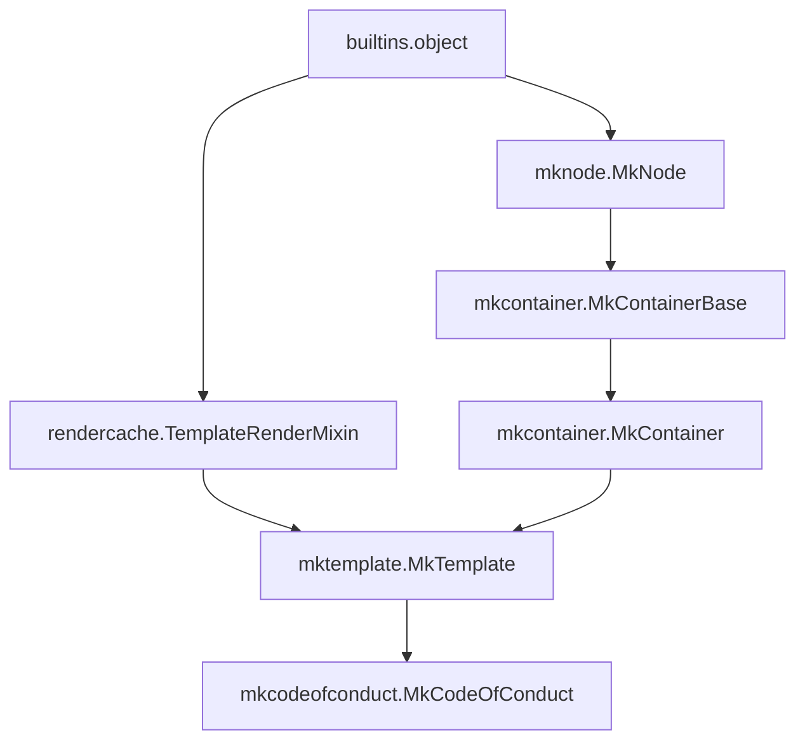

# MkCodeOfConduct

[ Show source on GitHub](https://github.com/phil65/mknodes/blob/main/src/mknodes/templatenodes/mkcodeofconduct/__init__.py)

### Node for a code of conduct section.

<details open>
<summary>Examples</summary>

### Example: **Regular**
> [!NOTE]
> **Jinja**
>
> ```jinja
> {{ mk.MkCodeOfConduct() }}
>
> ```

> [!NOTE]
> **Python**
>
> ```python
> MkCodeOfConduct()
> ```

<details open>
<summary>Rendered</summary>

## Our Pledge

We as members, contributors, and leaders pledge to make participation in our
community a harassment-free experience for everyone, regardless of age, body
size, visible or invisible disability, ethnicity, sex characteristics, gender
identity and expression, level of experience, education, socio-economic status,
nationality, personal appearance, race, caste, color, religion, or sexual
identity and orientation.

We pledge to act and interact in ways that contribute to an open, welcoming,
diverse, inclusive, and healthy community.

## Our Standards

Examples of behavior that contributes to a positive environment for our
community include:

* Demonstrating empathy and kindness toward other people
* Being respectful of differing opinions, viewpoints, and experiences
* Giving and gracefully accepting constructive feedback
* Accepting responsibility and apologizing to those affected by our mistakes,
  and learning from the experience
* Focusing on what is best not just for us as individuals, but for the overall
  community

Examples of unacceptable behavior include:

* The use of sexualized language or imagery, and sexual attention or advances of
  any kind
* Trolling, insulting or derogatory comments, and personal or political attacks
* Public or private harassment
* Publishing others' private information, such as a physical or email address,
  without their explicit permission
* Other conduct which could reasonably be considered inappropriate in a
  professional setting

## Enforcement Responsibilities

Community leaders are responsible for clarifying and enforcing our standards of
acceptable behavior and will take appropriate and fair corrective action in
response to any behavior that they deem inappropriate, threatening, offensive,
or harmful.

Community leaders have the right and responsibility to remove, edit, or reject
comments, commits, code, wiki edits, issues, and other contributions that are
not aligned to this Code of Conduct, and will communicate reasons for moderation
decisions when appropriate.

## Scope

This Code of Conduct applies within all community spaces, and also applies when
an individual is officially representing the community in public spaces.
Examples of representing our community include using an official e-mail address,
posting via an official social media account, or acting as an appointed
representative at an online or offline event.

## Enforcement

Instances of abusive, harassing, or otherwise unacceptable behavior may be
reported to the community leaders responsible for enforcement at
philipptemminghoff@gmail.com.
All complaints will be reviewed and investigated promptly and fairly.

All community leaders are obligated to respect the privacy and security of the
reporter of any incident.

## Enforcement Guidelines

Community leaders will follow these Community Impact Guidelines in determining
the consequences for any action they deem in violation of this Code of Conduct:

### 1. Correction

**Community Impact**: Use of inappropriate language or other behavior deemed
unprofessional or unwelcome in the community.

**Consequence**: A private, written warning from community leaders, providing
clarity around the nature of the violation and an explanation of why the
behavior was inappropriate. A public apology may be requested.

### 2. Warning

**Community Impact**: A violation through a single incident or series of
actions.

**Consequence**: A warning with consequences for continued behavior. No
interaction with the people involved, including unsolicited interaction with
those enforcing the Code of Conduct, for a specified period of time. This
includes avoiding interactions in community spaces as well as external channels
like social media. Violating these terms may lead to a temporary or permanent
ban.

### 3. Temporary Ban

**Community Impact**: A serious violation of community standards, including
sustained inappropriate behavior.

**Consequence**: A temporary ban from any sort of interaction or public
communication with the community for a specified period of time. No public or
private interaction with the people involved, including unsolicited interaction
with those enforcing the Code of Conduct, is allowed during this period.
Violating these terms may lead to a permanent ban.

### 4. Permanent Ban

**Community Impact**: Demonstrating a pattern of violation of community
standards, including sustained inappropriate behavior, harassment of an
individual, or aggression toward or disparagement of classes of individuals.

**Consequence**: A permanent ban from any sort of public interaction within the
community.

## Attribution

This Code of Conduct is adapted from the [Contributor Covenant][homepage],
version 2.1, available at
[https://www.contributor-covenant.org/version/2/1/code_of_conduct.html][v2.1].

Community Impact Guidelines were inspired by
[Mozilla's code of conduct enforcement ladder][Mozilla CoC].

For answers to common questions about this code of conduct, see the FAQ at
[FAQ](https://www.contributor-covenant.org/faq). Translations are available at
[translations](https://www.contributor-covenant.org/translations).

[homepage]: https://www.contributor-covenant.org
[v2.1]: https://www.contributor-covenant.org/version/2/1/code_of_conduct.html
[Mozilla CoC]: https://github.com/mozilla/diversity
[FAQ]: https://www.contributor-covenant.org/faq
[translations]: https://www.contributor-covenant.org/translations

</details>

<details>
<summary>Markdown</summary>

```markdown
## Our Pledge

We as members, contributors, and leaders pledge to make participation in our
community a harassment-free experience for everyone, regardless of age, body
size, visible or invisible disability, ethnicity, sex characteristics, gender
identity and expression, level of experience, education, socio-economic status,
nationality, personal appearance, race, caste, color, religion, or sexual
identity and orientation.

We pledge to act and interact in ways that contribute to an open, welcoming,
diverse, inclusive, and healthy community.

## Our Standards

Examples of behavior that contributes to a positive environment for our
community include:

* Demonstrating empathy and kindness toward other people
* Being respectful of differing opinions, viewpoints, and experiences
* Giving and gracefully accepting constructive feedback
* Accepting responsibility and apologizing to those affected by our mistakes,
  and learning from the experience
* Focusing on what is best not just for us as individuals, but for the overall
  community

Examples of unacceptable behavior include:

* The use of sexualized language or imagery, and sexual attention or advances of
  any kind
* Trolling, insulting or derogatory comments, and personal or political attacks
* Public or private harassment
* Publishing others' private information, such as a physical or email address,
  without their explicit permission
* Other conduct which could reasonably be considered inappropriate in a
  professional setting

## Enforcement Responsibilities

Community leaders are responsible for clarifying and enforcing our standards of
acceptable behavior and will take appropriate and fair corrective action in
response to any behavior that they deem inappropriate, threatening, offensive,
or harmful.

Community leaders have the right and responsibility to remove, edit, or reject
comments, commits, code, wiki edits, issues, and other contributions that are
not aligned to this Code of Conduct, and will communicate reasons for moderation
decisions when appropriate.

## Scope

This Code of Conduct applies within all community spaces, and also applies when
an individual is officially representing the community in public spaces.
Examples of representing our community include using an official e-mail address,
posting via an official social media account, or acting as an appointed
representative at an online or offline event.

## Enforcement

Instances of abusive, harassing, or otherwise unacceptable behavior may be
reported to the community leaders responsible for enforcement at
<MAIL NOT SET>.
All complaints will be reviewed and investigated promptly and fairly.

All community leaders are obligated to respect the privacy and security of the
reporter of any incident.

## Enforcement Guidelines

Community leaders will follow these Community Impact Guidelines in determining
the consequences for any action they deem in violation of this Code of Conduct:

### 1. Correction

**Community Impact**: Use of inappropriate language or other behavior deemed
unprofessional or unwelcome in the community.

**Consequence**: A private, written warning from community leaders, providing
clarity around the nature of the violation and an explanation of why the
behavior was inappropriate. A public apology may be requested.

### 2. Warning

**Community Impact**: A violation through a single incident or series of
actions.

**Consequence**: A warning with consequences for continued behavior. No
interaction with the people involved, including unsolicited interaction with
those enforcing the Code of Conduct, for a specified period of time. This
includes avoiding interactions in community spaces as well as external channels
like social media. Violating these terms may lead to a temporary or permanent
ban.

### 3. Temporary Ban

**Community Impact**: A serious violation of community standards, including
sustained inappropriate behavior.

**Consequence**: A temporary ban from any sort of interaction or public
communication with the community for a specified period of time. No public or
private interaction with the people involved, including unsolicited interaction
with those enforcing the Code of Conduct, is allowed during this period.
Violating these terms may lead to a permanent ban.

### 4. Permanent Ban

**Community Impact**: Demonstrating a pattern of violation of community
standards, including sustained inappropriate behavior, harassment of an
individual, or aggression toward or disparagement of classes of individuals.

**Consequence**: A permanent ban from any sort of public interaction within the
community.

## Attribution

This Code of Conduct is adapted from the [Contributor Covenant][homepage],
version 2.1, available at
[https://www.contributor-covenant.org/version/2/1/code_of_conduct.html][v2.1].

Community Impact Guidelines were inspired by
[Mozilla's code of conduct enforcement ladder][Mozilla CoC].

For answers to common questions about this code of conduct, see the FAQ at
[FAQ](https://www.contributor-covenant.org/faq). Translations are available at
[translations](https://www.contributor-covenant.org/translations).

[homepage]: https://www.contributor-covenant.org
[v2.1]: https://www.contributor-covenant.org/version/2/1/code_of_conduct.html
[Mozilla CoC]: https://github.com/mozilla/diversity
[FAQ]: https://www.contributor-covenant.org/faq
[translations]: https://www.contributor-covenant.org/translations

```

</details>

<details>
<summary>Html</summary>

```html
<h2 id="our-pledge">Our Pledge<a href="#our-pledge" aria-label="Link to heading 'Our Pledge'" data-heading-content="Our Pledge" class="anchor"></a></h2>
<p>We as members, contributors, and leaders pledge to make participation in our
community a harassment-free experience for everyone, regardless of age, body
size, visible or invisible disability, ethnicity, sex characteristics, gender
identity and expression, level of experience, education, socio-economic status,
nationality, personal appearance, race, caste, color, religion, or sexual
identity and orientation.</p>
<p>We pledge to act and interact in ways that contribute to an open, welcoming,
diverse, inclusive, and healthy community.</p>
<h2 id="our-standards">Our Standards<a href="#our-standards" aria-label="Link to heading 'Our Standards'" data-heading-content="Our Standards" class="anchor"></a></h2>
<p>Examples of behavior that contributes to a positive environment for our
community include:</p>
<ul>
<li>Demonstrating empathy and kindness toward other people</li>
<li>Being respectful of differing opinions, viewpoints, and experiences</li>
<li>Giving and gracefully accepting constructive feedback</li>
<li>Accepting responsibility and apologizing to those affected by our mistakes,
and learning from the experience</li>
<li>Focusing on what is best not just for us as individuals, but for the overall
community</li>
</ul>
<p>Examples of unacceptable behavior include:</p>
<ul>
<li>The use of sexualized language or imagery, and sexual attention or advances of
any kind</li>
<li>Trolling, insulting or derogatory comments, and personal or political attacks</li>
<li>Public or private harassment</li>
<li>Publishing others' private information, such as a physical or email address,
without their explicit permission</li>
<li>Other conduct which could reasonably be considered inappropriate in a
professional setting</li>
</ul>
<h2 id="enforcement-responsibilities">Enforcement Responsibilities<a href="#enforcement-responsibilities" aria-label="Link to heading 'Enforcement Responsibilities'" data-heading-content="Enforcement Responsibilities" class="anchor"></a></h2>
<p>Community leaders are responsible for clarifying and enforcing our standards of
acceptable behavior and will take appropriate and fair corrective action in
response to any behavior that they deem inappropriate, threatening, offensive,
or harmful.</p>
<p>Community leaders have the right and responsibility to remove, edit, or reject
comments, commits, code, wiki edits, issues, and other contributions that are
not aligned to this Code of Conduct, and will communicate reasons for moderation
decisions when appropriate.</p>
<h2 id="scope">Scope<a href="#scope" aria-label="Link to heading 'Scope'" data-heading-content="Scope" class="anchor"></a></h2>
<p>This Code of Conduct applies within all community spaces, and also applies when
an individual is officially representing the community in public spaces.
Examples of representing our community include using an official e-mail address,
posting via an official social media account, or acting as an appointed
representative at an online or offline event.</p>
<h2 id="enforcement">Enforcement<a href="#enforcement" aria-label="Link to heading 'Enforcement'" data-heading-content="Enforcement" class="anchor"></a></h2>
<p>Instances of abusive, harassing, or otherwise unacceptable behavior may be
reported to the community leaders responsible for enforcement at
<MAIL NOT SET>.
All complaints will be reviewed and investigated promptly and fairly.</p>
<p>All community leaders are obligated to respect the privacy and security of the
reporter of any incident.</p>
<h2 id="enforcement-guidelines">Enforcement Guidelines<a href="#enforcement-guidelines" aria-label="Link to heading 'Enforcement Guidelines'" data-heading-content="Enforcement Guidelines" class="anchor"></a></h2>
<p>Community leaders will follow these Community Impact Guidelines in determining
the consequences for any action they deem in violation of this Code of Conduct:</p>
<h3 id="1-correction">1. Correction<a href="#1-correction" aria-label="Link to heading '1. Correction'" data-heading-content="1. Correction" class="anchor"></a></h3>
<p><strong>Community Impact</strong>: Use of inappropriate language or other behavior deemed
unprofessional or unwelcome in the community.</p>
<p><strong>Consequence</strong>: A private, written warning from community leaders, providing
clarity around the nature of the violation and an explanation of why the
behavior was inappropriate. A public apology may be requested.</p>
<h3 id="2-warning">2. Warning<a href="#2-warning" aria-label="Link to heading '2. Warning'" data-heading-content="2. Warning" class="anchor"></a></h3>
<p><strong>Community Impact</strong>: A violation through a single incident or series of
actions.</p>
<p><strong>Consequence</strong>: A warning with consequences for continued behavior. No
interaction with the people involved, including unsolicited interaction with
those enforcing the Code of Conduct, for a specified period of time. This
includes avoiding interactions in community spaces as well as external channels
like social media. Violating these terms may lead to a temporary or permanent
ban.</p>
<h3 id="3-temporary-ban">3. Temporary Ban<a href="#3-temporary-ban" aria-label="Link to heading '3. Temporary Ban'" data-heading-content="3. Temporary Ban" class="anchor"></a></h3>
<p><strong>Community Impact</strong>: A serious violation of community standards, including
sustained inappropriate behavior.</p>
<p><strong>Consequence</strong>: A temporary ban from any sort of interaction or public
communication with the community for a specified period of time. No public or
private interaction with the people involved, including unsolicited interaction
with those enforcing the Code of Conduct, is allowed during this period.
Violating these terms may lead to a permanent ban.</p>
<h3 id="4-permanent-ban">4. Permanent Ban<a href="#4-permanent-ban" aria-label="Link to heading '4. Permanent Ban'" data-heading-content="4. Permanent Ban" class="anchor"></a></h3>
<p><strong>Community Impact</strong>: Demonstrating a pattern of violation of community
standards, including sustained inappropriate behavior, harassment of an
individual, or aggression toward or disparagement of classes of individuals.</p>
<p><strong>Consequence</strong>: A permanent ban from any sort of public interaction within the
community.</p>
<h2 id="attribution">Attribution<a href="#attribution" aria-label="Link to heading 'Attribution'" data-heading-content="Attribution" class="anchor"></a></h2>
<p>This Code of Conduct is adapted from the <a href="https://www.contributor-covenant.org">Contributor Covenant</a>,
version 2.1, available at
<a href="https://www.contributor-covenant.org/version/2/1/code_of_conduct.html">https://www.contributor-covenant.org/version/2/1/code_of_conduct.html</a>.</p>
<p>Community Impact Guidelines were inspired by
<a href="https://github.com/mozilla/diversity">Mozilla's code of conduct enforcement ladder</a>.</p>
<p>For answers to common questions about this code of conduct, see the FAQ at
<a href="https://www.contributor-covenant.org/faq">FAQ</a>. Translations are available at
<a href="https://www.contributor-covenant.org/translations">translations</a>.</p>

```

</details>

<details>
<summary>Repr tree</summary>

```
MkCodeOfConduct
├── MkHeader('Our Pledge')
├── MkHeader('Our Standards')
├── MkHeader('Enforcement Responsibilities')
├── MkHeader('Scope')
├── MkHeader('Enforcement')
├── MkHeader('Enforcement Guidelines')
├── MkHeader('1. Correction', level=3)
├── MkHeader('2. Warning', level=3)
├── MkHeader('3. Temporary Ban', level=3)
├── MkHeader('4. Permanent Ban', level=3)
├── MkHeader('Attribution')
├── MkLink('https://www.contributor-covenant.org/faq', 'FAQ')
╰── MkLink('https://www.contributor-covenant.org/translations', 'translations')
```

</details>

### Example: **Setting email explicitely**
> [!NOTE]
> **Jinja**
>
> ```jinja
> {{ "some@email.com" | MkCodeOfConduct }}
>
> ```

> [!NOTE]
> **Python**
>
> ```python
> MkCodeOfConduct('some@email.com')
> ```

<details open>
<summary>Rendered</summary>

## Our Pledge

We as members, contributors, and leaders pledge to make participation in our
community a harassment-free experience for everyone, regardless of age, body
size, visible or invisible disability, ethnicity, sex characteristics, gender
identity and expression, level of experience, education, socio-economic status,
nationality, personal appearance, race, caste, color, religion, or sexual
identity and orientation.

We pledge to act and interact in ways that contribute to an open, welcoming,
diverse, inclusive, and healthy community.

## Our Standards

Examples of behavior that contributes to a positive environment for our
community include:

* Demonstrating empathy and kindness toward other people
* Being respectful of differing opinions, viewpoints, and experiences
* Giving and gracefully accepting constructive feedback
* Accepting responsibility and apologizing to those affected by our mistakes,
  and learning from the experience
* Focusing on what is best not just for us as individuals, but for the overall
  community

Examples of unacceptable behavior include:

* The use of sexualized language or imagery, and sexual attention or advances of
  any kind
* Trolling, insulting or derogatory comments, and personal or political attacks
* Public or private harassment
* Publishing others' private information, such as a physical or email address,
  without their explicit permission
* Other conduct which could reasonably be considered inappropriate in a
  professional setting

## Enforcement Responsibilities

Community leaders are responsible for clarifying and enforcing our standards of
acceptable behavior and will take appropriate and fair corrective action in
response to any behavior that they deem inappropriate, threatening, offensive,
or harmful.

Community leaders have the right and responsibility to remove, edit, or reject
comments, commits, code, wiki edits, issues, and other contributions that are
not aligned to this Code of Conduct, and will communicate reasons for moderation
decisions when appropriate.

## Scope

This Code of Conduct applies within all community spaces, and also applies when
an individual is officially representing the community in public spaces.
Examples of representing our community include using an official e-mail address,
posting via an official social media account, or acting as an appointed
representative at an online or offline event.

## Enforcement

Instances of abusive, harassing, or otherwise unacceptable behavior may be
reported to the community leaders responsible for enforcement at
some@email.com.
All complaints will be reviewed and investigated promptly and fairly.

All community leaders are obligated to respect the privacy and security of the
reporter of any incident.

## Enforcement Guidelines

Community leaders will follow these Community Impact Guidelines in determining
the consequences for any action they deem in violation of this Code of Conduct:

### 1. Correction

**Community Impact**: Use of inappropriate language or other behavior deemed
unprofessional or unwelcome in the community.

**Consequence**: A private, written warning from community leaders, providing
clarity around the nature of the violation and an explanation of why the
behavior was inappropriate. A public apology may be requested.

### 2. Warning

**Community Impact**: A violation through a single incident or series of
actions.

**Consequence**: A warning with consequences for continued behavior. No
interaction with the people involved, including unsolicited interaction with
those enforcing the Code of Conduct, for a specified period of time. This
includes avoiding interactions in community spaces as well as external channels
like social media. Violating these terms may lead to a temporary or permanent
ban.

### 3. Temporary Ban

**Community Impact**: A serious violation of community standards, including
sustained inappropriate behavior.

**Consequence**: A temporary ban from any sort of interaction or public
communication with the community for a specified period of time. No public or
private interaction with the people involved, including unsolicited interaction
with those enforcing the Code of Conduct, is allowed during this period.
Violating these terms may lead to a permanent ban.

### 4. Permanent Ban

**Community Impact**: Demonstrating a pattern of violation of community
standards, including sustained inappropriate behavior, harassment of an
individual, or aggression toward or disparagement of classes of individuals.

**Consequence**: A permanent ban from any sort of public interaction within the
community.

## Attribution

This Code of Conduct is adapted from the [Contributor Covenant][homepage],
version 2.1, available at
[https://www.contributor-covenant.org/version/2/1/code_of_conduct.html][v2.1].

Community Impact Guidelines were inspired by
[Mozilla's code of conduct enforcement ladder][Mozilla CoC].

For answers to common questions about this code of conduct, see the FAQ at
[FAQ](https://www.contributor-covenant.org/faq). Translations are available at
[translations](https://www.contributor-covenant.org/translations).

[homepage]: https://www.contributor-covenant.org
[v2.1]: https://www.contributor-covenant.org/version/2/1/code_of_conduct.html
[Mozilla CoC]: https://github.com/mozilla/diversity
[FAQ]: https://www.contributor-covenant.org/faq
[translations]: https://www.contributor-covenant.org/translations

</details>

<details>
<summary>Markdown</summary>

```markdown
## Our Pledge

We as members, contributors, and leaders pledge to make participation in our
community a harassment-free experience for everyone, regardless of age, body
size, visible or invisible disability, ethnicity, sex characteristics, gender
identity and expression, level of experience, education, socio-economic status,
nationality, personal appearance, race, caste, color, religion, or sexual
identity and orientation.

We pledge to act and interact in ways that contribute to an open, welcoming,
diverse, inclusive, and healthy community.

## Our Standards

Examples of behavior that contributes to a positive environment for our
community include:

* Demonstrating empathy and kindness toward other people
* Being respectful of differing opinions, viewpoints, and experiences
* Giving and gracefully accepting constructive feedback
* Accepting responsibility and apologizing to those affected by our mistakes,
  and learning from the experience
* Focusing on what is best not just for us as individuals, but for the overall
  community

Examples of unacceptable behavior include:

* The use of sexualized language or imagery, and sexual attention or advances of
  any kind
* Trolling, insulting or derogatory comments, and personal or political attacks
* Public or private harassment
* Publishing others' private information, such as a physical or email address,
  without their explicit permission
* Other conduct which could reasonably be considered inappropriate in a
  professional setting

## Enforcement Responsibilities

Community leaders are responsible for clarifying and enforcing our standards of
acceptable behavior and will take appropriate and fair corrective action in
response to any behavior that they deem inappropriate, threatening, offensive,
or harmful.

Community leaders have the right and responsibility to remove, edit, or reject
comments, commits, code, wiki edits, issues, and other contributions that are
not aligned to this Code of Conduct, and will communicate reasons for moderation
decisions when appropriate.

## Scope

This Code of Conduct applies within all community spaces, and also applies when
an individual is officially representing the community in public spaces.
Examples of representing our community include using an official e-mail address,
posting via an official social media account, or acting as an appointed
representative at an online or offline event.

## Enforcement

Instances of abusive, harassing, or otherwise unacceptable behavior may be
reported to the community leaders responsible for enforcement at
some@email.com.
All complaints will be reviewed and investigated promptly and fairly.

All community leaders are obligated to respect the privacy and security of the
reporter of any incident.

## Enforcement Guidelines

Community leaders will follow these Community Impact Guidelines in determining
the consequences for any action they deem in violation of this Code of Conduct:

### 1. Correction

**Community Impact**: Use of inappropriate language or other behavior deemed
unprofessional or unwelcome in the community.

**Consequence**: A private, written warning from community leaders, providing
clarity around the nature of the violation and an explanation of why the
behavior was inappropriate. A public apology may be requested.

### 2. Warning

**Community Impact**: A violation through a single incident or series of
actions.

**Consequence**: A warning with consequences for continued behavior. No
interaction with the people involved, including unsolicited interaction with
those enforcing the Code of Conduct, for a specified period of time. This
includes avoiding interactions in community spaces as well as external channels
like social media. Violating these terms may lead to a temporary or permanent
ban.

### 3. Temporary Ban

**Community Impact**: A serious violation of community standards, including
sustained inappropriate behavior.

**Consequence**: A temporary ban from any sort of interaction or public
communication with the community for a specified period of time. No public or
private interaction with the people involved, including unsolicited interaction
with those enforcing the Code of Conduct, is allowed during this period.
Violating these terms may lead to a permanent ban.

### 4. Permanent Ban

**Community Impact**: Demonstrating a pattern of violation of community
standards, including sustained inappropriate behavior, harassment of an
individual, or aggression toward or disparagement of classes of individuals.

**Consequence**: A permanent ban from any sort of public interaction within the
community.

## Attribution

This Code of Conduct is adapted from the [Contributor Covenant][homepage],
version 2.1, available at
[https://www.contributor-covenant.org/version/2/1/code_of_conduct.html][v2.1].

Community Impact Guidelines were inspired by
[Mozilla's code of conduct enforcement ladder][Mozilla CoC].

For answers to common questions about this code of conduct, see the FAQ at
[FAQ](https://www.contributor-covenant.org/faq). Translations are available at
[translations](https://www.contributor-covenant.org/translations).

[homepage]: https://www.contributor-covenant.org
[v2.1]: https://www.contributor-covenant.org/version/2/1/code_of_conduct.html
[Mozilla CoC]: https://github.com/mozilla/diversity
[FAQ]: https://www.contributor-covenant.org/faq
[translations]: https://www.contributor-covenant.org/translations

```

</details>

<details>
<summary>Html</summary>

```html
<h2 id="our-pledge">Our Pledge<a href="#our-pledge" aria-label="Link to heading 'Our Pledge'" data-heading-content="Our Pledge" class="anchor"></a></h2>
<p>We as members, contributors, and leaders pledge to make participation in our
community a harassment-free experience for everyone, regardless of age, body
size, visible or invisible disability, ethnicity, sex characteristics, gender
identity and expression, level of experience, education, socio-economic status,
nationality, personal appearance, race, caste, color, religion, or sexual
identity and orientation.</p>
<p>We pledge to act and interact in ways that contribute to an open, welcoming,
diverse, inclusive, and healthy community.</p>
<h2 id="our-standards">Our Standards<a href="#our-standards" aria-label="Link to heading 'Our Standards'" data-heading-content="Our Standards" class="anchor"></a></h2>
<p>Examples of behavior that contributes to a positive environment for our
community include:</p>
<ul>
<li>Demonstrating empathy and kindness toward other people</li>
<li>Being respectful of differing opinions, viewpoints, and experiences</li>
<li>Giving and gracefully accepting constructive feedback</li>
<li>Accepting responsibility and apologizing to those affected by our mistakes,
and learning from the experience</li>
<li>Focusing on what is best not just for us as individuals, but for the overall
community</li>
</ul>
<p>Examples of unacceptable behavior include:</p>
<ul>
<li>The use of sexualized language or imagery, and sexual attention or advances of
any kind</li>
<li>Trolling, insulting or derogatory comments, and personal or political attacks</li>
<li>Public or private harassment</li>
<li>Publishing others' private information, such as a physical or email address,
without their explicit permission</li>
<li>Other conduct which could reasonably be considered inappropriate in a
professional setting</li>
</ul>
<h2 id="enforcement-responsibilities">Enforcement Responsibilities<a href="#enforcement-responsibilities" aria-label="Link to heading 'Enforcement Responsibilities'" data-heading-content="Enforcement Responsibilities" class="anchor"></a></h2>
<p>Community leaders are responsible for clarifying and enforcing our standards of
acceptable behavior and will take appropriate and fair corrective action in
response to any behavior that they deem inappropriate, threatening, offensive,
or harmful.</p>
<p>Community leaders have the right and responsibility to remove, edit, or reject
comments, commits, code, wiki edits, issues, and other contributions that are
not aligned to this Code of Conduct, and will communicate reasons for moderation
decisions when appropriate.</p>
<h2 id="scope">Scope<a href="#scope" aria-label="Link to heading 'Scope'" data-heading-content="Scope" class="anchor"></a></h2>
<p>This Code of Conduct applies within all community spaces, and also applies when
an individual is officially representing the community in public spaces.
Examples of representing our community include using an official e-mail address,
posting via an official social media account, or acting as an appointed
representative at an online or offline event.</p>
<h2 id="enforcement">Enforcement<a href="#enforcement" aria-label="Link to heading 'Enforcement'" data-heading-content="Enforcement" class="anchor"></a></h2>
<p>Instances of abusive, harassing, or otherwise unacceptable behavior may be
reported to the community leaders responsible for enforcement at
<a href="mailto:some@email.com">some@email.com</a>.
All complaints will be reviewed and investigated promptly and fairly.</p>
<p>All community leaders are obligated to respect the privacy and security of the
reporter of any incident.</p>
<h2 id="enforcement-guidelines">Enforcement Guidelines<a href="#enforcement-guidelines" aria-label="Link to heading 'Enforcement Guidelines'" data-heading-content="Enforcement Guidelines" class="anchor"></a></h2>
<p>Community leaders will follow these Community Impact Guidelines in determining
the consequences for any action they deem in violation of this Code of Conduct:</p>
<h3 id="1-correction">1. Correction<a href="#1-correction" aria-label="Link to heading '1. Correction'" data-heading-content="1. Correction" class="anchor"></a></h3>
<p><strong>Community Impact</strong>: Use of inappropriate language or other behavior deemed
unprofessional or unwelcome in the community.</p>
<p><strong>Consequence</strong>: A private, written warning from community leaders, providing
clarity around the nature of the violation and an explanation of why the
behavior was inappropriate. A public apology may be requested.</p>
<h3 id="2-warning">2. Warning<a href="#2-warning" aria-label="Link to heading '2. Warning'" data-heading-content="2. Warning" class="anchor"></a></h3>
<p><strong>Community Impact</strong>: A violation through a single incident or series of
actions.</p>
<p><strong>Consequence</strong>: A warning with consequences for continued behavior. No
interaction with the people involved, including unsolicited interaction with
those enforcing the Code of Conduct, for a specified period of time. This
includes avoiding interactions in community spaces as well as external channels
like social media. Violating these terms may lead to a temporary or permanent
ban.</p>
<h3 id="3-temporary-ban">3. Temporary Ban<a href="#3-temporary-ban" aria-label="Link to heading '3. Temporary Ban'" data-heading-content="3. Temporary Ban" class="anchor"></a></h3>
<p><strong>Community Impact</strong>: A serious violation of community standards, including
sustained inappropriate behavior.</p>
<p><strong>Consequence</strong>: A temporary ban from any sort of interaction or public
communication with the community for a specified period of time. No public or
private interaction with the people involved, including unsolicited interaction
with those enforcing the Code of Conduct, is allowed during this period.
Violating these terms may lead to a permanent ban.</p>
<h3 id="4-permanent-ban">4. Permanent Ban<a href="#4-permanent-ban" aria-label="Link to heading '4. Permanent Ban'" data-heading-content="4. Permanent Ban" class="anchor"></a></h3>
<p><strong>Community Impact</strong>: Demonstrating a pattern of violation of community
standards, including sustained inappropriate behavior, harassment of an
individual, or aggression toward or disparagement of classes of individuals.</p>
<p><strong>Consequence</strong>: A permanent ban from any sort of public interaction within the
community.</p>
<h2 id="attribution">Attribution<a href="#attribution" aria-label="Link to heading 'Attribution'" data-heading-content="Attribution" class="anchor"></a></h2>
<p>This Code of Conduct is adapted from the <a href="https://www.contributor-covenant.org">Contributor Covenant</a>,
version 2.1, available at
<a href="https://www.contributor-covenant.org/version/2/1/code_of_conduct.html">https://www.contributor-covenant.org/version/2/1/code_of_conduct.html</a>.</p>
<p>Community Impact Guidelines were inspired by
<a href="https://github.com/mozilla/diversity">Mozilla's code of conduct enforcement ladder</a>.</p>
<p>For answers to common questions about this code of conduct, see the FAQ at
<a href="https://www.contributor-covenant.org/faq">FAQ</a>. Translations are available at
<a href="https://www.contributor-covenant.org/translations">translations</a>.</p>

```

</details>

<details>
<summary>Repr tree</summary>

```
MkCodeOfConduct
├── MkHeader('Our Pledge')
├── MkHeader('Our Standards')
├── MkHeader('Enforcement Responsibilities')
├── MkHeader('Scope')
├── MkHeader('Enforcement')
├── MkHeader('Enforcement Guidelines')
├── MkHeader('1. Correction', level=3)
├── MkHeader('2. Warning', level=3)
├── MkHeader('3. Temporary Ban', level=3)
├── MkHeader('4. Permanent Ban', level=3)
├── MkHeader('Attribution')
├── MkLink('https://www.contributor-covenant.org/faq', 'FAQ')
╰── MkLink('https://www.contributor-covenant.org/translations', 'translations')
```

</details>

</details>

<details open>
<summary>DocStrings</summary>

<a id="mknodes.MkCodeOfConduct"></a>

```python
class MkCodeOfConduct(mktemplate.MkTemplate)
```

</details>

<details open>
<summary>Base classes</summary>

| Name | Children | Inherits |
|--- | --- | --- |
| **<font size='4'>[MkTemplate](https://phil65.github.io/mknodes/)</font>**<br>*<font size='1'>mknodes.templatenodes.mktemplate</font>*<br>Node representing a jinja template\. | <ul><li>[MkCliDoc](https://phil65.github.io/mknodes/)</li><li>[MkMaterialBadge](https://phil65.github.io/mknodes/)</li><li>[MkImageCompare](https://phil65.github.io/mknodes/)</li><li>[MkImageSlideshow](https://phil65.github.io/mknodes/)</li><li>[MkIFrame](https://phil65.github.io/mknodes/)</li><li>[MkCard](https://phil65.github.io/mknodes/)</li><li>[MkInstallGuide](https://phil65.github.io/mknodes/)</li><li>[MkCodeOfConduct](https://phil65.github.io/mknodes/)</li><li>[MkCommitConventions](https://phil65.github.io/mknodes/)</li><li>[MkDevEnvSetup](https://phil65.github.io/mknodes/)</li><li>[MkDevTools](https://phil65.github.io/mknodes/)</li><li>...</li></ul> | <ul><li>[TemplateRenderMixin](https://phil65.github.io/mknodes/)</li><li>[MkContainer](https://phil65.github.io/mknodes/)</li></ul> |

</details>

<details>
<summary>⋔ Inheritance diagram</summary>



</details>

<details>
<summary>NodeFile</summary>

**/home/runner/work/mknodes/mknodes/src/mknodes/templatenodes/mkcodeofconduct/metadata.toml**

```toml
[metadata]
name = "MkCodeOfConduct"
icon = "octicon:code-of-conduct-24"
group = "documentation"

[examples.regular]
title = "Regular"
jinja = """
{{ mk.MkCodeOfConduct() }}
"""

[examples.explicit]
title = "Setting email explicitely"
jinja = """
{{ "some@email.com" | MkCodeOfConduct }}
"""


[output.markdown]
template = """
{{ "Our Pledge" | MkHeader }}

We as members, contributors, and leaders pledge to make participation in our
community a harassment-free experience for everyone, regardless of age, body
size, visible or invisible disability, ethnicity, sex characteristics, gender
identity and expression, level of experience, education, socio-economic status,
nationality, personal appearance, race, caste, color, religion, or sexual
identity and orientation.

We pledge to act and interact in ways that contribute to an open, welcoming,
diverse, inclusive, and healthy community.

{{ "Our Standards" | MkHeader }}

Examples of behavior that contributes to a positive environment for our
community include:

* Demonstrating empathy and kindness toward other people
* Being respectful of differing opinions, viewpoints, and experiences
* Giving and gracefully accepting constructive feedback
* Accepting responsibility and apologizing to those affected by our mistakes,
  and learning from the experience
* Focusing on what is best not just for us as individuals, but for the overall
  community

Examples of unacceptable behavior include:

* The use of sexualized language or imagery, and sexual attention or advances of
  any kind
* Trolling, insulting or derogatory comments, and personal or political attacks
* Public or private harassment
* Publishing others' private information, such as a physical or email address,
  without their explicit permission
* Other conduct which could reasonably be considered inappropriate in a
  professional setting

{{ "Enforcement Responsibilities" | MkHeader }}

Community leaders are responsible for clarifying and enforcing our standards of
acceptable behavior and will take appropriate and fair corrective action in
response to any behavior that they deem inappropriate, threatening, offensive,
or harmful.

Community leaders have the right and responsibility to remove, edit, or reject
comments, commits, code, wiki edits, issues, and other contributions that are
not aligned to this Code of Conduct, and will communicate reasons for moderation
decisions when appropriate.

{{ "Scope" | MkHeader }}

This Code of Conduct applies within all community spaces, and also applies when
an individual is officially representing the community in public spaces.
Examples of representing our community include using an official e-mail address,
posting via an official social media account, or acting as an appointed
representative at an online or offline event.

{{ "Enforcement" | MkHeader }}

Instances of abusive, harassing, or otherwise unacceptable behavior may be
reported to the community leaders responsible for enforcement at
{{ node.contact_email }}.
All complaints will be reviewed and investigated promptly and fairly.

All community leaders are obligated to respect the privacy and security of the
reporter of any incident.

{{ "Enforcement Guidelines" | MkHeader }}

Community leaders will follow these Community Impact Guidelines in determining
the consequences for any action they deem in violation of this Code of Conduct:

{{ "1. Correction" | MkHeader(level=3) }}

**Community Impact**: Use of inappropriate language or other behavior deemed
unprofessional or unwelcome in the community.

**Consequence**: A private, written warning from community leaders, providing
clarity around the nature of the violation and an explanation of why the
behavior was inappropriate. A public apology may be requested.

{{ "2. Warning" | MkHeader(level=3) }}

**Community Impact**: A violation through a single incident or series of
actions.

**Consequence**: A warning with consequences for continued behavior. No
interaction with the people involved, including unsolicited interaction with
those enforcing the Code of Conduct, for a specified period of time. This
includes avoiding interactions in community spaces as well as external channels
like social media. Violating these terms may lead to a temporary or permanent
ban.

{{ "3. Temporary Ban" | MkHeader(level=3) }}

**Community Impact**: A serious violation of community standards, including
sustained inappropriate behavior.

**Consequence**: A temporary ban from any sort of interaction or public
communication with the community for a specified period of time. No public or
private interaction with the people involved, including unsolicited interaction
with those enforcing the Code of Conduct, is allowed during this period.
Violating these terms may lead to a permanent ban.

{{ "4. Permanent Ban" | MkHeader(level=3) }}

**Community Impact**: Demonstrating a pattern of violation of community
standards, including sustained inappropriate behavior, harassment of an
individual, or aggression toward or disparagement of classes of individuals.

**Consequence**: A permanent ban from any sort of public interaction within the
community.

{{ "Attribution" | MkHeader }}

This Code of Conduct is adapted from the [Contributor Covenant][homepage],
version 2.1, available at
[https://www.contributor-covenant.org/version/2/1/code_of_conduct.html][v2.1].

Community Impact Guidelines were inspired by
[Mozilla's code of conduct enforcement ladder][Mozilla CoC].

For answers to common questions about this code of conduct, see the FAQ at
{{ "https://www.contributor-covenant.org/faq" | MkLink("FAQ") }}. Translations are available at
{{ "https://www.contributor-covenant.org/translations" | MkLink("translations") }}.

[homepage]: https://www.contributor-covenant.org
[v2.1]: https://www.contributor-covenant.org/version/2/1/code_of_conduct.html
[Mozilla CoC]: https://github.com/mozilla/diversity
[FAQ]: https://www.contributor-covenant.org/faq
[translations]: https://www.contributor-covenant.org/translations


"""

```

</details>

<details>
<summary>Code</summary>

**mknodes.templatenodes.mkcodeofconduct.MkCodeOfConduct**

```python
class MkCodeOfConduct(mktemplate.MkTemplate):
    """Node for a code of conduct section."""

    ICON = "octicons/code-of-conduct-24"

    def __init__(
        self,
        contact_email: str | None = None,
        **kwargs: Any,
    ) -> None:
        """Constructor.

        Args:
            contact_email: Email for contacting. If None, it will be pulled from Project.
            kwargs: Keyword arguments passed to parent
        """
        super().__init__("output/markdown/template", **kwargs)
        self._contact_email = contact_email

    @property
    def contact_email(self):
        match self._contact_email:
            case str():
                return self._contact_email
            case None:
                return self.ctx.metadata.author_email or "<MAIL NOT SET>"
            case _:
                raise TypeError(self._contact_email)

```

</details>

<details>
<summary>Page info</summary>

<details>
<summary>Code for this page</summary>

**mknodes.manual.nodes_section.create_section_for_nodes**

```python
def create_section_for_nodes(
    nav: mk.MkNav,
    klasses: Sequence[type[mk.MkNode]],
) -> mk.MkTable:
    table = mk.MkTable(columns=["Node", "Docstrings", "Markdown extensions"])
    for kls in klasses:
        tpl = "classpage_custom.jinja"
        page = mk.MkClassPage(kls, icon=kls.ICON, template_path=tpl, parent=nav, hide="toc")
        nav += page
        if kls.STATUS:
            page.metadata.status = kls.STATUS
        elif kls.JS_FILES:
            page.metadata.status = "js"
        elif kls.CSS:
            page.metadata.status = "css"
        page.created_by = create_section_for_nodes
        link = mk.MkLink(page, kls.__name__, icon=kls.ICON)
        extensions = ", ".join(f"`{i}`" for i in kls.REQUIRED_EXTENSIONS)
        table.add_row((link, kls.__doc__, extensions))
    return table

```

</details>

<details>
<summary>Resources</summary>

```python
Resources(css=[],
          markdown_extensions={'admonition': {},
                               'pymdownx.details': {},
                               'pymdownx.highlight': {'anchor_linenums': True,
                                                      'line_spans': '__span',
                                                      'pygments_lang_class': True},
                               'pymdownx.superfences': {'custom_fences': [{'class': 'mermaid',
                                                                           'format': <function fence_code_format at 0x7bb797a5c1a0>,
                                                                           'name': 'mermaid'}]},
                               'pymdownx.tabbed': {},
                               'tables': {}},
          plugins=[Plugin('mkdocstrings')],
          js=[],
          assets=[],
          packages=[])
```

</details>

<details>
<summary>Metadata</summary>

```yaml
created:
  source_filename: /home/runner/work/mknodes/mknodes/src/mknodes/manual/nodes_section.py
  source_function: create_section_for_nodes
  source_line_no: 93
hide:
- toc
icon: octicons/code-of-conduct-24
status: new
title: MkCodeOfConduct

```

</details>

</details>
