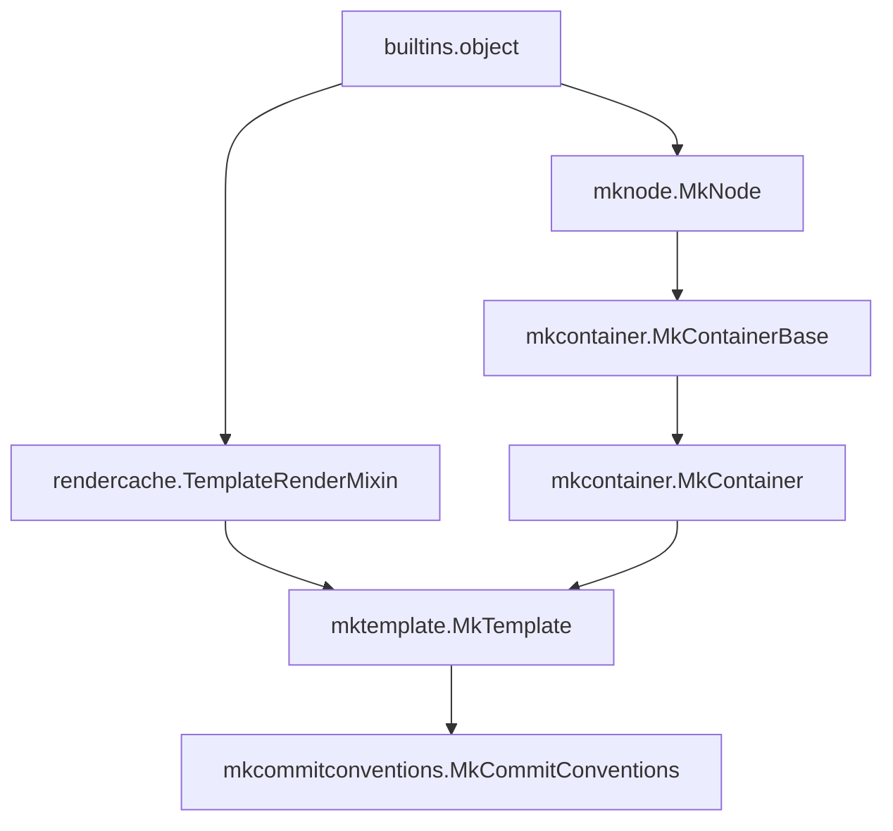

# MkCommitConventions

[ Show source on GitHub](https://github.com/phil65/mknodes/blob/main/src/mknodes/templatenodes/mkcommitconventions/__init__.py)

### Text node containing Commit message conventions.

<details open>
<summary>Examples</summary>

### Example: **All commit_types**
> [!NOTE]
> **Jinja**
>
> ```jinja
> {{ mk.MkCommitConventions() }}
>
> ```

> [!NOTE]
> **Python**
>
> ```python
> MkCommitConventions()
> ```

<details open>
<summary>Rendered</summary>

Commit messages must follow the following convention:

```md
<type>[(scope)]: Subject

[Body]
```

**Subject and body must be valid Markdown.**
Subject must have proper casing (uppercase for first letter
if it makes sense), but no dot at the end, and no punctuation
in general.

Scope and body are optional. Type can be:

* `build`: About packaging, building wheels, etc.
* `chore`: About packaging or repo/files management.
* `docs`: About documentation.
* `feat`: New feature.
* `fix`: Bug fix.
* `refactor`: Changes that are not features or bug fixes.
* `test`: About tests.

If you write a body, please add trailers at the end
(for example issues and PR references, or co-authors),
without relying on GitHub's flavored Markdown:

```md
Body.

Issue #10: https://github.com/namespace/project/issues/10
Related to PR namespace/other-project#2: https://github.com/namespace/other-project/pull/2"
```

These "trailers" must appear at the end of the body,
without any blank lines between them. The trailer title
can contain any character except colons `:`.
We expect a full URI for each trailer, not just GitHub autolinks
(for example, full GitHub URLs for commits and issues,
not the hash or the #issue-number).

We do not enforce a line length on commit messages summary and body,
but please avoid very long summaries, and very long lines in the body,
unless they are part of code blocks that must not be wrapped.

</details>

<details>
<summary>Markdown</summary>

````markdown
Commit messages must follow the following convention:

```md
<type>[(scope)]: Subject

[Body]
```

**Subject and body must be valid Markdown.**
Subject must have proper casing (uppercase for first letter
if it makes sense), but no dot at the end, and no punctuation
in general.

Scope and body are optional. Type can be:

* `build`: About packaging, building wheels, etc.
* `chore`: About packaging or repo/files management.
* `ci`: About Continuous Integration.
* `deps`: Dependencies update.
* `doc`: About documentation.
* `docs`: About documentation.
* `feat`: New feature.
* `fix`: Bug fix.
* `ref`: Code refactoring.
* `revert`: Code revert.
* `perf`: About performance.
* `refactor`: Changes that are not features or bug fixes.
* `style`: A change in code style/format.
* `test`: About tests.
* `tests`: About tests.

If you write a body, please add trailers at the end
(for example issues and PR references, or co-authors),
without relying on GitHub's flavored Markdown:

```md
Body.

Issue #10: https://github.com/namespace/project/issues/10
Related to PR namespace/other-project#2: https://github.com/namespace/other-project/pull/2"
```

These "trailers" must appear at the end of the body,
without any blank lines between them. The trailer title
can contain any character except colons `:`.
We expect a full URI for each trailer, not just GitHub autolinks
(for example, full GitHub URLs for commits and issues,
not the hash or the #issue-number).

We do not enforce a line length on commit messages summary and body,
but please avoid very long summaries, and very long lines in the body,
unless they are part of code blocks that must not be wrapped.
````

</details>

<details>
<summary>Html</summary>

```html
<p>Commit messages must follow the following convention:</p>
<pre><code class="language-md">&lt;type&gt;[(scope)]: Subject

[Body]
</code></pre>
<p><strong>Subject and body must be valid Markdown.</strong>
Subject must have proper casing (uppercase for first letter
if it makes sense), but no dot at the end, and no punctuation
in general.</p>
<p>Scope and body are optional. Type can be:</p>
<ul>
<li><code>build</code>: About packaging, building wheels, etc.</li>
<li><code>chore</code>: About packaging or repo/files management.</li>
<li><code>ci</code>: About Continuous Integration.</li>
<li><code>deps</code>: Dependencies update.</li>
<li><code>doc</code>: About documentation.</li>
<li><code>docs</code>: About documentation.</li>
<li><code>feat</code>: New feature.</li>
<li><code>fix</code>: Bug fix.</li>
<li><code>ref</code>: Code refactoring.</li>
<li><code>revert</code>: Code revert.</li>
<li><code>perf</code>: About performance.</li>
<li><code>refactor</code>: Changes that are not features or bug fixes.</li>
<li><code>style</code>: A change in code style/format.</li>
<li><code>test</code>: About tests.</li>
<li><code>tests</code>: About tests.</li>
</ul>
<p>If you write a body, please add trailers at the end
(for example issues and PR references, or co-authors),
without relying on GitHub's flavored Markdown:</p>
<pre><code class="language-md">Body.

Issue #10: https://github.com/namespace/project/issues/10
Related to PR namespace/other-project#2: https://github.com/namespace/other-project/pull/2&quot;
</code></pre>
<p>These &quot;trailers&quot; must appear at the end of the body,
without any blank lines between them. The trailer title
can contain any character except colons <code>:</code>.
We expect a full URI for each trailer, not just GitHub autolinks
(for example, full GitHub URLs for commits and issues,
not the hash or the #issue-number).</p>
<p>We do not enforce a line length on commit messages summary and body,
but please avoid very long summaries, and very long lines in the body,
unless they are part of code blocks that must not be wrapped.</p>

```

</details>

### Example: **Selected commit types**
> [!NOTE]
> **Jinja**
>
> ```jinja
> {{ ["fix", "feat", "refactor"] | MkCommitConventions }}
>
> ```

> [!NOTE]
> **Python**
>
> ```python
> MkCommitConventions(['fix', 'feat', 'refactor'])
> ```

<details open>
<summary>Rendered</summary>

Commit messages must follow the following convention:

```md
<type>[(scope)]: Subject

[Body]
```

**Subject and body must be valid Markdown.**
Subject must have proper casing (uppercase for first letter
if it makes sense), but no dot at the end, and no punctuation
in general.

Scope and body are optional. Type can be:

* `feat`: New feature.
* `fix`: Bug fix.
* `refactor`: Changes that are not features or bug fixes.

If you write a body, please add trailers at the end
(for example issues and PR references, or co-authors),
without relying on GitHub's flavored Markdown:

```md
Body.

Issue #10: https://github.com/namespace/project/issues/10
Related to PR namespace/other-project#2: https://github.com/namespace/other-project/pull/2"
```

These "trailers" must appear at the end of the body,
without any blank lines between them. The trailer title
can contain any character except colons `:`.
We expect a full URI for each trailer, not just GitHub autolinks
(for example, full GitHub URLs for commits and issues,
not the hash or the #issue-number).

We do not enforce a line length on commit messages summary and body,
but please avoid very long summaries, and very long lines in the body,
unless they are part of code blocks that must not be wrapped.

</details>

<details>
<summary>Markdown</summary>

````markdown
Commit messages must follow the following convention:

```md
<type>[(scope)]: Subject

[Body]
```

**Subject and body must be valid Markdown.**
Subject must have proper casing (uppercase for first letter
if it makes sense), but no dot at the end, and no punctuation
in general.

Scope and body are optional. Type can be:

* `feat`: New feature.
* `fix`: Bug fix.
* `refactor`: Changes that are not features or bug fixes.

If you write a body, please add trailers at the end
(for example issues and PR references, or co-authors),
without relying on GitHub's flavored Markdown:

```md
Body.

Issue #10: https://github.com/namespace/project/issues/10
Related to PR namespace/other-project#2: https://github.com/namespace/other-project/pull/2"
```

These "trailers" must appear at the end of the body,
without any blank lines between them. The trailer title
can contain any character except colons `:`.
We expect a full URI for each trailer, not just GitHub autolinks
(for example, full GitHub URLs for commits and issues,
not the hash or the #issue-number).

We do not enforce a line length on commit messages summary and body,
but please avoid very long summaries, and very long lines in the body,
unless they are part of code blocks that must not be wrapped.
````

</details>

<details>
<summary>Html</summary>

```html
<p>Commit messages must follow the following convention:</p>
<pre><code class="language-md">&lt;type&gt;[(scope)]: Subject

[Body]
</code></pre>
<p><strong>Subject and body must be valid Markdown.</strong>
Subject must have proper casing (uppercase for first letter
if it makes sense), but no dot at the end, and no punctuation
in general.</p>
<p>Scope and body are optional. Type can be:</p>
<ul>
<li><code>feat</code>: New feature.</li>
<li><code>fix</code>: Bug fix.</li>
<li><code>refactor</code>: Changes that are not features or bug fixes.</li>
</ul>
<p>If you write a body, please add trailers at the end
(for example issues and PR references, or co-authors),
without relying on GitHub's flavored Markdown:</p>
<pre><code class="language-md">Body.

Issue #10: https://github.com/namespace/project/issues/10
Related to PR namespace/other-project#2: https://github.com/namespace/other-project/pull/2&quot;
</code></pre>
<p>These &quot;trailers&quot; must appear at the end of the body,
without any blank lines between them. The trailer title
can contain any character except colons <code>:</code>.
We expect a full URI for each trailer, not just GitHub autolinks
(for example, full GitHub URLs for commits and issues,
not the hash or the #issue-number).</p>
<p>We do not enforce a line length on commit messages summary and body,
but please avoid very long summaries, and very long lines in the body,
unless they are part of code blocks that must not be wrapped.</p>

```

</details>

</details>

<details open>
<summary>DocStrings</summary>

<a id="mknodes.MkCommitConventions"></a>

```python
class MkCommitConventions(mktemplate.MkTemplate)
```

</details>

<details open>
<summary>Base classes</summary>

| Name | Children | Inherits |
|--- | --- | --- |
| **<font size='4'>[MkTemplate](https://phil65.github.io/mknodes/)</font>**<br>*<font size='1'>mknodes.templatenodes.mktemplate</font>*<br>Node representing a jinja template\. | <ul><li>[MkCliDoc](https://phil65.github.io/mknodes/)</li><li>[MkMaterialBadge](https://phil65.github.io/mknodes/)</li><li>[MkImageCompare](https://phil65.github.io/mknodes/)</li><li>[MkImageSlideshow](https://phil65.github.io/mknodes/)</li><li>[MkIFrame](https://phil65.github.io/mknodes/)</li><li>[MkCard](https://phil65.github.io/mknodes/)</li><li>[MkInstallGuide](https://phil65.github.io/mknodes/)</li><li>[MkCodeOfConduct](https://phil65.github.io/mknodes/)</li><li>[MkCommitConventions](https://phil65.github.io/mknodes/)</li><li>[MkDevEnvSetup](https://phil65.github.io/mknodes/)</li><li>[MkDevTools](https://phil65.github.io/mknodes/)</li><li>...</li></ul> | <ul><li>[TemplateRenderMixin](https://phil65.github.io/mknodes/)</li><li>[MkContainer](https://phil65.github.io/mknodes/)</li></ul> |

</details>

<details>
<summary>⋔ Inheritance diagram</summary>



</details>

<details>
<summary>NodeFile</summary>

**/home/runner/work/mknodes/mknodes/src/mknodes/templatenodes/mkcommitconventions/metadata.toml**

````toml
[metadata]
icon = "simple-icons:conventionalcommits"
status = "new"
name = "MkCommitConventions"
virtual_children = true

[examples.regular]
title = "All commit_types"
jinja = """
{{ mk.MkCommitConventions() }}
"""

[examples.explicit]
title = "Selected commit types"
jinja = """
{{ ["fix", "feat", "refactor"] | MkCommitConventions }}
"""

[output.markdown]
template = """
Commit messages must follow the following convention:

```md
<type>[(scope)]: Subject

[Body]
```

**Subject and body must be valid Markdown.**
Subject must have proper casing (uppercase for first letter
if it makes sense), but no dot at the end, and no punctuation
in general.

Scope and body are optional. Type can be:


* `{{ commit_type.typ }}`: {{ commit_type.description }}


If you write a body, please add trailers at the end
(for example issues and PR references, or co-authors),
without relying on GitHub's flavored Markdown:

```md
Body.

Issue #10: https://github.com/namespace/project/issues/10
Related to PR namespace/other-project#2: https://github.com/namespace/other-project/pull/2"
```

These "trailers" must appear at the end of the body,
without any blank lines between them. The trailer title
can contain any character except colons `:`.
We expect a full URI for each trailer, not just GitHub autolinks
(for example, full GitHub URLs for commits and issues,
not the hash or the #issue-number).

We do not enforce a line length on commit messages summary and body,
but please avoid very long summaries, and very long lines in the body,
unless they are part of code blocks that must not be wrapped.
"""

````

</details>

<details>
<summary>Code</summary>

**mknodes.templatenodes.mkcommitconventions.MkCommitConventions**

```python
class MkCommitConventions(mktemplate.MkTemplate):
    """Text node containing Commit message conventions."""

    ICON = "simple/conventionalcommits"
    STATUS = "new"

    def __init__(
        self,
        commit_types: (
            list[commitconventions.CommitTypeStr] | commitconventions.ConventionTypeStr | None
        ) = None,
        **kwargs: Any,
    ) -> None:
        """Constructor.

        Args:
            commit_types: Allowed commit commit_types. Can be "basic",
                          "conventional_commits", or a list of commit_types
            kwargs: Keyword arguments passed to parent
        """
        super().__init__(template="output/markdown/template", **kwargs)
        self._commit_types = commit_types

    @property
    def commit_types(self) -> list[commitconventions.CommitType]:
        val: list[commitconventions.CommitTypeStr] | commitconventions.ConventionTypeStr
        match self._commit_types:
            case None:
                val = self.ctx.metadata.commit_types or "conventional_commits"
            case _:
                val = self._commit_types
        return commitconventions.get_types(val)

```

</details>

<details>
<summary>Page info</summary>

<details>
<summary>Code for this page</summary>

**mknodes.manual.nodes_section.create_section_for_nodes**

```python
def create_section_for_nodes(
    nav: mk.MkNav,
    klasses: Sequence[type[mk.MkNode]],
) -> mk.MkTable:
    table = mk.MkTable(columns=["Node", "Docstrings", "Markdown extensions"])
    for kls in klasses:
        tpl = "classpage_custom.jinja"
        page = mk.MkClassPage(kls, icon=kls.ICON, template_path=tpl, parent=nav, hide="toc")
        nav += page
        if kls.STATUS:
            page.metadata.status = kls.STATUS
        elif kls.JS_FILES:
            page.metadata.status = "js"
        elif kls.CSS:
            page.metadata.status = "css"
        page.created_by = create_section_for_nodes
        link = mk.MkLink(page, kls.__name__, icon=kls.ICON)
        extensions = ", ".join(f"`{i}`" for i in kls.REQUIRED_EXTENSIONS)
        table.add_row((link, kls.__doc__, extensions))
    return table

```

</details>

<details>
<summary>Resources</summary>

```python
Resources(css=[],
          markdown_extensions={'admonition': {},
                               'pymdownx.details': {},
                               'pymdownx.highlight': {'anchor_linenums': True,
                                                      'line_spans': '__span',
                                                      'pygments_lang_class': True},
                               'pymdownx.superfences': {'custom_fences': [{'class': 'mermaid',
                                                                           'format': <function fence_code_format at 0x7bb797a5c1a0>,
                                                                           'name': 'mermaid'}]},
                               'pymdownx.tabbed': {},
                               'tables': {}},
          plugins=[Plugin('mkdocstrings')],
          js=[],
          assets=[],
          packages=[])
```

</details>

<details>
<summary>Metadata</summary>

```yaml
created:
  source_filename: /home/runner/work/mknodes/mknodes/src/mknodes/manual/nodes_section.py
  source_function: create_section_for_nodes
  source_line_no: 93
hide:
- toc
icon: simple/conventionalcommits
status: new
title: MkCommitConventions

```

</details>

</details>
