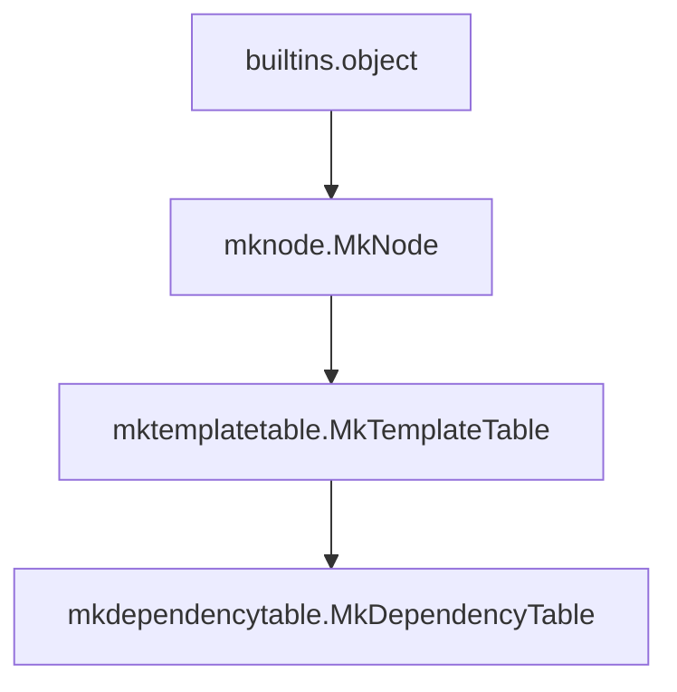

# MkDependencyTable

[ Show source on GitHub](https://github.com/phil65/mknodes/blob/main/src/mknodes/templatenodes/mkdependencytable/__init__.py)

### Node for a table showing dependencies for a package.

<details open>
<summary>Examples</summary>

### Example: **From Project**
> [!NOTE]
> **Jinja**
>
> ```jinja
> {{ mk.MkDependencyTable() }}
>
> ```

> [!NOTE]
> **Python**
>
> ```python
> MkDependencyTable()
> ```

<details open>
<summary>Rendered</summary>

| Name | Summary | Marker |
|--- | --- | --- |
| **<font size='3'>[anybadge](https://github.com/jongracecox/anybadge)</font>** | *Simple, flexible badge generator for project badges.* |  |
| **<font size='3'>[anyenv](https://phil65.github.io/anyenv/)</font>** | *Compatibility layer for some basic operations to allow painless operation in PyOdide and Python pre-releases* |  |
| **<font size='3'>[anyio](https://anyio.readthedocs.io/en/latest/)</font>** | *High-level concurrency and networking framework on top of asyncio or Trio* |  |
| **<font size='3'>[clinspector](https://phil65.github.io/clinspector/)</font>** | *Introspect Python CLI apps (Typer, Click, Cleo, Cappa, Cyclopts, argparse) into structured data.* |  |
| **<font size='3'>[coloraide](https://github.com/facelessuser/coloraide)</font>** | *A color library for Python.* |  |
| **<font size='3'>[epregistry](https://github.com/phil65/epregistry)</font>** | *Cached, generically typed registries for Python entry points, plus package/distribution name mapping* |  |
| **<font size='3'>[fieldz](https://github.com/pyapp-kit/fieldz)</font>** | *Utilities for providing compatibility with many dataclass-like libraries* |  |
| **<font size='3'>[fsspec](https://github.com/fsspec/filesystem_spec)</font>** | *File-system specification* |  |
| **<font size='3'>[git-changelog](https://pawamoy.github.io/git-changelog)</font>** | *Automatic Changelog generator using Jinja2 templates.* |  |
| **<font size='3'>[githarbor](https://github.com/phil65/githarbor)</font>** | *Unified Python client for GitHub, GitLab, Gitea, Azure DevOps and local Git repositories* |  |
| **<font size='3'>[GitPython](https://gitpython.readthedocs.io/en/stable/)</font>** | *GitPython is a Python library used to interact with Git repositories* |  |
| **<font size='3'>[griffelib](https://mkdocstrings.github.io/griffe)</font>** | *Signatures for entire Python programs. Extract the structure, the frame, the skeleton of your project, to generate API documentation or find breaking changes in your API.* |  |
| **<font size='3'>[Jinja2](https://jinja.palletsprojects.com/)</font>** | *A very fast and expressive template engine.* |  |
| **<font size='3'>[jinjarope](https://phil65.github.io/jinjarope/)</font>** | *Jinja2 toolkit: enhanced Environment, extra filters / tests, fsspec-based loaders and TOML JinjaFiles.* |  |
| **<font size='3'>[logfire-sdk](https://pydantic.dev/logfire)</font>** | *The best Python observability tool! 🪵🔥* |  |
| **<font size='3'>[Markdown](https://Python-Markdown.github.io/)</font>** | *Python implementation of John Gruber's Markdown.* |  |
| **<font size='3'>[MarkupSafe](https://markupsafe.palletsprojects.com/)</font>** | *Safely add untrusted strings to HTML/XML markup.* |  |
| **<font size='3'>[natsort](https://github.com/SethMMorton/natsort)</font>** | *Simple yet flexible natural sorting in Python.* |  |
| **<font size='3'>[packaging](https://packaging.pypa.io/)</font>** | *Core utilities for Python packages* |  |
| **<font size='3'>[pipdeptree](https://github.com/tox-dev/pipdeptree)</font>** | *Command line utility to show dependency tree of packages.* |  |
| **<font size='3'>[platformdirs](https://github.com/tox-dev/platformdirs)</font>** | *A small Python package for determining appropriate platform-specific dirs, e.g. a `user data dir`.* |  |
| **<font size='3'>[pydantic](https://github.com/pydantic/pydantic)</font>** | *Data validation using Python type hints* |  |
| **<font size='3'>[pymdown-extensions](https://github.com/facelessuser/pymdown-extensions)</font>** | *Extension pack for Python Markdown.* |  |
| **<font size='3'>[pytest-asyncio](https://github.com/pytest-dev/pytest-asyncio)</font>** | *Pytest support for asyncio* |  |
| **<font size='3'>[python-dotenv](https://github.com/theskumar/python-dotenv)</font>** | *Read key-value pairs from a .env file and set them as environment variables* |  |
| **<font size='3'>[PyYAML](https://pyyaml.org/)</font>** | *YAML parser and emitter for Python* |  |
| **<font size='3'>[requests](https://requests.readthedocs.io)</font>** | *Python HTTP for Humans.* |  |
| **<font size='3'>[rich](https://github.com/Textualize/rich)</font>** | *Render rich text, tables, progress bars, syntax highlighting, markdown and more to the terminal* |  |
| **<font size='3'>[tomli_w](https://github.com/hukkin/tomli-w)</font>** | *A lil' TOML writer* |  |
| **<font size='3'>[typer](https://github.com/fastapi/typer)</font>** | *Typer, build great CLIs. Easy to code. Based on Python type hints.* |  |
| **<font size='3'>[universal_pathlib](https://github.com/fsspec/universal_pathlib)</font>** | *pathlib api extended to use fsspec backends* |  |
| **<font size='3'>[upathtools](https://phil65.github.io/upathtools/)</font>** | *Async helpers, typed base classes and many filesystem implementations for fsspec and universal-pathlib* |  |
| **<font size='3'>[yamling](https://phil65.github.io/yamling/)</font>** | *Enhanced YAML loading and dumping.* |  |
| **<font size='3'>[zensical](https://zensical.org/)</font>** | *A modern static site generator built by the creators of Material for MkDocs* |  |
| **<font size='3'>[markdown-it-py](https://github.com/executablebooks/markdown-it-py)</font>** | *Python port of markdown-it. Markdown parsing, done right!* | `extra == "html"` |
| **<font size='3'>[mdit-py-plugins](https://github.com/executablebooks/mdit-py-plugins)</font>** | *Collection of plugins for markdown-it-py* | `extra == "html"` |
| **<font size='3'>[mkconvert](https://phil65.github.io/mkconvert/)</font>** | *One API for Python and Rust Markdown parsers with common options, plus HTML-to-Markdown conversion* | `extra == "html"` |
| **<font size='3'>[agentpool](https://phil65.github.io/agentpool/)</font>** | *Pydantic-AI based Multi-Agent Framework with YAML-based Agents, Teams, Workflows & Extended ACP / AGUI integration* | `extra == "llm"` |
| **<font size='3'>[mkdocs](https://www.mkdocs.org/)</font>** | *Project documentation with Markdown.* | `extra == "mkdocs"` |
| **<font size='3'>[mkdocs-material](https://squidfunk.github.io/mkdocs-material/)</font>** | *Documentation that simply works* | `extra == "mkdocs"` |
| `**<font size='3'>furo</font>**` | *A clean customisable Sphinx documentation theme.* | `extra == "sphinx"` |
| **<font size='3'>[myst-parser](https://github.com/executablebooks/MyST-Parser)</font>** | *An extended [CommonMark](https://spec.commonmark.org/) compliant parser,* | `extra == "sphinx"` |
| **<font size='3'>[Sphinx](https://www.sphinx-doc.org/)</font>** | *Python documentation generator* | `extra == "sphinx"` |
| **<font size='3'>[sphinx_design](https://github.com/executablebooks/sphinx-design)</font>** | *A sphinx extension for designing beautiful, view size responsive web components.* | `extra == "sphinx"` |

</details>

<details>
<summary>Markdown</summary>

```markdown
| Name | Summary | Marker |
|--- | --- | --- |
| **<font size='3'>[anybadge](https://github.com/jongracecox/anybadge)</font>** | *Simple, flexible badge generator for project badges.* |  |
| **<font size='3'>[anyenv](https://phil65.github.io/anyenv/)</font>** | *Compatibility layer for some basic operations to allow painless operation in PyOdide and Python pre-releases* |  |
| **<font size='3'>[anyio](https://anyio.readthedocs.io/en/latest/)</font>** | *High-level concurrency and networking framework on top of asyncio or Trio* |  |
| **<font size='3'>[clinspector](https://phil65.github.io/clinspector/)</font>** | *Introspect Python CLI apps (Typer, Click, Cleo, Cappa, Cyclopts, argparse) into structured data.* |  |
| **<font size='3'>[coloraide](https://github.com/facelessuser/coloraide)</font>** | *A color library for Python.* |  |
| **<font size='3'>[epregistry](https://github.com/phil65/epregistry)</font>** | *Cached, generically typed registries for Python entry points, plus package/distribution name mapping* |  |
| **<font size='3'>[fieldz](https://github.com/pyapp-kit/fieldz)</font>** | *Utilities for providing compatibility with many dataclass-like libraries* |  |
| **<font size='3'>[fsspec](https://github.com/fsspec/filesystem_spec)</font>** | *File-system specification* |  |
| **<font size='3'>[git-changelog](https://pawamoy.github.io/git-changelog)</font>** | *Automatic Changelog generator using Jinja2 templates.* |  |
| **<font size='3'>[githarbor](https://github.com/phil65/githarbor)</font>** | *Unified Python client for GitHub, GitLab, Gitea, Azure DevOps and local Git repositories* |  |
| **<font size='3'>[GitPython](https://gitpython.readthedocs.io/en/stable/)</font>** | *GitPython is a Python library used to interact with Git repositories* |  |
| **<font size='3'>[griffelib](https://mkdocstrings.github.io/griffe)</font>** | *Signatures for entire Python programs. Extract the structure, the frame, the skeleton of your project, to generate API documentation or find breaking changes in your API.* |  |
| **<font size='3'>[Jinja2](https://jinja.palletsprojects.com/)</font>** | *A very fast and expressive template engine.* |  |
| **<font size='3'>[jinjarope](https://phil65.github.io/jinjarope/)</font>** | *Jinja2 toolkit: enhanced Environment, extra filters / tests, fsspec-based loaders and TOML JinjaFiles.* |  |
| **<font size='3'>[logfire-sdk](https://pydantic.dev/logfire)</font>** | *The best Python observability tool! 🪵🔥* |  |
| **<font size='3'>[Markdown](https://Python-Markdown.github.io/)</font>** | *Python implementation of John Gruber's Markdown.* |  |
| **<font size='3'>[MarkupSafe](https://markupsafe.palletsprojects.com/)</font>** | *Safely add untrusted strings to HTML/XML markup.* |  |
| **<font size='3'>[natsort](https://github.com/SethMMorton/natsort)</font>** | *Simple yet flexible natural sorting in Python.* |  |
| **<font size='3'>[packaging](https://packaging.pypa.io/)</font>** | *Core utilities for Python packages* |  |
| **<font size='3'>[pipdeptree](https://github.com/tox-dev/pipdeptree)</font>** | *Command line utility to show dependency tree of packages.* |  |
| **<font size='3'>[platformdirs](https://github.com/tox-dev/platformdirs)</font>** | *A small Python package for determining appropriate platform-specific dirs, e.g. a `user data dir`.* |  |
| **<font size='3'>[pydantic](https://github.com/pydantic/pydantic)</font>** | *Data validation using Python type hints* |  |
| **<font size='3'>[pymdown-extensions](https://github.com/facelessuser/pymdown-extensions)</font>** | *Extension pack for Python Markdown.* |  |
| **<font size='3'>[pytest-asyncio](https://github.com/pytest-dev/pytest-asyncio)</font>** | *Pytest support for asyncio* |  |
| **<font size='3'>[python-dotenv](https://github.com/theskumar/python-dotenv)</font>** | *Read key-value pairs from a .env file and set them as environment variables* |  |
| **<font size='3'>[PyYAML](https://pyyaml.org/)</font>** | *YAML parser and emitter for Python* |  |
| **<font size='3'>[requests](https://requests.readthedocs.io)</font>** | *Python HTTP for Humans.* |  |
| **<font size='3'>[rich](https://github.com/Textualize/rich)</font>** | *Render rich text, tables, progress bars, syntax highlighting, markdown and more to the terminal* |  |
| **<font size='3'>[tomli_w](https://github.com/hukkin/tomli-w)</font>** | *A lil' TOML writer* |  |
| **<font size='3'>[typer](https://github.com/fastapi/typer)</font>** | *Typer, build great CLIs. Easy to code. Based on Python type hints.* |  |
| **<font size='3'>[universal_pathlib](https://github.com/fsspec/universal_pathlib)</font>** | *pathlib api extended to use fsspec backends* |  |
| **<font size='3'>[upathtools](https://phil65.github.io/upathtools/)</font>** | *Async helpers, typed base classes and many filesystem implementations for fsspec and universal-pathlib* |  |
| **<font size='3'>[yamling](https://phil65.github.io/yamling/)</font>** | *Enhanced YAML loading and dumping.* |  |
| **<font size='3'>[zensical](https://zensical.org/)</font>** | *A modern static site generator built by the creators of Material for MkDocs* |  |
| **<font size='3'>[markdown-it-py](https://github.com/executablebooks/markdown-it-py)</font>** | *Python port of markdown-it. Markdown parsing, done right!* | `extra == "html"` |
| **<font size='3'>[mdit-py-plugins](https://github.com/executablebooks/mdit-py-plugins)</font>** | *Collection of plugins for markdown-it-py* | `extra == "html"` |
| **<font size='3'>[mkconvert](https://phil65.github.io/mkconvert/)</font>** | *One API for Python and Rust Markdown parsers with common options, plus HTML-to-Markdown conversion* | `extra == "html"` |
| **<font size='3'>[agentpool](https://phil65.github.io/agentpool/)</font>** | *Pydantic-AI based Multi-Agent Framework with YAML-based Agents, Teams, Workflows & Extended ACP / AGUI integration* | `extra == "llm"` |
| **<font size='3'>[mkdocs](https://www.mkdocs.org/)</font>** | *Project documentation with Markdown.* | `extra == "mkdocs"` |
| **<font size='3'>[mkdocs-material](https://squidfunk.github.io/mkdocs-material/)</font>** | *Documentation that simply works* | `extra == "mkdocs"` |
| `**<font size='3'>furo</font>**` | *A clean customisable Sphinx documentation theme.* | `extra == "sphinx"` |
| **<font size='3'>[myst-parser](https://github.com/executablebooks/MyST-Parser)</font>** | *An extended [CommonMark](https://spec.commonmark.org/) compliant parser,* | `extra == "sphinx"` |
| **<font size='3'>[Sphinx](https://www.sphinx-doc.org/)</font>** | *Python documentation generator* | `extra == "sphinx"` |
| **<font size='3'>[sphinx_design](https://github.com/executablebooks/sphinx-design)</font>** | *A sphinx extension for designing beautiful, view size responsive web components.* | `extra == "sphinx"` |

```

</details>

<details>
<summary>Html</summary>

```html
<table>
<thead>
<tr>
<th>Name</th>
<th>Summary</th>
<th>Marker</th>
</tr>
</thead>
<tbody>
<tr>
<td><strong><font size='3'><a href="https://github.com/jongracecox/anybadge">anybadge</a></font></strong></td>
<td><em>Simple, flexible badge generator for project badges.</em></td>
<td></td>
</tr>
<tr>
<td><strong><font size='3'><a href="https://phil65.github.io/anyenv/">anyenv</a></font></strong></td>
<td><em>Compatibility layer for some basic operations to allow painless operation in PyOdide and Python pre-releases</em></td>
<td></td>
</tr>
<tr>
<td><strong><font size='3'><a href="https://anyio.readthedocs.io/en/latest/">anyio</a></font></strong></td>
<td><em>High-level concurrency and networking framework on top of asyncio or Trio</em></td>
<td></td>
</tr>
<tr>
<td><strong><font size='3'><a href="https://phil65.github.io/clinspector/">clinspector</a></font></strong></td>
<td><em>Introspect Python CLI apps (Typer, Click, Cleo, Cappa, Cyclopts, argparse) into structured data.</em></td>
<td></td>
</tr>
<tr>
<td><strong><font size='3'><a href="https://github.com/facelessuser/coloraide">coloraide</a></font></strong></td>
<td><em>A color library for Python.</em></td>
<td></td>
</tr>
<tr>
<td><strong><font size='3'><a href="https://github.com/phil65/epregistry">epregistry</a></font></strong></td>
<td><em>Cached, generically typed registries for Python entry points, plus package/distribution name mapping</em></td>
<td></td>
</tr>
<tr>
<td><strong><font size='3'><a href="https://github.com/pyapp-kit/fieldz">fieldz</a></font></strong></td>
<td><em>Utilities for providing compatibility with many dataclass-like libraries</em></td>
<td></td>
</tr>
<tr>
<td><strong><font size='3'><a href="https://github.com/fsspec/filesystem_spec">fsspec</a></font></strong></td>
<td><em>File-system specification</em></td>
<td></td>
</tr>
<tr>
<td><strong><font size='3'><a href="https://pawamoy.github.io/git-changelog">git-changelog</a></font></strong></td>
<td><em>Automatic Changelog generator using Jinja2 templates.</em></td>
<td></td>
</tr>
<tr>
<td><strong><font size='3'><a href="https://github.com/phil65/githarbor">githarbor</a></font></strong></td>
<td><em>Unified Python client for GitHub, GitLab, Gitea, Azure DevOps and local Git repositories</em></td>
<td></td>
</tr>
<tr>
<td><strong><font size='3'><a href="https://gitpython.readthedocs.io/en/stable/">GitPython</a></font></strong></td>
<td><em>GitPython is a Python library used to interact with Git repositories</em></td>
<td></td>
</tr>
<tr>
<td><strong><font size='3'><a href="https://mkdocstrings.github.io/griffe">griffelib</a></font></strong></td>
<td><em>Signatures for entire Python programs. Extract the structure, the frame, the skeleton of your project, to generate API documentation or find breaking changes in your API.</em></td>
<td></td>
</tr>
<tr>
<td><strong><font size='3'><a href="https://jinja.palletsprojects.com/">Jinja2</a></font></strong></td>
<td><em>A very fast and expressive template engine.</em></td>
<td></td>
</tr>
<tr>
<td><strong><font size='3'><a href="https://phil65.github.io/jinjarope/">jinjarope</a></font></strong></td>
<td><em>Jinja2 toolkit: enhanced Environment, extra filters / tests, fsspec-based loaders and TOML JinjaFiles.</em></td>
<td></td>
</tr>
<tr>
<td><strong><font size='3'><a href="https://pydantic.dev/logfire">logfire-sdk</a></font></strong></td>
<td><em>The best Python observability tool! 🪵🔥</em></td>
<td></td>
</tr>
<tr>
<td><strong><font size='3'><a href="https://Python-Markdown.github.io/">Markdown</a></font></strong></td>
<td><em>Python implementation of John Gruber's Markdown.</em></td>
<td></td>
</tr>
<tr>
<td><strong><font size='3'><a href="https://markupsafe.palletsprojects.com/">MarkupSafe</a></font></strong></td>
<td><em>Safely add untrusted strings to HTML/XML markup.</em></td>
<td></td>
</tr>
<tr>
<td><strong><font size='3'><a href="https://github.com/SethMMorton/natsort">natsort</a></font></strong></td>
<td><em>Simple yet flexible natural sorting in Python.</em></td>
<td></td>
</tr>
<tr>
<td><strong><font size='3'><a href="https://packaging.pypa.io/">packaging</a></font></strong></td>
<td><em>Core utilities for Python packages</em></td>
<td></td>
</tr>
<tr>
<td><strong><font size='3'><a href="https://github.com/tox-dev/pipdeptree">pipdeptree</a></font></strong></td>
<td><em>Command line utility to show dependency tree of packages.</em></td>
<td></td>
</tr>
<tr>
<td><strong><font size='3'><a href="https://github.com/tox-dev/platformdirs">platformdirs</a></font></strong></td>
<td><em>A small Python package for determining appropriate platform-specific dirs, e.g. a <code>user data dir</code>.</em></td>
<td></td>
</tr>
<tr>
<td><strong><font size='3'><a href="https://github.com/pydantic/pydantic">pydantic</a></font></strong></td>
<td><em>Data validation using Python type hints</em></td>
<td></td>
</tr>
<tr>
<td><strong><font size='3'><a href="https://github.com/facelessuser/pymdown-extensions">pymdown-extensions</a></font></strong></td>
<td><em>Extension pack for Python Markdown.</em></td>
<td></td>
</tr>
<tr>
<td><strong><font size='3'><a href="https://github.com/pytest-dev/pytest-asyncio">pytest-asyncio</a></font></strong></td>
<td><em>Pytest support for asyncio</em></td>
<td></td>
</tr>
<tr>
<td><strong><font size='3'><a href="https://github.com/theskumar/python-dotenv">python-dotenv</a></font></strong></td>
<td><em>Read key-value pairs from a .env file and set them as environment variables</em></td>
<td></td>
</tr>
<tr>
<td><strong><font size='3'><a href="https://pyyaml.org/">PyYAML</a></font></strong></td>
<td><em>YAML parser and emitter for Python</em></td>
<td></td>
</tr>
<tr>
<td><strong><font size='3'><a href="https://requests.readthedocs.io">requests</a></font></strong></td>
<td><em>Python HTTP for Humans.</em></td>
<td></td>
</tr>
<tr>
<td><strong><font size='3'><a href="https://github.com/Textualize/rich">rich</a></font></strong></td>
<td><em>Render rich text, tables, progress bars, syntax highlighting, markdown and more to the terminal</em></td>
<td></td>
</tr>
<tr>
<td><strong><font size='3'><a href="https://github.com/hukkin/tomli-w">tomli_w</a></font></strong></td>
<td><em>A lil' TOML writer</em></td>
<td></td>
</tr>
<tr>
<td><strong><font size='3'><a href="https://github.com/fastapi/typer">typer</a></font></strong></td>
<td><em>Typer, build great CLIs. Easy to code. Based on Python type hints.</em></td>
<td></td>
</tr>
<tr>
<td><strong><font size='3'><a href="https://github.com/fsspec/universal_pathlib">universal_pathlib</a></font></strong></td>
<td><em>pathlib api extended to use fsspec backends</em></td>
<td></td>
</tr>
<tr>
<td><strong><font size='3'><a href="https://phil65.github.io/upathtools/">upathtools</a></font></strong></td>
<td><em>Async helpers, typed base classes and many filesystem implementations for fsspec and universal-pathlib</em></td>
<td></td>
</tr>
<tr>
<td><strong><font size='3'><a href="https://phil65.github.io/yamling/">yamling</a></font></strong></td>
<td><em>Enhanced YAML loading and dumping.</em></td>
<td></td>
</tr>
<tr>
<td><strong><font size='3'><a href="https://zensical.org/">zensical</a></font></strong></td>
<td><em>A modern static site generator built by the creators of Material for MkDocs</em></td>
<td></td>
</tr>
<tr>
<td><strong><font size='3'><a href="https://github.com/executablebooks/markdown-it-py">markdown-it-py</a></font></strong></td>
<td><em>Python port of markdown-it. Markdown parsing, done right!</em></td>
<td><code>extra == &quot;html&quot;</code></td>
</tr>
<tr>
<td><strong><font size='3'><a href="https://github.com/executablebooks/mdit-py-plugins">mdit-py-plugins</a></font></strong></td>
<td><em>Collection of plugins for markdown-it-py</em></td>
<td><code>extra == &quot;html&quot;</code></td>
</tr>
<tr>
<td><strong><font size='3'><a href="https://phil65.github.io/mkconvert/">mkconvert</a></font></strong></td>
<td><em>One API for Python and Rust Markdown parsers with common options, plus HTML-to-Markdown conversion</em></td>
<td><code>extra == &quot;html&quot;</code></td>
</tr>
<tr>
<td><strong><font size='3'><a href="https://phil65.github.io/agentpool/">agentpool</a></font></strong></td>
<td><em>Pydantic-AI based Multi-Agent Framework with YAML-based Agents, Teams, Workflows &amp; Extended ACP / AGUI integration</em></td>
<td><code>extra == &quot;llm&quot;</code></td>
</tr>
<tr>
<td><strong><font size='3'><a href="https://www.mkdocs.org/">mkdocs</a></font></strong></td>
<td><em>Project documentation with Markdown.</em></td>
<td><code>extra == &quot;mkdocs&quot;</code></td>
</tr>
<tr>
<td><strong><font size='3'><a href="https://squidfunk.github.io/mkdocs-material/">mkdocs-material</a></font></strong></td>
<td><em>Documentation that simply works</em></td>
<td><code>extra == &quot;mkdocs&quot;</code></td>
</tr>
<tr>
<td><code>**&lt;font size='3'&gt;furo&lt;/font&gt;**</code></td>
<td><em>A clean customisable Sphinx documentation theme.</em></td>
<td><code>extra == &quot;sphinx&quot;</code></td>
</tr>
<tr>
<td><strong><font size='3'><a href="https://github.com/executablebooks/MyST-Parser">myst-parser</a></font></strong></td>
<td><em>An extended <a href="https://spec.commonmark.org/">CommonMark</a> compliant parser,</em></td>
<td><code>extra == &quot;sphinx&quot;</code></td>
</tr>
<tr>
<td><strong><font size='3'><a href="https://www.sphinx-doc.org/">Sphinx</a></font></strong></td>
<td><em>Python documentation generator</em></td>
<td><code>extra == &quot;sphinx&quot;</code></td>
</tr>
<tr>
<td><strong><font size='3'><a href="https://github.com/executablebooks/sphinx-design">sphinx_design</a></font></strong></td>
<td><em>A sphinx extension for designing beautiful, view size responsive web components.</em></td>
<td><code>extra == &quot;sphinx&quot;</code></td>
</tr>
</tbody>
</table>

```

</details>

<details>
<summary>Repr tree</summary>

```
MkDependencyTable
├── MkLink('https://github.com/jongracecox/anybadge', 'anybadge')
├── MkLink('https://phil65.github.io/anyenv/', 'anyenv')
├── MkLink('https://anyio.readthedocs.io/en/latest/', 'anyio')
├── MkLink('https://phil65.github.io/clinspector/', 'clinspector')
├── MkLink('https://github.com/facelessuser/coloraide', 'coloraide')
├── MkLink('https://github.com/phil65/epregistry', 'epregistry')
├── MkLink('https://github.com/pyapp-kit/fieldz', 'fieldz')
├── MkLink('https://github.com/fsspec/filesystem_spec', 'fsspec')
├── MkLink('https://pawamoy.github.io/git-changelog', 'git-changelog')
├── MkLink('https://github.com/phil65/githarbor', 'githarbor')
├── MkLink('https://gitpython.readthedocs.io/en/stable/', 'GitPython')
├── MkLink('https://mkdocstrings.github.io/griffe', 'griffelib')
├── MkLink('https://jinja.palletsprojects.com/', 'Jinja2')
├── MkLink('https://phil65.github.io/jinjarope/', 'jinjarope')
├── MkLink('https://pydantic.dev/logfire', 'logfire-sdk')
├── MkLink('https://Python-Markdown.github.io/', 'Markdown')
├── MkLink('https://markupsafe.palletsprojects.com/', 'MarkupSafe')
├── MkLink('https://github.com/SethMMorton/natsort', 'natsort')
├── MkLink('https://packaging.pypa.io/', 'packaging')
├── MkLink('https://github.com/tox-dev/pipdeptree', 'pipdeptree')
├── MkLink('https://github.com/tox-dev/platformdirs', 'platformdirs')
├── MkLink('https://github.com/pydantic/pydantic', 'pydantic')
├── MkLink('https://github.com/facelessuser/pymdown-extensions', 'pymdown-extensions')
├── MkLink('https://github.com/pytest-dev/pytest-asyncio', 'pytest-asyncio')
├── MkLink('https://github.com/theskumar/python-dotenv', 'python-dotenv')
├── MkLink('https://pyyaml.org/', 'PyYAML')
├── MkLink('https://requests.readthedocs.io', 'requests')
├── MkLink('https://github.com/Textualize/rich', 'rich')
├── MkLink('https://github.com/hukkin/tomli-w', 'tomli_w')
├── MkLink('https://github.com/fastapi/typer', 'typer')
├── MkLink('https://github.com/fsspec/universal_pathlib', 'universal_pathlib')
├── MkLink('https://phil65.github.io/upathtools/', 'upathtools')
├── MkLink('https://phil65.github.io/yamling/', 'yamling')
├── MkLink('https://zensical.org/', 'zensical')
├── MkLink('https://github.com/executablebooks/markdown-it-py', 'markdown-it-py')
├── MkLink('https://github.com/executablebooks/mdit-py-plugins', 'mdit-py-plugins')
├── MkLink('https://phil65.github.io/mkconvert/', 'mkconvert')
├── MkLink('https://phil65.github.io/agentpool/', 'agentpool')
├── MkLink('https://www.mkdocs.org/', 'mkdocs')
├── MkLink('https://squidfunk.github.io/mkdocs-material/', 'mkdocs-material')
├── MkLink('https://github.com/executablebooks/MyST-Parser', 'myst-parser')
├── MkLink('https://www.sphinx-doc.org/', 'Sphinx')
╰── MkLink('https://github.com/executablebooks/sphinx-design', 'sphinx_design')
```

</details>

### Example: **Explicit package**
> [!NOTE]
> **Jinja**
>
> ```jinja
> {{ "jinja2" | MkDependencyTable }}
>
> ```

> [!NOTE]
> **Python**
>
> ```python
> MkDependencyTable('jinja2')
> ```

<details open>
<summary>Rendered</summary>

| Name | Summary | Marker |
|--- | --- | --- |
| **<font size='3'>[MarkupSafe](https://markupsafe.palletsprojects.com/)</font>** | *Safely add untrusted strings to HTML/XML markup.* |  |
| **<font size='3'>[babel](https://babel.pocoo.org/)</font>** | *Internationalization utilities* | `extra == "i18n"` |

</details>

<details>
<summary>Markdown</summary>

```markdown
| Name | Summary | Marker |
|--- | --- | --- |
| **<font size='3'>[MarkupSafe](https://markupsafe.palletsprojects.com/)</font>** | *Safely add untrusted strings to HTML/XML markup.* |  |
| **<font size='3'>[babel](https://babel.pocoo.org/)</font>** | *Internationalization utilities* | `extra == "i18n"` |

```

</details>

<details>
<summary>Html</summary>

```html
<table>
<thead>
<tr>
<th>Name</th>
<th>Summary</th>
<th>Marker</th>
</tr>
</thead>
<tbody>
<tr>
<td><strong><font size='3'><a href="https://markupsafe.palletsprojects.com/">MarkupSafe</a></font></strong></td>
<td><em>Safely add untrusted strings to HTML/XML markup.</em></td>
<td></td>
</tr>
<tr>
<td><strong><font size='3'><a href="https://babel.pocoo.org/">babel</a></font></strong></td>
<td><em>Internationalization utilities</em></td>
<td><code>extra == &quot;i18n&quot;</code></td>
</tr>
</tbody>
</table>

```

</details>

<details>
<summary>Repr tree</summary>

```
MkDependencyTable
├── MkLink('https://markupsafe.palletsprojects.com/', 'MarkupSafe')
╰── MkLink('https://babel.pocoo.org/', 'babel')
```

</details>

### Example: **Badge style**
> [!NOTE]
> **Jinja**
>
> ```jinja
> {{ "mkdocs" | MkDependencyTable(layout="badge") }}
>
> ```

> [!NOTE]
> **Python**
>
> ```python
> MkDependencyTable('mkdocs', layout='badge')
> ```

<details open>
<summary>Rendered</summary>

| Name | Summary |
|--- | --- |
| **<font size='3'>[click](https://click.palletsprojects.com/)</font>**<br> | *Composable command line interface toolkit*<br>[](https://click.palletsprojects.com/page/changes/) [](https://discord.gg/pallets) [](https://click.palletsprojects.com/) [](https://palletsprojects.com/donate) [](https://github.com/pallets/click/) |
| **<font size='3'>[colorama](https://github.com/tartley/colorama)</font>**<br>`platform_system == "Windows"` | *Cross-platform colored terminal text.*<br>[](https://github.com/tartley/colorama) |
| **<font size='3'>[ghp-import](https://github.com/c-w/ghp-import)</font>**<br> | *Copy your docs directly to the gh-pages branch.*<br>[](https://github.com/c-w/ghp-import) |
| **<font size='3'>[Jinja2](https://jinja.palletsprojects.com/)</font>**<br> | *A very fast and expressive template engine.*<br>[](https://jinja.palletsprojects.com/changes/) [](https://discord.gg/pallets) [](https://jinja.palletsprojects.com/) [](https://palletsprojects.com/donate) [](https://github.com/pallets/jinja/) |
| **<font size='3'>[Markdown](https://Python-Markdown.github.io/)</font>**<br> | *Python implementation of John Gruber's Markdown.*<br>[](https://Python-Markdown.github.io/) [](https://Python-Markdown.github.io/) [](https://github.com/Python-Markdown/markdown) [](https://github.com/Python-Markdown/markdown/issues) [](https://python-markdown.github.io/changelog/) |
| **<font size='3'>[MarkupSafe](https://markupsafe.palletsprojects.com/)</font>**<br> | *Safely add untrusted strings to HTML/XML markup.*<br>[](https://palletsprojects.com/donate) [](https://markupsafe.palletsprojects.com/) [](https://markupsafe.palletsprojects.com/page/changes/) [](https://github.com/pallets/markupsafe/) [](https://discord.gg/pallets) |
| **<font size='3'>[mergedeep](https://github.com/clarketm/mergedeep)</font>**<br> | *A deep merge function for 🐍.*<br>[](https://github.com/clarketm/mergedeep) |
| **<font size='3'>[mkdocs-get-deps](https://github.com/mkdocs/get-deps)</font>**<br> | *An extra command for MkDocs that infers required PyPI packages from `plugins` in mkdocs.yml*<br>[](https://github.com/mkdocs/get-deps) [](https://github.com/mkdocs/get-deps/issues) [](https://github.com/mkdocs/get-deps/releases) |
| **<font size='3'>[packaging](https://packaging.pypa.io/)</font>**<br> | *Core utilities for Python packages*<br>[](https://packaging.pypa.io/) [](https://github.com/pypa/packaging) |
| **<font size='3'>[pathspec](https://python-path-specification.readthedocs.io/en/latest/index.html)</font>**<br> | *Utility library for gitignore style pattern matching of file paths.*<br>[](https://python-path-specification.readthedocs.io/en/latest/changes.html) [](https://python-path-specification.readthedocs.io/en/latest/index.html) [](https://github.com/cpburnz/python-pathspec/issues) [](https://github.com/cpburnz/python-pathspec) |
| **<font size='3'>[pyyaml_env_tag](https://github.com/waylan/pyyaml-env-tag)</font>**<br> | *A custom YAML tag for referencing environment variables in YAML files.*<br>[](https://github.com/waylan/pyyaml-env-tag) [](https://github.com/waylan/pyyaml-env-tag) [](https://github.com/waylan/pyyaml-env-tag/issues) |
| **<font size='3'>[PyYAML](https://pyyaml.org/)</font>**<br> | *YAML parser and emitter for Python*<br>[](https://github.com/yaml/pyyaml/issues) [](https://github.com/yaml/pyyaml/actions) [](https://pyyaml.org/wiki/PyYAMLDocumentation) [](http://lists.sourceforge.net/lists/listinfo/yaml-core) [](https://github.com/yaml/pyyaml) [](https://pyyaml.org/) |
| **<font size='3'>[watchdog](https://github.com/gorakhargosh/watchdog)</font>**<br> | *Filesystem events monitoring*<br>[](https://python-watchdog.readthedocs.io/en/stable/) [](https://github.com/gorakhargosh/watchdog/) [](https://github.com/gorakhargosh/watchdog/issues) [](https://github.com/gorakhargosh/watchdog/blob/master/changelog.rst) [](https://github.com/gorakhargosh/watchdog) |
| **<font size='3'>[babel](https://babel.pocoo.org/)</font>**<br>`extra == "i18n"` | *Internationalization utilities*<br>[](https://babel.pocoo.org/) [](https://github.com/python-babel/babel) |

</details>

<details>
<summary>Markdown</summary>

```markdown
| Name | Summary |
|--- | --- |
| **<font size='3'>[click](https://click.palletsprojects.com/)</font>**<br> | *Composable command line interface toolkit*<br>[](https://click.palletsprojects.com/page/changes/) [](https://discord.gg/pallets) [](https://click.palletsprojects.com/) [](https://palletsprojects.com/donate) [](https://github.com/pallets/click/) |
| **<font size='3'>[colorama](https://github.com/tartley/colorama)</font>**<br>`platform_system == "Windows"` | *Cross-platform colored terminal text.*<br>[](https://github.com/tartley/colorama) |
| **<font size='3'>[ghp-import](https://github.com/c-w/ghp-import)</font>**<br> | *Copy your docs directly to the gh-pages branch.*<br>[](https://github.com/c-w/ghp-import) |
| **<font size='3'>[Jinja2](https://jinja.palletsprojects.com/)</font>**<br> | *A very fast and expressive template engine.*<br>[](https://jinja.palletsprojects.com/changes/) [](https://discord.gg/pallets) [](https://jinja.palletsprojects.com/) [](https://palletsprojects.com/donate) [](https://github.com/pallets/jinja/) |
| **<font size='3'>[Markdown](https://Python-Markdown.github.io/)</font>**<br> | *Python implementation of John Gruber's Markdown.*<br>[](https://Python-Markdown.github.io/) [](https://Python-Markdown.github.io/) [](https://github.com/Python-Markdown/markdown) [](https://github.com/Python-Markdown/markdown/issues) [](https://python-markdown.github.io/changelog/) |
| **<font size='3'>[MarkupSafe](https://markupsafe.palletsprojects.com/)</font>**<br> | *Safely add untrusted strings to HTML/XML markup.*<br>[](https://palletsprojects.com/donate) [](https://markupsafe.palletsprojects.com/) [](https://markupsafe.palletsprojects.com/page/changes/) [](https://github.com/pallets/markupsafe/) [](https://discord.gg/pallets) |
| **<font size='3'>[mergedeep](https://github.com/clarketm/mergedeep)</font>**<br> | *A deep merge function for 🐍.*<br>[](https://github.com/clarketm/mergedeep) |
| **<font size='3'>[mkdocs-get-deps](https://github.com/mkdocs/get-deps)</font>**<br> | *An extra command for MkDocs that infers required PyPI packages from `plugins` in mkdocs.yml*<br>[](https://github.com/mkdocs/get-deps) [](https://github.com/mkdocs/get-deps/issues) [](https://github.com/mkdocs/get-deps/releases) |
| **<font size='3'>[packaging](https://packaging.pypa.io/)</font>**<br> | *Core utilities for Python packages*<br>[](https://packaging.pypa.io/) [](https://github.com/pypa/packaging) |
| **<font size='3'>[pathspec](https://python-path-specification.readthedocs.io/en/latest/index.html)</font>**<br> | *Utility library for gitignore style pattern matching of file paths.*<br>[](https://python-path-specification.readthedocs.io/en/latest/changes.html) [](https://python-path-specification.readthedocs.io/en/latest/index.html) [](https://github.com/cpburnz/python-pathspec/issues) [](https://github.com/cpburnz/python-pathspec) |
| **<font size='3'>[pyyaml_env_tag](https://github.com/waylan/pyyaml-env-tag)</font>**<br> | *A custom YAML tag for referencing environment variables in YAML files.*<br>[](https://github.com/waylan/pyyaml-env-tag) [](https://github.com/waylan/pyyaml-env-tag) [](https://github.com/waylan/pyyaml-env-tag/issues) |
| **<font size='3'>[PyYAML](https://pyyaml.org/)</font>**<br> | *YAML parser and emitter for Python*<br>[](https://github.com/yaml/pyyaml/issues) [](https://github.com/yaml/pyyaml/actions) [](https://pyyaml.org/wiki/PyYAMLDocumentation) [](http://lists.sourceforge.net/lists/listinfo/yaml-core) [](https://github.com/yaml/pyyaml) [](https://pyyaml.org/) |
| **<font size='3'>[watchdog](https://github.com/gorakhargosh/watchdog)</font>**<br> | *Filesystem events monitoring*<br>[](https://python-watchdog.readthedocs.io/en/stable/) [](https://github.com/gorakhargosh/watchdog/) [](https://github.com/gorakhargosh/watchdog/issues) [](https://github.com/gorakhargosh/watchdog/blob/master/changelog.rst) [](https://github.com/gorakhargosh/watchdog) |
| **<font size='3'>[babel](https://babel.pocoo.org/)</font>**<br>`extra == "i18n"` | *Internationalization utilities*<br>[](https://babel.pocoo.org/) [](https://github.com/python-babel/babel) |

```

</details>

<details>
<summary>Html</summary>

```html
<table>
<thead>
<tr>
<th>Name</th>
<th>Summary</th>
</tr>
</thead>
<tbody>
<tr>
<td><strong><font size='3'><a href="https://click.palletsprojects.com/">click</a></font></strong><br></td>
<td><em>Composable command line interface toolkit</em><br><a href="https://click.palletsprojects.com/page/changes/"></a> <a href="https://discord.gg/pallets"></a> <a href="https://click.palletsprojects.com/"></a> <a href="https://palletsprojects.com/donate"></a> <a href="https://github.com/pallets/click/"></a></td>
</tr>
<tr>
<td><strong><font size='3'><a href="https://github.com/tartley/colorama">colorama</a></font></strong><br><code>platform_system == &quot;Windows&quot;</code></td>
<td><em>Cross-platform colored terminal text.</em><br><a href="https://github.com/tartley/colorama"></a></td>
</tr>
<tr>
<td><strong><font size='3'><a href="https://github.com/c-w/ghp-import">ghp-import</a></font></strong><br></td>
<td><em>Copy your docs directly to the gh-pages branch.</em><br><a href="https://github.com/c-w/ghp-import"></a></td>
</tr>
<tr>
<td><strong><font size='3'><a href="https://jinja.palletsprojects.com/">Jinja2</a></font></strong><br></td>
<td><em>A very fast and expressive template engine.</em><br><a href="https://jinja.palletsprojects.com/changes/"></a> <a href="https://discord.gg/pallets"></a> <a href="https://jinja.palletsprojects.com/"></a> <a href="https://palletsprojects.com/donate"></a> <a href="https://github.com/pallets/jinja/"></a></td>
</tr>
<tr>
<td><strong><font size='3'><a href="https://Python-Markdown.github.io/">Markdown</a></font></strong><br></td>
<td><em>Python implementation of John Gruber's Markdown.</em><br><a href="https://Python-Markdown.github.io/"></a> <a href="https://Python-Markdown.github.io/"></a> <a href="https://github.com/Python-Markdown/markdown"></a> <a href="https://github.com/Python-Markdown/markdown/issues"></a> <a href="https://python-markdown.github.io/changelog/"></a></td>
</tr>
<tr>
<td><strong><font size='3'><a href="https://markupsafe.palletsprojects.com/">MarkupSafe</a></font></strong><br></td>
<td><em>Safely add untrusted strings to HTML/XML markup.</em><br><a href="https://palletsprojects.com/donate"></a> <a href="https://markupsafe.palletsprojects.com/"></a> <a href="https://markupsafe.palletsprojects.com/page/changes/"></a> <a href="https://github.com/pallets/markupsafe/"></a> <a href="https://discord.gg/pallets"></a></td>
</tr>
<tr>
<td><strong><font size='3'><a href="https://github.com/clarketm/mergedeep">mergedeep</a></font></strong><br></td>
<td><em>A deep merge function for 🐍.</em><br><a href="https://github.com/clarketm/mergedeep"></a></td>
</tr>
<tr>
<td><strong><font size='3'><a href="https://github.com/mkdocs/get-deps">mkdocs-get-deps</a></font></strong><br></td>
<td><em>An extra command for MkDocs that infers required PyPI packages from <code>plugins</code> in mkdocs.yml</em><br><a href="https://github.com/mkdocs/get-deps"></a> <a href="https://github.com/mkdocs/get-deps/issues"></a> <a href="https://github.com/mkdocs/get-deps/releases"></a></td>
</tr>
<tr>
<td><strong><font size='3'><a href="https://packaging.pypa.io/">packaging</a></font></strong><br></td>
<td><em>Core utilities for Python packages</em><br><a href="https://packaging.pypa.io/"></a> <a href="https://github.com/pypa/packaging"></a></td>
</tr>
<tr>
<td><strong><font size='3'><a href="https://python-path-specification.readthedocs.io/en/latest/index.html">pathspec</a></font></strong><br></td>
<td><em>Utility library for gitignore style pattern matching of file paths.</em><br><a href="https://python-path-specification.readthedocs.io/en/latest/changes.html"></a> <a href="https://python-path-specification.readthedocs.io/en/latest/index.html"></a> <a href="https://github.com/cpburnz/python-pathspec/issues"></a> <a href="https://github.com/cpburnz/python-pathspec"></a></td>
</tr>
<tr>
<td><strong><font size='3'><a href="https://github.com/waylan/pyyaml-env-tag">pyyaml_env_tag</a></font></strong><br></td>
<td><em>A custom YAML tag for referencing environment variables in YAML files.</em><br><a href="https://github.com/waylan/pyyaml-env-tag"></a> <a href="https://github.com/waylan/pyyaml-env-tag"></a> <a href="https://github.com/waylan/pyyaml-env-tag/issues"></a></td>
</tr>
<tr>
<td><strong><font size='3'><a href="https://pyyaml.org/">PyYAML</a></font></strong><br></td>
<td><em>YAML parser and emitter for Python</em><br><a href="https://github.com/yaml/pyyaml/issues"></a> <a href="https://github.com/yaml/pyyaml/actions"></a> <a href="https://pyyaml.org/wiki/PyYAMLDocumentation"></a> <a href="http://lists.sourceforge.net/lists/listinfo/yaml-core"></a> <a href="https://github.com/yaml/pyyaml"></a> <a href="https://pyyaml.org/"></a></td>
</tr>
<tr>
<td><strong><font size='3'><a href="https://github.com/gorakhargosh/watchdog">watchdog</a></font></strong><br></td>
<td><em>Filesystem events monitoring</em><br><a href="https://python-watchdog.readthedocs.io/en/stable/"></a> <a href="https://github.com/gorakhargosh/watchdog/"></a> <a href="https://github.com/gorakhargosh/watchdog/issues"></a> <a href="https://github.com/gorakhargosh/watchdog/blob/master/changelog.rst"></a> <a href="https://github.com/gorakhargosh/watchdog"></a></td>
</tr>
<tr>
<td><strong><font size='3'><a href="https://babel.pocoo.org/">babel</a></font></strong><br><code>extra == &quot;i18n&quot;</code></td>
<td><em>Internationalization utilities</em><br><a href="https://babel.pocoo.org/"></a> <a href="https://github.com/python-babel/babel"></a></td>
</tr>
</tbody>
</table>

```

</details>

<details>
<summary>Repr tree</summary>

```
MkDependencyTable
├── MkLink('https://click.palletsprojects.com/', 'click')
├── MkMetadataBadges('websites', package='click', block_separator=' ')
│   ├── MkBadge('Changes', 'click.palletsprojects.com')
│   ├── MkBadge('Chat', 'discord.gg')
│   ├── MkBadge('Documentation', 'click.palletsprojects.com')
│   ├── MkBadge('Donate', 'palletsprojects.com')
│   ╰── MkBadge('Source', 'github.com')
├── MkLink('https://github.com/tartley/colorama', 'colorama')
├── MkMetadataBadges('websites', package='colorama', block_separator=' ')
│   ╰── MkBadge('Homepage', 'github.com')
├── MkLink('https://github.com/c-w/ghp-import', 'ghp-import')
├── MkMetadataBadges('websites', package='ghp-import', block_separator=' ')
│   ╰── MkBadge('home_page', 'github.com')
├── MkLink('https://jinja.palletsprojects.com/', 'Jinja2')
├── MkMetadataBadges('websites', package='Jinja2', block_separator=' ')
│   ├── MkBadge('Changes', 'jinja.palletsprojects.com')
│   ├── MkBadge('Chat', 'discord.gg')
│   ├── MkBadge('Documentation', 'jinja.palletsprojects.com')
│   ├── MkBadge('Donate', 'palletsprojects.com')
│   ╰── MkBadge('Source', 'github.com')
├── MkLink('https://Python-Markdown.github.io/', 'Markdown')
├── MkMetadataBadges('websites', package='Markdown', block_separator=' ')
│   ├── MkBadge('Homepage', 'Python-Markdown.github.io')
│   ├── MkBadge('Documentation', 'Python-Markdown.github.io')
│   ├── MkBadge('Repository', 'github.com')
│   ├── MkBadge('Issue Tracker', 'github.com')
│   ╰── MkBadge('Changelog', 'python-markdown.github.io')
├── MkLink('https://markupsafe.palletsprojects.com/', 'MarkupSafe')
├── MkMetadataBadges('websites', package='MarkupSafe', block_separator=' ')
│   ├── MkBadge('Donate', 'palletsprojects.com')
│   ├── MkBadge('Documentation', 'markupsafe.palletsprojects.com')
│   ├── MkBadge('Changes', 'markupsafe.palletsprojects.com')
│   ├── MkBadge('Source', 'github.com')
│   ╰── MkBadge('Chat', 'discord.gg')
├── MkLink('https://github.com/clarketm/mergedeep', 'mergedeep')
├── MkMetadataBadges('websites', package='mergedeep', block_separator=' ')
│   ╰── MkBadge('home_page', 'github.com')
├── MkLink('https://github.com/mkdocs/get-deps', 'mkdocs-get-deps')
├── MkMetadataBadges('websites', package='mkdocs-get-deps', block_separator=' ')
│   ├── MkBadge('Source', 'github.com')
│   ├── MkBadge('Issues', 'github.com')
│   ╰── MkBadge('History', 'github.com')
├── MkLink('https://packaging.pypa.io/', 'packaging')
├── MkMetadataBadges('websites', package='packaging', block_separator=' ')
│   ├── MkBadge('Documentation', 'packaging.pypa.io')
│   ╰── MkBadge('Source', 'github.com')
├── MkLink('https://python-path-specification.readthedocs.io/en/latest/index.html', 'pathspec')
├── MkMetadataBadges('websites', package='pathspec', block_separator=' ')
│   ├── MkBadge('Change Log', 'python-path-specification.readthedocs.io')
│   ├── MkBadge('Documentation', 'python-path-specification.readthedocs.io')
│   ├── MkBadge('Issue Tracker', 'github.com')
│   ╰── MkBadge('Source Code', 'github.com')
├── MkLink('https://github.com/waylan/pyyaml-env-tag', 'pyyaml_env_tag')
├── MkMetadataBadges('websites', package='pyyaml_env_tag', block_separator=' ')
│   ├── MkBadge('Homepage', 'github.com')
│   ├── MkBadge('Repository', 'github.com')
│   ╰── MkBadge('Bug Tracker', 'github.com')
├── MkLink('https://pyyaml.org/', 'PyYAML')
├── MkMetadataBadges('websites', package='PyYAML', block_separator=' ')
│   ├── MkBadge('Bug Tracker', 'github.com')
│   ├── MkBadge('CI', 'github.com')
│   ├── MkBadge('Documentation', 'pyyaml.org')
│   ├── MkBadge('Mailing lists', 'lists.sourceforge.net')
│   ├── MkBadge('Source Code', 'github.com')
│   ╰── MkBadge('home_page', 'pyyaml.org')
├── MkLink('https://github.com/gorakhargosh/watchdog', 'watchdog')
├── MkMetadataBadges('websites', package='watchdog', block_separator=' ')
│   ├── MkBadge('Documentation', 'python-watchdog.readthedocs.io')
│   ├── MkBadge('Source', 'github.com')
│   ├── MkBadge('Issues', 'github.com')
│   ├── MkBadge('Changelog', 'github.com')
│   ╰── MkBadge('home_page', 'github.com')
├── MkLink('https://babel.pocoo.org/', 'babel')
╰── MkMetadataBadges('websites', package='babel', block_separator=' ')
    ├── MkBadge('Homepage', 'babel.pocoo.org')
    ╰── MkBadge('Source', 'github.com')
```

</details>

</details>

<details open>
<summary>DocStrings</summary>

<a id="mknodes.MkDependencyTable"></a>

```python
class MkDependencyTable(mktemplatetable.MkTemplateTable)
```

</details>

<details open>
<summary>Base classes</summary>

| Name | Children | Inherits |
|--- | --- | --- |
| **<font size='4'>[MkTemplateTable](https://phil65.github.io/mknodes/)</font>**<br>*<font size='1'>mknodes.templatenodes.mktemplatetable</font>*<br>Node for a table showing dependencies for a package\. | <ul><li>[MkClassTable](https://phil65.github.io/mknodes/)</li><li>[MkDependencyTable](https://phil65.github.io/mknodes/)</li><li>[MkModuleTable](https://phil65.github.io/mknodes/)</li></ul> | <ul><li>[MkNode](https://phil65.github.io/mknodes/)</li></ul> |

</details>

<details>
<summary>⋔ Inheritance diagram</summary>



</details>

<details>
<summary>NodeFile</summary>

**/home/runner/work/mknodes/mknodes/src/mknodes/templatenodes/mkdependencytable/metadata.toml**

```toml
[metadata]
icon = "mdi:database"
name = "MkDependencyTable"

[requirements.extension.tables]

[examples.from_project]
title = "From Project"
jinja = """
{{ mk.MkDependencyTable() }}
"""

[examples.explicit_package]
title = "Explicit package"
jinja = """
{{ "jinja2" | MkDependencyTable }}
"""

[examples.badge_style]
title = "Badge style"
jinja = """
{{ "mkdocs" | MkDependencyTable(layout="badge") }}
"""

[layouts.default]
Name = """

{{ package_info.homepage | MkLink(package_info.name) | string | md_style(size=3, bold=True) }}
{{ package_info.name | md_style(size=3, bold=True, code=True) }}
"""
Summary = """
{{ package_info.summary | md_style(italic=True) }}
"""
Marker = """
{{ (dep_info.marker or "") | string | re_replace('([A-Za-z_]* [>|=|<]* ".*?")', "`\\\\g<1>`") }}
"""

[layouts.badge]
Name = """

{{ package_info.homepage | MkLink(package_info.name) | string | md_style(size=3, bold=True) }}
{{ package_info.name | md_style(size=3, bold=True, code=True) }}<br>{{ (dep_info.marker or "") | string | re_replace('([A-Za-z_]* [>|=|<]* ".*?")', "`\\\\g<1>`") }}
"""

Summary = """
{{ package_info.summary | md_style(italic=True) }}<br>{{ "websites" | MkMetadataBadges(package=package_info.name, block_separator=" ") }}
"""

```

</details>

<details>
<summary>Code</summary>

**mknodes.templatenodes.mkdependencytable.MkDependencyTable**

```python
class MkDependencyTable(mktemplatetable.MkTemplateTable):
    """Node for a table showing dependencies for a package."""

    ICON = "material/database"
    STATUS = "new"

    def __init__(
        self,
        package: str | packageinfo.PackageInfo | None = None,
        *,
        layout: PackageLayoutStr = "default",
        **kwargs: Any,
    ) -> None:
        self.package = package
        super().__init__(layout=layout, **kwargs)

    @property
    def required_packages(self) -> dict[packageinfo.PackageInfo, Dependency] | None:
        match self.package:
            case None:
                return self.ctx.metadata.required_packages
            case str():
                return packageregistry.get_info(self.package).required_packages
            case packageinfo.PackageInfo():
                return self.package.required_packages
            case _:
                return None

    def iter_items(self):
        if not self.required_packages:
            return
        yield from [
            dict(package_info=package_info, dep_info=dep_info)
            for (package_info, dep_info) in self.required_packages.items()
        ]

```

</details>

<details>
<summary>Page info</summary>

<details>
<summary>Code for this page</summary>

**mknodes.manual.nodes_section.create_section_for_nodes**

```python
def create_section_for_nodes(
    nav: mk.MkNav,
    klasses: Sequence[type[mk.MkNode]],
) -> mk.MkTable:
    table = mk.MkTable(columns=["Node", "Docstrings", "Markdown extensions"])
    for kls in klasses:
        tpl = "classpage_custom.jinja"
        page = mk.MkClassPage(kls, icon=kls.ICON, template_path=tpl, parent=nav, hide="toc")
        nav += page
        if kls.STATUS:
            page.metadata.status = kls.STATUS
        elif kls.JS_FILES:
            page.metadata.status = "js"
        elif kls.CSS:
            page.metadata.status = "css"
        page.created_by = create_section_for_nodes
        link = mk.MkLink(page, kls.__name__, icon=kls.ICON)
        extensions = ", ".join(f"`{i}`" for i in kls.REQUIRED_EXTENSIONS)
        table.add_row((link, kls.__doc__, extensions))
    return table

```

</details>

<details>
<summary>Resources</summary>

```python
Resources(css=[],
          markdown_extensions={'admonition': {},
                               'pymdownx.details': {},
                               'pymdownx.highlight': {'anchor_linenums': True,
                                                      'line_spans': '__span',
                                                      'pygments_lang_class': True},
                               'pymdownx.superfences': {'custom_fences': [{'class': 'mermaid',
                                                                           'format': <function fence_code_format at 0x7bb797a5c1a0>,
                                                                           'name': 'mermaid'}]},
                               'pymdownx.tabbed': {},
                               'tables': {}},
          plugins=[Plugin('mkdocstrings')],
          js=[],
          assets=[],
          packages=[])
```

</details>

<details>
<summary>Metadata</summary>

```yaml
created:
  source_filename: /home/runner/work/mknodes/mknodes/src/mknodes/manual/nodes_section.py
  source_function: create_section_for_nodes
  source_line_no: 93
hide:
- toc
icon: material/database
status: new
title: MkDependencyTable

```

</details>

</details>
