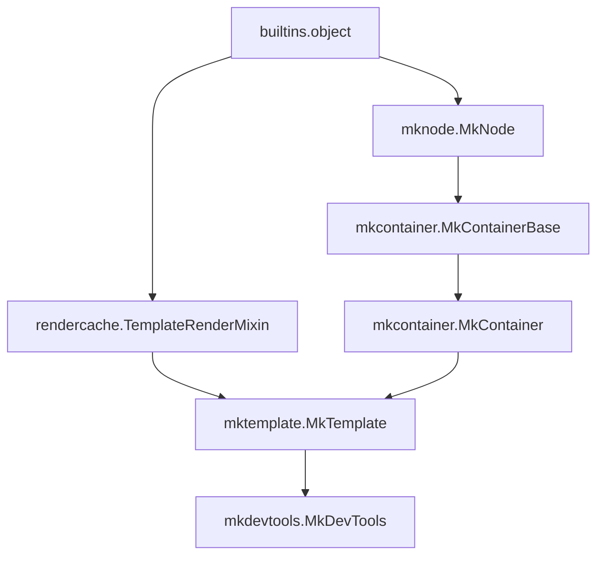

# MkDevTools

[ Show source on GitHub](https://github.com/phil65/mknodes/blob/main/src/mknodes/templatenodes/mkdevtools/__init__.py)

### Node showing information about used dev tools.

<details open>
<summary>Examples</summary>

### Example: **From project**
> [!NOTE]
> **Jinja**
>
> ```jinja
> {{ mk.MkDevTools() }}
>
> ```

> [!NOTE]
> **Python**
>
> ```python
> MkDevTools()
> ```

<details open>
<summary>Rendered</summary>

## PyRight

**PyRight** is used for type checking. You can find the configuration in the
`pyproject.toml` file.

````md
pyright --help
````

<details>
<summary>Config</summary>

````toml
venvPath = "."
venv = ".venv"
pythonVersion = "3.14"
pythonPlatform = "All"
typeCheckingMode = "basic"
deprecateTypingAliases = true
reportMissingTypeStubs = false
reportUnusedCallResult = false
reportUnknownVariableType = false
reportAny = false
reportImplicitOverride = false
reportUnusedFunction = false
reportImplicitStringConcatenation = false
reportIgnoreCommentWithoutRule = false
reportUnannotatedClassAttribute = false
reportSelfClsParameterName = false
reportPrivateImportUsage = false

````

</details>

<details>
<summary>Installing PyRight</summary>

To install pyright:

````bash
pip install pyright
````

[More information](https://microsoft.github.io/pyright/)

</details>

## Coverage

**Coverage** is used to monitor test coverage.

````md
coverage run some_module.py
````

<details>
<summary>Config</summary>

````toml
[report]
exclude_lines = [
    "pragma: no cover",
    "if TYPE_CHECKING:",
    "@overload",
    "except ImportError",
    "if __name__ == \"__main__\":",
]

````

</details>

<details>
<summary>Installing Coverage</summary>

To install coverage:

````bash
pip install coverage
````

[More information](https://coverage.readthedocs.io/)

</details>

## Ruff

**Ruff** is used as a linter. You can find the configuration in the
`pyproject.toml` file.

````md
ruff --help
````

<details>
<summary>Config</summary>

````toml
line-length = 100
extend-exclude = [
    "docs",
]
target-version = "py314"

[lint]
select = [
    "A",
    "B",
    "BLE",
    "C",
    "C4",
    "COM",
    "D",
    "E",
    "EM",
    "EXE",
    "F",
    "FLY",
    "G",
    "I",
    "ICN",
    "INP",
    "INT",
    "ISC",
    "N",
    "PERF",
    "PIE",
    "PLE",
    "PLC",
    "PLR",
    "PT",
    "PTH",
    "PYI",
    "Q",
    "RET",
    "RSE",
    "RUF",
    "SIM",
    "SLF",
    "SLOT",
    "T10",
    "TC",
    "TID",
    "TRY",
    "UP",
    "W",
    "YTT",
]
ignore = [
    "C408",
    "B905",
    "C901",
    "COM812",
    "D100",
    "D101",
    "D102",
    "D103",
    "D104",
    "D105",
    "D106",
    "D107",
    "D203",
    "D204",
    "D213",
    "D215",
    "D400",
    "D401",
    "D404",
    "D406",
    "D407",
    "D408",
    "D409",
    "D413",
    "EM101",
    "EM102",
    "ISC001",
    "PLC0415",
    "PLR0912",
    "PLR0913",
    "PLR0915",
    "PLR0917",
    "SLF001",
    "TRY003",
    "TC006",
    "E501",
    "RUF012",
]

[lint.flake8-quotes]
docstring-quotes = "double"

[lint.flake8-type-checking]
runtime-evaluated-base-classes = [
    "pydantic.BaseModel",
    "sqlalchemy.orm.DeclarativeBase",
    "schemez.Schema",
    "sqlmodel.SQLModel",
]
runtime-evaluated-decorators = [
    "pydantic.validate_call",
    "fastapi.FastAPI.get",
    "fastapi.FastAPI.post",
    "fastmcp.FastMCP.tool",
    "typer.Typer.command",
]

[lint.flake8-tidy-imports.banned-api."__future__.annotations"]
msg = "Not needed on Python 3.14+ (PEP 649 lazy annotations)."

[lint.isort]
lines-after-imports = 2
force-sort-within-sections = true
combine-as-imports = true

[lint.mccabe]
max-complexity = 15

[lint.per-file-ignores]
"__init__.py" = [
    "E402",
    "I001",
]
"scripts/*" = [
    "INP001",
]
"*tests/*" = [
    "D100",
]

[format]
preview = true
docstring-code-format = true

````

</details>

<details>
<summary>Installing Ruff</summary>

To install ruff:

````bash
pip install ruff
````

[More information](https://beta.ruff.rs/)

</details>

## MkDocs

**Ruff** is used as a linter. You can find the configuration in the
`pyproject.toml` file.

````md
ruff --help
````

<details>
<summary>Config</summary>

````toml
line-length = 100
extend-exclude = [
    "docs",
]
target-version = "py314"

[lint]
select = [
    "A",
    "B",
    "BLE",
    "C",
    "C4",
    "COM",
    "D",
    "E",
    "EM",
    "EXE",
    "F",
    "FLY",
    "G",
    "I",
    "ICN",
    "INP",
    "INT",
    "ISC",
    "N",
    "PERF",
    "PIE",
    "PLE",
    "PLC",
    "PLR",
    "PT",
    "PTH",
    "PYI",
    "Q",
    "RET",
    "RSE",
    "RUF",
    "SIM",
    "SLF",
    "SLOT",
    "T10",
    "TC",
    "TID",
    "TRY",
    "UP",
    "W",
    "YTT",
]
ignore = [
    "C408",
    "B905",
    "C901",
    "COM812",
    "D100",
    "D101",
    "D102",
    "D103",
    "D104",
    "D105",
    "D106",
    "D107",
    "D203",
    "D204",
    "D213",
    "D215",
    "D400",
    "D401",
    "D404",
    "D406",
    "D407",
    "D408",
    "D409",
    "D413",
    "EM101",
    "EM102",
    "ISC001",
    "PLC0415",
    "PLR0912",
    "PLR0913",
    "PLR0915",
    "PLR0917",
    "SLF001",
    "TRY003",
    "TC006",
    "E501",
    "RUF012",
]

[lint.flake8-quotes]
docstring-quotes = "double"

[lint.flake8-type-checking]
runtime-evaluated-base-classes = [
    "pydantic.BaseModel",
    "sqlalchemy.orm.DeclarativeBase",
    "schemez.Schema",
    "sqlmodel.SQLModel",
]
runtime-evaluated-decorators = [
    "pydantic.validate_call",
    "fastapi.FastAPI.get",
    "fastapi.FastAPI.post",
    "fastmcp.FastMCP.tool",
    "typer.Typer.command",
]

[lint.flake8-tidy-imports.banned-api."__future__.annotations"]
msg = "Not needed on Python 3.14+ (PEP 649 lazy annotations)."

[lint.isort]
lines-after-imports = 2
force-sort-within-sections = true
combine-as-imports = true

[lint.mccabe]
max-complexity = 15

[lint.per-file-ignores]
"__init__.py" = [
    "E402",
    "I001",
]
"scripts/*" = [
    "INP001",
]
"*tests/*" = [
    "D100",
]

[format]
preview = true
docstring-code-format = true

````

</details>

<details>
<summary>Installing MkDocs</summary>

To install mkdocs:

````bash
pip install mkdocs
````

[More information](https://mkdocs.org/)

</details>

## Pre-Commit

This project uses **pre-commit** to ensure code quality.
A `.pre-commit-config.yaml` configuration file tailored for this project is provided
in the root folder.

````md
# Setup pre-commit hooks for required formatting
pre-commit install
````

<details>
<summary>Config</summary>

````yaml
default_language_version:
  python: python3.14
default_stages: [pre-commit]
# Hooks run with `uv run --no-sync`: they use the venv exactly as you synced it
# (e.g. `uv sync --all-extras`). Plain `uv run` would re-sync without extras
# and break tests that need them.
repos:
  # Phase 1: Fast basic checks (fail early)
  - repo: https://github.com/pre-commit/pre-commit-hooks
    # https://pre-commit.com/hooks.html
    rev: v6.0.0
    hooks:
      - id: check-added-large-files
      - id: check-case-conflict
      - id: check-merge-conflict
      - id: check-toml
      - id: check-json
      - id: check-xml
      - id: check-yaml
        args: [--allow-multiple-documents, --unsafe]
      - id: detect-private-key
      - id: debug-statements

  # Phase 2: Code formatting (auto-fix, system commands)
  - repo: local
    hooks:
      - id: ruff-format
        name: ruff-format
        entry: uv run --no-sync ruff format
        language: system
        types: [python]
        require_serial: true
      - id: ruff-fix
        name: ruff-fix
        entry: uv run --no-sync ruff check --fix
        language: system
        types: [python]
        require_serial: true
      - id: tombi-format
        name: tombi-format
        entry: uv run --no-sync tombi format pyproject.toml
        language: system
        files: ^pyproject\.toml$
        require_serial: true

  # Phase 3: Linting and type checking (system commands)
  - repo: local
    hooks:
      - id: ruff
        name: ruff
        entry: uv run --no-sync ruff check
        language: system
        types: [python]
        require_serial: true
      # Project-specific: mypy instead of ty (see AGENTS.md).
      - id: mypy
        name: mypy
        entry: uv run --no-sync mypy src/
        language: system
        types: [python]
        pass_filenames: false
        require_serial: true

  # Phase 4: Tests (most expensive, system command)
  - repo: local
    hooks:
      - id: pytest-check
        name: pytest-check
        entry: uv run --no-sync pytest
        language: system
        types: [python]
        pass_filenames: false
        always_run: true
        require_serial: true

  # Phase 5: Commit message validation (final)
  - repo: https://github.com/commitizen-tools/commitizen
    rev: v4.9.1
    hooks:
      - id: commitizen
        stages: [commit-msg]
        additional_dependencies: [typing-extensions]

````

</details>

<details>
<summary>Installing Pre-Commit</summary>

To install pre-commit:

````bash
pip install pre-commit
````

[More information](https://pre-commit.com)

</details>

## MyPy

**MyPy** is used for type checking. You can find the configuration in the
`pyproject.toml` file.

````md
mypy --help
````

<details>
<summary>Config</summary>

````toml
python_version = "3.14"
pretty = true
check_untyped_defs = true
exclude = [
    "venv/",
    ".venv/",
    "tests/",
]
plugins = []

````

</details>

<details>
<summary>Installing MyPy</summary>

To install mypy:

````bash
pip install mypy
````

[More information](https://mypy-lang.org)

</details>

</details>

<details>
<summary>Markdown</summary>

```markdown

```

</details>

<details>
<summary>Html</summary>

```html

```

</details>

</details>

<details open>
<summary>DocStrings</summary>

<a id="mknodes.MkDevTools"></a>

```python
class MkDevTools(mktemplate.MkTemplate)
```

</details>

<details open>
<summary>Base classes</summary>

| Name | Children | Inherits |
|--- | --- | --- |
| **<font size='4'>[MkTemplate](https://phil65.github.io/mknodes/)</font>**<br>*<font size='1'>mknodes.templatenodes.mktemplate</font>*<br>Node representing a jinja template\. | <ul><li>[MkCliDoc](https://phil65.github.io/mknodes/)</li><li>[MkMaterialBadge](https://phil65.github.io/mknodes/)</li><li>[MkImageCompare](https://phil65.github.io/mknodes/)</li><li>[MkImageSlideshow](https://phil65.github.io/mknodes/)</li><li>[MkIFrame](https://phil65.github.io/mknodes/)</li><li>[MkCard](https://phil65.github.io/mknodes/)</li><li>[MkInstallGuide](https://phil65.github.io/mknodes/)</li><li>[MkCodeOfConduct](https://phil65.github.io/mknodes/)</li><li>[MkCommitConventions](https://phil65.github.io/mknodes/)</li><li>[MkDevEnvSetup](https://phil65.github.io/mknodes/)</li><li>[MkDevTools](https://phil65.github.io/mknodes/)</li><li>...</li></ul> | <ul><li>[TemplateRenderMixin](https://phil65.github.io/mknodes/)</li><li>[MkContainer](https://phil65.github.io/mknodes/)</li></ul> |

</details>

<details>
<summary>⋔ Inheritance diagram</summary>



</details>

<details>
<summary>NodeFile</summary>

**/home/runner/work/mknodes/mknodes/src/mknodes/templatenodes/mkdevtools/metadata.toml**

```toml
[metadata]
icon = "mdi:wrench"
status = "new"
name = "MkDevTools"
virtual_children = true

[examples.regular]
title = "From project"
jinja = """
{{ mk.MkDevTools() }}
"""

# [examples.explicit]
# title = "Explicit"
# jinja = """
# {{ ["black"] | MkDevTools }}
# """

[output.markdown]
template = """


{{ tool.title | MkHeader }}

{{ tool.description }}


{{ tool.setup_cmd | render_string | MkCode(language="md")}}


{{ (tool.cfg.content or "") | MkCode(language=tool.cfg.syntax) | MkAdmonition(collapsible=True, title="Config", typ="quote") }}

{{ ["To install " ~ tool.identifier ~ ":",
    ("pip install " ~ tool.identifier) | MkCode(language="bash"),
    tool.url | MkLink("More information")] | MkAdmonition(collapsible=True, title="Installing " ~ tool.title)}}





"""


```

</details>

<details>
<summary>Code</summary>

**mknodes.templatenodes.mkdevtools.MkDevTools**

```python
class MkDevTools(mktemplate.MkTemplate):
    """Node showing information about used dev tools."""

    ICON = "material/wrench"
    STATUS = "new"
    VIRTUAL_CHILDREN = True

    def __init__(self, tools: list[Tool] | None = None, **kwargs: Any) -> None:
        """Constructor.

        Args:
            tools: Tools to show install / setup instructions for.
                            If None, tools will be pulled from project.
            kwargs: Keyword arguments passed to parent
        """
        super().__init__("output/markdown/template", **kwargs)
        self._tools = tools

    @property
    def tools(self) -> list[Tool]:
        match self._tools:
            case list():
                return self._tools
            case None:
                return self.ctx.metadata.tools
            case _:  # pyright: ignore[reportUnnecessaryComparison]
                raise TypeError(self._tools)

```

</details>

<details>
<summary>Page info</summary>

<details>
<summary>Code for this page</summary>

**mknodes.manual.nodes_section.create_section_for_nodes**

```python
def create_section_for_nodes(
    nav: mk.MkNav,
    klasses: Sequence[type[mk.MkNode]],
) -> mk.MkTable:
    table = mk.MkTable(columns=["Node", "Docstrings", "Markdown extensions"])
    for kls in klasses:
        tpl = "classpage_custom.jinja"
        page = mk.MkClassPage(kls, icon=kls.ICON, template_path=tpl, parent=nav, hide="toc")
        nav += page
        if kls.STATUS:
            page.metadata.status = kls.STATUS
        elif kls.JS_FILES:
            page.metadata.status = "js"
        elif kls.CSS:
            page.metadata.status = "css"
        page.created_by = create_section_for_nodes
        link = mk.MkLink(page, kls.__name__, icon=kls.ICON)
        extensions = ", ".join(f"`{i}`" for i in kls.REQUIRED_EXTENSIONS)
        table.add_row((link, kls.__doc__, extensions))
    return table

```

</details>

<details>
<summary>Resources</summary>

```python
Resources(css=[],
          markdown_extensions={'admonition': {},
                               'pymdownx.details': {},
                               'pymdownx.highlight': {'anchor_linenums': True,
                                                      'line_spans': '__span',
                                                      'pygments_lang_class': True},
                               'pymdownx.superfences': {'custom_fences': [{'class': 'mermaid',
                                                                           'format': <function fence_code_format at 0x7bb797a5c1a0>,
                                                                           'name': 'mermaid'}]},
                               'pymdownx.tabbed': {},
                               'tables': {}},
          plugins=[Plugin('mkdocstrings')],
          js=[],
          assets=[],
          packages=[])
```

</details>

<details>
<summary>Metadata</summary>

```yaml
created:
  source_filename: /home/runner/work/mknodes/mknodes/src/mknodes/manual/nodes_section.py
  source_function: create_section_for_nodes
  source_line_no: 93
hide:
- toc
icon: material/wrench
status: new
title: MkDevTools

```

</details>

</details>
