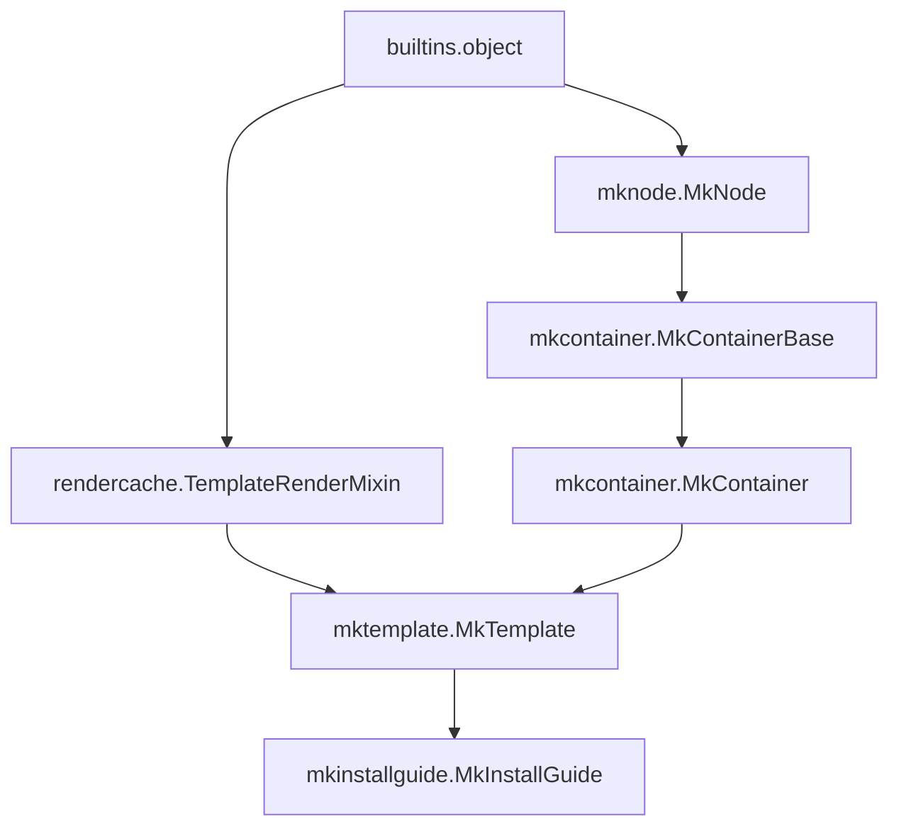

# MkInstallGuide

[ Show source on GitHub](https://github.com/phil65/mknodes/blob/main/src/mknodes/templatenodes/mkinstallguide/__init__.py)

### Node to display an install guide.

<details open>
<summary>Examples</summary>

### Example: **Regular**
> [!NOTE]
> **Jinja**
>
> ```jinja
> {{ mk.MkInstallGuide() }}
>
> ```

> [!NOTE]
> **Python**
>
> ```python
> MkInstallGuide()
> ```

<details open>
<summary>Rendered</summary>

### pip

The latest released version is available at the [Python package index](https://pypi.org/project/mknodes).

````python
pip install mknodes
````
### pipx

[pipx](https://github.com/pypa/pipx) allows for the global installation of Python applications in isolated environments.

````python
pipx install mknodes
````

</details>

<details>
<summary>Markdown</summary>

```markdown

```

</details>

<details>
<summary>Html</summary>

```html

```

</details>

### Example: **Explicit**
> [!NOTE]
> **Jinja**
>
> ```jinja
> {{ "mkdocs" | MkInstallGuide(package_repos=["pip", "pipx"]) }}
>
> ```

> [!NOTE]
> **Python**
>
> ```python
> MkInstallGuide('mkdocs', package_repos=['pip', 'pipx'])
> ```

<details open>
<summary>Rendered</summary>

### pip

The latest released version is available at the [Python package index](https://pypi.org/project/mkdocs).

````python
pip install mkdocs
````
### pipx

[pipx](https://github.com/pypa/pipx) allows for the global installation of Python applications in isolated environments.

````python
pipx install mkdocs
````

</details>

<details>
<summary>Markdown</summary>

`````markdown
### pip

The latest released version is available at the [Python package index](https://pypi.org/project/mkdocs).

````python
pip install mkdocs
````
### pipx

[pipx](https://github.com/pypa/pipx) allows for the global installation of Python applications in isolated environments.

````python
pipx install mkdocs
````

`````

</details>

<details>
<summary>Html</summary>

```html
<h3 id="pip">pip<a href="#pip" aria-label="Link to heading 'pip'" data-heading-content="pip" class="anchor"></a></h3>
<p>The latest released version is available at the <a href="https://pypi.org/project/mkdocs">Python package index</a>.</p>
<pre><code class="language-python">pip install mkdocs
</code></pre>
<h3 id="pipx">pipx<a href="#pipx" aria-label="Link to heading 'pipx'" data-heading-content="pipx" class="anchor"></a></h3>
<p><a href="https://github.com/pypa/pipx">pipx</a> allows for the global installation of Python applications in isolated environments.</p>
<pre><code class="language-python">pipx install mkdocs
</code></pre>

```

</details>

<details>
<summary>Repr tree</summary>

```
MkInstallGuide
├── MkHeader('pip', level=3)
├── MkCode(None)
│   ╰── MkText('pip install mkdocs')
├── MkHeader('pipx', level=3)
╰── MkCode(None)
    ╰── MkText('pipx install mkdocs')
```

</details>

</details>

<details open>
<summary>DocStrings</summary>

<a id="mknodes.MkInstallGuide"></a>

```python
class MkInstallGuide(mktemplate.MkTemplate)
```

</details>

<details open>
<summary>Base classes</summary>

| Name | Children | Inherits |
|--- | --- | --- |
| **<font size='4'>[MkTemplate](https://phil65.github.io/mknodes/)</font>**<br>*<font size='1'>mknodes.templatenodes.mktemplate</font>*<br>Node representing a jinja template\. | <ul><li>[MkCliDoc](https://phil65.github.io/mknodes/)</li><li>[MkMaterialBadge](https://phil65.github.io/mknodes/)</li><li>[MkImageCompare](https://phil65.github.io/mknodes/)</li><li>[MkImageSlideshow](https://phil65.github.io/mknodes/)</li><li>[MkIFrame](https://phil65.github.io/mknodes/)</li><li>[MkCard](https://phil65.github.io/mknodes/)</li><li>[MkInstallGuide](https://phil65.github.io/mknodes/)</li><li>[MkCodeOfConduct](https://phil65.github.io/mknodes/)</li><li>[MkCommitConventions](https://phil65.github.io/mknodes/)</li><li>[MkDevEnvSetup](https://phil65.github.io/mknodes/)</li><li>[MkDevTools](https://phil65.github.io/mknodes/)</li><li>...</li></ul> | <ul><li>[TemplateRenderMixin](https://phil65.github.io/mknodes/)</li><li>[MkContainer](https://phil65.github.io/mknodes/)</li></ul> |

</details>

<details>
<summary>⋔ Inheritance diagram</summary>



</details>

<details>
<summary>NodeFile</summary>

**/home/runner/work/mknodes/mknodes/src/mknodes/templatenodes/mkinstallguide/metadata.toml**

```toml
[metadata]
name = "MkInstallGuide"
icon = "mdi:help"
group = "documentation"
virtual_children = true

[examples.regular]
title = "Regular"
jinja = """
{{ mk.MkInstallGuide() }}
"""

[examples.explicit]
title = "Explicit"
jinja = """
{{ "mkdocs" | MkInstallGuide(package_repos=["pip", "pipx"]) }}
"""

[output.markdown]
template = """

{{ method.ID | MkHeader(level=node.header_level) }}

{{ method.info_text() }}

{{ method.install_instructions() | MkCode }}

"""

# proj = self.associated_distribution
# if method.ID == "pip" and proj and (extras := proj.info.extras):
#     extras_str = ",".join(extras)
#     text = f"{method.install_instructions()}[{extras_str}]"
#     code = mkcode.MkCode(text)
#     items.append(code)

```

</details>

<details>
<summary>Code</summary>

**mknodes.templatenodes.mkinstallguide.MkInstallGuide**

```python
class MkInstallGuide(mktemplate.MkTemplate):
    """Node to display an install guide."""

    ICON = "material/help"
    VIRTUAL_CHILDREN = True

    def __init__(
        self,
        distribution: str | None = None,
        *,
        package_repos: list[installmethods.InstallMethodStr] | None = None,
        header_level: int = 3,
        **kwargs: Any,
    ) -> None:
        """Constructor.

        Args:
            distribution: name of the distribution to install
            package_repos: package repositories the project is available on
            header_level: Header level for each section
            kwargs: Keyword arguments passed to parent
        """
        super().__init__("output/markdown/template", **kwargs)
        self._distribution = distribution
        self.header_level = header_level
        self._package_repos = package_repos

    @property
    def package_repos(self) -> list[installmethods.InstallMethod]:
        if self._package_repos:
            return [
                installmethods.InstallMethod.by_id(i)(self.distribution)
                for i in self._package_repos
            ]
        return self.ctx.metadata.package_repos or []

    @property
    def distribution(self):
        return self._distribution or self.ctx.metadata.distribution_name

    @distribution.setter
    def distribution(self, value) -> None:
        self._distribution = value

```

</details>

<details>
<summary>Page info</summary>

<details>
<summary>Code for this page</summary>

**mknodes.manual.nodes_section.create_section_for_nodes**

```python
def create_section_for_nodes(
    nav: mk.MkNav,
    klasses: Sequence[type[mk.MkNode]],
) -> mk.MkTable:
    table = mk.MkTable(columns=["Node", "Docstrings", "Markdown extensions"])
    for kls in klasses:
        tpl = "classpage_custom.jinja"
        page = mk.MkClassPage(kls, icon=kls.ICON, template_path=tpl, parent=nav, hide="toc")
        nav += page
        if kls.STATUS:
            page.metadata.status = kls.STATUS
        elif kls.JS_FILES:
            page.metadata.status = "js"
        elif kls.CSS:
            page.metadata.status = "css"
        page.created_by = create_section_for_nodes
        link = mk.MkLink(page, kls.__name__, icon=kls.ICON)
        extensions = ", ".join(f"`{i}`" for i in kls.REQUIRED_EXTENSIONS)
        table.add_row((link, kls.__doc__, extensions))
    return table

```

</details>

<details>
<summary>Resources</summary>

```python
Resources(css=[],
          markdown_extensions={'admonition': {},
                               'pymdownx.details': {},
                               'pymdownx.highlight': {'anchor_linenums': True,
                                                      'line_spans': '__span',
                                                      'pygments_lang_class': True},
                               'pymdownx.superfences': {'custom_fences': [{'class': 'mermaid',
                                                                           'format': <function fence_code_format at 0x7bb797a5c1a0>,
                                                                           'name': 'mermaid'}]},
                               'pymdownx.tabbed': {},
                               'tables': {}},
          plugins=[Plugin('mkdocstrings')],
          js=[],
          assets=[],
          packages=[])
```

</details>

<details>
<summary>Metadata</summary>

```yaml
created:
  source_filename: /home/runner/work/mknodes/mknodes/src/mknodes/manual/nodes_section.py
  source_function: create_section_for_nodes
  source_line_no: 93
hide:
- toc
icon: material/help
status: new
title: MkInstallGuide

```

</details>

</details>
