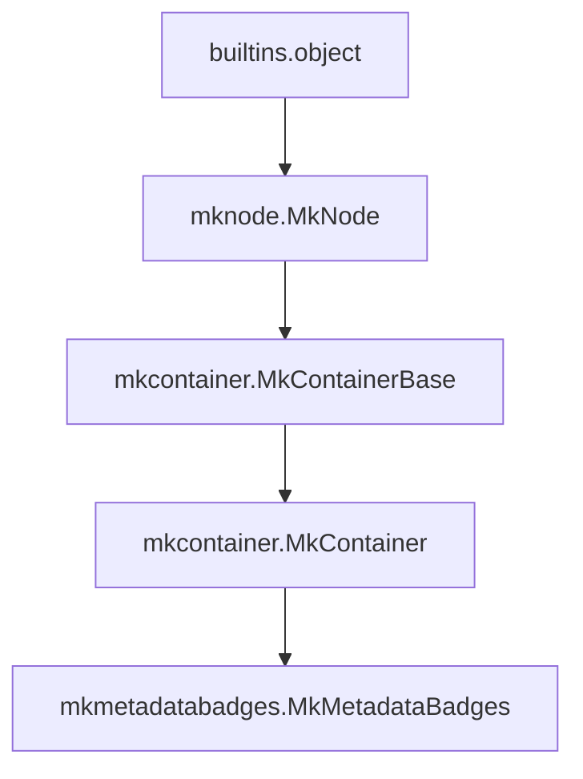

# MkMetadataBadges

[ Show source on GitHub](https://github.com/phil65/mknodes/blob/main/src/mknodes/templatenodes/mkmetadatabadges/__init__.py)

### Container node for a list of metadata badges.

> [!NOTE]
> **Description**
>
>
> Badges are generated locally using "anybadge" package

<details open>
<summary>Examples</summary>

### Example: **Classifiers**
> [!NOTE]
> **Jinja**
>
> ```jinja
> {{ "classifiers" | MkMetadataBadges }}
>
> ```

> [!NOTE]
> **Python**
>
> ```python
> MkMetadataBadges('classifiers')
> ```

<details open>
<summary>Rendered</summary>


</details>

<details>
<summary>Markdown</summary>

```markdown


```

</details>

<details>
<summary>Html</summary>

```html

```

</details>

### Example: **Keywords**
> [!NOTE]
> **Jinja**
>
> ```jinja
> {{ "keywords" | MkMetadataBadges }}
>
> ```

> [!NOTE]
> **Python**
>
> ```python
> MkMetadataBadges('keywords')
> ```

<details open>
<summary>Rendered</summary>


</details>

<details>
<summary>Markdown</summary>

```markdown


```

</details>

<details>
<summary>Html</summary>

```html

```

</details>

### Example: **Keywords combined**
> [!NOTE]
> **Jinja**
>
> ```jinja
> {{ "keywords_combined" | MkMetadataBadges }}
>
> ```

> [!NOTE]
> **Python**
>
> ```python
> MkMetadataBadges('keywords_combined')
> ```

<details open>
<summary>Rendered</summary>


</details>

<details>
<summary>Markdown</summary>

```markdown

```

</details>

<details>
<summary>Html</summary>

```html
<p></p>

```

</details>

<details>
<summary>Repr tree</summary>

```
MkMetadataBadges
╰── MkBadge('Keywords', 'api-documentation | docs-as-code | documentation | documentation-generator | jinja2 | markdown | static-site-generator | zensical')
```

</details>

### Example: **Websites**
> [!NOTE]
> **Jinja**
>
> ```jinja
> {{ "websites" | MkMetadataBadges }}
>
> ```

> [!NOTE]
> **Python**
>
> ```python
> MkMetadataBadges('websites')
> ```

<details open>
<summary>Rendered</summary>

[](https://app.codecov.io/gh/phil65/mknodes)
[](https://github.com/phil65/mknodes/discussions)
[](https://phil65.github.io/mknodes/)
[](https://github.com/phil65/mknodes/issues)
[](https://github.com/phil65/mknodes)

</details>

<details>
<summary>Markdown</summary>

```markdown
[](https://app.codecov.io/gh/phil65/mknodes)
[](https://github.com/phil65/mknodes/discussions)
[](https://phil65.github.io/mknodes/)
[](https://github.com/phil65/mknodes/issues)
[](https://github.com/phil65/mknodes)
```

</details>

<details>
<summary>Html</summary>

```html

```

</details>

### Example: **Dependencies**
> [!NOTE]
> **Jinja**
>
> ```jinja
> {{ "dependencies" | MkMetadataBadges }}
>
> ```

> [!NOTE]
> **Python**
>
> ```python
> MkMetadataBadges('dependencies')
> ```

<details open>
<summary>Rendered</summary>

[](https://github.com/jongracecox/anybadge)
[](https://phil65.github.io/anyenv/)
[](https://anyio.readthedocs.io/en/latest/)
[](https://phil65.github.io/clinspector/)
[](https://github.com/facelessuser/coloraide)
[](https://github.com/phil65/epregistry)
[](https://github.com/pyapp-kit/fieldz)
[](https://github.com/fsspec/filesystem_spec)
[](https://pawamoy.github.io/git-changelog)
[](https://github.com/phil65/githarbor)
[](https://gitpython.readthedocs.io/en/stable/)
[](https://mkdocstrings.github.io/griffe)
[](https://jinja.palletsprojects.com/)
[](https://phil65.github.io/jinjarope/)
[](https://pydantic.dev/logfire)
[](https://Python-Markdown.github.io/)
[](https://markupsafe.palletsprojects.com/)
[](https://github.com/SethMMorton/natsort)
[](https://packaging.pypa.io/)
[](https://github.com/tox-dev/pipdeptree)
[](https://github.com/tox-dev/platformdirs)
[](https://github.com/pydantic/pydantic)
[](https://github.com/facelessuser/pymdown-extensions)
[](https://github.com/pytest-dev/pytest-asyncio)
[](https://github.com/theskumar/python-dotenv)
[](https://pyyaml.org/)
[](https://requests.readthedocs.io)
[](https://github.com/Textualize/rich)
[](https://github.com/hukkin/tomli-w)
[](https://github.com/fastapi/typer)
[](https://github.com/fsspec/universal_pathlib)
[](https://phil65.github.io/upathtools/)
[](https://phil65.github.io/yamling/)
[](https://zensical.org/)
[](https://github.com/executablebooks/markdown-it-py)
[](https://github.com/executablebooks/mdit-py-plugins)
[](https://phil65.github.io/mkconvert/)
[](https://phil65.github.io/agentpool/)
[](https://www.mkdocs.org/)
[](https://squidfunk.github.io/mkdocs-material/)

[](https://github.com/executablebooks/MyST-Parser)
[](https://www.sphinx-doc.org/)
[](https://github.com/executablebooks/sphinx-design)

</details>

<details>
<summary>Markdown</summary>

```markdown
[](https://github.com/jongracecox/anybadge)
[](https://phil65.github.io/anyenv/)
[](https://anyio.readthedocs.io/en/latest/)
[](https://phil65.github.io/clinspector/)
[](https://github.com/facelessuser/coloraide)
[](https://github.com/phil65/epregistry)
[](https://github.com/pyapp-kit/fieldz)
[](https://github.com/fsspec/filesystem_spec)
[](https://pawamoy.github.io/git-changelog)
[](https://github.com/phil65/githarbor)
[](https://gitpython.readthedocs.io/en/stable/)
[](https://mkdocstrings.github.io/griffe)
[](https://jinja.palletsprojects.com/)
[](https://phil65.github.io/jinjarope/)
[](https://pydantic.dev/logfire)
[](https://Python-Markdown.github.io/)
[](https://markupsafe.palletsprojects.com/)
[](https://github.com/SethMMorton/natsort)
[](https://packaging.pypa.io/)
[](https://github.com/tox-dev/pipdeptree)
[](https://github.com/tox-dev/platformdirs)
[](https://github.com/pydantic/pydantic)
[](https://github.com/facelessuser/pymdown-extensions)
[](https://github.com/pytest-dev/pytest-asyncio)
[](https://github.com/theskumar/python-dotenv)
[](https://pyyaml.org/)
[](https://requests.readthedocs.io)
[](https://github.com/Textualize/rich)
[](https://github.com/hukkin/tomli-w)
[](https://github.com/fastapi/typer)
[](https://github.com/fsspec/universal_pathlib)
[](https://phil65.github.io/upathtools/)
[](https://phil65.github.io/yamling/)
[](https://zensical.org/)
[](https://github.com/executablebooks/markdown-it-py)
[](https://github.com/executablebooks/mdit-py-plugins)
[](https://phil65.github.io/mkconvert/)
[](https://phil65.github.io/agentpool/)
[](https://www.mkdocs.org/)
[](https://squidfunk.github.io/mkdocs-material/)

[](https://github.com/executablebooks/MyST-Parser)
[](https://www.sphinx-doc.org/)
[](https://github.com/executablebooks/sphinx-design)
```

</details>

<details>
<summary>Html</summary>

```html

```

</details>

### Example: **For other packages**
> [!NOTE]
> **Jinja**
>
> ```jinja
> {{ "dependencies" | MkMetadataBadges(package="mkdocs") }}
>
> ```

> [!NOTE]
> **Python**
>
> ```python
> MkMetadataBadges('dependencies', package='mkdocs')
> ```

<details open>
<summary>Rendered</summary>

[](https://click.palletsprojects.com/)
[](https://github.com/tartley/colorama)
[](https://github.com/c-w/ghp-import)
[](https://jinja.palletsprojects.com/)
[](https://Python-Markdown.github.io/)
[](https://markupsafe.palletsprojects.com/)
[](https://github.com/clarketm/mergedeep)
[](https://github.com/mkdocs/get-deps)
[](https://packaging.pypa.io/)
[](https://python-path-specification.readthedocs.io/en/latest/index.html)
[](https://github.com/waylan/pyyaml-env-tag)
[](https://pyyaml.org/)
[](https://github.com/gorakhargosh/watchdog)
[](https://babel.pocoo.org/)

</details>

<details>
<summary>Markdown</summary>

```markdown
[](https://click.palletsprojects.com/)
[](https://github.com/tartley/colorama)
[](https://github.com/c-w/ghp-import)
[](https://jinja.palletsprojects.com/)
[](https://Python-Markdown.github.io/)
[](https://markupsafe.palletsprojects.com/)
[](https://github.com/clarketm/mergedeep)
[](https://github.com/mkdocs/get-deps)
[](https://packaging.pypa.io/)
[](https://python-path-specification.readthedocs.io/en/latest/index.html)
[](https://github.com/waylan/pyyaml-env-tag)
[](https://pyyaml.org/)
[](https://github.com/gorakhargosh/watchdog)
[](https://babel.pocoo.org/)
```

</details>

<details>
<summary>Html</summary>

```html
<p><a href="https://click.palletsprojects.com/"></a>
<a href="https://github.com/tartley/colorama"></a>
<a href="https://github.com/c-w/ghp-import"></a>
<a href="https://jinja.palletsprojects.com/"></a>
<a href="https://Python-Markdown.github.io/"></a>
<a href="https://markupsafe.palletsprojects.com/"></a>
<a href="https://github.com/clarketm/mergedeep"></a>
<a href="https://github.com/mkdocs/get-deps"></a>
<a href="https://packaging.pypa.io/"></a>
<a href="https://python-path-specification.readthedocs.io/en/latest/index.html"></a>
<a href="https://github.com/waylan/pyyaml-env-tag"></a>
<a href="https://pyyaml.org/"></a>
<a href="https://github.com/gorakhargosh/watchdog"></a>
<a href="https://babel.pocoo.org/"></a></p>

```

</details>

<details>
<summary>Repr tree</summary>

```
MkMetadataBadges
├── MkBadge('click', '8.5.1')
├── MkBadge('colorama', '0.4.6')
├── MkBadge('ghp-import', '2.1.0')
├── MkBadge('Jinja2', '3.1.6')
├── MkBadge('Markdown', '3.11.4')
├── MkBadge('MarkupSafe', '3.0.4')
├── MkBadge('mergedeep', '1.3.4')
├── MkBadge('mkdocs-get-deps', '0.2.2')
├── MkBadge('packaging', '26.4')
├── MkBadge('pathspec', '1.1.1')
├── MkBadge('pyyaml_env_tag', '1.1')
├── MkBadge('PyYAML', '6.0.4')
├── MkBadge('watchdog', '7.1.1')
╰── MkBadge('babel', '2.19.0')
```

</details>

### Example: **Gitlab style**
> [!NOTE]
> **Jinja**
>
> ```jinja
> {{ "classifiers" | MkMetadataBadges(use_gitlab_style=True) }}
>
> ```

> [!NOTE]
> **Python**
>
> ```python
> MkMetadataBadges('classifiers', use_gitlab_style=True)
> ```

<details open>
<summary>Rendered</summary>


</details>

<details>
<summary>Markdown</summary>

```markdown


```

</details>

<details>
<summary>Html</summary>

```html

```

</details>

### Example: **Colored**
> [!NOTE]
> **Jinja**
>
> ```jinja
> {{ "required_python" | MkMetadataBadges(badge_color="red") }}
>
> ```

> [!NOTE]
> **Python**
>
> ```python
> MkMetadataBadges('required_python', badge_color='red')
> ```

<details open>
<summary>Rendered</summary>

[](https://python.org)

</details>

<details>
<summary>Markdown</summary>

```markdown
[](https://python.org)
```

</details>

<details>
<summary>Html</summary>

```html
<p><a href="https://python.org"></a></p>

```

</details>

<details>
<summary>Repr tree</summary>

```
MkMetadataBadges
╰── MkBadge('Python', '>=3.14', badge_color='red')
```

</details>

</details>

<details open>
<summary>DocStrings</summary>

<a id="mknodes.MkMetadataBadges"></a>

```python
class MkMetadataBadges(mkcontainer.MkContainer)
```

</details>

<details open>
<summary>Base classes</summary>

| Name | Children | Inherits |
|--- | --- | --- |
| **<font size='4'>[MkContainer](https://phil65.github.io/mknodes/)</font>**<br>*<font size='1'>mknodes.basenodes.mkcontainer</font>*<br>A node containing other MkNodes\. | <ul><li>[MkBlock](https://phil65.github.io/mknodes/)</li><li>[MkAdmonition](https://phil65.github.io/mknodes/)</li><li>[MkBlockQuote](https://phil65.github.io/mknodes/)</li><li>[MkCode](https://phil65.github.io/mknodes/)</li><li>[MkTemplate](https://phil65.github.io/mknodes/)</li><li>[MkList](https://phil65.github.io/mknodes/)</li><li>[MkBaseTable](https://phil65.github.io/mknodes/)</li><li>[MkTab](https://phil65.github.io/mknodes/)</li><li>[MkTabContainer](https://phil65.github.io/mknodes/)</li><li>[MkCritic](https://phil65.github.io/mknodes/)</li><li>[MkAnnotation](https://phil65.github.io/mknodes/)</li><li>...</li></ul> | <ul><li>[MkContainerBase](https://phil65.github.io/mknodes/)</li></ul> |

</details>

<details>
<summary>⋔ Inheritance diagram</summary>



</details>

<details>
<summary>NodeFile</summary>

**/home/runner/work/mknodes/mknodes/src/mknodes/templatenodes/mkmetadatabadges/metadata.toml**

```toml
[metadata]
name = "MkMetadataBadges"
icon = "simple-icons:shieldsdotio"
status = "new"
group = "badge"
virtual_children = true

[requirements.package.anybadge]

[examples.classifiers]
title = "Classifiers"
jinja = """
{{ "classifiers" | MkMetadataBadges }}
"""

[examples.keywords]
title = "Keywords"
jinja = """
{{ "keywords" | MkMetadataBadges }}
"""

[examples.keywords_combined]
title = "Keywords combined"
jinja = """
{{ "keywords_combined" | MkMetadataBadges }}
"""

[examples.websites]
title = "Websites"
jinja = """
{{ "websites" | MkMetadataBadges }}
"""

[examples.dependencies]
title = "Dependencies"
jinja = """
{{ "dependencies" | MkMetadataBadges }}
"""

[examples.other_packages]
title = "For other packages"
jinja = """
{{ "dependencies" | MkMetadataBadges(package="mkdocs") }}
"""

[examples.gitlab]
title = "Gitlab style"
jinja = """
{{ "classifiers" | MkMetadataBadges(use_gitlab_style=True) }}
"""

[examples.colored]
title = "Colored"
jinja = """
{{ "required_python" | MkMetadataBadges(badge_color="red") }}
"""

[output.markdown]
template = """


{{ label | MkBadge(value=value, target=link, font_size=node.font_size, font_name=node.font_name, badge_color=node.badge_color, text_color=node.text_color, num_padding_chars=node.num_padding_chars, use_gitlab_style=node.use_gitlab_style, title=label) }}


"""

```

</details>

<details>
<summary>Code</summary>

**mknodes.templatenodes.mkmetadatabadges.MkMetadataBadges**

```python
class MkMetadataBadges(mkcontainer.MkContainer):
    """Container node for a list of metadata badges.

    Badges are generated locally using "anybadge" package
    """

    ICON = "simple/shieldsdotio"
    STATUS = "new"
    VIRTUAL_CHILDREN = True

    def __init__(
        self,
        typ: datatypes.MetadataTypeStr,
        *,
        package: str | None = None,
        font_size: Literal[10, 11, 12] | None = None,
        font_name: str | None = None,
        num_padding_chars: int | None = None,
        badge_color: str | None = None,
        text_color: str | None = None,
        use_gitlab_style: bool = False,
        block_separator: str = "\n",
        **kwargs: Any,
    ) -> None:
        """Constructor.

        Args:
            typ: Metadata badges to show
            package: Package to show badges for. If None, it will get pulled from project
            font_size: Size of font to use
            font_name: Name of font to use
            num_padding_chars: Number of chars to use for padding
            badge_color: Badge color. If none is set, it will be pulled from project.
            text_color: Badge color
            use_gitlab_style: Use Gitlab-scope style
            block_separator: Divider to use between badges
            kwargs: Keyword arguments passed to parent
        """
        super().__init__(block_separator=block_separator, **kwargs)
        self._package = package
        self.typ = typ
        self.font_size: Literal[10, 11, 12] | None = font_size
        self.font_name = font_name
        self.num_padding_chars = num_padding_chars
        self.badge_color = badge_color
        self.text_color = text_color
        self.use_gitlab_style = use_gitlab_style

    @property
    def badge_content(self) -> list[tuple[str, str | None, str | None]]:  # noqa: PLR0911
        ctx = packageregistry.get_info(self._package) if self._package else self.ctx.metadata
        match self.typ:
            case "classifiers":
                items: list[tuple[str, str | None, str | None]] = []
                for category, labels in ctx.classifier_map.items():
                    items.extend([(i, category, None) for i in labels])
                return items
            case "keywords":
                return [(keyword, "", None) for keyword in ctx.keywords]
            case "keywords_combined":
                return [("Keywords", " | ".join(ctx.keywords), None)]
            case "required_python":
                return [("Python", ctx.required_python_version, "https://python.org")]
            case "websites":
                return [(name, parse.urlparse(url).netloc, url) for name, url in ctx.urls.items()]
            case "dependencies":
                return [(p.name, p.version, p.homepage) for p in ctx.required_packages]
            case "installed_packages":
                return [
                    (p.name, p.version, p.homepage)
                    for p in packageregistry.get_installed_packages()
                ]
            case str():
                raise ValueError(self.typ)
            case _ if self.typ in datatypes.CLASSIFIERS:
                labels = ctx.classifier_map.get(self.typ, [])
                return [(i, self.typ, None) for i in labels]

    def get_items(self) -> list[mknode.MkNode]:
        """Return computed badge items."""
        return [
            mkbadge.MkBadge(
                label=label,
                value=value,
                target=link,
                font_size=self.font_size,
                font_name=self.font_name,
                badge_color=self.badge_color,
                text_color=self.text_color,
                num_padding_chars=self.num_padding_chars,
                use_gitlab_style=self.use_gitlab_style,
                title=label,
                parent=self,
            )
            for label, value, link in self.badge_content
        ]

```

</details>

<details>
<summary>Page info</summary>

<details>
<summary>Code for this page</summary>

**mknodes.manual.nodes_section.create_section_for_nodes**

```python
def create_section_for_nodes(
    nav: mk.MkNav,
    klasses: Sequence[type[mk.MkNode]],
) -> mk.MkTable:
    table = mk.MkTable(columns=["Node", "Docstrings", "Markdown extensions"])
    for kls in klasses:
        tpl = "classpage_custom.jinja"
        page = mk.MkClassPage(kls, icon=kls.ICON, template_path=tpl, parent=nav, hide="toc")
        nav += page
        if kls.STATUS:
            page.metadata.status = kls.STATUS
        elif kls.JS_FILES:
            page.metadata.status = "js"
        elif kls.CSS:
            page.metadata.status = "css"
        page.created_by = create_section_for_nodes
        link = mk.MkLink(page, kls.__name__, icon=kls.ICON)
        extensions = ", ".join(f"`{i}`" for i in kls.REQUIRED_EXTENSIONS)
        table.add_row((link, kls.__doc__, extensions))
    return table

```

</details>

<details>
<summary>Resources</summary>

```python
Resources(css=[],
          markdown_extensions={'admonition': {},
                               'pymdownx.details': {},
                               'pymdownx.highlight': {'anchor_linenums': True,
                                                      'line_spans': '__span',
                                                      'pygments_lang_class': True},
                               'pymdownx.superfences': {'custom_fences': [{'class': 'mermaid',
                                                                           'format': <function fence_code_format at 0x7bb797a5c1a0>,
                                                                           'name': 'mermaid'}]},
                               'pymdownx.tabbed': {},
                               'tables': {}},
          plugins=[Plugin('mkdocstrings')],
          js=[],
          assets=[],
          packages=[])
```

</details>

<details>
<summary>Metadata</summary>

```yaml
created:
  source_filename: /home/runner/work/mknodes/mknodes/src/mknodes/manual/nodes_section.py
  source_function: create_section_for_nodes
  source_line_no: 93
hide:
- toc
icon: simple/shieldsdotio
status: new
title: MkMetadataBadges

```

</details>

</details>
