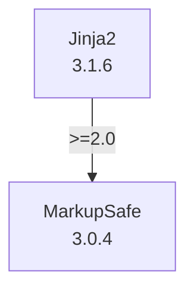
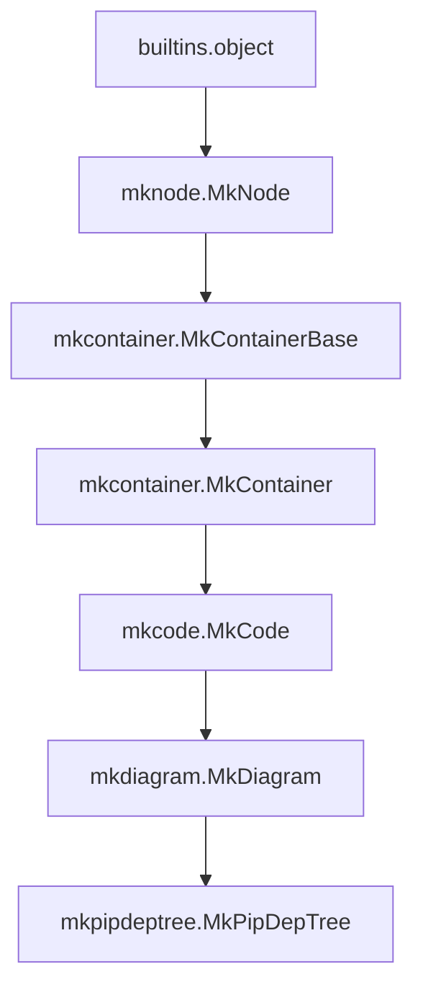

# MkPipDepTree

[ Show source on GitHub](https://github.com/phil65/mknodes/blob/main/src/mknodes/templatenodes/mkpipdeptree/__init__.py)

### Node to display a mermaid diagram for the dependencies.

<details open>
<summary>Examples</summary>

### Example: **Regular**
> [!NOTE]
> **Jinja**
>
> ```jinja
> {{ "jinja2" | MkPipDepTree }}
>
> ```

> [!NOTE]
> **Python**
>
> ```python
> MkPipDepTree('jinja2')
> ```

<details open>
<summary>Rendered</summary>



</details>

<details>
<summary>Markdown</summary>

`````markdown
````mermaid
graph TD
    classDef missing stroke-dasharray: 5
    jinja2["Jinja2<br/>3.1.6"]
    markupsafe["MarkupSafe<br/>3.0.4"]
    jinja2 -- ">=2.0" --> markupsafe

````
`````

</details>

<details>
<summary>Html</summary>

```html
<pre><code class="language-mermaid">graph TD
    classDef missing stroke-dasharray: 5
    jinja2[&quot;Jinja2&lt;br/&gt;3.1.6&quot;]
    markupsafe[&quot;MarkupSafe&lt;br/&gt;3.0.4&quot;]
    jinja2 -- &quot;&gt;=2.0&quot; --&gt; markupsafe

</code></pre>

```

</details>

<details>
<summary>GitHub</summary>

`````markdown
````mermaid
graph TD
    classDef missing stroke-dasharray: 5
    jinja2["Jinja2<br/>3.1.6"]
    markupsafe["MarkupSafe<br/>3.0.4"]
    jinja2 -- ">=2.0" --> markupsafe

````
`````

</details>

</details>

<details open>
<summary>DocStrings</summary>

<a id="mknodes.MkPipDepTree"></a>

```python
class MkPipDepTree(mkdiagram.MkDiagram)
```

</details>

<details open>
<summary>Base classes</summary>

| Name | Children | Inherits |
|--- | --- | --- |
| **<font size='4'>[MkDiagram](https://phil65.github.io/mknodes/)</font>**<br>*<font size='1'>mknodes.basenodes.mkdiagram</font>*<br>Class representing a mermaid diagram\. | <ul><li>[MkClassDiagram](https://phil65.github.io/mknodes/)</li><li>[MkPipDepTree](https://phil65.github.io/mknodes/)</li></ul> | <ul><li>[MkCode](https://phil65.github.io/mknodes/)</li></ul> |

</details>

<details>
<summary>⋔ Inheritance diagram</summary>



</details>

<details>
<summary>NodeFile</summary>

**/home/runner/work/mknodes/mknodes/src/mknodes/templatenodes/mkpipdeptree/metadata.toml**

```toml
[metadata]
name = "MkPipDepTree"
icon = "mdi:dependency"
status = "new"
group = "documentation"

[requirements.package.pipdeptree]

[examples.regular]
title = "Regular"
jinja = """
{{ "jinja2" | MkPipDepTree }}
"""

# [examples.direction]
# title = "Directed"
# jinja = """
# {{ mk.MkPipDepTree(direction="LR") }}
# """

[output.markdown]
template = """
{{ node.fence_boundary }} mermaid
{{ node.get_text() }}
{{ node.fence_boundary }}
"""

```

</details>

<details>
<summary>Code</summary>

**mknodes.templatenodes.mkpipdeptree.MkPipDepTree**

```python
class MkPipDepTree(mkdiagram.MkDiagram):
    """Node to display a mermaid diagram for the dependencies."""

    REQUIRED_PACKAGES = [resources.Package("pipdeptree")]
    ICON = "material/dependency"

    def __init__(
        self,
        package: types.ModuleType | str | None = None,
        *,
        direction: Literal["TD", "DT", "LR", "RL"] = "TD",
        local_only: bool = False,
        user_only: bool = False,
        **kwargs: Any,
    ) -> None:
        """Constructor.

        Args:
            package: Package to show a dependency diagram for
            direction: diagram direction
            local_only: Show ony local packages
            user_only: Show only user packages
            kwargs: Keyword arguments passed to parent
        """
        self._package = package
        self.local_only = local_only
        self.user_only = user_only
        super().__init__(direction=direction, **kwargs)

    @property
    def package(self) -> str:
        match self._package:
            case None:
                return self.ctx.metadata.distribution_name
            case types.ModuleType():
                return self._package.__name__
            case _:
                return self._package

    def _tree_params(self) -> dict[str, Any]:
        return dict(package=self.package, local_only=self.local_only, user_only=self.user_only)

    def get_input_requests(self) -> list[inputs.InputRequest]:
        return [inputs.InputRequest.create("pipdeptree", **self._tree_params())]

    def get_mermaid_code(self) -> str:
        return self.ctx.inputs.get("pipdeptree", **self._tree_params())

```

</details>

<details>
<summary>Page info</summary>

<details>
<summary>Code for this page</summary>

**mknodes.manual.nodes_section.create_section_for_nodes**

```python
def create_section_for_nodes(
    nav: mk.MkNav,
    klasses: Sequence[type[mk.MkNode]],
) -> mk.MkTable:
    table = mk.MkTable(columns=["Node", "Docstrings", "Markdown extensions"])
    for kls in klasses:
        tpl = "classpage_custom.jinja"
        page = mk.MkClassPage(kls, icon=kls.ICON, template_path=tpl, parent=nav, hide="toc")
        nav += page
        if kls.STATUS:
            page.metadata.status = kls.STATUS
        elif kls.JS_FILES:
            page.metadata.status = "js"
        elif kls.CSS:
            page.metadata.status = "css"
        page.created_by = create_section_for_nodes
        link = mk.MkLink(page, kls.__name__, icon=kls.ICON)
        extensions = ", ".join(f"`{i}`" for i in kls.REQUIRED_EXTENSIONS)
        table.add_row((link, kls.__doc__, extensions))
    return table

```

</details>

<details>
<summary>Resources</summary>

```python
Resources(css=[],
          markdown_extensions={'admonition': {},
                               'pymdownx.details': {},
                               'pymdownx.highlight': {'anchor_linenums': True,
                                                      'line_spans': '__span',
                                                      'pygments_lang_class': True},
                               'pymdownx.superfences': {'custom_fences': [{'class': 'mermaid',
                                                                           'format': <function fence_code_format at 0x7bb797a5c1a0>,
                                                                           'name': 'mermaid'}]},
                               'pymdownx.tabbed': {},
                               'tables': {}},
          plugins=[Plugin('mkdocstrings')],
          js=[],
          assets=[],
          packages=[])
```

</details>

<details>
<summary>Metadata</summary>

```yaml
created:
  source_filename: /home/runner/work/mknodes/mknodes/src/mknodes/manual/nodes_section.py
  source_function: create_section_for_nodes
  source_line_no: 93
hide:
- toc
icon: material/dependency
title: MkPipDepTree

```

</details>

</details>
