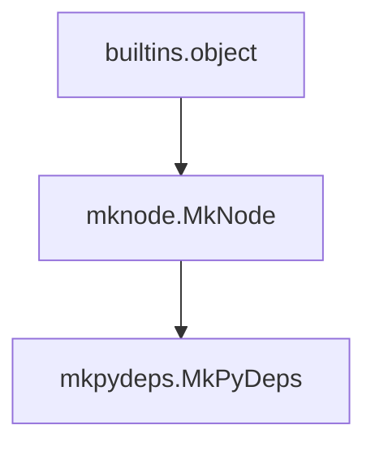

# MkPyDeps

[ Show source on GitHub](https://github.com/phil65/mknodes/blob/main/src/mknodes/templatenodes/mkpydeps/__init__.py)

### Node for showing a Dependency graph.

<details open>
<summary>Examples</summary>

</details>

<details>
<summary>DocStrings</summary>

<a id="mknodes.MkPyDeps"></a>

```python
class MkPyDeps(mknode.MkNode)
```

</details>

<details open>
<summary>Base classes</summary>

| Name | Children | Inherits |
|--- | --- | --- |
| **<font size='4'>[MkNode](https://phil65.github.io/mknodes/)</font>**<br>*<font size='1'>mknodes.basenodes.mknode</font>*<br>Base class for everything which can be expressed as Markup\. | <ul><li>[MkContainerBase](https://phil65.github.io/mknodes/)</li><li>[MkCompactAdmonition](https://phil65.github.io/mknodes/)</li><li>[MkLink](https://phil65.github.io/mknodes/)</li><li>[MkText](https://phil65.github.io/mknodes/)</li><li>[MkHeader](https://phil65.github.io/mknodes/)</li><li>[MkKeys](https://phil65.github.io/mknodes/)</li><li>[MkDocStrings](https://phil65.github.io/mknodes/)</li><li>[MkIcon](https://phil65.github.io/mknodes/)</li><li>[MkImage](https://phil65.github.io/mknodes/)</li><li>[MkProgressBar](https://phil65.github.io/mknodes/)</li><li>[BaseBlock](https://phil65.github.io/mknodes/)</li><li>...</li></ul> | <ul><li>[object](https://docs.python.org/3/library/functions.html#object)</li></ul> |

</details>

<details>
<summary>⋔ Inheritance diagram</summary>



</details>

<details>
<summary>NodeFile</summary>

**/home/runner/work/mknodes/mknodes/src/mknodes/templatenodes/mkpydeps/metadata.toml**

```toml
[metadata]
name = "MkPyDeps"
icon = "mdi:code-json"
group = "documentation"

# [examples.regular]
# condition = "{{ 'CI' | getenv }}"
# title = "Regular"
# jinja = """
# {{ "mknodes/data/tools.py" | MkPyDeps(max_bacon=1, max_module_depth=1) }}
# """

# [output.markdown]
# template = """
# <body>

# {{ node.get_svg() }}

# </body>

# """

```

</details>

<details>
<summary>Code</summary>

**mknodes.templatenodes.mkpydeps.MkPyDeps**

```python
class MkPyDeps(mknode.MkNode):
    """Node for showing a Dependency graph."""

    ICON = "material/code-json"
    REQUIRED_PACKAGES = [resources.Package("pydeps")]

    def __init__(
        self,
        module: str | os.PathLike[str] | types.ModuleType | None = None,
        *,
        max_bacon: int | None = None,
        max_module_depth: int | None = None,
        only_cycles: bool = False,
        clusters: bool = False,
        **kwargs: Any,
    ) -> None:
        """Constructor.

        Args:
            module: Path to the module
            max_bacon: Max bacon
            max_module_depth: Maximum module depth to display
            only_cycles: Only show import cycles
            clusters: draw external dependencies as separate clusters
            kwargs: Keyword arguments passed to parent
        """
        self._module = module
        self.max_bacon = max_bacon
        self.max_module_depth = max_module_depth
        self.only_cycles = only_cycles
        self.clusters = clusters
        super().__init__(**kwargs)

    @property
    def module(self):
        match self._module:
            case str() | os.PathLike:
                return self._module
            case types.ModuleType():
                return inspecthelpers.get_file(self._module)
            case _:
                return self.ctx.metadata.distribution_name

    def _pydeps_params(self) -> dict[str, Any]:
        return dict(
            folder_name=os.fspath(self.module),
            max_bacon=self.max_bacon,
            max_module_depth=self.max_module_depth,
            only_cycles=self.only_cycles,
            clusters=self.clusters,
        )

    def get_input_requests(self) -> list[inputs.InputRequest]:
        return [inputs.InputRequest.create("pydeps", **self._pydeps_params())]

    def get_svg(self) -> str:
        # pydeps + Graphviz run in the resolve phase (inputs store kind `pydeps`).
        content = self.ctx.inputs.get("pydeps", **self._pydeps_params())
        return insert_links(content, self.ctx.links.inv_manager)  # type: ignore  # pyright: ignore[reportArgumentType]

    def to_md_unprocessed(self) -> str:
        return f"<body>\n\n{self.get_svg()}\n\n</body>\n"

```

</details>

<details>
<summary>Page info</summary>

<details>
<summary>Code for this page</summary>

**mknodes.manual.nodes_section.create_section_for_nodes**

```python
def create_section_for_nodes(
    nav: mk.MkNav,
    klasses: Sequence[type[mk.MkNode]],
) -> mk.MkTable:
    table = mk.MkTable(columns=["Node", "Docstrings", "Markdown extensions"])
    for kls in klasses:
        tpl = "classpage_custom.jinja"
        page = mk.MkClassPage(kls, icon=kls.ICON, template_path=tpl, parent=nav, hide="toc")
        nav += page
        if kls.STATUS:
            page.metadata.status = kls.STATUS
        elif kls.JS_FILES:
            page.metadata.status = "js"
        elif kls.CSS:
            page.metadata.status = "css"
        page.created_by = create_section_for_nodes
        link = mk.MkLink(page, kls.__name__, icon=kls.ICON)
        extensions = ", ".join(f"`{i}`" for i in kls.REQUIRED_EXTENSIONS)
        table.add_row((link, kls.__doc__, extensions))
    return table

```

</details>

<details>
<summary>Resources</summary>

```python
Resources(css=[],
          markdown_extensions={'pymdownx.highlight': {'anchor_linenums': True,
                                                      'line_spans': '__span',
                                                      'pygments_lang_class': True},
                               'pymdownx.superfences': {'custom_fences': [{'class': 'mermaid',
                                                                           'format': <function fence_code_format at 0x7bb797a5c1a0>,
                                                                           'name': 'mermaid'}]},
                               'tables': {}},
          plugins=[Plugin('mkdocstrings')],
          js=[],
          assets=[],
          packages=[])
```

</details>

<details>
<summary>Metadata</summary>

```yaml
created:
  source_filename: /home/runner/work/mknodes/mknodes/src/mknodes/manual/nodes_section.py
  source_function: create_section_for_nodes
  source_line_no: 93
hide:
- toc
icon: material/code-json
title: MkPyDeps

```

</details>

</details>
