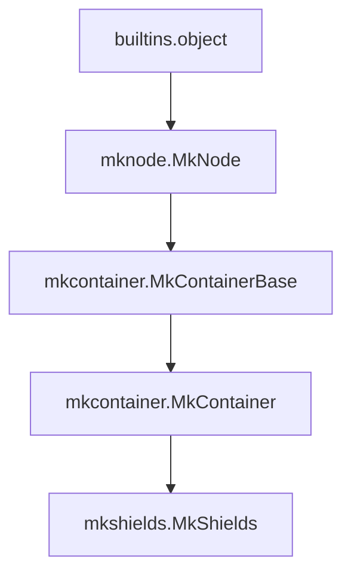

# MkShields

[ Show source on GitHub](https://github.com/phil65/mknodes/blob/main/src/mknodes/templatenodes/mkshields/__init__.py)

### Container for Shields.io / GitHub badges.

<details open>
<summary>Examples</summary>

### Example: **Regular**
> [!NOTE]
> **Jinja**
>
> ```jinja
> {{ ["version", "status", "codecov"] | MkShields }}
>
> ```

> [!NOTE]
> **Python**
>
> ```python
> MkShields(['version', 'status', 'codecov'])
> ```

<details open>
<summary>Rendered</summary>

<picture>
 
</picture>
<picture>
 
</picture>
<picture>
 
</picture>

</details>

<details>
<summary>Markdown</summary>

```markdown
<picture>
 
</picture>
<picture>
 
</picture>
<picture>
 
</picture>
```

</details>

<details>
<summary>Html</summary>

```html
<picture>
 
</picture>
<picture>
 
</picture>
<picture>
 
</picture>

```

</details>

<details>
<summary>Repr tree</summary>

```
MkShields
├── MkImage('https://img.shields.io/pypi/v/mknodes.svg', target='https://pypi.org/project/mknodes/', title='PyPI Latest Version')
├── MkImage('https://img.shields.io/pypi/status/mknodes.svg', target='https://pypi.org/project/mknodes/', title='Package status')
╰── MkImage('https://codecov.io/gh/phil65/mknodes/branch/main/graph/badge.svg', target='https://codecov.io/gh/phil65/mknodes/', title='Package status')
```

</details>

### Example: **Explicit**
> [!NOTE]
> **Jinja**
>
> ```jinja
> {{ ["version", "status", "codecov"] | MkShields(user="mkdocs", project="mkdocs") }}
>
> ```

> [!NOTE]
> **Python**
>
> ```python
> MkShields(['version', 'status', 'codecov'], user='mkdocs', project='mkdocs')
> ```

<details open>
<summary>Rendered</summary>

<picture>
 
</picture>
<picture>
 
</picture>
<picture>
 
</picture>

</details>

<details>
<summary>Markdown</summary>

```markdown
<picture>
 
</picture>
<picture>
 
</picture>
<picture>
 
</picture>
```

</details>

<details>
<summary>Html</summary>

```html
<picture>
 
</picture>
<picture>
 
</picture>
<picture>
 
</picture>

```

</details>

<details>
<summary>Repr tree</summary>

```
MkShields
├── MkImage('https://img.shields.io/pypi/v/mkdocs.svg', target='https://pypi.org/project/mkdocs/', title='PyPI Latest Version')
├── MkImage('https://img.shields.io/pypi/status/mkdocs.svg', target='https://pypi.org/project/mkdocs/', title='Package status')
╰── MkImage('https://codecov.io/gh/mkdocs/mkdocs/branch/main/graph/badge.svg', target='https://codecov.io/gh/mkdocs/mkdocs/', title='Package status')
```

</details>

</details>

<details open>
<summary>DocStrings</summary>

<a id="mknodes.MkShields"></a>

```python
class MkShields(mkcontainer.MkContainer)
```

</details>

<details open>
<summary>Base classes</summary>

| Name | Children | Inherits |
|--- | --- | --- |
| **<font size='4'>[MkContainer](https://phil65.github.io/mknodes/)</font>**<br>*<font size='1'>mknodes.basenodes.mkcontainer</font>*<br>A node containing other MkNodes\. | <ul><li>[MkBlock](https://phil65.github.io/mknodes/)</li><li>[MkAdmonition](https://phil65.github.io/mknodes/)</li><li>[MkBlockQuote](https://phil65.github.io/mknodes/)</li><li>[MkCode](https://phil65.github.io/mknodes/)</li><li>[MkTemplate](https://phil65.github.io/mknodes/)</li><li>[MkList](https://phil65.github.io/mknodes/)</li><li>[MkBaseTable](https://phil65.github.io/mknodes/)</li><li>[MkTab](https://phil65.github.io/mknodes/)</li><li>[MkTabContainer](https://phil65.github.io/mknodes/)</li><li>[MkCritic](https://phil65.github.io/mknodes/)</li><li>[MkAnnotation](https://phil65.github.io/mknodes/)</li><li>...</li></ul> | <ul><li>[MkContainerBase](https://phil65.github.io/mknodes/)</li></ul> |

</details>

<details>
<summary>⋔ Inheritance diagram</summary>



</details>

<details>
<summary>NodeFile</summary>

**/home/runner/work/mknodes/mknodes/src/mknodes/templatenodes/mkshields/metadata.toml**

```toml
[metadata]
name = "MkShields"
icon = "simple-icons:shieldsdotio"
group = "badge"
virtual_children = true

[examples.regular]
title = "Regular"
jinja = """
{{ ["version", "status", "codecov"] | MkShields }}
"""

[examples.explicit]
title = "Explicit"
jinja = """
{{ ["version", "status", "codecov"] | MkShields(user="mkdocs", project="mkdocs") }}
"""

[output.markdown]
template = """
{{ node.get_items() | join("\n") }}
"""
# 
# {{ s.image_url.format(user=node.user, project=node.project, branch=node.branch) | MkImage(target=s.get_url(user=node.user, project=node.project, title=node.title)) }}
# 

```

</details>

<details>
<summary>Code</summary>

**mknodes.templatenodes.mkshields.MkShields**

```python
class MkShields(mkcontainer.MkContainer):
    """Container for Shields.io / GitHub badges."""

    ICON = "simple/shieldsdotio"
    VIRTUAL_CHILDREN = True
    ATTR_LIST_SEPARATOR = ""

    def __init__(
        self,
        shields: Sequence[badges.BadgeTypeStr] | None = None,
        *,
        user: str | None = None,
        project: str | None = None,
        branch: str | None = None,
        **kwargs: Any,
    ) -> None:
        """Constructor.

        Args:
            shields: Shields to include
            user: Github username for shields
            project: project name for shields
            branch: branch name for shields
            kwargs: Keyword arguments passed to parent
        """
        super().__init__(**kwargs)
        self.block_separator = "\n"
        self._user = user
        self._project = project
        self._branch = branch
        self._shields = shields

    @property
    def user(self) -> str:
        match self._user:
            case None:
                return self.ctx.metadata.repository_username
            case str():
                return self._user
            case _:
                msg = "Invalid user type"
                raise ValueError(msg)

    @user.setter
    def user(self, val: str | None) -> None:
        self._user = val

    @property
    def project(self) -> str:
        if isinstance(self._project, str):
            return self._project
        return self.ctx.metadata.repository_name

    @project.setter
    def project(self, value) -> None:
        self._project = value

    @property
    def shields(self):
        shields = self._shields or [i.identifier for i in badges.SHIELDS]
        return [s for s in badges.SHIELDS if s.identifier in shields]

    @property
    def branch(self) -> str:
        if isinstance(self._branch, str):
            return self._branch
        return self.ctx.git.main_branch or "main"

    def get_items(self) -> list[mknode.MkNode]:
        """Return computed shield items."""
        return [
            mkimage.MkImage(
                s.get_image_url(user=self.user, project=self.project, branch=self.branch),
                target=s.get_url(user=self.user, project=self.project),
                title=s.title,
                parent=self,
            )
            for s in self.shields
        ]

    def set_items(self, items: list[mknode.MkNode]) -> None:
        """Set items (no-op for computed shields)."""

```

</details>

<details>
<summary>Page info</summary>

<details>
<summary>Code for this page</summary>

**mknodes.manual.nodes_section.create_section_for_nodes**

```python
def create_section_for_nodes(
    nav: mk.MkNav,
    klasses: Sequence[type[mk.MkNode]],
) -> mk.MkTable:
    table = mk.MkTable(columns=["Node", "Docstrings", "Markdown extensions"])
    for kls in klasses:
        tpl = "classpage_custom.jinja"
        page = mk.MkClassPage(kls, icon=kls.ICON, template_path=tpl, parent=nav, hide="toc")
        nav += page
        if kls.STATUS:
            page.metadata.status = kls.STATUS
        elif kls.JS_FILES:
            page.metadata.status = "js"
        elif kls.CSS:
            page.metadata.status = "css"
        page.created_by = create_section_for_nodes
        link = mk.MkLink(page, kls.__name__, icon=kls.ICON)
        extensions = ", ".join(f"`{i}`" for i in kls.REQUIRED_EXTENSIONS)
        table.add_row((link, kls.__doc__, extensions))
    return table

```

</details>

<details>
<summary>Resources</summary>

```python
Resources(css=[],
          markdown_extensions={'admonition': {},
                               'pymdownx.details': {},
                               'pymdownx.highlight': {'anchor_linenums': True,
                                                      'line_spans': '__span',
                                                      'pygments_lang_class': True},
                               'pymdownx.superfences': {'custom_fences': [{'class': 'mermaid',
                                                                           'format': <function fence_code_format at 0x7bb797a5c1a0>,
                                                                           'name': 'mermaid'}]},
                               'pymdownx.tabbed': {},
                               'tables': {}},
          plugins=[Plugin('mkdocstrings')],
          js=[],
          assets=[],
          packages=[])
```

</details>

<details>
<summary>Metadata</summary>

```yaml
created:
  source_filename: /home/runner/work/mknodes/mknodes/src/mknodes/manual/nodes_section.py
  source_function: create_section_for_nodes
  source_line_no: 93
hide:
- toc
icon: simple/shieldsdotio
title: MkShields

```

</details>

</details>
