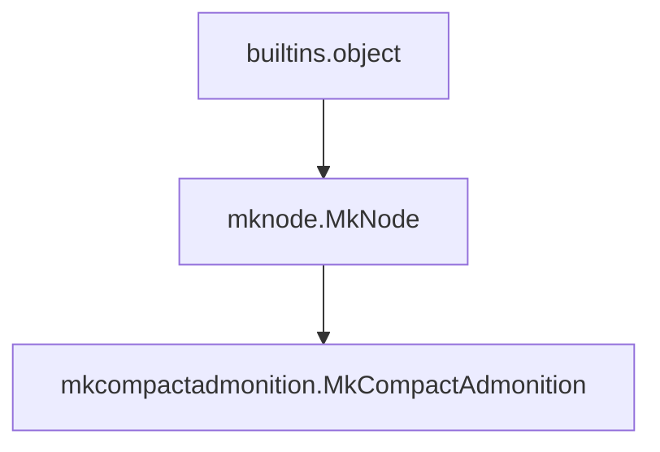

# MkCompactAdmonition

[ Show source on GitHub](https://github.com/phil65/mknodes/blob/main/src/mknodes/basenodes/mkcompactadmonition/__init__.py)

### Compact admonition info box.

<details open>
<summary>Examples</summary>

### Example: **Types**
> [!NOTE]
> **Jinja**
>
> ```jinja
> 
> {{ "Different types." | MkCompactAdmonition(typ=typ) }}
> 
>
> ```

> [!NOTE]
> **Python**
>
> ```python
> MkContainer()
> ```

<details open>
<summary>Rendered</summary>

> [!NOTE]
> Different types.

> [!WARNING]
> Different types.

> [!CAUTION]
> Different types.

</details>

<details>
<summary>Markdown</summary>

```markdown
> [!NOTE]
> Different types.

> [!WARNING]
> Different types.

> [!CAUTION]
> Different types.

```

</details>

<details>
<summary>Html</summary>

```html
<div class="markdown-alert markdown-alert-note">
<p class="markdown-alert-title">Note</p>
<p>Different types.</p>
</div>
<div class="markdown-alert markdown-alert-warning">
<p class="markdown-alert-title">Warning</p>
<p>Different types.</p>
</div>
<div class="markdown-alert markdown-alert-caution">
<p class="markdown-alert-title">Caution</p>
<p>Different types.</p>
</div>

```

</details>

<details>
<summary>Repr tree</summary>

```
MkContainer
├── MkCompactAdmonition('Different types.')
├── MkCompactAdmonition('Different types.', typ='warning')
╰── MkCompactAdmonition('Different types.', typ='bug')
```

</details>

</details>

<details open>
<summary>DocStrings</summary>

<a id="mknodes.MkCompactAdmonition"></a>

```python
class MkCompactAdmonition(mknode.MkNode)
```

</details>

<details open>
<summary>Base classes</summary>

| Name | Children | Inherits |
|--- | --- | --- |
| **<font size='4'>[MkNode](https://phil65.github.io/mknodes/)</font>**<br>*<font size='1'>mknodes.basenodes.mknode</font>*<br>Base class for everything which can be expressed as Markup\. | <ul><li>[MkContainerBase](https://phil65.github.io/mknodes/)</li><li>[MkCompactAdmonition](https://phil65.github.io/mknodes/)</li><li>[MkLink](https://phil65.github.io/mknodes/)</li><li>[MkText](https://phil65.github.io/mknodes/)</li><li>[MkHeader](https://phil65.github.io/mknodes/)</li><li>[MkKeys](https://phil65.github.io/mknodes/)</li><li>[MkDocStrings](https://phil65.github.io/mknodes/)</li><li>[MkIcon](https://phil65.github.io/mknodes/)</li><li>[MkImage](https://phil65.github.io/mknodes/)</li><li>[MkProgressBar](https://phil65.github.io/mknodes/)</li><li>[BaseBlock](https://phil65.github.io/mknodes/)</li><li>...</li></ul> | <ul><li>[object](https://docs.python.org/3/library/functions.html#object)</li></ul> |

</details>

<details>
<summary>⋔ Inheritance diagram</summary>



</details>

<details>
<summary>NodeFile</summary>

**/home/runner/work/mknodes/mknodes/src/mknodes/basenodes/mkcompactadmonition/metadata.toml**

```toml
[metadata]
icon = "octicon:info-16"
status = "new"
name = "MkCompactAdmonition"

[[resources.css]]
filename = "compactadmonition.css"
content = """

:root {
    --md-badge-fg--{{ node.typ }}: {{ admon.header_color }};
    --md-badge-bg--{{ node.typ }}: {{ admon.header_color }}1a;
    --badge-icon--{{ node.typ }}: {{ admon.icon | get_icon_svg | svg_to_data_uri }};
}

.mdx-grid-wrapper {
    display: grid;
    grid-template-columns: .5fr 9fr;
    gap: 1rem;

    border: .075rem solid #448aff;
    border-radius: .2rem;
}

.mdx-grid-child {
    align-self: center;
    font-size: .64rem;
}

.mdx-grid-child.mdx-grid-child--icon {
    background-color: "#448aff1a";
}

.mdx-grid-child.mdx-grid-child--icon::before {
    content: "";

    background-color: "#448aff";

    mask-position: center;
    mask-repeat: no-repeat;
    mask-size: contain;

    height: 1rem;
    width: 1rem;

    margin: .4rem;

    display: block;

    -webkit-mask-image: var(--badge-icon--note);
    mask-image: var(--badge-icon--note);
}

.mdx-admo--{{ node.typ }} {
    border-color: var(--md-badge-fg--{{ node.typ }});
}

.mdx-admo--{{ node.typ }} .mdx-grid-child--icon {
    background-color: var(--md-badge-bg--{{ node.typ }});
}

.mdx-admo--{{ node.typ }} .mdx-grid-child--icon::before {
    background-color: var(--md-badge-fg--{{ node.typ }});

    -webkit-mask-image: var(--badge-icon--{{ node.typ }});
            mask-image: var(--badge-icon--{{ node.typ }});
}
"""

[examples.types]
title = "Types"
jinja = """

{{ "Different types." | MkCompactAdmonition(typ=typ) }}

"""

[output.html]
template = """
<div class="mdx-grid-wrapper{{ node.typ | add(prefix=" mdx-admo--") }}">
  <div class="mdx-grid-child mdx-grid-child--icon"></div>
  <div class="mdx-grid-child">{{ node.get_text() }}</div>
</div>
"""

[admonitions]
note = { icon = "mdi:pencil-circle", header_color = "#448aff" }
abstract = { icon = "mdi:clipboard-text", header_color = "#00b0ff" }
info = { icon = "mdi:information", header_color = "#00b8d4" }
tip = { icon = "mdi:fire", header_color = "#00bfa5" }
success = { icon = "mdi:check", header_color = "#00c853" }
question = { icon = "mdi:help-circle", header_color = "#64dd17" }
warning = { icon = "mdi:alert", header_color = "#ff9100" }
failure = { icon = "mdi:close", header_color = "#ff5252" }
danger = { icon = "mdi:lightning-bolt-circle", header_color = "#ff1744" }
bug = { icon = "mdi:shield-bug", header_color = "#f50057" }
example = { icon = "mdi:test-tube", header_color = "#7c4dff" }
quote = { icon = "mdi:format-quote-close", header_color = "#9e9e9e" }

```

</details>

<details>
<summary>Code</summary>

**mknodes.basenodes.mkcompactadmonition.MkCompactAdmonition**

```python
class MkCompactAdmonition(mknode.MkNode):
    """Compact admonition info box."""

    ICON = "octicons/info-16"
    CSS = [resources.CSSFile("compactadmonition.css")]

    def __init__(
        self,
        text: str | mknode.MkNode,
        *,
        typ: datatypes.AdmonitionTypeStr | str = "info",
        **kwargs: Any,
    ) -> None:
        """Constructor.

        Args:
            text: Admonition text
            typ: Admonition type
            kwargs: Keyword arguments passed to parent
        """
        self._text = text
        self.typ = typ
        super().__init__(**kwargs)

    def to_md_unprocessed(self) -> str:
        kls = f"mdx-grid-wrapper mdx-admo--{self.typ}" if self.typ else "mdx-grid-wrapper"
        root = xmlhelpers.Div(kls)
        xmlhelpers.Div("mdx-grid-child mdx-grid-child--icon", parent=root)
        text_div = xmlhelpers.Div("mdx-grid-child", parent=root)
        text_div.text = str(self._text)
        return root.to_string()

    def get_text(self) -> str | mknode.MkNode:
        return self._text

```

</details>

<details>
<summary>Page info</summary>

<details>
<summary>Code for this page</summary>

**mknodes.manual.nodes_section.create_section_for_nodes**

```python
def create_section_for_nodes(
    nav: mk.MkNav,
    klasses: Sequence[type[mk.MkNode]],
) -> mk.MkTable:
    table = mk.MkTable(columns=["Node", "Docstrings", "Markdown extensions"])
    for kls in klasses:
        tpl = "classpage_custom.jinja"
        page = mk.MkClassPage(kls, icon=kls.ICON, template_path=tpl, parent=nav, hide="toc")
        nav += page
        if kls.STATUS:
            page.metadata.status = kls.STATUS
        elif kls.JS_FILES:
            page.metadata.status = "js"
        elif kls.CSS:
            page.metadata.status = "css"
        page.created_by = create_section_for_nodes
        link = mk.MkLink(page, kls.__name__, icon=kls.ICON)
        extensions = ", ".join(f"`{i}`" for i in kls.REQUIRED_EXTENSIONS)
        table.add_row((link, kls.__doc__, extensions))
    return table

```

</details>

<details>
<summary>Resources</summary>

```python
Resources(css=[],
          markdown_extensions={'admonition': {},
                               'pymdownx.details': {},
                               'pymdownx.highlight': {'anchor_linenums': True,
                                                      'line_spans': '__span',
                                                      'pygments_lang_class': True},
                               'pymdownx.superfences': {'custom_fences': [{'class': 'mermaid',
                                                                           'format': <function fence_code_format at 0x7bb797a5c1a0>,
                                                                           'name': 'mermaid'}]},
                               'pymdownx.tabbed': {},
                               'tables': {}},
          plugins=[Plugin('mkdocstrings')],
          js=[],
          assets=[],
          packages=[])
```

</details>

<details>
<summary>Metadata</summary>

```yaml
created:
  source_filename: /home/runner/work/mknodes/mknodes/src/mknodes/manual/nodes_section.py
  source_function: create_section_for_nodes
  source_line_no: 93
hide:
- toc
icon: octicons/info-16
status: css
title: MkCompactAdmonition

```

</details>

</details>
