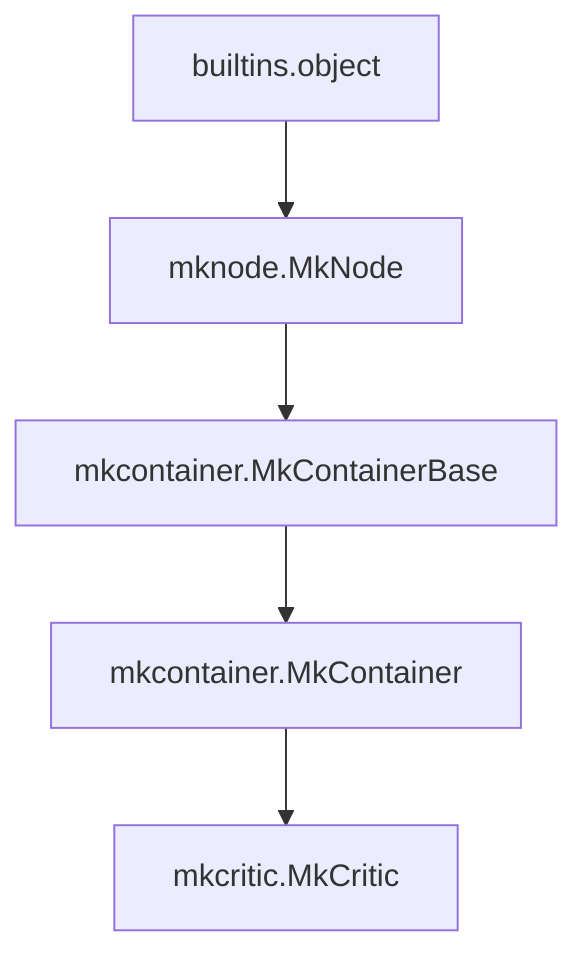

# MkCritic

[ Show source on GitHub](https://github.com/phil65/mknodes/blob/main/src/mknodes/basenodes/mkcritic/__init__.py)

### MkCritic block.

<details open>
<summary>Examples</summary>

### Example: **Addition**
> [!NOTE]
> **Jinja**
>
> ```jinja
> {{ "Type `addition`" | MkCritic(typ="addition") }}
>
> ```

> [!NOTE]
> **Python**
>
> ```python
> MkCritic(None, typ='addition')
> ```

<details open>
<summary>Rendered</summary>

<ins>

Type `addition`

</ins>

</details>

<details>
<summary>Markdown</summary>

```markdown
<ins>

Type `addition`

</ins>
```

</details>

<details>
<summary>Html</summary>

```html
<ins>
<p>Type <code>addition</code></p>
</ins>

```

</details>

<details>
<summary>GitHub</summary>

```markdown
<ins>

Type `addition`

</ins>
```

</details>

<details>
<summary>Repr tree</summary>

```
MkCritic
╰── MkText('Type `addition`')
```

</details>

### Example: **Deletion**
> [!NOTE]
> **Jinja**
>
> ```jinja
> {{ "Type `deletion`" | MkCritic(typ="deletion") }}
>
> ```

> [!NOTE]
> **Python**
>
> ```python
> MkCritic(None, typ='deletion')
> ```

<details open>
<summary>Rendered</summary>

<del>

Type `deletion`

</del>

</details>

<details>
<summary>Markdown</summary>

```markdown
<del>

Type `deletion`

</del>
```

</details>

<details>
<summary>Html</summary>

```html
<del>
<p>Type <code>deletion</code></p>
</del>

```

</details>

<details>
<summary>GitHub</summary>

```markdown
<del>

Type `deletion`

</del>
```

</details>

<details>
<summary>Repr tree</summary>

```
MkCritic
╰── MkText('Type `deletion`')
```

</details>

### Example: **Highlight**
> [!NOTE]
> **Jinja**
>
> ```jinja
> {{ "Type `highlight`" | MkCritic(typ="highlight") }}
>
> ```

> [!NOTE]
> **Python**
>
> ```python
> MkCritic(None)
> ```

<details open>
<summary>Rendered</summary>

<mark>

Type `highlight`

</mark>

</details>

<details>
<summary>Markdown</summary>

```markdown
<mark>

Type `highlight`

</mark>
```

</details>

<details>
<summary>Html</summary>

```html
<mark>
<p>Type <code>highlight</code></p>
</mark>

```

</details>

<details>
<summary>GitHub</summary>

```markdown
<mark>

Type `highlight`

</mark>
```

</details>

<details>
<summary>Repr tree</summary>

```
MkCritic
╰── MkText('Type `highlight`')
```

</details>

### Example: **Comment**
> [!NOTE]
> **Jinja**
>
> ```jinja
> {{ "Type `comment`" | MkCritic(typ="comment") }}
>
> ```

> [!NOTE]
> **Python**
>
> ```python
> MkCritic(None, typ='comment')
> ```

<details open>
<summary>Rendered</summary>

<!-- Type `comment` -->

</details>

<details>
<summary>Markdown</summary>

```markdown
<!-- Type `comment` -->
```

</details>

<details>
<summary>Html</summary>

```html
<!-- Type `comment` -->

```

</details>

<details>
<summary>GitHub</summary>

```markdown
<!-- Type `comment` -->
```

</details>

<details>
<summary>Repr tree</summary>

```
MkCritic
╰── MkText('Type `comment`')
```

</details>

</details>

<details open>
<summary>DocStrings</summary>

<a id="mknodes.MkCritic"></a>

```python
class MkCritic(mkcontainer.MkContainer)
```

</details>

<details open>
<summary>Base classes</summary>

| Name | Children | Inherits |
|--- | --- | --- |
| **<font size='4'>[MkContainer](https://phil65.github.io/mknodes/)</font>**<br>*<font size='1'>mknodes.basenodes.mkcontainer</font>*<br>A node containing other MkNodes\. | <ul><li>[MkBlock](https://phil65.github.io/mknodes/)</li><li>[MkAdmonition](https://phil65.github.io/mknodes/)</li><li>[MkBlockQuote](https://phil65.github.io/mknodes/)</li><li>[MkCode](https://phil65.github.io/mknodes/)</li><li>[MkTemplate](https://phil65.github.io/mknodes/)</li><li>[MkList](https://phil65.github.io/mknodes/)</li><li>[MkBaseTable](https://phil65.github.io/mknodes/)</li><li>[MkTab](https://phil65.github.io/mknodes/)</li><li>[MkTabContainer](https://phil65.github.io/mknodes/)</li><li>[MkCritic](https://phil65.github.io/mknodes/)</li><li>[MkAnnotation](https://phil65.github.io/mknodes/)</li><li>...</li></ul> | <ul><li>[MkContainerBase](https://phil65.github.io/mknodes/)</li></ul> |

</details>

<details>
<summary>⋔ Inheritance diagram</summary>



</details>

<details>
<summary>NodeFile</summary>

**/home/runner/work/mknodes/mknodes/src/mknodes/basenodes/mkcritic/metadata.toml**

```toml
[metadata]
icon = "mdi:format-text"
name = "MkCritic"

[requirements.extension."pymdownx.critic"]

[examples.addition]
title = "Addition"
jinja = """
{{ "Type `addition`" | MkCritic(typ="addition") }}
"""

[examples.deletion]
title = "Deletion"
jinja = """
{{ "Type `deletion`" | MkCritic(typ="deletion") }}
"""

[examples.highlight]
title = "Highlight"
jinja = """
{{ "Type `highlight`" | MkCritic(typ="highlight") }}
"""

[examples.comment]
title = "Comment"
jinja = """
{{ "Type `comment`" | MkCritic(typ="comment") }}
"""

[output.markdown]
template = """
{{{ node.marks[0] }}

{{ node.get_items() | join(node.block_separator) }}

{{ node.marks[1] }}}
"""

```

</details>

<details>
<summary>Code</summary>

**mknodes.basenodes.mkcritic.MkCritic**

```python
class MkCritic(mkcontainer.MkContainer):
    """MkCritic block."""

    ICON = "material/format-text"
    REQUIRED_EXTENSIONS = [resources.Extension("pymdownx.critic")]

    def __init__(
        self,
        content: str | mk.MkNode | list,
        *,
        typ: CriticMarkStr = "highlight",
        **kwargs: Any,
    ) -> None:
        """Constructor.

        Args:
            content: Content to mark
            typ: Mark type
            kwargs: Keyword arguments passed to parent
        """
        super().__init__(content=content, **kwargs)
        self.typ = typ

    @property
    def marks(self) -> tuple[str, str]:
        match self.typ:
            case "addition":
                return ("++", "++")
            case "deletion":
                return ("--", "--")
            case "highlight":
                return ("==", "==")
            case "comment":
                return (">>", "<<")
            case _:
                raise TypeError(self.typ)

    def get_content(self) -> resources.NodeContent:
        """Single-pass: get content with critic formatting and resources."""
        content = super().get_content()
        left, right = self.marks
        md = f"{{{left}\n\n{content.markdown}\n\n{right}}}"
        return resources.NodeContent(markdown=md, resources=content.resources)

    def to_md_unprocessed(self) -> str:
        content = self.get_content()
        return content.markdown

```

</details>

<details>
<summary>Page info</summary>

<details>
<summary>Code for this page</summary>

**mknodes.manual.nodes_section.create_section_for_nodes**

```python
def create_section_for_nodes(
    nav: mk.MkNav,
    klasses: Sequence[type[mk.MkNode]],
) -> mk.MkTable:
    table = mk.MkTable(columns=["Node", "Docstrings", "Markdown extensions"])
    for kls in klasses:
        tpl = "classpage_custom.jinja"
        page = mk.MkClassPage(kls, icon=kls.ICON, template_path=tpl, parent=nav, hide="toc")
        nav += page
        if kls.STATUS:
            page.metadata.status = kls.STATUS
        elif kls.JS_FILES:
            page.metadata.status = "js"
        elif kls.CSS:
            page.metadata.status = "css"
        page.created_by = create_section_for_nodes
        link = mk.MkLink(page, kls.__name__, icon=kls.ICON)
        extensions = ", ".join(f"`{i}`" for i in kls.REQUIRED_EXTENSIONS)
        table.add_row((link, kls.__doc__, extensions))
    return table

```

</details>

<details>
<summary>Resources</summary>

```python
Resources(css=[],
          markdown_extensions={'admonition': {},
                               'pymdownx.details': {},
                               'pymdownx.highlight': {'anchor_linenums': True,
                                                      'line_spans': '__span',
                                                      'pygments_lang_class': True},
                               'pymdownx.superfences': {'custom_fences': [{'class': 'mermaid',
                                                                           'format': <function fence_code_format at 0x7bb797a5c1a0>,
                                                                           'name': 'mermaid'}]},
                               'pymdownx.tabbed': {},
                               'tables': {}},
          plugins=[Plugin('mkdocstrings')],
          js=[],
          assets=[],
          packages=[])
```

</details>

<details>
<summary>Metadata</summary>

```yaml
created:
  source_filename: /home/runner/work/mknodes/mknodes/src/mknodes/manual/nodes_section.py
  source_function: create_section_for_nodes
  source_line_no: 93
hide:
- toc
icon: material/format-text
title: MkCritic

```

</details>

</details>
