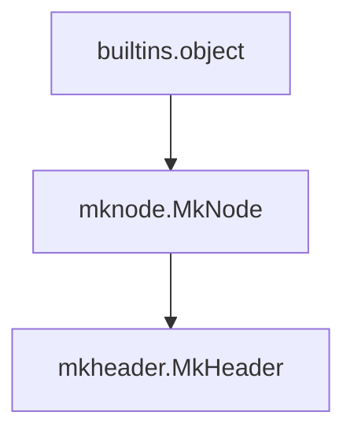

# MkHeader

[ Show source on GitHub](https://github.com/phil65/mknodes/blob/main/src/mknodes/basenodes/mkheader/__init__.py)

### Super simple header node.

<details open>
<summary>Examples</summary>

### Example: **Regular**
> [!NOTE]
> **Jinja**
>
> ```jinja
> {{ "Header with level 2" | MkHeader(level=2) }}
>
> ```

> [!NOTE]
> **Python**
>
> ```python
> MkHeader('Header with level 2')
> ```

<details open>
<summary>Rendered</summary>

## Header with level 2

</details>

<details>
<summary>Markdown</summary>

```markdown
## Header with level 2
```

</details>

<details>
<summary>Html</summary>

```html
<h2 id="header-with-level-2">Header with level 2<a href="#header-with-level-2" aria-label="Link to heading 'Header with level 2'" data-heading-content="Header with level 2" class="anchor"></a></h2>

```

</details>

<details>
<summary>reST</summary>

```rst
*******************
Header with level 2
*******************
```

</details>

### Example: **Header levels**
> [!NOTE]
> **Jinja**
>
> ```jinja
> 
>
> {{ ("Header level " ~ i) | MkHeader(level=i) }}
>
> 
>
> ```

> [!NOTE]
> **Python**
>
> ```python
> MkContainer()
> ```

<details open>
<summary>Rendered</summary>

# Header level 1

## Header level 2

### Header level 3

#### Header level 4

##### Header level 5

###### Header level 6

</details>

<details>
<summary>Markdown</summary>

```markdown
# Header level 1

## Header level 2

### Header level 3

#### Header level 4

##### Header level 5

###### Header level 6
```

</details>

<details>
<summary>Html</summary>

```html
<h1 id="header-level-1">Header level 1<a href="#header-level-1" aria-label="Link to heading 'Header level 1'" data-heading-content="Header level 1" class="anchor"></a></h1>
<h2 id="header-level-2">Header level 2<a href="#header-level-2" aria-label="Link to heading 'Header level 2'" data-heading-content="Header level 2" class="anchor"></a></h2>
<h3 id="header-level-3">Header level 3<a href="#header-level-3" aria-label="Link to heading 'Header level 3'" data-heading-content="Header level 3" class="anchor"></a></h3>
<h4 id="header-level-4">Header level 4<a href="#header-level-4" aria-label="Link to heading 'Header level 4'" data-heading-content="Header level 4" class="anchor"></a></h4>
<h5 id="header-level-5">Header level 5<a href="#header-level-5" aria-label="Link to heading 'Header level 5'" data-heading-content="Header level 5" class="anchor"></a></h5>
<h6 id="header-level-6">Header level 6<a href="#header-level-6" aria-label="Link to heading 'Header level 6'" data-heading-content="Header level 6" class="anchor"></a></h6>

```

</details>

<details>
<summary>Repr tree</summary>

```
MkContainer
├── MkHeader('Header level 1', level=1)
├── MkHeader('Header level 2')
├── MkHeader('Header level 3', level=3)
├── MkHeader('Header level 4', level=4)
├── MkHeader('Header level 5', level=5)
╰── MkHeader('Header level 6', level=6)
```

</details>

</details>

<details open>
<summary>DocStrings</summary>

<a id="mknodes.MkHeader"></a>

```python
class MkHeader(mknode.MkNode)
```

</details>

<details open>
<summary>Base classes</summary>

| Name | Children | Inherits |
|--- | --- | --- |
| **<font size='4'>[MkNode](https://phil65.github.io/mknodes/)</font>**<br>*<font size='1'>mknodes.basenodes.mknode</font>*<br>Base class for everything which can be expressed as Markup\. | <ul><li>[MkContainerBase](https://phil65.github.io/mknodes/)</li><li>[MkCompactAdmonition](https://phil65.github.io/mknodes/)</li><li>[MkLink](https://phil65.github.io/mknodes/)</li><li>[MkText](https://phil65.github.io/mknodes/)</li><li>[MkHeader](https://phil65.github.io/mknodes/)</li><li>[MkKeys](https://phil65.github.io/mknodes/)</li><li>[MkDocStrings](https://phil65.github.io/mknodes/)</li><li>[MkIcon](https://phil65.github.io/mknodes/)</li><li>[MkImage](https://phil65.github.io/mknodes/)</li><li>[MkProgressBar](https://phil65.github.io/mknodes/)</li><li>[BaseBlock](https://phil65.github.io/mknodes/)</li><li>...</li></ul> | <ul><li>[object](https://docs.python.org/3/library/functions.html#object)</li></ul> |

</details>

<details>
<summary>⋔ Inheritance diagram</summary>



</details>

<details>
<summary>NodeFile</summary>

**/home/runner/work/mknodes/mknodes/src/mknodes/basenodes/mkheader/metadata.toml**

```toml
[metadata]
icon = "mdi:format-header-pound"
name = "MkHeader"
group = "base"

[examples.regular]
title = "Regular"
jinja = """
{{ "Header with level 2" | MkHeader(level=2) }}
"""

[examples.header_levels]
title = "Header levels"
jinja = """


{{ ("Header level " ~ i) | MkHeader(level=i) }}


"""

[output.markdown]
template = """
{{ "#" * node.level }} {{ node.get_text() }} { data-search-exclude }
"""

# [output.html]
# template = """
# <h{{ node.level }}>{{ node.get_text() }}</h{{ node.level }}>
# """

[output.rst]
template = """

{{ line }}
{{ node.get_text() }}
{{ line }}
"""

```

</details>

<details>
<summary>Code</summary>

**mknodes.basenodes.mkheader.MkHeader**

```python
class MkHeader(mknode.MkNode):
    """Super simple header node."""

    ICON = "material/format-header-pound"
    STATUS = "new"

    def __init__(
        self,
        text: str | mknode.MkNode | None = "",
        *,
        level: int = 2,
        exclude_from_search: bool = False,
        **kwargs: Any,
    ) -> None:
        """Constructor.

        Args:
            text: Header text
            level: Header level
            exclude_from_search: Whether section should be included in search.
            kwargs: Keyword arguments passed to parent
        """
        super().__init__(**kwargs)
        self._text = str(text or "")
        self.level = level
        self.exclude_from_search = exclude_from_search

    def to_md_unprocessed(self) -> str:
        level_str = "#" * self.level
        suffix = " { data-search-exclude }" if self.exclude_from_search else ""
        return f"{level_str} {self._text}{suffix}"

    def get_text(self) -> str:
        return self._text

```

</details>

<details>
<summary>Page info</summary>

<details>
<summary>Code for this page</summary>

**mknodes.manual.nodes_section.create_section_for_nodes**

```python
def create_section_for_nodes(
    nav: mk.MkNav,
    klasses: Sequence[type[mk.MkNode]],
) -> mk.MkTable:
    table = mk.MkTable(columns=["Node", "Docstrings", "Markdown extensions"])
    for kls in klasses:
        tpl = "classpage_custom.jinja"
        page = mk.MkClassPage(kls, icon=kls.ICON, template_path=tpl, parent=nav, hide="toc")
        nav += page
        if kls.STATUS:
            page.metadata.status = kls.STATUS
        elif kls.JS_FILES:
            page.metadata.status = "js"
        elif kls.CSS:
            page.metadata.status = "css"
        page.created_by = create_section_for_nodes
        link = mk.MkLink(page, kls.__name__, icon=kls.ICON)
        extensions = ", ".join(f"`{i}`" for i in kls.REQUIRED_EXTENSIONS)
        table.add_row((link, kls.__doc__, extensions))
    return table

```

</details>

<details>
<summary>Resources</summary>

```python
Resources(css=[],
          markdown_extensions={'admonition': {},
                               'pymdownx.details': {},
                               'pymdownx.highlight': {'anchor_linenums': True,
                                                      'line_spans': '__span',
                                                      'pygments_lang_class': True},
                               'pymdownx.superfences': {'custom_fences': [{'class': 'mermaid',
                                                                           'format': <function fence_code_format at 0x7bb797a5c1a0>,
                                                                           'name': 'mermaid'}]},
                               'pymdownx.tabbed': {},
                               'tables': {}},
          plugins=[Plugin('mkdocstrings')],
          js=[],
          assets=[],
          packages=[])
```

</details>

<details>
<summary>Metadata</summary>

```yaml
created:
  source_filename: /home/runner/work/mknodes/mknodes/src/mknodes/manual/nodes_section.py
  source_function: create_section_for_nodes
  source_line_no: 93
hide:
- toc
icon: material/format-header-pound
status: new
title: MkHeader

```

</details>

</details>
