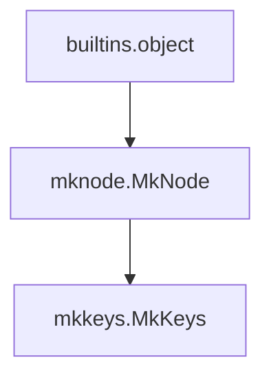

# MkKeys

[ Show source on GitHub](https://github.com/phil65/mknodes/blob/main/src/mknodes/basenodes/mkkeys/__init__.py)

### Node to display Keyboard keys.

> [!NOTE]
> **Description**
>
>
> Mostly used to explain shortcuts / commands for the keyboard.

<details open>
<summary>Examples</summary>

### Example: **Single key**
> [!NOTE]
> **Jinja**
>
> ```jinja
> {{ "M" | MkKeys }}
>
> ```

> [!NOTE]
> **Python**
>
> ```python
> MkKeys(['m'])
> ```

<details open>
<summary>Rendered</summary>

<kbd>M</kbd>

</details>

<details>
<summary>Markdown</summary>

```markdown
<kbd>M</kbd>
```

</details>

<details>
<summary>Html</summary>

```html
<p><kbd>M</kbd></p>

```

</details>

<details>
<summary>GitHub</summary>

```markdown
<kbd>M</kbd>
```

</details>

### Example: **Multiple keys**
> [!NOTE]
> **Jinja**
>
> ```jinja
> {{ "M+k+K+e+y+s" | MkKeys }}
>
> ```

> [!NOTE]
> **Python**
>
> ```python
> MkKeys(['m', 'k', 'k', 'e', 'y', 's'])
> ```

<details open>
<summary>Rendered</summary>

<kbd>M</kbd>+<kbd>K</kbd>+<kbd>K</kbd>+<kbd>E</kbd>+<kbd>Y</kbd>+<kbd>S</kbd>

</details>

<details>
<summary>Markdown</summary>

```markdown
<kbd>M</kbd>+<kbd>K</kbd>+<kbd>K</kbd>+<kbd>E</kbd>+<kbd>Y</kbd>+<kbd>S</kbd>
```

</details>

<details>
<summary>Html</summary>

```html
<p><kbd>M</kbd>+<kbd>K</kbd>+<kbd>K</kbd>+<kbd>E</kbd>+<kbd>Y</kbd>+<kbd>S</kbd></p>

```

</details>

<details>
<summary>GitHub</summary>

```markdown
<kbd>M</kbd>+<kbd>K</kbd>+<kbd>K</kbd>+<kbd>E</kbd>+<kbd>Y</kbd>+<kbd>S</kbd>
```

</details>

### Example: **Modifiers**
> [!NOTE]
> **Jinja**
>
> ```jinja
> {{ "Ctrl+A" | MkKeys }}
>
> ```

> [!NOTE]
> **Python**
>
> ```python
> MkKeys(['ctrl', 'a'])
> ```

<details open>
<summary>Rendered</summary>

<kbd>Ctrl</kbd>+<kbd>A</kbd>

</details>

<details>
<summary>Markdown</summary>

```markdown
<kbd>Ctrl</kbd>+<kbd>A</kbd>
```

</details>

<details>
<summary>Html</summary>

```html
<p><kbd>Ctrl</kbd>+<kbd>A</kbd></p>

```

</details>

<details>
<summary>GitHub</summary>

```markdown
<kbd>Ctrl</kbd>+<kbd>A</kbd>
```

</details>

### Example: **As list**
> [!NOTE]
> **Jinja**
>
> ```jinja
> {{ ["Alt", "X"] | MkKeys }}
>
> ```

> [!NOTE]
> **Python**
>
> ```python
> MkKeys(['alt', 'x'])
> ```

<details open>
<summary>Rendered</summary>

<kbd>Alt</kbd>+<kbd>X</kbd>

</details>

<details>
<summary>Markdown</summary>

```markdown
<kbd>Alt</kbd>+<kbd>X</kbd>
```

</details>

<details>
<summary>Html</summary>

```html
<p><kbd>Alt</kbd>+<kbd>X</kbd></p>

```

</details>

<details>
<summary>GitHub</summary>

```markdown
<kbd>Alt</kbd>+<kbd>X</kbd>
```

</details>

</details>

<details open>
<summary>DocStrings</summary>

<a id="mknodes.MkKeys"></a>

```python
class MkKeys(mknode.MkNode)
```

</details>

<details open>
<summary>Base classes</summary>

| Name | Children | Inherits |
|--- | --- | --- |
| **<font size='4'>[MkNode](https://phil65.github.io/mknodes/)</font>**<br>*<font size='1'>mknodes.basenodes.mknode</font>*<br>Base class for everything which can be expressed as Markup\. | <ul><li>[MkContainerBase](https://phil65.github.io/mknodes/)</li><li>[MkCompactAdmonition](https://phil65.github.io/mknodes/)</li><li>[MkLink](https://phil65.github.io/mknodes/)</li><li>[MkText](https://phil65.github.io/mknodes/)</li><li>[MkHeader](https://phil65.github.io/mknodes/)</li><li>[MkKeys](https://phil65.github.io/mknodes/)</li><li>[MkDocStrings](https://phil65.github.io/mknodes/)</li><li>[MkIcon](https://phil65.github.io/mknodes/)</li><li>[MkImage](https://phil65.github.io/mknodes/)</li><li>[MkProgressBar](https://phil65.github.io/mknodes/)</li><li>[BaseBlock](https://phil65.github.io/mknodes/)</li><li>...</li></ul> | <ul><li>[object](https://docs.python.org/3/library/functions.html#object)</li></ul> |

</details>

<details>
<summary>⋔ Inheritance diagram</summary>



</details>

<details>
<summary>NodeFile</summary>

**/home/runner/work/mknodes/mknodes/src/mknodes/basenodes/mkkeys/metadata.toml**

```toml
[metadata]
icon = "fa6-regular:keyboard"
name = "MkKeys"

[requirements.extension."pymdownx.keys"]

[examples.single_key]
title = "Single key"
jinja = """
{{ "M" | MkKeys }}
"""

[examples.multiple_keys]
title = "Multiple keys"
jinja = """
{{ "M+k+K+e+y+s" | MkKeys }}
"""

[examples.modifiers]
title = "Modifiers"
jinja = """
{{ "Ctrl+A" | MkKeys }}
"""

[examples.as_list]
title = "As list"
jinja = """
{{ ["Alt", "X"] | MkKeys }}
"""

[output.markdown]
template = """
++{{ node.keys | join("+") }}++
"""


```

</details>

<details>
<summary>Code</summary>

**mknodes.basenodes.mkkeys.MkKeys**

```python
class MkKeys(mknode.MkNode):
    """Node to display Keyboard keys.

    Mostly used to explain shortcuts / commands for the keyboard.
    """

    REQUIRED_EXTENSIONS = [resources.Extension("pymdownx.keys")]
    ICON = "fontawesome/regular/keyboard"
    ATTR_LIST_SEPARATOR = ""

    def __init__(
        self,
        keys: str | list[str],
        **kwargs: Any,
    ) -> None:
        """Constructor.

        Args:
            keys: keys to display
            kwargs: Keyword arguments passed to parent
        """
        super().__init__(**kwargs)
        match keys:
            case str():
                self.keys = keys.lower().split("+")
            case list():
                self.keys = [i.lower() for i in keys]

    def to_md_unprocessed(self) -> str:
        key_str = "+".join(self.keys)
        return f"++{key_str}++"

```

</details>

<details>
<summary>Page info</summary>

<details>
<summary>Code for this page</summary>

**mknodes.manual.nodes_section.create_section_for_nodes**

```python
def create_section_for_nodes(
    nav: mk.MkNav,
    klasses: Sequence[type[mk.MkNode]],
) -> mk.MkTable:
    table = mk.MkTable(columns=["Node", "Docstrings", "Markdown extensions"])
    for kls in klasses:
        tpl = "classpage_custom.jinja"
        page = mk.MkClassPage(kls, icon=kls.ICON, template_path=tpl, parent=nav, hide="toc")
        nav += page
        if kls.STATUS:
            page.metadata.status = kls.STATUS
        elif kls.JS_FILES:
            page.metadata.status = "js"
        elif kls.CSS:
            page.metadata.status = "css"
        page.created_by = create_section_for_nodes
        link = mk.MkLink(page, kls.__name__, icon=kls.ICON)
        extensions = ", ".join(f"`{i}`" for i in kls.REQUIRED_EXTENSIONS)
        table.add_row((link, kls.__doc__, extensions))
    return table

```

</details>

<details>
<summary>Resources</summary>

```python
Resources(css=[],
          markdown_extensions={'admonition': {},
                               'pymdownx.details': {},
                               'pymdownx.highlight': {'anchor_linenums': True,
                                                      'line_spans': '__span',
                                                      'pygments_lang_class': True},
                               'pymdownx.superfences': {'custom_fences': [{'class': 'mermaid',
                                                                           'format': <function fence_code_format at 0x7bb797a5c1a0>,
                                                                           'name': 'mermaid'}]},
                               'pymdownx.tabbed': {},
                               'tables': {}},
          plugins=[Plugin('mkdocstrings')],
          js=[],
          assets=[],
          packages=[])
```

</details>

<details>
<summary>Metadata</summary>

```yaml
created:
  source_filename: /home/runner/work/mknodes/mknodes/src/mknodes/manual/nodes_section.py
  source_function: create_section_for_nodes
  source_line_no: 93
hide:
- toc
icon: fontawesome/regular/keyboard
title: MkKeys

```

</details>

</details>
