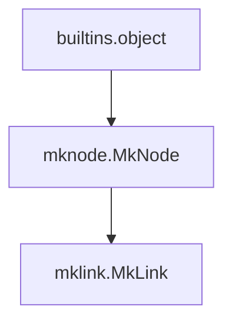

# MkLink

[ Show source on GitHub](https://github.com/phil65/mknodes/blob/main/src/mknodes/basenodes/mklink/__init__.py)

### A simple Link (with optional icon and option to show up as a button).

> [!NOTE]
> **Description**
>
>
> If no title is given, the URL is used as a title.

<details open>
<summary>Examples</summary>

### Example: **Regular**
> [!NOTE]
> **Jinja**
>
> ```jinja
> {{ "https://www.google.com" | MkLink("This is a link") }}
>
> ```

> [!NOTE]
> **Python**
>
> ```python
> MkLink('https://www.google.com', 'This is a link')
> ```

<details open>
<summary>Rendered</summary>

[This is a link](https://www.google.com)

</details>

<details>
<summary>Markdown</summary>

```markdown
[This is a link](https://www.google.com)
```

</details>

<details>
<summary>Html</summary>

```html
<p><a href="https://www.google.com">This is a link</a></p>

```

</details>

<details>
<summary>reST</summary>

```rst
`This is a link <https://www.google.com>`_
```

</details>

<details>
<summary>GitHub</summary>

```markdown
[This is a link](https://www.google.com)
```

</details>

### Example: **Button**
> [!NOTE]
> **Jinja**
>
> ```jinja
> {{ "https://www.google.com" | MkLink("Disguised as button.", as_button=True) }}
>
> ```

> [!NOTE]
> **Python**
>
> ```python
> MkLink('https://www.google.com', 'Disguised as button.', as_button=True)
> ```

<details open>
<summary>Rendered</summary>

[Disguised as button.](https://www.google.com)

</details>

<details>
<summary>Markdown</summary>

```markdown
[Disguised as button.](https://www.google.com)
```

</details>

<details>
<summary>Html</summary>

```html
<p><a href="https://www.google.com">Disguised as button.</a></p>

```

</details>

<details>
<summary>reST</summary>

```rst
`Disguised as button. <https://www.google.com>`_
```

</details>

<details>
<summary>GitHub</summary>

```markdown
[Disguised as button.](https://www.google.com)
```

</details>

### Example: **Colored**
> [!NOTE]
> **Jinja**
>
> ```jinja
> {{ "https://www.google.com" | MkLink("Colored.", as_button=True, primary_color=True) }}
>
> ```

> [!NOTE]
> **Python**
>
> ```python
> MkLink('https://www.google.com', 'Colored.', as_button=True, primary_color=True)
> ```

<details open>
<summary>Rendered</summary>

[Colored.](https://www.google.com)

</details>

<details>
<summary>Markdown</summary>

```markdown
[Colored.](https://www.google.com)
```

</details>

<details>
<summary>Html</summary>

```html
<p><a href="https://www.google.com">Colored.</a></p>

```

</details>

<details>
<summary>reST</summary>

```rst
`Colored. <https://www.google.com>`_
```

</details>

<details>
<summary>GitHub</summary>

```markdown
[Colored.](https://www.google.com)
```

</details>

### Example: **With icon**
> [!NOTE]
> **Jinja**
>
> ```jinja
> {{ "https://www.google.com" | MkLink("With icon.", icon="octicon:link-24") }}
>
> ```

> [!NOTE]
> **Python**
>
> ```python
> MkLink('https://www.google.com', 'With icon.', icon='octicon:link-24')
> ```

<details open>
<summary>Rendered</summary>

[ With icon.](https://www.google.com)

</details>

<details>
<summary>Markdown</summary>

```markdown
[ With icon.](https://www.google.com)
```

</details>

<details>
<summary>Html</summary>

```html
<p><a href="https://www.google.com"> With icon.</a></p>

```

</details>

<details>
<summary>reST</summary>

```rst
`With icon. <https://www.google.com>`_
```

</details>

<details>
<summary>GitHub</summary>

```markdown
[ With icon.](https://www.google.com)
```

</details>

### Example: **With tooltip**
> [!NOTE]
> **Jinja**
>
> ```jinja
> {{ "https://www.google.com" | MkLink("With tooltip.", as_button=True) }}
>
> ```

> [!NOTE]
> **Python**
>
> ```python
> MkLink('https://www.google.com', 'With tooltip.', as_button=True)
> ```

<details open>
<summary>Rendered</summary>

[With tooltip.](https://www.google.com)

</details>

<details>
<summary>Markdown</summary>

```markdown
[With tooltip.](https://www.google.com)
```

</details>

<details>
<summary>Html</summary>

```html
<p><a href="https://www.google.com">With tooltip.</a></p>

```

</details>

<details>
<summary>reST</summary>

```rst
`With tooltip. <https://www.google.com>`_
```

</details>

<details>
<summary>GitHub</summary>

```markdown
[With tooltip.](https://www.google.com)
```

</details>

</details>

<details open>
<summary>DocStrings</summary>

<a id="mknodes.MkLink"></a>

```python
class MkLink(mknode.MkNode)
```

</details>

<details open>
<summary>Base classes</summary>

| Name | Children | Inherits |
|--- | --- | --- |
| **<font size='4'>[MkNode](https://phil65.github.io/mknodes/)</font>**<br>*<font size='1'>mknodes.basenodes.mknode</font>*<br>Base class for everything which can be expressed as Markup\. | <ul><li>[MkContainerBase](https://phil65.github.io/mknodes/)</li><li>[MkCompactAdmonition](https://phil65.github.io/mknodes/)</li><li>[MkLink](https://phil65.github.io/mknodes/)</li><li>[MkText](https://phil65.github.io/mknodes/)</li><li>[MkHeader](https://phil65.github.io/mknodes/)</li><li>[MkKeys](https://phil65.github.io/mknodes/)</li><li>[MkDocStrings](https://phil65.github.io/mknodes/)</li><li>[MkIcon](https://phil65.github.io/mknodes/)</li><li>[MkImage](https://phil65.github.io/mknodes/)</li><li>[MkProgressBar](https://phil65.github.io/mknodes/)</li><li>[BaseBlock](https://phil65.github.io/mknodes/)</li><li>...</li></ul> | <ul><li>[object](https://docs.python.org/3/library/functions.html#object)</li></ul> |

</details>

<details>
<summary>⋔ Inheritance diagram</summary>



</details>

<details>
<summary>NodeFile</summary>

**/home/runner/work/mknodes/mknodes/src/mknodes/basenodes/mklink/metadata.toml**

```toml
[metadata]
icon = "octicon:link-24"
name = "MkLink"

[examples.regular]
title = "Regular"
jinja = """
{{ "https://www.google.com" | MkLink("This is a link") }}
"""

[examples.button]
title = "Button"
jinja = """
{{ "https://www.google.com" | MkLink("Disguised as button.", as_button=True) }}
"""

[examples.colored]
title = "Colored"
jinja = """
{{ "https://www.google.com" | MkLink("Colored.", as_button=True, primary_color=True) }}
"""

[examples.with_icon]
title = "With icon"
jinja = """
{{ "https://www.google.com" | MkLink("With icon.", icon="octicon:link-24") }}
"""

[examples.with_tooltip]
title = "With tooltip"
jinja = """
{{ "https://www.google.com" | MkLink("With tooltip.", as_button=True) }}
"""
# [examples.to_page]
# title = "To Page"
# jinja = """
# {{ page.parent.index_page | MkLink("To page.") }}
# """

[output.markdown]
template = """
[{{ node.icon | add(suffix=" ") }}{{ node.get_title() }}]({{ node.get_url() }}{{ node.tooltip | add(prefix=" '", suffix="'")}})
"""

[output.rst]
template = """
`{{ node.get_title() }} <{{ node.get_url() }}>`_
"""

```

</details>

<details>
<summary>Code</summary>

**mknodes.basenodes.mklink.MkLink**

```python
class MkLink(mknode.MkNode):
    """A simple Link (with optional icon and option to show up as a button).

    If no title is given, the URL is used as a title.
    """

    ICON = "octicons/link-24"
    ATTR_LIST_SEPARATOR = ""

    def __init__(
        self,
        target: linkprovider.LinkableType,
        title: str | None = None,
        *,
        tooltip: str | None = None,
        icon: str | None = None,
        as_button: bool = False,
        primary_color: bool = False,
        **kwargs: Any,
    ) -> None:
        """Constructor.

        Args:
            target: Link target
            title: Title used for link
            tooltip: Tooltip for the link
            icon: Optional icon to be displayed in front of title
            as_button: Whether link should be rendered as button
            primary_color: If rendered as button, use primary color as background.
            kwargs: keyword arguments passed to parent
        """
        super().__init__(**kwargs)
        self.target = target
        self._title = title
        self.tooltip = tooltip
        self.as_button = as_button
        self.primary_color = primary_color
        self._icon = icon
        if as_button:
            self.add_css_class("md-button")
        if primary_color:
            self.add_css_class("md-button--primary")

    @property
    def icon(self) -> str:
        return icons.get_emoji_slug(self._icon) if self._icon else ""

    def get_url(self) -> str:
        if isinstance(self.target, str) and helpers.is_url(self.target):
            return self.target  # no project context needed
        return self.ctx.links.get_url(self.target)

    def get_title(self) -> str:
        return self._title or self.get_url()

    @classmethod
    def for_pydantic_playground(
        cls,
        files: Mapping[str, str] | list[types.ModuleType] | Sequence[str | os.PathLike[str]],
        title: str = "Open in Pydantic Playground",
        active_index: int = 0,
        **kwargs: Any,
    ) -> MkLink:
        """Create a link to Pydantic playground with pre-populated files.

        Args:
            files: The files to include in the playground. Can be:
                    - A mapping of filenames to code content
                    - A list of modules
                    - A list of file paths
            title: The title of the link
            active_index: The index of the active file in the playground
            **kwargs: Additional keyword arguments to pass to the Pydantic playground

        Returns:
            An MkLink instance pointing to the Pydantic playground
        """
        from urllib.parse import quote

        match files:
            case Mapping():
                file_data: list[dict[str, Any]] = [
                    {"name": name, "content": content} for name, content in files.items()
                ]
            case [types.ModuleType(), *_]:
                file_data = [
                    {"name": f"{mod.__name__}.py", "content": inspect.getsource(mod)}  # type: ignore
                    for mod in files
                ]
            case [str() | os.PathLike(), *_]:
                file_data = []
                for path in files:
                    file = to_upath(path)
                    file_data.append({
                        "name": file.name,
                        "content": file.read_text("utf-8"),
                    })
            case _:
                raise TypeError(files)

        # Add activeIndex to first file
        if file_data:
            file_data[active_index]["activeIndex"] = 1

        json_str = json.dumps(file_data)
        encoded = quote(json_str)

        url = f"https://pydantic.run/new?files={encoded}"
        return cls(url, title, **kwargs)

    def to_md_unprocessed(self) -> str:
        prefix = f"{self.icon} " if self.icon else ""
        tooltip = f" {self.tooltip!r}" if self.tooltip else ""
        return f"[{prefix}{self.get_title()}]({self.get_url()}{tooltip})"

```

</details>

<details>
<summary>Page info</summary>

<details>
<summary>Code for this page</summary>

**mknodes.manual.nodes_section.create_section_for_nodes**

```python
def create_section_for_nodes(
    nav: mk.MkNav,
    klasses: Sequence[type[mk.MkNode]],
) -> mk.MkTable:
    table = mk.MkTable(columns=["Node", "Docstrings", "Markdown extensions"])
    for kls in klasses:
        tpl = "classpage_custom.jinja"
        page = mk.MkClassPage(kls, icon=kls.ICON, template_path=tpl, parent=nav, hide="toc")
        nav += page
        if kls.STATUS:
            page.metadata.status = kls.STATUS
        elif kls.JS_FILES:
            page.metadata.status = "js"
        elif kls.CSS:
            page.metadata.status = "css"
        page.created_by = create_section_for_nodes
        link = mk.MkLink(page, kls.__name__, icon=kls.ICON)
        extensions = ", ".join(f"`{i}`" for i in kls.REQUIRED_EXTENSIONS)
        table.add_row((link, kls.__doc__, extensions))
    return table

```

</details>

<details>
<summary>Resources</summary>

```python
Resources(css=[],
          markdown_extensions={'admonition': {},
                               'pymdownx.details': {},
                               'pymdownx.highlight': {'anchor_linenums': True,
                                                      'line_spans': '__span',
                                                      'pygments_lang_class': True},
                               'pymdownx.superfences': {'custom_fences': [{'class': 'mermaid',
                                                                           'format': <function fence_code_format at 0x7bb797a5c1a0>,
                                                                           'name': 'mermaid'}]},
                               'pymdownx.tabbed': {},
                               'tables': {}},
          plugins=[Plugin('mkdocstrings')],
          js=[],
          assets=[],
          packages=[])
```

</details>

<details>
<summary>Metadata</summary>

```yaml
created:
  source_filename: /home/runner/work/mknodes/mknodes/src/mknodes/manual/nodes_section.py
  source_function: create_section_for_nodes
  source_line_no: 93
hide:
- toc
icon: octicons/link-24
title: MkLink

```

</details>

</details>
