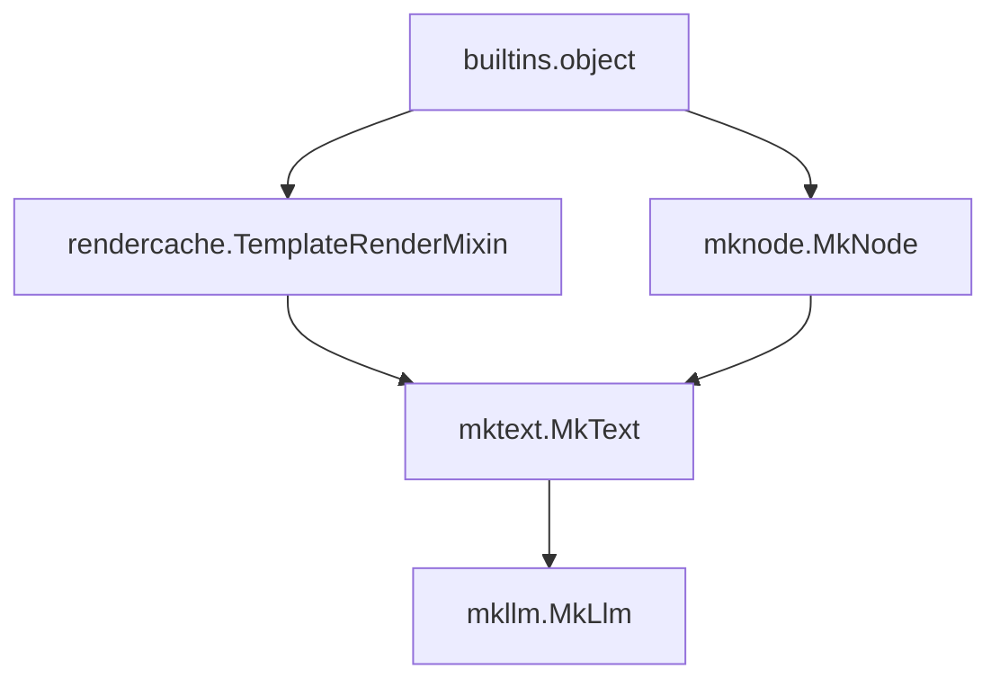

# MkLlm

[ Show source on GitHub](https://github.com/phil65/mknodes/blob/main/src/mknodes/templatenodes/mkllm/__init__.py)

### Node for LLM-based text generation.

<details open>
<summary>Examples</summary>

### Example: **Regular**
> [!NOTE]
> **Jinja**
>
> ```jinja
> {{ "Write a poem about MkDocs" | MkLlm(model="openai:gpt-6-luna") }}
>
> ```

> [!NOTE]
> **Python**
>
> ```python
> MkLlm('Write a poem about MkDocs', [])
> ```

<details open>
<summary>Rendered</summary>

**The MkDocs Lantern**

From Markdown’s quiet pages,  
a little lantern grows—  
MkDocs gathers every heading,  
every link, and note, and knows

how to turn a folder’s whispers  
into paths of polished light,  
with a theme to frame the reading  
and a search that shines at night.

One command, and files are traveling  
through the browser, clean and clear;  
what began as words in plain text  
becomes a guide for all to hear.

So build the map, arrange the chapters,  
let each reference find its place—  
MkDocs makes a home for knowledge,  
one bright page at a time.

</details>

<details>
<summary>Markdown</summary>

```markdown
**The MkDocs Lantern**

From Markdown’s quiet pages,  
a little lantern grows—  
MkDocs gathers every heading,  
every link, and note, and knows

how to turn a folder’s whispers  
into paths of polished light,  
with a theme to frame the reading  
and a search that shines at night.

One command, and files are traveling  
through the browser, clean and clear;  
what began as words in plain text  
becomes a guide for all to hear.

So build the map, arrange the chapters,  
let each reference find its place—  
MkDocs makes a home for knowledge,  
one bright page at a time.
```

</details>

<details>
<summary>Html</summary>

```html
<p><strong>The MkDocs Lantern</strong></p>
<p>From Markdown’s quiet pages,<br />
a little lantern grows—<br />
MkDocs gathers every heading,<br />
every link, and note, and knows</p>
<p>how to turn a folder’s whispers<br />
into paths of polished light,<br />
with a theme to frame the reading<br />
and a search that shines at night.</p>
<p>One command, and files are traveling<br />
through the browser, clean and clear;<br />
what began as words in plain text<br />
becomes a guide for all to hear.</p>
<p>So build the map, arrange the chapters,<br />
let each reference find its place—<br />
MkDocs makes a home for knowledge,<br />
one bright page at a time.</p>

```

</details>

</details>

<details open>
<summary>DocStrings</summary>

<a id="mknodes.MkLlm"></a>

```python
class MkLlm(mktext.MkText)
```

</details>

<details open>
<summary>Base classes</summary>

| Name | Children | Inherits |
|--- | --- | --- |
| **<font size='4'>[MkText](https://phil65.github.io/mknodes/)</font>**<br>*<font size='1'>mknodes.basenodes.mktext</font>*<br>Class for any Markup text\. | <ul><li>[MkInclude](https://phil65.github.io/mknodes/)</li><li>[MkChangelog](https://phil65.github.io/mknodes/)</li><li>[MkLicense](https://phil65.github.io/mknodes/)</li><li>[MkLlm](https://phil65.github.io/mknodes/)</li></ul> | <ul><li>[TemplateRenderMixin](https://phil65.github.io/mknodes/)</li><li>[MkNode](https://phil65.github.io/mknodes/)</li></ul> |

</details>

<details>
<summary>⋔ Inheritance diagram</summary>



</details>

<details>
<summary>NodeFile</summary>

**/home/runner/work/mknodes/mknodes/src/mknodes/templatenodes/mkllm/metadata.toml**

```toml
[metadata]
icon = "mdi:view-grid"
status = "new"
name = "MkLlm"

[examples.regular]
title = "Regular"
jinja = """
{{ "Write a poem about MkDocs" | MkLlm(model="openai:gpt-6-luna") }}
"""

# [output.markdown]
# template = """
# <div class="grid cards" markdown="1">

# 
# -   {{ item | indent }}
# 
# </div>
# """

```

</details>

<details>
<summary>Code</summary>

**mknodes.templatenodes.mkllm.MkLlm**

```python
class MkLlm(mktext.MkText):
    """Node for LLM-based text generation."""

    ICON = "material/format-list-group"
    REQUIRED_PACKAGES = [resources.Package("litellm")]

    def __init__(
        self,
        user_prompt: str,
        system_prompt: str | None = None,
        model: str | ModelName = "openai:gpt-6-luna",
        context: str | None = None,
        extra_files: Sequence[str | os.PathLike[str]] | None = None,
        **kwargs: Any,
    ) -> None:
        """Constructor.

        Args:
            user_prompt: Main prompt for the LLM
            system_prompt: System prompt to set LLM behavior
            model: LLM model identifier to use
            context: Main context string
            extra_files: Additional context files or strings
            kwargs: Keyword arguments passed to parent
        """
        super().__init__(**kwargs)
        self.user_prompt = user_prompt
        self.system_prompt = system_prompt
        self._model = model
        self._context = context
        self._extra_files = extra_files or []

    def _process_extra_files(self) -> list[str]:
        """Process extra context items, reading files if necessary.

        Returns:
            List of context strings.
        """
        context_items: list[str] = []

        def process_dir(path: UPath) -> list[str]:
            return [f.read_text("utf-8") for f in path.rglob("*") if f.is_file()]

        for item in self._extra_files:
            try:
                path = to_upath(item)
                if path.is_file():
                    context_items.append(path.read_text("utf-8"))
                elif path.is_dir():
                    context_items.extend(process_dir(path))
                else:
                    context_items.append(str(item))
            except Exception as exc:
                err_msg = f"Failed to read context file: {item}"
                logger.warning(err_msg)
                raise ValueError(err_msg) from exc

        return context_items

    def _llm_params(self) -> dict[str, Any]:
        context_items = self._process_extra_files()
        combined_context = "\n".join(filter(None, [self._context, *context_items]))
        return dict(
            user_prompt=self.user_prompt,
            system_prompt=self.system_prompt or "",
            model=self._model,
            context=combined_context,
        )

    def get_input_requests(self) -> list[inputs.InputRequest]:
        return [inputs.InputRequest.create("llm", **self._llm_params())]

    def get_text(self) -> str:
        """Generate text using the LLM (pinned in the lock file of the inputs store).

        Returns:
            Generated text content.
        """
        try:
            return self.ctx.inputs.get("llm", **self._llm_params())
        except inputs.InputUnavailableError as e:
            logger.warning("MkLlm: %s, using a placeholder", e)
            return UNAVAILABLE_TEXT

```

</details>

<details>
<summary>Page info</summary>

<details>
<summary>Code for this page</summary>

**mknodes.manual.nodes_section.create_section_for_nodes**

```python
def create_section_for_nodes(
    nav: mk.MkNav,
    klasses: Sequence[type[mk.MkNode]],
) -> mk.MkTable:
    table = mk.MkTable(columns=["Node", "Docstrings", "Markdown extensions"])
    for kls in klasses:
        tpl = "classpage_custom.jinja"
        page = mk.MkClassPage(kls, icon=kls.ICON, template_path=tpl, parent=nav, hide="toc")
        nav += page
        if kls.STATUS:
            page.metadata.status = kls.STATUS
        elif kls.JS_FILES:
            page.metadata.status = "js"
        elif kls.CSS:
            page.metadata.status = "css"
        page.created_by = create_section_for_nodes
        link = mk.MkLink(page, kls.__name__, icon=kls.ICON)
        extensions = ", ".join(f"`{i}`" for i in kls.REQUIRED_EXTENSIONS)
        table.add_row((link, kls.__doc__, extensions))
    return table

```

</details>

<details>
<summary>Resources</summary>

```python
Resources(css=[],
          markdown_extensions={'admonition': {},
                               'pymdownx.details': {},
                               'pymdownx.highlight': {'anchor_linenums': True,
                                                      'line_spans': '__span',
                                                      'pygments_lang_class': True},
                               'pymdownx.superfences': {'custom_fences': [{'class': 'mermaid',
                                                                           'format': <function fence_code_format at 0x7bb797a5c1a0>,
                                                                           'name': 'mermaid'}]},
                               'pymdownx.tabbed': {},
                               'tables': {}},
          plugins=[Plugin('mkdocstrings')],
          js=[],
          assets=[],
          packages=[])
```

</details>

<details>
<summary>Metadata</summary>

```yaml
created:
  source_filename: /home/runner/work/mknodes/mknodes/src/mknodes/manual/nodes_section.py
  source_function: create_section_for_nodes
  source_line_no: 93
hide:
- toc
icon: material/format-list-group
title: MkLlm

```

</details>

</details>
