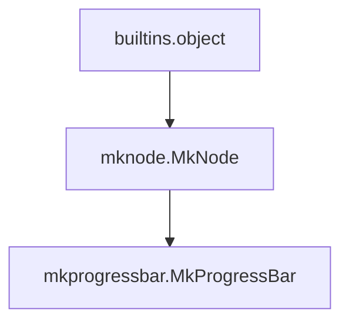

# MkProgressBar

[ Show source on GitHub](https://github.com/phil65/mknodes/blob/main/src/mknodes/basenodes/mkprogressbar/__init__.py)

### Node to display a CSS-based progress bar.

<details open>
<summary>Examples</summary>

### Example: **Regular**
> [!NOTE]
> **Jinja**
>
> ```jinja
> {{ 60 | MkProgressBar }}
>
> ```

> [!NOTE]
> **Python**
>
> ```python
> MkProgressBar(60)
> ```

<details open>
<summary>Rendered</summary>

`██████░░░░` 60%

</details>

<details>
<summary>Markdown</summary>

```markdown
`██████░░░░` 60%
```

</details>

<details>
<summary>Html</summary>

```html
<p><code>██████░░░░</code> 60%</p>

```

</details>

<details>
<summary>GitHub</summary>

```markdown
`██████░░░░` 60%
```

</details>

### Example: **Style thin**
> [!NOTE]
> **Jinja**
>
> ```jinja
> {{ 60 | MkProgressBar(style="thin") }}
>
> ```

> [!NOTE]
> **Python**
>
> ```python
> MkProgressBar(60, style='thin')
> ```

<details open>
<summary>Rendered</summary>

`██████░░░░` 60%

</details>

<details>
<summary>Markdown</summary>

```markdown
`██████░░░░` 60%
```

</details>

<details>
<summary>Html</summary>

```html
<p><code>██████░░░░</code> 60%</p>

```

</details>

<details>
<summary>GitHub</summary>

```markdown
`██████░░░░` 60%
```

</details>

### Example: **Style candystripe**
> [!NOTE]
> **Jinja**
>
> ```jinja
> {{ 70 | MkProgressBar(style="candystripe") }}
>
> ```

> [!NOTE]
> **Python**
>
> ```python
> MkProgressBar(70, style='candystripe')
> ```

<details open>
<summary>Rendered</summary>

`███████░░░` 70%

</details>

<details>
<summary>Markdown</summary>

```markdown
`███████░░░` 70%
```

</details>

<details>
<summary>Html</summary>

```html
<p><code>███████░░░</code> 70%</p>

```

</details>

<details>
<summary>GitHub</summary>

```markdown
`███████░░░` 70%
```

</details>

### Example: **Style candystripe_animated**
> [!NOTE]
> **Jinja**
>
> ```jinja
> {{ 80 | MkProgressBar(style="candystripe_animated") }}
>
> ```

> [!NOTE]
> **Python**
>
> ```python
> MkProgressBar(80, style='candystripe_animated')
> ```

<details open>
<summary>Rendered</summary>

`████████░░` 80%

</details>

<details>
<summary>Markdown</summary>

```markdown
`████████░░` 80%
```

</details>

<details>
<summary>Html</summary>

```html
<p><code>████████░░</code> 80%</p>

```

</details>

<details>
<summary>GitHub</summary>

```markdown
`████████░░` 80%
```

</details>

</details>

<details open>
<summary>DocStrings</summary>

<a id="mknodes.MkProgressBar"></a>

```python
class MkProgressBar(mknode.MkNode)
```

</details>

<details open>
<summary>Base classes</summary>

| Name | Children | Inherits |
|--- | --- | --- |
| **<font size='4'>[MkNode](https://phil65.github.io/mknodes/)</font>**<br>*<font size='1'>mknodes.basenodes.mknode</font>*<br>Base class for everything which can be expressed as Markup\. | <ul><li>[MkContainerBase](https://phil65.github.io/mknodes/)</li><li>[MkCompactAdmonition](https://phil65.github.io/mknodes/)</li><li>[MkLink](https://phil65.github.io/mknodes/)</li><li>[MkText](https://phil65.github.io/mknodes/)</li><li>[MkHeader](https://phil65.github.io/mknodes/)</li><li>[MkKeys](https://phil65.github.io/mknodes/)</li><li>[MkDocStrings](https://phil65.github.io/mknodes/)</li><li>[MkIcon](https://phil65.github.io/mknodes/)</li><li>[MkImage](https://phil65.github.io/mknodes/)</li><li>[MkProgressBar](https://phil65.github.io/mknodes/)</li><li>[BaseBlock](https://phil65.github.io/mknodes/)</li><li>...</li></ul> | <ul><li>[object](https://docs.python.org/3/library/functions.html#object)</li></ul> |

</details>

<details>
<summary>⋔ Inheritance diagram</summary>



</details>

<details>
<summary>NodeFile</summary>

**/home/runner/work/mknodes/mknodes/src/mknodes/basenodes/mkprogressbar/metadata.toml**

```toml
[metadata]
icon = "fa6-solid:bars-progress"
name = "MkProgressBar"

[[resources.css]]
filename = "progressbar.css"

[requirements.extension."pymdownx.progressbar"]

[examples.regular]
title = "Regular"
jinja = """
{{ 60 | MkProgressBar }}
"""

[examples.style_thin]
title = "Style thin"
jinja = """
{{ 60 | MkProgressBar(style="thin") }}
"""

[examples.style_candystripe]
title = "Style candystripe"
jinja = """
{{ 70 | MkProgressBar(style="candystripe") }}
"""

[examples.style_candystripe_animated]
title = "Style candystripe_animated"
jinja = """
{{ 80 | MkProgressBar(style="candystripe_animated") }}
"""

[output.markdown]
template = """
[={{ node.percentage }}% "{{ node.label }}"]
"""

[output.html5]
template = """
<label for="progress_bar">{{ node.label }}:</label>
<progress id="progress_bar" max="100" value="{{ node.percentage }}">{{ node.percentage }}%</progress>
"""

```

</details>

<details>
<summary>Code</summary>

**mknodes.basenodes.mkprogressbar.MkProgressBar**

```python
class MkProgressBar(mknode.MkNode):
    """Node to display a CSS-based progress bar."""

    REQUIRED_EXTENSIONS = [resources.Extension("pymdownx.progressbar")]
    ICON = "fontawesome/solid/bars-progress"
    CSS = [resources.CSSFile("progressbar.css")]
    ATTR_LIST_SEPARATOR = ""

    def __init__(
        self,
        percentage: int,
        *,
        label: str | Literal[True] | None = True,
        style: Literal["thin", "candystripe", "candystripe_animated"] | None = None,
        **kwargs: Any,
    ) -> None:
        """Constructor.

        Args:
            percentage: Percentage value for the progress bar
            label: Label to display on top of progress bar
            style: Progress bar style
            kwargs: Keyword arguments passed to parent
        """
        super().__init__(**kwargs)
        self._label = label
        self.percentage = percentage
        self.style = style
        match self.style:
            case "thin":
                self.add_css_class("thin")
            case "candystripe":
                self.add_css_class("candystripe")
            case "candystripe_animated":
                self.add_css_class("candystripe")
                self.add_css_class("candystripe-animate")
            case None:
                pass

    @property
    def label(self) -> str:
        match self._label:
            case str():
                return self._label.format(percentage=self.percentage)
            case True:
                return f"{self.percentage}%"
            case _:
                return ""

    def to_md_unprocessed(self) -> str:
        return rf'[={self.percentage}% "{self.label}"]'

```

</details>

<details>
<summary>Page info</summary>

<details>
<summary>Code for this page</summary>

**mknodes.manual.nodes_section.create_section_for_nodes**

```python
def create_section_for_nodes(
    nav: mk.MkNav,
    klasses: Sequence[type[mk.MkNode]],
) -> mk.MkTable:
    table = mk.MkTable(columns=["Node", "Docstrings", "Markdown extensions"])
    for kls in klasses:
        tpl = "classpage_custom.jinja"
        page = mk.MkClassPage(kls, icon=kls.ICON, template_path=tpl, parent=nav, hide="toc")
        nav += page
        if kls.STATUS:
            page.metadata.status = kls.STATUS
        elif kls.JS_FILES:
            page.metadata.status = "js"
        elif kls.CSS:
            page.metadata.status = "css"
        page.created_by = create_section_for_nodes
        link = mk.MkLink(page, kls.__name__, icon=kls.ICON)
        extensions = ", ".join(f"`{i}`" for i in kls.REQUIRED_EXTENSIONS)
        table.add_row((link, kls.__doc__, extensions))
    return table

```

</details>

<details>
<summary>Resources</summary>

```python
Resources(css=[],
          markdown_extensions={'admonition': {},
                               'pymdownx.details': {},
                               'pymdownx.highlight': {'anchor_linenums': True,
                                                      'line_spans': '__span',
                                                      'pygments_lang_class': True},
                               'pymdownx.superfences': {'custom_fences': [{'class': 'mermaid',
                                                                           'format': <function fence_code_format at 0x7bb797a5c1a0>,
                                                                           'name': 'mermaid'}]},
                               'pymdownx.tabbed': {},
                               'tables': {}},
          plugins=[Plugin('mkdocstrings')],
          js=[],
          assets=[],
          packages=[])
```

</details>

<details>
<summary>Metadata</summary>

```yaml
created:
  source_filename: /home/runner/work/mknodes/mknodes/src/mknodes/manual/nodes_section.py
  source_function: create_section_for_nodes
  source_line_no: 93
hide:
- toc
icon: fontawesome/solid/bars-progress
status: css
title: MkProgressBar

```

</details>

</details>
