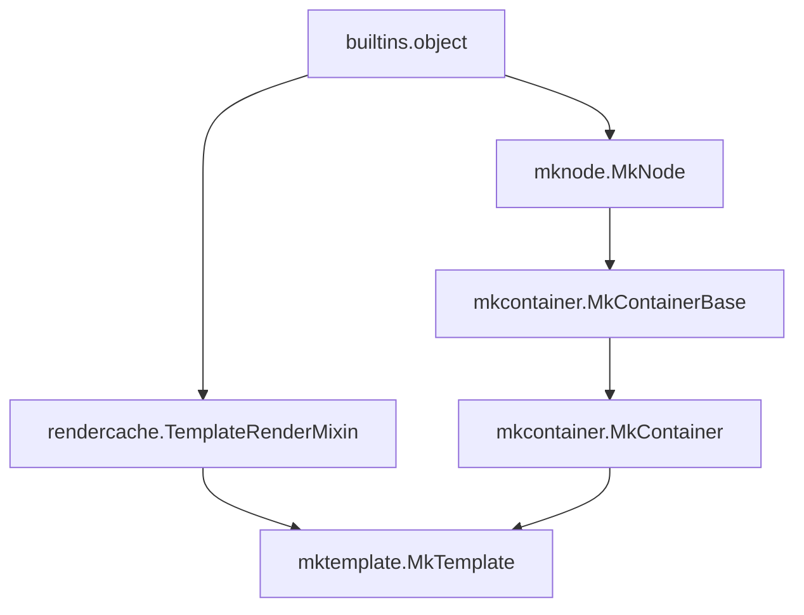

# MkTemplate

[ Show source on GitHub](https://github.com/phil65/mknodes/blob/main/src/mknodes/templatenodes/mktemplate/__init__.py)

### Node representing a jinja template.

> [!NOTE]
> **Description**
>
>
> Renders templates with the context-aware MkNodes jinja environment.
> Rendered nodes become virtual children of this node.
> Additional variables can be passed to the render process.

<details open>
<summary>Examples</summary>

### Example: **From project**
> [!NOTE]
> **Jinja**
>
> ```jinja
> {{ "why_mknodes.jinja" | MkTemplate }}
>
> ```

> [!NOTE]
> **Python**
>
> ```python
> MkTemplate('why_mknodes.jinja', variables={})
> ```

<details open>
<summary>Rendered</summary>

# Welcome to the **MkNodes** universe!

Features

* Move parts of the documentation generation process into the python space. You can easily switch between programmatically generating documentation and hand-writing documentation.

* Easy access to more "advanced" theme customization options.
The process of generating HTML page templates in MkDocs can be a bit cumbersome. Using MkNodes, you dont need to mess with HTML, and you dont have to manage a separate folder structure for the templates. Modifying `MkPage.template` will trigger an automated template generation process which also covers template inheritance, meaning you can also define templates for a complete tree section.

* Write your site navigation using idiomatic python. As known from frameworks like flask, you can create the website tree hierarchy using a decorator-based routing approach. Moving the navigation part into the python space allows to easily create documentation parts programatically.
Also, visual aspects like page icons / subtitles can be defined in the site navigation instead of in the page header metadata.

* A large library of python classes representing different kinds of Markdown fragments (the **MkNodes**). These nodes range from basic elements like lists or tables up to nodes which will generate large documentation chunks for you automatically. A complete API documentation can get created with a handful lines of code.

* A dead simple API. Working with **MkNodes** basically means: Create nodes, attach them to the tree and forget about them. For most nodes, you only need to learn about the `__init__`signature.

* A fully-loaded **jinja2** environment, with all information about your project available in the environment namespace. Also, all the **MkNodes** (approx 70 different nodes right now) are available as **Jinja2** filters.

* Separate content from layout. The nodes are context-aware, meaning that they show information of the project they are used in. You can write your own website template and use it for multiple projects.

* Create complex, composable and re-usable "documentation widgets" yourself. It's easy to write your own **MkNodes**. If desired then these can be composed of other **MkNodes**, making them small sub-trees of your site tree. It is even possible to create nodes which represent a whole website.

* Automatic resource management: The MkNodes know about the resources they require, like CSS, Javascript or markdown extensions. When the website gets assembled, this information can be used to automatically add all the required resources to the right place, like to the MkDocs config or to the HTML head by automatically creating HTML page templates.

</details>

<details>
<summary>Markdown</summary>

```markdown
# Welcome to the **MkNodes** universe!

Features

* Move parts of the documentation generation process into the python space. You can easily switch between programmatically generating documentation and hand-writing documentation.

* Easy access to more "advanced" theme customization options.
The process of generating HTML page templates in MkDocs can be a bit cumbersome. Using MkNodes, you dont need to mess with HTML, and you dont have to manage a separate folder structure for the templates. Modifying `MkPage.template` will trigger an automated template generation process which also covers template inheritance, meaning you can also define templates for a complete tree section.

* Write your site navigation using idiomatic python. As known from frameworks like flask, you can create the website tree hierarchy using a decorator-based routing approach. Moving the navigation part into the python space allows to easily create documentation parts programatically.
Also, visual aspects like page icons / subtitles can be defined in the site navigation instead of in the page header metadata.

* A large library of python classes representing different kinds of Markdown fragments (the **MkNodes**). These nodes range from basic elements like lists or tables up to nodes which will generate large documentation chunks for you automatically. A complete API documentation can get created with a handful lines of code.

* A dead simple API. Working with **MkNodes** basically means: Create nodes, attach them to the tree and forget about them. For most nodes, you only need to learn about the `__init__`signature.

* A fully-loaded **jinja2** environment, with all information about your project available in the environment namespace. Also, all the **MkNodes** (approx 70 different nodes right now) are available as **Jinja2** filters.

* Separate content from layout. The nodes are context-aware, meaning that they show information of the project they are used in. You can write your own website template and use it for multiple projects.

* Create complex, composable and re-usable "documentation widgets" yourself. It's easy to write your own **MkNodes**. If desired then these can be composed of other **MkNodes**, making them small sub-trees of your site tree. It is even possible to create nodes which represent a whole website.

* Automatic resource management: The MkNodes know about the resources they require, like CSS, Javascript or markdown extensions. When the website gets assembled, this information can be used to automatically add all the required resources to the right place, like to the MkDocs config or to the HTML head by automatically creating HTML page templates.

```

</details>

<details>
<summary>Html</summary>

```html
<h1 id="welcome-to-the-mknodes-universe">Welcome to the <strong>MkNodes</strong> universe!<a href="#welcome-to-the-mknodes-universe" aria-label="Link to heading 'Welcome to the MkNodes universe!'" data-heading-content="Welcome to the MkNodes universe!" class="anchor"></a></h1>
<p>Features</p>
<ul>
<li>
<p>Move parts of the documentation generation process into the python space. You can easily switch between programmatically generating documentation and hand-writing documentation.</p>
</li>
<li>
<p>Easy access to more &quot;advanced&quot; theme customization options.
The process of generating HTML page templates in MkDocs can be a bit cumbersome. Using MkNodes, you dont need to mess with HTML, and you dont have to manage a separate folder structure for the templates. Modifying <code>MkPage.template</code> will trigger an automated template generation process which also covers template inheritance, meaning you can also define templates for a complete tree section.</p>
</li>
<li>
<p>Write your site navigation using idiomatic python. As known from frameworks like flask, you can create the website tree hierarchy using a decorator-based routing approach. Moving the navigation part into the python space allows to easily create documentation parts programatically.
Also, visual aspects like page icons / subtitles can be defined in the site navigation instead of in the page header metadata.</p>
</li>
<li>
<p>A large library of python classes representing different kinds of Markdown fragments (the <strong>MkNodes</strong>). These nodes range from basic elements like lists or tables up to nodes which will generate large documentation chunks for you automatically. A complete API documentation can get created with a handful lines of code.</p>
</li>
<li>
<p>A dead simple API. Working with <strong>MkNodes</strong> basically means: Create nodes, attach them to the tree and forget about them. For most nodes, you only need to learn about the <code>__init__</code>signature.</p>
</li>
<li>
<p>A fully-loaded <strong>jinja2</strong> environment, with all information about your project available in the environment namespace. Also, all the <strong>MkNodes</strong> (approx 70 different nodes right now) are available as <strong>Jinja2</strong> filters.</p>
</li>
<li>
<p>Separate content from layout. The nodes are context-aware, meaning that they show information of the project they are used in. You can write your own website template and use it for multiple projects.</p>
</li>
<li>
<p>Create complex, composable and re-usable &quot;documentation widgets&quot; yourself. It's easy to write your own <strong>MkNodes</strong>. If desired then these can be composed of other <strong>MkNodes</strong>, making them small sub-trees of your site tree. It is even possible to create nodes which represent a whole website.</p>
</li>
<li>
<p>Automatic resource management: The MkNodes know about the resources they require, like CSS, Javascript or markdown extensions. When the website gets assembled, this information can be used to automatically add all the required resources to the right place, like to the MkDocs config or to the HTML head by automatically creating HTML page templates.</p>
</li>
</ul>

```

</details>

</details>

<details open>
<summary>DocStrings</summary>

<a id="mknodes.MkTemplate"></a>

```python
class MkTemplate(TemplateRenderMixin, mkcontainer.MkContainer)
```

</details>

<details open>
<summary>Sub classes</summary>

| Name | Children | Inherits |
|--- | --- | --- |
| **<font size='4'>[MkCliDoc](https://phil65.github.io/mknodes/)</font>**<br>*<font size='1'>mknodes.basenodes.mkclidoc</font>*<br>Node for showing documentation for click / typer CLI apps\. | <ul></ul> | <ul><li>[MkTemplate](https://phil65.github.io/mknodes/)</li></ul> |
| **<font size='4'>[MkMaterialBadge](https://phil65.github.io/mknodes/)</font>**<br>*<font size='1'>mknodes.basenodes.mkmaterialbadge</font>*<br>Node for a CSS\-based badge a la MkDocs\-Material\. | <ul></ul> | <ul><li>[MkTemplate](https://phil65.github.io/mknodes/)</li></ul> |
| **<font size='4'>[MkImageCompare](https://phil65.github.io/mknodes/)</font>**<br>*<font size='1'>mknodes.basenodes.mkimagecompare</font>*<br>Node to show an Image comparison \(using a slider\)\. | <ul></ul> | <ul><li>[MkTemplate](https://phil65.github.io/mknodes/)</li></ul> |
| **<font size='4'>[MkImageSlideshow](https://phil65.github.io/mknodes/)</font>**<br>*<font size='1'>mknodes.basenodes.mkimageslideshow</font>*<br>Node to show an Image slideshow \(in autoplay mode\)\. | <ul></ul> | <ul><li>[MkTemplate](https://phil65.github.io/mknodes/)</li></ul> |
| **<font size='4'>[MkIFrame](https://phil65.github.io/mknodes/)</font>**<br>*<font size='1'>mknodes.basenodes.mkiframe</font>*<br>Node for embedding an IFrame\. | <ul></ul> | <ul><li>[MkTemplate](https://phil65.github.io/mknodes/)</li></ul> |
| **<font size='4'>[MkCard](https://phil65.github.io/mknodes/)</font>**<br>*<font size='1'>mknodes.basenodes.mkcard</font>*<br>A card node, displaying an image, a button\-like label and a hover caption\. | <ul></ul> | <ul><li>[MkTemplate](https://phil65.github.io/mknodes/)</li></ul> |
| **<font size='4'>[MkInstallGuide](https://phil65.github.io/mknodes/)</font>**<br>*<font size='1'>mknodes.templatenodes.mkinstallguide</font>*<br>Node to display an install guide\. | <ul></ul> | <ul><li>[MkTemplate](https://phil65.github.io/mknodes/)</li></ul> |
| **<font size='4'>[MkCodeOfConduct](https://phil65.github.io/mknodes/)</font>**<br>*<font size='1'>mknodes.templatenodes.mkcodeofconduct</font>*<br>Node for a code of conduct section\. | <ul></ul> | <ul><li>[MkTemplate](https://phil65.github.io/mknodes/)</li></ul> |
| **<font size='4'>[MkCommitConventions](https://phil65.github.io/mknodes/)</font>**<br>*<font size='1'>mknodes.templatenodes.mkcommitconventions</font>*<br>Text node containing Commit message conventions\. | <ul></ul> | <ul><li>[MkTemplate](https://phil65.github.io/mknodes/)</li></ul> |
| **<font size='4'>[MkDevEnvSetup](https://phil65.github.io/mknodes/)</font>**<br>*<font size='1'>mknodes.templatenodes.mkdevenvsetup</font>*<br>Text node containing Instructions to set up a dev environment\. | <ul></ul> | <ul><li>[MkTemplate](https://phil65.github.io/mknodes/)</li></ul> |
| **<font size='4'>[MkDevTools](https://phil65.github.io/mknodes/)</font>**<br>*<font size='1'>mknodes.templatenodes.mkdevtools</font>*<br>Node showing information about used dev tools\. | <ul></ul> | <ul><li>[MkTemplate](https://phil65.github.io/mknodes/)</li></ul> |
| **<font size='4'>[MkReprRawRendered](https://phil65.github.io/mknodes/)</font>**<br>*<font size='1'>mknodes.templatenodes.mkreprrawrendered</font>*<br>Node showing a tabbed block to visualize a node in different representations\. | <ul></ul> | <ul><li>[MkTemplate](https://phil65.github.io/mknodes/)</li></ul> |
| **<font size='4'>[MkCommandOutput](https://phil65.github.io/mknodes/)</font>**<br>*<font size='1'>mknodes.templatenodes.mkcommandoutput</font>*<br>Node to display the terminal output of a command\. | <ul></ul> | <ul><li>[MkTemplate](https://phil65.github.io/mknodes/)</li></ul> |
| **<font size='4'>[MkCommentedCode](https://phil65.github.io/mknodes/)</font>**<br>*<font size='1'>mknodes.templatenodes.mkcommentedcode</font>*<br>Node which displays a list of code / comment blocks for given code\. | <ul></ul> | <ul><li>[MkTemplate](https://phil65.github.io/mknodes/)</li></ul> |
| **<font size='4'>[MkConfigSetting](https://phil65.github.io/mknodes/)</font>**<br>*<font size='1'>mknodes.templatenodes.mkconfigsetting</font>*<br>Node for describing a config setting\. | <ul></ul> | <ul><li>[MkTemplate](https://phil65.github.io/mknodes/)</li></ul> |

</details>

<details open>
<summary>Base classes</summary>

| Name | Children | Inherits |
|--- | --- | --- |
| **<font size='4'>[TemplateRenderMixin](https://phil65.github.io/mknodes/)</font>**<br>*<font size='1'>mknodes.jinja.rendercache</font>*<br>Renders the node's template once and serves both children and content from it\. | <ul><li>[MkText](https://phil65.github.io/mknodes/)</li><li>[MkTemplate](https://phil65.github.io/mknodes/)</li><li>[MkTemplatePage](https://phil65.github.io/mknodes/)</li></ul> | <ul><li>[object](https://docs.python.org/3/library/functions.html#object)</li></ul> |
| **<font size='4'>[MkContainer](https://phil65.github.io/mknodes/)</font>**<br>*<font size='1'>mknodes.basenodes.mkcontainer</font>*<br>A node containing other MkNodes\. | <ul><li>[MkBlock](https://phil65.github.io/mknodes/)</li><li>[MkAdmonition](https://phil65.github.io/mknodes/)</li><li>[MkBlockQuote](https://phil65.github.io/mknodes/)</li><li>[MkCode](https://phil65.github.io/mknodes/)</li><li>[MkTemplate](https://phil65.github.io/mknodes/)</li><li>[MkList](https://phil65.github.io/mknodes/)</li><li>[MkBaseTable](https://phil65.github.io/mknodes/)</li><li>[MkTab](https://phil65.github.io/mknodes/)</li><li>[MkTabContainer](https://phil65.github.io/mknodes/)</li><li>[MkCritic](https://phil65.github.io/mknodes/)</li><li>[MkAnnotation](https://phil65.github.io/mknodes/)</li><li>...</li></ul> | <ul><li>[MkContainerBase](https://phil65.github.io/mknodes/)</li></ul> |

</details>

<details>
<summary>⋔ Inheritance diagram</summary>



</details>

<details>
<summary>NodeFile</summary>

**/home/runner/work/mknodes/mknodes/src/mknodes/templatenodes/mktemplate/metadata.toml**

```toml
[metadata]
icon = "simple-icons:jinja"
name = "MkTemplate"
virtual_children = true

[examples.regular]
title = "From project"
jinja = """
{{ "why_mknodes.jinja" | MkTemplate }}
"""


```

</details>

<details>
<summary>Code</summary>

**mknodes.templatenodes.mktemplate.MkTemplate**

```python
class MkTemplate(TemplateRenderMixin, mkcontainer.MkContainer):
    """Node representing a jinja template.

    Renders templates with the context-aware MkNodes jinja environment.
    Rendered nodes become virtual children of this node.
    Additional variables can be passed to the render process.
    """

    ICON = "simple/jinja"
    STATUS = "new"
    VIRTUAL_CHILDREN = True

    def __init__(
        self,
        template: str,
        *,
        block: str | None = None,
        variables: dict[str, Any] | None = None,
        **kwargs: Any,
    ) -> None:
        """Constructor.

        Args:
            template: Jinja template name.
            block: Name of a specific block of the template which should get rendered
            variables: Variables to use for rendering
            kwargs: Keyword arguments passed to parent
        """
        super().__init__(**kwargs)
        self.template = template
        self.block = block
        self.variables = variables or {}

    def render_kwargs(self) -> dict[str, Any]:
        return dict(template_name=self.template, variables=self.variables, block_name=self.block)

    def get_items(self):
        return self.get_render_result().children

    def get_content(self) -> resources.NodeContent:
        """Render the template once: Markdown + resources of the created nodes."""
        result = self.current_render_result()
        # Strip YAML frontmatter if present
        _, md = metadata.Metadata.parse(result.markdown)
        aggregated = self._build_node_resources()
        for child in result.children:
            aggregated.merge(result.get_resources(child))
        return resources.NodeContent(markdown=md, resources=aggregated)

    def to_md_unprocessed(self) -> str:
        content = self.get_content()
        return content.markdown

```

</details>

<details>
<summary>Page info</summary>

<details>
<summary>Code for this page</summary>

**mknodes.manual.nodes_section.create_section_for_nodes**

```python
def create_section_for_nodes(
    nav: mk.MkNav,
    klasses: Sequence[type[mk.MkNode]],
) -> mk.MkTable:
    table = mk.MkTable(columns=["Node", "Docstrings", "Markdown extensions"])
    for kls in klasses:
        tpl = "classpage_custom.jinja"
        page = mk.MkClassPage(kls, icon=kls.ICON, template_path=tpl, parent=nav, hide="toc")
        nav += page
        if kls.STATUS:
            page.metadata.status = kls.STATUS
        elif kls.JS_FILES:
            page.metadata.status = "js"
        elif kls.CSS:
            page.metadata.status = "css"
        page.created_by = create_section_for_nodes
        link = mk.MkLink(page, kls.__name__, icon=kls.ICON)
        extensions = ", ".join(f"`{i}`" for i in kls.REQUIRED_EXTENSIONS)
        table.add_row((link, kls.__doc__, extensions))
    return table

```

</details>

<details>
<summary>Resources</summary>

```python
Resources(css=[],
          markdown_extensions={'admonition': {},
                               'pymdownx.details': {},
                               'pymdownx.highlight': {'anchor_linenums': True,
                                                      'line_spans': '__span',
                                                      'pygments_lang_class': True},
                               'pymdownx.superfences': {'custom_fences': [{'class': 'mermaid',
                                                                           'format': <function fence_code_format at 0x7bb797a5c1a0>,
                                                                           'name': 'mermaid'}]},
                               'pymdownx.tabbed': {},
                               'tables': {}},
          plugins=[Plugin('mkdocstrings')],
          js=[],
          assets=[],
          packages=[])
```

</details>

<details>
<summary>Metadata</summary>

```yaml
created:
  source_filename: /home/runner/work/mknodes/mknodes/src/mknodes/manual/nodes_section.py
  source_function: create_section_for_nodes
  source_line_no: 93
hide:
- toc
icon: simple/jinja
status: new
title: MkTemplate

```

</details>

</details>
