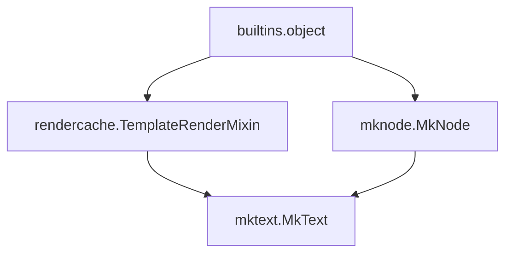

# MkText

[ Show source on GitHub](https://github.com/phil65/mknodes/blob/main/src/mknodes/basenodes/mktext/__init__.py)

### Class for any Markup text.

> [!NOTE]
> **Description**
>
>
> All classes inheriting from MkNode can get converted to this Type.

<details open>
<summary>Examples</summary>

### Example: **Regular**
> [!NOTE]
> **Jinja**
>
> ```jinja
> {{ "Some text" | MkText }}
>
> ```

> [!NOTE]
> **Python**
>
> ```python
> MkText('Some text')
> ```

<details open>
<summary>Rendered</summary>

Some text

</details>

<details>
<summary>Markdown</summary>

```markdown
Some text
```

</details>

<details>
<summary>Html</summary>

```html
<p>Some text</p>

```

</details>

</details>

<details open>
<summary>DocStrings</summary>

<a id="mknodes.MkText"></a>

```python
class MkText(TemplateRenderMixin, mknode.MkNode)
```

</details>

<details open>
<summary>Sub classes</summary>

| Name | Children | Inherits |
|--- | --- | --- |
| **<font size='4'>[MkInclude](https://phil65.github.io/mknodes/)</font>**<br>*<font size='1'>mknodes.templatenodes.mkinclude</font>*<br>Node to include the text of other Markdown files / MkNodes\. | <ul></ul> | <ul><li>[MkText](https://phil65.github.io/mknodes/)</li></ul> |
| **<font size='4'>[MkChangelog](https://phil65.github.io/mknodes/)</font>**<br>*<font size='1'>mknodes.templatenodes.mkchangelog</font>*<br>Node for a git\-based changelog \(created by git\-changelog\)\. | <ul></ul> | <ul><li>[MkText](https://phil65.github.io/mknodes/)</li></ul> |
| **<font size='4'>[MkLicense](https://phil65.github.io/mknodes/)</font>**<br>*<font size='1'>mknodes.templatenodes.mklicense</font>*<br>Node to show a license\. | <ul></ul> | <ul><li>[MkText](https://phil65.github.io/mknodes/)</li></ul> |
| **<font size='4'>[MkLlm](https://phil65.github.io/mknodes/)</font>**<br>*<font size='1'>mknodes.templatenodes.mkllm</font>*<br>Node for LLM\-based text generation\. | <ul></ul> | <ul><li>[MkText](https://phil65.github.io/mknodes/)</li></ul> |

</details>

<details open>
<summary>Base classes</summary>

| Name | Children | Inherits |
|--- | --- | --- |
| **<font size='4'>[TemplateRenderMixin](https://phil65.github.io/mknodes/)</font>**<br>*<font size='1'>mknodes.jinja.rendercache</font>*<br>Renders the node's template once and serves both children and content from it\. | <ul><li>[MkText](https://phil65.github.io/mknodes/)</li><li>[MkTemplate](https://phil65.github.io/mknodes/)</li><li>[MkTemplatePage](https://phil65.github.io/mknodes/)</li></ul> | <ul><li>[object](https://docs.python.org/3/library/functions.html#object)</li></ul> |
| **<font size='4'>[MkNode](https://phil65.github.io/mknodes/)</font>**<br>*<font size='1'>mknodes.basenodes.mknode</font>*<br>Base class for everything which can be expressed as Markup\. | <ul><li>[MkContainerBase](https://phil65.github.io/mknodes/)</li><li>[MkCompactAdmonition](https://phil65.github.io/mknodes/)</li><li>[MkLink](https://phil65.github.io/mknodes/)</li><li>[MkText](https://phil65.github.io/mknodes/)</li><li>[MkHeader](https://phil65.github.io/mknodes/)</li><li>[MkKeys](https://phil65.github.io/mknodes/)</li><li>[MkDocStrings](https://phil65.github.io/mknodes/)</li><li>[MkIcon](https://phil65.github.io/mknodes/)</li><li>[MkImage](https://phil65.github.io/mknodes/)</li><li>[MkProgressBar](https://phil65.github.io/mknodes/)</li><li>[BaseBlock](https://phil65.github.io/mknodes/)</li><li>...</li></ul> | <ul><li>[object](https://docs.python.org/3/library/functions.html#object)</li></ul> |

</details>

<details>
<summary>⋔ Inheritance diagram</summary>



</details>

<details>
<summary>NodeFile</summary>

**/home/runner/work/mknodes/mknodes/src/mknodes/basenodes/mktext/metadata.toml**

```toml
[metadata]
icon = "mdi:text"
name = "MkText"
group = "base"

[examples.regular]
title = "Regular"
jinja = """
{{ "Some text" | MkText }}
"""

# [examples.from_url]
# title = "From URL"
# jinja = """
# {{ mk.MkText.from_url("https://raw.githubusercontent.com/phil65/mknodes/main/README.md") }}
# """

[output.markdown]
template = """
{{ node.get_text() }}
"""

```

</details>

<details>
<summary>Code</summary>

**mknodes.basenodes.mktext.MkText**

```python
class MkText(TemplateRenderMixin, mknode.MkNode):
    """Class for any Markup text.

    All classes inheriting from MkNode can get converted to this Type.
    """

    ICON = "material/text"

    def __init__(
        self,
        text: str | mknode.MkNode | None = "",
        *,
        render_jinja: bool = False,
        **kwargs: Any,
    ) -> None:
        """Constructor.

        Args:
            text: Markup text
            render_jinja: Whether text should get rendered by this node
            kwargs: Keyword arguments passed to parent
        """
        super().__init__(**kwargs)
        self._text = str(text or "")
        self.render_jinja = render_jinja

    def get_section(self, section_name: str) -> Self | None:
        markdown = self.get_text()
        section_text = mdfilters.extract_header_section(markdown, section_name)
        return None if section_text is None else type(self)(section_text)

    def render_kwargs(self) -> dict[str, Any]:
        return dict(string=self._text, variables=self.variables)

    def get_text(self) -> str:
        if not self.render_jinja:
            return self._text
        return (self.current_render_result()).markdown

    def set_text(self, value: str) -> None:
        self._text = value

    def to_md_unprocessed(self) -> str:
        return self.get_text()

    def get_children(self) -> list[mknode.MkNode]:
        """Return children nodes.

        For MkText with render_jinja=True, this triggers Jinja rendering
        and returns any nodes created during rendering.
        """
        if not self.render_jinja:
            return []
        return self.get_render_result().children

    @classmethod
    def from_url(cls, url: str) -> Self | None:
        """Build a MkText node on a remote markup file.

        If the URL contains a "#" (http://.../markdown.md#section),
        it will try to extract the given section.

        All fsspec protocols are supported as URL.

        Args:
            url: URL to get markdown from.
        """
        url, *section = url.split("#")
        text = pathhelpers.load_file_cached(url)
        if not section:
            return cls(text)

        extracted = mdfilters.extract_header_section(text, section[0])
        return cls(extracted) if extracted is not None else None

```

</details>

<details>
<summary>Page info</summary>

<details>
<summary>Code for this page</summary>

**mknodes.manual.nodes_section.create_section_for_nodes**

```python
def create_section_for_nodes(
    nav: mk.MkNav,
    klasses: Sequence[type[mk.MkNode]],
) -> mk.MkTable:
    table = mk.MkTable(columns=["Node", "Docstrings", "Markdown extensions"])
    for kls in klasses:
        tpl = "classpage_custom.jinja"
        page = mk.MkClassPage(kls, icon=kls.ICON, template_path=tpl, parent=nav, hide="toc")
        nav += page
        if kls.STATUS:
            page.metadata.status = kls.STATUS
        elif kls.JS_FILES:
            page.metadata.status = "js"
        elif kls.CSS:
            page.metadata.status = "css"
        page.created_by = create_section_for_nodes
        link = mk.MkLink(page, kls.__name__, icon=kls.ICON)
        extensions = ", ".join(f"`{i}`" for i in kls.REQUIRED_EXTENSIONS)
        table.add_row((link, kls.__doc__, extensions))
    return table

```

</details>

<details>
<summary>Resources</summary>

```python
Resources(css=[],
          markdown_extensions={'admonition': {},
                               'pymdownx.details': {},
                               'pymdownx.highlight': {'anchor_linenums': True,
                                                      'line_spans': '__span',
                                                      'pygments_lang_class': True},
                               'pymdownx.superfences': {'custom_fences': [{'class': 'mermaid',
                                                                           'format': <function fence_code_format at 0x7bb797a5c1a0>,
                                                                           'name': 'mermaid'}]},
                               'pymdownx.tabbed': {},
                               'tables': {}},
          plugins=[Plugin('mkdocstrings')],
          js=[],
          assets=[],
          packages=[])
```

</details>

<details>
<summary>Metadata</summary>

```yaml
created:
  source_filename: /home/runner/work/mknodes/mknodes/src/mknodes/manual/nodes_section.py
  source_function: create_section_for_nodes
  source_line_no: 93
hide:
- toc
icon: material/text
title: MkText

```

</details>

</details>
