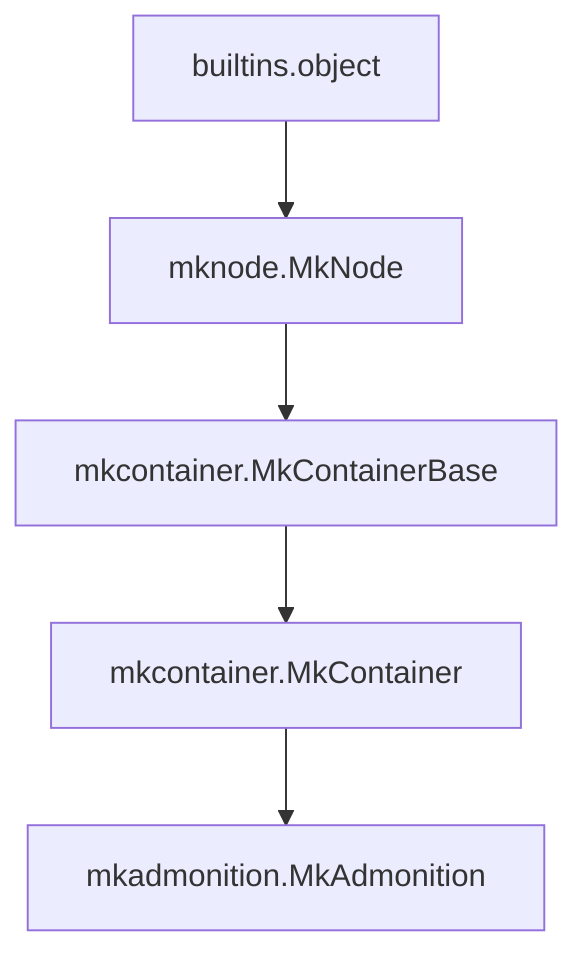

# MkAdmonition

[ Show source on GitHub](https://github.com/phil65/mknodes/blob/main/src/mknodes/basenodes/mkadmonition/__init__.py)

### Admonition info box.

<details open>
<summary>Examples</summary>

### Example: **Types**
> [!NOTE]
> **Jinja**
>
> ```jinja
> {{ "Different types." | MkAdmonition(typ="warning") }}
>
> ```

> [!NOTE]
> **Python**
>
> ```python
> MkAdmonition(None, typ='warning')
> ```

<details open>
<summary>Rendered</summary>

> [!WARNING]
> Different types.

</details>

<details>
<summary>Markdown</summary>

```markdown
> [!WARNING]
> Different types.

```

</details>

<details>
<summary>Html</summary>

```html
<div class="markdown-alert markdown-alert-warning">
<p class="markdown-alert-title">Warning</p>
<p>Different types.</p>
</div>

```

</details>

<details>
<summary>reST</summary>

```rst
.. warning:: 
    Different types.
```

</details>

<details>
<summary>GitHub</summary>

```markdown
> [!WARNING]
> Different types.

```

</details>

<details>
<summary>Repr tree</summary>

```
MkAdmonition
╰── MkText('Different types.')
```

</details>

### Example: **Collapsible and expandable**
> [!NOTE]
> **Jinja**
>
> ```jinja
> {{ "Admonitions can also be collapsible." | MkAdmonition(collapsible=True, title="Expand me!", expanded=True) }}
>
> ```

> [!NOTE]
> **Python**
>
> ```python
> MkAdmonition(None, title='Expand me!', collapsible=True, expanded=True)
> ```

<details open>
<summary>Rendered</summary>

<details open>
<summary>Expand me!</summary>

Admonitions can also be collapsible.

</details>

</details>

<details>
<summary>Markdown</summary>

```markdown
<details open>
<summary>Expand me!</summary>

Admonitions can also be collapsible.

</details>

```

</details>

<details>
<summary>Html</summary>

```html
<details open>
<summary>Expand me!</summary>
<p>Admonitions can also be collapsible.</p>
</details>

```

</details>

<details>
<summary>reST</summary>

```rst
.. info:: Expand me!
    Admonitions can also be collapsible.
```

</details>

<details>
<summary>GitHub</summary>

```markdown
<details open>
<summary>Expand me!</summary>

Admonitions can also be collapsible.

</details>

```

</details>

<details>
<summary>Repr tree</summary>

```
MkAdmonition
╰── MkText('Admonitions can also be collapsible.')
```

</details>

### Example: **Inlined**
> [!NOTE]
> **Jinja**
>
> ```jinja
> {{ "Inlined" | MkAdmonition(inline="left") }}
>
> ```

> [!NOTE]
> **Python**
>
> ```python
> MkAdmonition(None, inline='left')
> ```

<details open>
<summary>Rendered</summary>

> [!NOTE]
> Inlined

</details>

<details>
<summary>Markdown</summary>

```markdown
> [!NOTE]
> Inlined

```

</details>

<details>
<summary>Html</summary>

```html
<div class="markdown-alert markdown-alert-note">
<p class="markdown-alert-title">Note</p>
<p>Inlined</p>
</div>

```

</details>

<details>
<summary>reST</summary>

```rst
.. info:: 
    Inlined
```

</details>

<details>
<summary>GitHub</summary>

```markdown
> [!NOTE]
> Inlined

```

</details>

<details>
<summary>Repr tree</summary>

```
MkAdmonition
╰── MkText('Inlined')
```

</details>

</details>

<details open>
<summary>DocStrings</summary>

<a id="mknodes.MkAdmonition"></a>

```python
class MkAdmonition(mkcontainer.MkContainer)
```

</details>

<details open>
<summary>Base classes</summary>

| Name | Children | Inherits |
|--- | --- | --- |
| **<font size='4'>[MkContainer](https://phil65.github.io/mknodes/)</font>**<br>*<font size='1'>mknodes.basenodes.mkcontainer</font>*<br>A node containing other MkNodes\. | <ul><li>[MkBlock](https://phil65.github.io/mknodes/)</li><li>[MkAdmonition](https://phil65.github.io/mknodes/)</li><li>[MkBlockQuote](https://phil65.github.io/mknodes/)</li><li>[MkCode](https://phil65.github.io/mknodes/)</li><li>[MkTemplate](https://phil65.github.io/mknodes/)</li><li>[MkList](https://phil65.github.io/mknodes/)</li><li>[MkBaseTable](https://phil65.github.io/mknodes/)</li><li>[MkTab](https://phil65.github.io/mknodes/)</li><li>[MkTabContainer](https://phil65.github.io/mknodes/)</li><li>[MkCritic](https://phil65.github.io/mknodes/)</li><li>[MkAnnotation](https://phil65.github.io/mknodes/)</li><li>...</li></ul> | <ul><li>[MkContainerBase](https://phil65.github.io/mknodes/)</li></ul> |

</details>

<details>
<summary>⋔ Inheritance diagram</summary>



</details>

<details>
<summary>NodeFile</summary>

**/home/runner/work/mknodes/mknodes/src/mknodes/basenodes/mkadmonition/metadata.toml**

```toml
[metadata]
icon = "octicon:info-16"
name = "MkAdmonition"

[requirements.extension.admonition]

[requirements.extension."pymdownx.details"]

[requirements.extension."pymdownx.superfences"]

[examples.annotations]
title = "Annotations"
python = """
import mknodes as mk
node = mk.MkAdmonition("MkAdmonitions can carry annotations(1).")
node.annotations[1] = "Super handy!"
node
"""

[examples.types]
title = "Types"
jinja = """
{{ "Different types." | MkAdmonition(typ="warning") }}
"""

[examples.collapsible]
title = "Collapsible and expandable"
jinja = """
{{ "Admonitions can also be collapsible." | MkAdmonition(collapsible=True, title="Expand me!", expanded=True) }}
"""

[examples.inlined]
title = "Inlined"
jinja = """
{{ "Inlined" | MkAdmonition(inline="left") }}
"""

[output.markdown]
template = """

{{ node.title_line }}
{{ node.get_items() | join(node.block_separator) | indent(first=True) }}

"""

[output.block]
template = """
{{ node.fence_boundary }} admonition {{ node.typ }}{{ node.title | add(" | ") }}
{{ node.get_items() | join }}
{{ node.fence_boundary }}
"""

[output.rst]
template = """
.. {{ node.typ }}:: {{ node.title or "" }}
{{ node.get_items() | join(node.block_separator) | indent(first=True) }}
"""

```

</details>

<details>
<summary>Code</summary>

**mknodes.basenodes.mkadmonition.MkAdmonition**

```python
class MkAdmonition(mkcontainer.MkContainer):
    """Admonition info box."""

    ICON = "octicons/info-16"
    ATTR_LIST_SEPARATOR = "    "
    REQUIRED_EXTENSIONS = [
        resources.Extension("admonition"),
        resources.Extension("pymdownx.details"),
        resources.Extension("pymdownx.superfences"),
    ]

    def __init__(
        self,
        content: str | list[mknode.MkNode] | mknode.MkNode,
        *,
        typ: datatypes.AdmonitionTypeStr | str = "info",
        title: str | None = None,
        collapsible: bool = False,
        expanded: bool = False,
        inline: Literal["left", "right"] | None = None,
        **kwargs: Any,
    ) -> None:
        """Constructor.

        Args:
            content: Admonition content
            typ: Admonition type
            title: Optional Admonition title
            collapsible: Whether Admontion can get collapsed by user
            expanded: Initial state if collapsible is set
            inline: Whether admonition should rendered as inline block
            kwargs: Keyword arguments passed to parent
        """
        self.typ = typ
        self.title = title
        self.collapsible = collapsible
        self.inline = inline
        self.expanded = expanded
        super().__init__(content=content, **kwargs)

    def attach_annotations(self, text: str) -> str:
        # we deal with attaching annotations ourselves.
        return text

    @property
    def title_line(self) -> str:
        block_start = "???" if self.collapsible else "!!!"
        if self.collapsible and self.expanded:
            block_start += "+"
        if self.inline:
            inline_label = " inline" if self.inline == "left" else " inline end"
        else:
            inline_label = ""
        ann_marker = " annotate" if self.annotations else ""
        title = f' "{self.title}"' if self.title is not None else ""
        optional = ann_marker + inline_label
        return f"{block_start} {self.typ}{optional}{title}"

    def get_content(self) -> resources.NodeContent:
        """Single-pass: get markdown with custom admonition formatting and resources."""
        items = self.get_items()
        if not items and not self.title:
            return resources.NodeContent(
                markdown="",
                resources=self._build_node_resources(),
            )

        # Collect content from children
        renderer = rendering.current()
        child_contents = [renderer.render_child(item) for item in items]
        child_markdowns = [content.markdown for content in child_contents]

        text = "\n".join(child_markdowns)
        indented = textwrap.indent(text, "    ")
        annotations = f"\n{self.annotations}\n" if self.annotations else ""
        md = f"{self.title_line}\n{indented}\n{annotations}"

        # Aggregate resources
        aggregated = self._build_node_resources()
        for child_content in child_contents:
            aggregated.merge(child_content.resources)

        return resources.NodeContent(markdown=md, resources=aggregated)

    def to_md_unprocessed(self) -> str:
        content = self.get_content()
        return content.markdown

```

</details>

<details>
<summary>Page info</summary>

<details>
<summary>Code for this page</summary>

**mknodes.manual.nodes_section.create_section_for_nodes**

```python
def create_section_for_nodes(
    nav: mk.MkNav,
    klasses: Sequence[type[mk.MkNode]],
) -> mk.MkTable:
    table = mk.MkTable(columns=["Node", "Docstrings", "Markdown extensions"])
    for kls in klasses:
        tpl = "classpage_custom.jinja"
        page = mk.MkClassPage(kls, icon=kls.ICON, template_path=tpl, parent=nav, hide="toc")
        nav += page
        if kls.STATUS:
            page.metadata.status = kls.STATUS
        elif kls.JS_FILES:
            page.metadata.status = "js"
        elif kls.CSS:
            page.metadata.status = "css"
        page.created_by = create_section_for_nodes
        link = mk.MkLink(page, kls.__name__, icon=kls.ICON)
        extensions = ", ".join(f"`{i}`" for i in kls.REQUIRED_EXTENSIONS)
        table.add_row((link, kls.__doc__, extensions))
    return table

```

</details>

<details>
<summary>Resources</summary>

```python
Resources(css=[],
          markdown_extensions={'admonition': {},
                               'pymdownx.details': {},
                               'pymdownx.highlight': {'anchor_linenums': True,
                                                      'line_spans': '__span',
                                                      'pygments_lang_class': True},
                               'pymdownx.superfences': {'custom_fences': [{'class': 'mermaid',
                                                                           'format': <function fence_code_format at 0x7bb797a5c1a0>,
                                                                           'name': 'mermaid'}]},
                               'pymdownx.tabbed': {},
                               'tables': {}},
          plugins=[Plugin('mkdocstrings')],
          js=[],
          assets=[],
          packages=[])
```

</details>

<details>
<summary>Metadata</summary>

```yaml
created:
  source_filename: /home/runner/work/mknodes/mknodes/src/mknodes/manual/nodes_section.py
  source_function: create_section_for_nodes
  source_line_no: 93
hide:
- toc
icon: octicons/info-16
title: MkAdmonition

```

</details>

</details>
