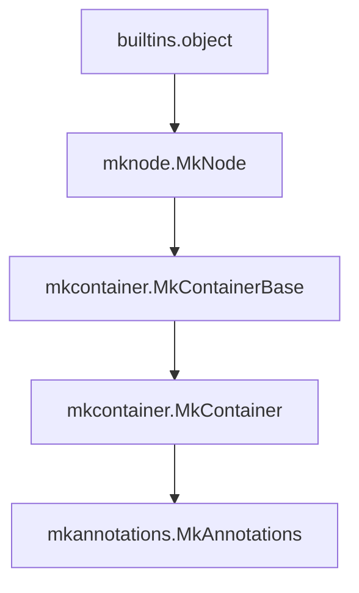

# MkAnnotations

[ Show source on GitHub](https://github.com/phil65/mknodes/blob/main/src/mknodes/basenodes/mkannotations/__init__.py)

### Node containing a list of MkAnnotations.

<details open>
<summary>Examples</summary>

</details>

<details>
<summary>DocStrings</summary>

<a id="mknodes.MkAnnotations"></a>

```python
class MkAnnotations(mkcontainer.MkContainer)
```

</details>

<details open>
<summary>Base classes</summary>

| Name | Children | Inherits |
|--- | --- | --- |
| **<font size='4'>[MkContainer](https://phil65.github.io/mknodes/)</font>**<br>*<font size='1'>mknodes.basenodes.mkcontainer</font>*<br>A node containing other MkNodes\. | <ul><li>[MkBlock](https://phil65.github.io/mknodes/)</li><li>[MkAdmonition](https://phil65.github.io/mknodes/)</li><li>[MkBlockQuote](https://phil65.github.io/mknodes/)</li><li>[MkCode](https://phil65.github.io/mknodes/)</li><li>[MkTemplate](https://phil65.github.io/mknodes/)</li><li>[MkList](https://phil65.github.io/mknodes/)</li><li>[MkBaseTable](https://phil65.github.io/mknodes/)</li><li>[MkTab](https://phil65.github.io/mknodes/)</li><li>[MkTabContainer](https://phil65.github.io/mknodes/)</li><li>[MkCritic](https://phil65.github.io/mknodes/)</li><li>[MkAnnotation](https://phil65.github.io/mknodes/)</li><li>...</li></ul> | <ul><li>[MkContainerBase](https://phil65.github.io/mknodes/)</li></ul> |

</details>

<details>
<summary>⋔ Inheritance diagram</summary>



</details>

<details>
<summary>NodeFile</summary>

**/home/runner/work/mknodes/mknodes/src/mknodes/basenodes/mkannotations/metadata.toml**

```toml
[metadata]
name = "MkAnnotations"
icon = "mdi:alert-box"

[requirements.extension."pymdownx.superfences"]

[examples.python]
python = """
import mknodes as mk

page += mk.MkCode.for_object(mk.MkCode.for_object, extract_body=True)
node = MkAnnotations()
page += node
text = mk.MkText("The MkAnnotations node aggregates annotations(1).")
page += text
info = r"Annotations are numbered and can be set via \\__setitem__."
node[1] = info  # (1)
admonition = mk.MkAdmonition("They can also contain other Markdown.")
node[2] = admonition  # (2)
text.annotations[1] = "Every MkNode can annotate via the 'annotations' attribute"
page += mk.MkCode(str(node), language="markdown", header="Markdown")
"""

[fragments.annotation]
template = """
{{ node.num }}.{{ 3 - self.num | string | length }}{{ node.get_items() | join("\n\n") | indent }}
"""

[output.markdown]
template = """
{{ node.get_items() | sort(attribute="num") | join }}
"""

```

</details>

<details>
<summary>Code</summary>

**mknodes.basenodes.mkannotations.MkAnnotations**

```python
class MkAnnotations(mkcontainer.MkContainer):
    """Node containing a list of MkAnnotations."""

    REQUIRED_EXTENSIONS = [resources.Extension("pymdownx.superfences")]
    ICON = "material/alert-box"

    def __init__(
        self,
        annotations: Mapping[int, str | mk.MkNode] | list[mk.MkNode | str] | None = None,
        **kwargs: Any,
    ) -> None:
        """Constructor.

        Args:
            annotations: Annotations data (Can be given in different shapes)
            kwargs: Keyword arguments passed to parent
        """
        match annotations:
            case None:
                items = []
            case list():
                items = [
                    (ann if isinstance(ann, MkAnnotation) else MkAnnotation(i, ann))
                    for i, ann in enumerate(annotations, start=1)
                ]
            case Mapping():
                items = [MkAnnotation(k, content=v) for k, v in annotations.items()]
            case _:  # pyright: ignore[reportUnnecessaryComparison]
                raise TypeError(annotations)
        super().__init__(content=items, **kwargs)

    def get_items(self) -> list[MkAnnotation]:  # type: ignore[override]
        """Return the list of annotations."""
        return self._items  # type: ignore[return-value]

    def __getitem__(self, item: int) -> MkAnnotation:
        for node in self.get_items():
            if node.num == item:
                return node
        raise IndexError(item)

    def __contains__(self, item: int | MkAnnotation) -> bool:
        match item:
            case MkAnnotation():
                return item in self.get_items()
            case int():
                return any(i.num == item for i in self.get_items())
            case _:
                raise TypeError(item)

    def __repr__(self) -> str:
        notes: list[str | MkAnnotation] = []
        for item in self.get_items():
            item_children = item.get_items()
            if len(item_children) == 1:
                string = reprhelpers.to_str_if_textnode(item_children[0])
                notes.append(string)
            else:
                notes.append(item)
        return reprhelpers.get_repr(self, annotations=notes)

    def _get_item_pos(self, num: int) -> int:
        items = self.get_items()
        item = next(i for i in items if i.num == num)
        return items.index(item)

    def __setitem__(self, index: int, value: mk.MkNode | str) -> None:
        import mknodes as mk

        match value:
            case str():
                item = mk.MkText(value)
                node = MkAnnotation(index, content=item, parent=self)
            case MkAnnotation():
                node = value
            case mk.MkNode():
                node = MkAnnotation(index, content=value, parent=self)
        items = self.get_items()
        if index in self:
            pos = self._get_item_pos(index)
            items[pos] = node
        else:
            items.append(node)

    def get_content(self) -> resources.NodeContent:
        """Single-pass: get content from sorted annotations and resources."""
        items = self.get_items()
        if not items:
            return resources.NodeContent(
                markdown="",
                resources=self._build_node_resources(),
            )

        items = sorted(items, key=lambda x: x.num)

        # Collect content from children
        renderer = rendering.current()
        child_contents = [renderer.render_child(item) for item in items]
        child_markdowns = [content.markdown for content in child_contents]

        md = "".join(child_markdowns)

        # Aggregate resources
        aggregated = self._build_node_resources()
        for child_content in child_contents:
            aggregated.merge(child_content.resources)

        return resources.NodeContent(markdown=md, resources=aggregated)

    def to_md_unprocessed(self) -> str:
        content = self.get_content()
        return content.markdown

    def annotate_text(self, markdown: str) -> str:
        if not self.get_items():
            return markdown
        return f'<div class="annotate" markdown>\n{markdown}\n</div>\n\n{self}'

```

</details>

<details>
<summary>Page info</summary>

<details>
<summary>Code for this page</summary>

**mknodes.manual.nodes_section.create_section_for_nodes**

```python
def create_section_for_nodes(
    nav: mk.MkNav,
    klasses: Sequence[type[mk.MkNode]],
) -> mk.MkTable:
    table = mk.MkTable(columns=["Node", "Docstrings", "Markdown extensions"])
    for kls in klasses:
        tpl = "classpage_custom.jinja"
        page = mk.MkClassPage(kls, icon=kls.ICON, template_path=tpl, parent=nav, hide="toc")
        nav += page
        if kls.STATUS:
            page.metadata.status = kls.STATUS
        elif kls.JS_FILES:
            page.metadata.status = "js"
        elif kls.CSS:
            page.metadata.status = "css"
        page.created_by = create_section_for_nodes
        link = mk.MkLink(page, kls.__name__, icon=kls.ICON)
        extensions = ", ".join(f"`{i}`" for i in kls.REQUIRED_EXTENSIONS)
        table.add_row((link, kls.__doc__, extensions))
    return table

```

</details>

<details>
<summary>Resources</summary>

```python
Resources(css=[],
          markdown_extensions={'pymdownx.highlight': {'anchor_linenums': True,
                                                      'line_spans': '__span',
                                                      'pygments_lang_class': True},
                               'pymdownx.superfences': {'custom_fences': [{'class': 'mermaid',
                                                                           'format': <function fence_code_format at 0x7bb797a5c1a0>,
                                                                           'name': 'mermaid'}]},
                               'tables': {}},
          plugins=[Plugin('mkdocstrings')],
          js=[],
          assets=[],
          packages=[])
```

</details>

<details>
<summary>Metadata</summary>

```yaml
created:
  source_filename: /home/runner/work/mknodes/mknodes/src/mknodes/manual/nodes_section.py
  source_function: create_section_for_nodes
  source_line_no: 93
hide:
- toc
icon: material/alert-box
title: MkAnnotations

```

</details>

</details>
