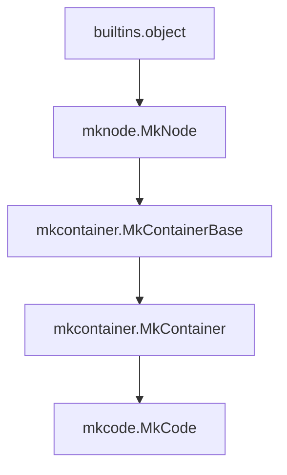

# MkCode

[ Show source on GitHub](https://github.com/phil65/mknodes/blob/main/src/mknodes/basenodes/mkcode/__init__.py)

### Class representing a Code block.

<details open>
<summary>Examples</summary>

### Example: **Default**
> [!NOTE]
> **Jinja**
>
> ```jinja
> {{ "a = 1 + 2" | MkCode }}
>
> ```

> [!NOTE]
> **Python**
>
> ```python
> MkCode(None)
> ```

<details open>
<summary>Rendered</summary>

```python
a = 1 + 2
```

</details>

<details>
<summary>Markdown</summary>

`````markdown
````python
a = 1 + 2
````
`````

</details>

<details>
<summary>Html</summary>

```html
<pre><code class="language-python">a = 1 + 2
</code></pre>

```

</details>

<details>
<summary>reST</summary>

```rst
.. sourcecode:: python
    a = 1 + 2
```

</details>

<details>
<summary>GitHub</summary>

`````markdown
````python
a = 1 + 2
````
`````

</details>

<details>
<summary>Repr tree</summary>

```
MkCode
╰── MkText('a = 1 + 2')
```

</details>

### Example: **Syntax highlighting**
> [!NOTE]
> **Jinja**
>
> ```jinja
> {{ "var z = x + y;" | MkCode(language="js") }}
>
> ```

> [!NOTE]
> **Python**
>
> ```python
> MkCode(None, language='js')
> ```

<details open>
<summary>Rendered</summary>

```js
var z = x + y;
```

</details>

<details>
<summary>Markdown</summary>

`````markdown
````js
var z = x + y;
````
`````

</details>

<details>
<summary>Html</summary>

```html
<pre><code class="language-js">var z = x + y;
</code></pre>

```

</details>

<details>
<summary>reST</summary>

```rst
.. sourcecode:: js
    var z = x + y;
```

</details>

<details>
<summary>GitHub</summary>

`````markdown
````js
var z = x + y;
````
`````

</details>

<details>
<summary>Repr tree</summary>

```
MkCode
╰── MkText('var z = x + y;')
```

</details>

### Example: **Highlighting lines**
> [!NOTE]
> **Jinja**
>
> ```jinja
> {{ "1
> 2
> 3
> 4" | MkCode(highlight_lines=[1, 3]) }}
>
> ```

> [!NOTE]
> **Python**
>
> ```python
> MkCode(None, highlight_lines=[1, 3])
> ```

<details open>
<summary>Rendered</summary>

```python
1
2
3
4
```

</details>

<details>
<summary>Markdown</summary>

`````markdown
````python
1
2
3
4
````
`````

</details>

<details>
<summary>Html</summary>

```html
<pre><code class="language-python">1
2
3
4
</code></pre>

```

</details>

<details>
<summary>reST</summary>

```rst
.. sourcecode:: python
    1
    2
    3
    4
```

</details>

<details>
<summary>GitHub</summary>

`````markdown
````python
1
2
3
4
````
`````

</details>

<details>
<summary>Repr tree</summary>

```
MkCode
╰── MkText('1\n2\n3\n4')
```

</details>

### Example: **Line numbers**
> [!NOTE]
> **Jinja**
>
> ```jinja
> {{ "1
> 2
> 3
> 4" | MkCode(linenums=10) }}
>
>
> ```

> [!NOTE]
> **Python**
>
> ```python
> MkCode(None, linenums=10)
> ```

<details open>
<summary>Rendered</summary>

```python
1
2
3
4
```

</details>

<details>
<summary>Markdown</summary>

`````markdown
````python
1
2
3
4
````
`````

</details>

<details>
<summary>Html</summary>

```html
<pre><code class="language-python">1
2
3
4
</code></pre>

```

</details>

<details>
<summary>reST</summary>

```rst
.. sourcecode:: python
    1
    2
    3
    4
```

</details>

<details>
<summary>GitHub</summary>

`````markdown
````python
1
2
3
4
````
`````

</details>

<details>
<summary>Repr tree</summary>

```
MkCode
╰── MkText('1\n2\n3\n4')
```

</details>

</details>

<details open>
<summary>DocStrings</summary>

<a id="mknodes.MkCode"></a>

```python
class MkCode(mkcontainer.MkContainer)
```

</details>

<details open>
<summary>Sub classes</summary>

| Name | Children | Inherits |
|--- | --- | --- |
| **<font size='4'>[MkDiagram](https://phil65.github.io/mknodes/)</font>**<br>*<font size='1'>mknodes.basenodes.mkdiagram</font>*<br>Class representing a mermaid diagram\. | <ul><li>[MkClassDiagram](https://phil65.github.io/mknodes/)</li><li>[MkPipDepTree](https://phil65.github.io/mknodes/)</li></ul> | <ul><li>[MkCode](https://phil65.github.io/mknodes/)</li></ul> |
| **<font size='4'>[MkTreeView](https://phil65.github.io/mknodes/)</font>**<br>*<font size='1'>mknodes.templatenodes.mktreeview</font>*<br>Node to display tree structures\. | <ul></ul> | <ul><li>[MkCode](https://phil65.github.io/mknodes/)</li></ul> |

</details>

<details open>
<summary>Base classes</summary>

| Name | Children | Inherits |
|--- | --- | --- |
| **<font size='4'>[MkContainer](https://phil65.github.io/mknodes/)</font>**<br>*<font size='1'>mknodes.basenodes.mkcontainer</font>*<br>A node containing other MkNodes\. | <ul><li>[MkBlock](https://phil65.github.io/mknodes/)</li><li>[MkAdmonition](https://phil65.github.io/mknodes/)</li><li>[MkBlockQuote](https://phil65.github.io/mknodes/)</li><li>[MkCode](https://phil65.github.io/mknodes/)</li><li>[MkTemplate](https://phil65.github.io/mknodes/)</li><li>[MkList](https://phil65.github.io/mknodes/)</li><li>[MkBaseTable](https://phil65.github.io/mknodes/)</li><li>[MkTab](https://phil65.github.io/mknodes/)</li><li>[MkTabContainer](https://phil65.github.io/mknodes/)</li><li>[MkCritic](https://phil65.github.io/mknodes/)</li><li>[MkAnnotation](https://phil65.github.io/mknodes/)</li><li>...</li></ul> | <ul><li>[MkContainerBase](https://phil65.github.io/mknodes/)</li></ul> |

</details>

<details>
<summary>⋔ Inheritance diagram</summary>



</details>

<details>
<summary>NodeFile</summary>

**/home/runner/work/mknodes/mknodes/src/mknodes/basenodes/mkcode/metadata.toml**

```toml
[metadata]
icon = "mdi:code-json"
name = "MkCode"

[requirements.extension."pymdownx.superfences"]

[requirements.extension."pymdownx.highlight"]
anchor_linenums = true
line_spans = "__span"
pygments_lang_class = true

[examples.title]
title = "Default"
description = "By default, python syntax highlighting is used."
jinja = """
{{ "a = 1 + 2" | MkCode }}
"""

[examples.syntax_highlight]
title = "Syntax highlighting"
jinja = """
{{ "var z = x + y;" | MkCode(language="js") }}
"""

[examples.hl_lines]
title = "Highlighting lines"
jinja = """
{{ "1\n2\n3\n4" | MkCode(highlight_lines=[1, 3]) }}
"""

[examples.line_numbers]
title = "Line numbers"
jinja = """
{{ "1\n2\n3\n4" | MkCode(linenums=10) }}

"""

[output.markdown]
template = """
{{ node.fence_boundary }} {{ node.fence_title }}
{{ node.get_text() }}
{{ node.fence_boundary }}
"""

[output.rst]
template = """
.. sourcecode:: {{ node.language }}
{{ node.get_text() | indent(first=True) }}
"""

```

</details>

<details>
<summary>Code</summary>

**mknodes.basenodes.mkcode.MkCode**

```python
class MkCode(mkcontainer.MkContainer):
    """Class representing a Code block."""

    ICON = "material/code-json"
    ATTR_LIST_SEPARATOR = "\n"
    REQUIRED_EXTENSIONS = [
        resources.Extension(
            "pymdownx.highlight",
            anchor_linenums=True,
            line_spans="__span",
            pygments_lang_class=True,
        ),
        resources.Extension("pymdownx.superfences"),
    ]

    def __init__(
        self,
        content: str | mk.MkNode | list[mk.MkNode] = "",
        *,
        language: str = "python",
        title: str = "",
        linenums: int | None = None,
        highlight_lines: list[int] | None = None,
        fence_level: int | None = None,
        **kwargs: Any,
    ) -> None:
        """Constructor.

        Args:
            content: Content to show inside code box
            language: language for syntax highlighting
            title: Code block title
            linenums: If set, use as start linenumber
            highlight_lines: Optionally highlight lines
            fence_level: Determines amount of ticks used for fence.
                         If None, auto-determine based on nesting depth.
            kwargs: Keyword arguments passed to parent
        """
        self.language = language
        self.title = title
        self.linenums = linenums
        self.highlight_lines = highlight_lines
        self._fence_level = fence_level
        super().__init__(content=content, **kwargs)

    def get_text(self) -> str:
        """Text content."""
        return "\n".join(str(i) for i in self.get_items())

    @property
    def fence_boundary(self) -> str:
        """Return fence boundary, based on nesting level. Default is ```."""
        if self._fence_level:
            return "`" * (self._fence_level + 3)
        block_level = sum(isinstance(i, MkCode) for i in self.ancestors)
        return "`" * (block_level + 3)

    def fence_for(self, text: str) -> str:
        """Return the fence for given code: longer than any fence inside the code."""
        inner = max((len(i) for i in INNER_FENCE_RE.findall(text)), default=0)
        boundary = self.fence_boundary
        return boundary if len(boundary) > inner else "`" * (inner + 1)

    @property
    def fence_title(self) -> str:
        """Title in first line."""
        classes = " ".join(f".{i}" for i in self.mods.css_classes)
        attrs = {}
        if self.title:
            attrs["title"] = self.title
        if self.language:
            classes = f".{self.language} {classes}"
        if self.linenums is not None:
            attrs["linenums"] = str(self.linenums)
        if self.highlight_lines:
            sub = " ".join(str(i) for i in self.highlight_lines)
            attrs["hl_lines"] = sub
        if not classes and not attrs:
            return ""
        attr_str = " ".join(f"{k}={v!r}" for k, v in attrs.items())
        if attr_str:
            attr_str = " " + attr_str
        return f"{{{classes}{attr_str}}}"

    def get_content(self) -> resources.NodeContent:
        """Single-pass: get code block markdown and resources."""
        space = " " if self.fence_title else ""
        text = self.get_text()
        fence = self.fence_for(text)
        md = f"{fence}{space}{self.fence_title}\n{text}\n{fence}"

        # Get own resources (don't aggregate children since we format them as text)
        aggregated = self._build_node_resources()

        return resources.NodeContent(markdown=md, resources=aggregated)

    def to_md_unprocessed(self) -> str:
        content = self.get_content()
        return content.markdown

    @classmethod
    def for_file(
        cls,
        path: JoinablePathLike,
        *,
        linenums: bool = True,
        highlight_caller: bool = True,
        title: str | None = None,
        language: str | None = None,
        **kwargs: Any,
    ) -> Self:
        """Create a MkCode node based on a code file.

        Line numbers will be shown by default. If `highlight_caller` is `True`,
        it will try to detect whether the calling method is inside the code block are
        creating and if yes, it will highlight that line.

        Args:
            path: Path to the code file (also supports fsspec-protocol URLs)
            linenums: Whether to show line numbers
            highlight_caller: Whether we want to try to highlight the line which called
                              this method.
            title: title to use for the code box. If None is set, filename will be used.
            language: Syntax highlighting language. If None, try to infer from extension.
            kwargs: Keyword arguments passed to MkCode ctor
        """
        file_path = to_upath(path)
        content = file_path.read_text("utf-8")
        hl_lines = None
        if highlight_caller and (frame := inspect.currentframe()) and frame.f_back:
            call_file = frame.f_back.f_code.co_filename
            if call_file == str(file_path.absolute()):
                line_count = content.count("\n")
                line = frame.f_back.f_lineno
                hl_lines = [line] if 0 <= line <= line_count else None
        start_line = 1 if linenums else None
        title = file_path.name if title is None else title
        if language is None:
            language = datatypes.EXT_TO_PYGMENTS_STYLE.get(file_path.suffix, "")
        return cls(
            content,
            linenums=start_line,
            title=title,
            highlight_lines=hl_lines,
            language=language,
            **kwargs,
        )

    @classmethod
    def for_object(
        cls,
        obj: datatypes.HasCodeType,
        *,
        dedent: bool = True,
        extract_body: bool = False,
        title: str | None = None,
        linenums: bool = True,
        highlight_caller: bool = True,
        **kwargs: Any,
    ) -> Self:
        """Create a MkCode node based on a python object.

        Fetches code by using the inspect module.
        Line numbers will be shown by default. If highlight_caller is True,
        it will try to detect whether the calling method is inside the code block are
        displaying and if yes, it will highlight that line.

        Args:
            obj: Python object to show code from
            dedent: Whether to dedent the code
            extract_body: if True, Function / Class signatures are stripped from the code
            title: Title to use for code block. If None, it will use the object path.
            linenums: Whether to show line numbers
            highlight_caller: Whether we want to try to highlight the line which called
                              this method.
            kwargs: Keyword arguments passed to MkCode ctor
        """
        code = inspecthelpers.get_source(obj)
        if extract_body:
            if not callable(obj):
                msg = "Can only extract body from Functions, Methods and classes"
                raise TypeError(msg)
            code = textfilters.extract_body(code)
        code = textwrap.dedent(code) if dedent else code
        code_title = title if title is not None else classhelpers.get_code_name(obj)
        hl_lines = None
        lines, start_line = inspecthelpers.get_source_lines(obj)
        if isinstance(obj, types.ModuleType):
            start_line += 1
        if highlight_caller and (frame := inspect.currentframe()) and frame.f_back:
            call_file = frame.f_back.f_code.co_filename
            obj_file = inspecthelpers.get_file(obj)
            if call_file == obj_file:
                line_no = frame.f_back.f_lineno
                line = line_no - start_line + 1
                hl_lines = [line] if 0 <= line <= start_line + len(lines) else None
        return cls(
            code,
            title=code_title,
            linenums=start_line if linenums else None,
            highlight_lines=hl_lines,
            **kwargs,
        )

```

</details>

<details>
<summary>Page info</summary>

<details>
<summary>Code for this page</summary>

**mknodes.manual.nodes_section.create_section_for_nodes**

```python
def create_section_for_nodes(
    nav: mk.MkNav,
    klasses: Sequence[type[mk.MkNode]],
) -> mk.MkTable:
    table = mk.MkTable(columns=["Node", "Docstrings", "Markdown extensions"])
    for kls in klasses:
        tpl = "classpage_custom.jinja"
        page = mk.MkClassPage(kls, icon=kls.ICON, template_path=tpl, parent=nav, hide="toc")
        nav += page
        if kls.STATUS:
            page.metadata.status = kls.STATUS
        elif kls.JS_FILES:
            page.metadata.status = "js"
        elif kls.CSS:
            page.metadata.status = "css"
        page.created_by = create_section_for_nodes
        link = mk.MkLink(page, kls.__name__, icon=kls.ICON)
        extensions = ", ".join(f"`{i}`" for i in kls.REQUIRED_EXTENSIONS)
        table.add_row((link, kls.__doc__, extensions))
    return table

```

</details>

<details>
<summary>Resources</summary>

```python
Resources(css=[],
          markdown_extensions={'admonition': {},
                               'pymdownx.details': {},
                               'pymdownx.highlight': {'anchor_linenums': True,
                                                      'line_spans': '__span',
                                                      'pygments_lang_class': True},
                               'pymdownx.superfences': {'custom_fences': [{'class': 'mermaid',
                                                                           'format': <function fence_code_format at 0x7bb797a5c1a0>,
                                                                           'name': 'mermaid'}]},
                               'pymdownx.tabbed': {},
                               'tables': {}},
          plugins=[Plugin('mkdocstrings')],
          js=[],
          assets=[],
          packages=[])
```

</details>

<details>
<summary>Metadata</summary>

```yaml
created:
  source_filename: /home/runner/work/mknodes/mknodes/src/mknodes/manual/nodes_section.py
  source_function: create_section_for_nodes
  source_line_no: 93
hide:
- toc
icon: material/code-json
title: MkCode

```

</details>

</details>
