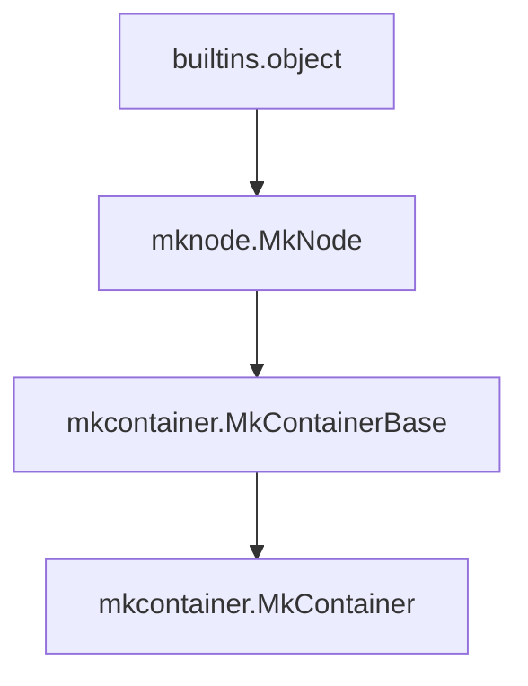

# MkContainer

[ Show source on GitHub](https://github.com/phil65/mknodes/blob/main/src/mknodes/basenodes/mkcontainer/__init__.py)

### A node containing other MkNodes.

> [!NOTE]
> **Description**
>
>
> This is the concrete implementation with list-based storage.
> Can be used directly or as a base class.
> Nodes added to a container are automatically re-parented.

<details open>
<summary>Examples</summary>

### Example: **Regular**
> [!NOTE]
> **Jinja**
>
> ```jinja
> {{ ["a = 1 + 2" | MkCode, "abc" | MkText] | MkContainer }}
>
> ```

> [!NOTE]
> **Python**
>
> ```python
> MkContainer()
> ```

<details open>
<summary>Rendered</summary>

````python
a = 1 + 2
````

abc

````python
a = 1 + 2
````

abc

</details>

<details>
<summary>Markdown</summary>

`````markdown
````python
a = 1 + 2
````

abc

````python
a = 1 + 2
````

abc
`````

</details>

<details>
<summary>Html</summary>

```html
<pre><code class="language-python">a = 1 + 2
</code></pre>
<p>abc</p>
<pre><code class="language-python">a = 1 + 2
</code></pre>
<p>abc</p>

```

</details>

<details>
<summary>Repr tree</summary>

```
MkContainer
├── MkCode(None)
│   ╰── MkText('a = 1 + 2')
├── MkText('abc')
╰── MkContainer()
├── MkCode(None)
│   ╰── MkText('a = 1 + 2')
├── MkText('abc')
```

</details>

</details>

<details open>
<summary>DocStrings</summary>

<a id="mknodes.MkContainer"></a>

```python
class MkContainer(MkContainerBase)
```

</details>

<details open>
<summary>Sub classes</summary>

| Name | Children | Inherits |
|--- | --- | --- |
| **<font size='4'>[MkBlock](https://phil65.github.io/mknodes/)</font>**<br>*<font size='1'>mknodes.basenodes.mkblock</font>*<br>PyMdown\-based block\. | <ul><li>[MkHtmlBlock](https://phil65.github.io/mknodes/)</li><li>[MkDetailsBlock](https://phil65.github.io/mknodes/)</li><li>[MkTabBlock](https://phil65.github.io/mknodes/)</li></ul> | <ul><li>[MkContainer](https://phil65.github.io/mknodes/)</li></ul> |
| **<font size='4'>[MkAdmonition](https://phil65.github.io/mknodes/)</font>**<br>*<font size='1'>mknodes.basenodes.mkadmonition</font>*<br>Admonition info box\. | <ul></ul> | <ul><li>[MkContainer](https://phil65.github.io/mknodes/)</li></ul> |
| **<font size='4'>[MkBlockQuote](https://phil65.github.io/mknodes/)</font>**<br>*<font size='1'>mknodes.basenodes.mkblockquote</font>*<br>BlockQuote node\. | <ul></ul> | <ul><li>[MkContainer](https://phil65.github.io/mknodes/)</li></ul> |
| **<font size='4'>[MkCode](https://phil65.github.io/mknodes/)</font>**<br>*<font size='1'>mknodes.basenodes.mkcode</font>*<br>Class representing a Code block\. | <ul><li>[MkDiagram](https://phil65.github.io/mknodes/)</li><li>[MkTreeView](https://phil65.github.io/mknodes/)</li></ul> | <ul><li>[MkContainer](https://phil65.github.io/mknodes/)</li></ul> |
| **<font size='4'>[MkTemplate](https://phil65.github.io/mknodes/)</font>**<br>*<font size='1'>mknodes.templatenodes.mktemplate</font>*<br>Node representing a jinja template\. | <ul><li>[MkCliDoc](https://phil65.github.io/mknodes/)</li><li>[MkMaterialBadge](https://phil65.github.io/mknodes/)</li><li>[MkImageCompare](https://phil65.github.io/mknodes/)</li><li>[MkImageSlideshow](https://phil65.github.io/mknodes/)</li><li>[MkIFrame](https://phil65.github.io/mknodes/)</li><li>[MkCard](https://phil65.github.io/mknodes/)</li><li>[MkInstallGuide](https://phil65.github.io/mknodes/)</li><li>[MkCodeOfConduct](https://phil65.github.io/mknodes/)</li><li>[MkCommitConventions](https://phil65.github.io/mknodes/)</li><li>[MkDevEnvSetup](https://phil65.github.io/mknodes/)</li><li>[MkDevTools](https://phil65.github.io/mknodes/)</li><li>...</li></ul> | <ul><li>[TemplateRenderMixin](https://phil65.github.io/mknodes/)</li><li>[MkContainer](https://phil65.github.io/mknodes/)</li></ul> |
| **<font size='4'>[MkList](https://phil65.github.io/mknodes/)</font>**<br>*<font size='1'>mknodes.basenodes.mklist</font>*<br>Node for showing a formatted list\. | <ul></ul> | <ul><li>[MkContainer](https://phil65.github.io/mknodes/)</li></ul> |
| **<font size='4'>[MkBaseTable](https://phil65.github.io/mknodes/)</font>**<br>*<font size='1'>mknodes.basenodes.mkbasetable</font>*<br>Base Class for MkTables\. Only deals with managing the data\. | <ul><li>[MkTable](https://phil65.github.io/mknodes/)</li><li>[MkHtmlTable](https://phil65.github.io/mknodes/)</li></ul> | <ul><li>[MkContainer](https://phil65.github.io/mknodes/)</li></ul> |
| **<font size='4'>[MkTab](https://phil65.github.io/mknodes/)</font>**<br>*<font size='1'>mknodes.basenodes.mktabs</font>*<br>Node representing a single tab\. | <ul></ul> | <ul><li>[MkContainer](https://phil65.github.io/mknodes/)</li></ul> |
| **<font size='4'>[MkTabContainer](https://phil65.github.io/mknodes/)</font>**<br>*<font size='1'>mknodes.basenodes.mktabcontainer</font>*<br>Base class for nodes containing tabs\. | <ul><li>[MkTabbedBlocks](https://phil65.github.io/mknodes/)</li><li>[MkTabbed](https://phil65.github.io/mknodes/)</li></ul> | <ul><li>[MkContainer](https://phil65.github.io/mknodes/)</li></ul> |
| **<font size='4'>[MkCritic](https://phil65.github.io/mknodes/)</font>**<br>*<font size='1'>mknodes.basenodes.mkcritic</font>*<br>MkCritic block\. | <ul></ul> | <ul><li>[MkContainer](https://phil65.github.io/mknodes/)</li></ul> |
| **<font size='4'>[MkAnnotation](https://phil65.github.io/mknodes/)</font>**<br>*<font size='1'>mknodes.basenodes.mkannotations</font>*<br>Represents a single annotation\. It gets managed by an MkAnnotations node\. | <ul></ul> | <ul><li>[MkContainer](https://phil65.github.io/mknodes/)</li></ul> |
| **<font size='4'>[MkAnnotations](https://phil65.github.io/mknodes/)</font>**<br>*<font size='1'>mknodes.basenodes.mkannotations</font>*<br>Node containing a list of MkAnnotations\. | <ul></ul> | <ul><li>[MkContainer](https://phil65.github.io/mknodes/)</li></ul> |
| **<font size='4'>[MkFootNote](https://phil65.github.io/mknodes/)</font>**<br>*<font size='1'>mknodes.basenodes.mkfootnotes</font>*<br>Represents a single footnote\. It gets managed by an MkFootNotes node\. | <ul></ul> | <ul><li>[MkContainer](https://phil65.github.io/mknodes/)</li></ul> |
| **<font size='4'>[MkFootNotes](https://phil65.github.io/mknodes/)</font>**<br>*<font size='1'>mknodes.basenodes.mkfootnotes</font>*<br>Node containing a list of MkFootNotes\. | <ul></ul> | <ul><li>[MkContainer](https://phil65.github.io/mknodes/)</li></ul> |
| **<font size='4'>[MkDefinition](https://phil65.github.io/mknodes/)</font>**<br>*<font size='1'>mknodes.basenodes.mkdefinitionlist</font>*<br>Node for a single definition\. | <ul></ul> | <ul><li>[MkContainer](https://phil65.github.io/mknodes/)</li></ul> |
| **<font size='4'>[MkDefinitionList](https://phil65.github.io/mknodes/)</font>**<br>*<font size='1'>mknodes.basenodes.mkdefinitionlist</font>*<br>Node for definition lists\. | <ul></ul> | <ul><li>[MkContainer](https://phil65.github.io/mknodes/)</li></ul> |
| **<font size='4'>[MkPage](https://phil65.github.io/mknodes/)</font>**<br>*<font size='1'>mknodes.pages.mkpage</font>*<br>A node container representing a Markdown page\. | <ul><li>[MkTemplatePage](https://phil65.github.io/mknodes/)</li></ul> | <ul><li>[MkContainer](https://phil65.github.io/mknodes/)</li></ul> |
| **<font size='4'>[MkShowcase](https://phil65.github.io/mknodes/)</font>**<br>*<font size='1'>mknodes.basenodes.mkshowcase</font>*<br>Node for showing a html\-based image grid\. | <ul></ul> | <ul><li>[MkContainer](https://phil65.github.io/mknodes/)</li></ul> |
| **<font size='4'>[MkSpeechBubble](https://phil65.github.io/mknodes/)</font>**<br>*<font size='1'>mknodes.basenodes.mkspeechbubble</font>*<br>Node for showing a css\-based speech bubble\. | <ul></ul> | <ul><li>[MkContainer](https://phil65.github.io/mknodes/)</li></ul> |
| **<font size='4'>[MkTask](https://phil65.github.io/mknodes/)</font>**<br>*<font size='1'>mknodes.basenodes.mktasklist</font>*<br>Node for a single task listitem\. | <ul></ul> | <ul><li>[MkContainer](https://phil65.github.io/mknodes/)</li></ul> |
| **<font size='4'>[MkTaskList](https://phil65.github.io/mknodes/)</font>**<br>*<font size='1'>mknodes.basenodes.mktasklist</font>*<br>Node for task lists\. | <ul></ul> | <ul><li>[MkContainer](https://phil65.github.io/mknodes/)</li></ul> |
| **<font size='4'>[MkTimeline](https://phil65.github.io/mknodes/)</font>**<br>*<font size='1'>mknodes.basenodes.mktimeline</font>*<br>Node to show a JavaScript\-supported Timeline\. | <ul></ul> | <ul><li>[MkContainer](https://phil65.github.io/mknodes/)</li></ul> |
| **<font size='4'>[MkShields](https://phil65.github.io/mknodes/)</font>**<br>*<font size='1'>mknodes.templatenodes.mkshields</font>*<br>Container for Shields\.io / GitHub badges\. | <ul></ul> | <ul><li>[MkContainer](https://phil65.github.io/mknodes/)</li></ul> |
| **<font size='4'>[MkMetadataBadges](https://phil65.github.io/mknodes/)</font>**<br>*<font size='1'>mknodes.templatenodes.mkmetadatabadges</font>*<br>Container node for a list of metadata badges\. | <ul></ul> | <ul><li>[MkContainer](https://phil65.github.io/mknodes/)</li></ul> |

</details>

<details open>
<summary>Base classes</summary>

| Name | Children | Inherits |
|--- | --- | --- |
| **<font size='4'>[MkContainerBase](https://phil65.github.io/mknodes/)</font>**<br>*<font size='1'>mknodes.basenodes.mkcontainer</font>*<br>Abstract base class for nodes containing other MkNodes\. | <ul><li>[MkContainer](https://phil65.github.io/mknodes/)</li></ul> | <ul><li>[MkNode](https://phil65.github.io/mknodes/)</li></ul> |

</details>

<details>
<summary>⋔ Inheritance diagram</summary>



</details>

<details>
<summary>NodeFile</summary>

**/home/runner/work/mknodes/mknodes/src/mknodes/basenodes/mkcontainer/metadata.toml**

```toml
[metadata]
icon = "mdi:database"
name = "MkContainer"

[examples.regular]
title = "Regular"
jinja = """
{{ ["a = 1 + 2" | MkCode, "abc" | MkText] | MkContainer }}
"""

```

</details>

<details>
<summary>Code</summary>

**mknodes.basenodes.mkcontainer.MkContainer**

```python
class MkContainer(MkContainerBase):
    """A node containing other MkNodes.

    This is the concrete implementation with list-based storage.
    Can be used directly or as a base class.
    Nodes added to a container are automatically re-parented.
    """

    def __init__(
        self,
        content: list[Any] | str | mknode.MkNode | None = None,
        *,
        block_separator: str = "\n\n",
        **kwargs: Any,
    ) -> None:
        """Constructor.

        Args:
            content: Child Nodes of this container
            block_separator: Separator to put between blocks. Defaults to 2 linebreaks
            kwargs: Keyword arguments passed to parent
        """
        super().__init__(block_separator=block_separator, **kwargs)
        match content:
            case None:
                self._items: list[mknode.MkNode] = []
            case str():
                self._items = [self.to_child_node(content)] if content else []
            case mknode.MkNode():
                self._items = [self.to_child_node(content)]
            case list():
                self._items = [self.to_child_node(i) for i in content]
            case _:
                raise TypeError(content)

    def get_items(self) -> list[mknode.MkNode]:
        """Return the list of contained items."""
        return self._items

    def set_items(self, items: list[mknode.MkNode]) -> None:
        """Set the list of contained items."""
        self._items = items

```

</details>

<details>
<summary>Page info</summary>

<details>
<summary>Code for this page</summary>

**mknodes.manual.nodes_section.create_section_for_nodes**

```python
def create_section_for_nodes(
    nav: mk.MkNav,
    klasses: Sequence[type[mk.MkNode]],
) -> mk.MkTable:
    table = mk.MkTable(columns=["Node", "Docstrings", "Markdown extensions"])
    for kls in klasses:
        tpl = "classpage_custom.jinja"
        page = mk.MkClassPage(kls, icon=kls.ICON, template_path=tpl, parent=nav, hide="toc")
        nav += page
        if kls.STATUS:
            page.metadata.status = kls.STATUS
        elif kls.JS_FILES:
            page.metadata.status = "js"
        elif kls.CSS:
            page.metadata.status = "css"
        page.created_by = create_section_for_nodes
        link = mk.MkLink(page, kls.__name__, icon=kls.ICON)
        extensions = ", ".join(f"`{i}`" for i in kls.REQUIRED_EXTENSIONS)
        table.add_row((link, kls.__doc__, extensions))
    return table

```

</details>

<details>
<summary>Resources</summary>

```python
Resources(css=[],
          markdown_extensions={'admonition': {},
                               'pymdownx.details': {},
                               'pymdownx.highlight': {'anchor_linenums': True,
                                                      'line_spans': '__span',
                                                      'pygments_lang_class': True},
                               'pymdownx.superfences': {'custom_fences': [{'class': 'mermaid',
                                                                           'format': <function fence_code_format at 0x7bb797a5c1a0>,
                                                                           'name': 'mermaid'}]},
                               'pymdownx.tabbed': {},
                               'tables': {}},
          plugins=[Plugin('mkdocstrings')],
          js=[],
          assets=[],
          packages=[])
```

</details>

<details>
<summary>Metadata</summary>

```yaml
created:
  source_filename: /home/runner/work/mknodes/mknodes/src/mknodes/manual/nodes_section.py
  source_function: create_section_for_nodes
  source_line_no: 93
hide:
- toc
icon: material/database
title: MkContainer

```

</details>

</details>
