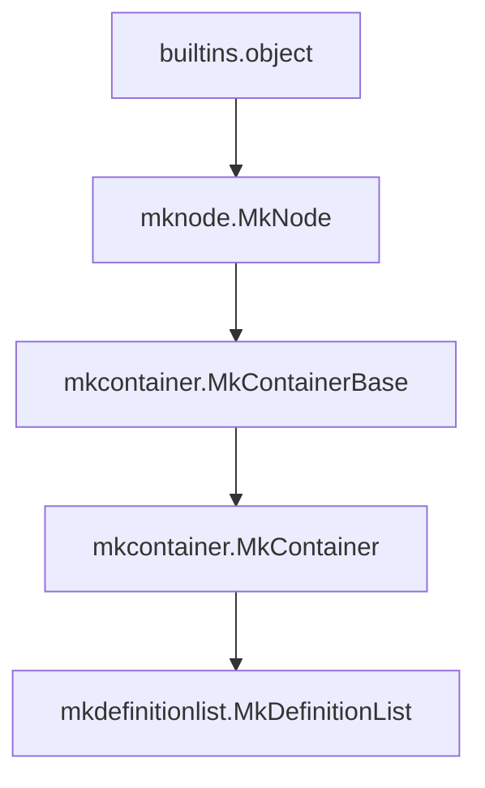

# MkDefinitionList

[ Show source on GitHub](https://github.com/phil65/mknodes/blob/main/src/mknodes/basenodes/mkdefinitionlist/__init__.py)

### Node for definition lists.

<details open>
<summary>Examples</summary>

### Example: **Regular**
> [!NOTE]
> **Jinja**
>
> ```jinja
> {{ {"something": "A definition", "something_else": "Another
> definition"} | MkDefinitionList }}
>
> ```

> [!NOTE]
> **Python**
>
> ```python
> MkDefinitionList(data={'something': 'A definition', 'something_else': 'Another\ndefinition'})
> ```

<details open>
<summary>Rendered</summary>

<dl>
<dt>something</dt>
<dd>

A definition

</dd>
<dt>something_else</dt>
<dd>

Another
definition

</dd>
</dl>

</details>

<details>
<summary>Markdown</summary>

```markdown
<dl>
<dt>something</dt>
<dd>

A definition

</dd>
<dt>something_else</dt>
<dd>

Another
definition

</dd>
</dl>

```

</details>

<details>
<summary>Html</summary>

```html
<dl>
<dt>something</dt>
<dd>
<p>A definition</p>
</dd>
<dt>something_else</dt>
<dd>
<p>Another
definition</p>
</dd>
</dl>

```

</details>

<details>
<summary>reST</summary>

```rst
something
  A definition
something_else
  Another
  definition

```

</details>

<details>
<summary>GitHub</summary>

```markdown
<dl>
<dt>something</dt>
<dd>

A definition

</dd>
<dt>something_else</dt>
<dd>

Another
definition

</dd>
</dl>

```

</details>

<details>
<summary>Repr tree</summary>

```
MkDefinitionList
├── MkText('A definition')
╰── MkText('Another\ndefinition')
```

</details>

### Example: **Nested markdown**
> [!NOTE]
> **Jinja**
>
> ```jinja
> {{ {"something": "A definition", "something_else": ("Nested" | MkAdmonition)} | MkDefinitionList }}
>
> ```

> [!NOTE]
> **Python**
>
> ```python
> MkContainer()
> ```

<details open>
<summary>Rendered</summary>

> [!NOTE]
> Nested

<dl>
<dt>something</dt>
<dd>

A definition

</dd>
<dt>something_else</dt>
<dd>

> [!NOTE]
> Nested

</dd>
</dl>

</details>

<details>
<summary>Markdown</summary>

```markdown
> [!NOTE]
> Nested

<dl>
<dt>something</dt>
<dd>

A definition

</dd>
<dt>something_else</dt>
<dd>

> [!NOTE]
> Nested

</dd>
</dl>

```

</details>

<details>
<summary>Html</summary>

```html
<div class="markdown-alert markdown-alert-note">
<p class="markdown-alert-title">Note</p>
<p>Nested</p>
</div>
<dl>
<dt>something</dt>
<dd>
<p>A definition</p>
</dd>
<dt>something_else</dt>
<dd>
<div class="markdown-alert markdown-alert-note">
<p class="markdown-alert-title">Note</p>
<p>Nested</p>
</div>
</dd>
</dl>

```

</details>

<details>
<summary>Repr tree</summary>

```
MkContainer
├── MkAdmonition(None)
│   ╰── MkText('Nested')
╰── MkDefinitionList(data={'something': 'A definition', 'something_else': MkAdmonition(None)})
    ├── MkText('A definition')
├── MkAdmonition(None)
│   ╰── MkText('Nested')
```

</details>

</details>

<details open>
<summary>DocStrings</summary>

<a id="mknodes.MkDefinitionList"></a>

```python
class MkDefinitionList(mkcontainer.MkContainer)
```

</details>

<details open>
<summary>Base classes</summary>

| Name | Children | Inherits |
|--- | --- | --- |
| **<font size='4'>[MkContainer](https://phil65.github.io/mknodes/)</font>**<br>*<font size='1'>mknodes.basenodes.mkcontainer</font>*<br>A node containing other MkNodes\. | <ul><li>[MkBlock](https://phil65.github.io/mknodes/)</li><li>[MkAdmonition](https://phil65.github.io/mknodes/)</li><li>[MkBlockQuote](https://phil65.github.io/mknodes/)</li><li>[MkCode](https://phil65.github.io/mknodes/)</li><li>[MkTemplate](https://phil65.github.io/mknodes/)</li><li>[MkList](https://phil65.github.io/mknodes/)</li><li>[MkBaseTable](https://phil65.github.io/mknodes/)</li><li>[MkTab](https://phil65.github.io/mknodes/)</li><li>[MkTabContainer](https://phil65.github.io/mknodes/)</li><li>[MkCritic](https://phil65.github.io/mknodes/)</li><li>[MkAnnotation](https://phil65.github.io/mknodes/)</li><li>...</li></ul> | <ul><li>[MkContainerBase](https://phil65.github.io/mknodes/)</li></ul> |

</details>

<details>
<summary>⋔ Inheritance diagram</summary>



</details>

<details>
<summary>NodeFile</summary>

**/home/runner/work/mknodes/mknodes/src/mknodes/basenodes/mkdefinitionlist/metadata.toml**

```toml
[metadata]
icon = "mdi:library"
name = "MkDefinitionList"

[requirements.extension.def_list]

[examples.regular]
title = "Regular"
jinja = """
{{ {"something": "A definition", "something_else": "Another\ndefinition"} | MkDefinitionList }}
"""

[examples.nested]
title = "Nested markdown"
jinja = """
{{ {"something": "A definition", "something_else": ("Nested" | MkAdmonition)} | MkDefinitionList }}
"""

[output.markdown]
template = """

{{ k }}
:   {{ v | string | indent }}

"""

[output.rst]
template = """

{{ k }}
  {{ v | string | indent(width=2) }}

"""

```

</details>

<details>
<summary>Code</summary>

**mknodes.basenodes.mkdefinitionlist.MkDefinitionList**

```python
class MkDefinitionList(mkcontainer.MkContainer):
    """Node for definition lists."""

    REQUIRED_EXTENSIONS = [resources.Extension("def_list")]
    ICON = "material/library"

    def __init__(self, data: Mapping[str, Any] | None = None, **kwargs: Any) -> None:
        """Constructor.

        Args:
            data: Data show for the table
            kwargs: Keyword arguments passed to parent
        """
        super().__init__(**kwargs)
        self.data: dict[str, str | mknode.MkNode] = {}
        self.set_items(data)

    def __repr__(self) -> str:
        kws = {k: reprhelpers.to_str_if_textnode(v) for k, v in self.data.items()}
        return reprhelpers.get_repr(self, data=kws)

    def get_items(self) -> list[mknode.MkNode]:  # type: ignore[override]
        """Return the list of definition values."""
        return list(self.data.values())  # type: ignore[arg-type]

    def set_items(self, data: Mapping[str, Any] | list[Any] | None) -> None:
        """Set items from data."""
        match data:
            case Mapping():
                self.data = {k: self.to_child_node(v) for k, v in data.items()}
            case list():
                self.data = {str(i): self.to_child_node(item) for i, item in enumerate(data)}
            case None:
                self.data = {}
            case _:  # pyright: ignore[reportUnnecessaryComparison]
                raise TypeError(data)

    def to_md_unprocessed(self) -> str:
        items = [f"{k}\n:   {filters.do_indent(str(v))}\n" for k, v in self.data.items()]
        return "".join(items)

```

</details>

<details>
<summary>Page info</summary>

<details>
<summary>Code for this page</summary>

**mknodes.manual.nodes_section.create_section_for_nodes**

```python
def create_section_for_nodes(
    nav: mk.MkNav,
    klasses: Sequence[type[mk.MkNode]],
) -> mk.MkTable:
    table = mk.MkTable(columns=["Node", "Docstrings", "Markdown extensions"])
    for kls in klasses:
        tpl = "classpage_custom.jinja"
        page = mk.MkClassPage(kls, icon=kls.ICON, template_path=tpl, parent=nav, hide="toc")
        nav += page
        if kls.STATUS:
            page.metadata.status = kls.STATUS
        elif kls.JS_FILES:
            page.metadata.status = "js"
        elif kls.CSS:
            page.metadata.status = "css"
        page.created_by = create_section_for_nodes
        link = mk.MkLink(page, kls.__name__, icon=kls.ICON)
        extensions = ", ".join(f"`{i}`" for i in kls.REQUIRED_EXTENSIONS)
        table.add_row((link, kls.__doc__, extensions))
    return table

```

</details>

<details>
<summary>Resources</summary>

```python
Resources(css=[],
          markdown_extensions={'admonition': {},
                               'pymdownx.details': {},
                               'pymdownx.highlight': {'anchor_linenums': True,
                                                      'line_spans': '__span',
                                                      'pygments_lang_class': True},
                               'pymdownx.superfences': {'custom_fences': [{'class': 'mermaid',
                                                                           'format': <function fence_code_format at 0x7bb797a5c1a0>,
                                                                           'name': 'mermaid'}]},
                               'pymdownx.tabbed': {},
                               'tables': {}},
          plugins=[Plugin('mkdocstrings')],
          js=[],
          assets=[],
          packages=[])
```

</details>

<details>
<summary>Metadata</summary>

```yaml
created:
  source_filename: /home/runner/work/mknodes/mknodes/src/mknodes/manual/nodes_section.py
  source_function: create_section_for_nodes
  source_line_no: 93
hide:
- toc
icon: material/library
title: MkDefinitionList

```

</details>

</details>
