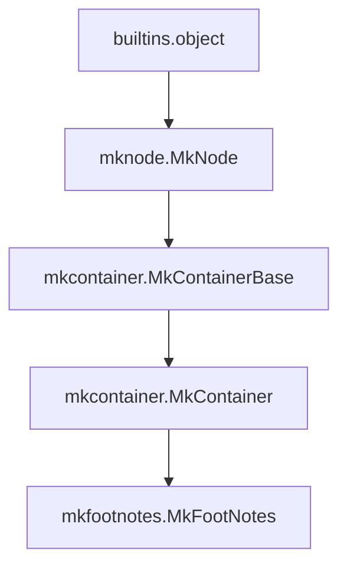

# MkFootNotes

[ Show source on GitHub](https://github.com/phil65/mknodes/blob/main/src/mknodes/basenodes/mkfootnotes/__init__.py)

### Node containing a list of MkFootNotes.

<details open>
<summary>Examples</summary>

</details>

<details>
<summary>DocStrings</summary>

<a id="mknodes.MkFootNotes"></a>

```python
class MkFootNotes(mkcontainer.MkContainer)
```

</details>

<details open>
<summary>Base classes</summary>

| Name | Children | Inherits |
|--- | --- | --- |
| **<font size='4'>[MkContainer](https://phil65.github.io/mknodes/)</font>**<br>*<font size='1'>mknodes.basenodes.mkcontainer</font>*<br>A node containing other MkNodes\. | <ul><li>[MkBlock](https://phil65.github.io/mknodes/)</li><li>[MkAdmonition](https://phil65.github.io/mknodes/)</li><li>[MkBlockQuote](https://phil65.github.io/mknodes/)</li><li>[MkCode](https://phil65.github.io/mknodes/)</li><li>[MkTemplate](https://phil65.github.io/mknodes/)</li><li>[MkList](https://phil65.github.io/mknodes/)</li><li>[MkBaseTable](https://phil65.github.io/mknodes/)</li><li>[MkTab](https://phil65.github.io/mknodes/)</li><li>[MkTabContainer](https://phil65.github.io/mknodes/)</li><li>[MkCritic](https://phil65.github.io/mknodes/)</li><li>[MkAnnotation](https://phil65.github.io/mknodes/)</li><li>...</li></ul> | <ul><li>[MkContainerBase](https://phil65.github.io/mknodes/)</li></ul> |

</details>

<details>
<summary>⋔ Inheritance diagram</summary>



</details>

<details>
<summary>NodeFile</summary>

**/home/runner/work/mknodes/mknodes/src/mknodes/basenodes/mkfootnotes/metadata.toml**

```toml
[metadata]
icon = "octicon:list-ordered-16"
name = "MkFootNotes"

[requirements.extension.footnotes]

[examples.regular]
title = "Regular"
python = """
node = MkFootNotes()
page += "The MkFootNotes node aggregates footnotes[^1]."
node[1] = r"Footnotes are numbered, can be set via `__setitem__`."
node[2] = r"They can also get nested[^3]."
node[3] = mk.MkAdmonition("And they can also contain other Markdown.")
node
"""

[fragments.footnote]
template = """
[^{{ footnote.num }}]
{{ node.get_items() | join("\n") | indent(first=True) }}
"""

[output.markdown]
template = """
{{ node.get_items() | sort(attribute="num") | join }}
"""

[output.rst]
template = """
.. rubric:: Footnotes


.. {{ item }}
"""

```

</details>

<details>
<summary>Code</summary>

**mknodes.basenodes.mkfootnotes.MkFootNotes**

```python
class MkFootNotes(mkcontainer.MkContainer):
    """Node containing a list of MkFootNotes."""

    ICON = "octicons/list-ordered-16"
    REQUIRED_EXTENSIONS = [resources.Extension("footnotes")]

    def __init__(
        self,
        footnotes: (Mapping[int, str | mk.MkNode] | list[MkFootNote] | list[str] | None) = None,
        **kwargs: Any,
    ) -> None:
        """Constructor.

        Args:
            footnotes: Footnotes data (Can be given in different shapes)
            kwargs: Keyword arguments passed to parent
        """
        match footnotes:
            case None:
                items = []
            case list():
                items = [
                    (
                        ann if isinstance(ann, MkFootNote) else MkFootNote(i, ann)  # type: ignore
                    )
                    for i, ann in enumerate(footnotes, start=1)
                ]
            case Mapping():
                items = [MkFootNote(k, content=v) for k, v in footnotes.items()]
            case _:
                raise TypeError(footnotes)
        super().__init__(content=items, **kwargs)

    def get_items(self) -> list[MkFootNote]:  # type: ignore[override]
        """Return the list of footnotes."""
        return self._items  # type: ignore[return-value]

    def __repr__(self) -> str:
        notes: list[mk.MkNode | str] = []
        for item in self.get_items():
            item_children = item.get_items()
            if len(item_children) == 1 and isinstance(item_children[0], mktext.MkText):
                notes.append(str(item_children[0]))
            elif len(item_children) == 1:
                notes.append(item_children[0])
            else:
                notes.append(item)
        return reprhelpers.get_repr(self, footnotes=notes)

    def __getitem__(self, index: int) -> MkFootNote:
        for node in self.get_items():
            if node.num == index:
                return node
        raise IndexError(index)

    def __contains__(self, item: int | MkFootNote) -> bool:
        match item:
            case MkFootNote():
                return item in self.get_items()
            case int():
                return any(i.num == item for i in self.get_items())
            case _:
                raise TypeError(item)

    def _get_item_pos(self, num: int) -> int:
        items = self.get_items()
        item = next(i for i in items if i.num == num)
        return items.index(item)

    def __setitem__(self, index: int, value: mk.MkNode | str) -> None:
        match value:
            case MkFootNote():
                node = value
            case _:
                node = MkFootNote(index, content=value, parent=self)
        items = self.get_items()
        if index in self:
            pos = self._get_item_pos(index)
            items[pos] = node
        else:
            items.append(node)

    def get_content(self) -> resources.NodeContent:
        """Single-pass: get content from sorted footnotes and resources."""
        items = self.get_items()
        if not items:
            return resources.NodeContent(
                markdown="",
                resources=self._build_node_resources(),
            )

        items = sorted(items, key=lambda x: x.num)

        # Collect content from children
        renderer = rendering.current()
        child_contents = [renderer.render_child(item) for item in items]
        child_markdowns = [content.markdown for content in child_contents]

        md = "".join(child_markdowns)

        # Aggregate resources
        aggregated = self._build_node_resources()
        for child_content in child_contents:
            aggregated.merge(child_content.resources)

        return resources.NodeContent(markdown=md, resources=aggregated)

    def to_md_unprocessed(self) -> str:
        content = self.get_content()
        return content.markdown

```

</details>

<details>
<summary>Page info</summary>

<details>
<summary>Code for this page</summary>

**mknodes.manual.nodes_section.create_section_for_nodes**

```python
def create_section_for_nodes(
    nav: mk.MkNav,
    klasses: Sequence[type[mk.MkNode]],
) -> mk.MkTable:
    table = mk.MkTable(columns=["Node", "Docstrings", "Markdown extensions"])
    for kls in klasses:
        tpl = "classpage_custom.jinja"
        page = mk.MkClassPage(kls, icon=kls.ICON, template_path=tpl, parent=nav, hide="toc")
        nav += page
        if kls.STATUS:
            page.metadata.status = kls.STATUS
        elif kls.JS_FILES:
            page.metadata.status = "js"
        elif kls.CSS:
            page.metadata.status = "css"
        page.created_by = create_section_for_nodes
        link = mk.MkLink(page, kls.__name__, icon=kls.ICON)
        extensions = ", ".join(f"`{i}`" for i in kls.REQUIRED_EXTENSIONS)
        table.add_row((link, kls.__doc__, extensions))
    return table

```

</details>

<details>
<summary>Resources</summary>

```python
Resources(css=[],
          markdown_extensions={'pymdownx.highlight': {'anchor_linenums': True,
                                                      'line_spans': '__span',
                                                      'pygments_lang_class': True},
                               'pymdownx.superfences': {'custom_fences': [{'class': 'mermaid',
                                                                           'format': <function fence_code_format at 0x7bb797a5c1a0>,
                                                                           'name': 'mermaid'}]},
                               'tables': {}},
          plugins=[Plugin('mkdocstrings')],
          js=[],
          assets=[],
          packages=[])
```

</details>

<details>
<summary>Metadata</summary>

```yaml
created:
  source_filename: /home/runner/work/mknodes/mknodes/src/mknodes/manual/nodes_section.py
  source_function: create_section_for_nodes
  source_line_no: 93
hide:
- toc
icon: octicons/list-ordered-16
title: MkFootNotes

```

</details>

</details>
