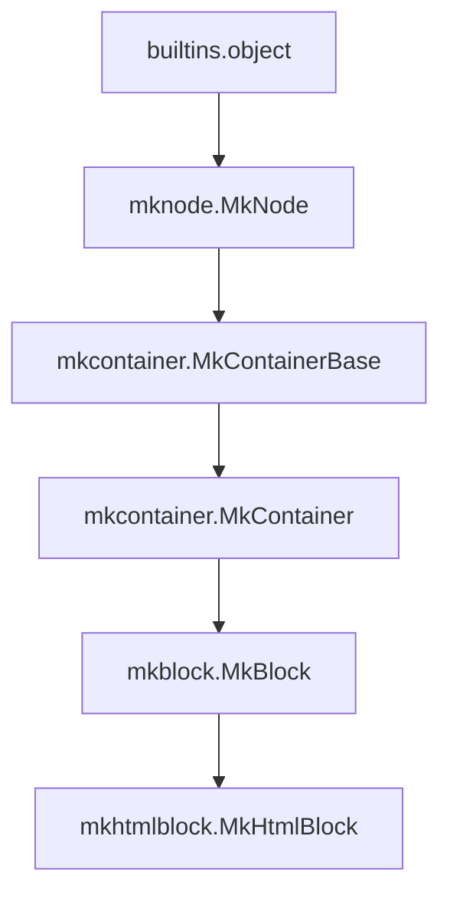

# MkHtmlBlock

[ Show source on GitHub](https://github.com/phil65/mknodes/blob/main/src/mknodes/basenodes/mkhtmlblock/__init__.py)

### PyMdown-based Html block. Can be used to show raw content.

<details open>
<summary>Examples</summary>

### Example: **Regular**
> [!NOTE]
> **Jinja**
>
> ```jinja
> {{ "Different types." | MkHtmlBlock("div") }}
>
> ```

> [!NOTE]
> **Python**
>
> ```python
> MkHtmlBlock(content='Different types.', block_type='div', attributes={'markdown': None})
> ```

<details open>
<summary>Rendered</summary>

<div>

Different types.

</div>

</details>

<details>
<summary>Markdown</summary>

```markdown
<div>

Different types.

</div>
```

</details>

<details>
<summary>Html</summary>

```html
<div>
<p>Different types.</p>
</div>

```

</details>

<details>
<summary>GitHub</summary>

```markdown
<div>

Different types.

</div>
```

</details>

<details>
<summary>Repr tree</summary>

```
MkHtmlBlock
╰── MkText('Different types.')
```

</details>

</details>

<details open>
<summary>DocStrings</summary>

<a id="mknodes.MkHtmlBlock"></a>

```python
class MkHtmlBlock(mkblock.MkBlock)
```

</details>

<details open>
<summary>Base classes</summary>

| Name | Children | Inherits |
|--- | --- | --- |
| **<font size='4'>[MkBlock](https://phil65.github.io/mknodes/)</font>**<br>*<font size='1'>mknodes.basenodes.mkblock</font>*<br>PyMdown\-based block\. | <ul><li>[MkHtmlBlock](https://phil65.github.io/mknodes/)</li><li>[MkDetailsBlock](https://phil65.github.io/mknodes/)</li><li>[MkTabBlock](https://phil65.github.io/mknodes/)</li></ul> | <ul><li>[MkContainer](https://phil65.github.io/mknodes/)</li></ul> |

</details>

<details>
<summary>⋔ Inheritance diagram</summary>



</details>

<details>
<summary>NodeFile</summary>

**/home/runner/work/mknodes/mknodes/src/mknodes/basenodes/mkhtmlblock/metadata.toml**

```toml
[metadata]
icon = "octicon:code-16"
name = "MkHtmlBlock"

[requirements.extension."pymdownx.blocks.html"]

[examples.regular]
title = "Regular"
jinja = """
{{ "Different types." | MkHtmlBlock("div") }}
"""

[output.markdown]
template = """
{{ node.fence_boundary }} html{{ node.argument | add(prefix=' | ')}}
{{ node.attributes_block }}

{{ node.get_content_block() }}{{ node.fence_boundary }}

"""

```

</details>

<details>
<summary>Code</summary>

**mknodes.basenodes.mkhtmlblock.MkHtmlBlock**

```python
class MkHtmlBlock(mkblock.MkBlock):
    """PyMdown-based Html block. Can be used to show raw content."""

    ICON = "octicons/code-16"
    REQUIRED_EXTENSIONS = [resources.Extension("pymdownx.blocks.html")]

    def __init__(
        self,
        content: str | mknode.MkNode = "",
        block_type: BlockTypeStr = "div",
        *,
        markdown_mode: MarkdownModeStr | None = None,
        attributes: dict[str, Any] | None = None,
        **kwargs: Any,
    ) -> None:
        """Constructor.

        Args:
            content: What should be contained in the block
            block_type: Block type
            markdown_mode: Markdown mode
            attributes: Block attrs
            kwargs: Keyword arguments passed to parent
        """
        super().__init__(
            name="html",
            argument=block_type,
            content=content,
            attributes=attributes,
            **kwargs,
        )
        self.markdown_mode = markdown_mode

    def __repr__(self) -> str:
        items = self.get_items()
        content = (
            reprhelpers.to_str_if_textnode(items[0])
            if len(items) == 1
            else [reprhelpers.to_str_if_textnode(i) for i in items]
        )
        return reprhelpers.get_repr(
            self,
            content=content,
            block_type=self.argument,
            markdown_mode=self.markdown_mode,
            attributes=self.attributes,
            _filter_empty=True,
        )

    @property
    def markdown_mode(self) -> MarkdownModeStr | None:
        """The markdown mode attribute."""
        return self.attributes.get("markdown")

    @markdown_mode.setter
    def markdown_mode(self, value: MarkdownModeStr | None) -> None:
        self.attributes["markdown"] = value

```

</details>

<details>
<summary>Page info</summary>

<details>
<summary>Code for this page</summary>

**mknodes.manual.nodes_section.create_section_for_nodes**

```python
def create_section_for_nodes(
    nav: mk.MkNav,
    klasses: Sequence[type[mk.MkNode]],
) -> mk.MkTable:
    table = mk.MkTable(columns=["Node", "Docstrings", "Markdown extensions"])
    for kls in klasses:
        tpl = "classpage_custom.jinja"
        page = mk.MkClassPage(kls, icon=kls.ICON, template_path=tpl, parent=nav, hide="toc")
        nav += page
        if kls.STATUS:
            page.metadata.status = kls.STATUS
        elif kls.JS_FILES:
            page.metadata.status = "js"
        elif kls.CSS:
            page.metadata.status = "css"
        page.created_by = create_section_for_nodes
        link = mk.MkLink(page, kls.__name__, icon=kls.ICON)
        extensions = ", ".join(f"`{i}`" for i in kls.REQUIRED_EXTENSIONS)
        table.add_row((link, kls.__doc__, extensions))
    return table

```

</details>

<details>
<summary>Resources</summary>

```python
Resources(css=[],
          markdown_extensions={'admonition': {},
                               'pymdownx.details': {},
                               'pymdownx.highlight': {'anchor_linenums': True,
                                                      'line_spans': '__span',
                                                      'pygments_lang_class': True},
                               'pymdownx.superfences': {'custom_fences': [{'class': 'mermaid',
                                                                           'format': <function fence_code_format at 0x7bb797a5c1a0>,
                                                                           'name': 'mermaid'}]},
                               'pymdownx.tabbed': {},
                               'tables': {}},
          plugins=[Plugin('mkdocstrings')],
          js=[],
          assets=[],
          packages=[])
```

</details>

<details>
<summary>Metadata</summary>

```yaml
created:
  source_filename: /home/runner/work/mknodes/mknodes/src/mknodes/manual/nodes_section.py
  source_function: create_section_for_nodes
  source_line_no: 93
hide:
- toc
icon: octicons/code-16
title: MkHtmlBlock

```

</details>

</details>
