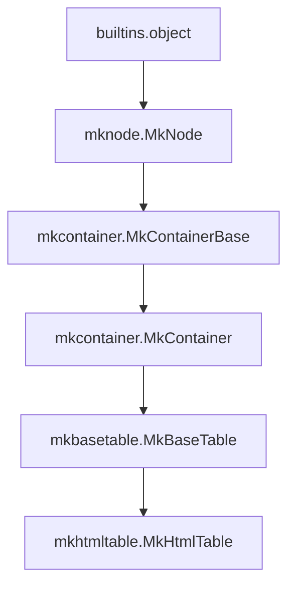

# MkHtmlTable

[ Show source on GitHub](https://github.com/phil65/mknodes/blob/main/src/mknodes/basenodes/mkhtmltable/__init__.py)

### Class representing a html table.

> [!NOTE]
> **Description**
>
>
> Compared to MkTable, this will end up with a more verbose output,
> but it can contain more complex Markdown in cells.

<details open>
<summary>Examples</summary>

### Example: **Regular**
> [!NOTE]
> **Jinja**
>
> ```jinja
> 
> 
> 
> 
> {{ data | MkHtmlTable }}
>
> ```

> [!NOTE]
> **Python**
>
> ```python
> MkHtmlTable(
>     data={
>         "Admonitions": [MkAdmonition(None), MkAdmonition(None)],
>         "Code": [MkCode(None), MkCode(None)],
>         "Tabs": [MkTabbed(tabs=[...]), MkTabbed(tabs=[...])],
>     }
> )
>
> ```

<details open>
<summary>Rendered</summary>

<table>
<tr><th>Code</th><th>Admonitions</th><th>Tabs</th></tr>
<tr>
<td>

````python
print('hello world')
sys.exit()
````

</td>
<td>

> [!NOTE]
> Admonition inside cell

</td>
<td>

<details open>
<summary>A</summary>

Tab a

</details>

<details>
<summary>B</summary>

Tab b

</details>

</td>
</tr>
<tr>
<td>

````python
print('hello world')
sys.exit()
````

</td>
<td>

> [!NOTE]
> Admonition inside cell

</td>
<td>

<details open>
<summary>A</summary>

Tab a

</details>

<details>
<summary>B</summary>

Tab b

</details>

</td>
</tr>
</table>

</details>

<details>
<summary>Markdown</summary>

`````markdown
<table>
<tr><th>Code</th><th>Admonitions</th><th>Tabs</th></tr>
<tr>
<td>

````python
print('hello world')
sys.exit()
````

</td>
<td>

> [!NOTE]
> Admonition inside cell

</td>
<td>

<details open>
<summary>A</summary>

Tab a

</details>

<details>
<summary>B</summary>

Tab b

</details>

</td>
</tr>
<tr>
<td>

````python
print('hello world')
sys.exit()
````

</td>
<td>

> [!NOTE]
> Admonition inside cell

</td>
<td>

<details open>
<summary>A</summary>

Tab a

</details>

<details>
<summary>B</summary>

Tab b

</details>

</td>
</tr>
</table>
`````

</details>

<details>
<summary>Html</summary>

```html
<table>
<tr><th>Code</th><th>Admonitions</th><th>Tabs</th></tr>
<tr>
<td>
<pre><code class="language-python">print('hello world')
sys.exit()
</code></pre>
</td>
<td>
<div class="markdown-alert markdown-alert-note">
<p class="markdown-alert-title">Note</p>
<p>Admonition inside cell</p>
</div>
</td>
<td>
<details open>
<summary>A</summary>
<p>Tab a</p>
</details>
<details>
<summary>B</summary>
<p>Tab b</p>
</details>
</td>
</tr>
<tr>
<td>
<pre><code class="language-python">print('hello world')
sys.exit()
</code></pre>
</td>
<td>
<div class="markdown-alert markdown-alert-note">
<p class="markdown-alert-title">Note</p>
<p>Admonition inside cell</p>
</div>
</td>
<td>
<details open>
<summary>A</summary>
<p>Tab a</p>
</details>
<details>
<summary>B</summary>
<p>Tab b</p>
</details>
</td>
</tr>
</table>

```

</details>

<details>
<summary>GitHub</summary>

`````markdown
<table>
<tr><th>Code</th><th>Admonitions</th><th>Tabs</th></tr>
<tr>
<td>

````python
print('hello world')
sys.exit()
````

</td>
<td>

> [!NOTE]
> Admonition inside cell

</td>
<td>

<details open>
<summary>A</summary>

Tab a

</details>

<details>
<summary>B</summary>

Tab b

</details>

</td>
</tr>
<tr>
<td>

````python
print('hello world')
sys.exit()
````

</td>
<td>

> [!NOTE]
> Admonition inside cell

</td>
<td>

<details open>
<summary>A</summary>

Tab a

</details>

<details>
<summary>B</summary>

Tab b

</details>

</td>
</tr>
</table>
`````

</details>

<details>
<summary>Repr tree</summary>

```
MkHtmlTable
├── MkCode(None)
│   ╰── MkText("print('hello world')\nsys.exit()")
├── MkCode(None)
│   ╰── MkText("print('hello world')\nsys.exit()")
├── MkAdmonition(None)
│   ╰── MkText('Admonition inside cell')
├── MkAdmonition(None)
│   ╰── MkText('Admonition inside cell')
├── MkTabbed(tabs=[...])
│   ├── MkTab(title='A', content='Tab a')
│   │   ╰── MkText('Tab a')
│   ╰── MkTab(title='B', content='Tab b')
│       ╰── MkText('Tab b')
├── MkTabbed(tabs=[...])
│   ├── MkTab(title='A', content='Tab a')
│   │   ╰── MkText('Tab a')
│   ╰── MkTab(title='B', content='Tab b')
│       ╰── MkText('Tab b')
```

</details>

</details>

<details open>
<summary>DocStrings</summary>

<a id="mknodes.MkHtmlTable"></a>

```python
class MkHtmlTable(mkbasetable.MkBaseTable)
```

</details>

<details open>
<summary>Base classes</summary>

| Name | Children | Inherits |
|--- | --- | --- |
| **<font size='4'>[MkBaseTable](https://phil65.github.io/mknodes/)</font>**<br>*<font size='1'>mknodes.basenodes.mkbasetable</font>*<br>Base Class for MkTables\. Only deals with managing the data\. | <ul><li>[MkTable](https://phil65.github.io/mknodes/)</li><li>[MkHtmlTable](https://phil65.github.io/mknodes/)</li></ul> | <ul><li>[MkContainer](https://phil65.github.io/mknodes/)</li></ul> |

</details>

<details>
<summary>⋔ Inheritance diagram</summary>



</details>

<details>
<summary>NodeFile</summary>

**/home/runner/work/mknodes/mknodes/src/mknodes/basenodes/mkhtmltable/metadata.toml**

```toml
[metadata]
icon = "octicon:table-24"
status = "new"
name = "MkHtmlTable"

[examples.regular]
title = "Regular"
jinja = """




{{ data | MkHtmlTable }}
"""

[output.markdown]
template = """

<table markdown="1">
<tr>

<td>
{{ header }}
</td>

</tr>

<tr>

<td>
{{ item }}
</td>

</tr>

</table>
"""


```

</details>

<details>
<summary>Code</summary>

**mknodes.basenodes.mkhtmltable.MkHtmlTable**

```python
class MkHtmlTable(mkbasetable.MkBaseTable):
    """Class representing a html table.

    Compared to MkTable, this will end up with a more verbose output,
    but it can contain more complex Markdown in cells.
    """

    STATUS = "new"

    def get_element(self) -> xml.Table | None:
        table_data = self.data  # property
        if not any(table_data[k] for k in table_data):
            return None
        root = xml.Table(markdown=True)
        data = [[str(k) for k in row] for row in self.iter_rows()]
        headers = list(table_data.keys())
        data.insert(0, headers)
        for items in data:
            tr = xml.Tr(parent=root)
            for item in items:
                td = xml.Td(parent=tr)
                td.text = "\n" + item + "\n"
        return root

    def to_md_unprocessed(self) -> str:
        root = self.get_element()
        return root.to_string(space="") if root is not None else ""

```

</details>

<details>
<summary>Page info</summary>

<details>
<summary>Code for this page</summary>

**mknodes.manual.nodes_section.create_section_for_nodes**

```python
def create_section_for_nodes(
    nav: mk.MkNav,
    klasses: Sequence[type[mk.MkNode]],
) -> mk.MkTable:
    table = mk.MkTable(columns=["Node", "Docstrings", "Markdown extensions"])
    for kls in klasses:
        tpl = "classpage_custom.jinja"
        page = mk.MkClassPage(kls, icon=kls.ICON, template_path=tpl, parent=nav, hide="toc")
        nav += page
        if kls.STATUS:
            page.metadata.status = kls.STATUS
        elif kls.JS_FILES:
            page.metadata.status = "js"
        elif kls.CSS:
            page.metadata.status = "css"
        page.created_by = create_section_for_nodes
        link = mk.MkLink(page, kls.__name__, icon=kls.ICON)
        extensions = ", ".join(f"`{i}`" for i in kls.REQUIRED_EXTENSIONS)
        table.add_row((link, kls.__doc__, extensions))
    return table

```

</details>

<details>
<summary>Resources</summary>

```python
Resources(css=[],
          markdown_extensions={'admonition': {},
                               'pymdownx.details': {},
                               'pymdownx.highlight': {'anchor_linenums': True,
                                                      'line_spans': '__span',
                                                      'pygments_lang_class': True},
                               'pymdownx.superfences': {'custom_fences': [{'class': 'mermaid',
                                                                           'format': <function fence_code_format at 0x7bb797a5c1a0>,
                                                                           'name': 'mermaid'}]},
                               'pymdownx.tabbed': {},
                               'tables': {}},
          plugins=[Plugin('mkdocstrings')],
          js=[],
          assets=[],
          packages=[])
```

</details>

<details>
<summary>Metadata</summary>

```yaml
created:
  source_filename: /home/runner/work/mknodes/mknodes/src/mknodes/manual/nodes_section.py
  source_function: create_section_for_nodes
  source_line_no: 93
hide:
- toc
icon: octicons/table-24
status: new
title: MkHtmlTable

```

</details>

</details>
