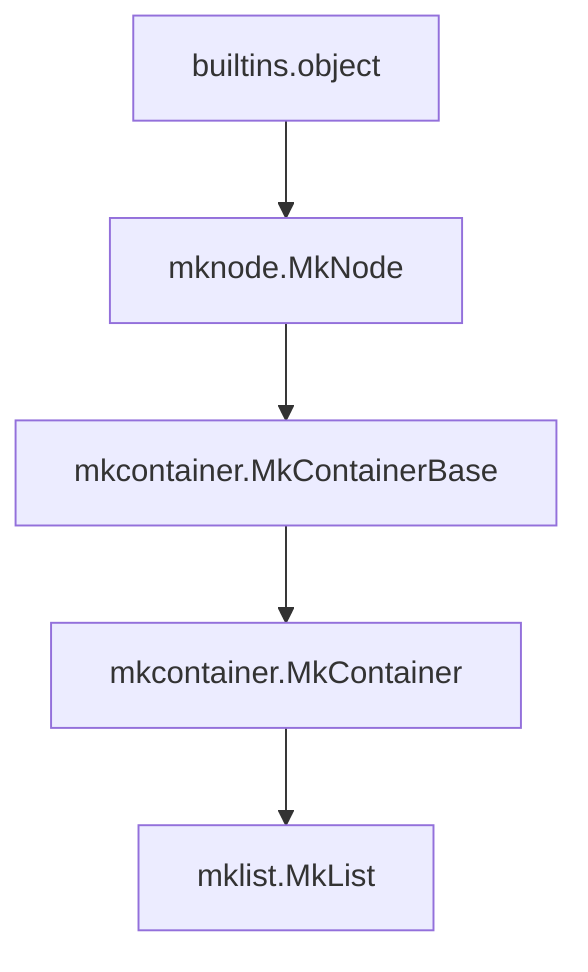

# MkList

[ Show source on GitHub](https://github.com/phil65/mknodes/blob/main/src/mknodes/basenodes/mklist/__init__.py)

### Node for showing a formatted list.

<details open>
<summary>Examples</summary>

### Example: **Regular**
> [!NOTE]
> **Jinja**
>
> ```jinja
> {{ ["Item 1", "Item 2", "Item 3"] | MkList }}
>
> ```

> [!NOTE]
> **Python**
>
> ```python
> MkList([MkText('Item 1'), MkText('Item 2'), MkText('Item 3')])
> ```

<details open>
<summary>Rendered</summary>

* Item 1
  * Item 2
  * Item 3

</details>

<details>
<summary>Markdown</summary>

```markdown
  * Item 1
  * Item 2
  * Item 3

```

</details>

<details>
<summary>Html</summary>

```html
<ul><li>Item 1</li><li>Item 2</li><li>Item 3</li></ul>
```

</details>

<details>
<summary>Repr tree</summary>

```
MkList
├── MkText('Item 1')
├── MkText('Item 2')
╰── MkText('Item 3')
```

</details>

### Example: **Shorten**
> [!NOTE]
> **Jinja**
>
> ```jinja
> {{ ["Item 1", "Item 2", "Item 3"] | MkList(shorten_after=2) }}
>
> ```

> [!NOTE]
> **Python**
>
> ```python
> MkList([MkText('Item 1'), MkText('Item 2'), MkText('Item 3')], shorten_after=2)
> ```

<details open>
<summary>Rendered</summary>

* Item 1
  * Item 2
  * ...

</details>

<details>
<summary>Markdown</summary>

```markdown
  * Item 1
  * Item 2
  * ...

```

</details>

<details>
<summary>Html</summary>

```html
<ul><li>Item 1</li><li>Item 2</li><li>...</li></ul>
```

</details>

<details>
<summary>Repr tree</summary>

```
MkList
├── MkText('Item 1')
├── MkText('Item 2')
╰── MkText('Item 3')
```

</details>

### Example: **Ordered**
> [!NOTE]
> **Jinja**
>
> ```jinja
> {{ ["Item 1", "Item 2", "Item 3"] | MkList(ordered=True) }}
>
> ```

> [!NOTE]
> **Python**
>
> ```python
> MkList([MkText('Item 1'), MkText('Item 2'), MkText('Item 3')], ordered=True)
> ```

<details open>
<summary>Rendered</summary>

1. Item 1
  2. Item 2
  3. Item 3

</details>

<details>
<summary>Markdown</summary>

```markdown
  1. Item 1
  2. Item 2
  3. Item 3

```

</details>

<details>
<summary>Html</summary>

```html
<ol><li>Item 1</li><li>Item 2</li><li>Item 3</li></ol>
```

</details>

<details>
<summary>Repr tree</summary>

```
MkList
├── MkText('Item 1')
├── MkText('Item 2')
╰── MkText('Item 3')
```

</details>

### Example: **Nested**
> [!NOTE]
> **Jinja**
>
> ```jinja
> {{ [_mk.MkAdmonition("Nested!")] | MkList }}
>
> ```

> [!NOTE]
> **Python**
>
> ```python
> MkList([list([...])])
> ```

<details open>
<summary>Rendered</summary>

* > [!NOTE]
    > Nested!

</details>

<details>
<summary>Markdown</summary>

```markdown
  * > [!NOTE]
    > Nested!

```

</details>

<details>
<summary>Html</summary>

```html
<ul><li>> [!NOTE]
> Nested!
</li></ul>
```

</details>

<details>
<summary>Repr tree</summary>

```
MkList
╰── MkAdmonition(None)
    ╰── MkText('Nested!')
```

</details>

</details>

<details open>
<summary>DocStrings</summary>

<a id="mknodes.MkList"></a>

```python
class MkList(mkcontainer.MkContainer)
```

</details>

<details open>
<summary>Base classes</summary>

| Name | Children | Inherits |
|--- | --- | --- |
| **<font size='4'>[MkContainer](https://phil65.github.io/mknodes/)</font>**<br>*<font size='1'>mknodes.basenodes.mkcontainer</font>*<br>A node containing other MkNodes\. | <ul><li>[MkBlock](https://phil65.github.io/mknodes/)</li><li>[MkAdmonition](https://phil65.github.io/mknodes/)</li><li>[MkBlockQuote](https://phil65.github.io/mknodes/)</li><li>[MkCode](https://phil65.github.io/mknodes/)</li><li>[MkTemplate](https://phil65.github.io/mknodes/)</li><li>[MkList](https://phil65.github.io/mknodes/)</li><li>[MkBaseTable](https://phil65.github.io/mknodes/)</li><li>[MkTab](https://phil65.github.io/mknodes/)</li><li>[MkTabContainer](https://phil65.github.io/mknodes/)</li><li>[MkCritic](https://phil65.github.io/mknodes/)</li><li>[MkAnnotation](https://phil65.github.io/mknodes/)</li><li>...</li></ul> | <ul><li>[MkContainerBase](https://phil65.github.io/mknodes/)</li></ul> |

</details>

<details>
<summary>⋔ Inheritance diagram</summary>



</details>

<details>
<summary>NodeFile</summary>

**/home/runner/work/mknodes/mknodes/src/mknodes/basenodes/mklist/metadata.toml**

```toml
[metadata]
name = "MkList"
group = "container"
icon = "octicon:list-unordered-24"

[requirements.extension.def_list]

[examples.regular]
title = "Regular"
jinja = """
{{ ["Item 1", "Item 2", "Item 3"] | MkList }}
"""

[examples.shorten]
title = "Shorten"
jinja = """
{{ ["Item 1", "Item 2", "Item 3"] | MkList(shorten_after=2) }}
"""

[examples.ordered]
title = "Ordered"
jinja = """
{{ ["Item 1", "Item 2", "Item 3"] | MkList(ordered=True) }}
"""

[examples.nested]
title = "Nested"
jinja = """
{{ [_mk.MkAdmonition("Nested!")] | MkList }}
"""

[output.markdown]
template = """

{{ (node | getattr("_line"))(loop.index, item) }}


  {{ (node.shorten_after + 1 ~ ".") if node.ordered else "*" }} ...


"""

[output.html]
template = """
<{{ "ol" if node.ordered else "ul" }}><li>{{ (node | getattr("_prep"))(item)}}</li>

<li>...</li>
</{{ "ol" if node.ordered else "ul" }}>
"""

```

</details>

<details>
<summary>Code</summary>

**mknodes.basenodes.mklist.MkList**

```python
class MkList(mkcontainer.MkContainer):
    """Node for showing a formatted list."""

    ICON = "octicons/list-unordered-24"
    REQUIRED_EXTENSIONS = [resources.Extension("def_list")]

    def __init__(
        self,
        items: Sequence[str | mknode.MkNode] | None = None,
        *,
        ordered: bool = False,
        shorten_after: int | None = None,
        as_links: bool = False,
        **kwargs: Any,
    ) -> None:
        """Constructor.

        Args:
            items: Items to show as a list
            ordered: whether the list should be numbered
            shorten_after: will clip the list after n items and append a "..."
            as_links: will convert the label to links which will get replaced by plugin
            kwargs: Keyword arguments passed to parent
        """
        # if as_links:
        #     items = [link.Link(i) for i in items]
        items = items or []
        self.ordered = ordered
        self.shorten_after = shorten_after
        self.as_links = as_links
        super().__init__(content=list(items), **kwargs)

    def _prep(self, item: mknode.MkNode) -> str:
        return linkprovider.linked(str(item)) if self.as_links else str(item)

    def _line(self, index: int, item: mknode.MkNode) -> str:
        marker = f"  {f'{index}.' if self.ordered else '*'} "
        # Continuation lines of multi-line items (admonitions, code) belong to the item.
        text = self._prep(item).rstrip("\n").replace("\n", "\n" + " " * len(marker))
        return marker + re.sub(r"^ +$", "", text, flags=re.MULTILINE)

    def to_md_unprocessed(self) -> str:
        items = self.get_items()
        if not items:
            return ""
        lines = [self._line(i, item) for i, item in enumerate(items[: self.shorten_after], 1)]
        if self.shorten_after and len(items) > self.shorten_after:
            prefix = f"{self.shorten_after + 1}." if self.ordered else "*"
            lines.append(f"  {prefix} ...")
        return "\n".join(lines) + "\n"

    def to_html(self, flavor: str | rendering.Renderer | None = None) -> str:
        """Formats list in html as one single line (same in every flavour).

        Can be useful for including in Tables.
        """
        items = self.get_items()
        if not items:
            return ""
        tag_name = "ol" if self.ordered else "ul"
        li_items = [f"<li>{self._prep(i)}</li>" for i in items[: self.shorten_after]]
        item_str = "".join(li_items)
        if self.shorten_after and len(items) > self.shorten_after:
            item_str += "<li>...</li>"
        return f"<{tag_name}>{item_str}</{tag_name}>"

```

</details>

<details>
<summary>Page info</summary>

<details>
<summary>Code for this page</summary>

**mknodes.manual.nodes_section.create_section_for_nodes**

```python
def create_section_for_nodes(
    nav: mk.MkNav,
    klasses: Sequence[type[mk.MkNode]],
) -> mk.MkTable:
    table = mk.MkTable(columns=["Node", "Docstrings", "Markdown extensions"])
    for kls in klasses:
        tpl = "classpage_custom.jinja"
        page = mk.MkClassPage(kls, icon=kls.ICON, template_path=tpl, parent=nav, hide="toc")
        nav += page
        if kls.STATUS:
            page.metadata.status = kls.STATUS
        elif kls.JS_FILES:
            page.metadata.status = "js"
        elif kls.CSS:
            page.metadata.status = "css"
        page.created_by = create_section_for_nodes
        link = mk.MkLink(page, kls.__name__, icon=kls.ICON)
        extensions = ", ".join(f"`{i}`" for i in kls.REQUIRED_EXTENSIONS)
        table.add_row((link, kls.__doc__, extensions))
    return table

```

</details>

<details>
<summary>Resources</summary>

```python
Resources(css=[],
          markdown_extensions={'admonition': {},
                               'pymdownx.details': {},
                               'pymdownx.highlight': {'anchor_linenums': True,
                                                      'line_spans': '__span',
                                                      'pygments_lang_class': True},
                               'pymdownx.superfences': {'custom_fences': [{'class': 'mermaid',
                                                                           'format': <function fence_code_format at 0x7bb797a5c1a0>,
                                                                           'name': 'mermaid'}]},
                               'pymdownx.tabbed': {},
                               'tables': {}},
          plugins=[Plugin('mkdocstrings')],
          js=[],
          assets=[],
          packages=[])
```

</details>

<details>
<summary>Metadata</summary>

```yaml
created:
  source_filename: /home/runner/work/mknodes/mknodes/src/mknodes/manual/nodes_section.py
  source_function: create_section_for_nodes
  source_line_no: 93
hide:
- toc
icon: octicons/list-unordered-24
title: MkList

```

</details>

</details>
