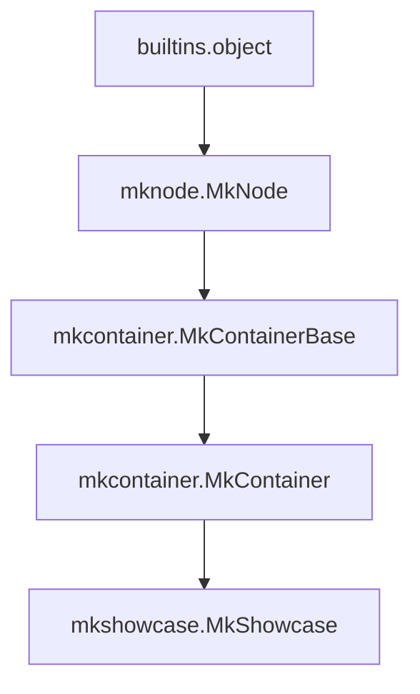

# MkShowcase

[ Show source on GitHub](https://github.com/phil65/mknodes/blob/main/src/mknodes/basenodes/mkshowcase/__init__.py)

### Node for showing a html-based image grid.

> [!NOTE]
> **Description**
>
>
> Manages row / column positioning.
> Mainly intended for MkCards, but can also include other markdown (there are limits
> though.)
> When adding MkCards, then addtional CSS is required.

<details open>
<summary>Examples</summary>

### Example: **From TOML format**
> [!NOTE]
> **Jinja**
>
> ```jinja
> {{
> '
> ["Card 1"]
> title = "Some title 1"
> image = "https://picsum.photos/300"
> caption = "Some **markdown**"
> ["Card 2"]
> title = "Some title 2"
> image = "https://picsum.photos/301"
> caption = "Some **markdown**"
> ' | load_toml | MkShowcase
> }}
>
> ```

> [!NOTE]
> **Python**
>
> ```python
> MkShowcase([MkCard('Some title 1', 'http... caption='Some **markdown**'), MkCard('Some title 2', 'http... caption='Some **markdown**')])
> ```

<details open>
<summary>Rendered</summary>

<div class="row">
  <div class="column">
    <div class="card">
    <div class="showcase-container">
    
    <div class="overlay">Some **markdown**</div>
    </div>
    <p>
    <button>Some title 1</button>
    </p>
    </div>
  </div>
  <div class="column">
    <div class="card">
    <div class="showcase-container">
    
    <div class="overlay">Some **markdown**</div>
    </div>
    <p>
    <button>Some title 2</button>
    </p>
    </div>
  </div>
</div>

</details>

<details>
<summary>Markdown</summary>

```markdown
<div class="row">
  <div class="column">
    <div class="card">
    <div class="showcase-container">
    
    <div class="overlay">Some **markdown**</div>
    </div>
    <p>
    <button>Some title 1</button>
    </p>
    </div>
  </div>
  <div class="column">
    <div class="card">
    <div class="showcase-container">
    
    <div class="overlay">Some **markdown**</div>
    </div>
    <p>
    <button>Some title 2</button>
    </p>
    </div>
  </div>
</div>
```

</details>

<details>
<summary>Html</summary>

```html
<div class="row">
  <div class="column">
    <div class="card">
    <div class="showcase-container">
    
    <div class="overlay">Some **markdown**</div>
    </div>
    <p>
    <button>Some title 1</button>
    </p>
    </div>
  </div>
  <div class="column">
    <div class="card">
    <div class="showcase-container">
    
    <div class="overlay">Some **markdown**</div>
    </div>
    <p>
    <button>Some title 2</button>
    </p>
    </div>
  </div>
</div>

```

</details>

<details>
<summary>Repr tree</summary>

```
MkShowcase
MkCard('Some title 1', 'https://picsum.photos/300', caption='Some **markdown**')
MkCard('Some title 2', 'https://picsum.photos/301', caption='Some **markdown**')
```

</details>

### Example: **Manual**
> [!NOTE]
> **Jinja**
>
> ```jinja
> 
> 
> {{ ["Title 0" | MkCard(target=url, image=img_url, caption="Caption 0"),
>     "Title 1" | MkCard(target=url, image=img_url, caption="Caption 1"),
>     "Title 2" | MkCard(target=url, image=img_url, caption="Caption 2"),
>     "Title 3" | MkCard(target=url, image=img_url, caption="Caption 3"),
>     "Title 4" | MkCard(target=url, image=img_url, caption="Caption 4"),
>     "Title 5" | MkCard(target=url, image=img_url, caption="Caption 5")] | MkShowcase }}
>
> ```

> [!NOTE]
> **Python**
>
> ```python
> MkContainer()
> ```

<details open>
<summary>Rendered</summary>

<a href="https://phil65.github.io/mknodes/">
<div class="card">
<div class="showcase-container">

<div class="overlay">Caption 0</div>
</div>
<p>
<button>Title 0</button>
</p>
</div>
</a>

<a href="https://phil65.github.io/mknodes/">
<div class="card">
<div class="showcase-container">

<div class="overlay">Caption 1</div>
</div>
<p>
<button>Title 1</button>
</p>
</div>
</a>

<a href="https://phil65.github.io/mknodes/">
<div class="card">
<div class="showcase-container">

<div class="overlay">Caption 2</div>
</div>
<p>
<button>Title 2</button>
</p>
</div>
</a>

<a href="https://phil65.github.io/mknodes/">
<div class="card">
<div class="showcase-container">

<div class="overlay">Caption 3</div>
</div>
<p>
<button>Title 3</button>
</p>
</div>
</a>

<a href="https://phil65.github.io/mknodes/">
<div class="card">
<div class="showcase-container">

<div class="overlay">Caption 4</div>
</div>
<p>
<button>Title 4</button>
</p>
</div>
</a>

<a href="https://phil65.github.io/mknodes/">
<div class="card">
<div class="showcase-container">

<div class="overlay">Caption 5</div>
</div>
<p>
<button>Title 5</button>
</p>
</div>
</a>

<div class="row">
  <div class="column">
    <a href="https://phil65.github.io/mknodes/">
    <div class="card">
    <div class="showcase-container">
    
    <div class="overlay">Caption 0</div>
    </div>
    <p>
    <button>Title 0</button>
    </p>
    </div>
    </a>
  </div>
  <div class="column">
    <a href="https://phil65.github.io/mknodes/">
    <div class="card">
    <div class="showcase-container">
    
    <div class="overlay">Caption 1</div>
    </div>
    <p>
    <button>Title 1</button>
    </p>
    </div>
    </a>
  </div>
  <div class="column">
    <a href="https://phil65.github.io/mknodes/">
    <div class="card">
    <div class="showcase-container">
    
    <div class="overlay">Caption 2</div>
    </div>
    <p>
    <button>Title 2</button>
    </p>
    </div>
    </a>
  </div>
</div><div class="row">
  <div class="column">
    <a href="https://phil65.github.io/mknodes/">
    <div class="card">
    <div class="showcase-container">
    
    <div class="overlay">Caption 3</div>
    </div>
    <p>
    <button>Title 3</button>
    </p>
    </div>
    </a>
  </div>
  <div class="column">
    <a href="https://phil65.github.io/mknodes/">
    <div class="card">
    <div class="showcase-container">
    
    <div class="overlay">Caption 4</div>
    </div>
    <p>
    <button>Title 4</button>
    </p>
    </div>
    </a>
  </div>
  <div class="column">
    <a href="https://phil65.github.io/mknodes/">
    <div class="card">
    <div class="showcase-container">
    
    <div class="overlay">Caption 5</div>
    </div>
    <p>
    <button>Title 5</button>
    </p>
    </div>
    </a>
  </div>
</div>

</details>

<details>
<summary>Markdown</summary>

```markdown
<a href="https://phil65.github.io/mknodes/">
<div class="card">
<div class="showcase-container">

<div class="overlay">Caption 0</div>
</div>
<p>
<button>Title 0</button>
</p>
</div>
</a>

<a href="https://phil65.github.io/mknodes/">
<div class="card">
<div class="showcase-container">

<div class="overlay">Caption 1</div>
</div>
<p>
<button>Title 1</button>
</p>
</div>
</a>

<a href="https://phil65.github.io/mknodes/">
<div class="card">
<div class="showcase-container">

<div class="overlay">Caption 2</div>
</div>
<p>
<button>Title 2</button>
</p>
</div>
</a>

<a href="https://phil65.github.io/mknodes/">
<div class="card">
<div class="showcase-container">

<div class="overlay">Caption 3</div>
</div>
<p>
<button>Title 3</button>
</p>
</div>
</a>

<a href="https://phil65.github.io/mknodes/">
<div class="card">
<div class="showcase-container">

<div class="overlay">Caption 4</div>
</div>
<p>
<button>Title 4</button>
</p>
</div>
</a>

<a href="https://phil65.github.io/mknodes/">
<div class="card">
<div class="showcase-container">

<div class="overlay">Caption 5</div>
</div>
<p>
<button>Title 5</button>
</p>
</div>
</a>

<div class="row">
  <div class="column">
    <a href="https://phil65.github.io/mknodes/">
    <div class="card">
    <div class="showcase-container">
    
    <div class="overlay">Caption 0</div>
    </div>
    <p>
    <button>Title 0</button>
    </p>
    </div>
    </a>
  </div>
  <div class="column">
    <a href="https://phil65.github.io/mknodes/">
    <div class="card">
    <div class="showcase-container">
    
    <div class="overlay">Caption 1</div>
    </div>
    <p>
    <button>Title 1</button>
    </p>
    </div>
    </a>
  </div>
  <div class="column">
    <a href="https://phil65.github.io/mknodes/">
    <div class="card">
    <div class="showcase-container">
    
    <div class="overlay">Caption 2</div>
    </div>
    <p>
    <button>Title 2</button>
    </p>
    </div>
    </a>
  </div>
</div><div class="row">
  <div class="column">
    <a href="https://phil65.github.io/mknodes/">
    <div class="card">
    <div class="showcase-container">
    
    <div class="overlay">Caption 3</div>
    </div>
    <p>
    <button>Title 3</button>
    </p>
    </div>
    </a>
  </div>
  <div class="column">
    <a href="https://phil65.github.io/mknodes/">
    <div class="card">
    <div class="showcase-container">
    
    <div class="overlay">Caption 4</div>
    </div>
    <p>
    <button>Title 4</button>
    </p>
    </div>
    </a>
  </div>
  <div class="column">
    <a href="https://phil65.github.io/mknodes/">
    <div class="card">
    <div class="showcase-container">
    
    <div class="overlay">Caption 5</div>
    </div>
    <p>
    <button>Title 5</button>
    </p>
    </div>
    </a>
  </div>
</div>
```

</details>

<details>
<summary>Html</summary>

```html
<a href="https://phil65.github.io/mknodes/">
<div class="card">
<div class="showcase-container">

<div class="overlay">Caption 0</div>
</div>
<p>
<button>Title 0</button>
</p>
</div>
</a>
<a href="https://phil65.github.io/mknodes/">
<div class="card">
<div class="showcase-container">

<div class="overlay">Caption 1</div>
</div>
<p>
<button>Title 1</button>
</p>
</div>
</a>
<a href="https://phil65.github.io/mknodes/">
<div class="card">
<div class="showcase-container">

<div class="overlay">Caption 2</div>
</div>
<p>
<button>Title 2</button>
</p>
</div>
</a>
<a href="https://phil65.github.io/mknodes/">
<div class="card">
<div class="showcase-container">

<div class="overlay">Caption 3</div>
</div>
<p>
<button>Title 3</button>
</p>
</div>
</a>
<a href="https://phil65.github.io/mknodes/">
<div class="card">
<div class="showcase-container">

<div class="overlay">Caption 4</div>
</div>
<p>
<button>Title 4</button>
</p>
</div>
</a>
<a href="https://phil65.github.io/mknodes/">
<div class="card">
<div class="showcase-container">

<div class="overlay">Caption 5</div>
</div>
<p>
<button>Title 5</button>
</p>
</div>
</a>
<div class="row">
  <div class="column">
    <a href="https://phil65.github.io/mknodes/">
    <div class="card">
    <div class="showcase-container">
    
    <div class="overlay">Caption 0</div>
    </div>
    <p>
    <button>Title 0</button>
    </p>
    </div>
    </a>
  </div>
  <div class="column">
    <a href="https://phil65.github.io/mknodes/">
    <div class="card">
    <div class="showcase-container">
    
    <div class="overlay">Caption 1</div>
    </div>
    <p>
    <button>Title 1</button>
    </p>
    </div>
    </a>
  </div>
  <div class="column">
    <a href="https://phil65.github.io/mknodes/">
    <div class="card">
    <div class="showcase-container">
    
    <div class="overlay">Caption 2</div>
    </div>
    <p>
    <button>Title 2</button>
    </p>
    </div>
    </a>
  </div>
</div><div class="row">
  <div class="column">
    <a href="https://phil65.github.io/mknodes/">
    <div class="card">
    <div class="showcase-container">
    
    <div class="overlay">Caption 3</div>
    </div>
    <p>
    <button>Title 3</button>
    </p>
    </div>
    </a>
  </div>
  <div class="column">
    <a href="https://phil65.github.io/mknodes/">
    <div class="card">
    <div class="showcase-container">
    
    <div class="overlay">Caption 4</div>
    </div>
    <p>
    <button>Title 4</button>
    </p>
    </div>
    </a>
  </div>
  <div class="column">
    <a href="https://phil65.github.io/mknodes/">
    <div class="card">
    <div class="showcase-container">
    
    <div class="overlay">Caption 5</div>
    </div>
    <p>
    <button>Title 5</button>
    </p>
    </div>
    </a>
  </div>
</div>

```

</details>

<details>
<summary>Repr tree</summary>

```
MkContainer
╰── MkCard('Title 0', 'https://picsum.photos/300', caption='Caption 0', target='https://phil65.github.io/mknodes/')
╰── MkCard('Title 1', 'https://picsum.photos/300', caption='Caption 1', target='https://phil65.github.io/mknodes/')
╰── MkCard('Title 2', 'https://picsum.photos/300', caption='Caption 2', target='https://phil65.github.io/mknodes/')
╰── MkCard('Title 3', 'https://picsum.photos/300', caption='Caption 3', target='https://phil65.github.io/mknodes/')
╰── MkCard('Title 4', 'https://picsum.photos/300', caption='Caption 4', target='https://phil65.github.io/mknodes/')
├── MkCard('Title 5', 'https://picsum.photos/300', caption='Caption 5', target='https://phil65.github.io/mknodes/')
╰── MkShowcase([MkCard('Title 0', 'https://p...//phil65.github.io/mknodes/'), MkCard('Title 1', 'https://p...//phil65.github.io/mknodes/'), MkCard('Title 2', 'https://p...//phil65.github.io/mknodes/'), MkCard('Title 3', 'https://p...//phil65.github.io/mknodes/'), MkCard('Title 4', 'https://p...//phil65.github.io/mknodes/'), MkCard('Title 5', 'https://p...//phil65.github.io/mknodes/')])
╰── MkCard('Title 0', 'https://picsum.photos/300', caption='Caption 0', target='https://phil65.github.io/mknodes/')
╰── MkCard('Title 1', 'https://picsum.photos/300', caption='Caption 1', target='https://phil65.github.io/mknodes/')
╰── MkCard('Title 2', 'https://picsum.photos/300', caption='Caption 2', target='https://phil65.github.io/mknodes/')
╰── MkCard('Title 3', 'https://picsum.photos/300', caption='Caption 3', target='https://phil65.github.io/mknodes/')
╰── MkCard('Title 4', 'https://picsum.photos/300', caption='Caption 4', target='https://phil65.github.io/mknodes/')
├── MkCard('Title 5', 'https://picsum.photos/300', caption='Caption 5', target='https://phil65.github.io/mknodes/')
```

</details>

</details>

<details open>
<summary>DocStrings</summary>

<a id="mknodes.MkShowcase"></a>

```python
class MkShowcase(mkcontainer.MkContainer)
```

</details>

<details open>
<summary>Base classes</summary>

| Name | Children | Inherits |
|--- | --- | --- |
| **<font size='4'>[MkContainer](https://phil65.github.io/mknodes/)</font>**<br>*<font size='1'>mknodes.basenodes.mkcontainer</font>*<br>A node containing other MkNodes\. | <ul><li>[MkBlock](https://phil65.github.io/mknodes/)</li><li>[MkAdmonition](https://phil65.github.io/mknodes/)</li><li>[MkBlockQuote](https://phil65.github.io/mknodes/)</li><li>[MkCode](https://phil65.github.io/mknodes/)</li><li>[MkTemplate](https://phil65.github.io/mknodes/)</li><li>[MkList](https://phil65.github.io/mknodes/)</li><li>[MkBaseTable](https://phil65.github.io/mknodes/)</li><li>[MkTab](https://phil65.github.io/mknodes/)</li><li>[MkTabContainer](https://phil65.github.io/mknodes/)</li><li>[MkCritic](https://phil65.github.io/mknodes/)</li><li>[MkAnnotation](https://phil65.github.io/mknodes/)</li><li>...</li></ul> | <ul><li>[MkContainerBase](https://phil65.github.io/mknodes/)</li></ul> |

</details>

<details>
<summary>⋔ Inheritance diagram</summary>



</details>

<details>
<summary>NodeFile</summary>

**/home/runner/work/mknodes/mknodes/src/mknodes/basenodes/mkshowcase/metadata.toml**

```toml
[metadata]
icon = "mdi:view-grid"
name = "MkShowcase"

[examples.toml]
title = "From TOML format"
jinja = """
{{
'
["Card 1"]
title = "Some title 1"
image = "https://picsum.photos/300"
caption = "Some **markdown**"
["Card 2"]
title = "Some title 2"
image = "https://picsum.photos/301"
caption = "Some **markdown**"
' | load_toml | MkShowcase
}}
"""

[examples.cards]
title = "Manual"
python = """
import mknodes as mk

node = mk.MkShowcase()
for i in range(6):
    node.add_card(
        target="https://phil65.github.io/mknodes/",
        title=f"Title {i}",
        image="https://picsum.photos/300",
        caption=f"Caption {i}",
    )
node
"""
jinja = """


{{ ["Title 0" | MkCard(target=url, image=img_url, caption="Caption 0"),
    "Title 1" | MkCard(target=url, image=img_url, caption="Caption 1"),
    "Title 2" | MkCard(target=url, image=img_url, caption="Caption 2"),
    "Title 3" | MkCard(target=url, image=img_url, caption="Caption 3"),
    "Title 4" | MkCard(target=url, image=img_url, caption="Caption 4"),
    "Title 5" | MkCard(target=url, image=img_url, caption="Caption 5")] | MkShowcase }}
"""

[output.markdown]
template = """

<div class="row">

  <div class="column">
{{ item | string | indent(first=True) }}  </div>

</div>
"""

```

</details>

<details>
<summary>Code</summary>

**mknodes.basenodes.mkshowcase.MkShowcase**

```python
class MkShowcase(mkcontainer.MkContainer):
    """Node for showing a html-based image grid.

    Manages row / column positioning.
    Mainly intended for MkCards, but can also include other markdown (there are limits
    though.)
    When adding MkCards, then addtional CSS is required.
    """

    ICON = "material/view-grid"

    def __init__(
        self,
        items: list[str | mknode.MkNode] | None = None,
        *,
        column_count: int = 3,
        **kwargs: Any,
    ) -> None:
        self.column_count = column_count
        if isinstance(items, str | os.PathLike):
            text = pathhelpers.load_file_cached(str(items))
            data = tomllib.loads(text)
            items = [mkcard.MkCard(**dct) for dct in data.values()]
        elif isinstance(items, dict):
            items = [mkcard.MkCard(**dct) for dct in items.values()]
        super().__init__(content=items or [], **kwargs)

    def to_child_node(self, item) -> mknode.MkNode:
        match item:
            case mkpage.MkPage():
                return mkcard.MkCard(
                    target=item,
                    title=item.title or " ",
                    caption=item.subtitle or " ",
                    image=":material-tab:",
                    parent=self,
                )
            case mkcard.MkCard():
                return item
            case _:
                return super().to_child_node(item)

    def get_content(self) -> resources.NodeContent:
        """Single-pass: get content with grid formatting and resources."""
        items = self.get_items()
        # Collect content from children
        renderer = rendering.current()
        child_contents = [renderer.render_child(item) for item in items]
        # Build markdown with grid formatting
        text = ""
        content_iter = iter(zip(items, child_contents))
        for batch in filters.do_batch(items, self.column_count):
            text += '<div class="row">'
            for _ in batch:
                _item, child_content = next(content_iter)
                md = child_content.markdown
                text += '\n  <div class="column">\n'
                text += textwrap.indent(md, "    ")
                text += "  </div>"
            text += "\n</div>"

        # Aggregate resources
        aggregated = self._build_node_resources()
        for child_content in child_contents:
            aggregated.merge(child_content.resources)

        return resources.NodeContent(markdown=text, resources=aggregated)

    def to_md_unprocessed(self) -> str:
        content = self.get_content()
        return content.markdown

    def add_card(
        self,
        title: str,
        image: str,
        target: str | mk.MkPage | mk.MkNav | None = None,
        caption: str | None = None,
    ) -> None:
        """Add an image card to the node.

        Args:
            title: Card title
            image: link to the Image
            target: Optional link for the card
            caption: Image caption
        """
        card = mkcard.MkCard(target=target, title=title, image=image, caption=caption)
        self.append(card)

```

</details>

<details>
<summary>Page info</summary>

<details>
<summary>Code for this page</summary>

**mknodes.manual.nodes_section.create_section_for_nodes**

```python
def create_section_for_nodes(
    nav: mk.MkNav,
    klasses: Sequence[type[mk.MkNode]],
) -> mk.MkTable:
    table = mk.MkTable(columns=["Node", "Docstrings", "Markdown extensions"])
    for kls in klasses:
        tpl = "classpage_custom.jinja"
        page = mk.MkClassPage(kls, icon=kls.ICON, template_path=tpl, parent=nav, hide="toc")
        nav += page
        if kls.STATUS:
            page.metadata.status = kls.STATUS
        elif kls.JS_FILES:
            page.metadata.status = "js"
        elif kls.CSS:
            page.metadata.status = "css"
        page.created_by = create_section_for_nodes
        link = mk.MkLink(page, kls.__name__, icon=kls.ICON)
        extensions = ", ".join(f"`{i}`" for i in kls.REQUIRED_EXTENSIONS)
        table.add_row((link, kls.__doc__, extensions))
    return table

```

</details>

<details>
<summary>Resources</summary>

```python
Resources(css=[],
          markdown_extensions={'admonition': {},
                               'pymdownx.details': {},
                               'pymdownx.highlight': {'anchor_linenums': True,
                                                      'line_spans': '__span',
                                                      'pygments_lang_class': True},
                               'pymdownx.superfences': {'custom_fences': [{'class': 'mermaid',
                                                                           'format': <function fence_code_format at 0x7bb797a5c1a0>,
                                                                           'name': 'mermaid'}]},
                               'pymdownx.tabbed': {},
                               'tables': {}},
          plugins=[Plugin('mkdocstrings')],
          js=[],
          assets=[],
          packages=[])
```

</details>

<details>
<summary>Metadata</summary>

```yaml
created:
  source_filename: /home/runner/work/mknodes/mknodes/src/mknodes/manual/nodes_section.py
  source_function: create_section_for_nodes
  source_line_no: 93
hide:
- toc
icon: material/view-grid
title: MkShowcase

```

</details>

</details>
