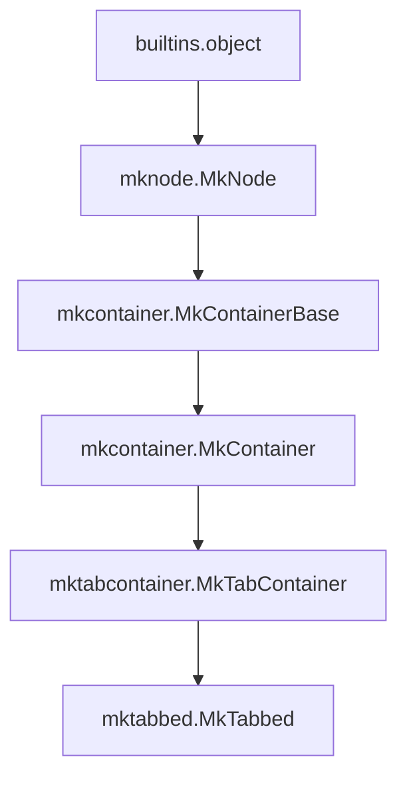

# MkTabbed

[ Show source on GitHub](https://github.com/phil65/mknodes/blob/main/src/mknodes/basenodes/mktabbed/__init__.py)

### PyMdown-based Tab container.

<details open>
<summary>Examples</summary>

### Example: **Regular**
> [!NOTE]
> **Jinja**
>
> ```jinja
> {{ {"Tab 1": "Some markdown", "Tab 2": "Other Markdown"} | MkTabbed}}
>
> ```

> [!NOTE]
> **Python**
>
> ```python
> MkTabbed(tabs=[...])
> ```

<details open>
<summary>Rendered</summary>

<details open>
<summary>Tab 1</summary>

Some markdown

</details>

<details>
<summary>Tab 2</summary>

Other Markdown

</details>

</details>

<details>
<summary>Markdown</summary>

```markdown
<details open>
<summary>Tab 1</summary>

Some markdown

</details>

<details>
<summary>Tab 2</summary>

Other Markdown

</details>

```

</details>

<details>
<summary>Html</summary>

```html
<details open>
<summary>Tab 1</summary>
<p>Some markdown</p>
</details>
<details>
<summary>Tab 2</summary>
<p>Other Markdown</p>
</details>

```

</details>

<details>
<summary>GitHub</summary>

```markdown
<details open>
<summary>Tab 1</summary>

Some markdown

</details>

<details>
<summary>Tab 2</summary>

Other Markdown

</details>

```

</details>

<details>
<summary>Repr tree</summary>

```
MkTabbed
├── MkTab(title='Tab 1', content='Some markdown')
│   ╰── MkText('Some markdown')
╰── MkTab(title='Tab 2', content='Other Markdown')
    ╰── MkText('Other Markdown')
```

</details>

### Example: **Nested**
> [!NOTE]
> **Jinja**
>
> ```jinja
> 
> {{ {"Tabs": node, "Admonition": mk.MkAdmonition("Nested admonition")} | MkTabbed }}
>
> ```

> [!NOTE]
> **Python**
>
> ```python
> MkContainer()
> ```

<details open>
<summary>Rendered</summary>

<details open>
<summary>Tab 1</summary>

Some markdown

</details>

<details>
<summary>Tab 2</summary>

Other Markdown

</details>

> [!NOTE]
> Nested admonition

<details open>
<summary>Tabs</summary>

<details open>
<summary>Tab 1</summary>

Some markdown

</details>

<details>
<summary>Tab 2</summary>

Other Markdown

</details>

</details>

<details>
<summary>Admonition</summary>

> [!NOTE]
> Nested admonition

</details>

</details>

<details>
<summary>Markdown</summary>

```markdown
<details open>
<summary>Tab 1</summary>

Some markdown

</details>

<details>
<summary>Tab 2</summary>

Other Markdown

</details>

> [!NOTE]
> Nested admonition

<details open>
<summary>Tabs</summary>

<details open>
<summary>Tab 1</summary>

Some markdown

</details>

<details>
<summary>Tab 2</summary>

Other Markdown

</details>

</details>

<details>
<summary>Admonition</summary>

> [!NOTE]
> Nested admonition

</details>

```

</details>

<details>
<summary>Html</summary>

```html
<details open>
<summary>Tab 1</summary>
<p>Some markdown</p>
</details>
<details>
<summary>Tab 2</summary>
<p>Other Markdown</p>
</details>
<div class="markdown-alert markdown-alert-note">
<p class="markdown-alert-title">Note</p>
<p>Nested admonition</p>
</div>
<details open>
<summary>Tabs</summary>
<details open>
<summary>Tab 1</summary>
<p>Some markdown</p>
</details>
<details>
<summary>Tab 2</summary>
<p>Other Markdown</p>
</details>
</details>
<details>
<summary>Admonition</summary>
<div class="markdown-alert markdown-alert-note">
<p class="markdown-alert-title">Note</p>
<p>Nested admonition</p>
</div>
</details>

```

</details>

<details>
<summary>Repr tree</summary>

```
MkContainer
├── MkTabbed(tabs=[...])
│   ├── MkTab(title='Tab 1', content='Some markdown')
│   │   ╰── MkText('Some markdown')
│   ╰── MkTab(title='Tab 2', content='Other Markdown')
│       ╰── MkText('Other Markdown')
├── MkAdmonition(None)
│   ╰── MkText('Nested admonition')
╰── MkTabbed(tabs=[...])
    ├── MkTab(title='Tabs', content=MkTabbed(tabs=[...]))
├── MkTabbed(tabs=[...])
│   ├── MkTab(title='Tab 1', content='Some markdown')
│   │   ╰── MkText('Some markdown')
│   ╰── MkTab(title='Tab 2', content='Other Markdown')
│       ╰── MkText('Other Markdown')
│   ╰── MkTab(title='Admonition', content=MkAdmonition(None))
├── MkAdmonition(None)
│   ╰── MkText('Nested admonition')
```

</details>

</details>

<details open>
<summary>DocStrings</summary>

<a id="mknodes.MkTabbed"></a>

```python
class MkTabbed(mktabcontainer.MkTabContainer)
```

</details>

<details open>
<summary>Base classes</summary>

| Name | Children | Inherits |
|--- | --- | --- |
| **<font size='4'>[MkTabContainer](https://phil65.github.io/mknodes/)</font>**<br>*<font size='1'>mknodes.basenodes.mktabcontainer</font>*<br>Base class for nodes containing tabs\. | <ul><li>[MkTabbedBlocks](https://phil65.github.io/mknodes/)</li><li>[MkTabbed](https://phil65.github.io/mknodes/)</li></ul> | <ul><li>[MkContainer](https://phil65.github.io/mknodes/)</li></ul> |

</details>

<details>
<summary>⋔ Inheritance diagram</summary>



</details>

<details>
<summary>NodeFile</summary>

**/home/runner/work/mknodes/mknodes/src/mknodes/basenodes/mktabbed/metadata.toml**

```toml
[metadata]
name = "MkTabbed"
icon = "mdi:tab"

[requirements.extension."pymdownx.tabbed"]

[requirements.extension."pymdownx.superfences"]

[examples.regular]
title = "Regular"
jinja = """
{{ {"Tab 1": "Some markdown", "Tab 2": "Other Markdown"} | MkTabbed}}
"""

[examples.nested]
title = "Nested"
jinja = """

{{ {"Tabs": node, "Admonition": mk.MkAdmonition("Nested admonition")} | MkTabbed }}
"""

[fragments.tab]
template = """
===!+ "{{ tab.title }}"
    {{ tab.get_items() | join(tab.block_separator) | rstrip("\n") | indent }}
    
    { .annotate }

    {{ tab.annotations | indent }}
    
"""

[output.markdown]
template = """
{{ node.get_items() | join(node.block_separator) }}
"""

```

</details>

<details>
<summary>Code</summary>

**mknodes.basenodes.mktabbed.MkTabbed**

```python
class MkTabbed(mktabcontainer.MkTabContainer):
    """PyMdown-based Tab container."""

    items: list[mktabs.MkTab]
    REQUIRED_EXTENSIONS = [
        resources.Extension("pymdownx.tabbed"),
        resources.Extension("pymdownx.superfences"),
    ]
    Tab = mktabs.MkTab

```

</details>

<details>
<summary>Page info</summary>

<details>
<summary>Code for this page</summary>

**mknodes.manual.nodes_section.create_section_for_nodes**

```python
def create_section_for_nodes(
    nav: mk.MkNav,
    klasses: Sequence[type[mk.MkNode]],
) -> mk.MkTable:
    table = mk.MkTable(columns=["Node", "Docstrings", "Markdown extensions"])
    for kls in klasses:
        tpl = "classpage_custom.jinja"
        page = mk.MkClassPage(kls, icon=kls.ICON, template_path=tpl, parent=nav, hide="toc")
        nav += page
        if kls.STATUS:
            page.metadata.status = kls.STATUS
        elif kls.JS_FILES:
            page.metadata.status = "js"
        elif kls.CSS:
            page.metadata.status = "css"
        page.created_by = create_section_for_nodes
        link = mk.MkLink(page, kls.__name__, icon=kls.ICON)
        extensions = ", ".join(f"`{i}`" for i in kls.REQUIRED_EXTENSIONS)
        table.add_row((link, kls.__doc__, extensions))
    return table

```

</details>

<details>
<summary>Resources</summary>

```python
Resources(css=[],
          markdown_extensions={'admonition': {},
                               'pymdownx.details': {},
                               'pymdownx.highlight': {'anchor_linenums': True,
                                                      'line_spans': '__span',
                                                      'pygments_lang_class': True},
                               'pymdownx.superfences': {'custom_fences': [{'class': 'mermaid',
                                                                           'format': <function fence_code_format at 0x7bb797a5c1a0>,
                                                                           'name': 'mermaid'}]},
                               'pymdownx.tabbed': {},
                               'tables': {}},
          plugins=[Plugin('mkdocstrings')],
          js=[],
          assets=[],
          packages=[])
```

</details>

<details>
<summary>Metadata</summary>

```yaml
created:
  source_filename: /home/runner/work/mknodes/mknodes/src/mknodes/manual/nodes_section.py
  source_function: create_section_for_nodes
  source_line_no: 93
hide:
- toc
icon: material/tab
title: MkTabbed

```

</details>

</details>
