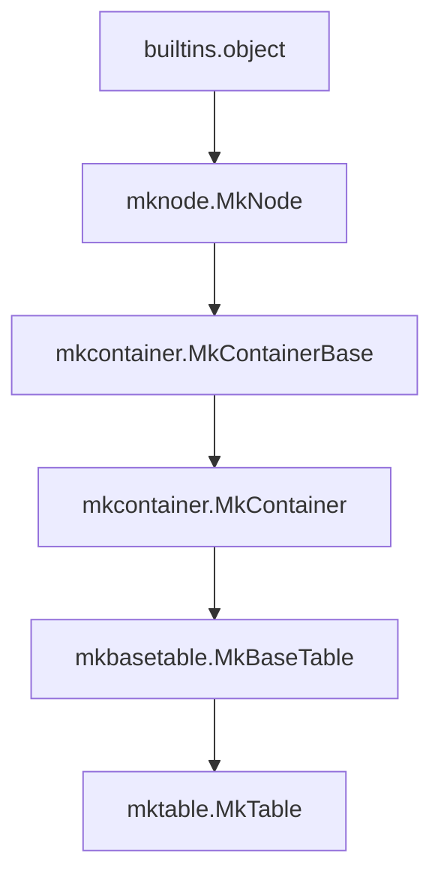

# MkTable

[ Show source on GitHub](https://github.com/phil65/mknodes/blob/main/src/mknodes/basenodes/mktable/__init__.py)

### Class representing a formatted table.

> [!NOTE]
> **Description**
>
>
> Data: a mapping column -> cells, a list of rows (the first one is the header unless
> `columns` are given) or a list of dicts (see `MkBaseTable`). `|` in cells gets escaped.

<details open>
<summary>Examples</summary>

### Example: **Regular**
> [!NOTE]
> **Jinja**
>
> ```jinja
> {{ {"Column A": ["A", "B", "C"], "Column B": ["C", "D", "E"]} | MkTable }}
>
> ```

> [!NOTE]
> **Python**
>
> ```python
> MkTable(data={'Column A': ['A', 'B', 'C'], 'Column B': ['C', 'D', 'E']})
> ```

<details open>
<summary>Rendered</summary>

| Column A | Column B |
| -------- | -------- |
| A        | C        |
| B        | D        |
| C        | E        |

</details>

<details>
<summary>Markdown</summary>

```markdown
| Column A | Column B |
| -------- | -------- |
| A        | C        |
| B        | D        |
| C        | E        |

```

</details>

<details>
<summary>Html</summary>

```html
<table>
<thead>
<tr>
<th>Column A</th>
<th>Column B</th>
</tr>
</thead>
<tbody>
<tr>
<td>A</td>
<td>C</td>
</tr>
<tr>
<td>B</td>
<td>D</td>
</tr>
<tr>
<td>C</td>
<td>E</td>
</tr>
</tbody>
</table>

```

</details>

<details>
<summary>Repr tree</summary>

```
MkTable
├── MkText('A')
├── MkText('B')
├── MkText('C')
├── MkText('C')
├── MkText('D')
╰── MkText('E')
```

</details>

### Example: **From rows (the first one is the header unless `columns` are given)**
> [!NOTE]
> **Jinja**
>
> ```jinja
> {{ [["Name", "Value"], ["a|b", "1"], ["c", "2"]] | MkTable }}
>
> ```

> [!NOTE]
> **Python**
>
> ```python
> MkTable(data={'Name': ['a|b', 'c'], 'Value': ['1', '2']})
> ```

<details open>
<summary>Rendered</summary>

| Name | Value |
| ---- | ----- |
| a\|b | 1     |
| c    | 2     |

</details>

<details>
<summary>Markdown</summary>

```markdown
| Name | Value |
| ---- | ----- |
| a\|b | 1     |
| c    | 2     |

```

</details>

<details>
<summary>Html</summary>

```html
<table>
<thead>
<tr>
<th>Name</th>
<th>Value</th>
</tr>
</thead>
<tbody>
<tr>
<td>a|b</td>
<td>1</td>
</tr>
<tr>
<td>c</td>
<td>2</td>
</tr>
</tbody>
</table>

```

</details>

<details>
<summary>Repr tree</summary>

```
MkTable
├── MkText('a|b')
├── MkText('c')
├── MkText('1')
╰── MkText('2')
```

</details>

### Example: **From list of dicts**
> [!NOTE]
> **Jinja**
>
> ```jinja
> {{ [{"col 1": "abc", "col 2": "cde"}, {"col 1": "fgh", "col 2": "ijk"}] | MkTable }}
>
> ```

> [!NOTE]
> **Python**
>
> ```python
> MkTable(data={'col 1': ['abc', 'fgh'], 'col 2': ['cde', 'ijk']})
> ```

<details open>
<summary>Rendered</summary>

| col 1 | col 2 |
| ----- | ----- |
| abc   | cde   |
| fgh   | ijk   |

</details>

<details>
<summary>Markdown</summary>

```markdown
| col 1 | col 2 |
| ----- | ----- |
| abc   | cde   |
| fgh   | ijk   |

```

</details>

<details>
<summary>Html</summary>

```html
<table>
<thead>
<tr>
<th>col 1</th>
<th>col 2</th>
</tr>
</thead>
<tbody>
<tr>
<td>abc</td>
<td>cde</td>
</tr>
<tr>
<td>fgh</td>
<td>ijk</td>
</tr>
</tbody>
</table>

```

</details>

<details>
<summary>Repr tree</summary>

```
MkTable
├── MkText('abc')
├── MkText('fgh')
├── MkText('cde')
╰── MkText('ijk')
```

</details>

</details>

<details open>
<summary>DocStrings</summary>

<a id="mknodes.MkTable"></a>

```python
class MkTable(mkbasetable.MkBaseTable)
```

</details>

<details open>
<summary>Sub classes</summary>

| Name | Children | Inherits |
|--- | --- | --- |
| **<font size='4'>[MkDependencyGroups](https://phil65.github.io/mknodes/)</font>**<br>*<font size='1'>mknodes.templatenodes.mkdependencygroups</font>*<br>Node to display optional dependencies or dependency groups as a table\. | <ul></ul> | <ul><li>[MkTable](https://phil65.github.io/mknodes/)</li></ul> |

</details>

<details open>
<summary>Base classes</summary>

| Name | Children | Inherits |
|--- | --- | --- |
| **<font size='4'>[MkBaseTable](https://phil65.github.io/mknodes/)</font>**<br>*<font size='1'>mknodes.basenodes.mkbasetable</font>*<br>Base Class for MkTables\. Only deals with managing the data\. | <ul><li>[MkTable](https://phil65.github.io/mknodes/)</li><li>[MkHtmlTable](https://phil65.github.io/mknodes/)</li></ul> | <ul><li>[MkContainer](https://phil65.github.io/mknodes/)</li></ul> |

</details>

<details>
<summary>⋔ Inheritance diagram</summary>



</details>

<details>
<summary>NodeFile</summary>

**/home/runner/work/mknodes/mknodes/src/mknodes/basenodes/mktable/metadata.toml**

```toml
[metadata]
icon = "octicon:table-24"
name = "MkTable"

[requirements.extension.tables]

[examples.regular]
title = "Regular"
jinja = """
{{ {"Column A": ["A", "B", "C"], "Column B": ["C", "D", "E"]} | MkTable }}
"""

[examples.rows]
title = "From rows (the first one is the header unless `columns` are given)"
jinja = """
{{ [["Name", "Value"], ["a|b", "1"], ["c", "2"]] | MkTable }}
"""

[examples.list_of_dicts]
title = "From list of dicts"
jinja = """
{{ [{"col 1": "abc", "col 2": "cde"}, {"col 1": "fgh", "col 2": "ijk"}] | MkTable }}
"""

# [output.markdown]
# template = """
# 
# 
# 
# 

# """

```

</details>

<details>
<summary>Code</summary>

**mknodes.basenodes.mktable.MkTable**

```python
class MkTable(mkbasetable.MkBaseTable):
    """Class representing a formatted table.

    Data: a mapping column -> cells, a list of rows (the first one is the header unless
    `columns` are given) or a list of dicts (see `MkBaseTable`). `|` in cells gets escaped.
    """

    REQUIRED_EXTENSIONS = [resources.Extension("tables")]

    def to_md_unprocessed(self) -> str:
        table_data = self.data  # property
        if not any(table_data[k] for k in table_data):
            return ""
        in_code = rendering.current().name != "material"
        headers = [escape_cell(k, in_code_spans=in_code) for k in table_data]
        rows = [
            [escape_cell(str(cell), in_code_spans=in_code) for cell in row]
            for row in self.iter_rows()
        ]
        widths = [
            max(len(h), *(len(row[i]) for row in rows)) if rows else len(h)
            for i, h in enumerate(headers)
        ]
        formatters = [f"{{:<{width}}}" for width in widths]
        headers = [formatters[i].format(h) for i, h in enumerate(headers)]
        divider = [width * "-" for width in widths]
        data = [[formatters[i].format(c) for i, c in enumerate(row)] for row in rows]
        header_txt = "| " + " | ".join(headers) + " |"
        divider_text = "| " + " | ".join(divider) + " |"
        data_txt = ["| " + " | ".join(line) + " |" for line in data]
        return "\n".join([header_txt, divider_text, *data_txt]) + "\n"

```

</details>

<details>
<summary>Page info</summary>

<details>
<summary>Code for this page</summary>

**mknodes.manual.nodes_section.create_section_for_nodes**

```python
def create_section_for_nodes(
    nav: mk.MkNav,
    klasses: Sequence[type[mk.MkNode]],
) -> mk.MkTable:
    table = mk.MkTable(columns=["Node", "Docstrings", "Markdown extensions"])
    for kls in klasses:
        tpl = "classpage_custom.jinja"
        page = mk.MkClassPage(kls, icon=kls.ICON, template_path=tpl, parent=nav, hide="toc")
        nav += page
        if kls.STATUS:
            page.metadata.status = kls.STATUS
        elif kls.JS_FILES:
            page.metadata.status = "js"
        elif kls.CSS:
            page.metadata.status = "css"
        page.created_by = create_section_for_nodes
        link = mk.MkLink(page, kls.__name__, icon=kls.ICON)
        extensions = ", ".join(f"`{i}`" for i in kls.REQUIRED_EXTENSIONS)
        table.add_row((link, kls.__doc__, extensions))
    return table

```

</details>

<details>
<summary>Resources</summary>

```python
Resources(css=[],
          markdown_extensions={'admonition': {},
                               'pymdownx.details': {},
                               'pymdownx.highlight': {'anchor_linenums': True,
                                                      'line_spans': '__span',
                                                      'pygments_lang_class': True},
                               'pymdownx.superfences': {'custom_fences': [{'class': 'mermaid',
                                                                           'format': <function fence_code_format at 0x7bb797a5c1a0>,
                                                                           'name': 'mermaid'}]},
                               'pymdownx.tabbed': {},
                               'tables': {}},
          plugins=[Plugin('mkdocstrings')],
          js=[],
          assets=[],
          packages=[])
```

</details>

<details>
<summary>Metadata</summary>

```yaml
created:
  source_filename: /home/runner/work/mknodes/mknodes/src/mknodes/manual/nodes_section.py
  source_function: create_section_for_nodes
  source_line_no: 93
hide:
- toc
icon: octicons/table-24
title: MkTable

```

</details>

</details>
