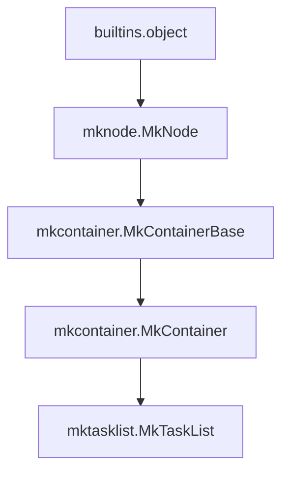

# MkTaskList

[ Show source on GitHub](https://github.com/phil65/mknodes/blob/main/src/mknodes/basenodes/mktasklist/__init__.py)

### Node for task lists.

<details open>
<summary>Examples</summary>

### Example: **Regular**
> [!NOTE]
> **Jinja**
>
> ```jinja
> {{ [_mk.MkTask(True, "Item 1"), _mk.MkTask(True, "Item 2")] | MkTaskList }}
>
> ```

> [!NOTE]
> **Python**
>
> ```python
> MkTaskList()
> ```

<details open>
<summary>Rendered</summary>

- [x] Item 1
- [x] Item 2

</details>

<details>
<summary>Markdown</summary>

```markdown
- [x] Item 1
- [x] Item 2

```

</details>

<details>
<summary>Html</summary>

```html
<ul>
<li><input type="checkbox" checked="" disabled="" /> Item 1</li>
<li><input type="checkbox" checked="" disabled="" /> Item 2</li>
</ul>

```

</details>

<details>
<summary>Repr tree</summary>

```
MkTaskList
├── MkTask(True)
│   ╰── MkText('Item 1')
╰── MkTask(True)
    ╰── MkText('Item 2')
```

</details>

</details>

<details open>
<summary>DocStrings</summary>

<a id="mknodes.MkTaskList"></a>

```python
class MkTaskList(mkcontainer.MkContainer)
```

</details>

<details open>
<summary>Base classes</summary>

| Name | Children | Inherits |
|--- | --- | --- |
| **<font size='4'>[MkContainer](https://phil65.github.io/mknodes/)</font>**<br>*<font size='1'>mknodes.basenodes.mkcontainer</font>*<br>A node containing other MkNodes\. | <ul><li>[MkBlock](https://phil65.github.io/mknodes/)</li><li>[MkAdmonition](https://phil65.github.io/mknodes/)</li><li>[MkBlockQuote](https://phil65.github.io/mknodes/)</li><li>[MkCode](https://phil65.github.io/mknodes/)</li><li>[MkTemplate](https://phil65.github.io/mknodes/)</li><li>[MkList](https://phil65.github.io/mknodes/)</li><li>[MkBaseTable](https://phil65.github.io/mknodes/)</li><li>[MkTab](https://phil65.github.io/mknodes/)</li><li>[MkTabContainer](https://phil65.github.io/mknodes/)</li><li>[MkCritic](https://phil65.github.io/mknodes/)</li><li>[MkAnnotation](https://phil65.github.io/mknodes/)</li><li>...</li></ul> | <ul><li>[MkContainerBase](https://phil65.github.io/mknodes/)</li></ul> |

</details>

<details>
<summary>⋔ Inheritance diagram</summary>



</details>

<details>
<summary>NodeFile</summary>

**/home/runner/work/mknodes/mknodes/src/mknodes/basenodes/mktasklist/metadata.toml**

```toml
[metadata]
icon = "mdi:library"
name = "MkTaskList"

[requirements.extension."pymdownx.tasklist"]

[examples.regular]
title = "Regular"
jinja = """
{{ [_mk.MkTask(True, "Item 1"), _mk.MkTask(True, "Item 2")] | MkTaskList }}
"""

[fragments]
task = """
- [{{ "x" if node.value else " " }}] {{ node.get_items() | join(node.block_separator) | indent }}

"""

[output.markdown]
template = """
{{ node.get_items() | join(node.block_separator) }}
"""

```

</details>

<details>
<summary>Code</summary>

**mknodes.basenodes.mktasklist.MkTaskList**

```python
class MkTaskList(mkcontainer.MkContainer):
    """Node for task lists."""

    REQUIRED_EXTENSIONS = [resources.Extension("pymdownx.tasklist")]
    ICON = "material/library"

    def __init__(
        self,
        content: list | str | mknode.MkNode | None = None,
        **kwargs: Any,
    ) -> None:
        """Constructor.

        Args:
            content: Data show for the table
            kwargs: Keyword arguments passed to parent
        """
        super().__init__(content=content, block_separator="", **kwargs)

    def add_item(self, content, value: bool) -> None:
        item = MkTask(value, content)
        self.append(item)

```

</details>

<details>
<summary>Page info</summary>

<details>
<summary>Code for this page</summary>

**mknodes.manual.nodes_section.create_section_for_nodes**

```python
def create_section_for_nodes(
    nav: mk.MkNav,
    klasses: Sequence[type[mk.MkNode]],
) -> mk.MkTable:
    table = mk.MkTable(columns=["Node", "Docstrings", "Markdown extensions"])
    for kls in klasses:
        tpl = "classpage_custom.jinja"
        page = mk.MkClassPage(kls, icon=kls.ICON, template_path=tpl, parent=nav, hide="toc")
        nav += page
        if kls.STATUS:
            page.metadata.status = kls.STATUS
        elif kls.JS_FILES:
            page.metadata.status = "js"
        elif kls.CSS:
            page.metadata.status = "css"
        page.created_by = create_section_for_nodes
        link = mk.MkLink(page, kls.__name__, icon=kls.ICON)
        extensions = ", ".join(f"`{i}`" for i in kls.REQUIRED_EXTENSIONS)
        table.add_row((link, kls.__doc__, extensions))
    return table

```

</details>

<details>
<summary>Resources</summary>

```python
Resources(css=[],
          markdown_extensions={'admonition': {},
                               'pymdownx.details': {},
                               'pymdownx.highlight': {'anchor_linenums': True,
                                                      'line_spans': '__span',
                                                      'pygments_lang_class': True},
                               'pymdownx.superfences': {'custom_fences': [{'class': 'mermaid',
                                                                           'format': <function fence_code_format at 0x7bb797a5c1a0>,
                                                                           'name': 'mermaid'}]},
                               'pymdownx.tabbed': {},
                               'tables': {}},
          plugins=[Plugin('mkdocstrings')],
          js=[],
          assets=[],
          packages=[])
```

</details>

<details>
<summary>Metadata</summary>

```yaml
created:
  source_filename: /home/runner/work/mknodes/mknodes/src/mknodes/manual/nodes_section.py
  source_function: create_section_for_nodes
  source_line_no: 93
hide:
- toc
icon: material/library
title: MkTaskList

```

</details>

</details>
