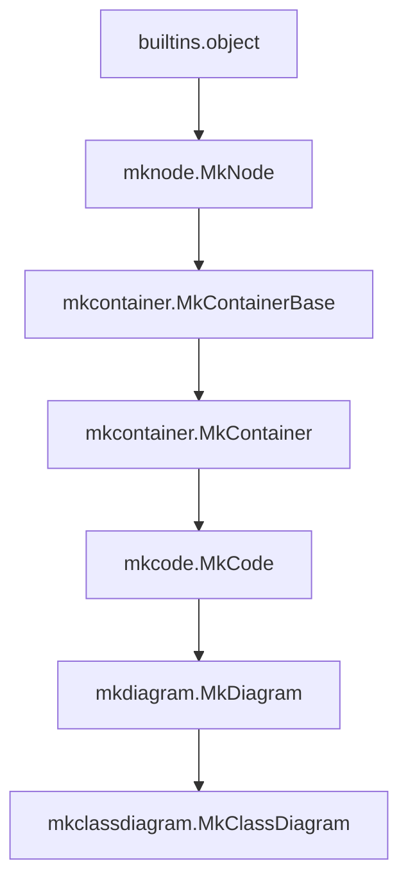
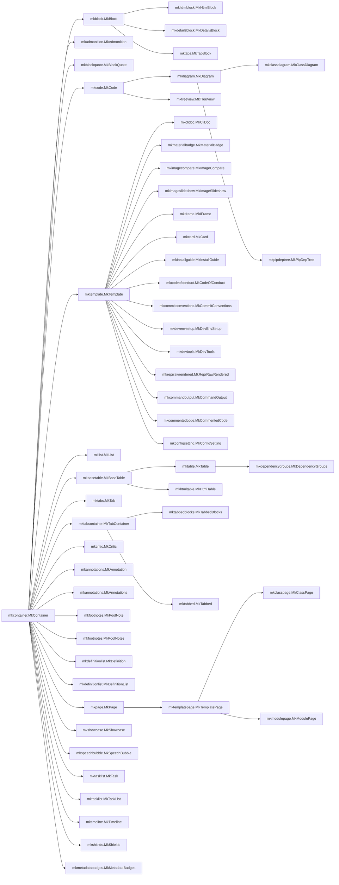
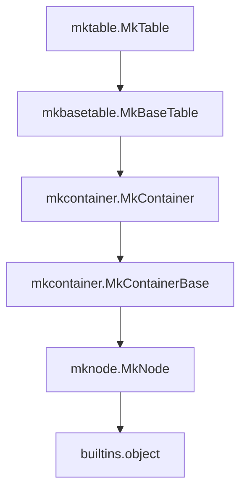

# MkClassDiagram

[ Show source on GitHub](https://github.com/phil65/mknodes/blob/main/src/mknodes/templatenodes/mkclassdiagram/__init__.py)

### Node to display the class hierarchy of a class. Supports multiple modes.

<details open>
<summary>Examples</summary>

### Example: **Baseclass diagram**
> [!NOTE]
> **Jinja**
>
> ```jinja
> {{ _mk.MkClassDiagram | MkClassDiagram(mode="baseclasses") }}
>
> ```

> [!NOTE]
> **Python**
>
> ```python
> MkClassDiagram(klass=MkClassDiagram, mode='baseclasses', direction='TD')
> ```

<details open>
<summary>Rendered</summary>



</details>

<details>
<summary>Markdown</summary>

`````markdown
````mermaid
graph TD
  2335698932["mkclassdiagram.MkClassDiagram"]
  1128373226["mkdiagram.MkDiagram"]
  1761293797["mkcode.MkCode"]
  835538629["mkcontainer.MkContainer"]
  1956333208["mkcontainer.MkContainerBase"]
  1359323199["mknode.MkNode"]
  2751680898["builtins.object"]
  1128373226 --> 2335698932
  1761293797 --> 1128373226
  835538629 --> 1761293797
  1956333208 --> 835538629
  1359323199 --> 1956333208
  2751680898 --> 1359323199
````
`````

</details>

<details>
<summary>Html</summary>

```html
<pre><code class="language-mermaid">graph TD
  2335698932[&quot;mkclassdiagram.MkClassDiagram&quot;]
  1128373226[&quot;mkdiagram.MkDiagram&quot;]
  1761293797[&quot;mkcode.MkCode&quot;]
  835538629[&quot;mkcontainer.MkContainer&quot;]
  1956333208[&quot;mkcontainer.MkContainerBase&quot;]
  1359323199[&quot;mknode.MkNode&quot;]
  2751680898[&quot;builtins.object&quot;]
  1128373226 --&gt; 2335698932
  1761293797 --&gt; 1128373226
  835538629 --&gt; 1761293797
  1956333208 --&gt; 835538629
  1359323199 --&gt; 1956333208
  2751680898 --&gt; 1359323199
</code></pre>

```

</details>

<details>
<summary>GitHub</summary>

`````markdown
````mermaid
graph TD
  2335698932["mkclassdiagram.MkClassDiagram"]
  1128373226["mkdiagram.MkDiagram"]
  1761293797["mkcode.MkCode"]
  835538629["mkcontainer.MkContainer"]
  1956333208["mkcontainer.MkContainerBase"]
  1359323199["mknode.MkNode"]
  2751680898["builtins.object"]
  1128373226 --> 2335698932
  1761293797 --> 1128373226
  835538629 --> 1761293797
  1956333208 --> 835538629
  1359323199 --> 1956333208
  2751680898 --> 1359323199
````
`````

</details>

### Example: **Subclass diagram**
> [!NOTE]
> **Jinja**
>
> ```jinja
> {{ _mk.MkContainer | MkClassDiagram(mode="subclasses", direction="LR") }}
>
> ```

> [!NOTE]
> **Python**
>
> ```python
> MkClassDiagram(klass=MkContainer, mode='subclasses', direction='LR')
> ```

<details open>
<summary>Rendered</summary>



</details>

<details>
<summary>Markdown</summary>

`````markdown
````mermaid
graph LR
  835538629["mkcontainer.MkContainer"]
  1483073837["mkblock.MkBlock"]
  2214384146["mkhtmlblock.MkHtmlBlock"]
  3959722705["mkdetailsblock.MkDetailsBlock"]
  611245329["mktabs.MkTabBlock"]
  178616935["mkadmonition.MkAdmonition"]
  1647548858["mkblockquote.MkBlockQuote"]
  1761293797["mkcode.MkCode"]
  1128373226["mkdiagram.MkDiagram"]
  2335698932["mkclassdiagram.MkClassDiagram"]
  570879978["mkpipdeptree.MkPipDepTree"]
  3075081054["mktreeview.MkTreeView"]
  1289759389["mktemplate.MkTemplate"]
  3586431358["mkclidoc.MkCliDoc"]
  3179977919["mkmaterialbadge.MkMaterialBadge"]
  800882708["mkimagecompare.MkImageCompare"]
  74516232["mkimageslideshow.MkImageSlideshow"]
  3066175229["mkiframe.MkIFrame"]
  71538296["mkcard.MkCard"]
  2805510712["mkinstallguide.MkInstallGuide"]
  1314643430["mkcodeofconduct.MkCodeOfConduct"]
  3868777977["mkcommitconventions.MkCommitConventions"]
  282560596["mkdevenvsetup.MkDevEnvSetup"]
  2977970046["mkdevtools.MkDevTools"]
  3610119223["mkreprrawrendered.MkReprRawRendered"]
  503546122["mkcommandoutput.MkCommandOutput"]
  634542573["mkcommentedcode.MkCommentedCode"]
  1561279813["mkconfigsetting.MkConfigSetting"]
  3178260457["mklist.MkList"]
  3678415322["mkbasetable.MkBaseTable"]
  1430734008["mktable.MkTable"]
  3857258308["mkdependencygroups.MkDependencyGroups"]
  530410512["mkhtmltable.MkHtmlTable"]
  2293543343["mktabs.MkTab"]
  3468216723["mktabcontainer.MkTabContainer"]
  4054600563["mktabbedblocks.MkTabbedBlocks"]
  3704821286["mktabbed.MkTabbed"]
  832683224["mkcritic.MkCritic"]
  596592930["mkannotations.MkAnnotation"]
  3461153190["mkannotations.MkAnnotations"]
  605012372["mkfootnotes.MkFootNote"]
  3964180375["mkfootnotes.MkFootNotes"]
  2133900327["mkdefinitionlist.MkDefinition"]
  178757003["mkdefinitionlist.MkDefinitionList"]
  1511245065["mkpage.MkPage"]
  2403743895["mktemplatepage.MkTemplatePage"]
  957393682["mkclasspage.MkClassPage"]
  2767653079["mkmodulepage.MkModulePage"]
  2297657893["mkshowcase.MkShowcase"]
  1965962441["mkspeechbubble.MkSpeechBubble"]
  2629609700["mktasklist.MkTask"]
  3678778186["mktasklist.MkTaskList"]
  1587059980["mktimeline.MkTimeline"]
  2259144671["mkshields.MkShields"]
  4160346072["mkmetadatabadges.MkMetadataBadges"]
  835538629 --> 1483073837
  1483073837 --> 2214384146
  1483073837 --> 3959722705
  1483073837 --> 611245329
  835538629 --> 178616935
  835538629 --> 1647548858
  835538629 --> 1761293797
  1761293797 --> 1128373226
  1128373226 --> 2335698932
  1128373226 --> 570879978
  1761293797 --> 3075081054
  835538629 --> 1289759389
  1289759389 --> 3586431358
  1289759389 --> 3179977919
  1289759389 --> 800882708
  1289759389 --> 74516232
  1289759389 --> 3066175229
  1289759389 --> 71538296
  1289759389 --> 2805510712
  1289759389 --> 1314643430
  1289759389 --> 3868777977
  1289759389 --> 282560596
  1289759389 --> 2977970046
  1289759389 --> 3610119223
  1289759389 --> 503546122
  1289759389 --> 634542573
  1289759389 --> 1561279813
  835538629 --> 3178260457
  835538629 --> 3678415322
  3678415322 --> 1430734008
  1430734008 --> 3857258308
  3678415322 --> 530410512
  835538629 --> 2293543343
  835538629 --> 3468216723
  3468216723 --> 4054600563
  3468216723 --> 3704821286
  835538629 --> 832683224
  835538629 --> 596592930
  835538629 --> 3461153190
  835538629 --> 605012372
  835538629 --> 3964180375
  835538629 --> 2133900327
  835538629 --> 178757003
  835538629 --> 1511245065
  1511245065 --> 2403743895
  2403743895 --> 957393682
  2403743895 --> 2767653079
  835538629 --> 2297657893
  835538629 --> 1965962441
  835538629 --> 2629609700
  835538629 --> 3678778186
  835538629 --> 1587059980
  835538629 --> 2259144671
  835538629 --> 4160346072
````
`````

</details>

<details>
<summary>Html</summary>

```html
<pre><code class="language-mermaid">graph LR
  835538629[&quot;mkcontainer.MkContainer&quot;]
  1483073837[&quot;mkblock.MkBlock&quot;]
  2214384146[&quot;mkhtmlblock.MkHtmlBlock&quot;]
  3959722705[&quot;mkdetailsblock.MkDetailsBlock&quot;]
  611245329[&quot;mktabs.MkTabBlock&quot;]
  178616935[&quot;mkadmonition.MkAdmonition&quot;]
  1647548858[&quot;mkblockquote.MkBlockQuote&quot;]
  1761293797[&quot;mkcode.MkCode&quot;]
  1128373226[&quot;mkdiagram.MkDiagram&quot;]
  2335698932[&quot;mkclassdiagram.MkClassDiagram&quot;]
  570879978[&quot;mkpipdeptree.MkPipDepTree&quot;]
  3075081054[&quot;mktreeview.MkTreeView&quot;]
  1289759389[&quot;mktemplate.MkTemplate&quot;]
  3586431358[&quot;mkclidoc.MkCliDoc&quot;]
  3179977919[&quot;mkmaterialbadge.MkMaterialBadge&quot;]
  800882708[&quot;mkimagecompare.MkImageCompare&quot;]
  74516232[&quot;mkimageslideshow.MkImageSlideshow&quot;]
  3066175229[&quot;mkiframe.MkIFrame&quot;]
  71538296[&quot;mkcard.MkCard&quot;]
  2805510712[&quot;mkinstallguide.MkInstallGuide&quot;]
  1314643430[&quot;mkcodeofconduct.MkCodeOfConduct&quot;]
  3868777977[&quot;mkcommitconventions.MkCommitConventions&quot;]
  282560596[&quot;mkdevenvsetup.MkDevEnvSetup&quot;]
  2977970046[&quot;mkdevtools.MkDevTools&quot;]
  3610119223[&quot;mkreprrawrendered.MkReprRawRendered&quot;]
  503546122[&quot;mkcommandoutput.MkCommandOutput&quot;]
  634542573[&quot;mkcommentedcode.MkCommentedCode&quot;]
  1561279813[&quot;mkconfigsetting.MkConfigSetting&quot;]
  3178260457[&quot;mklist.MkList&quot;]
  3678415322[&quot;mkbasetable.MkBaseTable&quot;]
  1430734008[&quot;mktable.MkTable&quot;]
  3857258308[&quot;mkdependencygroups.MkDependencyGroups&quot;]
  530410512[&quot;mkhtmltable.MkHtmlTable&quot;]
  2293543343[&quot;mktabs.MkTab&quot;]
  3468216723[&quot;mktabcontainer.MkTabContainer&quot;]
  4054600563[&quot;mktabbedblocks.MkTabbedBlocks&quot;]
  3704821286[&quot;mktabbed.MkTabbed&quot;]
  832683224[&quot;mkcritic.MkCritic&quot;]
  596592930[&quot;mkannotations.MkAnnotation&quot;]
  3461153190[&quot;mkannotations.MkAnnotations&quot;]
  605012372[&quot;mkfootnotes.MkFootNote&quot;]
  3964180375[&quot;mkfootnotes.MkFootNotes&quot;]
  2133900327[&quot;mkdefinitionlist.MkDefinition&quot;]
  178757003[&quot;mkdefinitionlist.MkDefinitionList&quot;]
  1511245065[&quot;mkpage.MkPage&quot;]
  2403743895[&quot;mktemplatepage.MkTemplatePage&quot;]
  957393682[&quot;mkclasspage.MkClassPage&quot;]
  2767653079[&quot;mkmodulepage.MkModulePage&quot;]
  2297657893[&quot;mkshowcase.MkShowcase&quot;]
  1965962441[&quot;mkspeechbubble.MkSpeechBubble&quot;]
  2629609700[&quot;mktasklist.MkTask&quot;]
  3678778186[&quot;mktasklist.MkTaskList&quot;]
  1587059980[&quot;mktimeline.MkTimeline&quot;]
  2259144671[&quot;mkshields.MkShields&quot;]
  4160346072[&quot;mkmetadatabadges.MkMetadataBadges&quot;]
  835538629 --&gt; 1483073837
  1483073837 --&gt; 2214384146
  1483073837 --&gt; 3959722705
  1483073837 --&gt; 611245329
  835538629 --&gt; 178616935
  835538629 --&gt; 1647548858
  835538629 --&gt; 1761293797
  1761293797 --&gt; 1128373226
  1128373226 --&gt; 2335698932
  1128373226 --&gt; 570879978
  1761293797 --&gt; 3075081054
  835538629 --&gt; 1289759389
  1289759389 --&gt; 3586431358
  1289759389 --&gt; 3179977919
  1289759389 --&gt; 800882708
  1289759389 --&gt; 74516232
  1289759389 --&gt; 3066175229
  1289759389 --&gt; 71538296
  1289759389 --&gt; 2805510712
  1289759389 --&gt; 1314643430
  1289759389 --&gt; 3868777977
  1289759389 --&gt; 282560596
  1289759389 --&gt; 2977970046
  1289759389 --&gt; 3610119223
  1289759389 --&gt; 503546122
  1289759389 --&gt; 634542573
  1289759389 --&gt; 1561279813
  835538629 --&gt; 3178260457
  835538629 --&gt; 3678415322
  3678415322 --&gt; 1430734008
  1430734008 --&gt; 3857258308
  3678415322 --&gt; 530410512
  835538629 --&gt; 2293543343
  835538629 --&gt; 3468216723
  3468216723 --&gt; 4054600563
  3468216723 --&gt; 3704821286
  835538629 --&gt; 832683224
  835538629 --&gt; 596592930
  835538629 --&gt; 3461153190
  835538629 --&gt; 605012372
  835538629 --&gt; 3964180375
  835538629 --&gt; 2133900327
  835538629 --&gt; 178757003
  835538629 --&gt; 1511245065
  1511245065 --&gt; 2403743895
  2403743895 --&gt; 957393682
  2403743895 --&gt; 2767653079
  835538629 --&gt; 2297657893
  835538629 --&gt; 1965962441
  835538629 --&gt; 2629609700
  835538629 --&gt; 3678778186
  835538629 --&gt; 1587059980
  835538629 --&gt; 2259144671
  835538629 --&gt; 4160346072
</code></pre>

```

</details>

<details>
<summary>GitHub</summary>

`````markdown
````mermaid
graph LR
  835538629["mkcontainer.MkContainer"]
  1483073837["mkblock.MkBlock"]
  2214384146["mkhtmlblock.MkHtmlBlock"]
  3959722705["mkdetailsblock.MkDetailsBlock"]
  611245329["mktabs.MkTabBlock"]
  178616935["mkadmonition.MkAdmonition"]
  1647548858["mkblockquote.MkBlockQuote"]
  1761293797["mkcode.MkCode"]
  1128373226["mkdiagram.MkDiagram"]
  2335698932["mkclassdiagram.MkClassDiagram"]
  570879978["mkpipdeptree.MkPipDepTree"]
  3075081054["mktreeview.MkTreeView"]
  1289759389["mktemplate.MkTemplate"]
  3586431358["mkclidoc.MkCliDoc"]
  3179977919["mkmaterialbadge.MkMaterialBadge"]
  800882708["mkimagecompare.MkImageCompare"]
  74516232["mkimageslideshow.MkImageSlideshow"]
  3066175229["mkiframe.MkIFrame"]
  71538296["mkcard.MkCard"]
  2805510712["mkinstallguide.MkInstallGuide"]
  1314643430["mkcodeofconduct.MkCodeOfConduct"]
  3868777977["mkcommitconventions.MkCommitConventions"]
  282560596["mkdevenvsetup.MkDevEnvSetup"]
  2977970046["mkdevtools.MkDevTools"]
  3610119223["mkreprrawrendered.MkReprRawRendered"]
  503546122["mkcommandoutput.MkCommandOutput"]
  634542573["mkcommentedcode.MkCommentedCode"]
  1561279813["mkconfigsetting.MkConfigSetting"]
  3178260457["mklist.MkList"]
  3678415322["mkbasetable.MkBaseTable"]
  1430734008["mktable.MkTable"]
  3857258308["mkdependencygroups.MkDependencyGroups"]
  530410512["mkhtmltable.MkHtmlTable"]
  2293543343["mktabs.MkTab"]
  3468216723["mktabcontainer.MkTabContainer"]
  4054600563["mktabbedblocks.MkTabbedBlocks"]
  3704821286["mktabbed.MkTabbed"]
  832683224["mkcritic.MkCritic"]
  596592930["mkannotations.MkAnnotation"]
  3461153190["mkannotations.MkAnnotations"]
  605012372["mkfootnotes.MkFootNote"]
  3964180375["mkfootnotes.MkFootNotes"]
  2133900327["mkdefinitionlist.MkDefinition"]
  178757003["mkdefinitionlist.MkDefinitionList"]
  1511245065["mkpage.MkPage"]
  2403743895["mktemplatepage.MkTemplatePage"]
  957393682["mkclasspage.MkClassPage"]
  2767653079["mkmodulepage.MkModulePage"]
  2297657893["mkshowcase.MkShowcase"]
  1965962441["mkspeechbubble.MkSpeechBubble"]
  2629609700["mktasklist.MkTask"]
  3678778186["mktasklist.MkTaskList"]
  1587059980["mktimeline.MkTimeline"]
  2259144671["mkshields.MkShields"]
  4160346072["mkmetadatabadges.MkMetadataBadges"]
  835538629 --> 1483073837
  1483073837 --> 2214384146
  1483073837 --> 3959722705
  1483073837 --> 611245329
  835538629 --> 178616935
  835538629 --> 1647548858
  835538629 --> 1761293797
  1761293797 --> 1128373226
  1128373226 --> 2335698932
  1128373226 --> 570879978
  1761293797 --> 3075081054
  835538629 --> 1289759389
  1289759389 --> 3586431358
  1289759389 --> 3179977919
  1289759389 --> 800882708
  1289759389 --> 74516232
  1289759389 --> 3066175229
  1289759389 --> 71538296
  1289759389 --> 2805510712
  1289759389 --> 1314643430
  1289759389 --> 3868777977
  1289759389 --> 282560596
  1289759389 --> 2977970046
  1289759389 --> 3610119223
  1289759389 --> 503546122
  1289759389 --> 634542573
  1289759389 --> 1561279813
  835538629 --> 3178260457
  835538629 --> 3678415322
  3678415322 --> 1430734008
  1430734008 --> 3857258308
  3678415322 --> 530410512
  835538629 --> 2293543343
  835538629 --> 3468216723
  3468216723 --> 4054600563
  3468216723 --> 3704821286
  835538629 --> 832683224
  835538629 --> 596592930
  835538629 --> 3461153190
  835538629 --> 605012372
  835538629 --> 3964180375
  835538629 --> 2133900327
  835538629 --> 178757003
  835538629 --> 1511245065
  1511245065 --> 2403743895
  2403743895 --> 957393682
  2403743895 --> 2767653079
  835538629 --> 2297657893
  835538629 --> 1965962441
  835538629 --> 2629609700
  835538629 --> 3678778186
  835538629 --> 1587059980
  835538629 --> 2259144671
  835538629 --> 4160346072
````
`````

</details>

### Example: **MRO diagram**
> [!NOTE]
> **Jinja**
>
> ```jinja
> {{ _mk.MkTable | MkClassDiagram(mode="mro") }}
>
> ```

> [!NOTE]
> **Python**
>
> ```python
> MkClassDiagram(klass=MkTable, mode='mro', direction='TD')
> ```

<details open>
<summary>Rendered</summary>



</details>

<details>
<summary>Markdown</summary>

`````markdown
````mermaid
graph TD
  1430734008["mktable.MkTable"]
  3678415322["mkbasetable.MkBaseTable"]
  835538629["mkcontainer.MkContainer"]
  1956333208["mkcontainer.MkContainerBase"]
  1359323199["mknode.MkNode"]
  2751680898["builtins.object"]
  1430734008 --> 3678415322
  3678415322 --> 835538629
  835538629 --> 1956333208
  1956333208 --> 1359323199
  1359323199 --> 2751680898
````
`````

</details>

<details>
<summary>Html</summary>

```html
<pre><code class="language-mermaid">graph TD
  1430734008[&quot;mktable.MkTable&quot;]
  3678415322[&quot;mkbasetable.MkBaseTable&quot;]
  835538629[&quot;mkcontainer.MkContainer&quot;]
  1956333208[&quot;mkcontainer.MkContainerBase&quot;]
  1359323199[&quot;mknode.MkNode&quot;]
  2751680898[&quot;builtins.object&quot;]
  1430734008 --&gt; 3678415322
  3678415322 --&gt; 835538629
  835538629 --&gt; 1956333208
  1956333208 --&gt; 1359323199
  1359323199 --&gt; 2751680898
</code></pre>

```

</details>

<details>
<summary>GitHub</summary>

`````markdown
````mermaid
graph TD
  1430734008["mktable.MkTable"]
  3678415322["mkbasetable.MkBaseTable"]
  835538629["mkcontainer.MkContainer"]
  1956333208["mkcontainer.MkContainerBase"]
  1359323199["mknode.MkNode"]
  2751680898["builtins.object"]
  1430734008 --> 3678415322
  3678415322 --> 835538629
  835538629 --> 1956333208
  1956333208 --> 1359323199
  1359323199 --> 2751680898
````
`````

</details>

</details>

<details open>
<summary>DocStrings</summary>

<a id="mknodes.MkClassDiagram"></a>

```python
class MkClassDiagram(mkdiagram.MkDiagram)
```

</details>

<details open>
<summary>Base classes</summary>

| Name | Children | Inherits |
|--- | --- | --- |
| **<font size='4'>[MkDiagram](https://phil65.github.io/mknodes/)</font>**<br>*<font size='1'>mknodes.basenodes.mkdiagram</font>*<br>Class representing a mermaid diagram\. | <ul><li>[MkClassDiagram](https://phil65.github.io/mknodes/)</li><li>[MkPipDepTree](https://phil65.github.io/mknodes/)</li></ul> | <ul><li>[MkCode](https://phil65.github.io/mknodes/)</li></ul> |

</details>

<details>
<summary>⋔ Inheritance diagram</summary>


</details>

<details>
<summary>NodeFile</summary>

**/home/runner/work/mknodes/mknodes/src/mknodes/templatenodes/mkclassdiagram/metadata.toml**

```toml
[metadata]
icon = "mdi:graph-outline"
name = "MkClassDiagram"
group = "diagram"

[[requirements.extension."pymdownx.superfences".custom_fences]]
name = "mermaid"
class = "mermaid"
format = "pymdownx.superfences.fence_code_format"

[examples.baseclass_diagram]
title = "Baseclass diagram"
jinja = """
{{ _mk.MkClassDiagram | MkClassDiagram(mode="baseclasses") }}
"""

[examples.subclass_diagram]
title = "Subclass diagram"
jinja = """
{{ _mk.MkContainer | MkClassDiagram(mode="subclasses", direction="LR") }}
"""

[examples.mro_diagram]
title = "MRO diagram"
jinja = """
{{ _mk.MkTable | MkClassDiagram(mode="mro") }}
"""

[output.markdown]
template = """
{{ node.fence_boundary }} mermaid
graph {{ node.direction }}

  {{ identifier }}["{{ title }}"]


  {{ a }} --> {{ b }}

{{ node.fence_boundary }}
"""

```

</details>

<details>
<summary>Code</summary>

**mknodes.templatenodes.mkclassdiagram.MkClassDiagram**

```python
class MkClassDiagram(mkdiagram.MkDiagram):
    """Node to display the class hierarchy of a class. Supports multiple modes."""

    def __init__(
        self,
        klass: type | str | griffe.Class,
        mode: DiagramModeStr = "baseclasses",
        direction: Literal["TD", "DT", "LR", "RL"] = "TD",
        max_depth: int | None = None,
        **kwargs: Any,
    ) -> None:
        """Constructor.

        Args:
            klass: Klass to show a diagram for
            mode: What kind of diagram to display
            direction: diagram direction
            max_depth: Maxium depth to display
            kwargs: Keyword arguments passed to parent
        """
        self.klass = klass
        self.mode = mode
        self._max_depth = max_depth
        super().__init__(direction=direction, **kwargs)

    def __repr__(self) -> str:
        return reprhelpers.get_repr(
            self,
            klass=self.klass,
            mode=self.mode,
            direction=self.direction,
        )

    @property
    def builder(self):
        klass = classhelpers.to_class(self.klass)
        match self.mode:
            case "subclasses":
                return SubclassConnector(klass, max_depth=self._max_depth)
            case "baseclasses":
                return ParentClassConnector(klass, max_depth=self._max_depth)
            case "mro":
                return MroConnector(klass, max_depth=self._max_depth)
            case _:
                raise ValueError(self.mode)

    def get_mermaid_code(self) -> str:
        return self.builder.get_graph_connection_text()

```

</details>

<details>
<summary>Page info</summary>

<details>
<summary>Code for this page</summary>

**mknodes.manual.nodes_section.create_section_for_nodes**

```python
def create_section_for_nodes(
    nav: mk.MkNav,
    klasses: Sequence[type[mk.MkNode]],
) -> mk.MkTable:
    table = mk.MkTable(columns=["Node", "Docstrings", "Markdown extensions"])
    for kls in klasses:
        tpl = "classpage_custom.jinja"
        page = mk.MkClassPage(kls, icon=kls.ICON, template_path=tpl, parent=nav, hide="toc")
        nav += page
        if kls.STATUS:
            page.metadata.status = kls.STATUS
        elif kls.JS_FILES:
            page.metadata.status = "js"
        elif kls.CSS:
            page.metadata.status = "css"
        page.created_by = create_section_for_nodes
        link = mk.MkLink(page, kls.__name__, icon=kls.ICON)
        extensions = ", ".join(f"`{i}`" for i in kls.REQUIRED_EXTENSIONS)
        table.add_row((link, kls.__doc__, extensions))
    return table

```

</details>

<details>
<summary>Resources</summary>

```python
Resources(css=[],
          markdown_extensions={'admonition': {},
                               'pymdownx.details': {},
                               'pymdownx.highlight': {'anchor_linenums': True,
                                                      'line_spans': '__span',
                                                      'pygments_lang_class': True},
                               'pymdownx.superfences': {'custom_fences': [{'class': 'mermaid',
                                                                           'format': <function fence_code_format at 0x7bb797a5c1a0>,
                                                                           'name': 'mermaid'}]},
                               'pymdownx.tabbed': {},
                               'tables': {}},
          plugins=[Plugin('mkdocstrings')],
          js=[],
          assets=[],
          packages=[])
```

</details>

<details>
<summary>Metadata</summary>

```yaml
created:
  source_filename: /home/runner/work/mknodes/mknodes/src/mknodes/manual/nodes_section.py
  source_function: create_section_for_nodes
  source_line_no: 93
hide:
- toc
icon: material/graph-outline
title: MkClassDiagram

```

</details>

</details>
