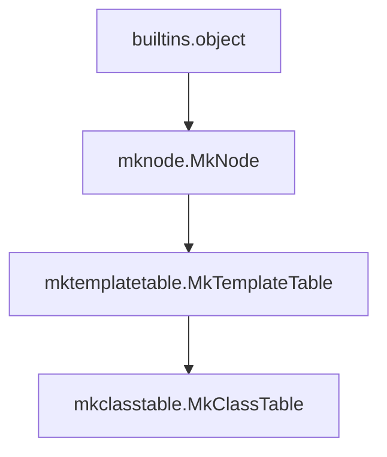

# MkClassTable

[ Show source on GitHub](https://github.com/phil65/mknodes/blob/main/src/mknodes/templatenodes/mkclasstable/__init__.py)

### Node for a table showing info for a list of classes.

<details open>
<summary>Examples</summary>

### Example: **Compact layout**
> [!NOTE]
> **Jinja**
>
> ```jinja
> {{ [_mk.MkTable, _mk.MkClassTable, _mk.MkNav] | MkClassTable(layout="compact") }}
>
> ```

> [!NOTE]
> **Python**
>
> ```python
> MkClassTable([MkTable, MkClassTable, MkNav], layout='compact')
> ```

<details open>
<summary>Rendered</summary>

| Class | Module | Description |
|--- | --- | --- |
| [MkTable](https://phil65.github.io/mknodes/) | mknodes.basenodes.mktable | Class representing a formatted table. |
| [MkClassTable](https://phil65.github.io/mknodes/) | mknodes.templatenodes.mkclasstable | Node for a table showing info for a list of classes. |
| [MkNav](https://phil65.github.io/mknodes/) | mknodes.navs.mknav | Nav section, representing a nestable menu. |

</details>

<details>
<summary>Markdown</summary>

```markdown
| Class | Module | Description |
|--- | --- | --- |
| [MkTable](https://phil65.github.io/mknodes/) | mknodes.basenodes.mktable | Class representing a formatted table. |
| [MkClassTable](https://phil65.github.io/mknodes/) | mknodes.templatenodes.mkclasstable | Node for a table showing info for a list of classes. |
| [MkNav](https://phil65.github.io/mknodes/) | mknodes.navs.mknav | Nav section, representing a nestable menu. |

```

</details>

<details>
<summary>Html</summary>

```html
<table>
<thead>
<tr>
<th>Class</th>
<th>Module</th>
<th>Description</th>
</tr>
</thead>
<tbody>
<tr>
<td><a href="https://phil65.github.io/mknodes/">MkTable</a></td>
<td>mknodes.basenodes.mktable</td>
<td>Class representing a formatted table.</td>
</tr>
<tr>
<td><a href="https://phil65.github.io/mknodes/">MkClassTable</a></td>
<td>mknodes.templatenodes.mkclasstable</td>
<td>Node for a table showing info for a list of classes.</td>
</tr>
<tr>
<td><a href="https://phil65.github.io/mknodes/">MkNav</a></td>
<td>mknodes.navs.mknav</td>
<td>Nav section, representing a nestable menu.</td>
</tr>
</tbody>
</table>

```

</details>

### Example: **Extended layout**
> [!NOTE]
> **Jinja**
>
> ```jinja
> {{ [_mk.MkTable, _mk.MkClassTable, _mk.MkNav] | MkClassTable(layout="default") }}
>
> ```

> [!NOTE]
> **Python**
>
> ```python
> MkClassTable([MkTable, MkClassTable, MkNav])
> ```

<details open>
<summary>Rendered</summary>

| Name | Children | Inherits |
|--- | --- | --- |
| **<font size='4'>[MkTable](https://phil65.github.io/mknodes/)</font>**<br>*<font size='1'>mknodes.basenodes.mktable</font>*<br>Class representing a formatted table\. | <ul><li>[MkDependencyGroups](https://phil65.github.io/mknodes/)</li></ul> | <ul><li>[MkBaseTable](https://phil65.github.io/mknodes/)</li></ul> |
| **<font size='4'>[MkClassTable](https://phil65.github.io/mknodes/)</font>**<br>*<font size='1'>mknodes.templatenodes.mkclasstable</font>*<br>Node for a table showing info for a list of classes\. | <ul></ul> | <ul><li>[MkTemplateTable](https://phil65.github.io/mknodes/)</li></ul> |
| **<font size='4'>[MkNav](https://phil65.github.io/mknodes/)</font>**<br>*<font size='1'>mknodes.navs.mknav</font>*<br>Nav section, representing a nestable menu\. | <ul><li>[MkDoc](https://phil65.github.io/mknodes/)</li><li>[MkCliNav](https://phil65.github.io/mknodes/)</li><li>[MkDefaultWebsite](https://phil65.github.io/mknodes/)</li></ul> | <ul><li>[MkNode](https://phil65.github.io/mknodes/)</li></ul> |

</details>

<details>
<summary>Markdown</summary>

```markdown
| Name | Children | Inherits |
|--- | --- | --- |
| **<font size='4'>[MkTable](https://phil65.github.io/mknodes/)</font>**<br>*<font size='1'>mknodes.basenodes.mktable</font>*<br>Class representing a formatted table\. | <ul><li>[MkDependencyGroups](https://phil65.github.io/mknodes/)</li></ul> | <ul><li>[MkBaseTable](https://phil65.github.io/mknodes/)</li></ul> |
| **<font size='4'>[MkClassTable](https://phil65.github.io/mknodes/)</font>**<br>*<font size='1'>mknodes.templatenodes.mkclasstable</font>*<br>Node for a table showing info for a list of classes\. | <ul></ul> | <ul><li>[MkTemplateTable](https://phil65.github.io/mknodes/)</li></ul> |
| **<font size='4'>[MkNav](https://phil65.github.io/mknodes/)</font>**<br>*<font size='1'>mknodes.navs.mknav</font>*<br>Nav section, representing a nestable menu\. | <ul><li>[MkDoc](https://phil65.github.io/mknodes/)</li><li>[MkCliNav](https://phil65.github.io/mknodes/)</li><li>[MkDefaultWebsite](https://phil65.github.io/mknodes/)</li></ul> | <ul><li>[MkNode](https://phil65.github.io/mknodes/)</li></ul> |

```

</details>

<details>
<summary>Html</summary>

```html
<table>
<thead>
<tr>
<th>Name</th>
<th>Children</th>
<th>Inherits</th>
</tr>
</thead>
<tbody>
<tr>
<td><strong><font size='4'><a href="https://phil65.github.io/mknodes/">MkTable</a></font></strong><br><em><font size='1'>mknodes.basenodes.mktable</font></em><br>Class representing a formatted table.</td>
<td><ul><li><a href="https://phil65.github.io/mknodes/">MkDependencyGroups</a></li></ul></td>
<td><ul><li><a href="https://phil65.github.io/mknodes/">MkBaseTable</a></li></ul></td>
</tr>
<tr>
<td><strong><font size='4'><a href="https://phil65.github.io/mknodes/">MkClassTable</a></font></strong><br><em><font size='1'>mknodes.templatenodes.mkclasstable</font></em><br>Node for a table showing info for a list of classes.</td>
<td><ul></ul></td>
<td><ul><li><a href="https://phil65.github.io/mknodes/">MkTemplateTable</a></li></ul></td>
</tr>
<tr>
<td><strong><font size='4'><a href="https://phil65.github.io/mknodes/">MkNav</a></font></strong><br><em><font size='1'>mknodes.navs.mknav</font></em><br>Nav section, representing a nestable menu.</td>
<td><ul><li><a href="https://phil65.github.io/mknodes/">MkDoc</a></li><li><a href="https://phil65.github.io/mknodes/">MkCliNav</a></li><li><a href="https://phil65.github.io/mknodes/">MkDefaultWebsite</a></li></ul></td>
<td><ul><li><a href="https://phil65.github.io/mknodes/">MkNode</a></li></ul></td>
</tr>
</tbody>
</table>

```

</details>

</details>

<details open>
<summary>DocStrings</summary>

<a id="mknodes.MkClassTable"></a>

```python
class MkClassTable(mktemplatetable.MkTemplateTable)
```

</details>

<details open>
<summary>Base classes</summary>

| Name | Children | Inherits |
|--- | --- | --- |
| **<font size='4'>[MkTemplateTable](https://phil65.github.io/mknodes/)</font>**<br>*<font size='1'>mknodes.templatenodes.mktemplatetable</font>*<br>Node for a table showing dependencies for a package\. | <ul><li>[MkClassTable](https://phil65.github.io/mknodes/)</li><li>[MkDependencyTable](https://phil65.github.io/mknodes/)</li><li>[MkModuleTable](https://phil65.github.io/mknodes/)</li></ul> | <ul><li>[MkNode](https://phil65.github.io/mknodes/)</li></ul> |

</details>

<details>
<summary>⋔ Inheritance diagram</summary>



</details>

<details>
<summary>NodeFile</summary>

**/home/runner/work/mknodes/mknodes/src/mknodes/templatenodes/mkclasstable/metadata.toml**

```toml
[metadata]
icon = "octicon:table-24"
name = "MkClassTable"

[requirements.extension.tables]

[examples.compact]
title = "Compact layout"
jinja = """
{{ [_mk.MkTable, _mk.MkClassTable, _mk.MkNav] | MkClassTable(layout="compact") }}
"""

[examples.extended]
title = "Extended layout"
jinja = """
{{ [_mk.MkTable, _mk.MkClassTable, _mk.MkNav] | MkClassTable(layout="default") }}
"""

[layouts.compact]
Class = """
{{ kls | get_link }}
"""
Module = """
{{ kls | getattr("__module__") }}
"""
Description = """
{{ kls | get_doc(only_summary=True) }}
"""

[layouts.default]
Name = """
{{ kls | get_link | md_style(size=4, bold=True) }}<br>{{ kls | getattr("__module__") | md_style(size=1, italic=True) }}<br>{{ kls | get_doc(escape=True, only_summary=True) }}
"""
Children = """
<ul>
<li>{{ sub | get_link }}</li><li>...</li></ul>
"""
Inherits = """
<ul>
<li>{{ base_kls | get_link }}</li>    <li>...</li></ul>
"""

```

</details>

<details>
<summary>Code</summary>

**mknodes.templatenodes.mkclasstable.MkClassTable**

```python
class MkClassTable(mktemplatetable.MkTemplateTable):
    """Node for a table showing info for a list of classes."""

    def __init__(
        self,
        klasses: Sequence[type | str | griffe.Class],
        *,
        layout: str = "default",
        **kwargs,
    ) -> None:
        self.klasses = klasses
        super().__init__(layout=layout, **kwargs)

    def iter_items(self):
        for kls in self.klasses:
            match kls:
                case type():
                    yield dict(kls=kls, griffe_kls=_get_griffe_class(kls))
                case griffe.Class():
                    yield dict(kls=classhelpers.import_module(kls.path), griffe_kls=kls)
                case str():
                    yield dict(
                        kls=classhelpers.import_module(kls),
                        griffe_kls=_get_griffe_class(kls),
                    )

```

</details>

<details>
<summary>Page info</summary>

<details>
<summary>Code for this page</summary>

**mknodes.manual.nodes_section.create_section_for_nodes**

```python
def create_section_for_nodes(
    nav: mk.MkNav,
    klasses: Sequence[type[mk.MkNode]],
) -> mk.MkTable:
    table = mk.MkTable(columns=["Node", "Docstrings", "Markdown extensions"])
    for kls in klasses:
        tpl = "classpage_custom.jinja"
        page = mk.MkClassPage(kls, icon=kls.ICON, template_path=tpl, parent=nav, hide="toc")
        nav += page
        if kls.STATUS:
            page.metadata.status = kls.STATUS
        elif kls.JS_FILES:
            page.metadata.status = "js"
        elif kls.CSS:
            page.metadata.status = "css"
        page.created_by = create_section_for_nodes
        link = mk.MkLink(page, kls.__name__, icon=kls.ICON)
        extensions = ", ".join(f"`{i}`" for i in kls.REQUIRED_EXTENSIONS)
        table.add_row((link, kls.__doc__, extensions))
    return table

```

</details>

<details>
<summary>Resources</summary>

```python
Resources(css=[],
          markdown_extensions={'admonition': {},
                               'pymdownx.details': {},
                               'pymdownx.highlight': {'anchor_linenums': True,
                                                      'line_spans': '__span',
                                                      'pygments_lang_class': True},
                               'pymdownx.superfences': {'custom_fences': [{'class': 'mermaid',
                                                                           'format': <function fence_code_format at 0x7bb797a5c1a0>,
                                                                           'name': 'mermaid'}]},
                               'pymdownx.tabbed': {},
                               'tables': {}},
          plugins=[Plugin('mkdocstrings')],
          js=[],
          assets=[],
          packages=[])
```

</details>

<details>
<summary>Metadata</summary>

```yaml
created:
  source_filename: /home/runner/work/mknodes/mknodes/src/mknodes/manual/nodes_section.py
  source_function: create_section_for_nodes
  source_line_no: 93
hide:
- toc
icon: material/database
title: MkClassTable

```

</details>

</details>
