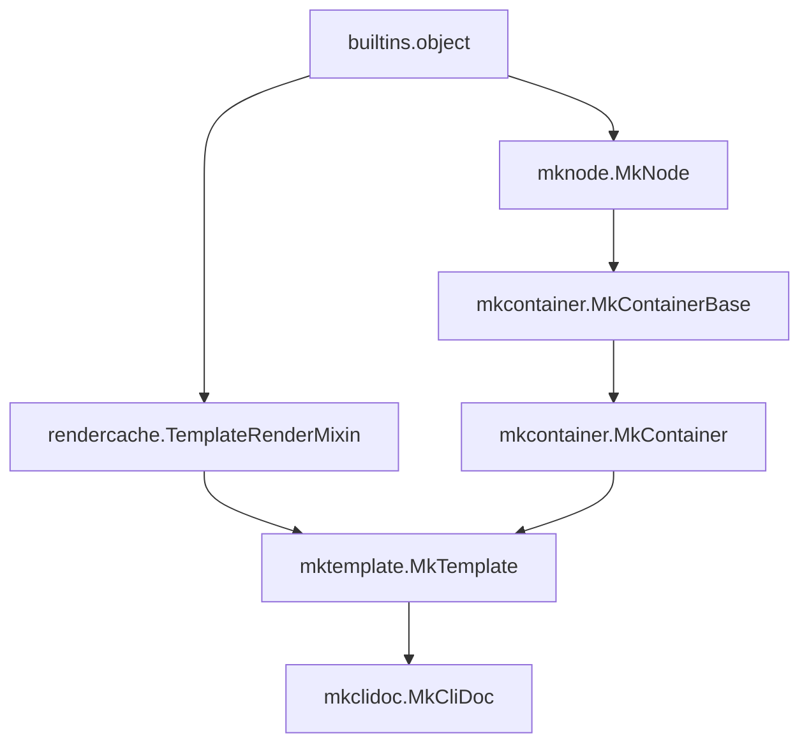

# MkCliDoc

[ Show source on GitHub](https://github.com/phil65/mknodes/blob/main/src/mknodes/basenodes/mkclidoc/__init__.py)

### Node for showing documentation for click / typer CLI apps.

<details open>
<summary>Examples</summary>

### Example: **MkDocs-MkNodes CLI**
> [!NOTE]
> **Jinja**
>
> ```jinja
> {{ "mknodes.cli:cli" | MkCliDoc }}
>
> ```

> [!NOTE]
> **Python**
>
> ```python
> MkCliDoc('mknodes.cli:cli')
> ```

<details open>
<summary>Rendered</summary>

## mknodes

MkNodes: build documentation from Python node trees.

`generate` writes the pages (and the site config), `build` / `serve` also run the site engine. Docs: https://phil65.github.io/mknodes/

````python
mknodes [OPTIONS] COMMAND [ARGS]...
````

### `--install-completion`

 <code>Flag</code>
Install completion for the current shell.

### `--show-completion`

 <code>Flag</code>
Show completion for the current shell, to copy it or customize the installation.

### `--help`

 <code>Flag</code>
Show this message and exit.

</details>

<details>
<summary>Markdown</summary>

`````markdown
## mknodes

MkNodes: build documentation from Python node trees.

`generate` writes the pages (and the site config), `build` / `serve` also run the site engine. Docs: https://phil65.github.io/mknodes/

````python
mknodes [OPTIONS] COMMAND [ARGS]...
````

### `--install-completion`

 <code>Flag</code>
Install completion for the current shell.

### `--show-completion`

 <code>Flag</code>
Show completion for the current shell, to copy it or customize the installation.

### `--help`

 <code>Flag</code>
Show this message and exit.

`````

</details>

<details>
<summary>Html</summary>

```html
<h2 id="mknodes">mknodes<a href="#mknodes" aria-label="Link to heading 'mknodes'" data-heading-content="mknodes" class="anchor"></a></h2>
<p>MkNodes: build documentation from Python node trees.</p>
<p><code>generate</code> writes the pages (and the site config), <code>build</code> / <code>serve</code> also run the site engine. Docs: <a href="https://phil65.github.io/mknodes/">https://phil65.github.io/mknodes/</a></p>
<pre><code class="language-python">mknodes [OPTIONS] COMMAND [ARGS]...
</code></pre>
<h3 id="--install-completion"><code>--install-completion</code><a href="#--install-completion" aria-label="Link to heading '--install-completion'" data-heading-content="--install-completion" class="anchor"></a></h3>
<p> <code>Flag</code>
Install completion for the current shell.</p>
<h3 id="--show-completion"><code>--show-completion</code><a href="#--show-completion" aria-label="Link to heading '--show-completion'" data-heading-content="--show-completion" class="anchor"></a></h3>
<p> <code>Flag</code>
Show completion for the current shell, to copy it or customize the installation.</p>
<h3 id="--help"><code>--help</code><a href="#--help" aria-label="Link to heading '--help'" data-heading-content="--help" class="anchor"></a></h3>
<p> <code>Flag</code>
Show this message and exit.</p>

```

</details>

<details>
<summary>Repr tree</summary>

```
MkCliDoc
├── MkHeader('mknodes')
├── MkCode(None)
│   ╰── MkText('mknodes [OPTIONS] COMMAND [ARGS]...')
╰── MkHeader('`--install-completion`', level=3)
├── MkMaterialBadge('mdi:flag', 'Flag')
╰── MkHeader('`--show-completion`', level=3)
├── MkMaterialBadge('mdi:flag', 'Flag')
╰── MkHeader('`--help`', level=3)
╰── MkMaterialBadge('mdi:flag', 'Flag')
```

</details>

### Example: **SubCommand**
> [!NOTE]
> **Jinja**
>
> ```jinja
> {{ "mknodes.cli:cli" | MkCliDoc(prog_name="build") }}
>
> ```

> [!NOTE]
> **Python**
>
> ```python
> MkCliDoc('mknodes.cli:cli', prog_name='build')
> ```

<details open>
<summary>Rendered</summary>

## build

Build a MkNodes-based website, locally or remotely.

Runs the build function on given repository (either locally or a hosted one),
writes the generated pages and config (see `generate`) and builds the HTML website
with the engine (`zensical build -f <generated config>`, `mkdocs build -f ...`,
`mdbook build <book dir>`, `sphinx-build <source dir> <site dir>`). Docsify has no
build step: the generated site dir is the website.

Problems which leave pages broken (build diagnostics) get logged as warnings and
summarized at the end; in strict mode they fail the build.

Further info here: https://phil65.github.io/mknodes/CLI/

````python
mknodes build [OPTIONS]
````

### `--repo-url`, `-r`

Repository URL of the target package. Can be remote or local.

### `--build-fn`, `-b`

Path to the build script. (form: `path.to.module:function` )

### `--site-dir`, `-d`

Path to the folder where the HTML should get written.

### `--clone-depth`, `-c`

Git clone depth in case repository is remote. Important for changelog generation.

### `--config-path`, `-p`

**Default:** mkdocs.yml
Path to the config file.

### `--strict`, `-s`

 <code>Flag</code>
Strict mode: fail if the build reported problems (failed nodes, `/// mknodes` or `python exec` blocks, broken code fences, unresolved references). Also passed to the engine. Default: the `strict` setting.

### `--engine`, `-e`

**Default:** zensical
Site engine: `zensical` (HTML site, default), `mkdocs` (HTML site, needs the `mkdocs` extra), `mdbook` (HTML book, needs the `mdbook` binary to build / serve), `sphinx` (HTML site from MyST Markdown, needs the `sphinx` extra), `docsify` (Markdown rendered in the browser, no build step) or `markdown` (plain Markdown files).

### `--flavor`

Markdown flavour (`material`, `github`, `mdbook`, `myst`). Default: the engine's flavour (zensical / mkdocs: `material`, mdbook: `mdbook`, sphinx: `myst`, docsify / markdown: `github`).

### `--jinja-engine`

Template engine for the Jinja templates: `jinja2` (default) or `minijinja` (needs the `minijinja` extra). Default: `jinja_engine` of [tool.mknodes], else the MKNODES_JINJA_ENGINE environment variable, else jinja2.

### `--offline`

 <code>Flag</code>
Take external inputs (icons, licenses, LLM texts) only from the lock file (`mknodes.lock`): fail if one is missing, never write the lock file.

### `--refresh-inputs`

 <code>Flag</code>
Fetch all external inputs again and rewrite the lock file with exactly the used ones.

### `--verbose`, `-v`

 <code>Flag</code>
Enable verbose output. (`DEBUG` level)

### `--quiet`, `-q`

 <code>Flag</code>
Suppress output.

### `--help`

 <code>Flag</code>
Show this message and exit.

</details>

<details>
<summary>Markdown</summary>

`````markdown
## build

Build a MkNodes-based website, locally or remotely.

Runs the build function on given repository (either locally or a hosted one),
writes the generated pages and config (see `generate`) and builds the HTML website
with the engine (`zensical build -f <generated config>`, `mkdocs build -f ...`,
`mdbook build <book dir>`, `sphinx-build <source dir> <site dir>`). Docsify has no
build step: the generated site dir is the website.

Problems which leave pages broken (build diagnostics) get logged as warnings and
summarized at the end; in strict mode they fail the build.

Further info here: https://phil65.github.io/mknodes/CLI/

````python
mknodes build [OPTIONS]
````

### `--repo-url`, `-r`

Repository URL of the target package. Can be remote or local.

### `--build-fn`, `-b`

Path to the build script. (form: `path.to.module:function` )

### `--site-dir`, `-d`

Path to the folder where the HTML should get written.

### `--clone-depth`, `-c`

Git clone depth in case repository is remote. Important for changelog generation.

### `--config-path`, `-p`

**Default:** mkdocs.yml
Path to the config file.

### `--strict`, `-s`

 <code>Flag</code>
Strict mode: fail if the build reported problems (failed nodes, `/// mknodes` or `python exec` blocks, broken code fences, unresolved references). Also passed to the engine. Default: the `strict` setting.

### `--engine`, `-e`

**Default:** zensical
Site engine: `zensical` (HTML site, default), `mkdocs` (HTML site, needs the `mkdocs` extra), `mdbook` (HTML book, needs the `mdbook` binary to build / serve), `sphinx` (HTML site from MyST Markdown, needs the `sphinx` extra), `docsify` (Markdown rendered in the browser, no build step) or `markdown` (plain Markdown files).

### `--flavor`

Markdown flavour (`material`, `github`, `mdbook`, `myst`). Default: the engine's flavour (zensical / mkdocs: `material`, mdbook: `mdbook`, sphinx: `myst`, docsify / markdown: `github`).

### `--jinja-engine`

Template engine for the Jinja templates: `jinja2` (default) or `minijinja` (needs the `minijinja` extra). Default: `jinja_engine` of [tool.mknodes], else the MKNODES_JINJA_ENGINE environment variable, else jinja2.

### `--offline`

 <code>Flag</code>
Take external inputs (icons, licenses, LLM texts) only from the lock file (`mknodes.lock`): fail if one is missing, never write the lock file.

### `--refresh-inputs`

 <code>Flag</code>
Fetch all external inputs again and rewrite the lock file with exactly the used ones.

### `--verbose`, `-v`

 <code>Flag</code>
Enable verbose output. (`DEBUG` level)

### `--quiet`, `-q`

 <code>Flag</code>
Suppress output.

### `--help`

 <code>Flag</code>
Show this message and exit.

`````

</details>

<details>
<summary>Html</summary>

```html
<h2 id="build">build<a href="#build" aria-label="Link to heading 'build'" data-heading-content="build" class="anchor"></a></h2>
<p>Build a MkNodes-based website, locally or remotely.</p>
<p>Runs the build function on given repository (either locally or a hosted one),
writes the generated pages and config (see <code>generate</code>) and builds the HTML website
with the engine (<code>zensical build -f &lt;generated config&gt;</code>, <code>mkdocs build -f ...</code>,
<code>mdbook build &lt;book dir&gt;</code>, <code>sphinx-build &lt;source dir&gt; &lt;site dir&gt;</code>). Docsify has no
build step: the generated site dir is the website.</p>
<p>Problems which leave pages broken (build diagnostics) get logged as warnings and
summarized at the end; in strict mode they fail the build.</p>
<p>Further info here: <a href="https://phil65.github.io/mknodes/CLI/">https://phil65.github.io/mknodes/CLI/</a></p>
<pre><code class="language-python">mknodes build [OPTIONS]
</code></pre>
<h3 id="--repo-url--r"><code>--repo-url</code>, <code>-r</code><a href="#--repo-url--r" aria-label="Link to heading '--repo-url, -r'" data-heading-content="--repo-url, -r" class="anchor"></a></h3>
<p>Repository URL of the target package. Can be remote or local.</p>
<h3 id="--build-fn--b"><code>--build-fn</code>, <code>-b</code><a href="#--build-fn--b" aria-label="Link to heading '--build-fn, -b'" data-heading-content="--build-fn, -b" class="anchor"></a></h3>
<p>Path to the build script. (form: <code>path.to.module:function</code> )</p>
<h3 id="--site-dir--d"><code>--site-dir</code>, <code>-d</code><a href="#--site-dir--d" aria-label="Link to heading '--site-dir, -d'" data-heading-content="--site-dir, -d" class="anchor"></a></h3>
<p>Path to the folder where the HTML should get written.</p>
<h3 id="--clone-depth--c"><code>--clone-depth</code>, <code>-c</code><a href="#--clone-depth--c" aria-label="Link to heading '--clone-depth, -c'" data-heading-content="--clone-depth, -c" class="anchor"></a></h3>
<p>Git clone depth in case repository is remote. Important for changelog generation.</p>
<h3 id="--config-path--p"><code>--config-path</code>, <code>-p</code><a href="#--config-path--p" aria-label="Link to heading '--config-path, -p'" data-heading-content="--config-path, -p" class="anchor"></a></h3>
<p><strong>Default:</strong> mkdocs.yml
Path to the config file.</p>
<h3 id="--strict--s"><code>--strict</code>, <code>-s</code><a href="#--strict--s" aria-label="Link to heading '--strict, -s'" data-heading-content="--strict, -s" class="anchor"></a></h3>
<p> <code>Flag</code>
Strict mode: fail if the build reported problems (failed nodes, <code>/// mknodes</code> or <code>python exec</code> blocks, broken code fences, unresolved references). Also passed to the engine. Default: the <code>strict</code> setting.</p>
<h3 id="--engine--e"><code>--engine</code>, <code>-e</code><a href="#--engine--e" aria-label="Link to heading '--engine, -e'" data-heading-content="--engine, -e" class="anchor"></a></h3>
<p><strong>Default:</strong> zensical
Site engine: <code>zensical</code> (HTML site, default), <code>mkdocs</code> (HTML site, needs the <code>mkdocs</code> extra), <code>mdbook</code> (HTML book, needs the <code>mdbook</code> binary to build / serve), <code>sphinx</code> (HTML site from MyST Markdown, needs the <code>sphinx</code> extra), <code>docsify</code> (Markdown rendered in the browser, no build step) or <code>markdown</code> (plain Markdown files).</p>
<h3 id="--flavor"><code>--flavor</code><a href="#--flavor" aria-label="Link to heading '--flavor'" data-heading-content="--flavor" class="anchor"></a></h3>
<p>Markdown flavour (<code>material</code>, <code>github</code>, <code>mdbook</code>, <code>myst</code>). Default: the engine's flavour (zensical / mkdocs: <code>material</code>, mdbook: <code>mdbook</code>, sphinx: <code>myst</code>, docsify / markdown: <code>github</code>).</p>
<h3 id="--jinja-engine"><code>--jinja-engine</code><a href="#--jinja-engine" aria-label="Link to heading '--jinja-engine'" data-heading-content="--jinja-engine" class="anchor"></a></h3>
<p>Template engine for the Jinja templates: <code>jinja2</code> (default) or <code>minijinja</code> (needs the <code>minijinja</code> extra). Default: <code>jinja_engine</code> of [tool.mknodes], else the MKNODES_JINJA_ENGINE environment variable, else jinja2.</p>
<h3 id="--offline"><code>--offline</code><a href="#--offline" aria-label="Link to heading '--offline'" data-heading-content="--offline" class="anchor"></a></h3>
<p> <code>Flag</code>
Take external inputs (icons, licenses, LLM texts) only from the lock file (<code>mknodes.lock</code>): fail if one is missing, never write the lock file.</p>
<h3 id="--refresh-inputs"><code>--refresh-inputs</code><a href="#--refresh-inputs" aria-label="Link to heading '--refresh-inputs'" data-heading-content="--refresh-inputs" class="anchor"></a></h3>
<p> <code>Flag</code>
Fetch all external inputs again and rewrite the lock file with exactly the used ones.</p>
<h3 id="--verbose--v"><code>--verbose</code>, <code>-v</code><a href="#--verbose--v" aria-label="Link to heading '--verbose, -v'" data-heading-content="--verbose, -v" class="anchor"></a></h3>
<p> <code>Flag</code>
Enable verbose output. (<code>DEBUG</code> level)</p>
<h3 id="--quiet--q"><code>--quiet</code>, <code>-q</code><a href="#--quiet--q" aria-label="Link to heading '--quiet, -q'" data-heading-content="--quiet, -q" class="anchor"></a></h3>
<p> <code>Flag</code>
Suppress output.</p>
<h3 id="--help"><code>--help</code><a href="#--help" aria-label="Link to heading '--help'" data-heading-content="--help" class="anchor"></a></h3>
<p> <code>Flag</code>
Show this message and exit.</p>

```

</details>

<details>
<summary>Repr tree</summary>

```
MkCliDoc
├── MkHeader('build')
├── MkCode(None)
│   ╰── MkText('mknodes build [OPTIONS]')
├── MkHeader('`--repo-url`, `-r`', level=3)
├── MkHeader('`--build-fn`, `-b`', level=3)
├── MkHeader('`--site-dir`, `-d`', level=3)
├── MkHeader('`--clone-depth`, `-c`', level=3)
├── MkHeader('`--config-path`, `-p`', level=3)
╰── MkHeader('`--strict`, `-s`', level=3)
├── MkMaterialBadge('mdi:flag', 'Flag')
├── MkHeader('`--engine`, `-e`', level=3)
├── MkHeader('`--flavor`', level=3)
├── MkHeader('`--jinja-engine`', level=3)
╰── MkHeader('`--offline`', level=3)
├── MkMaterialBadge('mdi:flag', 'Flag')
╰── MkHeader('`--refresh-inputs`', level=3)
├── MkMaterialBadge('mdi:flag', 'Flag')
╰── MkHeader('`--verbose`, `-v`', level=3)
├── MkMaterialBadge('mdi:flag', 'Flag')
╰── MkHeader('`--quiet`, `-q`', level=3)
├── MkMaterialBadge('mdi:flag', 'Flag')
╰── MkHeader('`--help`', level=3)
╰── MkMaterialBadge('mdi:flag', 'Flag')
```

</details>

</details>

<details open>
<summary>DocStrings</summary>

<a id="mknodes.MkCliDoc"></a>

```python
class MkCliDoc(mktemplate.MkTemplate)
```

</details>

<details open>
<summary>Base classes</summary>

| Name | Children | Inherits |
|--- | --- | --- |
| **<font size='4'>[MkTemplate](https://phil65.github.io/mknodes/)</font>**<br>*<font size='1'>mknodes.templatenodes.mktemplate</font>*<br>Node representing a jinja template\. | <ul><li>[MkCliDoc](https://phil65.github.io/mknodes/)</li><li>[MkMaterialBadge](https://phil65.github.io/mknodes/)</li><li>[MkImageCompare](https://phil65.github.io/mknodes/)</li><li>[MkImageSlideshow](https://phil65.github.io/mknodes/)</li><li>[MkIFrame](https://phil65.github.io/mknodes/)</li><li>[MkCard](https://phil65.github.io/mknodes/)</li><li>[MkInstallGuide](https://phil65.github.io/mknodes/)</li><li>[MkCodeOfConduct](https://phil65.github.io/mknodes/)</li><li>[MkCommitConventions](https://phil65.github.io/mknodes/)</li><li>[MkDevEnvSetup](https://phil65.github.io/mknodes/)</li><li>[MkDevTools](https://phil65.github.io/mknodes/)</li><li>...</li></ul> | <ul><li>[TemplateRenderMixin](https://phil65.github.io/mknodes/)</li><li>[MkContainer](https://phil65.github.io/mknodes/)</li></ul> |

</details>

<details>
<summary>⋔ Inheritance diagram</summary>



</details>

<details>
<summary>NodeFile</summary>

**/home/runner/work/mknodes/mknodes/src/mknodes/basenodes/mkclidoc/metadata.toml**

```toml
[metadata]
icon = "mdi:api"
name = "MkCliDoc"

[examples.cli]
title = "MkDocs-MkNodes CLI"
jinja = """
{{ "mknodes.cli:cli" | MkCliDoc }}
"""

[examples.sub_command]
title = "SubCommand"
jinja = """
{{ "mknodes.cli:cli" | MkCliDoc(prog_name="build") }}
"""

[examples.argparse]
title = "ArgumentParser"
python = """
import git_changelog
import mknodes as mk

parser = git_changelog.get_parser()
mk.MkCliDoc(parser)
"""

[fragments]
param_template = """
{{ param.opt_str | MkHeader(level=3) }}


"{{ "REQUIRED" | md_style(bold=True) }}"


Environment variable{{ param.envvar }}


{{ "Multiple values allowed." | md_style(bold=True) }}


{{ "Default:" | md_style(bold=True) }} {{ param.default }}


{{ "mdi:flag" | MkMaterialBadge("Flag") }}


{{ param.help }}

"""
command_template = """
{{ info.name | MkHeader }}

{{ info.description }}

{{ info.usage | MkCode }}


{{ "fragments/param_template" | render_template(param=param) }}



"""

[output.markdown]
template = """

{{ "fragments/command_template" | render_template(info=node.info) }}


{{ "fragments/command_template" | render_template(info=sub_info) }}



"""

```

</details>

<details>
<summary>Code</summary>

**mknodes.basenodes.mkclidoc.MkCliDoc**

```python
class MkCliDoc(mktemplate.MkTemplate):
    """Node for showing documentation for click / typer CLI apps."""

    ICON = "material/api"

    def __init__(
        self,
        target: str | argparse.ArgumentParser | None = None,
        *,
        prog_name: str | None = None,
        show_hidden: bool = False,
        show_subcommands: bool = False,
        **kwargs: Any,
    ) -> None:
        r"""Constructor.

        Args:
            target: Dotted path to click group / typer instance / ArgumentParser
            prog_name: Program name
            show_hidden: Show commands and options that are marked as hidden.
            show_subcommands: List subcommands of a given command.
            kwargs: Keyword arguments passed to parent
        """
        super().__init__("output/markdown/template", **kwargs)
        self.target = target
        self.prog_name = prog_name
        self.show_hidden = show_hidden
        self.show_subcommands = show_subcommands

    @property
    def info(self) -> clinspector.CommandInfo | None:
        import importlib

        match self.target:
            case str():
                module, command = self.target.split(":")
                prog_name = self.prog_name
                mod = importlib.import_module(module)
                instance = getattr(mod, command)
            case None:
                if cli_eps := self.ctx.metadata.entry_points.get_group("console_scripts"):
                    module, command = cli_eps[0].value.split(":")
                    prog_name = cli_eps[0].name
                    mod = importlib.import_module(module)
                    instance = getattr(mod, command)
                else:
                    return None
            case _:
                instance = self.target
                prog_name = self.prog_name
        return clinspector.get_cmd_info(instance, command=prog_name)

```

</details>

<details>
<summary>Page info</summary>

<details>
<summary>Code for this page</summary>

**mknodes.manual.nodes_section.create_section_for_nodes**

```python
def create_section_for_nodes(
    nav: mk.MkNav,
    klasses: Sequence[type[mk.MkNode]],
) -> mk.MkTable:
    table = mk.MkTable(columns=["Node", "Docstrings", "Markdown extensions"])
    for kls in klasses:
        tpl = "classpage_custom.jinja"
        page = mk.MkClassPage(kls, icon=kls.ICON, template_path=tpl, parent=nav, hide="toc")
        nav += page
        if kls.STATUS:
            page.metadata.status = kls.STATUS
        elif kls.JS_FILES:
            page.metadata.status = "js"
        elif kls.CSS:
            page.metadata.status = "css"
        page.created_by = create_section_for_nodes
        link = mk.MkLink(page, kls.__name__, icon=kls.ICON)
        extensions = ", ".join(f"`{i}`" for i in kls.REQUIRED_EXTENSIONS)
        table.add_row((link, kls.__doc__, extensions))
    return table

```

</details>

<details>
<summary>Resources</summary>

```python
Resources(css=[],
          markdown_extensions={'admonition': {},
                               'pymdownx.details': {},
                               'pymdownx.highlight': {'anchor_linenums': True,
                                                      'line_spans': '__span',
                                                      'pygments_lang_class': True},
                               'pymdownx.superfences': {'custom_fences': [{'class': 'mermaid',
                                                                           'format': <function fence_code_format at 0x7bb797a5c1a0>,
                                                                           'name': 'mermaid'}]},
                               'pymdownx.tabbed': {},
                               'tables': {}},
          plugins=[Plugin('mkdocstrings')],
          js=[],
          assets=[],
          packages=[])
```

</details>

<details>
<summary>Metadata</summary>

```yaml
created:
  source_filename: /home/runner/work/mknodes/mknodes/src/mknodes/manual/nodes_section.py
  source_function: create_section_for_nodes
  source_line_no: 93
hide:
- toc
icon: material/api
status: new
title: MkCliDoc

```

</details>

</details>
