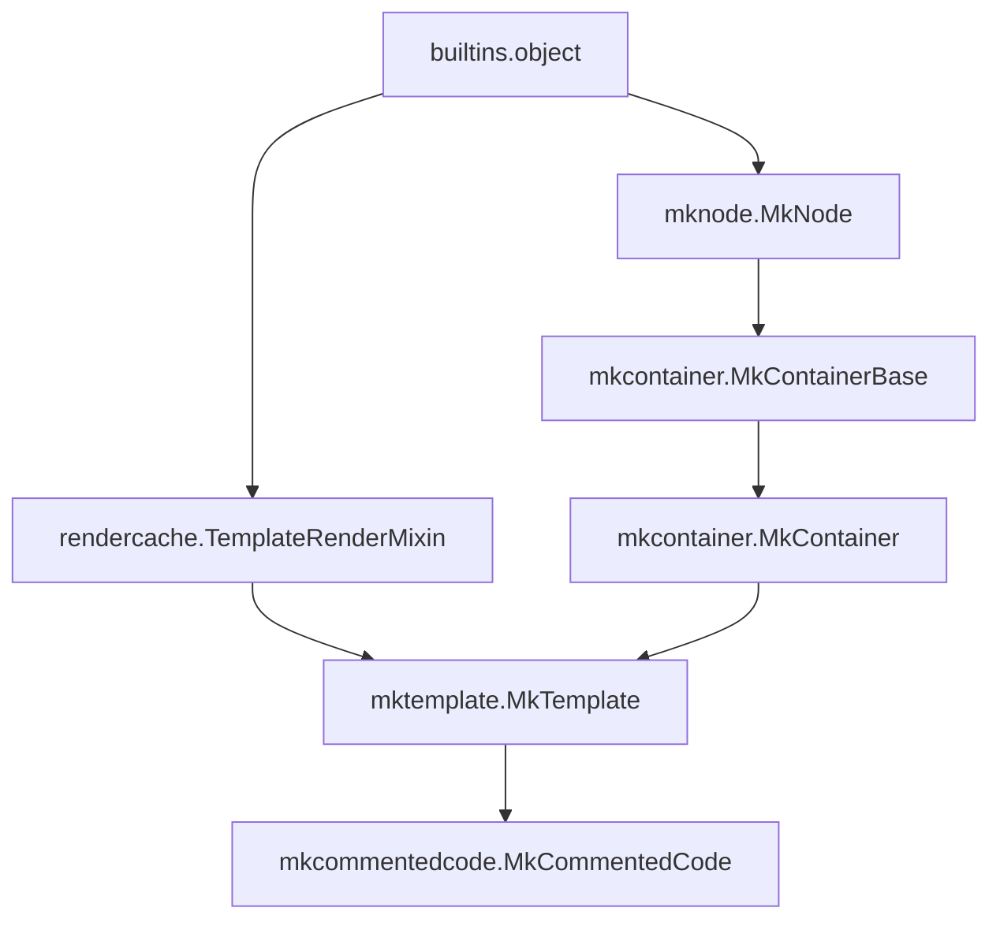

# MkCommentedCode

[ Show source on GitHub](https://github.com/phil65/mknodes/blob/main/src/mknodes/templatenodes/mkcommentedcode/__init__.py)

### Node which displays a list of code / comment blocks for given code.

> [!NOTE]
> **Description**
>
>
> Lines beginning with # are shown in dedicated blocks and can be used to
> inline-explain the code. Lines can be hidden by ending a line with "##".

<details open>
<summary>Examples</summary>

### Example: **From text**
> [!NOTE]
> **Jinja**
>
> ```jinja
> {{
> "
> # Comment sections automatically get converted to non-codeblock sections.
> # That way you can explain your code in-line.
>
> # ## you can use headers.
>
> some_code = 1 + 2
>
> # !!! note
> #     Admonitions and everything else work, too.
> #
>
> " | MkCommentedCode
> }}
>
> ```

> [!NOTE]
> **Python**
>
> ```python
> MkCommentedCode(
>     "\n# Comment sections automatically get converted to non-codeblock sections.\n# That way you can explain your code in-line.\n\n# ## you can use headers.\n\nsome_code = 1 + 2\n\n# !!! note\n#     Admonitions and everything else work, too.\n#\n\n"
> )
>
> ```

<details open>
<summary>Rendered</summary>

<div class="speech bottom">

Comment sections automatically get converted to non-codeblock sections.
That way you can explain your code in-line.
## you can use headers.

</div>

````python
some_code = 1 + 2
````

<div class="speech bottom">

> [!NOTE]
> Admonitions and everything else work, too.

</div>

</details>

<details>
<summary>Markdown</summary>

`````markdown
<div class="speech bottom">

Comment sections automatically get converted to non-codeblock sections.
That way you can explain your code in-line.
## you can use headers.

</div>

````python
some_code = 1 + 2
````

<div class="speech bottom">

!!! note
    Admonitions and everything else work, too.

</div>

`````

</details>

<details>
<summary>Html</summary>

```html
<div class="speech bottom">
<p>Comment sections automatically get converted to non-codeblock sections.
That way you can explain your code in-line.</p>
<h2 id="you-can-use-headers">you can use headers.<a href="#you-can-use-headers" aria-label="Link to heading 'you can use headers.'" data-heading-content="you can use headers." class="anchor"></a></h2>
</div>
<pre><code class="language-python">some_code = 1 + 2
</code></pre>
<div class="speech bottom">
<p>!!! note
Admonitions and everything else work, too.</p>
</div>

```

</details>

<details>
<summary>Repr tree</summary>

```
MkCommentedCode
├── MkSpeechBubble()
│   ╰── MkText('Comment sections automatically get converted to non-codeblock sections.\nThat way you can explain your code in-line.\n## you can use headers.')
├── MkCode(None)
│   ╰── MkText('some_code = 1 + 2')
╰── MkSpeechBubble()
    ╰── MkText('!!! note\n    Admonitions and everything else work, too.\n')
```

</details>

### Example: **From function**
> [!NOTE]
> **Jinja**
>
> ```jinja
> {{ mk.MkCommentedCode.create_example_page | MkCommentedCode }}
>
> ```

> [!NOTE]
> **Python**
>
> ```python
> MkCommentedCode(<bound method MkCommentedCode.create_example_page of <class 'mknodes.templatenodes.mkcommentedcode.<locals>.MkCommentedCode'>>)
> ```

<details open>
<summary>Rendered</summary>

````python
    @classmethod
    def create_example_page(cls, page) -> None:
````

<div class="speech bottom">

Comment sections automatically get converted to non-codeblock sections.
That way you can explain your code in-line.
## you can use headers.

</div>

````python
        page += MkCommentedCode(MkCommentedCode.create_example_page)
````

<div class="speech bottom">

> [!NOTE]
> Admonitions and everything else work, too.

</div>

````python
        page += MkCommentedCode(MkCommentedCode.create_example_page, style="admonition")
````

</details>

<details>
<summary>Markdown</summary>

`````markdown
````python
    @classmethod
    def create_example_page(cls, page) -> None:
````

<div class="speech bottom">

Comment sections automatically get converted to non-codeblock sections.
That way you can explain your code in-line.
## you can use headers.

</div>

````python
        page += MkCommentedCode(MkCommentedCode.create_example_page)
````

<div class="speech bottom">

!!! note
    Admonitions and everything else work, too.

</div>

````python
        page += MkCommentedCode(MkCommentedCode.create_example_page, style="admonition")
````

`````

</details>

<details>
<summary>Html</summary>

```html
<pre><code class="language-python">    @classmethod
    def create_example_page(cls, page) -&gt; None:
</code></pre>
<div class="speech bottom">
<p>Comment sections automatically get converted to non-codeblock sections.
That way you can explain your code in-line.</p>
<h2 id="you-can-use-headers">you can use headers.<a href="#you-can-use-headers" aria-label="Link to heading 'you can use headers.'" data-heading-content="you can use headers." class="anchor"></a></h2>
</div>
<pre><code class="language-python">        page += MkCommentedCode(MkCommentedCode.create_example_page)
</code></pre>
<div class="speech bottom">
<p>!!! note
Admonitions and everything else work, too.</p>
</div>
<pre><code class="language-python">        page += MkCommentedCode(MkCommentedCode.create_example_page, style=&quot;admonition&quot;)
</code></pre>

```

</details>

<details>
<summary>Repr tree</summary>

```
MkCommentedCode
├── MkCode(None)
│   ╰── MkText('    @classmethod\n    def create_example_page(cls, page) -> None:')
├── MkSpeechBubble()
│   ╰── MkText('Comment sections automatically get converted to non-codeblock sections.\nThat way you can explain your code in-line.\n## you can use headers.')
├── MkCode(None)
│   ╰── MkText('        page += MkCommentedCode(MkCommentedCode.create_example_page)')
├── MkSpeechBubble()
│   ╰── MkText('!!! note\n    Admonitions and everything else work, too.\n')
╰── MkCode(None)
    ╰── MkText('        page += MkCommentedCode(MkCommentedCode.create_example_page, style="admonition")')
```

</details>

</details>

<details open>
<summary>DocStrings</summary>

<a id="mknodes.MkCommentedCode"></a>

```python
class MkCommentedCode(mktemplate.MkTemplate)
```

</details>

<details open>
<summary>Base classes</summary>

| Name | Children | Inherits |
|--- | --- | --- |
| **<font size='4'>[MkTemplate](https://phil65.github.io/mknodes/)</font>**<br>*<font size='1'>mknodes.templatenodes.mktemplate</font>*<br>Node representing a jinja template\. | <ul><li>[MkCliDoc](https://phil65.github.io/mknodes/)</li><li>[MkMaterialBadge](https://phil65.github.io/mknodes/)</li><li>[MkImageCompare](https://phil65.github.io/mknodes/)</li><li>[MkImageSlideshow](https://phil65.github.io/mknodes/)</li><li>[MkIFrame](https://phil65.github.io/mknodes/)</li><li>[MkCard](https://phil65.github.io/mknodes/)</li><li>[MkInstallGuide](https://phil65.github.io/mknodes/)</li><li>[MkCodeOfConduct](https://phil65.github.io/mknodes/)</li><li>[MkCommitConventions](https://phil65.github.io/mknodes/)</li><li>[MkDevEnvSetup](https://phil65.github.io/mknodes/)</li><li>[MkDevTools](https://phil65.github.io/mknodes/)</li><li>...</li></ul> | <ul><li>[TemplateRenderMixin](https://phil65.github.io/mknodes/)</li><li>[MkContainer](https://phil65.github.io/mknodes/)</li></ul> |

</details>

<details>
<summary>⋔ Inheritance diagram</summary>



</details>

<details>
<summary>NodeFile</summary>

**/home/runner/work/mknodes/mknodes/src/mknodes/templatenodes/mkcommentedcode/metadata.toml**

```toml
[metadata]
icon = "mdi:code-json"
name = "MkCommentedCode"
status = "new"
group = "documentation"
virtual_children = true

[examples.from_text]
title = "From text"
jinja = """
{{
"
# Comment sections automatically get converted to non-codeblock sections.
# That way you can explain your code in-line.

# ## you can use headers.

some_code = 1 + 2

# !!! note
#     Admonitions and everything else work, too.
#

" | MkCommentedCode
}}
"""

[examples.from_function]
title = "From function"
jinja = """
{{ mk.MkCommentedCode.create_example_page | MkCommentedCode }}
"""

[output.markdown]
template = """


{{ section.code | MkCode(linenums=section.start_line) }}



{{ comment }}

{{ comment | MkSpeechBubble }}

{{ comment | MkAdmonition }}




"""

```

</details>

<details>
<summary>Code</summary>

**mknodes.templatenodes.mkcommentedcode.MkCommentedCode**

```python
class MkCommentedCode(mktemplate.MkTemplate):
    """Node which displays a list of code / comment blocks for given code.

    Lines beginning with # are shown in dedicated blocks and can be used to
    inline-explain the code. Lines can be hidden by ending a line with "##".
    """

    ICON = "material/code-json"
    STATUS = "new"
    VIRTUAL_CHILDREN = True

    def __init__(
        self,
        code: str | datatypes.HasCodeType,
        language: str = "py",
        *,
        linenums: int | None = None,
        style: Literal["text", "admonition", "bubble"] = "bubble",
        render_comments: bool = False,
        **kwargs: Any,
    ) -> None:
        """Constructor.

        Args:
            code: Code to show
            language: language for syntax highlighting
            linenums: If set, use as start linenumber
            style: Comment style
            render_comments: Render the comments with Jinja (they can contain
                             `{{ ... }}` expressions, the code stays as it is)
            kwargs: Keyword arguments passed to parent
        """
        self._code = code
        self.language = language
        self.title = ""
        self.linenums = linenums
        self.style = style
        self.render_comments = render_comments
        super().__init__(template="output/markdown/template", **kwargs)

    def iter_code_sections(self) -> Iterator[Section]:
        lines: list[str] = []
        mode = ""
        line_num = self.linenums or 0
        for i, line in enumerate(self.code.split("\n"), start=line_num):
            if not line.strip() or line.rstrip().endswith("##"):
                continue
            if line.strip().startswith("#"):
                if mode == "code":
                    code = "\n".join(lines)
                    yield Section(mode, code, start_line=line_num if self.linenums else None)
                    lines = []
                    line_num = i
                lines.append(line.strip().removeprefix("#")[1:])
                mode = "comment"
            elif not line.strip().startswith("#"):
                if mode == "comment":
                    text = "\n".join(lines)
                    yield Section("comment", text)
                    lines = []
                    line_num = i
                lines.append(line)
                mode = "code"
        if mode == "code":
            code = "\n".join(lines)
            yield Section("code", code, start_line=line_num if self.linenums else None)
        elif mode == "comment":
            text = "\n".join(lines)
            yield Section("comment", text)

    @property
    def code(self) -> str:
        match self._code:
            case str():
                return self._code
            case _:
                return inspecthelpers.get_source(self._code)

    @classmethod
    def create_example_page(cls, page) -> None:
        # Comment sections automatically get converted to non-codeblock sections.
        # That way you can explain your code in-line.

        # ## you can use headers.

        page += MkCommentedCode(MkCommentedCode.create_example_page)
        # !!! note
        #     Admonitions and everything else work, too.
        #
        page += MkCommentedCode(MkCommentedCode.create_example_page, style="admonition")

```

</details>

<details>
<summary>Page info</summary>

<details>
<summary>Code for this page</summary>

**mknodes.manual.nodes_section.create_section_for_nodes**

```python
def create_section_for_nodes(
    nav: mk.MkNav,
    klasses: Sequence[type[mk.MkNode]],
) -> mk.MkTable:
    table = mk.MkTable(columns=["Node", "Docstrings", "Markdown extensions"])
    for kls in klasses:
        tpl = "classpage_custom.jinja"
        page = mk.MkClassPage(kls, icon=kls.ICON, template_path=tpl, parent=nav, hide="toc")
        nav += page
        if kls.STATUS:
            page.metadata.status = kls.STATUS
        elif kls.JS_FILES:
            page.metadata.status = "js"
        elif kls.CSS:
            page.metadata.status = "css"
        page.created_by = create_section_for_nodes
        link = mk.MkLink(page, kls.__name__, icon=kls.ICON)
        extensions = ", ".join(f"`{i}`" for i in kls.REQUIRED_EXTENSIONS)
        table.add_row((link, kls.__doc__, extensions))
    return table

```

</details>

<details>
<summary>Resources</summary>

```python
Resources(css=[],
          markdown_extensions={'admonition': {},
                               'pymdownx.details': {},
                               'pymdownx.highlight': {'anchor_linenums': True,
                                                      'line_spans': '__span',
                                                      'pygments_lang_class': True},
                               'pymdownx.superfences': {'custom_fences': [{'class': 'mermaid',
                                                                           'format': <function fence_code_format at 0x7bb797a5c1a0>,
                                                                           'name': 'mermaid'}]},
                               'pymdownx.tabbed': {},
                               'tables': {}},
          plugins=[Plugin('mkdocstrings')],
          js=[],
          assets=[],
          packages=[])
```

</details>

<details>
<summary>Metadata</summary>

```yaml
created:
  source_filename: /home/runner/work/mknodes/mknodes/src/mknodes/manual/nodes_section.py
  source_function: create_section_for_nodes
  source_line_no: 93
hide:
- toc
icon: material/code-json
status: new
title: MkCommentedCode

```

</details>

</details>
