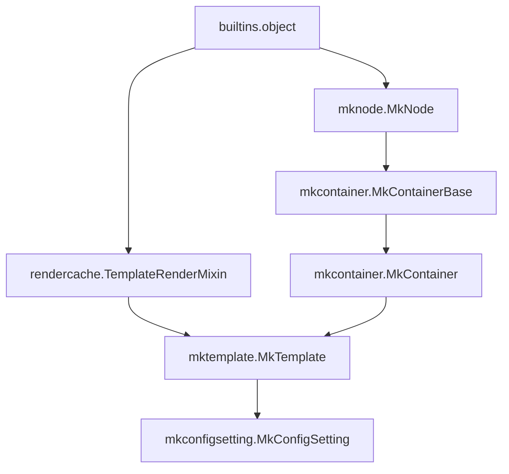

# MkConfigSetting

[ Show source on GitHub](https://github.com/phil65/mknodes/blob/main/src/mknodes/templatenodes/mkconfigsetting/__init__.py)

### Node for describing a config setting.

<details open>
<summary>Examples</summary>

### Example: **YAML format**
> [!NOTE]
> **Jinja**
>
> ```jinja
> {{ "path" | MkConfigSetting(mode="yaml",
>                             setting={"plugins": {"mknodes": {"path": "path.to.module"}}},
>                             description="Some **markdown** to describe the setting",
>                             default="path.to.module")}}
>
> ```

> [!NOTE]
> **Python**
>
> ```python
> MkConfigSetting(
>     "path",
>     "Some **markdown** to describe the setting",
>     setting={"plugins": {"mknodes": {"path": "path.to.module"}}},
>     default="path.to.module",
> )
>
> ```

<details open>
<summary>Rendered</summary>

`**path**`
:   Default: `'path.to.module'`

    Some **markdown** to describe the setting

    ````yaml
    plugins:
      mknodes:
        path: path.to.module

    ````

</details>

<details>
<summary>Markdown</summary>

`````markdown
`**path**`
:   Default: `'path.to.module'`

    Some **markdown** to describe the setting

    ````yaml
    plugins:
      mknodes:
        path: path.to.module

    ````

`````

</details>

<details>
<summary>Html</summary>

`````html
<p><code>**path**</code>
:   Default: <code>'path.to.module'</code></p>
<pre><code>Some **markdown** to describe the setting

````yaml
plugins:
  mknodes:
    path: path.to.module

````
</code></pre>

`````

</details>

<details>
<summary>Repr tree</summary>

```
MkConfigSetting
╰── MkCode(None, language='yaml')
    ╰── MkText('plugins:\n  mknodes:\n    path: path.to.module\n')
```

</details>

### Example: **JSON format**
> [!NOTE]
> **Jinja**
>
> ```jinja
> {{ "path" | MkConfigSetting(mode="json",
>                             setting={"plugins": {"mknodes": {"path": "path.to.module"}}},
>                             description="Some **markdown** to describe the setting",
>                             default="path.to.module")}}
>
> ```

> [!NOTE]
> **Python**
>
> ```python
> MkConfigSetting(
>     "path",
>     "Some **markdown** to describe the setting",
>     setting={"plugins": {"mknodes": {"path": "path.to.module"}}},
>     default="path.to.module",
>     mode="json",
> )
>
> ```

<details open>
<summary>Rendered</summary>

`**path**`
:   Default: `'path.to.module'`

    Some **markdown** to describe the setting

    ````json
    {
      "plugins": {
        "mknodes": {
          "path": "path.to.module"
        }
      }
    }
    ````

</details>

<details>
<summary>Markdown</summary>

`````markdown
`**path**`
:   Default: `'path.to.module'`

    Some **markdown** to describe the setting

    ````json
    {
      "plugins": {
        "mknodes": {
          "path": "path.to.module"
        }
      }
    }
    ````

`````

</details>

<details>
<summary>Html</summary>

`````html
<p><code>**path**</code>
:   Default: <code>'path.to.module'</code></p>
<pre><code>Some **markdown** to describe the setting

````json
{
  &quot;plugins&quot;: {
    &quot;mknodes&quot;: {
      &quot;path&quot;: &quot;path.to.module&quot;
    }
  }
}
````
</code></pre>

`````

</details>

<details>
<summary>Repr tree</summary>

```
MkConfigSetting
╰── MkCode(None, language='json')
    ╰── MkText('{\n  "plugins": {\n    "mknodes": {\n      "path": "path.to.module"\n    }\n  }\n}')
```

</details>

### Example: **TOML format**
> [!NOTE]
> **Jinja**
>
> ```jinja
> {{ "path" | MkConfigSetting(mode="toml",
>                             setting={"plugins": {"mknodes": {"path": "path.to.module"}}},
>                             description="Some **markdown** to describe the setting",
>                             default="path.to.module")}}
>
> ```

> [!NOTE]
> **Python**
>
> ```python
> MkConfigSetting(
>     "path",
>     "Some **markdown** to describe the setting",
>     setting={"plugins": {"mknodes": {"path": "path.to.module"}}},
>     default="path.to.module",
>     mode="toml",
> )
>
> ```

<details open>
<summary>Rendered</summary>

`**path**`
:   Default: `'path.to.module'`

    Some **markdown** to describe the setting

    ````toml
    [plugins.mknodes]
    path = "path.to.module"

    ````

</details>

<details>
<summary>Markdown</summary>

`````markdown
`**path**`
:   Default: `'path.to.module'`

    Some **markdown** to describe the setting

    ````toml
    [plugins.mknodes]
    path = "path.to.module"

    ````

`````

</details>

<details>
<summary>Html</summary>

`````html
<p><code>**path**</code>
:   Default: <code>'path.to.module'</code></p>
<pre><code>Some **markdown** to describe the setting

````toml
[plugins.mknodes]
path = &quot;path.to.module&quot;

````
</code></pre>

`````

</details>

<details>
<summary>Repr tree</summary>

```
MkConfigSetting
╰── MkCode(None, language='toml')
    ╰── MkText('[plugins.mknodes]\npath = "path.to.module"\n')
```

</details>

</details>

<details open>
<summary>DocStrings</summary>

<a id="mknodes.MkConfigSetting"></a>

```python
class MkConfigSetting(mktemplate.MkTemplate)
```

</details>

<details open>
<summary>Base classes</summary>

| Name | Children | Inherits |
|--- | --- | --- |
| **<font size='4'>[MkTemplate](https://phil65.github.io/mknodes/)</font>**<br>*<font size='1'>mknodes.templatenodes.mktemplate</font>*<br>Node representing a jinja template\. | <ul><li>[MkCliDoc](https://phil65.github.io/mknodes/)</li><li>[MkMaterialBadge](https://phil65.github.io/mknodes/)</li><li>[MkImageCompare](https://phil65.github.io/mknodes/)</li><li>[MkImageSlideshow](https://phil65.github.io/mknodes/)</li><li>[MkIFrame](https://phil65.github.io/mknodes/)</li><li>[MkCard](https://phil65.github.io/mknodes/)</li><li>[MkInstallGuide](https://phil65.github.io/mknodes/)</li><li>[MkCodeOfConduct](https://phil65.github.io/mknodes/)</li><li>[MkCommitConventions](https://phil65.github.io/mknodes/)</li><li>[MkDevEnvSetup](https://phil65.github.io/mknodes/)</li><li>[MkDevTools](https://phil65.github.io/mknodes/)</li><li>...</li></ul> | <ul><li>[TemplateRenderMixin](https://phil65.github.io/mknodes/)</li><li>[MkContainer](https://phil65.github.io/mknodes/)</li></ul> |

</details>

<details>
<summary>⋔ Inheritance diagram</summary>



</details>

<details>
<summary>NodeFile</summary>

**/home/runner/work/mknodes/mknodes/src/mknodes/templatenodes/mkconfigsetting/metadata.toml**

```toml
[metadata]
name = "MkConfigSetting"
icon = "mdi:library"
virtual_children = true

[requirements.extension.def_list]

[examples.yaml]
title = "YAML format"
jinja = """
{{ "path" | MkConfigSetting(mode="yaml",
                            setting={"plugins": {"mknodes": {"path": "path.to.module"}}},
                            description="Some **markdown** to describe the setting",
                            default="path.to.module")}}
"""

[examples.json]
title = "JSON format"
jinja = """
{{ "path" | MkConfigSetting(mode="json",
                            setting={"plugins": {"mknodes": {"path": "path.to.module"}}},
                            description="Some **markdown** to describe the setting",
                            default="path.to.module")}}
"""

[examples.toml]
title = "TOML format"
jinja = """
{{ "path" | MkConfigSetting(mode="toml",
                            setting={"plugins": {"mknodes": {"path": "path.to.module"}}},
                            description="Some **markdown** to describe the setting",
                            default="path.to.module")}}
"""

[output.markdown]
template = """
{{ node.title | md_style(bold=True, code=True) }}
:   Default: `{{ node.default | repr }}`


Version added: `{{ node.version_added }}`



Required: `{{ "yes" if node.required else "no" }}`


{{ node.description }}



{{ node.setting | serialize(node.mode) | MkCode(language=node.mode) }}

{{ node.setting | MkCode(language=node.mode) }}


"""

```

</details>

<details>
<summary>Code</summary>

**mknodes.templatenodes.mkconfigsetting.MkConfigSetting**

```python
class MkConfigSetting(mktemplate.MkTemplate):
    """Node for describing a config setting."""

    ICON = "material/library"

    def __init__(
        self,
        title: str,
        description: str,
        *,
        setting: dict[str, Any] | str | None = None,
        default: str | int | None = None,
        version_added: str | None = None,
        optional: bool | None = None,
        mode: superdict.MarkupTypeStr = "yaml",
        **kwargs: Any,
    ) -> None:
        """Constructor.

        Args:
            title: Setting title
            description: Setting description
            setting: (Nested) json-like object representing the setting
            default: Default setting value
            version_added: Version added
            optional: Whether setting is optional. (None hides the label)
            mode: Markup language of settings file
            kwargs: Keyword arguments passed to parent
        """
        super().__init__("output/markdown/template", **kwargs)
        self.title = title
        self.setting = setting
        self.default = default
        self.version_added = version_added
        self.description = description
        self.optional = optional
        self.mode = mode

```

</details>

<details>
<summary>Page info</summary>

<details>
<summary>Code for this page</summary>

**mknodes.manual.nodes_section.create_section_for_nodes**

```python
def create_section_for_nodes(
    nav: mk.MkNav,
    klasses: Sequence[type[mk.MkNode]],
) -> mk.MkTable:
    table = mk.MkTable(columns=["Node", "Docstrings", "Markdown extensions"])
    for kls in klasses:
        tpl = "classpage_custom.jinja"
        page = mk.MkClassPage(kls, icon=kls.ICON, template_path=tpl, parent=nav, hide="toc")
        nav += page
        if kls.STATUS:
            page.metadata.status = kls.STATUS
        elif kls.JS_FILES:
            page.metadata.status = "js"
        elif kls.CSS:
            page.metadata.status = "css"
        page.created_by = create_section_for_nodes
        link = mk.MkLink(page, kls.__name__, icon=kls.ICON)
        extensions = ", ".join(f"`{i}`" for i in kls.REQUIRED_EXTENSIONS)
        table.add_row((link, kls.__doc__, extensions))
    return table

```

</details>

<details>
<summary>Resources</summary>

```python
Resources(css=[],
          markdown_extensions={'admonition': {},
                               'pymdownx.details': {},
                               'pymdownx.highlight': {'anchor_linenums': True,
                                                      'line_spans': '__span',
                                                      'pygments_lang_class': True},
                               'pymdownx.superfences': {'custom_fences': [{'class': 'mermaid',
                                                                           'format': <function fence_code_format at 0x7bb797a5c1a0>,
                                                                           'name': 'mermaid'}]},
                               'pymdownx.tabbed': {},
                               'tables': {}},
          plugins=[Plugin('mkdocstrings')],
          js=[],
          assets=[],
          packages=[])
```

</details>

<details>
<summary>Metadata</summary>

```yaml
created:
  source_filename: /home/runner/work/mknodes/mknodes/src/mknodes/manual/nodes_section.py
  source_function: create_section_for_nodes
  source_line_no: 93
hide:
- toc
icon: material/library
status: new
title: MkConfigSetting

```

</details>

</details>
