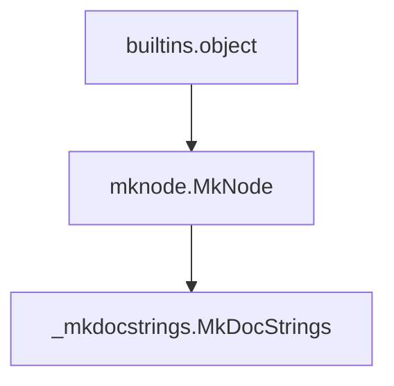

# MkDocStrings

[ Show source on GitHub](https://github.com/phil65/mknodes/blob/main/src/mknodes/basenodes/_mkdocstrings/__init__.py)

### Docstring section (powered by mkdocstrings).

<details open>
<summary>Examples</summary>

### Example: **DocStrings**
> [!NOTE]
> **Jinja**
>
> ```jinja
> {{ "mknodes.MkDocStrings" | MkDocStrings(show_if_no_docstring=True, heading_level=3) }}
>
> ```

> [!NOTE]
> **Python**
>
> ```python
> MkDocStrings(obj='mknodes.MkDocStrings', heading_level=3, show_if_no_docstring=True)
> ```

<details open>
<summary>Rendered</summary>

<a id="mknodes.MkDocStrings"></a>

```python
class MkDocStrings(mknode.MkNode)
```

Docstring section (powered by mkdocstrings).

</details>

<details>
<summary>Markdown</summary>

````markdown
<a id="mknodes.MkDocStrings"></a>

```python
class MkDocStrings(mknode.MkNode)
```

Docstring section (powered by mkdocstrings).

````

</details>

<details>
<summary>Html</summary>

```html
<p><a id="mknodes.MkDocStrings"></a></p>
<pre><code class="language-python">class MkDocStrings(mknode.MkNode)
</code></pre>
<p>Docstring section (powered by mkdocstrings).</p>

```

</details>

<details>
<summary>GitHub</summary>

````markdown
<a id="mknodes.MkDocStrings"></a>

```python
class MkDocStrings(mknode.MkNode)
```

Docstring section (powered by mkdocstrings).

````

</details>

</details>

<details open>
<summary>DocStrings</summary>

<a id="mknodes.MkDocStrings"></a>

```python
class MkDocStrings(mknode.MkNode)
```

</details>

<details open>
<summary>Base classes</summary>

| Name | Children | Inherits |
|--- | --- | --- |
| **<font size='4'>[MkNode](https://phil65.github.io/mknodes/)</font>**<br>*<font size='1'>mknodes.basenodes.mknode</font>*<br>Base class for everything which can be expressed as Markup\. | <ul><li>[MkContainerBase](https://phil65.github.io/mknodes/)</li><li>[MkCompactAdmonition](https://phil65.github.io/mknodes/)</li><li>[MkLink](https://phil65.github.io/mknodes/)</li><li>[MkText](https://phil65.github.io/mknodes/)</li><li>[MkHeader](https://phil65.github.io/mknodes/)</li><li>[MkKeys](https://phil65.github.io/mknodes/)</li><li>[MkDocStrings](https://phil65.github.io/mknodes/)</li><li>[MkIcon](https://phil65.github.io/mknodes/)</li><li>[MkImage](https://phil65.github.io/mknodes/)</li><li>[MkProgressBar](https://phil65.github.io/mknodes/)</li><li>[BaseBlock](https://phil65.github.io/mknodes/)</li><li>...</li></ul> | <ul><li>[object](https://docs.python.org/3/library/functions.html#object)</li></ul> |

</details>

<details>
<summary>⋔ Inheritance diagram</summary>



</details>

<details>
<summary>NodeFile</summary>

**/home/runner/work/mknodes/mknodes/src/mknodes/basenodes/_mkdocstrings/metadata.toml**

```toml
[metadata]
icon = "mdi:api"
name = "MkDocStrings"
group = "documentation"

[requirements.plugin.mkdocstrings]
[requirements.package.mkdocstrings]
extras = "python"


[examples.docstrings]
title = "DocStrings"
jinja = """
{{ "mknodes.MkDocStrings" | MkDocStrings(show_if_no_docstring=True, heading_level=3) }}
"""

[output.markdown]
template = """
::: {{ node.obj_path }}

    options:

      {{ k }}: {{ v | repr }}


"""

```

</details>

<details>
<summary>Code</summary>

**mknodes.basenodes._mkdocstrings.MkDocStrings**

```python
class MkDocStrings(mknode.MkNode):
    """Docstring section (powered by mkdocstrings)."""

    REQUIRED_PLUGINS = [resources.Plugin("mkdocstrings")]
    REQUIRED_PACKAGES = [resources.Package("mkdocstrings", extras=["python"])]
    OPTIONS_DEFAULT: dict[str, Any] = {}
    ICON = "material/api"

    def __init__(
        self,
        obj: (
            types.ModuleType
            | griffe.Object
            | str
            | tuple[str, ...]
            | list[str]
            | os.PathLike[str]
            | type
            | Callable[..., Any]
        ),
        for_topmost: bool = True,
        allow_inspection: bool | None = None,
        show_bases: bool | None = None,
        show_source: bool | None = None,
        preload_modules: list[str] | None = None,
        heading_level: int | None = None,
        show_root_heading: bool | None = None,
        show_root_toc_entry: bool | None = None,
        show_root_full_path: bool | None = None,
        show_root_members_full_path: bool | None = None,
        show_object_full_path: bool | None = None,
        show_category_heading: bool | None = None,
        show_symbol_type_heading: bool | None = None,
        show_symbol_type_toc: bool | None = None,
        show_docstring_description: bool | None = None,
        inherited_members: bool | None = None,
        members: list[str] | None = None,
        members_order: Literal["alphabetical", "source"] | None = None,
        filters: list[str] | None = None,
        group_by_category: bool | None = None,
        show_submodules: bool | None = None,
        docstring_section_style: Literal["table", "list", "spacy"] | None = None,
        merge_init_into_class: bool | None = None,
        show_if_no_docstring: bool | None = None,
        annotations_path: Literal["brief", "source"] | None = None,
        line_length: int | None = None,
        show_signature: bool | None = None,
        show_signature_annotations: bool | None = None,
        signature_crossrefs: bool | None = None,
        separate_signature: bool | None = None,
        **kwargs: Any,
    ) -> None:
        """Docstring section.

        Global options for DocStrings can be overridden by setting the keyword arguments
        to not-None.

        Args:
            obj: What to show DocStrings for.
            for_topmost: If True, try to find the "shortest" path to given object by
                         checking whether it can also be found in a parent module.
            allow_inspection: Whether to allow inspecting modules when visiting
                              them is not possible
            show_bases: Show the base classes of a class.
            show_source: Show the source code of this object.
            preload_modules: List of modules to pre-load.
            heading_level: The initial heading level to use.
            show_root_heading: Show the heading of the object at the root of the
                               documentation tree (i.e. the object referenced by
                               the identifier after :::).
            show_root_toc_entry: If the root heading is not shown, at least
                                 add a ToC entry for it.
            show_root_full_path: Show the full Python path for the root
                                 object heading.
            show_root_members_full_path: Show the full Python path of the
                                         root members.
            show_object_full_path: Show the full Python path of every object.
            show_category_heading: When grouped by categories, show a heading
                                   for each category.
            show_symbol_type_heading: Show the symbol type in headings (e.g. mod,
                                      class, func and attr).
            show_symbol_type_toc: Show the symbol type in the Table of
                                  Contents (e.g. mod, class, func and attr).
            show_docstring_description: Whether to show the description from DocStrings
            inherited_members: Also show inherited members.
            members: An explicit list of members to render.
            members_order: The members ordering to use.
            filters: A list of filters applied to filter objects based on their name.
                     A filter starting with ! will exclude matching objects instead of
                     including them. The members option takes precedence over filters
                     (filters will still be applied recursively to lower members in the
                     hierarchy).
            group_by_category: Group the object's children by categories:
                               attributes, classes, functions, and modules.
            show_submodules: When rendering a module, show its submodules recursively.
            docstring_section_style: The style used to render docstring sections.
            merge_init_into_class: Whether to merge the __init__ method into
                                   the class' signature and docstring.
            show_if_no_docstring: Show the object heading even if it has no
                                  docstring or children with docstrings.
            annotations_path: The verbosity for annotations path
            line_length: Maximum line length when formatting code/signatures.
            show_signature: Show methods and functions signatures.
            show_signature_annotations: Show the type annotations in methods
                                        and functions signatures.
            signature_crossrefs: Whether to render cross-references for type
                                 annotations in signatures.
            separate_signature: Whether to put the whole signature in a code
                                block below the heading. If Black is installed,
                                the signature is also formatted using it.
            kwargs: Keyword arguments passed to super.
        """
        super().__init__(**kwargs)
        self.obj = obj
        self.for_topmost = for_topmost
        opts = dict(
            allow_inspection=allow_inspection,
            show_bases=show_bases,
            show_source=show_source,
            preload_modules=preload_modules,
            heading_level=heading_level,
            show_root_heading=show_root_heading,
            show_root_toc_entry=show_root_toc_entry,
            show_root_full_path=show_root_full_path,
            show_root_members_full_path=show_root_members_full_path,
            show_object_full_path=show_object_full_path,
            show_category_heading=show_category_heading,
            show_symbol_type_heading=show_symbol_type_heading,
            show_symbol_type_toc=show_symbol_type_toc,
            show_docstring_description=show_docstring_description,
            inherited_members=inherited_members,
            members=members,
            members_order=members_order,
            filters=filters,
            group_by_category=group_by_category,
            show_submodules=show_submodules,
            docstring_section_style=docstring_section_style,
            merge_init_into_class=merge_init_into_class,
            show_if_no_docstring=show_if_no_docstring,
            annotations_path=annotations_path,
            line_length=line_length,
            show_signature=show_signature,
            show_signature_annotations=show_signature_annotations,
            signature_crossrefs=signature_crossrefs,
            separate_signature=separate_signature,
        )
        opts = self.OPTIONS_DEFAULT.copy() | opts
        self._options = {k: v for k, v in opts.items() if v is not None}

    def __repr__(self) -> str:
        option_kwargs = {k: v for k, v in self.options.items() if v is not None}
        return reprhelpers.get_repr(self, obj=self.obj, **option_kwargs)

    @property
    def obj_path(self) -> str:
        match self.obj:
            case types.ModuleType():
                return self.obj.__name__
            case griffe.Object():
                return self.obj.path
            case Callable():
                if not self.for_topmost:
                    return f"{self.obj.__module__}.{self.obj.__qualname__}"
                topmost_path = classhelpers.get_topmost_module_path(self.obj)
                return f"{topmost_path}.{self.obj.__qualname__}"
            case str():
                return self.obj  # for setting a manual path
            case tuple() | list():
                return ".".join(self.obj)
            case _:
                raise TypeError(self.obj)

    @property
    def options(self) -> dict[str, Any]:
        import mknodes as mk

        # The default section style does not work well inside Annotations,
        # so we switch to "list" when any parent is an MkAnnotation
        # and no style is explicitely set.
        opts = self._options.copy()
        style = opts.get("docstring_section_style")
        if not style and self.is_descendant_of(mk.MkAnnotations):
            opts["docstring_section_style"] = "list"
            opts["show_root_heading"] = True
        return opts

    def to_md_unprocessed(self) -> str:
        md = f"::: {self.obj_path}\n"
        if not self.options:
            return md
        option_lines = [f"      {k}: {v!r}" for k, v in self.options.items()]
        option_text = "\n".join(option_lines)
        return f"{md}    options:\n{option_text}\n"

```

</details>

<details>
<summary>Page info</summary>

<details>
<summary>Code for this page</summary>

**mknodes.manual.nodes_section.create_section_for_nodes**

```python
def create_section_for_nodes(
    nav: mk.MkNav,
    klasses: Sequence[type[mk.MkNode]],
) -> mk.MkTable:
    table = mk.MkTable(columns=["Node", "Docstrings", "Markdown extensions"])
    for kls in klasses:
        tpl = "classpage_custom.jinja"
        page = mk.MkClassPage(kls, icon=kls.ICON, template_path=tpl, parent=nav, hide="toc")
        nav += page
        if kls.STATUS:
            page.metadata.status = kls.STATUS
        elif kls.JS_FILES:
            page.metadata.status = "js"
        elif kls.CSS:
            page.metadata.status = "css"
        page.created_by = create_section_for_nodes
        link = mk.MkLink(page, kls.__name__, icon=kls.ICON)
        extensions = ", ".join(f"`{i}`" for i in kls.REQUIRED_EXTENSIONS)
        table.add_row((link, kls.__doc__, extensions))
    return table

```

</details>

<details>
<summary>Resources</summary>

```python
Resources(css=[],
          markdown_extensions={'admonition': {},
                               'pymdownx.details': {},
                               'pymdownx.highlight': {'anchor_linenums': True,
                                                      'line_spans': '__span',
                                                      'pygments_lang_class': True},
                               'pymdownx.superfences': {'custom_fences': [{'class': 'mermaid',
                                                                           'format': <function fence_code_format at 0x7bb797a5c1a0>,
                                                                           'name': 'mermaid'}]},
                               'pymdownx.tabbed': {},
                               'tables': {}},
          plugins=[Plugin('mkdocstrings')],
          js=[],
          assets=[],
          packages=[])
```

</details>

<details>
<summary>Metadata</summary>

```yaml
created:
  source_filename: /home/runner/work/mknodes/mknodes/src/mknodes/manual/nodes_section.py
  source_function: create_section_for_nodes
  source_line_no: 93
hide:
- toc
icon: material/api
title: MkDocStrings

```

</details>

</details>
