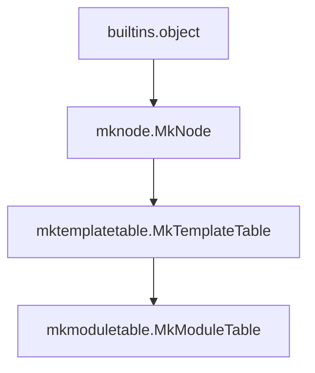

# MkModuleTable

[ Show source on GitHub](https://github.com/phil65/mknodes/blob/main/src/mknodes/templatenodes/mkmoduletable/__init__.py)

### Node for a table containing formatted information about a module.

<details open>
<summary>Examples</summary>

### Example: **Regular**
> [!NOTE]
> **Jinja**
>
> ```jinja
> {{ ["mknodes.info"] | MkModuleTable }}
>
> ```

> [!NOTE]
> **Python**
>
> ```python
> MkModuleTable([mknodes.info])
> ```

<details open>
<summary>Rendered</summary>

| Name | DocStrings | Members |
|--- | --- | --- |
| [mknodes.info](https://phil65.github.io/mknodes/) | Information/Metadata- related classes. |  |

</details>

<details>
<summary>Markdown</summary>

```markdown
| Name | DocStrings | Members |
|--- | --- | --- |
| [mknodes.info](https://phil65.github.io/mknodes/) | Information/Metadata- related classes. |  |

```

</details>

<details>
<summary>Html</summary>

```html
<table>
<thead>
<tr>
<th>Name</th>
<th>DocStrings</th>
<th>Members</th>
</tr>
</thead>
<tbody>
<tr>
<td><a href="https://phil65.github.io/mknodes/">mknodes.info</a></td>
<td>Information/Metadata- related classes.</td>
<td></td>
</tr>
</tbody>
</table>

```

</details>

</details>

<details open>
<summary>DocStrings</summary>

<a id="mknodes.MkModuleTable"></a>

```python
class MkModuleTable(mktemplatetable.MkTemplateTable)
```

</details>

<details open>
<summary>Base classes</summary>

| Name | Children | Inherits |
|--- | --- | --- |
| **<font size='4'>[MkTemplateTable](https://phil65.github.io/mknodes/)</font>**<br>*<font size='1'>mknodes.templatenodes.mktemplatetable</font>*<br>Node for a table showing dependencies for a package\. | <ul><li>[MkClassTable](https://phil65.github.io/mknodes/)</li><li>[MkDependencyTable](https://phil65.github.io/mknodes/)</li><li>[MkModuleTable](https://phil65.github.io/mknodes/)</li></ul> | <ul><li>[MkNode](https://phil65.github.io/mknodes/)</li></ul> |

</details>

<details>
<summary>⋔ Inheritance diagram</summary>



</details>

<details>
<summary>NodeFile</summary>

**/home/runner/work/mknodes/mknodes/src/mknodes/templatenodes/mkmoduletable/metadata.toml**

```toml
[metadata]
icon = "mdi:view-module-outline"
name = "MkModuleTable"
group = "documentation"

[requirements.extension.tables]

[examples.regular]
title = "Regular"
jinja = """
{{ ["mknodes.info"] | MkModuleTable }}
"""

[layouts.default]
Name = """
{{ module | get_link }}
"""
DocStrings = """
{{ module | get_doc(fallback="*No docstrings defined.*", only_summary=True) }}
"""
Members = """

{{ (module | getattr("__all__") | MkList(as_links=True, shorten_after=10)).to_html() }}

"""

```

</details>

<details>
<summary>Code</summary>

**mknodes.templatenodes.mkmoduletable.MkModuleTable**

```python
class MkModuleTable(mktemplatetable.MkTemplateTable):
    """Node for a table containing formatted information about a module."""

    ICON = "material/view-module-outline"

    def __init__(
        self,
        modules: Sequence[types.ModuleType | str],
        **kwargs,
    ) -> None:
        self.modules = [classhelpers.to_module(i, return_none=False) for i in modules]
        super().__init__(**kwargs)

    def iter_items(self):
        yield from [
            dict(module=module, griffe_module=grifferegistry.get_module(module))
            for module in self.modules
        ]

```

</details>

<details>
<summary>Page info</summary>

<details>
<summary>Code for this page</summary>

**mknodes.manual.nodes_section.create_section_for_nodes**

```python
def create_section_for_nodes(
    nav: mk.MkNav,
    klasses: Sequence[type[mk.MkNode]],
) -> mk.MkTable:
    table = mk.MkTable(columns=["Node", "Docstrings", "Markdown extensions"])
    for kls in klasses:
        tpl = "classpage_custom.jinja"
        page = mk.MkClassPage(kls, icon=kls.ICON, template_path=tpl, parent=nav, hide="toc")
        nav += page
        if kls.STATUS:
            page.metadata.status = kls.STATUS
        elif kls.JS_FILES:
            page.metadata.status = "js"
        elif kls.CSS:
            page.metadata.status = "css"
        page.created_by = create_section_for_nodes
        link = mk.MkLink(page, kls.__name__, icon=kls.ICON)
        extensions = ", ".join(f"`{i}`" for i in kls.REQUIRED_EXTENSIONS)
        table.add_row((link, kls.__doc__, extensions))
    return table

```

</details>

<details>
<summary>Resources</summary>

```python
Resources(css=[],
          markdown_extensions={'admonition': {},
                               'pymdownx.details': {},
                               'pymdownx.highlight': {'anchor_linenums': True,
                                                      'line_spans': '__span',
                                                      'pygments_lang_class': True},
                               'pymdownx.superfences': {'custom_fences': [{'class': 'mermaid',
                                                                           'format': <function fence_code_format at 0x7bb797a5c1a0>,
                                                                           'name': 'mermaid'}]},
                               'pymdownx.tabbed': {},
                               'tables': {}},
          plugins=[Plugin('mkdocstrings')],
          js=[],
          assets=[],
          packages=[])
```

</details>

<details>
<summary>Metadata</summary>

```yaml
created:
  source_filename: /home/runner/work/mknodes/mknodes/src/mknodes/manual/nodes_section.py
  source_function: create_section_for_nodes
  source_line_no: 93
hide:
- toc
icon: material/view-module-outline
title: MkModuleTable

```

</details>

</details>
