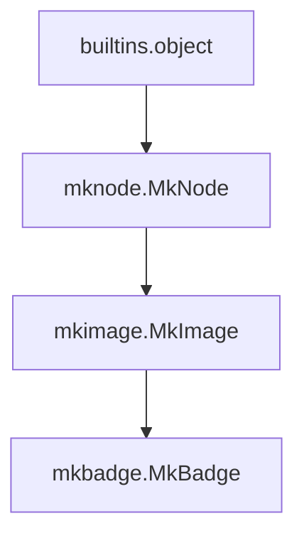

# MkBadge

[ Show source on GitHub](https://github.com/phil65/mknodes/blob/main/src/mknodes/templatenodes/mkbadge/__init__.py)

### Node for a locally-created badge (based on "anybadge").

> [!NOTE]
> **Description**
>
>
> The node creates a badge svg, appends it to the virtual files, and
> shows it as an image.

<details open>
<summary>Examples</summary>

### Example: **Regular**
> [!NOTE]
> **Jinja**
>
> ```jinja
> {{ ("Some", "Badge") | MkBadge }}
>
> ```

> [!NOTE]
> **Python**
>
> ```python
> MkBadge('Some', 'Badge')
> ```

<details open>
<summary>Rendered</summary>


</details>

<details>
<summary>Markdown</summary>

```markdown

```

</details>

<details>
<summary>Html</summary>

```html
<p></p>

```

</details>

<details>
<summary>GitHub</summary>

```markdown

```

</details>

### Example: **Font size**
> [!NOTE]
> **Jinja**
>
> ```jinja
> {{ ("Some", "Badge") | MkBadge(font_size=12) }}
>
> ```

> [!NOTE]
> **Python**
>
> ```python
> MkBadge('Some', 'Badge', font_size=12)
> ```

<details open>
<summary>Rendered</summary>


</details>

<details>
<summary>Markdown</summary>

```markdown

```

</details>

<details>
<summary>Html</summary>

```html
<p></p>

```

</details>

<details>
<summary>GitHub</summary>

```markdown

```

</details>

### Example: **Char padding**
> [!NOTE]
> **Jinja**
>
> ```jinja
> {{ ("Some", "Badge") | MkBadge(num_padding_chars=5) }}
>
> ```

> [!NOTE]
> **Python**
>
> ```python
> MkBadge('Some', 'Badge', num_padding_chars=5)
> ```

<details open>
<summary>Rendered</summary>


</details>

<details>
<summary>Markdown</summary>

```markdown

```

</details>

<details>
<summary>Html</summary>

```html
<p></p>

```

</details>

<details>
<summary>GitHub</summary>

```markdown

```

</details>

### Example: **Badge color**
> [!NOTE]
> **Jinja**
>
> ```jinja
> {{ ("Some", "Badge") | MkBadge(font_size=12) }}
>
> ```

> [!NOTE]
> **Python**
>
> ```python
> MkBadge('Some', 'Badge', font_size=12)
> ```

<details open>
<summary>Rendered</summary>


</details>

<details>
<summary>Markdown</summary>

```markdown

```

</details>

<details>
<summary>Html</summary>

```html
<p></p>

```

</details>

<details>
<summary>GitHub</summary>

```markdown

```

</details>

### Example: **GitLab style**
> [!NOTE]
> **Jinja**
>
> ```jinja
> {{ ("Some", "Badge") | MkBadge(use_gitlab_style=True) }}
>
> ```

> [!NOTE]
> **Python**
>
> ```python
> MkBadge('Some', 'Badge', use_gitlab_style=True)
> ```

<details open>
<summary>Rendered</summary>


</details>

<details>
<summary>Markdown</summary>

```markdown

```

</details>

<details>
<summary>Html</summary>

```html
<p></p>

```

</details>

<details>
<summary>GitHub</summary>

```markdown

```

</details>

</details>

<details open>
<summary>DocStrings</summary>

<a id="mknodes.MkBadge"></a>

```python
class MkBadge(mkimage.MkImage)
```

</details>

<details open>
<summary>Base classes</summary>

| Name | Children | Inherits |
|--- | --- | --- |
| **<font size='4'>[MkImage](https://phil65.github.io/mknodes/)</font>**<br>*<font size='1'>mknodes.basenodes.mkimage</font>*<br>Image including optional caption\. | <ul><li>[MkBinaryImage](https://phil65.github.io/mknodes/)</li><li>[MkBadge](https://phil65.github.io/mknodes/)</li></ul> | <ul><li>[MkNode](https://phil65.github.io/mknodes/)</li></ul> |

</details>

<details>
<summary>⋔ Inheritance diagram</summary>



</details>

<details>
<summary>NodeFile</summary>

**/home/runner/work/mknodes/mknodes/src/mknodes/templatenodes/mkbadge/metadata.toml**

```toml
[metadata]
icon = "simple-icons:shieldsdotio"
name = "MkBadge"
group = "badge"

[requirements.package.anybadge]

[examples.regular]
title = "Regular"
jinja = """
{{ ("Some", "Badge") | MkBadge }}
"""

[examples.font_size]
title = "Font size"
jinja = """
{{ ("Some", "Badge") | MkBadge(font_size=12) }}
"""

[examples.char_padding]
title = "Char padding"
jinja = """
{{ ("Some", "Badge") | MkBadge(num_padding_chars=5) }}
"""

[examples.badge_color]
title = "Badge color"
jinja = """
{{ ("Some", "Badge") | MkBadge(font_size=12) }}
"""

[examples.gitlab_style]
title = "GitLab style"
jinja = """
{{ ("Some", "Badge") | MkBadge(use_gitlab_style=True) }}
"""

[output.html]
template = """
<body>{{ node.get_data() | replace("\n", "") | html_link(node.get_url()) }}</body>
"""

```

</details>

<details>
<summary>Code</summary>

**mknodes.templatenodes.mkbadge.MkBadge**

```python
class MkBadge(mkimage.MkImage):
    """Node for a locally-created badge (based on "anybadge").

    The node creates a badge svg, appends it to the virtual files, and
    shows it as an image.
    """

    ICON = "simple/shieldsdotio"
    REQUIRED_PACKAGES = [resources.Package("anybadge")]

    def __init__(
        self,
        label: str | tuple[str, str],
        value: str | None = None,
        *,
        font_size: Literal[10, 11, 12] | None = None,
        font_name: str | None = None,
        num_padding_chars: int | None = None,
        badge_color: str | None = None,
        text_color: str | None = None,
        use_gitlab_style: bool = False,
        **kwargs: Any,
    ) -> None:
        """Constructor.

        Args:
            label: Left part of the badge. If given a tuple, use 2nd item as value.
            value: Right part of the badge
            font_size: Size of font to use
            font_name: Name of font to use
            num_padding_chars: Number of chars to use for padding
            badge_color: Badge color
            text_color: Badge color
            use_gitlab_style: Use Gitlab-scope style
            kwargs: Keyword arguments passed to parent
        """
        super().__init__("", **kwargs)
        self.value: str | None
        if isinstance(label, tuple):
            self.label, self.value = label
        else:
            self.label = label
            self.value = value
        self.font_size = font_size
        self.font_name = font_name
        self.num_padding_chars = num_padding_chars
        self._badge_color = badge_color
        self._text_color = text_color
        self.use_gitlab_style = use_gitlab_style

    @property
    def badge_color(self) -> str | None:
        if isinstance(self._badge_color, str):
            return self._badge_color
        return self.ctx.theme.primary_color

    def to_md_unprocessed(self) -> str:
        data = self.get_data()
        inner = htmlfilters.html_link(data.replace("\n", ""), self.get_url())
        return f"<body>{inner}</body>"

    @property
    def text_color(self) -> str | None:
        if isinstance(self._text_color, str):
            return self._text_color
        color = self.ctx.theme.text_color
        return f"{color},#fff" if self.use_gitlab_style else f"#fff,{color}"

    def get_data(self) -> str:
        return get_badge(
            label=self.label,
            value=self.value,
            font_size=self.font_size,
            font_name=self.font_name,
            num_padding_chars=self.num_padding_chars,
            badge_color=self.badge_color,
            text_color=self.text_color,
            use_gitlab_style=self.use_gitlab_style,
        )

    @property
    def path(self) -> str:
        hashed = utils.get_hash(repr(self))
        unique = f"{self.label}_{self.value}_{hashed}.svg"
        return textfilters.slugify(unique)

```

</details>

<details>
<summary>Page info</summary>

<details>
<summary>Code for this page</summary>

**mknodes.manual.nodes_section.create_section_for_nodes**

```python
def create_section_for_nodes(
    nav: mk.MkNav,
    klasses: Sequence[type[mk.MkNode]],
) -> mk.MkTable:
    table = mk.MkTable(columns=["Node", "Docstrings", "Markdown extensions"])
    for kls in klasses:
        tpl = "classpage_custom.jinja"
        page = mk.MkClassPage(kls, icon=kls.ICON, template_path=tpl, parent=nav, hide="toc")
        nav += page
        if kls.STATUS:
            page.metadata.status = kls.STATUS
        elif kls.JS_FILES:
            page.metadata.status = "js"
        elif kls.CSS:
            page.metadata.status = "css"
        page.created_by = create_section_for_nodes
        link = mk.MkLink(page, kls.__name__, icon=kls.ICON)
        extensions = ", ".join(f"`{i}`" for i in kls.REQUIRED_EXTENSIONS)
        table.add_row((link, kls.__doc__, extensions))
    return table

```

</details>

<details>
<summary>Resources</summary>

```python
Resources(css=[],
          markdown_extensions={'admonition': {},
                               'pymdownx.details': {},
                               'pymdownx.highlight': {'anchor_linenums': True,
                                                      'line_spans': '__span',
                                                      'pygments_lang_class': True},
                               'pymdownx.superfences': {'custom_fences': [{'class': 'mermaid',
                                                                           'format': <function fence_code_format at 0x7bb797a5c1a0>,
                                                                           'name': 'mermaid'}]},
                               'pymdownx.tabbed': {},
                               'tables': {}},
          plugins=[Plugin('mkdocstrings')],
          js=[],
          assets=[],
          packages=[])
```

</details>

<details>
<summary>Metadata</summary>

```yaml
created:
  source_filename: /home/runner/work/mknodes/mknodes/src/mknodes/manual/nodes_section.py
  source_function: create_section_for_nodes
  source_line_no: 93
hide:
- toc
icon: simple/shieldsdotio
title: MkBadge

```

</details>

</details>
