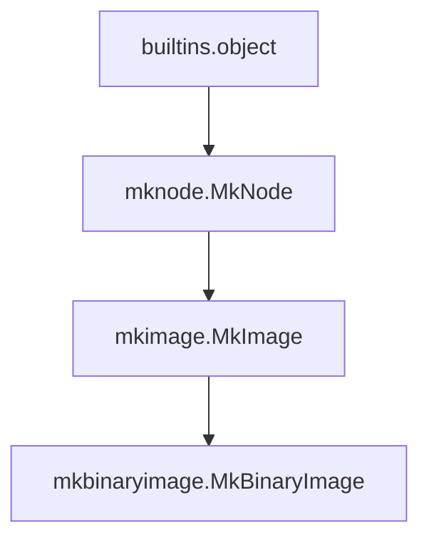

# MkBinaryImage

[ Show source on GitHub](https://github.com/phil65/mknodes/blob/main/src/mknodes/basenodes/mkbinaryimage/__init__.py)

### Image carrying the data by itself.

> [!NOTE]
> **Description**
>
>
> This node basically is a regular image link, but carries the image data by itself.
> The data will get written to the "virtual" folder at the end of the process.
> It can hold either str or bytes as data.

<details open>
<summary>Examples</summary>

### Example: **From data**
> [!NOTE]
> **Jinja**
>
> ```jinja
> 
>
> {{ svg | MkBinaryImage(path="some_image.svg", caption="A simple cross") }}
>
> ```

> [!NOTE]
> **Python**
>
> ```python
> MkBinaryImage(
>     '<svg width="90pt" height="90pt" version="1.1" viewBox="0 0 15.875 10.583" xmlns="http://www.w3.org/2000/svg">\n                  <g fill="none" stroke="#F00" stroke-width=".3">\n                      <path d="m6.1295 3.6601 3.2632 3.2632z"/>\n                      <path d="m9.3927 3.6601-3.2632 3.2632z"/>\n                  </g>\n              </svg>',
>     "some_image.svg",
>     caption="A simple cross",
> )
>
> ```

<details open>
<summary>Rendered</summary>

<picture>
 
</picture>

</details>

<details>
<summary>Markdown</summary>

```markdown
<picture>
 
</picture>
```

</details>

<details>
<summary>Html</summary>

```html
<picture>
 
</picture>

```

</details>

<details>
<summary>GitHub</summary>

```markdown
<picture>
 
</picture>
```

</details>

### Example: **From icon**
> [!NOTE]
> **Jinja**
>
> ```jinja
> {{ mk.MkBinaryImage.for_icon("file-image", width=200) }}
>
> ```

> [!NOTE]
> **Python**
>
> ```python
> MkBinaryImage(
>     '<svg xmlns="http://www.w3.org/2000/svg" width="1em" height="1em" viewBox="0 0 24 24"><path fill="currentColor" d="M13 9h5.5L13 3.5zM6 2h8l6 6v12a2 2 0 0 1-2 2H6a2 2 0 0 1-2-2V4c0-1.11.89-2 2-2m0 18h12v-8l-4 4l-2-2zM8 9a2 2 0 0 0-2 2a2 2 0 0 0 2 2a2 2 0 0 0 2-2a2 2 0 0 0-2-2"/></svg>',
>     "file_image.svg",
>     width=200,
> )
>
> ```

<details open>
<summary>Rendered</summary>

<picture>
 
</picture>

</details>

<details>
<summary>Markdown</summary>

```markdown
<picture>
 
</picture>
```

</details>

<details>
<summary>Html</summary>

```html
<picture>
 
</picture>

```

</details>

<details>
<summary>GitHub</summary>

```markdown
<picture>
 
</picture>
```

</details>

</details>

<details open>
<summary>DocStrings</summary>

<a id="mknodes.MkBinaryImage"></a>

```python
class MkBinaryImage(mkimage.MkImage)
```

</details>

<details open>
<summary>Base classes</summary>

| Name | Children | Inherits |
|--- | --- | --- |
| **<font size='4'>[MkImage](https://phil65.github.io/mknodes/)</font>**<br>*<font size='1'>mknodes.basenodes.mkimage</font>*<br>Image including optional caption\. | <ul><li>[MkBinaryImage](https://phil65.github.io/mknodes/)</li><li>[MkBadge](https://phil65.github.io/mknodes/)</li></ul> | <ul><li>[MkNode](https://phil65.github.io/mknodes/)</li></ul> |

</details>

<details>
<summary>⋔ Inheritance diagram</summary>



</details>

<details>
<summary>NodeFile</summary>

**/home/runner/work/mknodes/mknodes/src/mknodes/basenodes/mkbinaryimage/metadata.toml**

```toml
[metadata]
icon = "mdi:file-image"
name = "MkBinaryImage"
group = "image"

[examples.from_data]
title = "From data"
jinja = """


{{ svg | MkBinaryImage(path="some_image.svg", caption="A simple cross") }}
"""

[examples.from_icon]
title = "From icon"
jinja = """
{{ mk.MkBinaryImage.for_icon("file-image", width=200) }}
"""

```

</details>

<details>
<summary>Code</summary>

**mknodes.basenodes.mkbinaryimage.MkBinaryImage**

```python
class MkBinaryImage(mkimage.MkImage):
    """Image carrying the data by itself.

    This node basically is a regular image link, but carries the image data by itself.
    The data will get written to the "virtual" folder at the end of the process.
    It can hold either str or bytes as data.
    """

    ICON = "material/file-image"

    def __init__(
        self,
        data: bytes | str,
        path: str,
        *,
        target: linkprovider.LinkableType | None = None,
        caption: str = "",
        title: str = "",
        align: Literal["left", "right"] | None = None,
        width: int | None = None,
        **kwargs: Any,
    ) -> None:
        """Constructor.

        Args:
            data: Image data
            path: path for the image (including extension)
            target: Optional URL or node the image should link to
            caption: Image caption
            title: Image title
            align: Image alignment
            width: Image width in pixels
            kwargs: Keyword arguments passed to parent
        """
        super().__init__(
            path=path,
            target=target,
            caption=caption,
            title=title,
            align=align,
            width=width,
            **kwargs,
        )
        self.data = data

    @property
    def files(self) -> dict[str, str | bytes]:
        path = "/".join(self.resolved_parts) + "/" + self.path
        return {path: self.data} | self._files

    @classmethod
    def for_icon(cls, icon: str, **kwargs: Any) -> Self:
        """Return a MkBinaryImage with data for given icon.

        Args:
            icon: Icon to get a MkBinaryImage for (example: material/file-image)
            kwargs: Keyword arguments passed to constructor
        """
        content = iconcache.get_icon_svg(icon)
        path = f"{textfilters.slugify(icon)}.svg"
        return cls(data=content, path=path, **kwargs)

    @classmethod
    def for_file(
        cls,
        path: str | os.PathLike[str],
        storage_options: dict[str, Any] | None = None,
        **kwargs: Any,
    ) -> Self:
        """Return a MkBinaryImage with data for given icon.

        Args:
            path: Path to an image (also takes fsspec protocol URLs)
            storage_options: Options for fsspec backend
            kwargs: Keyword arguments passed to constructor
        """
        data = pathhelpers.load_bytes(path, **(storage_options or {}))
        return cls(data=data, path=upath.UPath(os.fspath(path)).name, **kwargs)

```

</details>

<details>
<summary>Page info</summary>

<details>
<summary>Code for this page</summary>

**mknodes.manual.nodes_section.create_section_for_nodes**

```python
def create_section_for_nodes(
    nav: mk.MkNav,
    klasses: Sequence[type[mk.MkNode]],
) -> mk.MkTable:
    table = mk.MkTable(columns=["Node", "Docstrings", "Markdown extensions"])
    for kls in klasses:
        tpl = "classpage_custom.jinja"
        page = mk.MkClassPage(kls, icon=kls.ICON, template_path=tpl, parent=nav, hide="toc")
        nav += page
        if kls.STATUS:
            page.metadata.status = kls.STATUS
        elif kls.JS_FILES:
            page.metadata.status = "js"
        elif kls.CSS:
            page.metadata.status = "css"
        page.created_by = create_section_for_nodes
        link = mk.MkLink(page, kls.__name__, icon=kls.ICON)
        extensions = ", ".join(f"`{i}`" for i in kls.REQUIRED_EXTENSIONS)
        table.add_row((link, kls.__doc__, extensions))
    return table

```

</details>

<details>
<summary>Resources</summary>

```python
Resources(css=[],
          markdown_extensions={'admonition': {},
                               'pymdownx.details': {},
                               'pymdownx.highlight': {'anchor_linenums': True,
                                                      'line_spans': '__span',
                                                      'pygments_lang_class': True},
                               'pymdownx.superfences': {'custom_fences': [{'class': 'mermaid',
                                                                           'format': <function fence_code_format at 0x7bb797a5c1a0>,
                                                                           'name': 'mermaid'}]},
                               'pymdownx.tabbed': {},
                               'tables': {}},
          plugins=[Plugin('mkdocstrings')],
          js=[],
          assets=[],
          packages=[])
```

</details>

<details>
<summary>Metadata</summary>

```yaml
created:
  source_filename: /home/runner/work/mknodes/mknodes/src/mknodes/manual/nodes_section.py
  source_function: create_section_for_nodes
  source_line_no: 93
hide:
- toc
icon: material/file-image
title: MkBinaryImage

```

</details>

</details>
