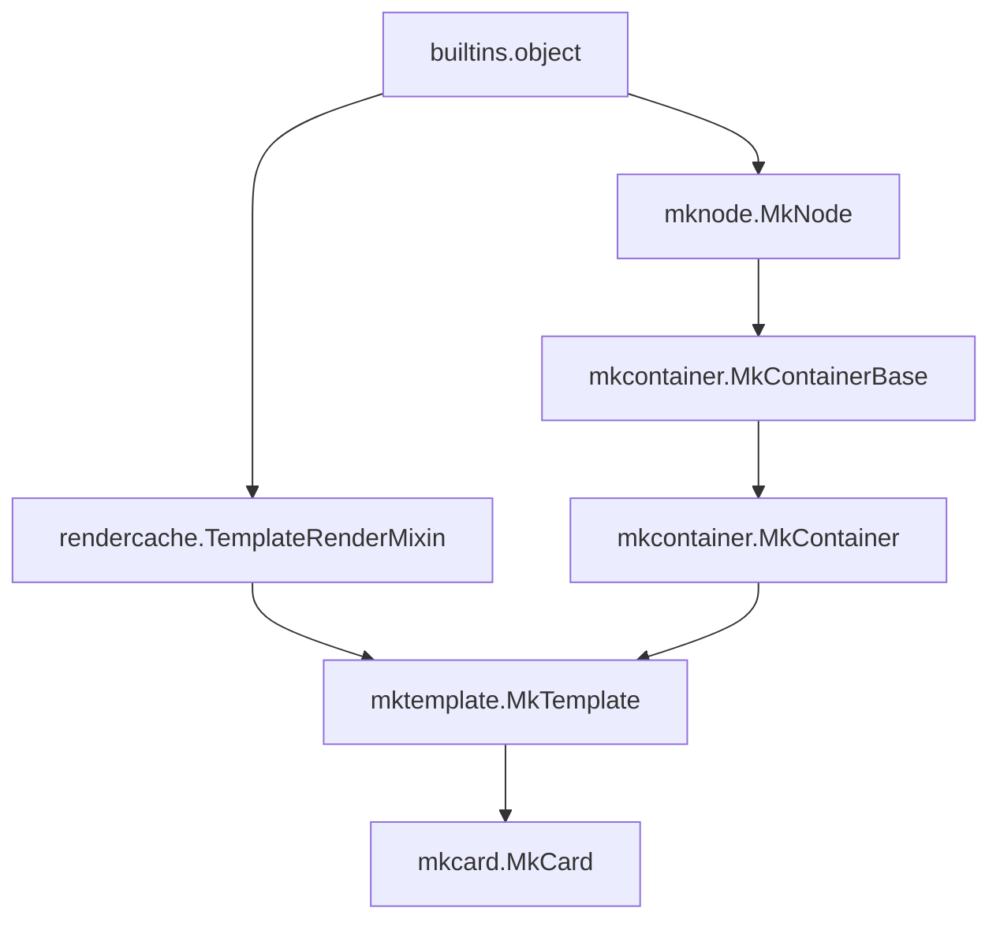

# MkCard

[ Show source on GitHub](https://github.com/phil65/mknodes/blob/main/src/mknodes/basenodes/mkcard/__init__.py)

### A card node, displaying an image, a button-like label and a hover caption.

> [!NOTE]
> **Description**
>
>
> This node requires addtional CSS to work.

<details open>
<summary>Examples</summary>

### Example: **With link**
> [!NOTE]
> **Jinja**
>
> ```jinja
> {{ "Title" | MkCard("https://picsum.photos/300", target="https://phil65.github.io/mknodes/") }}
>
> ```

> [!NOTE]
> **Python**
>
> ```python
> MkCard('Title', 'https://picsum.photos/300', target='https://phil65.github.io/mknodes/')
> ```

<details open>
<summary>Rendered</summary>

<a href="https://phil65.github.io/mknodes/">
<div class="card">
<div class="showcase-container">

</div>
<p>
<button>Title</button>
</p>
</div>
</a>

</details>

<details>
<summary>Markdown</summary>

```markdown
<a href="https://phil65.github.io/mknodes/">
<div class="card">
<div class="showcase-container">

</div>
<p>
<button>Title</button>
</p>
</div>
</a>

```

</details>

<details>
<summary>Html</summary>

```html
<a href="https://phil65.github.io/mknodes/">
<div class="card">
<div class="showcase-container">

</div>
<p>
<button>Title</button>
</p>
</div>
</a>

```

</details>

### Example: **With caption**
> [!NOTE]
> **Jinja**
>
> ```jinja
> {{ "Title" | MkCard("https://picsum.photos/300", caption="Caption") }}
>
> ```

> [!NOTE]
> **Python**
>
> ```python
> MkCard('Title', 'https://picsum.photos/300', caption='Caption')
> ```

<details open>
<summary>Rendered</summary>

<div class="card">
<div class="showcase-container">

<div class="overlay">Caption</div>
</div>
<p>
<button>Title</button>
</p>
</div>

</details>

<details>
<summary>Markdown</summary>

```markdown
<div class="card">
<div class="showcase-container">

<div class="overlay">Caption</div>
</div>
<p>
<button>Title</button>
</p>
</div>

```

</details>

<details>
<summary>Html</summary>

```html
<div class="card">
<div class="showcase-container">

<div class="overlay">Caption</div>
</div>
<p>
<button>Title</button>
</p>
</div>

```

</details>

### Example: **Separate dark mode image**
> [!NOTE]
> **Jinja**
>
> ```jinja
> {{ "Title" | MkCard("https://picsum.photos/300", path_dark_mode="https://picsum.photos/200") }}
>
> ```

> [!NOTE]
> **Python**
>
> ```python
> MkCard('Title', 'https://picsum.photos/300', path_dark_mode='https://picsum.photos/200')
> ```

<details open>
<summary>Rendered</summary>

<div class="card">
<div class="showcase-container">


</div>
<p>
<button>Title</button>
</p>
</div>

</details>

<details>
<summary>Markdown</summary>

```markdown
<div class="card">
<div class="showcase-container">


</div>
<p>
<button>Title</button>
</p>
</div>

```

</details>

<details>
<summary>Html</summary>

```html
<div class="card">
<div class="showcase-container">


</div>
<p>
<button>Title</button>
</p>
</div>

```

</details>

</details>

<details open>
<summary>DocStrings</summary>

<a id="mknodes.MkCard"></a>

```python
class MkCard(mktemplate.MkTemplate)
```

</details>

<details open>
<summary>Base classes</summary>

| Name | Children | Inherits |
|--- | --- | --- |
| **<font size='4'>[MkTemplate](https://phil65.github.io/mknodes/)</font>**<br>*<font size='1'>mknodes.templatenodes.mktemplate</font>*<br>Node representing a jinja template\. | <ul><li>[MkCliDoc](https://phil65.github.io/mknodes/)</li><li>[MkMaterialBadge](https://phil65.github.io/mknodes/)</li><li>[MkImageCompare](https://phil65.github.io/mknodes/)</li><li>[MkImageSlideshow](https://phil65.github.io/mknodes/)</li><li>[MkIFrame](https://phil65.github.io/mknodes/)</li><li>[MkCard](https://phil65.github.io/mknodes/)</li><li>[MkInstallGuide](https://phil65.github.io/mknodes/)</li><li>[MkCodeOfConduct](https://phil65.github.io/mknodes/)</li><li>[MkCommitConventions](https://phil65.github.io/mknodes/)</li><li>[MkDevEnvSetup](https://phil65.github.io/mknodes/)</li><li>[MkDevTools](https://phil65.github.io/mknodes/)</li><li>...</li></ul> | <ul><li>[TemplateRenderMixin](https://phil65.github.io/mknodes/)</li><li>[MkContainer](https://phil65.github.io/mknodes/)</li></ul> |

</details>

<details>
<summary>⋔ Inheritance diagram</summary>



</details>

<details>
<summary>NodeFile</summary>

**/home/runner/work/mknodes/mknodes/src/mknodes/basenodes/mkcard/metadata.toml**

```toml
[metadata]
icon = "mdi:square-medium"
status = "new"
name = "MkCard"
group = "image"

[[resources.css]]
filename = "grid.css"

[examples.with_link]
title = "With link"
jinja = """
{{ "Title" | MkCard("https://picsum.photos/300", target="https://phil65.github.io/mknodes/") }}
"""

[examples.with_caption]
title = "With caption"
jinja = """
{{ "Title" | MkCard("https://picsum.photos/300", caption="Caption") }}
"""

[examples.dark_mode_image]
title = "Separate dark mode image"
jinja = """
{{ "Title" | MkCard("https://picsum.photos/300", path_dark_mode="https://picsum.photos/200") }}
"""

[output.markdown]
template = """

<a href="{{ node.target | get_url }}">

<div class="card">
<div class="showcase-container">



<div class="overlay">{{ node.caption }}</div>

</div>
<p>
<button>{{ node.title }}</button>
</p>
</div>
</a>

"""

```

</details>

<details>
<summary>Code</summary>

**mknodes.basenodes.mkcard.MkCard**

```python
class MkCard(mktemplate.MkTemplate):
    """A card node, displaying an image, a button-like label and a hover caption.

    This node requires addtional CSS to work.
    """

    ICON = "material/square-medium"
    STATUS = "new"
    CSS = [resources.CSSFile("grid.css")]

    def __init__(
        self,
        title: str,
        image: str,
        *,
        caption: str | None = None,
        target: linkprovider.LinkableType | None = None,
        size: int = CARD_DEFAULT_SIZE,
        path_dark_mode: str | None = None,
        **kwargs: Any,
    ) -> None:
        """Constructor.

        Args:
            title: Button text
            image: Card image
            caption: Image caption
            target: Link target. Can be a URL, an MkPage, or an MkNav
            size: Height/Width of the card
            path_dark_mode: Optional alternative image for dark mode
            kwargs: keyword arguments passed to parent
        """
        super().__init__("output/markdown/template", **kwargs)
        self.target = target
        self.title = title
        self.image = image
        self.caption = caption
        self.size = size
        self.path_dark_mode = path_dark_mode

    @classmethod
    def for_page(cls, page: mkpage.MkPage):
        assert page.icon, "Page must have an icon"
        image = mkbinaryimage.MkBinaryImage.for_icon(page.icon)
        card = MkCard(
            page.title,
            image=image.path,
            caption=page.subtitle or "",
            target=page,
        )
        card.add_file(image.path, image.data)
        return card

```

</details>

<details>
<summary>Page info</summary>

<details>
<summary>Code for this page</summary>

**mknodes.manual.nodes_section.create_section_for_nodes**

```python
def create_section_for_nodes(
    nav: mk.MkNav,
    klasses: Sequence[type[mk.MkNode]],
) -> mk.MkTable:
    table = mk.MkTable(columns=["Node", "Docstrings", "Markdown extensions"])
    for kls in klasses:
        tpl = "classpage_custom.jinja"
        page = mk.MkClassPage(kls, icon=kls.ICON, template_path=tpl, parent=nav, hide="toc")
        nav += page
        if kls.STATUS:
            page.metadata.status = kls.STATUS
        elif kls.JS_FILES:
            page.metadata.status = "js"
        elif kls.CSS:
            page.metadata.status = "css"
        page.created_by = create_section_for_nodes
        link = mk.MkLink(page, kls.__name__, icon=kls.ICON)
        extensions = ", ".join(f"`{i}`" for i in kls.REQUIRED_EXTENSIONS)
        table.add_row((link, kls.__doc__, extensions))
    return table

```

</details>

<details>
<summary>Resources</summary>

```python
Resources(css=[],
          markdown_extensions={'admonition': {},
                               'pymdownx.details': {},
                               'pymdownx.highlight': {'anchor_linenums': True,
                                                      'line_spans': '__span',
                                                      'pygments_lang_class': True},
                               'pymdownx.superfences': {'custom_fences': [{'class': 'mermaid',
                                                                           'format': <function fence_code_format at 0x7bb797a5c1a0>,
                                                                           'name': 'mermaid'}]},
                               'pymdownx.tabbed': {},
                               'tables': {}},
          plugins=[Plugin('mkdocstrings')],
          js=[],
          assets=[],
          packages=[])
```

</details>

<details>
<summary>Metadata</summary>

```yaml
created:
  source_filename: /home/runner/work/mknodes/mknodes/src/mknodes/manual/nodes_section.py
  source_function: create_section_for_nodes
  source_line_no: 93
hide:
- toc
icon: material/square-medium
status: new
title: MkCard

```

</details>

</details>
