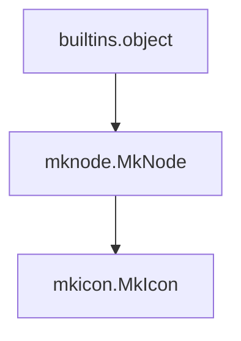

# MkIcon

[ Show source on GitHub](https://github.com/phil65/mknodes/blob/main/src/mknodes/basenodes/mkicon/__init__.py)

### Pyconify-based Icon.

<details open>
<summary>Examples</summary>

### Example: **With caption**
> [!NOTE]
> **Jinja**
>
> ```jinja
> {{ "mdi:file" | MkIcon }}
>
> ```

> [!NOTE]
> **Python**
>
> ```python
> MkIcon('mdi:file')
> ```

<details open>
<summary>Rendered</summary>


</details>

<details>
<summary>Markdown</summary>

```markdown

```

</details>

<details>
<summary>Html</summary>

```html


```

</details>

<details>
<summary>GitHub</summary>

```markdown

```

</details>

### Example: **Colored**
> [!NOTE]
> **Jinja**
>
> ```jinja
> {{ "mdi:file" | MkIcon(color="red") }}
>
> ```

> [!NOTE]
> **Python**
>
> ```python
> MkIcon('mdi:file', color='red')
> ```

<details open>
<summary>Rendered</summary>


</details>

<details>
<summary>Markdown</summary>

```markdown

```

</details>

<details>
<summary>Html</summary>

```html


```

</details>

<details>
<summary>GitHub</summary>

```markdown

```

</details>

### Example: **Rotated**
> [!NOTE]
> **Jinja**
>
> ```jinja
> {{ "mdi:file" | MkIcon(rotate=90) }}
>
> ```

> [!NOTE]
> **Python**
>
> ```python
> MkIcon('mdi:file', rotate=90)
> ```

<details open>
<summary>Rendered</summary>


</details>

<details>
<summary>Markdown</summary>

```markdown

```

</details>

<details>
<summary>Html</summary>

```html


```

</details>

<details>
<summary>GitHub</summary>

```markdown

```

</details>

### Example: **Sized**
> [!NOTE]
> **Jinja**
>
> ```jinja
> {{ "noto:wrench" | MkIcon(height=100, width=100) }}
>
> ```

> [!NOTE]
> **Python**
>
> ```python
> MkIcon('noto:wrench', height=100, width=100)
> ```

<details open>
<summary>Rendered</summary>


</details>

<details>
<summary>Markdown</summary>

```markdown

```

</details>

<details>
<summary>Html</summary>

```html


```

</details>

<details>
<summary>GitHub</summary>

```markdown

```

</details>

</details>

<details open>
<summary>DocStrings</summary>

<a id="mknodes.MkIcon"></a>

```python
class MkIcon(mknode.MkNode)
```

</details>

<details open>
<summary>Base classes</summary>

| Name | Children | Inherits |
|--- | --- | --- |
| **<font size='4'>[MkNode](https://phil65.github.io/mknodes/)</font>**<br>*<font size='1'>mknodes.basenodes.mknode</font>*<br>Base class for everything which can be expressed as Markup\. | <ul><li>[MkContainerBase](https://phil65.github.io/mknodes/)</li><li>[MkCompactAdmonition](https://phil65.github.io/mknodes/)</li><li>[MkLink](https://phil65.github.io/mknodes/)</li><li>[MkText](https://phil65.github.io/mknodes/)</li><li>[MkHeader](https://phil65.github.io/mknodes/)</li><li>[MkKeys](https://phil65.github.io/mknodes/)</li><li>[MkDocStrings](https://phil65.github.io/mknodes/)</li><li>[MkIcon](https://phil65.github.io/mknodes/)</li><li>[MkImage](https://phil65.github.io/mknodes/)</li><li>[MkProgressBar](https://phil65.github.io/mknodes/)</li><li>[BaseBlock](https://phil65.github.io/mknodes/)</li><li>...</li></ul> | <ul><li>[object](https://docs.python.org/3/library/functions.html#object)</li></ul> |

</details>

<details>
<summary>⋔ Inheritance diagram</summary>



</details>

<details>
<summary>NodeFile</summary>

**/home/runner/work/mknodes/mknodes/src/mknodes/basenodes/mkicon/metadata.toml**

```toml
[metadata]
icon = "mdi:image"
status = "new"
name = "MkIcon"
group = "image"

[examples.with_caption]
title = "With caption"
jinja = """
{{ "mdi:file" | MkIcon }}
"""

[examples.colored]
title = "Colored"
jinja = """
{{ "mdi:file" | MkIcon(color="red") }}
"""

[examples.rotated]
title = "Rotated"
jinja = """
{{ "mdi:file" | MkIcon(rotate=90) }}
"""

[examples.sized]
title = "Sized"
jinja = """
{{ "noto:wrench" | MkIcon(height=100, width=100) }}
"""

[output.html]
template = """
{{ node.icon_name | get_icon_svg(color=node.color, height=node.height, width=node.width, flip=node.flip, rotate=node.rotate, box=node.box)}}
"""

```

</details>

<details>
<summary>Code</summary>

**mknodes.basenodes.mkicon.MkIcon**

```python
class MkIcon(mknode.MkNode):
    """Pyconify-based Icon."""

    ICON = "material/image"
    ATTR_LIST_SEPARATOR = "\n"
    STATUS = "new"

    def __init__(
        self,
        icon_name: str,
        *,
        color: str | None = None,
        height: str | int | None = None,
        width: str | int | None = None,
        flip: iconfilters.Flip | None = None,
        rotate: iconfilters.Rotation | None = None,
        box: bool | None = None,
        **kwargs: Any,
    ) -> None:
        """Constructor.

        Args:
            icon_name: Icon name
            color: Icon color. Replaces currentColor with specific color, resulting in
                   icon with hardcoded palette.
            height: Icon height. If only one dimension is specified, such as height, other
                    dimension will be automatically set to match it.
            width: Icon width. If only one dimension is specified, such as height, other
                   dimension will be automatically set to match it.
            flip: Flip icon.
            rotate: Rotate icon. If an int is provided, it is assumed to be in degrees.
            box: Adds an empty rectangle to SVG that matches the icon's viewBox.
                 It is needed when importing SVG to various UI design tools that ignore
                 viewBox. Those tools, such as Sketch, create layer groups that
                 automatically resize to fit content. Icons usually have empty pixels
                 around icon, so such software crops those empty pixels and icon's
                 group ends up being smaller than actual icon, making it harder to
                 align it in design.
            kwargs: Keyword arguments passed to parent
        """
        super().__init__(**kwargs)
        self.icon_name = icon_name
        self.color = color
        self.height = height
        self.width = width
        self.flip = flip
        self.rotate = rotate
        self.box = box

    def _svg_params(self) -> dict[str, Any]:
        return dict(
            color=self.color,
            height=self.height,
            width=self.width,
            flip=self.flip,
            rotate=self.rotate,
            box=self.box,
        )

    def get_input_requests(self) -> list[inputs.InputRequest]:
        return [inputs.InputRequest.create("icon", icon=self.icon_name, **self._svg_params())]

    @property
    def svg(self) -> str:
        """The icon SVG (from the inputs store, fetched now if it is not there yet)."""
        try:
            return self.ctx.inputs.get("icon", icon=self.icon_name, **self._svg_params())
        except inputs.MissingInputError, inputs.InputPendingError:
            raise
        except Exception:  # noqa: BLE001
            logger.warning("Could not find icon %r", self.icon_name)
            return ""

    def get_svg(self) -> str:
        """Return the icon SVG (from the inputs store, fetched now if it is not there yet)."""
        try:
            return self.ctx.inputs.get("icon", icon=self.icon_name, **self._svg_params())
        except inputs.MissingInputError, inputs.InputPendingError:
            raise
        except Exception:  # noqa: BLE001
            logger.warning("Could not find icon %r", self.icon_name)
            return ""

    def to_md_unprocessed(self) -> str:
        return self.get_svg()

```

</details>

<details>
<summary>Page info</summary>

<details>
<summary>Code for this page</summary>

**mknodes.manual.nodes_section.create_section_for_nodes**

```python
def create_section_for_nodes(
    nav: mk.MkNav,
    klasses: Sequence[type[mk.MkNode]],
) -> mk.MkTable:
    table = mk.MkTable(columns=["Node", "Docstrings", "Markdown extensions"])
    for kls in klasses:
        tpl = "classpage_custom.jinja"
        page = mk.MkClassPage(kls, icon=kls.ICON, template_path=tpl, parent=nav, hide="toc")
        nav += page
        if kls.STATUS:
            page.metadata.status = kls.STATUS
        elif kls.JS_FILES:
            page.metadata.status = "js"
        elif kls.CSS:
            page.metadata.status = "css"
        page.created_by = create_section_for_nodes
        link = mk.MkLink(page, kls.__name__, icon=kls.ICON)
        extensions = ", ".join(f"`{i}`" for i in kls.REQUIRED_EXTENSIONS)
        table.add_row((link, kls.__doc__, extensions))
    return table

```

</details>

<details>
<summary>Resources</summary>

```python
Resources(css=[],
          markdown_extensions={'admonition': {},
                               'pymdownx.details': {},
                               'pymdownx.highlight': {'anchor_linenums': True,
                                                      'line_spans': '__span',
                                                      'pygments_lang_class': True},
                               'pymdownx.superfences': {'custom_fences': [{'class': 'mermaid',
                                                                           'format': <function fence_code_format at 0x7bb797a5c1a0>,
                                                                           'name': 'mermaid'}]},
                               'pymdownx.tabbed': {},
                               'tables': {}},
          plugins=[Plugin('mkdocstrings')],
          js=[],
          assets=[],
          packages=[])
```

</details>

<details>
<summary>Metadata</summary>

```yaml
created:
  source_filename: /home/runner/work/mknodes/mknodes/src/mknodes/manual/nodes_section.py
  source_function: create_section_for_nodes
  source_line_no: 93
hide:
- toc
icon: material/image
status: new
title: MkIcon

```

</details>

</details>
