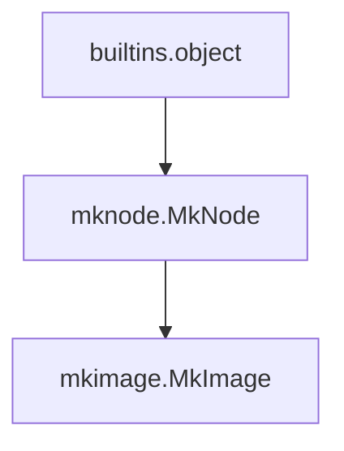

# MkImage

[ Show source on GitHub](https://github.com/phil65/mknodes/blob/main/src/mknodes/basenodes/mkimage/__init__.py)

### Image including optional caption.

<details open>
<summary>Examples</summary>

### Example: **With caption**
> [!NOTE]
> **Jinja**
>
> ```jinja
> {{ "https://picsum.photos/200" | MkImage(caption="A caption!") }}
>
> ```

> [!NOTE]
> **Python**
>
> ```python
> MkImage('https://picsum.photos/200', caption='A caption!')
> ```

<details open>
<summary>Rendered</summary>

<picture>
 
</picture>

</details>

<details>
<summary>Markdown</summary>

```markdown
<picture>
 
</picture>
```

</details>

<details>
<summary>Html</summary>

```html
<picture>
 
</picture>

```

</details>

<details>
<summary>reST</summary>

```rst
.. image:: https://picsum.photos/200
    :alt: A caption!
```

</details>

<details>
<summary>GitHub</summary>

```markdown
<picture>
 
</picture>
```

</details>

### Example: **Right-aligned**
> [!NOTE]
> **Jinja**
>
> ```jinja
> {{ "https://picsum.photos/200" | MkImage(align="right") }}
>
> ```

> [!NOTE]
> **Python**
>
> ```python
> MkImage('https://picsum.photos/200', align='right')
> ```

<details open>
<summary>Rendered</summary>

<picture>
 
</picture>

</details>

<details>
<summary>Markdown</summary>

```markdown
<picture>
 
</picture>
```

</details>

<details>
<summary>Html</summary>

```html
<picture>
 
</picture>

```

</details>

<details>
<summary>reST</summary>

```rst
.. image:: https://picsum.photos/200
    :align: right
```

</details>

<details>
<summary>GitHub</summary>

```markdown
<picture>
 
</picture>
```

</details>

### Example: **Fixed width**
> [!NOTE]
> **Jinja**
>
> ```jinja
> {{ "https://picsum.photos/200" | MkImage(width=500) }}
>
> ```

> [!NOTE]
> **Python**
>
> ```python
> MkImage('https://picsum.photos/200', width=500)
> ```

<details open>
<summary>Rendered</summary>

<picture>
 
</picture>

</details>

<details>
<summary>Markdown</summary>

```markdown
<picture>
 
</picture>
```

</details>

<details>
<summary>Html</summary>

```html
<picture>
 
</picture>

```

</details>

<details>
<summary>reST</summary>

```rst
.. image:: https://picsum.photos/200
    :width: 500
```

</details>

<details>
<summary>GitHub</summary>

```markdown
<picture>
 
</picture>
```

</details>

### Example: **Hyperlinked**
> [!NOTE]
> **Jinja**
>
> ```jinja
> {{ "https://picsum.photos/200" | MkImage(target="https://phil65.github.io/mknodes") }}
>
> ```

> [!NOTE]
> **Python**
>
> ```python
> MkImage('https://picsum.photos/200', target='https://phil65.github.io/mknodes')
> ```

<details open>
<summary>Rendered</summary>

<picture>
 
</picture>

</details>

<details>
<summary>Markdown</summary>

```markdown
<picture>
 
</picture>
```

</details>

<details>
<summary>Html</summary>

```html
<picture>
 
</picture>

```

</details>

<details>
<summary>reST</summary>

```rst
.. image:: https://picsum.photos/200
    :target: https://phil65.github.io/mknodes
```

</details>

<details>
<summary>GitHub</summary>

```markdown
<picture>
 
</picture>
```

</details>

### Example: **Separate dark mode image**
> [!NOTE]
> **Jinja**
>
> ```jinja
> {{ "https://picsum.photos/200" | MkImage(path_dark_mode="https://picsum.photos/300") }}
>
> ```

> [!NOTE]
> **Python**
>
> ```python
> MkImage('https://picsum.photos/200', path_dark_mode='https://picsum.photos/300')
> ```

<details open>
<summary>Rendered</summary>

<picture>
 <source media="(prefers-color-scheme: dark)" srcset="https://picsum.photos/300">
 <source media="(prefers-color-scheme: light)" srcset="https://picsum.photos/200">
 
</picture>

</details>

<details>
<summary>Markdown</summary>

```markdown
<picture>
 <source media="(prefers-color-scheme: dark)" srcset="https://picsum.photos/300">
 <source media="(prefers-color-scheme: light)" srcset="https://picsum.photos/200">
 
</picture>
```

</details>

<details>
<summary>Html</summary>

```html
<picture>
 <source media="(prefers-color-scheme: dark)" srcset="https://picsum.photos/300">
 <source media="(prefers-color-scheme: light)" srcset="https://picsum.photos/200">
 
</picture>

```

</details>

<details>
<summary>reST</summary>

```rst
.. image:: https://picsum.photos/200

```

</details>

<details>
<summary>GitHub</summary>

```markdown
<picture>
 <source media="(prefers-color-scheme: dark)" srcset="https://picsum.photos/300">
 <source media="(prefers-color-scheme: light)" srcset="https://picsum.photos/200">
 
</picture>
```

</details>

</details>

<details open>
<summary>DocStrings</summary>

<a id="mknodes.MkImage"></a>

```python
class MkImage(mknode.MkNode)
```

</details>

<details open>
<summary>Sub classes</summary>

| Name | Children | Inherits |
|--- | --- | --- |
| **<font size='4'>[MkBinaryImage](https://phil65.github.io/mknodes/)</font>**<br>*<font size='1'>mknodes.basenodes.mkbinaryimage</font>*<br>Image carrying the data by itself\. | <ul></ul> | <ul><li>[MkImage](https://phil65.github.io/mknodes/)</li></ul> |
| **<font size='4'>[MkBadge](https://phil65.github.io/mknodes/)</font>**<br>*<font size='1'>mknodes.templatenodes.mkbadge</font>*<br>Node for a locally\-created badge \(based on "anybadge"\)\. | <ul></ul> | <ul><li>[MkImage](https://phil65.github.io/mknodes/)</li></ul> |

</details>

<details open>
<summary>Base classes</summary>

| Name | Children | Inherits |
|--- | --- | --- |
| **<font size='4'>[MkNode](https://phil65.github.io/mknodes/)</font>**<br>*<font size='1'>mknodes.basenodes.mknode</font>*<br>Base class for everything which can be expressed as Markup\. | <ul><li>[MkContainerBase](https://phil65.github.io/mknodes/)</li><li>[MkCompactAdmonition](https://phil65.github.io/mknodes/)</li><li>[MkLink](https://phil65.github.io/mknodes/)</li><li>[MkText](https://phil65.github.io/mknodes/)</li><li>[MkHeader](https://phil65.github.io/mknodes/)</li><li>[MkKeys](https://phil65.github.io/mknodes/)</li><li>[MkDocStrings](https://phil65.github.io/mknodes/)</li><li>[MkIcon](https://phil65.github.io/mknodes/)</li><li>[MkImage](https://phil65.github.io/mknodes/)</li><li>[MkProgressBar](https://phil65.github.io/mknodes/)</li><li>[BaseBlock](https://phil65.github.io/mknodes/)</li><li>...</li></ul> | <ul><li>[object](https://docs.python.org/3/library/functions.html#object)</li></ul> |

</details>

<details>
<summary>⋔ Inheritance diagram</summary>



</details>

<details>
<summary>NodeFile</summary>

**/home/runner/work/mknodes/mknodes/src/mknodes/basenodes/mkimage/metadata.toml**

```toml
[metadata]
icon = "mdi:image"
name = "MkImage"
group = "image"

[examples.with_caption]
title = "With caption"
jinja = """
{{ "https://picsum.photos/200" | MkImage(caption="A caption!") }}
"""

[examples.right_aligned]
title = "Right-aligned"
jinja = """
{{ "https://picsum.photos/200" | MkImage(align="right") }}
"""

[examples.fixed_width]
title = "Fixed width"
jinja = """
{{ "https://picsum.photos/200" | MkImage(width=500) }}
"""

[examples.hyperlinked]
title = "Hyperlinked"
jinja = """
{{ "https://picsum.photos/200" | MkImage(target="https://phil65.github.io/mknodes") }}
"""

[examples.dark_mode_image]
title = "Separate dark mode image"
jinja = """
{{ "https://picsum.photos/200" | MkImage(path_dark_mode="https://picsum.photos/300") }}
"""

[fragments]
image = """
) ~ ")" ~ (node.align | add("{ align=", " }")) ~ (node.width | add('{ width="', '" }')) }}{ loading=lazy }
"""
linked_image = """

[{{ "fragments/image" | render_template(node=node, path=path, mode=mode) }}]({{ node.get_url() }})
{{ "fragments/image" | render_template(node=node, path=path, mode=mode) }}
"""

[output.markdown]
template = """








<figure markdown>
  {{ markdown_link }}
  <figcaption>{{ node.caption }}</figcaption>
</figure>

{{ markdown_link }}
"""

[output.github]
template = """
<picture>

 <source media="(prefers-color-scheme: dark)" srcset="{{ node.path_dark_mode }}">
 <source media="(prefers-color-scheme: light)" srcset="{{ node.path }}">

 
</picture>
"""

[output.rst]
template = """
.. image:: {{ node.path }}
    :width: {{ node.width }}
    :alt: {{ node.caption }}
    :align: {{ node.align }}
    :target: {{ node.get_url() }}
"""

```

</details>

<details>
<summary>Code</summary>

**mknodes.basenodes.mkimage.MkImage**

```python
class MkImage(mknode.MkNode):
    """Image including optional caption."""

    ICON = "material/image"
    ATTR_LIST_SEPARATOR = ""

    def __init__(
        self,
        path: str,
        *,
        target: linkprovider.LinkableType | None = None,
        caption: str = "",
        title: str = "",
        align: Literal["left", "right"] | None = None,
        width: int | None = None,
        lazy: bool = False,
        path_dark_mode: str | None = None,
        **kwargs: Any,
    ) -> None:
        """Constructor.

        Args:
            path: path of the image
            target: Optional URL or node the image should link to
            caption: Image caption
            title: Image title
            align: Image alignment
            width: Image width in pixels
            lazy: Whether to lazy-load image
            path_dark_mode: Optional alternative image for dark mode
            kwargs: Keyword arguments passed to parent
        """
        super().__init__(**kwargs)
        self.title = title
        self.caption = caption
        self.target = target
        self.align = align
        self.width = width
        self.lazy = lazy
        self._path_dark_mode = path_dark_mode
        self._path = path

    @property
    def path(self) -> str:
        if helpers.is_url(self._path):
            return self._path
        # TODO: linkreplacer doesnt work yet with full path
        return pathlib.Path(self._path).name  # this should not be needed.

    @property
    def path_dark_mode(self):
        match self._path_dark_mode:
            case str() if helpers.is_url(self._path_dark_mode):
                return self._path_dark_mode
            case str():
                return pathlib.Path(self._path_dark_mode).name
            case _:
                return None

    def get_url(self) -> str:
        return self.ctx.links.get_url(self.target) if self.target else ""

    def to_md_unprocessed(self) -> str:
        if not self.path_dark_mode:
            markdown_link = self._build(self.path)
        else:
            link_2 = self._build(self.path, "light")
            link_1 = self._build(self.path_dark_mode, "dark")
            markdown_link = f"{link_1} {link_2}"
        if not self.caption:
            return markdown_link
        lines = [
            "<figure markdown>",
            f"  {markdown_link}",
            f"  <figcaption>{self.caption}</figcaption>",
            "</figure>",
        ]
        return "\n".join(lines) + "\n"

    def _build(self, path: str, mode: Literal["light", "dark"] | None = None) -> str:
        if mode:
            path += f"#only-{mode}"
        markdown_link = f""
        if self.align:
            markdown_link += f"{{ align={self.align} }}"
        if self.width:
            markdown_link += f'{{ width="{self.width}" }}'
        if self.lazy:
            markdown_link += "{ loading=lazy }"
        if self.target:
            markdown_link = f"[{markdown_link}]({self.get_url()})"
        return markdown_link

```

</details>

<details>
<summary>Page info</summary>

<details>
<summary>Code for this page</summary>

**mknodes.manual.nodes_section.create_section_for_nodes**

```python
def create_section_for_nodes(
    nav: mk.MkNav,
    klasses: Sequence[type[mk.MkNode]],
) -> mk.MkTable:
    table = mk.MkTable(columns=["Node", "Docstrings", "Markdown extensions"])
    for kls in klasses:
        tpl = "classpage_custom.jinja"
        page = mk.MkClassPage(kls, icon=kls.ICON, template_path=tpl, parent=nav, hide="toc")
        nav += page
        if kls.STATUS:
            page.metadata.status = kls.STATUS
        elif kls.JS_FILES:
            page.metadata.status = "js"
        elif kls.CSS:
            page.metadata.status = "css"
        page.created_by = create_section_for_nodes
        link = mk.MkLink(page, kls.__name__, icon=kls.ICON)
        extensions = ", ".join(f"`{i}`" for i in kls.REQUIRED_EXTENSIONS)
        table.add_row((link, kls.__doc__, extensions))
    return table

```

</details>

<details>
<summary>Resources</summary>

```python
Resources(css=[],
          markdown_extensions={'admonition': {},
                               'pymdownx.details': {},
                               'pymdownx.highlight': {'anchor_linenums': True,
                                                      'line_spans': '__span',
                                                      'pygments_lang_class': True},
                               'pymdownx.superfences': {'custom_fences': [{'class': 'mermaid',
                                                                           'format': <function fence_code_format at 0x7bb797a5c1a0>,
                                                                           'name': 'mermaid'}]},
                               'pymdownx.tabbed': {},
                               'tables': {}},
          plugins=[Plugin('mkdocstrings')],
          js=[],
          assets=[],
          packages=[])
```

</details>

<details>
<summary>Metadata</summary>

```yaml
created:
  source_filename: /home/runner/work/mknodes/mknodes/src/mknodes/manual/nodes_section.py
  source_function: create_section_for_nodes
  source_line_no: 93
hide:
- toc
icon: material/image
title: MkImage

```

</details>

</details>
