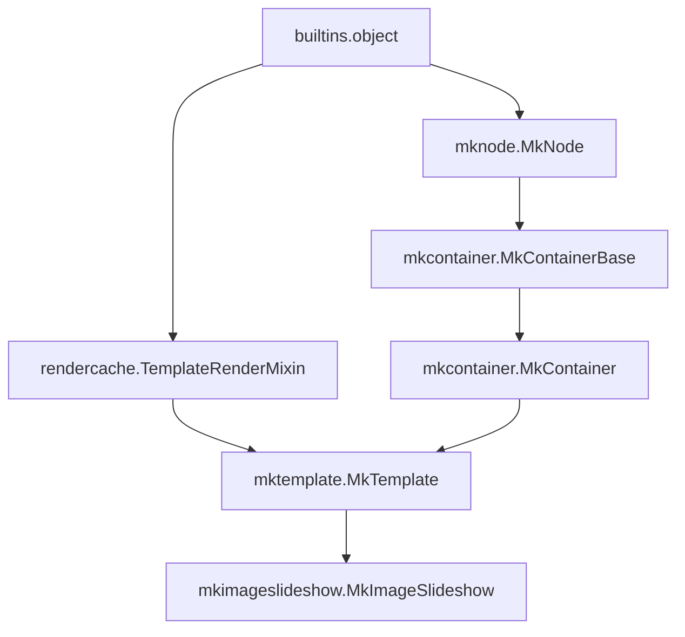

# MkImageSlideshow

[ Show source on GitHub](https://github.com/phil65/mknodes/blob/main/src/mknodes/basenodes/mkimageslideshow/__init__.py)

### Node to show an Image slideshow (in autoplay mode).

<details open>
<summary>Examples</summary>

### Example: **Regular**
> [!NOTE]
> **Jinja**
>
> ```jinja
> {{ ["https://picsum.photos/700", "https://picsum.photos/701"] | MkImageSlideshow }}
>
> ```

> [!NOTE]
> **Python**
>
> ```python
> MkImageSlideshow(['https://picsum.photos/700', 'https://picsum.photos/701'])
> ```

<details open>
<summary>Rendered</summary>

<div style="width: 100%; padding-bottom: 25%" data-simple-slider="">
  
  
</div>

</details>

<details>
<summary>Markdown</summary>

```markdown
<div style="width: 100%; padding-bottom: 25%" data-simple-slider="">
  
  
</div>
```

</details>

<details>
<summary>Html</summary>

```html
<div style="width: 100%; padding-bottom: 25%" data-simple-slider="">
  
  
</div>

```

</details>

</details>

<details open>
<summary>DocStrings</summary>

<a id="mknodes.MkImageSlideshow"></a>

```python
class MkImageSlideshow(mktemplate.MkTemplate)
```

</details>

<details open>
<summary>Base classes</summary>

| Name | Children | Inherits |
|--- | --- | --- |
| **<font size='4'>[MkTemplate](https://phil65.github.io/mknodes/)</font>**<br>*<font size='1'>mknodes.templatenodes.mktemplate</font>*<br>Node representing a jinja template\. | <ul><li>[MkCliDoc](https://phil65.github.io/mknodes/)</li><li>[MkMaterialBadge](https://phil65.github.io/mknodes/)</li><li>[MkImageCompare](https://phil65.github.io/mknodes/)</li><li>[MkImageSlideshow](https://phil65.github.io/mknodes/)</li><li>[MkIFrame](https://phil65.github.io/mknodes/)</li><li>[MkCard](https://phil65.github.io/mknodes/)</li><li>[MkInstallGuide](https://phil65.github.io/mknodes/)</li><li>[MkCodeOfConduct](https://phil65.github.io/mknodes/)</li><li>[MkCommitConventions](https://phil65.github.io/mknodes/)</li><li>[MkDevEnvSetup](https://phil65.github.io/mknodes/)</li><li>[MkDevTools](https://phil65.github.io/mknodes/)</li><li>...</li></ul> | <ul><li>[TemplateRenderMixin](https://phil65.github.io/mknodes/)</li><li>[MkContainer](https://phil65.github.io/mknodes/)</li></ul> |

</details>

<details>
<summary>⋔ Inheritance diagram</summary>



</details>

<details>
<summary>NodeFile</summary>

**/home/runner/work/mknodes/mknodes/src/mknodes/basenodes/mkimageslideshow/metadata.toml**

```toml
[metadata]
icon = "mdi:image-multiple"
name = "MkImageSlideshow"
group = "image"

[[resources.js]]
link = "https://rawgit.com/ruyadorno/simple-slider/master/dist/simpleslider.min.js"

[[resources.js]]
filename = "slideshow.js"
content = """
window.addEventListener('DOMContentLoaded', function () {
  simpleslider.getSlider();
})
"""

[[resources.css]]
filename = "https://unpkg.com/img-comparison-slider@7/dist/styles.css"


[examples.regular]
title = "Regular"
jinja = """
{{ ["https://picsum.photos/700", "https://picsum.photos/701"] | MkImageSlideshow }}
"""

[output.html]
template = """
<div style="width: 100%; padding-bottom: 25%" data-simple-slider="">

  

</div>
"""

```

</details>

<details>
<summary>Code</summary>

**mknodes.basenodes.mkimageslideshow.MkImageSlideshow**

```python
class MkImageSlideshow(mktemplate.MkTemplate):
    """Node to show an Image slideshow (in autoplay mode)."""

    ICON = "material/image-multiple"
    JS_FILES = [resources.JSFile(JS_URL), resources.JSText(SCRIPT, "slideshow.js")]

    def __init__(
        self,
        images: list[str],
        **kwargs: Any,
    ) -> None:
        """Constructor.

        Args:
            images: A list of image URLs to use for the slideshow
            kwargs: Keyword arguments passed to parent
        """
        super().__init__("output/html/template", **kwargs)
        self.images = images

```

</details>

<details>
<summary>Page info</summary>

<details>
<summary>Code for this page</summary>

**mknodes.manual.nodes_section.create_section_for_nodes**

```python
def create_section_for_nodes(
    nav: mk.MkNav,
    klasses: Sequence[type[mk.MkNode]],
) -> mk.MkTable:
    table = mk.MkTable(columns=["Node", "Docstrings", "Markdown extensions"])
    for kls in klasses:
        tpl = "classpage_custom.jinja"
        page = mk.MkClassPage(kls, icon=kls.ICON, template_path=tpl, parent=nav, hide="toc")
        nav += page
        if kls.STATUS:
            page.metadata.status = kls.STATUS
        elif kls.JS_FILES:
            page.metadata.status = "js"
        elif kls.CSS:
            page.metadata.status = "css"
        page.created_by = create_section_for_nodes
        link = mk.MkLink(page, kls.__name__, icon=kls.ICON)
        extensions = ", ".join(f"`{i}`" for i in kls.REQUIRED_EXTENSIONS)
        table.add_row((link, kls.__doc__, extensions))
    return table

```

</details>

<details>
<summary>Resources</summary>

```python
Resources(css=[],
          markdown_extensions={'admonition': {},
                               'pymdownx.details': {},
                               'pymdownx.highlight': {'anchor_linenums': True,
                                                      'line_spans': '__span',
                                                      'pygments_lang_class': True},
                               'pymdownx.superfences': {'custom_fences': [{'class': 'mermaid',
                                                                           'format': <function fence_code_format at 0x7bb797a5c1a0>,
                                                                           'name': 'mermaid'}]},
                               'pymdownx.tabbed': {},
                               'tables': {}},
          plugins=[Plugin('mkdocstrings')],
          js=[],
          assets=[],
          packages=[])
```

</details>

<details>
<summary>Metadata</summary>

```yaml
created:
  source_filename: /home/runner/work/mknodes/mknodes/src/mknodes/manual/nodes_section.py
  source_function: create_section_for_nodes
  source_line_no: 93
hide:
- toc
icon: material/image-multiple
status: new
title: MkImageSlideshow

```

</details>

</details>
